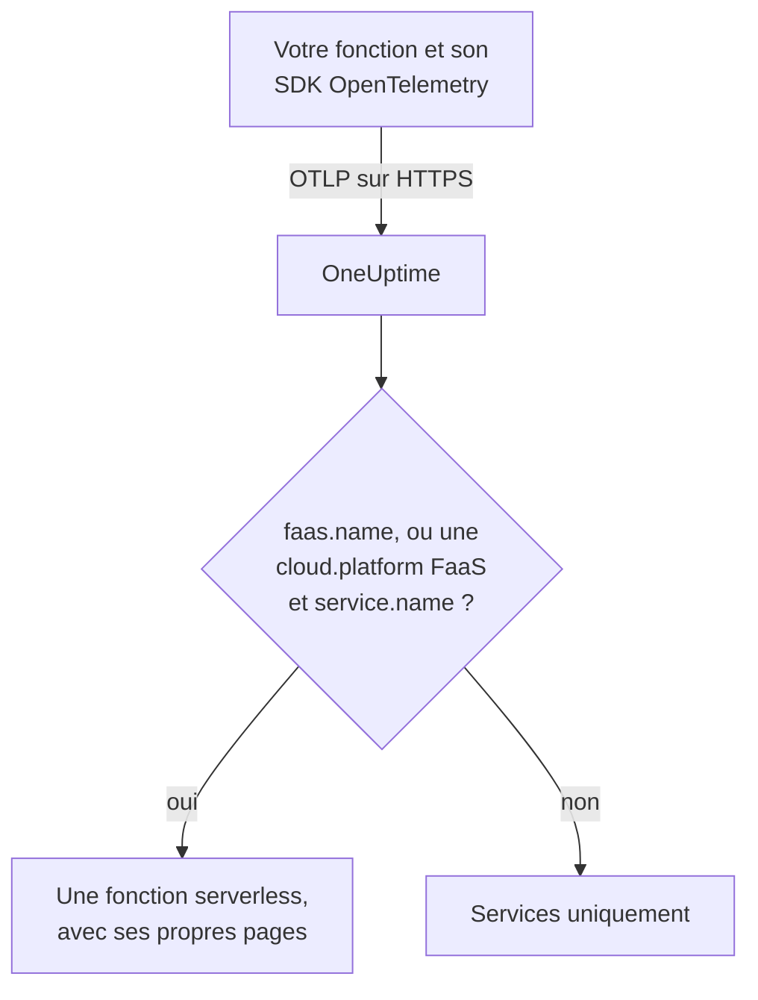

# Fonctions serverless

OneUptime reconnaît une fonction serverless dès qu'il reçoit d'elle des données OpenTelemetry, et la liste sous **Fonctions serverless** avec ses traces, journaux et métriques. Cela fonctionne pour AWS Lambda, Google Cloud Functions, Azure Functions, Cloudflare Workers et tout autre environnement d'exécution FaaS capable d'envoyer de l'OpenTelemetry. Il n'y a rien à créer à la main : instrumentez la fonction avec le SDK OpenTelemetry de son environnement d'exécution et pointez son exportateur OTLP vers OneUptime.

:::cards
- [Comment OneUptime identifie une fonction](#comment-oneuptime-identifie-une-fonction): `faas.name`, ou une `cloud.platform` FaaS avec un `service.name`.
- [Envoyer la télémétrie d'une fonction](#envoyer-la-télémétrie-dune-fonction): Les paramètres de l'exportateur, et la couche Lambda.
- [Azure Functions](#azure-functions): Une fonction par Function App, depuis l'hôte Functions.
- [Dépannage](#dépannage): Une fonction qui n'apparaît pas, ou dont les pages sont vides.
:::

## Fonctionnement

OneUptime lit les attributs de ressource de chaque lot à son arrivée. Une ressource avec un `faas.name`, ou avec une `cloud.platform` FaaS comme `aws_lambda` ou `azure_functions` accompagnée d'un `service.name`, est une fonction serverless : OneUptime la crée avec ses premières données et range la télémétrie sous elle.



## Avant de commencer

- Une clé d'ingestion. Créez-en une sous **Paramètres du projet → Télémétrie & APM → Clés d'ingestion** et copiez sa valeur.
- Le SDK OpenTelemetry, ou une couche d'auto-instrumentation, pour le langage de votre fonction.

## Comment OneUptime identifie une fonction

OneUptime identifie chaque fonction par l'attribut de ressource `faas.name`. Les détecteurs de ressources de certaines plateformes ne le définissent jamais ([Azure Functions](#azure-functions) est le cas courant) ; ainsi, lorsqu'une ressource n'a pas de `faas.name` mais que sa `cloud.platform` est une plateforme FaaS, OneUptime utilise plutôt son `service.name` comme identité de la fonction, et inscrit cette valeur comme `faas.name` sur chaque span, journal, métrique et profil qu'il stocke, afin que les pages de la fonction trouvent toute sa télémétrie :

| Attribut | Obligatoire | Rôle |
| --- | --- | --- |
| `faas.name` | **oui**, sauf si les deux suivants sont définis | Identité de la fonction (par exemple `checkout-handler`) |
| `cloud.platform` | avec `service.name`, en l'absence de `faas.name` | `aws_lambda`, `gcp_cloud_functions`, `azure_functions`, `tencent_cloud_scf` ou `alibaba_cloud_fc` |
| `service.name` | sur une `cloud.platform` FaaS sans `faas.name` | Identité de la fonction, écrite dans la télémétrie comme `faas.name` |
| `faas.version` | non | Affiché dans la vue d'ensemble |
| `faas.instance` | non | Suivi par instance sur la page **Instances** |
| `cloud.provider` / `cloud.region` / `cloud.account.id` | non | Affiché dans la vue d'ensemble |
| `process.runtime.name` / `process.runtime.version` | non | Affiché comme environnement d'exécution dans la vue d'ensemble |

Un `faas.name` que vous définissez n'est jamais remplacé. La valeur de `cloud.platform` doit être écrite comme indiqué (le `azure.functions` à points qu'envoient certains détecteurs Azure est aussi accepté), et `service.name` doit être un attribut de ressource : l'en-tête `x-oneuptime-service-name` nomme un service, pas une fonction.

> [!NOTE]
> Une fonction qui définit aussi `service.name` apparaît quand même sous **Services**. **Fonctions serverless** est la vue conçue pour les fonctions, délimitée par `faas.name`.

## Envoyer la télémétrie d'une fonction

:::steps
### Définir les variables d'environnement de l'exportateur OTLP

La plupart des auto-instrumentations des langages lisent les variables d'environnement OpenTelemetry standard :

```bash
OTEL_EXPORTER_OTLP_ENDPOINT="https://oneuptime.com/otlp"
OTEL_EXPORTER_OTLP_HEADERS="x-oneuptime-token=YOUR_TELEMETRY_INGESTION_TOKEN"
OTEL_RESOURCE_ATTRIBUTES="faas.name=checkout-handler,faas.version=1.4.2"
```

Si vous hébergez OneUptime vous-même, remplacez le point de terminaison par `https://YOUR-ONEUPTIME-HOST/otlp`. Sur Azure Functions, laissez `faas.name` en dehors de `OTEL_RESOURCE_ATTRIBUTES` — voir [Azure Functions](#azure-functions).

> [!WARNING]
> La clé d'ingestion est un secret. Utilisez une clé d'ingestion de type **Serveur**, définie comme variable d'environnement de la fonction. Une clé qui atteint un navigateur peut être lue par toute personne qui consulte le code source de la page.

### Ajouter la couche Lambda OpenTelemetry (AWS Lambda)

Sur AWS Lambda, le chemin le plus simple est la [couche Lambda OpenTelemetry](https://opentelemetry.io/docs/faas/lambda-auto/). Attachez la couche correspondant à l'environnement d'exécution de votre fonction, puis définissez :

```bash
AWS_LAMBDA_EXEC_WRAPPER=/opt/otel-handler
OTEL_EXPORTER_OTLP_ENDPOINT=https://oneuptime.com/otlp
OTEL_EXPORTER_OTLP_HEADERS=x-oneuptime-token=YOUR_TELEMETRY_INGESTION_TOKEN
```

La couche définit `faas.name` à partir du nom de la fonction, et son détecteur de ressources renseigne `cloud.platform`, `cloud.region` et `cloud.account.id`. Sur une autre plateforme, passez cette étape.

### Invoquer la fonction et vérifier qu'elle arrive

Vérifiez que OneUptime accepte la clé :

```bash
curl -i https://oneuptime.com/otlp/v1/validate \
  -H "x-oneuptime-token: YOUR_TELEMETRY_INGESTION_TOKEN"
```

`200` avec `"valid": true` signifie que OneUptime accepte la clé ; `401` signifie qu'elle est inconnue, révoquée, désactivée ou expirée. Invoquez ensuite la fonction. Dès qu'elle envoie un span, un journal ou une métrique, elle apparaît sous **Produits → Infrastructure → Serverless → Toutes les fonctions**.
:::

## Azure Functions

L'hôte Azure Functions peut envoyer lui-même de l'OpenTelemetry, de sorte qu'une Function App rapporte ses invocations (traces, journaux et métriques) sans modification de code, quel que soit son langage. Le guide de Microsoft est [Use OpenTelemetry with Azure Functions](https://learn.microsoft.com/en-us/azure/azure-functions/opentelemetry-howto).

### Comment une Function App apparaît

Les détecteurs de ressources d'Azure (celui de l'hôte Functions lui-même, celui du worker isolé .NET dans `Microsoft.Azure.Functions.Worker.OpenTelemetry`, et celui de Node.js dans `@opentelemetry/resource-detector-azure`) décrivent la **Function App**, pas une fonction isolée, et aucun d'eux ne définit `faas.name` :

| Attribut | Valeur |
| --- | --- |
| `service.name` | Le nom de la Function App, d'après `WEBSITE_SITE_NAME` |
| `cloud.provider` | `azure` |
| `cloud.platform` | `azure_functions` ; le détecteur Node.js écrit `azure.functions`, que OneUptime réécrit |
| `cloud.region` | La région de l'app, d'après `REGION_NAME` |
| `cloud.resource_id` | `/subscriptions/<subscription>/resourceGroups/<group>/providers/Microsoft.Web/sites/<app>` |
| `faas.instance` | L'instance, d'après `WEBSITE_INSTANCE_ID` : le détecteur Node.js uniquement |

OneUptime identifie donc la fonction par `service.name`, renseigne `faas.name` avec le nom de la Function App, et affiche **une fonction serverless par Function App**. La ressource décrit l'app, pas l'une de ses fonctions : chaque instance rapporte les mêmes attributs au niveau de l'app, quelle que soit la fonction de l'app qu'elle exécute, et sur le plan Flex Consumption, certaines fonctions montent même en charge sur leurs propres instances. Les fonctions individuelles se trouvent dans la télémétrie elle-même :

- L'hôte démarre un span pour chaque invocation, nommé d'après la fonction qu'il a exécutée : recherchez ce nom sur la page **Traces** de la fonction.
- L'hôte enregistre `faas.invoke_duration`, un histogramme en secondes, avec le nom de la fonction dans l'attribut de point de données `faas.name` : regroupez la métrique selon cet attribut sur la page **Métriques** ou dans un tableau de bord pour obtenir la latence de chaque fonction.

N'ajoutez pas `faas.name` à `OTEL_RESOURCE_ATTRIBUTES` sur une Function App, comme le fait l'exemple générique de la [première étape](#définir-les-variables-denvironnement-de-lexportateur-otlp). Les paramètres d'application atteignent chaque processus de l'app, si bien que la télémétrie de toutes ses fonctions porterait ce seul nom, et OneUptime ne remplace jamais un `faas.name` qu'on lui fournit. Le guide de Microsoft dit la même chose : ne placez pas de valeurs propres à une fonction sur la ressource. Laissez-le non défini, et la fonction porte le nom de l'app.

L'hôte et le worker isolé .NET utilisent `OTEL_SERVICE_NAME` au lieu du nom de l'app lorsqu'il est défini. Gardez tous les processus d'une même app sur le même `service.name` : l'hôte et le worker de langage envoient tous deux de la télémétrie, et un worker qui rapporte un second nom crée une seconde fonction serverless. Un worker dont la ressource n'a pas de `cloud.platform` FaaS ne rejoint aucune fonction serverless — voir [Instrumenter le code de votre fonction](#instrumenter-le-code-de-votre-fonction-facultatif).

:::steps
### Activer OpenTelemetry dans l'hôte Functions

Ajoutez `"telemetryMode": "OpenTelemetry"` à la racine du `host.json` de l'app :

```json title="host.json"
{
  "version": "2.0",
  "telemetryMode": "OpenTelemetry"
}
```

L'hôte envoie alors, quel que soit le langage de l'app, ses propres traces (un span par invocation, plus les spans de processeur Service Bus et Event Hubs derrière les fonctions déclenchées), ses journaux et des métriques, dont `faas.invoke_duration`.

### Pointer l'hôte vers OneUptime

Définissez l'exportateur dans les paramètres d'application :

```bash
az functionapp config appsettings set \
  --name my-function-app \
  --resource-group my-rg \
  --settings \
    OTEL_EXPORTER_OTLP_ENDPOINT=https://oneuptime.com/otlp \
    OTEL_EXPORTER_OTLP_PROTOCOL=http/protobuf \
    "OTEL_EXPORTER_OTLP_HEADERS=x-oneuptime-token=YOUR_TELEMETRY_INGESTION_TOKEN"
```

Si vous hébergez OneUptime vous-même, remplacez le point de terminaison par `https://YOUR-ONEUPTIME-HOST/otlp`. `OTEL_EXPORTER_OTLP_PROTOCOL=http/protobuf` compte : l'exportateur .NET de l'hôte utilise gRPC par défaut, et avec `http/protobuf` il envoie à `/otlp/v1/traces`, `/otlp/v1/metrics` et `/otlp/v1/logs` sous le point de terminaison. L'hôte n'envoie de l'OTLP que tant que `OTEL_EXPORTER_OTLP_ENDPOINT` est défini.

> [!WARNING]
> Ce jeton est un secret : utilisez une clé d'ingestion de type **Serveur**. Les paramètres d'application sont chiffrés au repos ; pour conserver plutôt le jeton dans Key Vault, définissez `OTEL_EXPORTER_OTLP_HEADERS` sur une référence Key Vault telle que `@Microsoft.KeyVault(SecretUri=https://my-vault.vault.azure.net/secrets/oneuptime-otlp-headers/)` et accordez à l'identité managée de l'app le rôle **Key Vault Secrets User** sur le coffre. La référence se résout en la valeur du secret telle qu'elle est stockée ; stockez donc l'en-tête entier, `x-oneuptime-token=YOUR_TELEMETRY_INGESTION_TOKEN`, et pas seulement le jeton.

Conservez `APPLICATIONINSIGHTS_CONNECTION_STRING` si vous voulez toujours Application Insights : avec les deux définis, l'hôte envoie les mêmes données OpenTelemetry à Application Insights et à OneUptime. Supprimez-le pour n'envoyer qu'à OneUptime.

### Instrumenter le code de votre fonction (facultatif)

L'hôte trace déjà chaque invocation. Pour ajouter des spans et des journaux issus de votre propre code, reliés à ceux de l'hôte, activez aussi OpenTelemetry dans le worker de langage. Il envoie avec les mêmes paramètres `OTEL_EXPORTER_OTLP_*` :

- **C# (isolated worker)** : ajoutez les paquets NuGet `Microsoft.Azure.Functions.Worker.OpenTelemetry`, `OpenTelemetry.Extensions.Hosting` et `OpenTelemetry.Exporter.OpenTelemetryProtocol`, puis dans `Program.cs` : `builder.Services.AddOpenTelemetry().UseFunctionsWorkerDefaults().UseOtlpExporter();`
- **JavaScript / TypeScript** : `npm install @azure/functions-opentelemetry-instrumentation` en plus du SDK OpenTelemetry pour Node.js et de ses exportateurs OTLP, puis enregistrez `AzureFunctionsInstrumentation` dans un fichier qu'inclut le champ `main` de `package.json`.
- **Java** : ajoutez la dépendance Maven `com.microsoft.azure.functions:azure-functions-java-opentelemetry`.
- **Python** : définissez le paramètre d'application `PYTHON_ENABLE_OPENTELEMETRY=true`, ajoutez à `requirements.txt` les paquets OpenTelemetry que Microsoft liste (parmi eux `opentelemetry-sdk` et `opentelemetry-exporter-otlp`), et configurez les exportateurs dans `function_app.py`.
- **PowerShell** : définissez le paramètre d'application `OTEL_FUNCTIONS_WORKER_ENABLED=True` et chargez le module `AzureFunctions.PowerShell.OpenTelemetry.SDK` depuis `profile.ps1`.

Le guide de Microsoft contient le code complet pour chaque langage. Le worker .NET (via `UseFunctionsWorkerDefaults()`) et le worker Python (via `PYTHON_ENABLE_OPENTELEMETRY`) indiquent à l'hôte de leur laisser leurs journaux, si bien que ces journaux ne sont pas envoyés deux fois.

Les spans et journaux d'un worker n'atteignent les pages de la fonction que si sa ressource décrit l'app comme le fait celle de l'hôte : le même `service.name` et une `cloud.platform` FaaS. Le worker isolé .NET (via `UseFunctionsWorkerDefaults()`) et l'exemple Node.js de Microsoft (via les détecteurs Azure qu'inclut `getResourceDetectors()`) rapportent les deux. L'exemple Python de Microsoft construit sa ressource sans détecteur Azure ; tel quel, il ne rapporte donc ni l'un ni l'autre et sa télémétrie n'atteint jamais la fonction. Pour Python, ou tout worker configuré sans détecteur de ressources Azure Functions, ajoutez deux paramètres d'application de plus. Chaque processus de l'app les lit, l'hôte compris, si bien que tous rapportent la même identité :

```bash
az functionapp config appsettings set \
  --name my-function-app \
  --resource-group my-rg \
  --settings \
    OTEL_SERVICE_NAME=my-function-app \
    "OTEL_RESOURCE_ATTRIBUTES=cloud.provider=azure,cloud.platform=azure_functions"
```

Définissez `OTEL_SERVICE_NAME` sur le nom propre de la Function App. C'est le nom que l'hôte et le détecteur Node.js rapportent sans lui, si bien que la fonction garde l'identité qu'elle a déjà.
:::

### Limites

- Les **apps C# in-process** ne peuvent pas utiliser OpenTelemetry : passez-les d'abord au modèle de worker isolé.
- Le **streaming des journaux** du portail Azure ne fonctionne pas tant que l'hôte est en mode OpenTelemetry, et la liste _Recent function invocations_ du portail a besoin de la télémétrie dans Application Insights. Utilisez plutôt les pages **Journaux** et **Traces** de la fonction dans OneUptime.
- La section `logging.applicationInsights` de `host.json` ne s'applique plus dès que `telemetryMode` vaut `OpenTelemetry`.
- **Instances** liste les valeurs `faas.instance`. Parmi les détecteurs ci-dessus, seul celui de Node.js la définit, si bien que la page reste vide pour la télémétrie de l'hôte et du worker .NET.

## Ce que vous obtenez

Dès que la fonction envoie un span, un journal ou une métrique, elle apparaît sous **Fonctions serverless**. Sa page **Vue d'ensemble** affiche :

- **Invocations**, **taux d'erreur** et **durée p95**, calculés à partir de vos traces sur une plage de temps de votre choix, avec des graphiques de tendance.
- **Instances** : une liste en direct des valeurs `faas.instance` que la fonction rapporte.
- Des pages **Journaux**, **Traces** et **Métriques** complètes, limitées à cette fonction.

## Étiqueter les fonctions et attribuer des propriétaires

Un attribut de ressource qui commence par `oneuptime.label.` devient une étiquette de projet sur la fonction : `oneuptime.label.team=payments` ajoute l'étiquette `team:payments`. Ajoutez les attributs à `OTEL_RESOURCE_ATTRIBUTES` :

```bash
OTEL_RESOURCE_ATTRIBUTES="faas.name=checkout-handler,oneuptime.label.team=payments,oneuptime.label.env=production"
```

Pour étiqueter les fonctions ou attribuer des propriétaires d'après leurs noms, ouvrez **Produits → Infrastructure → Serverless** et utilisez **Règles d'étiquettes** et **Règles de propriétaire** dans le menu latéral. Les règles s'exécutent quand une fonction est créée, y compris celles découvertes automatiquement. Pour appliquer une règle aux fonctions que vous avez déjà, utilisez son bouton **Run Now** (voir [Exécuter des règles sur les ressources existantes](/docs/configuration/run-rules-now)).

## Dépannage

:::details La fonction n'apparaît pas sous Fonctions serverless
Vérifiez, dans l'ordre :

1. La fonction a été invoquée depuis que vous avez défini les variables : elle n'envoie de télémétrie que lorsqu'elle s'exécute.
2. Sur AWS Lambda, la couche est attachée pour l'environnement d'exécution de la fonction, et `AWS_LAMBDA_EXEC_WRAPPER` vaut `/opt/otel-handler` : sans le wrapper, l'instrumentation de la couche ne démarre jamais.
3. Ailleurs, le code de la fonction charge le SDK OpenTelemetry ou l'auto-instrumentation : les variables seules n'envoient rien.
4. La ressource porte `faas.name`, ou une `cloud.platform` FaaS et un `service.name`. Sans eux, la télémétrie est rangée sous **Services**, comme un service.
5. La fonction peut joindre votre URL OneUptime. Une fonction sur un réseau privé a besoin d'une route sortante vers celle-ci, comme une passerelle NAT.
:::

:::details La fonction est listée, mais ses pages sont vides
Les pages **Vue d'ensemble**, **Journaux**, **Traces** et **Métriques** de la fonction affichent la télémétrie dont le `faas.name` est exactement égal au nom de la fonction, casse comprise. Une fonction nommée par une `cloud.platform` FaaS et son `service.name` n'a pas besoin de `faas.name` propre : OneUptime écrit le `service.name` dans la télémétrie comme `faas.name` à son arrivée. La télémétrie stockée avant que OneUptime ne commence à renseigner `faas.name` n'est pas mise à jour et reste hors des pages : invoquez la fonction pour envoyer de la nouvelle télémétrie. Vérifiez aussi la plage de temps en haut de la page.
:::

:::details La fonction apparaît comme déconnectée
Une fonction passe à l'état déconnecté quand OneUptime n'a rien reçu d'elle pendant 15 minutes ; OneUptime vérifie toutes les 5 minutes, et le temps pendant lequel il ne recevait lui-même pas de données ne compte pas. Une fonction qui ne s'exécute que de temps en temps est déconnectée entre deux exécutions : elle repasse à l'état connecté avec sa télémétrie suivante.
:::

## Étapes suivantes

:::cards
- [OpenTelemetry](/docs/telemetry/open-telemetry): Envoyez des traces, des journaux et des métriques depuis n'importe quelle application.
- [Files d'attente](/docs/telemetry/queues): Les files d'attente et les topics vers lesquels vos fonctions publient et depuis lesquels elles consomment.
- [Surveillance des traces](/docs/monitor/traces-monitor): Alertez sur les invocations en échec ou lentes d'une fonction.
:::
