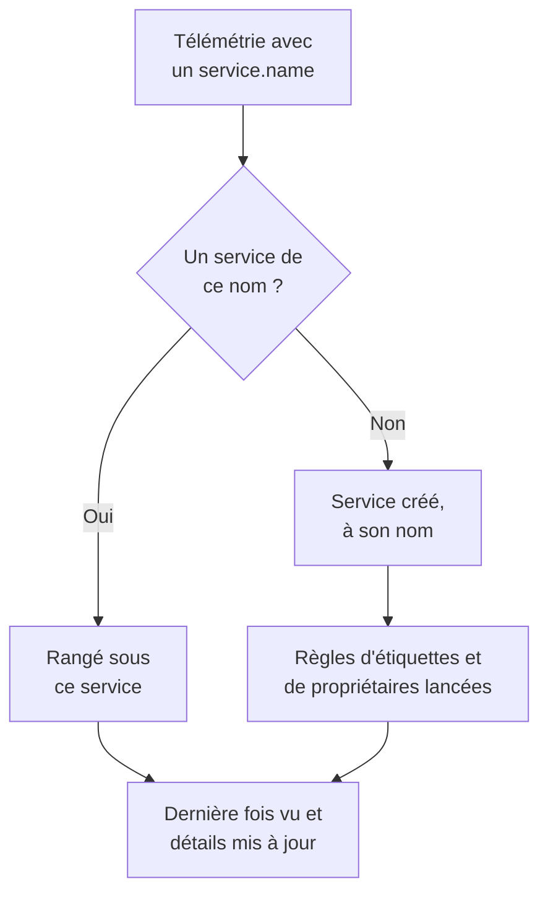

# Catalogue de services

Le catalogue de services liste les applications et les microservices que vous exploitez. OneUptime ajoute un service dès que sa télémétrie arrive pour la première fois, puis réunit ses journaux, ses traces, ses métriques, ses exceptions, ses incidents et ses propriétaires sur une seule page, pour que chacun sache ce que fait un service, à qui il appartient et comment il se porte.

:::cards
- [Comment un service entre dans le catalogue](#comment-un-service-entre-dans-le-catalogue): Son `service.name`, dès sa première télémétrie.
- [Trouver un service](#trouver-un-service): La liste, ses filtres et ses colonnes.
- [Les pages d'un service](#les-pages-dun-service): Tout ce qui concerne un service.
- [Archiver ou supprimer un service](#archiver-ou-supprimer-un-service): Garder son historique, ou le retirer.
:::

## Comment un service entre dans le catalogue

Vous n'avez pas à créer de services. Chaque lot de télémétrie nomme le service qui l'a envoyé dans son attribut de ressource `service.name`. OneUptime range le lot sous le service qui porte ce nom, et crée le service quand le projet n'en a pas encore.

- **Le nom fait l'identité du service.** La comparaison ignore la casse : `Checkout-API` et `checkout-api` sont un seul service. Un nouveau `service.name` crée un nouveau service.
- **Les conteneurs se nomment eux-mêmes.** La télémétrie des agents Docker et Podman nomme un service d'après son conteneur quand elle n'a pas de `service.name`.
- **Une clé d'ingestion peut nommer le service.** Les données OpenTelemetry envoyées avec une clé qui a un **Nom du service épinglé** sont rangées sous ce nom, quel que soit leur `service.name`. Voir [Clés d'ingestion](/docs/telemetry/ingestion-keys#verrouiller-une-clé-de-navigateur).
- **Les navigateurs et les téléphones ne sont pas des services.** La télémétrie d'un navigateur ou d'une application mobile appartient plutôt à une [application RUM](/docs/rum/applications).
- **Les étiquettes peuvent venir avec la télémétrie.** Un attribut de ressource nommé `oneuptime.label.<name>` ajoute l'étiquette `<name>:<value>` au service, par exemple `oneuptime.label.team=payments` pour `team:payments`.

À chaque arrivée de télémétrie, **Dernière fois vu** du service avance, et ses détails sont rafraîchis à partir des attributs de ressource qui l'accompagnent :

| Détail | D'après l'attribut |
| --- | --- |
| Version du service | `service.version` |
| Environnement de déploiement | `deployment.environment.name`, ou `deployment.environment` |
| Espace de noms du service | `service.namespace` |
| Environnement d'exécution | `process.runtime.name` et `process.runtime.version` |
| Technologie | `telemetry.sdk.language`, ou l'environnement d'exécution |
| Cloud | `cloud.provider`, `cloud.platform`, `cloud.region` et `cloud.account.id` |

## Avant de commencer

- **Une télémétrie qui arrive** avec un `service.name`. Voir [OpenTelemetry](/docs/telemetry/open-telemetry) : `OTEL_SERVICE_NAME` le définit.
- **Un rôle qui peut lire les services.** Project Owner, Project Admin, Project Member, Viewer, Settings Admin, Settings Member ou Settings Viewer, ou un rôle personnalisé avec la permission Read Service. Créer, modifier et supprimer des services demande Project Owner, Project Admin, Project Member, Settings Admin ou Settings Member, ou les permissions de service correspondantes.

## Trouver un service

Ouvrez **Produits → Ressources → Services**. **Tous les services** liste chaque service avec son **Nom**, sa **Description**, sa **Technology**, son **Dernière fois vu**, ses **Étiquettes** et ses **Propriétaires**.

- Cherchez par nom ou par description, et filtrez par propriétaire ou par étiquette avec la barre au-dessus de la liste.
- Sélectionnez plusieurs services pour leur ajouter à tous des étiquettes ou des propriétaires en une fois, ou pour les archiver.
- Cliquez sur un service pour ouvrir ses pages.

Pour ajouter un service avant l'arrivée de sa télémétrie, par exemple pour définir d'abord ses propriétaires, cliquez sur **Créer : Service** et saisissez son **Nom** exactement comme son `service.name` le sera. Les règles d'étiquettes et de propriétaires s'appliquent à lui comme à un service découvert. Une fois qu'il est enregistré, le guide de configuration OpenTelemetry s'ouvre avec ce nom dans chaque extrait, et sa dernière étape, **Attendre la connexion**, indique quand les premières données du service arrivent.

## Les pages d'un service

Le menu latéral d'un service compte cinq sections :

| Section | Pages |
| --- | --- |
| **Basique** | **Vue d'ensemble** : requêtes, taux d'erreur et latence p95 tirés de ses spans, graphiques et détails. **Recommandations** : des moniteurs prêts à l'emploi pour le service, choisis selon son langage. **Propriétaires** : les personnes et les équipes qui en sont responsables. **Fil d'activité** : tout ce qui lui est arrivé, de sa création à chaque modification depuis. |
| **Télémétrie** | Ses **Journaux**, **Traces**, **Métriques**, **Profils de performance**, **Exceptions** et **Source Maps**, déjà filtrés sur ce service. |
| **Activité** | Les **Incidents**, les **Alertes** et les événements de **Maintenance planifiée** qui le concernent. |
| **Développeurs** | **Terraform**, **API** et **Assistants IA** : le service géré depuis du code. Cette section est d'abord repliée. |
| **Avancé** | **Paramètres**, **Journaux d'audit** et **Supprimer le service**. **Avancé** est replié au départ : dépliez-le d'abord. |

Les propriétaires comptent au-delà de la page : un rôle dont la portée est Owned lit la télémétrie des services qui vous appartiennent, à vous ou à vos équipes. Voir [Télémétrie](/docs/permissions/index#télémétrie).

## Modifier un service

:::steps
### Ouvrir ses paramètres

Ouvrez le service, dépliez **Avancé** dans son menu latéral et cliquez sur **Paramètres**.

### Le renommer ou le décrire

Dans **Détails du service**, cliquez sur **Modifier les détails** pour changer son **Nom**, sa **Description** ou ses **Étiquettes**. Le nom doit toujours correspondre au `service.name` que sa télémétrie rapporte : changez-le aussi dans votre configuration OpenTelemetry, sinon la prochaine télémétrie crée un nouveau service.

### Choisir sa couleur et sa pile technologique

Dans **Paramètres du service**, cliquez sur **Modifier les paramètres**. La **Couleur du service** repère le service dans les graphiques et les listes ; un nouveau service reçoit la sienne. **Pile technologique** est facultative : laissez-la vide pour afficher le langage détecté dans sa télémétrie.
:::

La même page contient la conservation du service, repliée sous **Plus de paramètres**. Les cartes **Conservation des données de télémétrie** et **Rétention par type de télémétrie** conservent sa télémétrie plus ou moins longtemps que la conservation par défaut du projet. Elles font partie de l'[Enterprise Edition](/docs/self-hosted/enterprise), et du forfait Scale sur OneUptime Cloud ; sans elles, la page montre ce qu'elles apportent, et le service garde la conservation du projet.

## Définir les étiquettes et les propriétaires automatiquement

Des règles donnent leurs étiquettes et leurs propriétaires aux nouveaux services dès leur création, services découverts compris. Elles se trouvent sous **Services → Paramètres → Règles de propriétaire** et **Services → Paramètres → Règles d'étiquettes** ; **Paramètres** est replié au départ dans le menu latéral. Voir [Règles d'étiquettes et de propriétaires](/docs/configuration/label-and-owner-rules).

## Archiver ou supprimer un service

Archivez un service que vous ne surveillez plus mais dont vous voulez garder l'historique. Un service archivé est masqué dans **Tous les services**, mais il continue de recevoir de la télémétrie. Archivez-le depuis sa page **Paramètres**, ou sélectionnez-en plusieurs dans la liste. Pour en rétablir un, ouvrez **Services → Avancé → Archivé**.

> [!WARNING]
> Supprimer un service supprime aussi ses source maps, ainsi que les règles de pipeline de métriques et les budgets de coût LLM définis pour lui. Si OneUptime reçoit encore sa télémétrie, le service est recréé, sans les étiquettes, les propriétaires et les paramètres que vous lui aviez donnés. Pour le retirer de la liste en gardant tout, archivez-le plutôt.

## Dépannage

:::details Un service apparaît deux fois
Deux valeurs de `service.name` ont atteint OneUptime, par exemple depuis deux versions de votre configuration, ou après un renommage d'un seul côté. La télémétrie est rattachée par nom : faites en sorte que chaque instance rapporte le même `service.name`, puis archivez ou supprimez le service dont vous n'avez plus besoin.
:::

:::details Mon service n'est pas dans le catalogue
Vérifiez que sa télémétrie porte un `service.name`. La télémétrie d'un navigateur ou d'une application mobile va plutôt dans Real User Monitoring, et un hôte ou un cluster sans nom de service est rangé sous cet hôte ou ce cluster.
:::

:::details Dernière fois vu est en retard
**Dernière fois vu** est mis à jour environ une fois par minute, pas à chaque lot, et peut donc avoir une minute environ de retard sur la télémétrie en direct.
:::

## Étapes suivantes

:::cards
- [Explorateur de journaux](/docs/telemetry/logs-explorer): Chercher dans les journaux d'un service.
- [Explorateur de traces](/docs/telemetry/traces-explorer): Suivre ses requêtes.
- [Suivi des exceptions](/docs/telemetry/exceptions): Trier les erreurs qu'il lève.
- [Règles d'étiquettes et de propriétaires](/docs/configuration/label-and-owner-rules): Donner étiquettes et propriétaires aux nouveaux services.
:::
