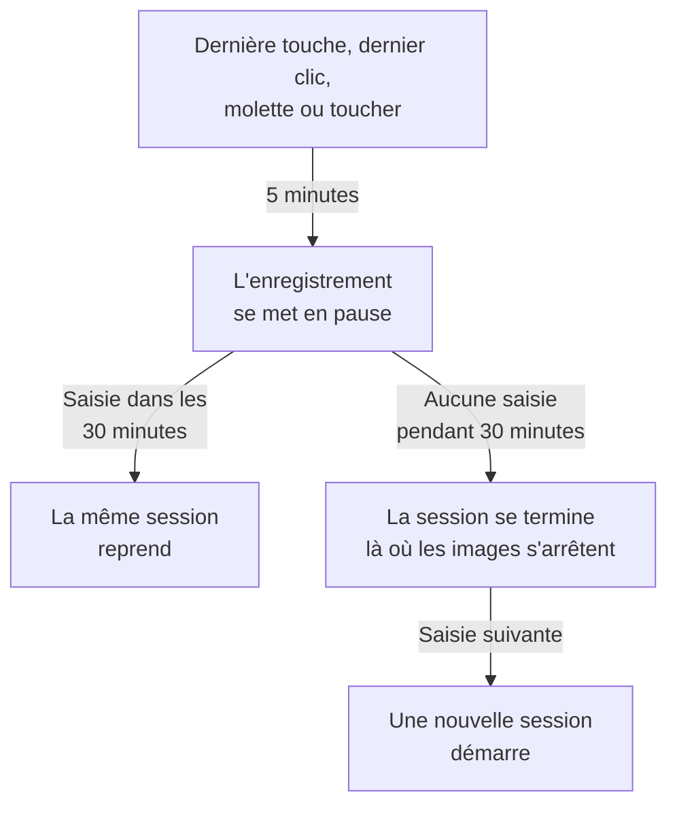

# Relecture de session

La relecture de session enregistre ce que de vrais utilisateurs ont vu dans votre application web ou React Native, et le rejoue à côté des erreurs, traces et journaux de la même session. Vous ajoutez une balise script, choisissez ce qui est masqué, et regardez n'importe quelle session depuis son application RUM.

:::cards
- [Fonctionnement](#fonctionnement): Un chargeur, une politique et un enregistreur qui envoie au fil de l'eau.
- [Installation](#installation): Une balise script sur chaque page, ou le SDK React Native.
- [Confidentialité](#confidentialité): Ce qui est masqué, le consentement, et qui peut envoyer des enregistrements.
- [Corréler avec le reste de votre télémétrie](#corréler-avec-le-reste-de-votre-télémétrie): Traces, journaux et erreurs du backend, liés sans code.
- [Regarder une session](#regarder-une-session): La liste des sessions, la page Utilisateurs, les parcours utilisateurs et le lecteur.
- [Santé de l'enregistrement](#santé-de-lenregistrement): Pourquoi rien n'arrive, et des alertes avant qu'un budget s'épuise.
:::

## Fonctionnement

Le script sur votre page est un petit chargeur. Il vérifie les signaux de confidentialité du navigateur, récupère la politique de l'application auprès de OneUptime, et ne charge qu'ensuite l'enregistreur, qui masque la page en l'enregistrant et l'envoie par fragments tant que l'utilisateur est actif.

```mermaid title="Du chargement d'une page à un enregistrement que vous pouvez regarder"
flowchart TB
    page["Votre page charge<br/>la balise script"] --> dnt{"Signal Do Not Track<br/>ou GPC ?"}
    dnt -->|"Oui"| none["Rien n'est<br/>enregistré"]
    dnt -->|"Non"| policy["Le chargeur récupère<br/>la politique"]
    policy --> recorder["L'enregistreur masque<br/>et enregistre la page"]
    recorder -->|"Des fragments tant que<br/>l'utilisateur est actif"| ingest["OneUptime"]
    ingest --> player["Liste des sessions<br/>et lecteur"]
```

Par défaut, chaque session est enregistrée et envoyée au fur et à mesure, pas seulement celles qui ont rencontré un problème. C'est dans les sessions où rien n'a planté que vous trouvez le paiement que personne n'a terminé, le formulaire que tout le monde a abandonné et la page qui, selon un client, « avait l'air bizarre ».

Pour stocker moins, deux réglages de la politique de l'application agissent ensemble :

| Réglage | Par défaut | Ce qu'il change |
| --- | --- | --- |
| **Pourcentage d'échantillonnage** | 100 | Combien de sessions sont éligibles. Divisez-le par deux et vous divisez par deux à la fois les octets stockés et les données d'utilisateurs finaux au repos. La décision est prise une fois par session à partir d'un hachage de l'id de session, si bien qu'une session n'est jamais enregistrée à moitié. |
| **Quand envoyer un enregistrement** | _Always_ | Réglé sur _On error or frustration_, l'enregistreur garde un tampon tournant en mémoire et n'envoie que lorsque quelque chose tourne mal. Il existe alors un enregistrement pour presque chaque session en échec, pour un coût environ 15 fois moindre que l'enregistrement de tout le monde, mais vous ne pouvez pas regarder une session qui n'a pas échoué. |

## Avant de commencer

- Une application RUM. Créez-en une sous **Produits → Ressources → Surveillance des utilisateurs réels**, ou laissez votre télémétrie la créer : voir [Gérer les applications](/docs/rum/applications).
- Une clé d'ingestion **Navigateur**, depuis **Paramètres du projet → Télémétrie & APM → Clés d'ingestion**. Une clé Navigateur ne fonctionne que depuis les origines que vous y listez : voir [Définissez vos origines autorisées en production](#définissez-vos-origines-autorisées-en-production).

La relecture de session est activée par défaut. Ses réglages se trouvent à trois endroits :

| Où | Ce qu'on y trouve |
| --- | --- |
| La page **Replay Policy** de l'application | La politique (enregistrement, masquage, consentement, traçage et limites), un résumé **État de l'enregistrement**, la carte **Ce que contient un enregistrement**, le panneau **Test your installation** et **Record a specific user's next session**. |
| La page **Santé** de l'application | Si les enregistrements arrivent, et pourquoi pas quand ils n'arrivent pas. Voir [Santé de l'enregistrement](#santé-de-lenregistrement). |
| **Surveillance des utilisateurs réels → Paramètres → Relecture de session** | L'interrupteur de tout le projet qui arrête toutes les applications d'un coup, et une liste en lecture seule de la politique de chaque application. |

## Installation

Ajoutez une balise script à chaque page que vous voulez enregistrer.

:::steps
### Créer une clé Navigateur

Sous **Paramètres du projet → Télémétrie & APM → Clés d'ingestion**, cliquez sur **Créer une clé d'ingestion**, choisissez **Navigateur** comme **Type de clé** et listez les origines de votre site dans **Origines autorisées**. Copiez ensuite la **Clé secrète** de la clé. [Configuration navigateur](/docs/rum/browser-setup#mise-en-place) montre chaque écran.

### Ajouter la balise script

Placez la balise sur chaque page, avec votre clé et l'identifiant de votre application :

```html
<script
  src="https://oneuptime.com/telemetry/session-replay/v1/recorder.js"
  data-oneuptime-token="YOUR_TELEMETRY_INGESTION_KEY"
  data-oneuptime-app-identifier="storefront-web"
  crossorigin="anonymous"
  async
></script>
```

`data-oneuptime-app-identifier` doit correspondre à l'identifiant de l'application RUM, la même valeur que celle que vous utilisez pour `service.name`. La page **Documentation** de l'application, dans la section **Relecture de session** de son menu latéral, montre cet extrait avec les deux valeurs déjà renseignées, ainsi que ses versions Next.js / React et Google Tag Manager.

### Vérifier que les enregistrements arrivent

Ouvrez l'une de vos pages et cliquez çà et là pendant quelques secondes. En une minute environ, la session apparaît sur la page **Relecture de session** de l'application, marquée **Enregistrement en cours**. Sinon, la page **Santé** de l'application dit pourquoi : voir [Santé de l'enregistrement](#santé-de-lenregistrement).
:::

Le script à `/v1/recorder.js` est un petit chargeur. Il vérifie Do Not Track, récupère la politique de votre application, et ne charge qu'ensuite `/latest/recorder.js`. La politique et l'enregistreur sont tous deux servis en `no-store`, si bien qu'un changement de l'un ou de l'autre atteint le chargement de page suivant sans attendre l'expiration d'un cache du navigateur.

### Attributs de la balise script

| Attribut | Obligatoire | Rôle |
| --- | --- | --- |
| `data-oneuptime-token` | Oui | Votre jeton d'ingestion de télémétrie. |
| `data-oneuptime-app-identifier` | Oui | L'identifiant de l'application RUM. |
| `data-oneuptime-host` | Non | L'origine OneUptime. Déduite du `src` du script lui-même quand elle est omise : vous n'en avez donc besoin que si vous faites passer le script par votre propre domaine. |
| `data-oneuptime-user-ref` | Non | La référence de l'utilisateur final connue au chargement de la page (un id d'utilisateur, jamais une adresse e-mail que vous ne voudriez pas stocker). La même chose que ce que `identify()` définit plus tard ; c'est la seule forme qui fonctionne pour [Enregistrer la prochaine session d'un utilisateur précis](#enregistrer-la-prochaine-session-dun-utilisateur-précis). |
| `data-oneuptime-respect-do-not-track` | Non | Respecte par défaut Do Not Track et Global Privacy Control. Réglez-le sur `"false"` pour enregistrer quel que soit le signal ; voir [Do Not Track](#do-not-track). |
| `data-oneuptime-debug` | Non | `"true"` affiche les décisions de l'enregistreur dans la console. Voir [Dépannage de la relecture de session](/docs/rum/session-replay-troubleshooting). |
| `data-oneuptime-offline-storage` | Non | Réglez-le sur `"false"` pour garder les fragments enregistrés pendant que le visiteur est hors ligne en mémoire seulement, au lieu de les garder aussi dans l'IndexedDB du navigateur. Voir [Mode hors ligne](#mode-hors-ligne). |

Les mêmes options peuvent être données sur un objet global plutôt que sur la balise, ce qu'utilisent les gestionnaires de balises et les installations empaquetées :

```js
window.__ONEUPTIME_SESSION_REPLAY__ = {
  host: "https://oneuptime.com",
  token: "YOUR_TELEMETRY_INGESTION_KEY",
  appIdentifier: "storefront-web",
  userRef: "user-123", // optional
  respectDoNotTrack: true, // optional
  debug: false, // optional
  offlineStorage: true, // optional; false keeps offline chunks in memory only
};
```

### À quoi ressemble une installation saine

Ouvrez DevTools → Network et filtrez sur `session-replay`. Une page qui fonctionne produit :

1. **Un `GET .../session-replay/v1/config`** par chargement de page — la récupération de la politique.
2. **Un `POST .../session-replay/v1/chunk` environ toutes les 15 secondes tant que l'utilisateur fait quelque chose**, ou plus tôt quand 256 KB d'événements se sont accumulés. Un onglet inactif ne produit aucun événement et donc aucun POST : bougez la souris ou cliquez avant de juger une installation depuis l'onglet Network.
3. Quand l'onglet est masqué, et à nouveau quand la page s'en va, un `POST` envoyé avec `keepalive`. Le départ de la page — l'onglet fermé, rechargé ou parti vers une autre page, ou la page placée dans le cache back/forward du navigateur (chaque `pagehide`) — le marque comme final, ce qui dit à OneUptime que l'enregistrement de cet onglet est terminé ; une page que l'utilisateur fait revenir depuis le cache back/forward continue d'enregistrer comme un nouvel onglet de la même session. Un onglet simplement masqué reste ouvert, et l'enregistrement continue quand l'utilisateur y revient. Son corps entier reste sous 56 KB — la part de l'enregistreur dans le quota keepalive de 64 KB par origine du navigateur — et il peut porter plusieurs fragments comme trames de cette unique requête : le fragment de clôture, les morceaux en lesquels un gros fragment de clôture a été découpé (au plus 48 KB d'événements chacun, pour que l'en-tête de trame tienne encore), et tout fragment qui attendait encore une nouvelle tentative. Un fragment déjà plus gros que ce budget quand l'onglet est simplement masqué part plutôt par le chemin ordinaire, tant que la page est encore vivante pour l'envoyer.

Avec le déclencheur _On error or frustration_, l'étape 2 n'a pas lieu tant qu'aucun déclencheur ne s'est produit — voir [Dépannage](#dépannage).

## Installation dans React Native

Le SDK React Native enregistre la hiérarchie des vues natives sous forme d'événements synthétiques compatibles avec rrweb : les enregistrements mobiles s'ouvrent donc dans la même liste de sessions et le même lecteur que les enregistrements web. Il ne prend pas de captures d'écran. Le lecteur indique pour chaque enregistrement qu'il s'agit d'une application React Native, et son onglet **Fidélité** explique les surfaces natives qui n'ont pas pu être représentées.

:::steps
### Installer le SDK

Le SDK prend en charge les applications React Native iOS et Android. Installez-le avec sa dépendance pair de boîte d'envoi persistante :

```bash
npm install @oneuptime/react-native-replay @react-native-async-storage/async-storage
```

Pour un projet iOS nu, lancez votre installation CocoaPods habituelle après avoir ajouté les paquets ; les versions actuelles de React Native lient automatiquement Android sans enregistrement manuel. L'enregistreur a son propre module natif d'arbre de vues en plus d'Async Storage : les projets Expo doivent donc utiliser un build de développement ou de production personnalisé (par exemple EAS Build ou un prebuild). Expo Go ne peut pas exécuter ce SDK, car aucun des deux modules natifs ne peut être ajouté au binaire figé d'Expo Go.

### Démarrer l'enregistreur et envelopper votre application

Démarrez le singleton une fois, puis placez le provider au-dessus de la partie de l'application que vous voulez enregistrer :

```tsx
import {
  OneUptimeReplay,
  OneUptimeReplayProvider,
} from "@oneuptime/react-native-replay";

OneUptimeReplay.start({
  host: "https://oneuptime.com",
  token: "YOUR_TELEMETRY_INGESTION_KEY",
  appIdentifier: "storefront-mobile",
  mobileAppIdentifier: "com.example.storefront",
  appName: "Storefront", // optional, shown in session details
  appVersion: "4.2.0", // optional, shown in session details
});

export default function App() {
  return (
    <OneUptimeReplayProvider>
      <Navigation />
    </OneUptimeReplayProvider>
  );
}
```

`appIdentifier` est l'identifiant de l'application RUM. `mobileAppIdentifier` est l'id d'application Android ou l'identifiant de bundle iOS livré dans le binaire, pas un nom d'affichage. Utilisez la même valeur dans les [listes d'autorisation `app://`](#définissez-vos-origines-autorisées-en-production). Le SDK récupère la politique de relecture de l'application depuis `host` ; l'échantillonnage, le déclencheur, le consentement, la rétention et les budgets d'envoi restent contrôlés par le serveur.
:::

Le provider détient une racine native non repliable et enregistre son arbre de vues et les événements de début, de mouvement et de fin de toucher. Si vous construisez déjà vous-même des instances d'enregistreur, passez-en une avec `<OneUptimeReplayProvider recorder={recorder}>`. `MobileReplayRecorder` est aussi exporté pour des intégrations isolées ou multi-clients ; la plupart des applications devraient utiliser le singleton.

### API React Native

Importez `OneUptimeReplay` directement, ou appelez `useOneUptimeReplay()` sous le provider. Le singleton expose :

| Méthode | Rôle |
| --- | --- |
| `start(options)` | Récupère la politique et démarre la capture. Les options obligatoires sont `host`, `token`, `appIdentifier` et `mobileAppIdentifier` ; `appName` et `appVersion` sont des métadonnées d'affichage facultatives, et `connectivity` est une source facultative d'état du réseau pour le [mode hors ligne](#mode-hors-ligne). |
| `stop()` | Vide ce qui peut être envoyé, arrête la capture et détache les gestionnaires de cycle de vie. |
| `identify(userRef, traits?)` | Attache l'utilisateur connecté et des attributs facultatifs, sous réserve de **Capturer l'identité de l'utilisateur final**. |
| `setTags(tags)` / `addTag(key, value)` | Remplace tous les tags recherchables de la session, ou ajoute un tag sans remplacer les autres. |
| `track(name, properties?)` | Place un événement d'application sur la chronologie de la relecture. |
| `setRoute(route)` | Enregistre un écran ou une route logique nettoyé après une navigation. Appelez-le depuis le callback de changement de route de votre navigateur d'écrans. |
| `captureSession(reason?)` | Avec _On error or frustration_, envoie le tampon tournant pour une raison propre à l'application, comme un utilisateur qui touche « Signaler un problème ». |
| `captureError(error)` | Enregistre une erreur JavaScript gérée et active la capture déclenchée par les erreurs. |
| `grantConsent()` / `revokeConsent()` | Autorise les envois, ou efface immédiatement le tampon en mémoire, la boîte d'envoi stockée, la session et l'id de visiteur. Un consentement ultérieur repart avec des identifiants neufs. |
| `getSessionId()` / `onSessionChange(listener)` | Lit l'id de la session de relecture actuelle avec consentement, ou s'y abonne, pour la corrélation des traces et des journaux. L'écouteur reçoit aussi `null` quand la capture ou le consentement prend fin. |
| `getDiagnostics()` | Renvoie l'état de l'enregistreur et ses décisions récentes, sans renvoyer le contenu des vues capturées. |

Le SDK écoute `AppState` de React Native : le passage en arrière-plan clôt et vide les événements avec consentement, tandis que les images d'avant le consentement restent seulement en mémoire. Avant que la capture au premier plan reprenne, le SDK actualise la politique sans utiliser de réponse en cache. Il actualise aussi la politique périodiquement pendant qu'il est actif, pour que la désactivation, le consentement, l'échantillonnage, le ciblage et les changements d'identité prennent effet dans une application ouverte longtemps. Appelez `stop()` quand votre intégration est démontée définitivement ; la navigation ordinaire entre écrans doit utiliser `setRoute()` plutôt que d'arrêter et de redémarrer l'enregistreur.

**Quand une session mobile se termine par inactivité.** Cinq minutes sans saisie mettent déjà la capture en pause (voir [Temps d'inactivité](#temps-dinactivité)). Trente minutes sans toucher et sans aucun appel du SDK enregistré (`track()`, `setTags()`, `identify()` et autres, faits pendant que la capture tournait) terminent la session. Elle se termine à cette dernière activité, ou pour une session en pause à la pause, là où ses images se sont arrêtées — pas quand l'application revient ou que l'enregistreur s'en aperçoit — si bien que le temps passé en arrière-plan ou en pause n'est jamais ajouté à la fin d'une session. Une application laissée ouverte au premier plan ne démarre pas une nouvelle session toutes les demi-heures. La session suivante démarre quand l'utilisateur revient : son premier toucher, l'affichage ou le masquage du clavier logiciel, le retour de l'application au premier plan, ou un appel à `captureSession()`. Elle s'ouvre sur un instantané neuf de l'écran. D'ici là, `getSessionId()` renvoie `null` et `onSessionChange()` est appelé avec `null`. Les erreurs, la navigation et les appels à `track()` entre-temps ne sont pas enregistrés.

Pour corréler la télémétrie mobile avec une relecture, abonnez-vous avec `onSessionChange()` et placez la valeur renvoyée dans l'attribut `session.id` de votre instrumentation OpenTelemetry. Remplacez cet attribut chaque fois que le callback se déclenche, y compris en l'effaçant quand la valeur est `null`. Le SDK de relecture ne modifie pas le réseau natif et ne change pas lui-même un provider OpenTelemetry.

### Confidentialité et masquage dans React Native

La capture mobile est délibérément plus stricte que les modes de masquage du web. Le texte de l'interface native, les valeurs d'accessibilité, les valeurs de saisie et les pixels d'image ne sont jamais sérialisés ; le serveur reçoit une maquette structurelle même quand le mode de masquage web de l'application autoriserait un texte lisible. Les métadonnées fournies par l'appelant, comme les références d'utilisateur, les noms d'événements, les routes et les tags recherchables, suivent le contrat de l'API : n'y mettez donc pas de secrets. Enveloppez un sous-arbre particulièrement sensible dans `<ReplayMask>` pour remplacer cette zone par un espace réservé de confidentialité tout en préservant la mise en page autour.

Le consentement ne se déduit ni d'une autorisation du système d'exploitation ni de votre bannière de consentement. Avec _Require explicit_, n'appelez `grantConsent()` qu'une fois que votre application a obtenu le consentement nécessaire. Appeler `revokeConsent()` jette à la fois les données non envoyées en file et persistées, et les identifiants qui pourraient relier une session ultérieure à celle qui a été révoquée.

L'enregistreur mobile capture les limites et types des vues, les positions des touchers, les routes logiques, les événements personnalisés et les erreurs JavaScript. Ces limites sont toujours indiquées dans l'onglet Fidélité du lecteur :

- Les pixels de `Image` natif sont opaques ; seul le cadre est représenté.
- Le contenu de `WebView` est hors de l'arbre React Native. Installez l'enregistreur web dans la page hébergée si elle a besoin de son propre enregistrement.
- Canvas, Skia, OpenGL, les cartes, les aperçus de caméra, la vidéo et les autres surfaces dessinées sur mesure sont opaques.
- Les trajets de toucher à l'intérieur de `ReplayMask` ou d'une surface opaque ne sont pas enregistrés. Le pont natif vérifie la cible vivante du toucher et ses ancêtres, et supprime le geste si cette vérification de confidentialité ne peut pas aboutir.
- Les animations Reanimated, native-driver et du thread UI sont échantillonnées aux instantanés de l'arbre de vues, pas reproduites image par image.
- Les plantages natifs qui terminent JavaScript avant qu'il puisse vider sa file nécessitent un SDK de plantage natif ; `captureError()` couvre les erreurs JavaScript gérées, pas les vidages de plantage au niveau du processus.

## Identifier vos utilisateurs

Chaque session est anonyme tant que votre page ne dit pas à qui elle appartient. Sans cela, la liste peut toujours regrouper les sessions d'un navigateur sous un id de visiteur anonyme (voir [Visiteurs anonymes](#visiteurs-anonymes) ci-dessous), mais rien ne nomme la personne ni ne relie son deuxième navigateur au premier. Appelez `identify()` dès que vous le savez, ou mettez-le en file avant le chargement du script — dans les deux cas, il est appliqué avant l'envoi du premier fragment, si bien que la session est recherchable par utilisateur dès son apparition :

```js
// After the script has loaded:
OneUptimeReplay.identify("user-123", { plan: "pro", tenant: "acme" });

// Or at any time, whether or not the script has loaded yet:
(window.OneUptimeReplayQueue = window.OneUptimeReplayQueue || []).push([
  "identify",
  "user-123",
  { plan: "pro", tenant: "acme" },
]);
```

- La référence est ce que la liste des sessions affiche et ce que les recherches `user:` comparent. Les attributs sont affichés dans l'en-tête du lecteur et dans le panneau de détails de la session.
- **L'identité appartient à la session, pas seulement à la page.** Une session couvre chaque chargement de page et chaque onglet de la visite, et dès qu'une de ses pages appelle `identify()`, toute la session est celle de cet utilisateur — y compris les pages d'avant la connexion, puisqu'elles font partie de la même visite. Chaque page et chaque onglet ultérieurs de la session nomment aussi l'utilisateur, même ceux qui n'appellent jamais `identify()` eux-mêmes : la page d'arrivée de la redirection de connexion, un lien ouvert dans un nouvel onglet. Tant que **Capturer l'identité de l'utilisateur final** est activé, l'enregistreur retient à qui appartient la session en cours dans `localStorage` sous `oneuptime.replay.user` — l'id de session et la référence, rien d'autre, et avec le consentement _Require explicit_ seulement une fois le consentement donné — et seulement pour cette session : la session suivante (après 30 minutes d'inactivité ou le plafond de 4 heures) démarre anonyme jusqu'à ce qu'une page l'identifie, sauf si la page qui l'a démarrée avait elle-même identifié l'utilisateur. Appelez donc `identify()` à chaque chargement de page où votre application connaît l'utilisateur, pas seulement juste après la connexion.
- **Un autre utilisateur obtient sa propre session.** Quand `identify()` nomme quelqu'un d'autre que l'utilisateur à qui la session appartient déjà — une personne s'est déconnectée et une autre s'est connectée sur le même navigateur, dans cet onglet ou dans un autre —, la session en cours se termine, toujours rangée sous le premier utilisateur, et une nouvelle session démarre pour le second. Les écouteurs `onSessionChange` en sont avertis, et le lecteur montre le changement comme la fin d'un enregistrement et le début du suivant. Identifier à nouveau le même utilisateur ne change rien ; les références sont comparées après suppression des espaces aux extrémités et en respectant la casse, exactement comme le serveur les compare.
- Ce que `identify()` donne à l'enregistreur n'est envoyé avec l'enregistrement que tant que **Capturer l'identité de l'utilisateur final** est activé pour l'application (le défaut). S'il est désactivé, l'enregistreur laisse la référence et les attributs hors du fragment, et le serveur ne stocke **absolument rien** sur la personne — ni référence, ni hachage à clé de celle-ci, ni attributs. Ces sessions sont réellement pseudonymes, et la contrepartie est qu'elles ne peuvent pas être effacées _par utilisateur_ : une demande d'effacement n'a rien à comparer, utilisez donc plutôt `BySessionId`, `ByDateRange` ou `ByRumApplication` (voir [Effacer des sessions](#effacer-des-sessions)). Si honorer une demande de suppression par utilisateur compte plus pour vous que de ne stocker aucun identifiant, laissez l'interrupteur activé — la clé stockée est un hachage à clé à sens unique, qu'on peut comparer mais pas lire, et seule l'étiquette séparée porte la référence elle-même.
- Une référence quitte bien le navigateur quel que soit cet interrupteur, par conception : celle que votre page fournit **au chargement** via `data-oneuptime-user-ref` ou `userRef` sur l'objet global d'initialisation voyage comme en-tête de requête sur la récupération de la politique à chaque chargement de page, car c'est ainsi que [Enregistrer la prochaine session d'un utilisateur précis](#enregistrer-la-prochaine-session-dun-utilisateur-précis) reconnaît un visiteur avant qu'un enregistreur existe. Le serveur la compare à la cible armée puis la jette ; elle n'est écrite dans la session que si la capture d'identité est activée et que l'enregistreur l'envoie de nouveau avec l'enregistrement. Une référence passée à `identify()` n'est jamais envoyée de cette façon.
- Les attributs sont plafonnés à 20 clés, 40 caractères par clé et 200 par valeur, convertis en chaînes, et passent par le mode de masquage de l'application : sous _Mask all text_, ils sont masqués avant l'envoi.
- Relire l'identité dans le tableau de bord exige la même autorisation que regarder l'enregistrement (voir [Qui peut regarder un enregistrement](#qui-peut-regarder-un-enregistrement)) ; les autres rôles voient « Identity hidden ».

### Visiteurs anonymes

Une page qui n'appelle jamais `identify()` a quand même besoin que ses sessions puissent être regroupées, sinon une liste de quarante lignes _Anonymous_ ne peut pas vous dire si une personne a rencontré la même erreur quarante fois ou si quarante personnes l'ont rencontrée une fois. L'enregistreur crée donc un id de visiteur aléatoire par profil de navigateur et par origine — 32 caractères hexadécimaux en minuscules, gardés dans `localStorage` sous `oneuptime.replay.visitor`, à côté de l'enregistrement de session, si bien qu'un site servi depuis deux noms d'hôte ou ports apparaît comme deux visiteurs et que seul `identify()` les réunit — et l'envoie comme `meta.visitorId` sur chaque fragment qui porte des métadonnées : le premier fragment, le fragment de clôture, et le fragment qui suit un appel à `identify()` ou `setTags()`. Le serveur en vérifie la forme et le stocke sur la session, avec les mêmes règles d'accès que le reste de l'en-tête de session. Il survit à l'id de session à dessein : le renouvellement après 30 minutes d'inactivité et le plafond de 4 heures démarrent une nouvelle session, et la nouvelle session porte le même id de visiteur, si bien que deux visites depuis le même navigateur à une semaine d'intervalle se retrouvent ensemble sur la [page Utilisateurs](#la-page-utilisateurs) et dans le menu des autres sessions du lecteur (voir [Le lecteur](#le-lecteur)).

Soyez précis sur ce qu'il n'est pas :

- **Ce n'est pas une identité.** Il est aléatoire, créé dans le navigateur, et ne dérive de rien de ce que votre page a fourni ni de rien concernant l'appareil. Deux navigateurs sur un même portable, ou la même personne sur un téléphone et un ordinateur, sont deux visiteurs ; seul `identify()` les réunit. Une fenêtre privée reçoit un id neuf qui disparaît avec la fenêtre, et là où rien ne peut être écrit dans le stockage (mode privé de Safari, données de site bloquées), l'id dure le temps d'un chargement de page.
- **Il ne dépend pas de Capturer l'identité de l'utilisateur final.** Cet interrupteur décide si la référence et les attributs quittent le navigateur ; l'id de visiteur est envoyé dans tous les cas, car il ne nomme personne. Si vous ne voulez aucun id créé du tout, la réponse est l'absence d'enregistreur : désactivez la relecture de session pour l'application, ou laissez [Do Not Track](#do-not-track) respecté.
- **Il suit les règles de consentement de l'id de session.** `revokeConsent()` le retire du stockage avec la session, rien n'est écrit tant que le consentement est retiré, et un `grantConsent()` ultérieur en crée un nouveau — un utilisateur qui retire son consentement puis revient n'est donc pas relié de nouveau aux sessions qu'il vous a demandé d'oublier. Avec Do Not Track ou Global Privacy Control, aucun enregistreur ne s'exécute, donc aucun id n'est créé.
- **Il ne voyage jamais sur vos propres requêtes.** Le contexte de trace que l'enregistreur ajoute aux requêtes de votre page vers sa propre origine nomme la session, jamais le visiteur (voir [Ce que portent vos propres requêtes](#ce-que-portent-vos-propres-requêtes)) ; l'id de visiteur ne va qu'à OneUptime, avec l'enregistrement.
- **Il ne peut pas être la cible d'une demande d'effacement.** Les types de demande n'ont pas changé (voir [Effacer des sessions](#effacer-des-sessions)) ; une recherche `visitor:` réduit la liste aux sessions d'un navigateur, d'où vous prenez les ids de session à effacer.

`OneUptimeReplay.getVisitorId()` renvoie l'id actuel, ou une chaîne vide avant le démarrage de l'enregistreur, après `stop()`, et entre un `revokeConsent()` et le `grantConsent()` suivant. Les enregistreurs construits avant que cela existe n'en envoyaient aucun : les sessions qu'ils ont enregistrées ont donc un `visitorId` vide, la liste les affiche comme _Anonymous_ et la page Utilisateurs les range sous **Unlinked sessions**. Un enregistreur qui en crée un liste `visitor-id` parmi ses `capabilities` dans `getDiagnostics()` et sur la page **Santé**.

## API JavaScript

L'enregistreur publie `window.OneUptimeReplay`. Comme il se charge de manière asynchrone, tout ce que votre page appelle avant son arrivée doit plutôt passer par la file de commandes — `window.OneUptimeReplayQueue` est un simple tableau d'entrées `[command, ...arguments]` que l'enregistreur vide dès son démarrage, et qui accepte par leur nom toutes les commandes ci-dessous :

```js
(window.OneUptimeReplayQueue = window.OneUptimeReplayQueue || []).push(
  ["grantConsent"],
  ["identify", "user-123", { plan: "pro" }],
  ["setTags", { build: "1.4.2" }],
  ["onSessionChange", (sessionId, tabId) => console.log(sessionId)],
);
```

`grantConsent`, `revokeConsent`, `stop`, `identify`, `setTags` et `addTag` sont appliqués avant le démarrage de l'enregistreur : une décision de consentement mise en file décide donc si quoi que ce soit est envoyé, et une identité mise en file voyage dès le tout premier fragment. `track`, `captureSession` et `onSessionChange` s'exécutent juste après son démarrage.

| Méthode | Rôle |
| --- | --- |
| `identify(userRef, traits?)` | Attache l'utilisateur final à la session — à chacune de ses pages et chacun de ses onglets, depuis son début (voir [Identifier vos utilisateurs](#identifier-vos-utilisateurs)). `traits` est un objet de valeurs chaînes, nombres ou booléens (≤ 20 clés, clé ≤ 40 caractères, valeur ≤ 200 caractères), masqué sous _Mask all text_ et envoyé seulement quand **Capturer l'identité de l'utilisateur final** est activé. L'appeler de nouveau pour le même utilisateur renvoie l'identité (et tout nouvel attribut) sur le fragment suivant ; nommer un autre utilisateur termine la session et en démarre une nouvelle pour lui. |
| `track(name, properties?)` | Enregistre un événement métier (`"checkout_failed"`) sur la chronologie. `name` ≤ 64 caractères, ≤ 20 clés de propriétés avec les mêmes plafonds de valeur que les attributs. Jusqu'à 50 par fragment de 15 secondes ; au-delà, le fragment porte un unique marqueur « events dropped » avec le nombre. |
| `setTags(tags)` / `addTag(key, value)` | Tags par session (`{ build: "1.4.2", experiment: "new-checkout" }`), ≤ 20 tags, clé ≤ 32 caractères, valeur ≤ 128. Recherchables depuis la liste des sessions avec `tag:key=value` et affichés dans les détails de la session. `setTags` **remplace** toute la table, donc un second `setTags({ experiment })` supprime un tag `build` défini par le premier ; `addTag` définit une clé et garde les autres. Construisez la table en un seul appel à `setTags`, ou utilisez `addTag` à mesure que vous apprenez chaque valeur. |
| `captureSession(reason?)` | Avec _On error or frustration_, force cette session à envoyer à partir de son tampon tournant ; avec _Always_, cela ne change rien à l'envoi, mais la `reason` (≤ 80 caractères) est quand même marquée sur la chronologie. Utilisez-le depuis votre propre bouton « signaler un problème ». |
| `onSessionChange(listener)` | `listener(sessionId, tabId)` est appelé immédiatement si une session existe, puis chaque fois que l'id change — quand l'utilisateur revient après 30 minutes d'inactivité, au plafond de 4 heures, quand `identify()` nomme un autre utilisateur, ou quand un autre onglet du même visiteur a changé de session en premier. Renvoie une fonction de désabonnement. **Facultatif** : les requêtes vers votre propre origine lient les spans, journaux et exceptions de votre backend à l'enregistrement sans lui (voir [Corréler avec le reste de votre télémétrie](#corréler-avec-le-reste-de-votre-télémétrie)). Utilisez-le pour placer `session.id` sur la télémétrie que la page produit elle-même, comme les spans du SDK navigateur OpenTelemetry ; voir [La télémétrie navigateur de votre propre page](#la-télémétrie-navigateur-de-votre-propre-page). |
| `grantConsent()` | Avec le mode de consentement _Require explicit_, autorise les envois. Rien n'est envoyé avant. |
| `revokeConsent()` | Jette tout ce qui est en tampon et arrête les envois. L'enregistreur continue de tourner en mémoire seulement, donc un `grantConsent()` ultérieur continue sur un id de session neuf. |
| `getSessionId()` | L'id de session actuel, ou `null` quand rien n'est enregistré. Préférez `onSessionChange()`, qui suit aussi les renouvellements. |
| `getVisitorId()` | L'[id de visiteur anonyme](#visiteurs-anonymes) — 32 caractères hexadécimaux, un par profil de navigateur, le même d'un renouvellement de session à l'autre — ou `""` avant le démarrage de l'enregistreur, après `stop()`, et tant que le consentement est retiré. Aléatoire et pas une identité ; ne dépend pas de **Capturer l'identité de l'utilisateur final**. |
| `stop()` | Envoie le dernier fragment, scelle la session et s'arrête pour le reste de la vie de la page. |
| `setDebug(enabled)` | Affiche désormais les décisions de l'enregistreur dans la console. |
| `getDiagnostics()` | Tout ce que l'enregistreur a décidé, que les diagnostics aient été activés ou non. Voir ci-dessous. |

### `getDiagnostics()`

C'est la première chose à coller dans un ticket de support. Elle ne contient par construction aucun contenu de page (voir [Ce que les diagnostics ne contiennent jamais](/docs/rum/session-replay-troubleshooting#ce-que-les-diagnostics-ne-contiennent-jamais)).

```js
copy(JSON.stringify(OneUptimeReplay.getDiagnostics(), null, 2));
```

| Champ | Signification |
| --- | --- |
| `state` | `none` (aucun enregistreur n'a été construit), `not-started`, `recording` (en mémoire seulement), `uploading`, `paused` (personne n'a touché la page depuis cinq minutes, donc rien n'est capturé jusqu'à la saisie suivante — voir [Temps d'inactivité](#temps-dinactivité)), `not-sampled` ou `stopped`. |
| `stopReason` | Pourquoi il s'est arrêté, le cas échéant : `api` (votre `stop()`), `server-directive`, `transport-failure` ou `chunk-cap`. |
| `bootstrapDecision` | Pourquoi l'artefact a construit ou non un enregistreur : `started`, `privacy-signal`, `directive-stop`, `already-started`, `cancelled-before-start` (un `revokeConsent`/`stop` mis en file) ou `not-started`. |
| `decisions` | La réponse de chaque barrière : `isSampled`, `captureTrigger`, `consentMode`, `consentState`, `uploadsAllowed`, `uploadBlockedBy` (`consent`, `transport` ou `null`), `lastDirective` et sa raison, et `startDecision` (`recording-and-uploading`, `recording-into-memory`, `not-sampled`, `not-started`). |
| `capabilities` | Ce que ce build de l'enregistreur capture : `click-events`, `web-vitals`, `custom-events`, `traits`, `tags`, `visibility`, `visitor-id`. La page **Santé** du tableau de bord affiche la même liste pour la session la plus récente, si bien qu'un enregistrement venant d'une page ancienne et ouverte longtemps se repère facilement. |
| `tags`, `hasTraits`, `triggerReason`, `isRecording`, `isUploading`, `sessionId`, `tabId`, `visitorId`, `version` | L'état actuel de la session. `isRecording` ne vaut true que tant que l'enregistreur enregistre réellement. `visitorId` vaut `null` tant qu'aucun enregistreur n'existe et `""` tant que le consentement est retiré. |
| `records` | Les 250 dernières décisions avec des codes stables — y compris celles du chargeur, d'avant l'existence de l'artefact. Chaque code est expliqué dans [Dépannage de la relecture de session](/docs/rum/session-replay-troubleshooting#codes). |

## Confidentialité

**Le masquage a lieu à la capture, sur l'appareil de l'utilisateur final, avant tout envoi.** Le serveur ne reçoit jamais ce qui a été masqué : une décision de masquage ne peut donc pas être annulée après coup, ni appliquée rétroactivement. Sur le web, ce qui est masqué dépend du mode ; React Native envoie toujours la maquette structurelle plus stricte décrite dans [Confidentialité et masquage dans React Native](#confidentialité-et-masquage-dans-react-native). La carte **Ce que contient un enregistrement** de la page **Replay Policy** de l'application reformule ces décisions en phrases simples pour ce que vous avez configuré.

Les réglages de confidentialité de la politique, sous le nom que leur donne **Modifier la politique** :

| Réglage | Par défaut | Rôle |
| --- | --- | --- |
| **Enregistrer les sessions de cette application** | Activé | L'interrupteur propre à l'application. Désactivez-le pour arrêter l'enregistrement de cette application. |
| **Mode de masquage** | _Mask sensitive inputs only_ | Les mots de passe et les champs de carte et de code à usage unique sont masqués. Le reste de la page, son texte statique et ses valeurs de saisie ordinaires, est enregistré tel qu'il apparaissait. Voir [Choisir un mode de masquage en connaissance de cause](#choisir-un-mode-de-masquage-en-connaissance-de-cause). |
| **Consentement** | _Not required_ | Les envois commencent aussitôt. Choisissez _Require explicit_ si vous avez besoin d'un échange de consentement pour chaque session, ce que la plupart des déploiements dans l'UE exigeront. |
| **Quand envoyer un enregistrement** | _Always_ | Chaque session échantillonnée est envoyée dès son premier événement. Choisissez _On error or frustration_ pour n'envoyer que lorsque quelque chose tourne mal. |
| **Pourcentage d'échantillonnage** | 100 % | La part des sessions éligibles à l'enregistrement, et le réglage du coût. 0 % combiné à _Always_ n'enregistre rien du tout, et la page de la politique vous avertit quand vous réglez cela. |
| **Origines autorisées** | Vide : toute origine | Listez vos domaines pour restreindre qui peut envoyer des enregistrements. Voir [Définissez vos origines autorisées en production](#définissez-vos-origines-autorisées-en-production). |
| **Capturer l'identité de l'utilisateur final** | Activé | La référence et les attributs de l'utilisateur final que fournit votre page sont stockés, pour que vous puissiez retrouver la session d'un client nommé. Désactivez-le pour garder les enregistrements pseudonymes : désactivé, rien n'est stocké sur la personne, pas même la clé qu'une demande d'effacement par utilisateur devrait comparer ([Identifier vos utilisateurs](#identifier-vos-utilisateurs)). Il ne régit pas l'[id de visiteur anonyme](#visiteurs-anonymes), qui est aléatoire, ne nomme personne et est envoyé dans tous les cas. |
| **Propagation des traces de même origine** | Activé | Pendant qu'une session envoie, les requêtes de votre page vers sa propre origine portent un `traceparent` W3C et un `tracestate` qui nomme la session, si bien que la télémétrie de votre backend est liée à l'enregistrement sans code. L'OpenTelemetry de votre backend transmet les deux à chaque service qu'il appelle. Voir [Ce que portent vos propres requêtes](#ce-que-portent-vos-propres-requêtes). |
| **Capturer le pays** | Activé | Le pays seulement, jamais une adresse IP. |
| **Enregistrer le contenu des canvas** | Désactivé | Canvas et WebGL ne sont pas enregistrés. |
| **Conservation** | 7 jours | Plus courte que pour le reste de la télémétrie, à dessein. 1, 14, 30 et 90 jours sont aussi disponibles. |
| **Budget mensuel (Go)** | Vide | Un plafond facultatif sur les octets envoyés par mois civil pour cette application. Vide ou 0 signifie aucun plafond. |

### Choisir un mode de masquage en connaissance de cause

> [!WARNING]
> Le défaut enregistre une page lisible, car une maquette suffit rarement pour déboguer. Tout ce qui est affiché dans votre page se retrouve dans l'enregistrement : un numéro de commande, une adresse e-mail dans un en-tête, une bannière d'erreur qui cite des données utilisateur. De même que tout ce qui est saisi dans un champ que votre balisage ne déclare pas sensible. Le masquage a lieu dans le navigateur avant l'envoi : durcir le mode plus tard n'efface donc pas les enregistrements déjà faits.

Les trois modes, du moins au plus confidentiel :

| Mode | Texte statique de la page | Valeurs de saisie ordinaires | Champs de mot de passe, de carte et d'OTP |
| --- | --- | --- | --- |
| Mask sensitive inputs only *(par défaut)* | enregistré | enregistrées | masqués |
| Mask inputs only | enregistré | masquées | masqués |
| Mask all text | masqué | masquées | masqués |

Sous _Mask all text_, la relecture est une maquette : les nœuds de texte, les libellés que l'enregistreur attache aux clics, les attributs de `identify()` et les propriétés de `track()` sont tous masqués avant l'envoi, et le lecteur ne charge aucune des images ni des polices web de la page depuis leurs adresses. L'enregistrement contient toujours ces adresses, et une session enregistrée dans ce mode se lit sans elles, à une exception près : une image que la page détenait sous forme d'URL `data:` fait partie de l'enregistrement lui-même, et s'affiche quand même. Bloquez les éléments qui peuvent afficher ainsi une image personnelle, comme l'aperçu d'un document que l'utilisateur téléverse. Les feuilles de style se chargent toujours, si bien que la mise en page garde sa forme (voir [Images, styles et polices pendant la lecture](#images-styles-et-polices-pendant-la-lecture)).

Si vos pages affichent des données personnelles, montez d'un mode ou ajoutez des sélecteurs de masquage ou de blocage pour les éléments précis : voir [Marquer votre propre contenu](#marquer-votre-propre-contenu). Les sélecteurs sont le bon outil quand seules quelques zones sont sensibles ; un mode plus strict est le bon outil quand vous ne pouvez pas les énumérer.

### Définissez vos origines autorisées en production

La relecture de session fonctionne d'emblée avec une liste d'origines autorisées vide, qui accepte les enregistrements de n'importe quelle origine. C'est pratique pour démarrer, et inadapté à la production.

Votre jeton d'ingestion est livré au client — dans le JavaScript de la page ou dans le binaire mobile — il y a donc deux barrières, et elles se combinent :

- **Sur la clé.** Créez la clé d'ingestion avec **Navigateur** comme **Type de clé**. Pour le web, listez ses **Origines autorisées** (`https://app.example.com`, ou `https://*.example.com` pour un niveau de sous-domaine). Pour React Native, ajoutez l'identité exacte de l'application sous la forme `app://com.example.storefront`. Donnez aussi à la clé une date **Expire le** : un jeton copié cesse alors de fonctionner à une date que vous avez choisie plutôt que jamais.
- **Sur l'application.** **Replay Policy → Origines autorisées** restreint qui peut écrire des enregistrements dans cette application, quelle que soit la clé présentée. Ajoutez-y les mêmes origines web et les identités mobiles `app://` exactes.

Une entrée `app://` est le préfixe littéral suivi de l'id d'application Android ou de l'identifiant de bundle iOS normalisé fourni comme `mobileAppIdentifier`. La comparaison ne tient pas compte de la casse, après suppression des espaces et mise en minuscules d'un identifiant reverse-DNS valide. Les identités mobiles n'acceptent **pas** de caractères génériques : `app://*.example.com` est invalide. Le SDK mobile n'envoie pas d'`Origin` de navigateur ; il envoie son type d'enregistreur et l'identité de l'application dans des en-têtes dédiés. Si une requête porte bien une vraie `Origin`, cette origine l'emporte toujours — les en-têtes mobiles ne peuvent jamais servir à contourner la vérification de l'origine du navigateur.

Cette identité mobile est une métadonnée HTTP auto-déclarée, pas une attestation de plateforme Apple/Google, ni une preuve que la requête vient de votre binaire signé. Quelqu'un qui extrait le jeton client peut envoyer une requête hors navigateur avec le même en-tête d'identité d'application. Les entrées `app://` exactes empêchent toujours l'usage accidentel d'une application à l'autre et séparent les identités mobiles que vous voulez accepter, mais ne les présentez pas comme une frontière d'authenticité. Fixez une expiration, faites tourner les clés exposées, et gardez les budgets de débit et d'octets activés pour borner les abus ; ne mettez jamais un secret serveur dans l'application en le traitant comme une protection, car il peut être extrait.

Une requête doit passer les deux listes d'autorisation. Pour les requêtes web, la vérification de l'`Origin`, contrôlée par le navigateur, empêche un site web de réutiliser la clé d'un autre site ; pour les requêtes natives, les contrôles ci-dessus limitent et cloisonnent une identité auto-déclarée. Définissez les deux listes avant de diriger du vrai trafic vers l'un ou l'autre enregistreur ; les envois refusés apparaissent sur la page **Santé** comme `origin-not-allowed`.

### Toujours masqué

Toujours masqué quel que soit le mode, et non configurable :

- **Les mots de passe**, y compris après un bouton « afficher le mot de passe ». Un champ qui a été un jour un champ de mot de passe reste masqué, et le changement de type lui-même est supprimé.
- **Les champs de carte**, détectés via `autocomplete` (`cc-number`, `cc-csc`, `cc-exp`), car les saisies de carte sont des `type="text"` et resteraient autrement invisibles au masquage fondé sur le type.
- **Les codes à usage unique** (`autocomplete="one-time-code"`).
- **Les valeurs des champs de fichier** — le navigateur expose le vrai nom de fichier, et les noms de fichier sont souvent personnels.
- **Les chaînes de requête et les fragments** sont retirés des URL de page que stocke l'enregistrement et de l'URL de chaque requête réseau, et les segments de chemin qui ont la forme d'un identifiant (UUID, adresses e-mail, longues suites de chiffres, longs jetons opaques) sont remplacés. C'est le seul canal que le masquage de texte ne couvre pas : sans cela, un lien de réinitialisation de mot de passe atterrirait dans la liste des sessions. Les adresses à l'intérieur de la page sont une autre affaire. La cible d'un lien n'est nettoyée de la même façon que sous _Mask all text_ ; dans les deux autres modes, elle est enregistrée comme le reste de la page. Les adresses d'images, de feuilles de style et de polices sont gardées telles que la page les a écrites dans tous les modes, chaîne de requête comprise, car la lecture les charge de là (sous _Mask all text_, seules les feuilles de style ; voir [Images, styles et polices pendant la lecture](#images-styles-et-polices-pendant-la-lecture)). Bloquez un élément dont l'adresse d'image porte quelque chose de sensible, comme un jeton signé.
- **Les événements du presse-papiers** ne sont jamais enregistrés.
- **Le rythme de frappe** est quantifié, car les intervalles entre les frappes trahissent le contenu saisi même quand la valeur est masquée.
- **Les corps et en-têtes de requête et de réponse** ne sont jamais enregistrés. Une ligne réseau du lecteur porte la méthode, l'URL, le statut, les temps, le nombre d'octets et l'id de trace — rien d'autre. (L'enregistreur _ajoute_ bien un contexte de trace aux requêtes vers votre propre origine ; voir [Ce que portent vos propres requêtes](#ce-que-portent-vos-propres-requêtes).)
- **Les libellés de clic** viennent de l'`aria-label` ou du texte visible d'un élément, jamais de la valeur d'un contrôle de formulaire, et sont entièrement supprimés dans les zones masquées.

Les valeurs masquées ne conservent pas la longueur. Un champ masqué est un espace réservé de largeur fixe : il ne permet donc pas de deviner la longueur d'un mot de passe ou d'un numéro de carte.

### Marquer votre propre contenu

```html
<!-- Not recorded at all: the element and its subtree are omitted. -->
<div class="oneuptime-block">...</div>

<!-- Recorded, but all text inside is masked. -->
<div class="oneuptime-mask">...</div>

<!-- Recorded, but input events inside are dropped. -->
<div class="oneuptime-ignore">...</div>
```

Vous pouvez aussi ajouter des **Sélecteurs de masquage supplémentaires** et des **Sélecteurs de blocage** sur la page **Replay Policy** de votre application, sans modifier votre balisage. Avec le mode de masquage par défaut, ce sont les principaux outils pour protéger un contenu que votre balisage ne déclare pas sensible.

### Ce que portent vos propres requêtes

L'enregistreur n'enregistre jamais les en-têtes ni le corps d'une requête, mais il **ajoute** bien un contexte de trace à certaines requêtes de votre propre page, et celui-ci va à votre backend plutôt qu'à OneUptime. C'est ce qui lie la télémétrie du backend à un enregistrement (voir [Corréler avec le reste de votre télémétrie](#corréler-avec-le-reste-de-votre-télémétrie)) :

```text
traceparent: 00-<32 hex trace id>-<16 hex parent id>-01
tracestate:  oneuptime=sid:<32 hex session id>;p:<16 hex parent id>
```

- **Quelles requêtes.** Les appels `fetch` et `XMLHttpRequest` vers **l'origine propre** de la page, faits pendant que la session **envoie**, à l'exception des exports OpenTelemetry de la page elle-même (requêtes `POST` vers des chemins se terminant par `/v1/traces`, `/v1/logs` ou `/v1/metrics`). Rien n'est ajouté avant le consentement sous _Require explicit_, après `revokeConsent()`, sous _On error or frustration_ tant qu'aucun déclencheur ne s'est produit, dans une session non échantillonnée, pendant que l'enregistrement est [en pause parce que personne n'est devant la page](#temps-dinactivité), ni après `stop()`. Un `traceparent` ou un `tracestate` que la requête porte déjà n'est jamais remplacé : elle garde le sien, et l'enregistreur n'ajoute que ce qui manque. `;p:` n'apparaît que lorsque l'enregistreur a créé le `traceparent` lui-même. Les requêtes vers d'autres origines ne reçoivent rien, sauf si vous listez l'origine dans **Origines de propagation des traces**, et alors seulement un `traceparent`, qui ne porte aucun id de session.
- **Ce qu'est l'id de session.** Le même id aléatoire de 32 caractères hexadécimaux sous lequel l'enregistrement est rangé. Il ne dit rien de la personne et reste le même pendant toute la visite, jusqu'à ce que 30 minutes d'inactivité ou le plafond de 4 heures terminent la session, que `identify()` nomme un autre utilisateur, ou qu'un `revokeConsent()` suivi d'un `grantConsent()` en crée un nouveau. Une session terminée par inactivité n'envoie plus aucun id jusqu'au retour de l'utilisateur, qui démarre la session suivante. L'[id de visiteur anonyme](#visiteurs-anonymes), la référence de l'utilisateur et les attributs ne voyagent jamais de cette façon.
- **Où il va.** L'OpenTelemetry de votre backend garde `tracestate` avec la trace et le transmet à chaque appel qu'il fait, vers vos autres services et vers toute API tierce qu'il appelle avec un contexte de trace, exactement comme l'id de trace. OneUptime lit le membre sur chaque span à l'ingestion, stocke l'id de session dans la colonne d'id de session du span et retire le membre de l'état de trace qu'il stocke.
- **Ce qu'il relie.** Un span, un journal ou une exception du backend qui nomme l'utilisateur (un attribut `enduser.id`, une adresse e-mail dans une ligne de journal) n'est plus qu'à un clic de l'enregistrement, même avec **Capturer l'identité de l'utilisateur final** désactivé : cet interrupteur décide de ce que stocke l'enregistrement, pas de ce que journalise votre backend. Si les enregistrements ne doivent pas pouvoir être reliés à l'identité de l'utilisateur, désactivez aussi **Propagation des traces de même origine**.
- **Qui peut l'affirmer.** Comme tout contexte de trace, le membre est écrit par le client. Quelqu'un qui connaîtrait un id de session pourrait l'envoyer à votre API et faire ranger les spans de ses propres requêtes sous cette session. Les ids de session sont des valeurs aléatoires de 128 bits : il lui faudrait d'abord l'id. Il en va de même pour la trace qu'un client nomme : une requête qui envoie un `traceparent` pour une trace qu'elle connaît, à côté du membre de sa propre session, amène les lignes backend de cette trace dans le rail de sa session et dans le périmètre de l'effacement de cette session. L'effacement ne retire une trace en entier que lorsqu'elle appartient aux seules sessions effacées ; d'une trace partagée avec d'autres sessions, il ne retire que les lignes marquées des ids effacés (voir [Effacer des sessions](#effacer-des-sessions)).

Désactivez-le par application avec **Propagation des traces de même origine** sur la page **Replay Policy** ; voir [Désactiver la liaison automatique](#désactiver-la-liaison-automatique).

### Consentement

```js
// After the user accepts. Nothing is uploaded before this.
window.OneUptimeReplay.grantConsent();

// Drops everything buffered and stops uploading. A later grantConsent()
// continues on a fresh session.
window.OneUptimeReplay.revokeConsent();
```

Votre bannière se résout généralement avant le chargement du script de l'enregistreur : mettez donc la décision en file plutôt que d'attendre l'objet global :

```js
(window.OneUptimeReplayQueue = window.OneUptimeReplayQueue || []).push(["grantConsent"]);
```

Sous _Require explicit_, l'enregistreur enregistre en mémoire dès le premier événement et envoie tout le tampon dès que le consentement arrive, si bien que les secondes d'avant l'acceptation de la bannière ne sont pas perdues. Tant qu'il n'arrive pas, la page **Santé** affiche « waiting for consent », ce qui est une réponse de la politique et non une panne.

`revokeConsent()` oublie trois choses, et un `grantConsent()` ultérieur recrée les deux premières :

- L'id de session, pour qu'un utilisateur qui retire son consentement puis revient ne soit pas relié de nouveau à la même session.
- L'[id de visiteur anonyme](#visiteurs-anonymes), retiré du stockage avec la session. Rien n'est écrit tant que le consentement est retiré, et `getVisitorId()` répond `""` jusqu'au consentement suivant — les sessions enregistrées après un nouveau consentement sont donc regroupées entre elles, jamais avec celles que l'utilisateur vous a demandé d'oublier.
- À qui appartenait la session (`oneuptime.replay.user`), retiré du stockage avec la session. Une page qui a appelé `identify()` garde la référence en mémoire, et la session qu'un consentement ultérieur démarre appartient de nouveau à cet utilisateur ; rien de l'utilisateur de la session retirée ne reste pour qu'une page ultérieure le reprenne.

La même barrière régit le [contexte de trace que l'enregistreur ajoute à vos propres requêtes](#ce-que-portent-vos-propres-requêtes) : aucun id de session n'est envoyé avant `grantConsent()` ni après `revokeConsent()`, et après un nouveau consentement les requêtes portent l'id de la nouvelle session, jamais celui qui a été retiré.

### Do Not Track

`navigator.doNotTrack` et `navigator.globalPrivacyControl` sont respectés avant que la requête de configuration soit faite : une page qui ne dit rien sur sa balise script renonce pour un utilisateur qui envoie l'un ou l'autre signal, sans qu'aucune requête le concernant soit faite rien que pour savoir s'il aurait été enregistré. Le chargeur journalise `privacy-signal` et rien d'autre ne se passe.

La règle a une seule dérogation. Définissez `data-oneuptime-respect-do-not-track="false"` (ou `respectDoNotTrack: false` sur l'objet global d'initialisation) pour enregistrer quel que soit le signal, si votre base légale ne dépend vraiment pas de lui. Seul le balisage de la page elle-même peut le dire : rien dans la politique du tableau de bord ne l'assouplit, et une page qui ne dit rien respecte le signal.

## Content Security Policy

> [!IMPORTANT]
> Si votre site envoie une Content Security Policy, l'enregistreur échoue en silence tant que vous ne l'autorisez pas. Aucune erreur n'atteint OneUptime depuis les navigateurs de vos utilisateurs : c'est donc la première chose à vérifier quand aucun enregistrement n'apparaît.

Ajoutez l'origine de OneUptime aux directives que vous avez déjà. Ne les remplacez pas, sinon vous bloquez vos propres scripts dans votre page :

```text
script-src  'self' https://oneuptime.com;
connect-src 'self' https://oneuptime.com;
```

Si vous hébergez OneUptime vous-même, utilisez plutôt votre propre hôte.

Un autre détail voisin de la CSP, qui concerne les feuilles de style plutôt que votre politique : l'enregistreur ne peut stocker qu'une feuille de style qu'il peut lire. Une feuille de style d'une autre origine n'est lisible que si son serveur envoie un en-tête `Access-Control-Allow-Origin` qui autorise votre site **et** si votre `<link>` porte `crossorigin="anonymous"`. Sinon, l'enregistrement ne garde que son adresse, et la lecture la charge depuis cette adresse dans le navigateur de la personne qui regarde ; voir [Images, styles et polices pendant la lecture](#images-styles-et-polices-pendant-la-lecture). N'ajoutez l'attribut qu'une fois l'en-tête en place : `crossorigin` sans l'en-tête fait refuser la feuille de style par votre propre page.

Utilisez le panneau **Test your installation** de la page **Replay Policy** de l'application pour confirmer, côté serveur, le jeton, les interrupteurs de la politique et les listes d'origines autorisées. Il ne peut pas vérifier votre CSP : une CSP est un en-tête que votre propre site envoie à vos propres visiteurs, et rien côté serveur ne la voit jamais. Un blocage CSP n'y apparaît qu'indirectement : `script-src` bloque l'enregistreur, donc la ligne _Recorder loaded on your site_ du panneau reste en attente ; `connect-src` bloque l'envoi, donc cette ligne passe tandis que la ligne de l'enregistrement reçu, en dessous, reste en attente. Dans les deux cas, la console du navigateur sur la page bloquée journalise le refus, et c'est la seule preuve positive.

## Corréler avec le reste de votre télémétrie

Installer l'enregistreur suffit pour lier un enregistrement aux traces, journaux et exceptions de votre backend. Il n'y a aucun code à ajouter à la page ni à vos services.

```mermaid title="Comment un span du backend est rangé sous l'enregistrement"
flowchart TB
    recorder["Enregistreur"] -->|"Une requête avec<br/>traceparent et tracestate"| backend["Votre backend et chaque<br/>service qu'il appelle"]
    backend -->|"Spans et journaux<br/>via OTLP"| oneuptime["OneUptime"]
    oneuptime --> filed["Les spans reçoivent<br/>l'id de session, les journaux<br/>suivent l'id de trace"]
```

Pendant qu'une session envoie, chaque `fetch` et chaque `XMLHttpRequest` que votre page fait **vers sa propre origine** porte le contexte de trace W3C de la session :

- un `traceparent`, créé par l'enregistreur, sauf si la requête en a déjà un ou si un autre agent de traçage de la page est configuré pour la tracer, auquel cas l'enregistreur laisse cela à l'agent ;
- un membre `tracestate`, `oneuptime=sid:<session id>`, sauf si la requête porte déjà un `tracestate`.

L'enregistreur ne laisse le `traceparent` à un autre agent que lorsque cet agent est configuré pour tracer la requête : l'instrumentation fetch ou XMLHttpRequest du SDK navigateur OpenTelemetry ; Datadog RUM, une fois démarré et suivant la session, quand la première entrée de son `allowedTracingUrls` qui correspond à l'URL de la requête utilise le propagateur `tracecontext` (une entrée sans `propagatorTypes` l'utilise) ; un agent RUM Elastic APM actif avec le traçage distribué activé et son nom d'en-tête `traceparent` par défaut (`distributedTracingHeaderName`) ; ou New Relic avec le traçage distribué activé. Il ajoute quand même son membre `tracestate`. Avec les trois premiers, la requête n'est liée que si cet agent envoie vraiment un `traceparent` W3C avec elle, et Datadog n'en envoie un que dans une session Datadog suivie et échantillonnée pour les traces. New Relic envoie son propre `tracestate` avec son `traceparent`, et celui-ci prend la place du membre : les requêtes de New Relic ne sont donc jamais marquées de la session et ne sont liées que par id de trace (voir [Ce qui n'est pas lié automatiquement](#ce-qui-nest-pas-lié-automatiquement)). Un agent simplement chargé n'empêche pas l'enregistreur d'en créer un : Datadog RUM sans entrée `allowedTracingUrls` pour votre origine, avant qu'il ait démarré ou que son `trackingConsent` soit accordé, ou dans une session qu'il ne suit pas.

Les requêtes de même origine ne font pas de pré-requête CORS : ces en-têtes ne déclenchent donc pas les règles CORS de votre API ; la seule exception est une [redirection vers une autre origine](#redirections-vers-une-autre-origine).

Le SDK OpenTelemetry de votre backend extrait les deux en-têtes, chaque span qu'il enregistre pour la requête hérite de l'état de trace, et chaque appel qu'il fait vers un autre service le transmet. À l'ingestion, OneUptime marque donc de l'id de session les spans de **chaque service qui poursuit le contexte de trace W3C**, ainsi que les exceptions enregistrées sur ces spans. Les enregistrements de journaux OTLP ne portent pas d'état de trace : les journaux du backend, et les exceptions signalées via les journaux, sont donc rattachés à l'enregistrement **par id de trace** quand vous l'ouvrez. Quand l'enregistreur a créé le `traceparent`, le membre porte aussi l'id de son parent (`;p:<parent id>`) : ce span du navigateur n'est jamais exporté, et l'ingestion utilise cet id pour garder le span d'entrée de votre backend comme span racine plutôt que comme un span dont le parent manque. Un span qui porte à la fois le membre et un attribut `session.id` est rangé sous l'id du membre, car `session.id` est aussi la clé de conversation de plusieurs SDK de LLM.

Les onglets **Journaux**, **Traces** et **Erreurs** du lecteur listent alors ces lignes sur l'horloge de l'enregistrement, et la ligne de chaque requête dans l'onglet **Réseau** renvoie vers sa trace backend. Ce que ces en-têtes signifient pour la confidentialité est expliqué dans [Ce que portent vos propres requêtes](#ce-que-portent-vos-propres-requêtes).

### API sur une autre origine

Une requête vers une autre origine ne reçoit rien par défaut : ajouter un en-tête quelconque transforme une requête cross-origin simple en requête avec pré-requête, et une API qui n'autorise pas l'en-tête se mettrait à échouer parce que vous avez installé un enregistreur. Pour en lier une, ajoutez son origine à **Origines de propagation des traces** sur la page **Replay Policy**, à l'étape **Performances et traçage** de **Modifier la politique**. Ne listez qu'une origine dont l'API autorise `traceparent` dans `Access-Control-Allow-Headers` ; c'est toute la raison pour laquelle il s'agit d'une liste d'autorisation explicite.

Les requêtes vers une origine listée ne reçoivent qu'un `traceparent`, sans `tracestate` et donc sans id de session, et la télémétrie de leur backend est rapprochée de l'enregistrement **par id de trace**, grâce aux ids de trace que l'enregistrement a observés. Les requêtes qui portent déjà un `traceparent`, et les appels `fetch` faits avec un objet `Request` plutôt qu'une URL, ne sont pas modifiés sur ce chemin.

### Échantillonnage des traces démarrées dans le navigateur

L'enregistreur crée son `traceparent` avec le drapeau d'échantillonnage activé (`-01`), car un backend qui suit la décision de son parent jetterait sinon chaque span de la requête. Le revers est que les échantillonneurs `ParentBased` par défaut gardent chaque trace que l'enregistreur démarre, même si votre backend échantillonne ses propres traces racines à, disons, 10 % : les requêtes de même origine de chaque session qui envoie, et les requêtes vers les origines de **Origines de propagation des traces** de chaque session où l'enregistreur s'exécute, enregistrée ou non. Le volume de traces et le coût d'ingestion peuvent augmenter une fois que vos pages exécutent l'enregistreur. `OTEL_TRACES_SAMPLER=parentbased_traceidratio` se comporte de la même façon : son ratio ne s'applique qu'aux spans racines.

Pour garder un échantillonnage par ratio sur les traces démarrées dans le navigateur, donnez un échantillonneur par ratio pour les parents distants échantillonnés **seulement au(x) service(s) que vos pages appellent directement**. Laissez l'échantillonneur `ParentBased` par défaut sur chaque service qu'ils appellent, pour qu'ils suivent la décision du premier saut :

:::tabs
@tab Node.js
```js
import {
  ParentBasedSampler,
  TraceIdRatioBasedSampler,
} from "@opentelemetry/sdk-trace-base";

const sampler = new ParentBasedSampler({
  root: new TraceIdRatioBasedSampler(0.1),
  remoteParentSampled: new TraceIdRatioBasedSampler(0.1),
});
```
@tab Java
```java
Sampler sampler = Sampler.parentBasedBuilder(Sampler.traceIdRatioBased(0.1))
    .setRemoteParentSampled(Sampler.traceIdRatioBased(0.1))
    .build();
```
@tab Python
```python
from opentelemetry.sdk.trace.sampling import ParentBased, TraceIdRatioBased

sampler = ParentBased(
    root=TraceIdRatioBased(0.1),
    remote_parent_sampled=TraceIdRatioBased(0.1),
)
```
@tab Go
```go
sampler := sdktrace.ParentBased(
    sdktrace.TraceIDRatioBased(0.1),
    sdktrace.WithRemoteParentSampled(sdktrace.TraceIDRatioBased(0.1)),
)
```
:::

Ne placez pas ce délégué sur les services plus en aval. `TraceIdRatioBased` hache l'id de trace différemment dans chaque SDK de langage : JavaScript fait un XOR de ses mots de 32 bits, Go et Python utilisent ses 64 bits de poids faible, et Java utilise la valeur absolue des 64 bits de poids faible signés. Un service en aval dans un autre langage jetterait des spans de traces que le premier saut a gardées, et rééchantillonnerait aussi les traces qui démarrent dans votre backend. La spécification OpenTelemetry recommande cet échantillonneur pour les seuls spans racines. Pour un taux d'échantillonnage cohérent entre services, utilisez plutôt le tail sampling dans un OpenTelemetry Collector.

Une trace que votre backend jette alors n'atteint jamais OneUptime, donc elle n'est pas liée non plus. Ou désactivez la [liaison automatique](#désactiver-la-liaison-automatique). Un `traceparent` défini par l'instrumentation de la page elle-même porte la décision de cette instrumentation, pas celle de l'enregistreur.

### Désactiver la liaison automatique

**Propagation des traces de même origine**, sur la page **Replay Policy** à côté de **Origines de propagation des traces**, est activé par défaut pour chaque application. Désactivé, l'enregistreur n'ajoute plus rien aux requêtes de même origine à partir du chargement de page suivant, et **Origines de propagation des traces** continue de fonctionner comme avant, pour chaque origine qu'elle liste. Si vous y aviez listé votre propre origine (les anciennes versions de cette page le conseillaient), retirez-la aussi, sinon vos propres requêtes continuent de recevoir un `traceparent`. Avec les diagnostics activés, l'enregistreur dit lequel s'applique à son démarrage : `same-origin-propagation`, avec `enabled` et une `reason` (voir [Dépannage de la relecture de session](/docs/rum/session-replay-troubleshooting#codes)).

### Redirections vers une autre origine

Une requête de même origine que votre serveur redirige vers une autre origine (un téléchargement renvoyé vers une URL présignée S3, GCS ou Azure Blob, un avatar servi par un CDN) emporte les en-têtes ajoutés, et le navigateur doit alors demander d'abord la permission de cette origine par une pré-requête CORS. Si cette origine n'autorise pas `traceparent` et `tracestate`, la requête échoue.

L'enregistreur s'en aperçoit. Quand une requête à laquelle il a ajouté des en-têtes échoue au niveau réseau, il cesse de les ajouter pour le reste du chargement de page et journalise `same-origin-propagation-tripped`. Un `fetch` `GET` ou `HEAD` sans corps est renvoyé une fois, exactement comme votre page l'avait fait, et votre page reçoit le résultat de cette nouvelle tentative. Rien d'autre n'est renvoyé : un `XMLHttpRequest` ne peut pas être renvoyé, ni un `fetch` avec une autre méthode ou avec un corps, donc cette requête-là échoue. Pour corriger durablement, autorisez `traceparent` et `tracestate` dans la configuration CORS de l'autre origine (les `AllowedHeaders` du bucket sur S3), ou désactivez **Propagation des traces de même origine** et retirez votre propre origine de **Origines de propagation des traces** si vous l'y aviez listée.

### Ce qui n'est pas lié automatiquement

- **Les requêtes que l'enregistreur ne voit pas :** les navigations de document et les envois de formulaires, le rendu côté serveur d'une page, WebSocket et les server-sent events, `navigator.sendBeacon`, et les requêtes faites depuis des Web Workers ou des Service Workers.
- **Les requêtes faites avant le démarrage de l'enregistreur** à chaque chargement de page. L'enregistreur se charge de manière asynchrone, souvent après que les premières requêtes de la page sont parties.
- **Les requêtes faites pendant que la session n'envoie pas :** avant le consentement sous _Require explicit_, après `revokeConsent()`, avant un déclencheur sous _On error or frustration_ (les secondes en tampon avant le déclencheur ne sont liées que par un `traceparent` que votre page a défini elle-même), et dans une session non échantillonnée.
- **Les requêtes qui portent déjà un `tracestate`**, de Datadog RUM, d'Elastic RUM ou de votre propre instrumentation, et chaque requête que New Relic trace. L'enregistreur n'écrit pas dans l'en-tête d'un autre fournisseur. Ces requêtes sont quand même liées par id de trace quand l'enregistrement a observé leur `traceparent`. New Relic, avec le traçage distribué activé, envoie son propre `tracestate` avec chaque `traceparent` qu'il ajoute, à la place du membre, si bien qu'aucune de ses requêtes n'est marquée de la session. Ses appels `XMLHttpRequest` et ses appels `fetch` faits avec un objet `Request` sont quand même liés par id de trace. Un `fetch` appelé avec une URL n'est pas lié du tout quand New Relic se charge en premier (son extrait va dans le `<head>` de la page), car New Relic ajoute alors ses en-têtes à une copie des options de la requête que l'enregistreur ne voit jamais.
- **Les requêtes sans `traceparent`.** L'état de trace ne voyage qu'avec une trace : une requête que votre propre instrumentation laisse délibérément non tracée (une URL de son `ignoreUrls`) n'est donc pas liée.
- **Les requêtes qu'un autre agent de traçage était configuré pour tracer mais qu'il a envoyées sans `traceparent` W3C.** Quand Datadog RUM suit la session et liste l'URL dans `allowedTracingUrls`, ou qu'un agent RUM Elastic APM est actif avec le traçage distribué activé, l'enregistreur laisse le `traceparent` à cet agent et n'ajoute que son membre `tracestate`. Si l'agent n'envoie alors aucun `traceparent`, votre backend jette le `tracestate` isolé et rien n'est lié. Datadog n'en envoie un que dans les sessions qu'il échantillonne pour les traces : avec un `traceSampleRate` inférieur à 100 et le `traceContextInjection: "sampled"` par défaut, les requêtes de ses autres sessions ne sont pas liées. `traceSampleRate: 100` lie chaque session que Datadog suit. `traceContextInjection: "all"` fait envoyer à Datadog un `traceparent` dans ces autres sessions aussi, mais marqué non échantillonné : elles ne sont donc liées que si votre backend garde de telles traces (l'échantillonneur `ParentBased` par défaut les jette). Avec les diagnostics activés, `same-origin-propagation` avec `reason: "agent-stand-down"` nomme l'agent la première fois que l'enregistreur renonce dans un chargement de page. Si l'agent a ignoré la requête pour une autre raison (pour Elastic, `fetch` ou `xmlhttprequest` dans son `disableInstrumentations`), configurez-le pour envoyer un `traceparent` W3C vers votre propre origine.
- **Les exports OpenTelemetry de votre page elle-même.** Un `POST` de même origine dont le chemin se termine par `/v1/traces`, `/v1/logs` ou `/v1/metrics` (l'exportateur du navigateur qui envoie via un proxy sur votre propre origine) ne reçoit rien du chemin de même origine de l'enregistreur, si bien qu'exporter la télémétrie de votre navigateur n'ajoute pas une trace backend par lot à l'enregistrement. Les autres requêtes vers de tels chemins, comme un `GET /api/v1/logs` sur votre propre API, sont liées comme d'habitude. Si votre propre origine est aussi listée dans **Origines de propagation des traces** (les anciennes versions de cette page conseillaient de l'y lister), ces exports reçoivent quand même le `traceparent` de cette liste : retirez donc votre origine de la liste.
- **Les backends qui ne poursuivent pas le contexte de trace W3C :** un service dont les propagateurs omettent le `tracecontext` W3C (le SDK OpenTelemetry de Go ne propage rien tant que vous n'appelez pas `otel.SetTextMapPropagator(propagation.TraceContext{})` ; les configurations B3 seul ou X-Ray seul), et les proxys ou CDN qui retirent `traceparent` et `tracestate` avant que votre backend les voie.
- **Les API sur une autre origine** que vous n'avez pas listées dans [Trace propagation origins](#api-sur-une-autre-origine).
- **Les pages sans véritable origine propre :** iframes en bac à sable, `about:blank`, `srcdoc` et pages `file:`.
- **React Native.** Le SDK n'instrumente pas le réseau : liez donc vous-même la télémétrie mobile avec `onSessionChange()` (voir [API React Native](#api-react-native)).

### La télémétrie navigateur de votre propre page

La télémétrie du backend n'a besoin de rien de tout cela. Si la page exécute aussi le [SDK navigateur OpenTelemetry](/docs/rum/browser-setup), ses propres spans (chargements de document, changements de route, erreurs que vous signalez) sont une télémétrie distincte que les en-têtes ne touchent pas. Pour les ranger aussi sous l'enregistrement, marquez chaque span de `session.id` à son démarrage, avec `onSessionChange`, qui se déclenche immédiatement quand une session existe puis à chaque renouvellement :

```js
let replaySessionId = null;

(window.OneUptimeReplayQueue = window.OneUptimeReplayQueue || []).push([
  "onSessionChange",
  (sessionId) => {
    replaySessionId = sessionId;
  },
]);

// Add to the spanProcessors of your WebTracerProvider.
const replaySessionSpanProcessor = {
  onStart: (span) => {
    if (replaySessionId) {
      span.setAttribute("session.id", replaySessionId);
    }
  },
  onEnd: () => {},
  forceFlush: () => Promise.resolve(),
  shutdown: () => Promise.resolve(),
};
```

Un processeur de spans marque chaque span de l'id qui était actuel à son démarrage. Écrire plutôt l'id dans `resource.attributes` réétiquetterait les spans encore en attente dans le lot d'export au moment où la session change. Contrairement aux en-têtes automatiques, l'écouteur reçoit l'id dès le démarrage de l'enregistreur, avant le consentement ou un déclencheur : conditionnez donc le marquage à votre propre état de consentement si cela compte. [Configuration navigateur](/docs/rum/browser-setup#relier-les-traces-à-la-relecture-de-session) montre où cela se place dans une configuration complète.

### Où sont les liens

Une exception dans le tableau de bord affiche une carte **Watch what the user saw** quand un enregistrement existe pour une session qui a rencontré cette erreur, et ouvre le lecteur dix secondes avant l'exception avec l'onglet Errors sélectionné. Les détails d'un span proposent **Watch session at this span** ; les détails d'une ligne de journal proposent **View session replay** au moment de la ligne quand le journal lui-même porte l'id de session, et un journal lié par id de trace atteint l'enregistrement par sa trace. Dans l'autre sens, chaque ligne réseau, de journal, de trace et d'erreur du lecteur renvoie vers la vue de la trace, l'explorateur de journaux limité à la session à ce moment, ou le groupe d'exceptions.

## Regarder une session

### La liste des sessions

La page **Relecture de session** de l'application liste les sessions de la période sélectionnée (les dernières 24 heures par défaut), les plus récentes d'abord. Savoir si des enregistrements arrivent en ce moment, et pourquoi pas sinon, se trouve sur la page **Santé** de l'application (voir [Santé de l'enregistrement](#santé-de-lenregistrement)) ; quand la liste est vide, son état vide nomme la même cause.

Chaque ligne affiche :

| Colonne | Ce qu'elle affiche |
| --- | --- |
| **Session** | Le chemin d'entrée et, en dessous, jusqu'à trois des pages visitées ensuite (« → /cart → /checkout → /pay +2 »), puis son heure de début et, là où il y a la place, l'id court de la session. Un point pulsant marque une session encore en cours d'enregistrement. |
| **User & device** | Un avatar et un nom : la référence de l'utilisateur identifié ; _Visitor a1b2c3_ (les six premiers caractères de l'[id de visiteur anonyme](#visiteurs-anonymes)) pour une session non identifiée venant d'un enregistreur actuel ; _Anonymous_ quand la session ne porte ni l'un ni l'autre ; ou _Hidden_ quand votre rôle ne peut pas lire l'identité. Puis le navigateur, l'OS, le type d'appareil et le pays. Cliquez sur le nom pour réduire la liste à cette personne : un jeton `user:` pour un utilisateur identifié (il apparaît dans le champ de recherche), un jeton `visitor:` pour un visiteur, et un filtre par clé pseudonyme quand l'étiquette vous est masquée. |
| **Durée** | Durée, pages, clics et part d'inactivité (« idle 40% »). Les compteurs ne s'affichent qu'une fois mesurés ; une session pas encore finalisée affiche « counting ». |
| **Signaux** | Erreurs, clics de rage / morts / d'erreur, rage de rechargement, traces, groupes d'exceptions et _Slow_ (un budget de performance s'est déclenché). Chaque badge ouvre le lecteur sur l'onglet correspondant du rail. Une session finalisée sans rien à signaler affiche _Clean_ ; une session pas encore finalisée, _Not counted yet_. |
| **Enregistrement** | Un badge qui dit honnêtement s'il y a des images à regarder, plus la raison du déclencheur (« Always-on », « Sampled (25%) », « Error », « Frustration », « Slow page », « Manual »). |
| **Actions** | **Watch** est le bouton de la ligne. Son menu **⋯** propose **Afficher l'ID**, l'ID complet de la session à copier, et, quand la session a eu une erreur, **Watch from first error**, qui ouvre le lecteur à la première erreur avec l'onglet Errors sélectionné. **Watch** n'est proposé que là où des images existent ; sinon la ligne affiche _Signals only_. Cliquez n'importe où sur une ligne pour l'ouvrir ; Cmd/Ctrl-clic ouvre un nouvel onglet. |

Les états du badge Enregistrement :

| Badge | Signification |
| --- | --- |
| **Enregistrement en cours** | La session est peut-être encore en cours d'enregistrement ; les images se lisent à mesure qu'elles arrivent et le lecteur s'actualise toutes les 30 secondes. Il passe à _Recording ended_ environ une minute après la fin de chaque onglet de la session. La durée, les pages et les signaux sont comptés quand la session est finalisée (voir ci-dessous). |
| **Enregistrement terminé** — finalizing | Chaque onglet de la session est terminé, donc plus rien n'est enregistré. Les images se lisent dès maintenant ; la durée, les pages et les signaux sont comptés peu après, quand la session est finalisée et que la ligne devient _Playable_ ou _Partial_. |
| **Lisibles** — expires in 6d | Les images sont stockées, avec la date à laquelle elles sortent de la rétention. |
| **Partiel** — about 45s missing | Certains fragments ne sont jamais arrivés. Le lecteur saute les trous et les marque sur la chronologie. |
| **Métadonnées uniquement** | Seules les métadonnées de la session subsistent — les signaux, l'appareil et la liste des pages — et les images ne sont plus stockées. |
| **Enregistrement perdu** | Une session a été ouverte mais ses images ne sont jamais arrivées, ou ont expiré avant d'avoir pu être traitées. Les signaux et les compteurs restent exacts ; il n'y a rien à lire. |

```mermaid title="Comment le badge Enregistrement d'une session se stabilise"
flowchart TB
    now["Recording now"] -->|"Chaque onglet terminé,<br/>environ une minute après"| ended["Recording ended"]
    ended -->|"Finalisée"| final{"Chaque fragment<br/>est-il arrivé ?"}
    now -->|"Aucun signe du navigateur :<br/>10 à 15 minutes après<br/>le dernier fragment"| final
    final -->|"Oui"| playable["Playable"]
    final -->|"Non"| partial["Partial"]
```

**Quand une session se termine par inactivité.** Trente minutes sans touche, clic, mouvement de souris, molette ni toucher dans aucun onglet de la session la terminent — là où ses images se sont arrêtées, pas quand l'enregistreur s'en est aperçu — si bien qu'une page laissée ouverte sur un bureau est listée pour la durée que quelqu'un y a réellement passée, et que sa durée correspond aux images que vous pouvez lire. L'enregistrement était déjà [en pause](#temps-dinactivité) depuis 25 de ces minutes, donc rien n'a été capturé ni stocké pour elles. L'onglet n'enregistre ensuite plus rien jusqu'au retour de l'utilisateur ; son premier clic, défilement ou frappe démarre une nouvelle session sur un instantané neuf, sous le même id de visiteur. Un onglet laissé ouvert toute la nuit produit donc une seule session, pas une toutes les demi-heures.

**Quand une session est finalisée.** La durée, les pages et les signaux d'une session sont comptés, et son badge se stabilise sur _Playable_ ou _Partial_, dès que plus rien n'arrivera pour elle. Un onglet est terminé quand sa page est partie — fermée, rechargée, quittée pour une autre page, ou placée dans le cache back/forward — ou quand il a atteint le plafond de fragments (480 fragments, environ deux heures d'enregistrement continu), au-delà duquel OneUptime n'accepte plus rien de lui. Une fois chaque onglet d'une session terminé, OneUptime attend environ une minute au cas où la page suivante de la même application reprendrait la session ; si aucune ne le fait, la ligne affiche **Enregistrement terminé**, et la session est en général finalisée en une minute de plus environ. Quand le navigateur ne dit jamais que l'onglet est terminé — un navigateur mobile balayé, un navigateur planté, ou un onglet en arrière-plan abandonné par le navigateur — la session est finalisée 10 à 15 minutes après son dernier fragment, et affiche **Enregistrement en cours** d'ici là. Il en va de même d'une page qui exécute encore un enregistreur plus ancien que celui que publie cette version de OneUptime quand elle passe dans le cache back/forward : les anciens enregistreurs ne marquaient pas cela comme une fin.

Tant que la page de la liste où vous vous trouvez affiche une session non finalisée, la liste s'actualise d'elle-même toutes les 30 secondes, en gardant vos filtres et votre page — seulement tant que son onglet de navigateur est visible, et jusqu'à 10 minutes après votre dernier chargement de la liste ou votre retour sur son onglet ; ensuite, **Actualiser** dans le menu **⋯** la relit et relance les 10 minutes. Une actualisation attend tant que votre pointeur est sur la liste ou qu'une ligne a le focus, pour que la ligne que vous vous apprêtez à ouvrir ne change pas sous vos yeux.

Une rangée de puces au-dessus de la liste la restreint, chacune sur un champ. **Signal** garde un type de session : Errors, Frustration, Identified (la page a appelé `identify()`), Playable, Slow (déclencheur de performance), Live (pas encore finalisée : encore en enregistrement, ou terminée et encore en cours de comptage) ou Traced (porte au moins un id de trace backend). **Navigateur**, **Système d'exploitation**, **Appareil**, **Pays**, **Déclencheur** et **Durée** gardent chacune une valeur ; **Tout effacer** au bout de la rangée les vide toutes. La section **Trier** du menu **⋯** à côté du champ de recherche ordonne la liste par Plus récent, La plus longue, Le plus d'erreurs ou Le plus de frustration. La taille de page est de 20, 50 ou 100.

**Recherche.** Le champ de recherche est le champ **Rechercher…** de l'en-tête de la liste ; `/` l'ouvre depuis n'importe où sur la page et, tant qu'il est vide, il liste les jetons qu'il accepte. Il accepte du texte libre et des jetons, qui se combinent :

| Jeton | Correspond à |
| --- | --- |
| `user:jane@acme.com` | La référence de l'utilisateur identifié. Jamais écrite dans l'URL. |
| `visitor:<id>` | Chaque session d'un même navigateur, par son [id de visiteur anonyme](#visiteurs-anonymes) complet. Cliquer sur un nom _Visitor_, ou sur **Sessions** dans une ligne de la page Utilisateurs, le définit pour vous ; il est écrit dans l'URL sous la forme `visitor`. |
| `url:/checkout` ou `page:/checkout` | Les sessions dont l'URL d'entrée ou une route visitée commence par ce chemin (une URL `https://` complète fonctionne aussi). |
| `tag:build=1.4.2` | Un tag défini avec `setTags()` / `addTag()`. Répétez le jeton pour plusieurs tags. |
| `browser:Chrome` `os:macOS` `device:mobile` `country:DE` | Les caractéristiques de l'appareil. `device:` vaut `desktop`, `mobile` ou `tablet`. |
| `trigger:error` | La raison du déclencheur : `error`, `frustration` (ou `rage`), `slow` (ou `performance`), `sampled` (ou `always`), `manual`. |
| `min:2m` | Durée minimale : `90`, `90s`, `2m`, `1h30m` ou `1:30`. |
| `id:<sessionId>` | Réduit la liste aux ids qui ont ce préfixe ; appuyer sur `Enter` ouvre directement la session. |

Le texte nu est orienté selon sa forme : ce qui commence par `/` ou `http` est un préfixe d'URL, ce qui contient `@` est une référence d'utilisateur, et tout le reste est une recherche en texte libre sur le préfixe de l'id de session, les URL d'entrée et de sortie, les routes visitées, les ids de trace exacts et — quand votre rôle peut la lire — l'étiquette de l'utilisateur. Le texte libre est plafonné à 200 caractères et à une fenêtre de 30 jours ; une plage plus large répond « narrow the range » plutôt qu'une liste vide. Mettez entre guillemets une valeur qui contient des espaces. Le champ garde ce que vous cherchez et les puces montrent le reste : un jeton `browser:`, `os:`, `device:`, `country:`, `trigger:` ou `min:` restreint la liste dès la saisie, et `Enter` le déplace dans sa puce. **Filtre** dans le menu **⋯** ouvre les mêmes champs sous forme de formulaire, plus un filtre de route exacte que le champ ne couvre pas.

L'URL de la liste porte tout l'état — `signal`, `browser`, `os`, `device`, `country`, `route`, `urlPrefix`, `tag` (répétable), `minDuration`, `trigger`, `sort`, `q`, `visitor`, `userKey`, `range` ou une paire absolue `startTime`/`endTime`, et `page` — si bien qu'une vue filtrée peut être liée depuis un incident. La référence de l'utilisateur est le seul filtre jamais écrit dans l'URL. Les deux filtres de personne qui y sont écrits ne nomment personne à eux seuls : `visitor` est l'id aléatoire de l'enregistreur, et `userKey` est la clé pseudonyme sous laquelle le serveur stocke un utilisateur identifié — le filtre que la liste applique quand vous cliquez sur un nom que votre rôle voit comme _Hidden_. La clé brute n'est jamais affichée ; sa puce de filtre indique « pseudonymous key ».

Si votre rôle ne peut pas lire l'identité de l'utilisateur final, un filtre `user:` est écarté par le serveur et la liste affiche un avis **User filter ignored** plutôt que de répondre en silence pour tout le monde. Les filtres `visitor:` et par clé pseudonyme ne sont pas soumis à cette barrière, car aucun de ces jetons ne dit qui est la personne.

**Quand chaque session est anonyme.** Si chaque ligne de la page est non identifiée, une note discrète au-dessus de la liste le dit — _No session here is linked to a signed-in user_ — et explique qu'appeler `OneUptimeReplay.identify()` quand votre page sait qui est connecté regroupe les sessions par personne ici et dans le lecteur, et que d'ici là les sessions d'un même navigateur sont regroupées par id de visiteur. Elle renvoie vers le guide d'installation et vers la page Utilisateurs, et la fermer la fait taire pour l'onglet. Il lui faut au moins trois lignes pour apparaître, et elle reste absente quand l'identité d'une ligne est simplement masquée pour votre rôle, puisque cette ligne peut fort bien être une personne identifiée.

### La page Utilisateurs

La page Utilisateurs est une page à part, à côté de la liste des sessions : **Replay Users** dans la section **Relecture de session** du menu latéral de l'application, à `.../session-replay-users`, accessible aussi depuis la bannière `identify()` au-dessus de la liste des sessions. Elle montre la même période agrégée par personne. Là où la liste des sessions répond à « que s'est-il passé », la page Utilisateurs répond à « qui a eu des problèmes, et à quelle fréquence » : une ligne par utilisateur identifié, une par [visiteur anonyme](#visiteurs-anonymes), et au plus une ligne **Unlinked sessions** pour les enregistrements faits par un enregistreur qui n'envoyait pas d'id de visiteur. Les lignes sont triées selon la dernière fois où la personne a été vue. La page n'a pas de contrôles de recherche, de tri ni de filtre, car l'agrégation n'en accepte aucun ; seule la période s'applique, et c'est la seule chose que les deux pages partagent — l'URL la porte sous les mêmes clés `range` ou `startTime`/`endTime`, si bien qu'un lien vers l'une ou l'autre page ouvre l'autre sur la même fenêtre.

Une ligne de visiteur ne compte que les sessions dans lesquelles personne n'a été identifié ; ouvrir ses sessions montre chaque session de ce navigateur, y compris celles enregistrées après la connexion de la personne, si bien que la liste peut contenir plus de lignes que le compteur.

| Colonne | Ce qu'elle affiche |
| --- | --- |
| **Utilisateur** | L'avatar et le nom, selon les mêmes règles que la liste des sessions — la référence, _Visitor a1b2c3_, ou _Hidden_ — avec le navigateur, l'OS et le pays de la session la plus récente de la personne et, pour un utilisateur identifié, le nombre d'attributs qu'elle portait. |
| **Sessions** | Combien de sessions dans la période, et combien sont encore en cours d'enregistrement (« 2 live ») ou, quand aucune ne l'est, quand la personne a été vue pour la première fois. |
| **Vu pour la dernière fois** | Quand sa session la plus récente a commencé. |
| **Heure** | Le temps enregistré cumulé sur ses sessions, et le nombre total de pages. |
| **Signaux** | Les totaux d'erreurs et de frustration sur ses sessions (le badge d'erreur dit dans combien de sessions elles sont survenues) ; _Clean_ quand il n'y en a aucune. |
| **Actions** | **Sessions** ouvre la liste des sessions filtrée sur cette personne, sur la même période — pour un utilisateur identifié, la liste affiche `user:<reference>` dans le champ de recherche, pour un visiteur `visitor:`, et la clé pseudonyme quand l'étiquette vous est masquée. La référence elle-même ne voyage jamais dans l'URL : le lien ne porte que la clé pseudonyme, et la liste retrouve le nom depuis votre propre onglet de navigateur. **Watch latest** ouvre sa session la plus récente dans le lecteur — depuis le menu **⋯** de la ligne quand **Sessions** est proposé, ou comme lien propre de la ligne quand il ne l'est pas. |

Les utilisateurs identifiés sont regroupés par la clé pseudonyme sous laquelle le serveur stocke la référence, si bien que l'agrégation fonctionne pour les rôles qui ne peuvent pas lire l'identité ; l'étiquette et les attributs ne sont envoyés qu'aux rôles qui le peuvent, et la ligne affiche sinon _Hidden_. Les visiteurs sont regroupés par id de visiteur. C'est aussi la limite honnête de la page : une personne qui a navigué anonymement puis s'est connectée sur le même navigateur est comptée sous sa ligne de visiteur pour les sessions d'avant `identify()` et sous sa ligne d'utilisateur ensuite. Le menu des autres sessions du lecteur réunit les deux ; l'agrégation non. La ligne **Unlinked sessions** ne propose pas de filtre **Sessions** — rien dans ces sessions ne permet de les sélectionner en groupe — mais **Watch latest** ouvre quand même la plus récente.

L'agrégation est calculée sur le serveur (`POST /telemetry/rum/session-replay/users`, avec les mêmes autorisations que la liste) plutôt qu'en regroupant la liste des sessions dans le navigateur, car la liste est paginée par jeu de clés : une page de 20 sessions dirait « 3 sessions » pour une personne qui en a eu 30, les 27 autres se trouvant sur des pages que vous n'avez pas récupérées. Le serveur agrège toute la période et pagine plutôt les personnes.

### Parcours utilisateurs

**User Flows** se trouve dans la section **Relecture de session** du menu latéral de l'application, à `.../user-flows`. Il dessine comment les gens se déplacent de page en page dans votre application, à partir des enregistrements de la période sélectionnée (une semaine par défaut) : où ils arrivent, vers quelle page ils vont ensuite, où ils partent, et où ils tournent en rond.

La carte des parcours a une colonne par étape. Une page est une boîte dont la hauteur est le nombre de sessions à cette étape, et une bande entre deux boîtes est aussi épaisse que le nombre de sessions qui ont fait ce mouvement. Un moignon rouge sur une boîte représente les sessions qui ont quitté l'application à cet endroit ; un fondu gris signifie que le parcours continue au-delà de la dernière colonne. Une bande dessinée en ambre est une bande où la plupart des sessions revenaient à une page qu'elles avaient déjà vue. Un point rouge sur une boîte signifie que des sessions ont rencontré une erreur sur cette page. Survolez une boîte ou une bande pour suivre son trafic dans la carte ; cliquez dessus pour le panneau de détails.

| Contrôle | Rôle |
| --- | --- |
| **Depuis le début de la session** | L'étape 1 est la page d'arrivée de chaque session. |
| **Après une page** | Ancre la carte sur une page et suit les sessions à partir de la première fois qu'elles l'ont atteinte — « où vont les gens après `/pricing` ? » |
| **Avant une page** | Suit les sessions en remontant depuis la première fois qu'elles ont atteint une page — « comment les gens arrivent-ils à `/checkout` ? » L'ancre est dessinée à droite. |
| **Étapes** / **Pages per step** | Combien de colonnes dessiner, et combien de pages une colonne nomme avant que le reste soit replié dans **Other pages** (cliquez dessus pour voir ce qu'il contient). |
| **Sessions** | Toutes les sessions, seulement les sessions avec des erreurs, ou seulement les sessions avec des signaux de frustration (clics de rage, clics morts, clics d'erreur, rage de rechargement). |
| **Appareil** | Seulement les sessions sur ordinateur, mobile ou tablette. |
| **Group IDs in URLs** | Activé par défaut : `/orders/1042` et `/orders/1043` sont une seule page, `/orders/:id`. Les nombres, les ids hexadécimaux et les longs jetons de lettres et de chiffres sont regroupés, tout comme chaque segment que l'enregistreur a déjà remplacé par `[redacted]`. |
| **Masquer cette page** | Dans le panneau de détails d'une page. Retire la page de chaque parcours, pour qu'une page intermédiaire de connexion ou de consentement cesse de couper les parcours en deux ; les pages masquées sont listées au-dessus de la carte et peuvent être réaffichées. |

Le panneau de détails d'une page montre combien de sessions l'ont atteinte à cette étape, combien sont parties de là, combien y ont rencontré une erreur, d'où venaient les visiteurs et où ils sont allés ensuite sur toute la période, jusqu'à cinq sessions à regarder, et un lien vers la liste des sessions filtrée sur chaque session qui a visité la page. Pour une bande, il montre la part de chaque côté et les sessions qui ont fait exactement ce mouvement.

Au-dessus de la carte, quelques constats nomment les pages à regarder en premier : la page où la plus grande part des visiteurs a rencontré une erreur, la page où se terminent le plus de parcours qui allaient quelque part (les pages d'où presque personne ne repart, comme une confirmation de commande, sont traitées comme des fins naturelles et jamais nommées), la page avec le plus de frustration, et la paire de pages entre lesquelles les gens font des allers-retours (A → B → A). Chaque constat exige au moins trois sessions. Cliquez sur l'un d'eux pour orienter la carte vers cette page. Sous la carte, **Top paths** liste les parcours complets selon le nombre de sessions qui les ont suivis, **Pages** donne pour chaque page les entrées, les sorties, le taux de sortie, les erreurs et la frustration, et **Allers-retours** liste les boucles.

Chaque contrôle est gardé dans l'URL : une carte est donc un lien que vous pouvez partager.

Ce à partir de quoi la carte est construite : chaque fragment d'enregistrement porte, dans l'ordre, les pages visitées pendant qu'il était ouvert, et les fragments sont ordonnés dans le temps d'un onglet à l'autre (l'enregistreur démarre un nouvel onglet à chaque chargement de page complet). Une page répétée deux fois de suite — un rechargement, ou deux fragments sur une même page — compte une fois, et deux visites de la même page à l'intérieur d'un seul fragment comptent aussi une fois : la carte montre donc des parcours plutôt que des nombres exacts de pages vues. Les erreurs et la frustration sont attribuées à la page depuis laquelle un fragment a été vidé. La page lit les 5 000 sessions enregistrées les plus récentes de la période, et le dit quand la période en contenait davantage ; seules les sessions enregistrées apparaissent, si bien que l'échantillonnage et les déclencheurs de capture la façonnent de la même manière qu'ils façonnent la liste des sessions. La page est servie par `POST /telemetry/rum/session-replay/user-flow`, avec les mêmes autorisations et le même forfait que la liste des sessions.

### Le lecteur

Le lecteur s'ouvre en mode large par défaut — le menu latéral RUM s'écarte pour laisser la largeur à la scène et au rail d'événements ; appuyez sur `W` ou utilisez **Wide** dans l'en-tête pour le faire revenir. L'en-tête est une barre compacte plutôt qu'une carte de résumé, car chaque ligne qu'il ne prend pas est une ligne que prend l'enregistrement. Sa première ligne porte **All recordings** (retour à la liste avec vos filtres intacts), l'utilisateur (ou _Visitor a1b2c3_ pour une session anonyme qui porte un [id de visiteur](#visiteurs-anonymes), _Anonymous_ quand elle n'en porte pas, _Identity hidden_ quand votre rôle ne peut pas lire l'identité), les autres sessions de cette personne, et les boutons **Copier le lien**, **Détails de la session**, **Wide** et **Theater**. Sa seconde ligne porte le navigateur, l'OS, la zone d'affichage et le pays, la date d'enregistrement de la session, l'id court de la session et la tête de lecture à la fois comme décalage et comme heure réelle, pour que vous puissiez recouper des tableaux de bord à l'œil.

À partir de 1280px de large, le lecteur est dimensionné sur la fenêtre : la scène prend chaque pixel que l'en-tête, la chronologie et les commandes de lecture ne prennent pas, si bien que l'enregistrement est dessiné aussi grand que l'écran le permet plutôt que dans une boîte fixe. Elle ne fait jamais moins de 720px de haut : sur une fenêtre de portable peu haute, la page défile donc un peu plutôt que de comprimer l'enregistrement dans la bande qui reste après les cadres — masquer les couloirs de signaux de la chronologie depuis le menu des commandes rend environ 90px de plus à l'image. En dessous de cette largeur, la page revient à un flux ordinaire — la scène garde le rapport d'aspect de l'enregistrement, plafonné à 70 % de la hauteur de la fenêtre, et le rail d'événements se place en dessous.

**Les autres sessions de cette personne.** À côté de l'identité, l'en-tête indique combien il y a de sessions, par exemple _3 sessions_ : chaque session de la même personne dans les 30 jours précédant celle-ci, jusqu'à maintenant — rapprochée par la clé utilisateur pseudonyme pour un utilisateur identifié, sinon par l'id de visiteur, et par les deux quand la session porte les deux, si bien que les sessions qu'un utilisateur a enregistrées avant de se connecter sur le même navigateur sont incluses. Trente jours est une fenêtre fixe qui garde la recherche peu coûteuse ; la rétention peut aller jusqu'à 90 jours, et les sessions plus anciennes restent accessibles par les filtres `user:` et `visitor:` de la liste. Le compteur ouvre une liste déroulante qui les liste, les plus récentes d'abord — quand, la page d'entrée, le navigateur et l'appareil, la durée, un nombre d'erreurs, un point rouge pour celle encore en cours d'enregistrement, et _Watching_ sur celle à l'écran — et des boutons **Older** / **Newer** à côté permettent de les parcourir ; `{` et `}` font de même au clavier et figurent dans la feuille des raccourcis `?`. Une session sans autre session dans la fenêtre affiche _Only session in 30 days_. Une session qui ne porte ni clé utilisateur ni id de visiteur — enregistrée par un ancien enregistreur pour une page qui n'a jamais identifié personne — affiche _Not linked to other sessions_, car il n'y a rien par quoi chercher ses autres sessions. Quand un enregistrement arrive à son terme et que la même personne a une session plus récente, la carte de fin sur la scène propose **Next session by this user** à côté de **Watch again**, qui ouvre le même enregistrement que `}`.

Au-dessus de la scène, une barre d'URL montre la page où se trouvait l'utilisateur à la tête de lecture, avec des boutons pour copier et ouvrir, et une puce montre la zone d'affichage enregistrée et l'échelle à laquelle elle est dessinée. À côté, l'ajustement de la scène a trois réglages : **Ajuster** met toute la page à l'échelle de la scène, **Largeur** remplit la largeur de la scène et fait défiler l'enregistrement verticalement — c'est ainsi qu'on lit une page haute avec tous ses détails plutôt qu'en vignette — et **1:1** la dessine en pixels enregistrés et la fait défiler dans les deux sens (la puce y omet le pourcentage, puisque 1:1 vaut 100 % par définition). `Z` passe de l'un à l'autre, et le réglage est retenu pour le prochain enregistrement que vous ouvrez. Les enregistrements mobiles sont dessinés dans un cadre en forme de téléphone.

Utilisez **Select text** dans cette barre pour mettre la relecture en pause et copier le texte visible de la page enregistrée dans un rapport de bug, une recherche ou un terminal. La page reste en lecture seule : les liens ne naviguent pas, les contrôles et les médias ne fonctionnent pas, et l'édition, le collage, la découpe, le glisser-déposer et l'envoi de formulaires sont bloqués. Tout défilement fait pendant l'inspection est annulé à la sortie ; lancer la lecture, se déplacer dans le temps ou changer d'onglet enregistré quitte d'abord le mode sélection. Copier ne peut pas révéler un contenu masqué ou bloqué à la capture ; les enregistrements _Mask all text_ contiennent toujours des espaces réservés au lieu des mots d'origine.

Pendant que la relecture est en pause, un dock de capture d'écran dans le coin inférieur droit de la scène propose **Copier l'image** et **Télécharger**. Les deux prennent l'image affichée sur la scène au format PNG — à la taille de la zone d'affichage enregistrée, ou jusqu'au double sur un écran haute densité, avec le pointeur là où la scène le dessine — et une vignette confirme ce qui a été pris. **Copier l'image** la place dans le presse-papiers, prête à être collée dans un ticket ou une discussion ; **Télécharger** l'enregistre sous `session-replay-<session>-<offset>.png`, nommé d'après la session et la tête de lecture (plus l'onglet, quand la session en a plusieurs). L'image est redessinée dans votre navigateur à partir de la relecture elle-même et rien n'est récupéré pour la produire : elle peut donc être plus sobre que la scène. La plupart des images que la scène a chargées depuis d'autres sites sont dessinées comme des rectangles gris de même taille, car le navigateur ne laisse pas une page lire leurs pixels ; les images d'arrière-plan CSS et les polices web sont omises, donc le texte est dessiné dans une police de repli ; et les règles d'une feuille de style d'un autre site que le navigateur ne laisse pas lire sont omises, sauf que ce qu'elle masque avec `display: none` ou `visibility` reste masqué. Le texte réservé aux lecteurs d'écran, et tout ce qu'une telle feuille de style découpe, transforme ou déplace hors de l'écran, peut donc apparaître dans l'image alors que la scène ne le montre pas. Une image que la scène n'a pas pu charger est dessinée cassée ; une image encore en chargement reste vide, y compris une image dont l'adresse vient de changer alors que la scène montre encore l'image précédente ; et un contenu masqué ou bloqué à la capture reste masqué. Les navigateurs ne laissent qu'une page sécurisée (`https`) copier des images ; sur une installation en http simple, **Copier l'image** le dit et propose plutôt **Télécharger**. Le dock s'écarte tant que **Select text** est activé.

Les commandes sous la scène tiennent sur une ligne : lecture/pause, le temps courant et la durée, −10s / +10s, un menu de vitesse (0,25× à 8×), **Skip idle**, erreur précédente / suivante, frustration suivante, un bouton **?** qui liste chaque raccourci clavier, et un menu pour la trace de la souris, le suivi du rail, les couloirs de signaux de la chronologie et la poursuite de la lecture d'un onglet à l'autre.

**La chronologie** montre quelles images existent et ce qui s'y est passé :

- La piste est colorée selon ce qui est chargé et ce qui est encore sur le serveur. Les **Lacunes** — des intervalles que l'enregistreur n'a jamais livrés — sont hachurées en ambre et étiquetées (« 18s missing ») ; la lecture les franchit avec un avis de deux secondes plutôt que de lire des mutations par-dessus un trou. Les intervalles **Inactif** (cinq secondes ou plus sans souris, défilement, saisie ni clic) sont hachurés en gris et étiquetés ; **Skip idle** les saute, et une puce sur la scène propose le même saut chaque fois que la tête de lecture est dans l'un d'eux. Un intervalle d'onglet en arrière-plan (l'utilisateur a changé d'onglet) est dessiné en pointillés. Un intervalle **Recording paused**, où l'enregistreur s'est arrêté parce que personne n'a touché la page (voir [Temps d'inactivité](#temps-dinactivité)), est dessiné avec des barres verticales et un bord en tirets. La lecture le franchit toujours, avec un avis comme _Skipped 23m: recording paused while the page was idle_, car rien n'y a été enregistré, et le rail d'événements marque l'endroit où l'enregistrement s'est mis en pause et celui où il a repris.
- Le couloir d'activité montre ce qui se passait dans chaque fragment. Trois couloirs de marqueurs montrent Errors (erreurs client, exceptions serveur et journaux d'erreur), Network / Traces (requêtes 4xx, 5xx et en échec, requêtes lentes, spans en erreur) et Navigation / Frustration (changements de route, clics de rage, morts et d'erreur, rage de rechargement). Les marqueurs qui se chevauchent se regroupent en une pastille de compteur. Les marqueurs dessinés creux sont approximatifs — le fragment auquel ils appartiennent n'a pas encore été décodé — et deviennent pleins quand il se charge. **Masquer les couloirs de signaux** dans le menu des commandes retire les trois couloirs et la légende, et rend cette hauteur à l'enregistrement ; la piste garde ses couleurs et les marqueurs qui signalent un intervalle illisible, et le choix est retenu.
- Survolez pour un aperçu du temps, de la route la plus proche et des signaux à moins de deux secondes ; cliquez sur un marqueur pour vous placer une seconde avant et le sélectionner dans le rail ; faites glisser pour parcourir ; utilisez la molette pour avancer d'une seconde.

**Onglets.** Une session contient un enregistrement par onglet, et l'enregistreur démarre un nouvel id d'onglet à chaque chargement de page — un visiteur qui a parcouru quatre pages arrive donc comme quatre « onglets » d'une même session, et un visiteur avec deux fenêtres ouvertes en ajoute d'autres. Le sélecteur de l'en-tête liste d'abord les onglets encore ouverts, chacun avec un point vert signifiant qu'il enregistre encore, puis les onglets fermés ; chaque pastille nomme la page où il se trouvait et sa durée (« Tab 3 · /checkout · 30s »), et une ligne au-dessus les compte (« 3 tabs · 1 open · 2 closed »). Changer d'onglet garde la tête de lecture à sa place sur l'horloge de la session. Les pastilles passent à la ligne plutôt que de défiler sur le côté, et un onglet sans images stockées est désactivé et le dit.

Au-delà de six onglets, la bande cesse de grandir : elle montre les onglets ouverts et celui que vous regardez, et _All 11 tabs_ ouvre un sélecteur qui les liste tous. Le sélecteur les regroupe en ouverts, fermés ou sans images, avec un compteur sur chaque titre, filtre à mesure que vous tapez une page ou un numéro d'onglet, et donne pour chaque ligne la page, l'heure d'ouverture de l'onglet, sa durée, ses erreurs et signaux de frustration, une barre qui situe l'onglet sur l'horloge de la session pour que « celui qui était ouvert quand ça a cassé » se retrouve par sa position, et **Watching** sur l'onglet à l'écran. Une fois une session terminée, plus rien n'est ouvert, et les titres se réduisent à une seule liste.

**Lire toute une visite.** Comme chaque chargement de page est un autre onglet, la lecture s'arrêterait sinon à chaque page d'une visite. Ce n'est pas le cas : quand l'onglet que vous regardez arrive à son terme et qu'un autre a des images plus tardives, le lecteur passe à cet onglet et continue la lecture, en disant lequel il a rejoint. Une visite de quatre pages se lit donc de bout en bout d'une seule pression sur Lecture. Le parcours suit l'horloge de la session, n'entre dans chaque onglet qu'une fois au plus, et s'arrête quand plus rien ne suit — là où la carte de fin propose **Watch again** et, quand la même personne en a une, **Next session by this user**.

Il ne passe jamais outre vos choix. Un onglet que vous avez mis en pause à sa fin reste en pause, et choisir vous-même un onglet dans le sélecteur vous rend la main pour cet intervalle. Pour regarder un chargement de page à la fois, désactivez-le avec **Stop at the end of each tab** dans le menu de débordement des commandes de lecture ; le choix est retenu, et la puce _Continue in Tab 2_ dans l'en-tête et sur la carte de fin est alors le moyen d'avancer — une seule pression change d'onglet et reprend la lecture. Cette puce est aussi ce que vous obtenez partout où le parcours refuse de vous déplacer — l'arrêt en pause ci-dessus, et un onglet où il est déjà entré une fois. Une page à laquelle l'utilisateur est revenu par le cache back/forward du navigateur apparaît comme un onglet à part entière.

**Sessions en direct.** Tant qu'une session est encore en cours d'enregistrement, l'en-tête affiche une pastille rouge **En direct** et le lecteur récupère de nouvelles images toutes les 30 secondes sans écrire d'entrées supplémentaires dans le journal d'accès. La pastille s'éteint environ une minute après la fin de chaque onglet de la session ; le lecteur continue de vérifier toutes les 30 secondes jusqu'à la finalisation de la session, si bien que ses compteurs apparaissent sans rechargement.

**Mode théâtre et liens.** `F` ou **Theater** passe en plein écran en gardant le rail sur le côté ; `Esc` en sort. **Copier le lien** (ou `C`) copie une URL vers le moment présent, y compris la ligne et l'onglet du rail sélectionnés, pour qu'un collègue ouvre exactement ce que vous regardez. Les paramètres de l'URL sont `t` (secondes depuis le début), `at` (une heure absolue en millisecondes Unix — ce qu'utilisent les liens depuis les journaux et les exceptions ; il l'emporte sur `t`), `tab`, `rail`, `signal` et `q` (une recherche dans le rail).

**Détails de la session** (`I`) ouvre un panneau latéral à trois onglets : **Session** (les faits, les ids de trace et les groupes d'exceptions observés, les tags et attributs de la session), **Confidentialité** (le mode de masquage, l'état du consentement et la version de l'enregistreur sous lesquels la session a été capturée) et **Fidélité** (chaque avis sur ce que l'enregistrement n'a pas pu capturer — une feuille de style d'une autre origine, un canvas, une iframe, un instantané trop gros pour être stocké, des erreurs de l'enregistreur — avec ce que chacun signifie pour la lecture, et sous **Ressources manquantes** les images et feuilles de style qui ne se sont pas chargées dans votre navigateur pendant que vous regardiez).

### Le rail d'événements

À côté de la scène, le rail liste tout ce qui s'est passé, sur l'horloge de l'enregistrement, avec un séparateur « now » fixe qui suit la tête de lecture. Cliquez sur une ligne pour vous placer une seconde avant ; dépliez-la pour le détail. Chaque onglet affiche un compteur une fois récupéré — jamais un zéro supposé. `R` masque le rail et le fait revenir, quelle que soit la largeur ; masqué, il laisse au bord une bande étroite **Événements** qui le rouvre. (Le bouton de repli dans l'en-tête du rail est réservé au bureau : sur un écran étroit, c'est donc `R` qui le fait.)

| Onglet | Ce qu'il liste |
| --- | --- |
| **Tous** | Tout ce qui suit, fusionné. |
| **Console** | La sortie `console.error` et `console.warn`, avec des arguments sérialisés en surface et masqués. |
| **Réseau** | Chaque `fetch` et XHR : méthode, URL, statut, durée, octets de requête et de réponse, initiateur. Quand une trace backend existe pour la requête, la ligne l'affiche en ligne : span racine, service, durée, statut, nombre de spans et tout journal d'erreur de cette trace. L'enregistreur capture au plus 500 requêtes par session. |
| **Nav** | Les changements de route, les chargements de page complets et les restaurations depuis le cache back/forward, avec le LCP de la page quand il a été mesuré. |
| **Interagir** | Les clics avec le sélecteur et le libellé de l'élément, plus les clics de rage, morts et d'erreur et la rage de rechargement. Les enregistrements faits avant l'existence des libellés de clic n'affichent que des coordonnées. |
| **Perf** | Les web vitals (LCP, CLS, INP, FCP, TTFB avec leurs évaluations) et les événements de budget de performance qui se sont déclenchés. |
| **Erreurs** | Les erreurs côté client de l'enregistrement fusionnées avec les exceptions côté serveur liées à la session, marquées de son id ou présentes sur l'une de ses traces ; une erreur client et une exception serveur au même message à moins de deux secondes d'écart sont mises en correspondance, jamais fusionnées. |
| **Journaux** | Les journaux de votre backend sur les traces de cette session, rattachés par id de trace, plus tout journal qui porte lui-même l'id de session, depuis l'explorateur de journaux. Voir [Corréler avec le reste de votre télémétrie](#corréler-avec-le-reste-de-votre-télémétrie). |
| **Traces** | Les traces de votre backend liées à cette session : les spans marqués de son id à l'ingestion, et les traces que ses requêtes portaient. Une ligne par trace avec une petite cascade dans le détail. |

Logs, Traces et la moitié serveur de Errors sont lus avec les mêmes autorisations que les pages Logs, Traces et Exceptions ; un rôle qui ne les a pas voit un onglet verrouillé qui nomme l'autorisation. Les lignes marquées par le serveur sont placées sur l'horloge de l'enregistrement en les ancrant aux traces que l'enregistrement lui-même a observées ; le rail dit si cet ancrage a réussi (« server times anchored via 6 traces ») ou si l'heure de la ligne est approximative.

Le champ de recherche du rail (`/`) accepte du texte libre et des jetons : `status:500`, `status:>=400`, `status:5xx`, `status:failed`, `level:error`, `kind:network`, `trace:<id>`, `method:post`, `url:/api/orders`, `service:payment`. Un sélecteur de portée réduit n'importe quel onglet à ±30 secondes autour de la tête de lecture. Le rail suit la tête de lecture jusqu'à ce que vous le fassiez défiler ; une puce **Resume following** (ou `M`) réactive le suivi.

### Raccourcis clavier

Appuyez sur `?` dans le lecteur pour cette liste. Les raccourcis ne se déclenchent jamais pendant que vous tapez dans un champ.

| Touches | Action |
| --- | --- |
| `Space`, `K` | Lecture ou pause |
| `J` / `L` | Reculer / avancer de 10 secondes |
| `ArrowLeft` / `ArrowRight` | Reculer / avancer de 5 secondes |
| `Shift + ArrowLeft` / `Shift + ArrowRight` | Reculer / avancer de 30 secondes |
| `,` / `.` | Reculer / avancer de 1 seconde |
| `0` … `9` | Aller de 0 % à 90 % de la session |
| `Home` / `End` | Aller au début / à la fin |
| `<` / `>` | Plus lent / plus rapide |
| `S` | Sauter l'intervalle d'inactivité en cours |
| `Shift + S` | Activer ou désactiver le saut des temps d'inactivité |
| `E` / `Shift + E` | Erreur suivante / précédente |
| `N` | Frustration suivante |
| `[` / `]` | Ligne précédente / suivante dans l'onglet actuel du rail |
| `{` / `}` | Session plus ancienne / plus récente de cet utilisateur |
| `J` / `K` (rail actif) | Ligne suivante / précédente du rail |
| `Enter` (rail actif) | Aller à la ligne sélectionnée du rail |
| `Escape` | Effacer la sélection, ou fermer une fenêtre modale |
| `F` | Mode théâtre |
| `W` | Mise en page large |
| `M` | Suivre la tête de lecture dans le rail |
| `R` | Afficher ou masquer le rail d'événements |
| `Z` | Changer l'ajustement de la scène (Fit, Width, 1:1) |
| `/` | Rechercher dans le rail |
| `C` | Copier un lien vers ce moment |
| `I` | Détails de la session |
| `?` | Feuille des raccourcis |

## Santé de l'enregistrement

La page **Santé** de l'application, dans la section **Relecture de session** de son menu latéral, répond côté serveur à la question « est-ce que quelque chose est enregistré, et sinon, pourquoi ? », et la page **Replay Policy** reprend son diagnostic d'une ligne au-dessus de la politique. Le diagnostic nomme une cause, la chiffre et propose une action ; il ne dit jamais « disconnected » sans raison. Les états, dans l'ordre où ils sont vérifiés :

| État | Ce qu'il signifie | Que faire |
| --- | --- | --- |
| `disabled-project` | L'interrupteur principal de tout le projet est désactivé. | Activez-le sous **Surveillance des utilisateurs réels → Paramètres → Relecture de session**. |
| `disabled-app` | La relecture de session est désactivée pour cette application. | Activez-la sous **Replay Policy**. |
| `budget-paused` | Le budget mensuel de l'application ou la limite quotidienne d'octets du déploiement est épuisé ; les enregistreurs actifs ont reçu l'ordre de s'arrêter. | Augmentez le budget, ou attendez le jour / mois suivant. Mettez en place des [alertes de budget de stockage](#alertes-de-budget-de-stockage) pour en être averti avant que cela arrive. |
| `refusing` | Des envois arrivent et sont refusés — le diagnostic donne la raison principale et le nombre sur les dernières 24 heures, par exemple `origin-not-allowed` (212 envois depuis une origine absente de vos origines autorisées) ou `not-sampled`. | Suivez la raison : modifiez les origines autorisées, augmentez le pourcentage d'échantillonnage, etc. |
| `never-loaded` | Aucun navigateur n'a jamais récupéré la politique de cette application. La balise script n'est pas sur la page, ou l'identifiant ne correspond pas. | Le guide d'installation de la page **Documentation** de l'application, dans sa section **Relecture de session**, vous guide pas à pas. |
| `loaded-never-uploaded` | L'enregistreur a récupéré sa politique récemment mais aucun fragment n'est jamais arrivé. Le détail l'explique à partir de la politique : l'échantillonnage est à 0 %, le mode de consentement est _Require explicit_ et la page ne l'a pas accordé, le déclencheur est _On error or frustration_ et rien ne s'est produit — ou, avec une politique saine, une CSP ou un bloqueur de publicité refuse l'URL d'ingestion. | L'action correspond à la cause. |
| `stale` | Des enregistreurs continuent de récupérer la politique, mais aucun fragment n'est arrivé depuis plus de six heures. | Les mêmes causes que ci-dessus, sur une page qui fonctionnait : vérifiez ce qui a changé. |
| `healthy-quiet` | Aucun fragment depuis plus de six heures **et** aucune page n'a récupéré la politique sur les dernières 24 heures non plus, sans que rien soit désactivé, hors budget ni refusé. Aucun enregistreur ne tourne en ce moment sur cette application — une application à faible trafic ou de préproduction, ou un extrait qui n'est plus sur la page. La page chiffre les deux silences. | Si vos pages sont servies, vérifiez que la balise script s'y trouve toujours ; sinon, rien. |
| `healthy` | Des fragments arrivent : le diagnostic montre l'âge du dernier fragment, les sessions du jour et le pourcentage d'échantillonnage. | Rien. |
| `unknown` | Le point de terminaison d'état n'a pas pu être lu. | Réessayez ; vérifiez l'erreur d'autorisation que la page affiche. |

Sous le diagnostic, la page présente un enregistrement en quatre étapes — **Recorder loaded**, **Recording allowed**, **Chunks received** et **Sessions in 24h** — chacune marquée en vert, ambre ou rouge selon ce que le serveur en sait : la première étape ambre ou rouge est donc celle où les enregistrements s'arrêtent. En dessous, elle liste par raison les envois refusés à l'entrée et les fragments jetés après acceptation, les octets utilisés aujourd'hui et ce mois-ci face à leurs limites, la politique telle que l'enregistreur la reçoit, l'étiquette de l'artefact d'enregistreur publié et les capacités de l'enregistreur le plus récent qui a fait son rapport. Les compteurs issus de Valkey affichent **inconnu** — jamais 0 — quand Valkey est injoignable. Tout en bas, **Interroger le navigateur** prend la sortie de `getDiagnostics()` et explique chaque code qu'elle contient.

### Alertes de budget de stockage

Les deux budgets de stockage — la limite d'envoi quotidienne du projet et le **Budget mensuel (Go)** facultatif d'une application — s'appliquent en silence : dès que l'un est épuisé, les enregistreurs reçoivent l'ordre de s'arrêter et les enregistrements cessent simplement d'arriver. Pour que quelqu'un en soit averti, idéalement avant que cela arrive, OneUptime écrit toutes les 5 minutes, sous forme de métriques, la part consommée de chacun, et des [moniteurs de métriques](/docs/monitor/metrics-monitor) ordinaires déclenchent des alertes dessus.

**Les mettre en place.** Quatre alertes prêtes à l'emploi surveillent ces budgets, dans l'onglet **Recommandations** de l'application sous **Relecture de session** :

| Recommandation | Gravité | Alerte quand |
| --- | --- | --- |
| **Session Replay Daily Budget Nearly Spent** | Avertissement | Le projet a utilisé 80 % de la limite du jour. |
| **Session Replay Daily Budget Spent** | Critique | La limite quotidienne du projet est épuisée : chaque enregistreur du projet a reçu l'ordre de s'arrêter jusqu'à 00:00 UTC. |
| **Session Replay Monthly Budget Nearly Spent** | Avertissement | L'application a utilisé 80 % de son budget mensuel. |
| **Session Replay Monthly Budget Spent** | Critique | Le budget mensuel de l'application est épuisé : ses enregistreurs ont reçu l'ordre de s'arrêter jusqu'au 1er du mois suivant (UTC) ou jusqu'à ce que le budget soit augmenté. |

Tant que la relecture de session est activée pour l'application, la paire quotidienne est proposée dès que l'application a enregistré une relecture, et la paire mensuelle dès qu'elle a aussi un **Budget mensuel (Go)** sur sa page **Replay Policy** ; s'il en manque une sur une application où vous utilisez la relecture de session, l'onglet dit pourquoi. Dès que la paire quotidienne est proposée, **Configurer des alertes** dans le panneau **Storage budget** de la page **Santé** ouvre l'onglet filtré sur les alertes de budget, y compris celles que vous avez déjà créées. Chacune de celles que vous créez est un moniteur de métriques ordinaire sur l'application, et l'incident et l'alerte qu'il ouvre disent quoi faire. Pour faire durer un budget, baissez le **Pourcentage d'échantillonnage**, n'envoyez que _On error or frustration_ ou restreignez les **Origines autorisées** dans **Replay Policy** — chacun arrête un envoi avant qu'il soit compté — ou augmentez le **Budget mensuel (Go)**. La limite quotidienne ne peut pas être augmentée depuis le tableau de bord ; sur une installation auto-hébergée, c'est `SESSION_REPLAY_MAX_BYTES_PER_PROJECT_PER_DAY` (voir [Notes pour l'auto-hébergement](#notes-pour-lauto-hébergement)).

**Un seul moniteur quotidien couvre le projet.** La limite quotidienne appartient au projet, pas à une application : toutes ses applications la consomment ensemble, et chaque application qui enregistre porte le chiffre du projet ; la paire quotidienne est donc proposée sur chacune d'elles, et un moniteur quotidien sur l'une quelconque d'entre elles les couvre toutes. Créez la paire quotidienne sur une seule application, une qui garde la relecture de session activée (son moniteur ne voit que les points écrits pour cette application), et écartez les cartes quotidiennes des autres ; sinon une journée épuisée déclenche une alerte par application. La paire mensuelle est propre à chaque application : créez-la partout où vous fixez un budget.

**Les métriques.**

| Métrique | Unité | Agrégation | Ce qu'elle contient |
| --- | --- | --- | --- |
| `oneuptime.rum.session.replay.budget.project.daily.used.bytes` | `By` | Max | Les octets d'envoi de relecture de session comptés sur la limite quotidienne du projet depuis 00:00 UTC, toutes ses applications ensemble, tels que les enregistreurs les ont envoyés (en général compressés). |
| `oneuptime.rum.session.replay.budget.project.daily.used.percent` | `%` | Max | La même chose, en pourcentage de la limite quotidienne. À partir de 100, chaque enregistreur du projet reçoit l'ordre de s'arrêter jusqu'à 00:00 UTC. |
| `oneuptime.rum.session.replay.budget.application.monthly.used.bytes` | `By` | Max | Les octets d'envoi de relecture de session comptés sur le budget mensuel de l'application depuis le 1er du mois (UTC). |
| `oneuptime.rum.session.replay.budget.application.monthly.used.percent` | `%` | Max | La même chose, en pourcentage de son **Budget mensuel (Go)**. À partir de 100, ses enregistreurs reçoivent l'ordre de s'arrêter jusqu'au 1er du mois suivant (UTC) ou jusqu'à ce que le budget soit augmenté. |

Les pourcentages sont arrondis à 0,01 près vers le bas, si bien que 100 ou plus signifie exactement ce que la barrière d'envoi entend par épuisé. Ils ne sont pas plafonnés : l'envoi qui franchit une limite est refusé mais reste compté, donc un budget épuisé peut afficher un peu plus de 100, et un budget mensuel abaissé sous ce qui était déjà utilisé, nettement plus.

Chaque point est rangé sous l'application RUM pour laquelle il a été écrit, et c'est ainsi qu'un moniteur créé à partir d'une recommandation ne surveille que sa propre application. Le chiffre quotidien du projet est donc écrit une fois pour chaque application qui enregistre, avec la même valeur sur chacune : agrégez-le avec Max, ne l'additionnez jamais.

| Attribut | Sur | Valeur |
| --- | --- | --- |
| `projectId` | Les quatre | ID du projet. |
| `rumApplicationId` | La paire mensuelle | ID de l'application. Filtrez sur celui-ci : il ne change jamais. |
| `rumApplicationName` | La paire mensuelle | Nom de l'application au moment où le point a été écrit ; omis quand il est vide. |

La paire quotidienne ne porte que `projectId` : son chiffre est celui du projet, et rien dans un point quotidien ne dit quelle application l'a consommé.

**Quand aucun point n'est écrit.** Un point manquant est un trou dans le graphique, jamais un 0 :

- Aucun envoi n'a encore été compté aujourd'hui, ou ce mois-ci pour la paire mensuelle — par exemple entre 00:00 UTC et le premier envoi de la journée.
- Les compteurs d'utilisation ne peuvent pas être lus depuis Valkey. Un chiffre inconnu n'est jamais écrit comme 0, de même que la page Santé affiche **inconnu** plutôt que 0. Les alertes ouvertes se résolvent dès que leur fenêtre ne contient plus de point, et se rouvrent, en notifiant de nouveau, quand les compteurs peuvent être lus et que le budget est toujours au-dessus du seuil.
- La relecture de session est désactivée pour l'application (**Replay Policy**) ou pour tout le projet (**Surveillance des utilisateurs réels → Paramètres → Relecture de session**).
- L'application n'a jamais enregistré de relecture.
- L'application n'a pas de budget mensuel : rien n'est compté sur un budget qui n'est pas défini, donc il n'y a pas du tout de paire mensuelle. Retirer le budget fait taire ses moniteurs mensuels, et le chiffre mensuel ne compte que les envois faits pendant qu'un budget est défini : un budget défini pour la première fois en milieu de mois compte à partir de ce moment, pas du 1er, tandis qu'un budget retiré puis redéfini dans le même mois reprend le compte antérieur de ce mois.

**Créer votre propre moniteur.** Un [moniteur de métriques](/docs/monitor/metrics-monitor) que vous créez vous-même a besoin des mêmes réglages que ceux des recommandations :

- Trouvez les métriques dans l'explorateur de métriques du projet (**Métriques** dans la navigation principale), et dans le sélecteur de métrique d'un moniteur, une fois leur premier point écrit. Elles ne sont pas listées dans l'onglet **Métriques** propre à l'application.
- Réglez la [fenêtre de temps glissante](/docs/monitor/metrics-monitor#fenêtre-de-temps-glissante) sur 15 minutes ou plus. Un point arrive toutes les 5 minutes, donc une fenêtre plus courte peut contenir un point ou aucun, et une fenêtre vide résout l'alerte : un seul passage en retard la ferait osciller.
- Réglez l'agrégation de la requête sur **Max** et celle du critère sur **Maximum Value**. **Somme** additionne les relevés — les copies du chiffre quotidien, une par application qui enregistre, et, dans le critère, chaque relevé de la fenêtre — et **Comptage** compte les relevés au lieu d'utiliser leurs valeurs.
- Filtrez la paire mensuelle sur `rumApplicationId` pour surveiller une application, ou [groupez par](/docs/monitor/metrics-monitor#alertes-par-série-group-by) celui-ci pour une alerte par application. La paire quotidienne n'a besoin d'aucun filtre : un seul moniteur couvre le projet.
- Laissez **En l'absence de données** (sous **Plus de champs** du critère) sur **Ignore**. Les trous sont normaux ici — rien n'est écrit avant le premier envoi du jour ou du mois, ni tant que les compteurs ne peuvent pas être lus — et **Déclencheur** donnerait une alerte à chacun d'eux.
- Alertez sur le pourcentage, pas sur les octets. Les limites sont comptées en unités binaires — le « GB » de la page Santé vaut 1024³ octets — tandis que les graphiques mettent les octets à l'échelle en unités décimales : une journée qui épuise la limite par défaut de 1 GB apparaît donc dans le graphique à environ 1,07 GB.

**Quand les alertes s'ouvrent et se résolvent.** Un franchissement est écrit au passage de 5 minutes suivant, donc une alerte s'ouvre dans les 6 minutes environ. Elle se résout 10 à 15 minutes après que la valeur est repassée sous le seuil, une fois que le dernier relevé égal ou supérieur au seuil a quitté la fenêtre de 15 minutes : les alertes quotidiennes d'elles-mêmes vers 00:10–00:15 UTC, les mensuelles à la même heure le 1er du mois, ou 10 à 15 minutes après l'augmentation du budget. Une limite quotidienne épuisée dans les toutes dernières minutes avant 00:00 UTC peut ne pas déclencher d'alerte du tout : la journée se termine avant que le passage suivant puisse l'écrire.

**Rétention et utilisation.** Ces séries sont conservées aussi longtemps que les métriques de moniteur : **30 jours** par défaut, réglé sur une installation auto-hébergée par **Rétention des métriques du moniteur (jours)** dans les paramètres **Rétention des données** de l'Admin Dashboard. Elles ne comptent pas dans l'utilisation de la télémétrie. Les noms de métriques qui commencent par `oneuptime.rum.session.replay.`, quelle que soit la casse, leur sont réservés : les métriques que vos propres applications envoient sous un tel nom, ou renomment ainsi avec une règle de pipeline de métriques, sont jetées à l'ingestion, et une règle d'enregistrement ne peut pas être enregistrée avec un tel nom comme sortie.

## Déclencheurs de capture sur la performance

Avec le déclencheur _Always_ par défaut, chaque session échantillonnée est envoyée : ces budgets ne changent donc rien à ce qui est enregistré — ils marquent seulement, sur la chronologie et dans l'onglet **Perf**, les événements qui les ont dépassés. Quand le déclencheur est _On error or frustration_, ils étendent les déclencheurs aux sessions qui ont simplement été *lentes*. Réglez-les sur la page **Replay Policy**, à l'étape **Performances et traçage** de **Modifier la politique** :

| Budget | Se déclenche quand | Point de départ suggéré |
| --- | --- | --- |
| **Budget Largest Contentful Paint (ms)** | Le LCP de la page dépasse le budget | 4000 — la limite d'un LCP « médiocre » |
| **Budget des tâches longues (ms)** | Une seule tâche du thread principal bloque au moins pendant le budget | 200+ — les navigateurs ne signalent que les tâches de plus de 50 ms |
| **Budget des requêtes lentes (ms)** | Un `fetch`/XHR réussit mais prend au moins le budget | Les délais d'attente prévus de votre API |

Chaque budget est désactivé à `0` (le défaut). Les sessions capturées de cette façon apparaissent avec la raison de déclencheur `performance` (_Slow_ dans la liste). Les requêtes en échec et annulées ne sont pas comptées ici — un 5xx ou un échec réseau déclenche déjà par le chemin des erreurs.

Indépendamment des budgets, l'enregistreur signale les Core Web Vitals de chaque page — LCP, CLS, INP, FCP et TTFB avec leur évaluation bonne / à améliorer / médiocre — sous forme de lignes **Perf**. Les vitals ne déclenchent jamais un envoi à elles seules. CLS et INP couvrent toute la vie de la page : si l'un d'eux augmente après le retour du visiteur sur l'onglet, il est de nouveau signalé, sur une nouvelle ligne, et les détails de chacune des deux lignes renvoient à l'autre.

L'enregistreur mesure chaque vital comme le fait la bibliothèque `web-vitals` de Google, si bien qu'un enregistrement donne les mêmes chiffres que votre propre télémétrie web-vitals pour la même visite. Trois sortes de chargement de page sont mesurées autrement qu'un chargement ordinaire :

- Une page que le navigateur a pré-rendue avant que le visiteur ne l'ouvre, comme Chrome le fait pour une page qu'il s'attend à voir ouvrir depuis la barre d'adresse, est mesurée à partir du moment où elle a été ouverte : ses FCP, LCP et TTFB laissent de côté le temps où elle a attendu sans être vue, tout comme le budget LCP. Chacun de ses vitals l'indique dans ses détails.
- Une page ouverte dans un onglet en arrière-plan ne signale ni FCP, ni LCP, ni CLS. Le navigateur ne dessine une page masquée qu'une fois qu'elle est affichée, si bien que ces chiffres mesureraient l'onglet, pas la page.
- Une page restaurée depuis le cache back/forward signale ses propres valeurs : TTFB 0, FCP et LCP jusqu'à sa première image de retour à l'écran, puis CLS et INP pour cette visite. Chacun d'eux l'indique dans ses détails.

L'INP est signalé par vue, pas par chargement de page. Dans une application monopage, chaque changement de route (`pushState`, `replaceState`, précédent/suivant, ou une route en hash `#/`) ferme la vue en cours et en démarre une nouvelle : une visite qui passe par cinq routes reçoit donc jusqu'à cinq lignes INP, chacune étiquetée de sa route. Une interaction appartient à la vue où elle a commencé : le clic qui a navigué de `/products` vers `/cart` compte pour `/products`, la page qui a été lente à répondre. Chaque ligne INP dit aussi ce qu'était l'interaction lente — pointeur ou clavier, l'élément (un sélecteur structurel comme `div#checkout > button.pay`, construit comme celui d'un clic et ne contenant jamais de texte ni de valeurs d'attribut), et comment son temps s'est réparti entre délai d'entrée, traitement et présentation. Une vue est signalée environ une seconde après que l'utilisateur l'a quittée, ou quand l'onglet est masqué.

Les erreurs peuvent être un déclencheur trop bruyant : un script tiers qui lève une exception sur chaque page enverrait chaque session. Listez leurs messages dans **Motifs d'erreurs ignorés**, à l'étape **Enregistrement** de **Modifier la politique**, qui ne l'affiche que sous _On error or frustration_, le seul déclencheur qu'il modifie : un tableau JSON de jusqu'à 20 expressions régulières, de jusqu'à 200 caractères chacune, comparées au message et à l'URL source d'une erreur non interceptée, par exemple `["ResizeObserver loop"]`. Une erreur correspondante est quand même enregistrée dans la session ; elle ne démarre simplement plus d'envoi. Le bruit `Script error.` sans pile venant d'autres origines est ignoré automatiquement.

## Enregistrer la prochaine session d'un utilisateur précis

Quand un client nommé signale un problème que vous ne pouvez pas reproduire, armez une cible à usage unique au lieu d'attendre une erreur.

:::steps
### Ouvrir la politique

Ouvrez la page **Replay Policy** de l'application et trouvez **Record a specific user's next session**.

### Armer la cible

Saisissez la même référence d'utilisateur final que celle que fournit votre page, et cliquez sur **Record next session**.

### Attendre la visite

La prochaine visite de cet utilisateur est enregistrée dès son premier événement, avec la raison de déclencheur `manual`.
:::

Ses limites, pour que « armée » ne soit pas lu comme « garantie » :

- Votre page doit fournir la référence **au chargement** — l'attribut `data-oneuptime-user-ref` ou `userRef` sur l'objet global d'initialisation — car la cible est comparée lors de la récupération de la politique, avant que l'artefact de l'enregistreur existe. Une référence définie plus tard via `identify()` arrive trop tard pour ce chargement de page, même si elle rend toujours la session recherchable par `user:`.
- Le consentement s'applique toujours. Une session ciblée en mode _Require explicit_ n'envoie rien tant que votre page n'a pas accordé le consentement.
- La cible expire après 24 heures, est consommée par le premier chargement de page correspondant, et seul un hachage à clé de la référence est stocké côté serveur.

## Temps d'inactivité

Un onglet que personne n'utilise cesse de coûter quoi que ce soit après cinq minutes.



- **Ce qui compte comme une présence.** Une pression de touche, un bouton de souris, un mouvement de souris, la molette ou un toucher sur la page. Ce que la page fait d'elle-même ne compte pas, même si cela change beaucoup la page : un tableau de bord qui se redessine à chaque interrogation, une horloge qui tourne, un carrousel qui défile tout seul, un framework qui écrit dans un champ, une animation, une vidéo en lecture.
- **Les cinq premières minutes sont enregistrées comme d'habitude.** Personne ne peut savoir qu'un utilisateur est parti tant qu'il n'est pas parti depuis un moment : d'ici là, la page est donc enregistrée comme à n'importe quel autre moment. Une page qui ne change pas n'envoie rien pendant ce temps, car l'enregistreur n'envoie que ce qui a changé ; une page qui change d'elle-même envoie ces changements.
- **Après cinq minutes sans saisie, l'enregistrement se met en pause.** L'enregistreur place un marqueur _Recording paused_ à la fin des images, envoie ce qu'il gardait, et cesse d'observer la page : ni changements du DOM, ni instantanés, ni capture de console, de réseau ou d'erreurs, ni envois, rien de stocké, et aucun travail sur votre page. Les requêtes que votre page fait vers sa propre origine ne portent aucun id de session pendant la pause. Une erreur ou un 5xx en arrière-plan ne compte pas pour la session et, sous _On error or frustration_, ne démarre pas d'envoi, et un appel à `track()` est ignoré. Avant la pause, l'enregistreur signale les web vitals de la page comme il le ferait quand l'onglet est masqué, si bien qu'un onglet fermé plus tard par quelqu'un qui était parti les a quand même.
- **La saisie suivante reprend la même session.** Dans les 30 minutes qui suivent la dernière saisie, la touche, le clic, le défilement ou le toucher suivant de l'utilisateur reprend l'enregistrement dans la même session et le même onglet, sur un instantané neuf de la page telle qu'elle est alors, suivi d'un marqueur _Recording resumed_. Après 30 minutes, la session est terminée, à la fin de ses images, et cette saisie démarre une nouvelle session sous le même id de visiteur. Dans les deux cas, le premier instantané après la pause montre la page telle que l'utilisateur l'a trouvée à son retour. Ce qui a changé pendant que personne n'était là n'est pas enregistré.
- **La durée compte les images, pas l'absence.** Une session qui se termine pendant la pause se termine à son marqueur _Recording paused_, que l'onglet soit fermé, que `stop()` soit appelé ou que les 30 minutes s'écoulent : un onglet laissé ouvert pendant la pause déjeuner n'est donc pas listé comme durant une heure. Une session qui reprend est listée de ses premières à ses dernières images, avec l'intervalle de pause à l'intérieur, et la part d'inactivité de la liste compte cet intervalle comme de l'inactivité.
- **La lecture saute l'intervalle de pause.** Le lecteur le dessine sur la chronologie comme _Recording paused_ et le franchit de lui-même, avec un avis, quel que soit le réglage de **Skip idle**, car il n'y a rien d'enregistré à regarder. Les intervalles d'inactivité ordinaires, qui sont des images où rien ne s'est passé, suivent **Skip idle** comme avant.
- **Stockage et coût.** Rien n'est envoyé pendant la pause : le temps d'inactivité au-delà des cinq premières minutes n'ajoute donc rien aux octets stockés, à vos budgets quotidien et mensuel, ni aux données que les navigateurs de vos utilisateurs envoient. La rétention court à partir du début de la session et ne dépend pas du temps d'inactivité.
- **Pas un réglage.** Les cinq minutes et les 30 minutes sont fixes. Cinq minutes, c'est bien au-delà du plus long temps que quiconque passe à lire un écran sans défiler ni bouger la souris, et ce qu'une page fait ensuite, sans personne pour la regarder, n'est pas ce à quoi sert une relecture. Pour enregistrer un moment pendant que personne n'est devant la page, appelez `OneUptimeReplay.captureSession()`. Cela reprend l'enregistrement aussitôt, et l'enregistrement se remet en pause à la vérification suivante si personne n'est toujours là.
- **React Native** se met en pause de la même façon. Après cinq minutes sans toucher, l'échantillonnage de l'arbre de vues s'arrête (`getDiagnostics().status` indique `paused`) jusqu'à ce que le toucher suivant, l'affichage ou le masquage du clavier logiciel, ou le retour de l'application au premier plan le reprenne dans la même session. Il ne se met jamais en pause pendant que le clavier logiciel est affiché, car la frappe sur celui-ci n'atteint aucune vue que le SDK puisse voir.

Les pages appliquent cela à leur prochain chargement. Un onglet ouvert depuis avant la mise à jour de votre OneUptime continue d'enregistrer le temps d'inactivité jusqu'à ce qu'il soit rechargé.

## Mode hors ligne

Les deux enregistreurs continuent d'enregistrer quand l'appareil perd sa connexion, et envoient tout ce qu'ils ont enregistré, dans l'ordre et sous la même session, quand elle revient. Rien n'est à configurer.

- **Une coupure n'est pas un échec.** Une requête qui n'atteint jamais OneUptime ne compte ni pour le disjoncteur de l'enregistreur ni pour le fragment, quelle que soit la durée de la coupure. Les limitations du serveur sont attendues de la même façon. (L'enregistreur du navigateur compte quand même un échec avant son tout premier envoi réussi, car c'est aussi à cela que ressemble un bloqueur de publicité qui refuse l'URL d'envoi.)
- **Il envoie dès qu'il le peut.** L'enregistreur du navigateur n'envoie rien tant que le navigateur se déclare hors ligne et vide l'arriéré à l'événement `online` du navigateur ; le SDK React Native réessaie avec un recul progressif doux, de nouveau quand l'application revient au premier plan, et immédiatement si vous passez une source `connectivity` comme NetInfo : `connectivity: { subscribe: (listener) => NetInfo.addEventListener((state) => listener(state.isConnected)) }`.
- **Un onglet fermé ou une application tuée ne perd rien.** L'enregistreur du navigateur écrit aussi ce qu'il a en file dans l'IndexedDB du navigateur (base `oneuptime-session-replay`), y compris les dernières secondes d'un onglet fermé hors ligne, et la page suivante de votre application qui se charge avec une connexion l'envoie. Le SDK React Native garde sa file dans AsyncStorage, compressée, et l'envoie au lancement suivant. Une application lancée sans connexion enregistre selon la dernière politique qu'elle a reçue (vieille de trois jours au plus) et en récupère une nouvelle dès qu'elle le peut.
- **Les enregistrements gardent leur heure réelle.** Une session enregistrée pendant un vol et envoyée à l'atterrissage apparaît dans la liste des sessions à l'heure où elle a eu lieu, pas à l'heure où elle est arrivée.
- **Borné et privé.** La file du navigateur contient jusqu'à 240 fragments ou 4 Mo, la boîte d'envoi mobile 240 fragments ou 3 Mo compressés ; au-delà, les fragments les plus anciens sont jetés et le lecteur montre la lacune. Ce qui est stocké est le même contenu masqué qui aurait été envoyé, est supprimé après trois jours s'il n'a jamais été envoyé, et est supprimé aussitôt par `revokeConsent()`. Une page qui n'a pas reçu de consentement n'envoie rien de ce qu'une page antérieure a stocké. Définissez `data-oneuptime-offline-storage="false"` pour garder les fragments en file en mémoire seulement.

Une page web _chargée_ hors ligne n'enregistre pas : l'enregistreur doit récupérer la politique de votre application auprès de OneUptime avant de démarrer.

## Ce qui n'est pas enregistré

La plupart de ces éléments sont nommés dans l'onglet **Fidélité** du lecteur plutôt que laissés vides en silence, et la liste **Ressources manquantes** du même onglet nomme les images et feuilles de style qui ne se sont pas chargées pendant que vous regardiez :

| Non capturé | Pourquoi |
| --- | --- |
| Canvas / WebGL | Désactivé par défaut. Activable par application ; coûteux, et peut capturer des données utilisateur affichées. |
| Iframes d'autres origines | Les iframes de paiement restent des boîtes noires. C'est voulu. |
| Shadow roots fermés | Impossibles à parcourir, donc non enregistrés plutôt qu'enregistrés sans masquage. |
| Images | Gardées sous forme d'adresses plutôt que de fichiers, et chargées depuis le site d'origine pendant que vous regardez — jamais sous _Mask all text_. Une image intégrée sous forme d'URL `data:` fait partie de l'enregistrement, et s'affiche dans tous les modes. Voir [Images, styles et polices pendant la lecture](#images-styles-et-polices-pendant-la-lecture). |
| Polices web | Trop volumineuses pour être enregistrées. La lecture les charge depuis leurs adresses d'origine quand le serveur de la police l'autorise — jamais sous _Mask all text_ — et se rabat sur une police système quand ce n'est pas le cas. Voir [Images, styles et polices pendant la lecture](#images-styles-et-polices-pendant-la-lecture). |
| `<video>` / `<audio>` | Ils ne se lisent pas dans la relecture : leurs sources sont souvent des URL signées qui expirent, et la position de lecture ne peut pas être synchronisée. Une image d'affiche s'affiche là où la page en a défini une (pas sous _Mask all text_) ; une adresse d'affiche que la page a écrite de façon relative est d'abord résolue par rapport à l'adresse de la page enregistrée, donc elle est demandée à votre site, jamais à OneUptime. |
| Feuilles de style d'autres origines | Non enregistrées, sauf si elles sont servies avec `Access-Control-Allow-Origin` et liées avec `crossorigin`. La lecture les charge plutôt depuis leurs adresses d'origine, et un avis le dit. Voir [Enregistrer une feuille de style d'une autre origine](#enregistrer-une-feuille-de-style-dune-autre-origine). |
| Un très grand instantané du DOM | Un instantané que l'enregistreur n'a pas pu stocker est signalé, et la lecture démarre au suivant. |
| Les signaux au-delà d'un plafond | La sortie de console, les requêtes réseau et les clics sont plafonnés par session ou par fragment ; le rail marque l'endroit où la capture s'est arrêtée. |
| Pixels d'image React Native | Le cadre de l'image est conservé comme espace réservé opaque ; les photos des utilisateurs et les pixels téléchargés ne sont pas copiés. |
| WebViews React Native | Hors de l'arbre de vues natif. Enregistrez séparément la page hébergée avec l'enregistreur web si nécessaire. |
| Canvas et dessin personnalisé React Native | Skia, OpenGL, les cartes, les aperçus de caméra/vidéo et les surfaces semblables sont des espaces réservés opaques. |
| Images d'animation React Native | Les mouvements natifs et du thread UI sont échantillonnés aux instantanés plutôt que reproduits image par image. |

## Images, styles et polices pendant la lecture

Un enregistrement garde la structure, le texte et les styles de la page, mais pas les fichiers que la page a chargés. Pour une image, il garde l'adresse — `src`, `srcset`, le `poster` d'une vidéo, un `url()` dans le CSS de la page — et jamais l'image elle-même. Une feuille de style que l'enregistreur peut lire est copiée en entier dans l'enregistrement ; une qu'il ne peut pas lire, une feuille de style d'une autre origine qui n'est pas partagée avec votre page via CORS, n'est gardée que sous forme d'adresse. Les polices web sont gardées sous forme des adresses que nomment leurs règles `@font-face`. L'enregistreur ne télécharge jamais une image ni une police pour la stocker (une image que votre page intègre sous forme d'URL `data:` fait partie du balisage, et est enregistrée avec lui).

**La lecture charge ces fichiers depuis leurs adresses d'origine, dans votre navigateur, pendant que vous regardez.** Les images (y compris les candidats `srcset`, les affiches de vidéo et les images d'arrière-plan CSS), les feuilles de style que l'enregistreur n'a pas pu lire et les polices web sont demandées aux sites depuis lesquels votre page les a chargées, comme le navigateur de votre utilisateur les a demandées, sauf que la requête vient de votre navigateur et de l'origine OneUptime. Une affiche de vidéo dont votre page a écrit l'adresse de façon relative (`poster="/media/hero.jpg"`) est enregistrée telle quelle : avant la lecture, le lecteur la résout donc par rapport à l'adresse de la page enregistrée, telle que l'enregistrement la garde (origine et chemin) ; elle va elle aussi à votre site, jamais à OneUptime, et là où le lecteur n'a pas d'adresse de page pour la résoudre, l'affiche est omise. Cela fonctionne pour les enregistrements que vous avez déjà, y compris ceux faits avant que OneUptime charge ces fichiers pendant la lecture : rien dans un enregistrement n'a à changer, car c'est le lecteur qui les charge.

Tout le reste reste bloqué dans la relecture : les scripts, les connexions `fetch`, XHR et WebSocket, le chargement d'une page dans un cadre, `<object>` et `<embed>`, la vidéo et l'audio, et l'envoi de formulaires. Une page enregistrée ne peut ni exécuter de code, ni ouvrir de connexion, ni intégrer une autre page, ni envoyer un formulaire pendant que vous la regardez.

Sous _Mask all text_, le lecteur ne charge ni les images ni les polices web depuis leurs adresses. L'enregistrement garde ces adresses, mais la relecture reste la maquette que ce mode promet, et une note de capture sous le lecteur indique _Images and web fonts are not loaded_. Les feuilles de style se chargent quand même, pour que la mise en page garde sa forme, et votre navigateur contacte quand même les sites d'où elles viennent (voir [Ce que révèle le visionnage d'une relecture](#ce-que-révèle-le-visionnage-dune-relecture)). Une image que votre page détenait sous forme d'URL `data:` est l'exception : elle fait partie de l'enregistrement plutôt que d'être une adresse, donc elle s'affiche quand même, dans ce mode comme dans les autres. Bloquez un élément qui peut afficher ainsi une image personnelle, comme l'aperçu d'un document que l'utilisateur téléverse (voir [Marquer votre propre contenu](#marquer-votre-propre-contenu)).

Une session dont le mode de masquage n'a pas été signalé, ou n'est pas l'un de ceux que ce tableau de bord reconnaît, se lit elle aussi sans ses images ni ses polices web, par prudence ; son texte se lit tel qu'il a été enregistré. Le lecteur se fie au mode de masquage que la session signale, c'est-à-dire celui de son chargement de page le plus récent : une session dont la politique a été assouplie pendant qu'elle enregistrait se lit sous le mode assoupli, et charge ses images.

### Ce dont un fichier a besoin pour s'afficher dans la relecture

Comme la requête vient de votre navigateur plutôt que de celui de votre utilisateur, et de l'origine OneUptime plutôt que de celle de votre site, un fichier ne s'affiche que :

- **S'il n'exige aucune connexion.** Votre navigateur n'a rien de la session de votre utilisateur : un fichier que seul un utilisateur connecté peut récupérer — un avatar privé, une pièce jointe, une image derrière une connexion — ne se charge pas.
- **S'il n'exige pas un `Referer` de votre site.** Les requêtes d'images et de feuilles de style de la relecture ne portent aucun `Referer`, et les requêtes faites par le CSS de la page (images d'arrière-plan, polices) portent votre origine OneUptime dans Chrome et Edge, si bien qu'une protection contre le hotlinking qui n'accepte que l'adresse de votre propre site les refuse. Faites-lui accepter les requêtes sans `Referer` et celles dont le `Referer` est votre origine OneUptime.
- **Si son serveur laisse d'autres sites l'utiliser.** `Cross-Origin-Resource-Policy: same-origin` ou `same-site` refuse tout autre site, relecture comprise ; envoyez `cross-origin` sur les fichiers statiques, ou aucun en-tête de ce type. Les polices web, et les images que votre page charge avec un attribut `crossorigin`, ont aussi besoin de `Access-Control-Allow-Origin` réglé sur `*` ou sur votre origine OneUptime.
- **S'il existe encore.** La relecture demande le fichier tel qu'il est maintenant. Un déploiement qui a renommé ses fichiers hachés, une image supprimée ou un lien signé expiré laisse un trou là où votre utilisateur a vu le fichier. Garder en ligne les fichiers du déploiement précédent aussi longtemps que vous gardez les enregistrements l'évite.
- **Si votre navigateur peut l'atteindre.** Les fichiers d'un intranet, derrière un VPN ou derrière une liste d'IP autorisées ne se chargent que sur un réseau qui peut les atteindre.
- **S'il est servi en `https` quand le tableau de bord l'est.** Sur un tableau de bord en `https`, le navigateur bloque les feuilles de style, polices, candidats `srcset` et images dans `<picture>` en `http://` comme contenu mixte, et promeut les autres images `http://` (un simple ``, une affiche de vidéo, un arrière-plan CSS) en `https://`, ce qui échoue là où l'hôte ne répond pas en `https`.
- **Si rien dans votre propre navigateur ne le refuse.** Un bloqueur de publicité ou de traceurs, ou une autre extension, refuse les fichiers des hôtes de ses listes dans une relecture comme partout ailleurs, même là où votre utilisateur les a vus.

Les icônes dessinées à partir d'un fichier de sprite SVG (`<use href="/icons.svg#close">`) ne s'affichent jamais. Les navigateurs ne laissent `<use>` pointer que vers un fichier de l'origine propre de la page, et l'origine de la relecture est celle de OneUptime : un sprite sur votre propre domaine est donc hors de portée aussi. Un sprite intégré dans la page (`<use href="#close">`) fonctionne.

**Auto-hébergé :** si un proxy inverse devant OneUptime ajoute un en-tête `Content-Security-Policy` au tableau de bord, cette politique s'applique aussi dans la relecture. Ses `img-src`, `style-src` et `font-src` doivent autoriser les sites depuis lesquels vos pages enregistrées chargent des fichiers (`https:` les couvre), sinon ces fichiers ne s'affichent pas.

### Enregistrer une feuille de style d'une autre origine

Une feuille de style que l'enregistreur a pu lire fait partie de l'enregistrement : ses règles se lisent donc quoi que le navigateur de la personne qui regarde puisse atteindre (les images et polices qu'elle nomme se chargent toujours depuis leurs adresses). Pour qu'une feuille de style d'une autre origine soit enregistrée, servez-la avec un en-tête `Access-Control-Allow-Origin` qui autorise votre site (`*`, ou l'origine de votre site) **et** ajoutez `crossorigin="anonymous"` à son `<link>` :

```html
<link rel="stylesheet" href="https://cdn.example.com/app.css" crossorigin="anonymous" />
```

Mettez d'abord l'en-tête en place, et n'ajoutez jamais l'attribut seul : avec `crossorigin` et sans en-tête, votre propre page refuse la feuille de style, pour vos utilisateurs comme dans la relecture.

### Ce que révèle le visionnage d'une relecture

Charger ces fichiers fait contacter par votre navigateur les sites que la page enregistrée utilisait :

- Ces sites voient votre adresse IP et votre user agent, et le moment où vous avez regardé.
- Les requêtes d'images et de feuilles de style ne portent aucun `Referer`. Le lecteur retire aussi de l'enregistrement, avant la lecture, les propres réglages de referrer de la page enregistrée — un attribut `referrerpolicy`, une balise `<meta name="referrer">` — pour que rien dans la page ne puisse en remettre un. Les requêtes faites par le CSS de la page enregistrée — ses images d'arrière-plan et ses polices — portent votre origine OneUptime (`https://oneuptime.com/`, ou votre propre hôte) dans Chrome et Edge, et les requêtes qu'une feuille de style chargée depuis sa propre adresse fait portent au plus l'adresse de cette feuille de style, comme sur votre site. Aucune requête vers un autre site ne porte l'URL de la relecture ni l'id de session. Une requête que le CSS de la page fait vers l'hôte OneUptime lui-même est l'exception : Chrome et Edge l'envoient avec l'adresse complète du lecteur.
- Un `` dont les attributs `width` et `height` valent tous deux 1 ou moins, comme le sont en général les pixels de suivi et de conversion, n'est jamais demandé pendant la lecture. Toute autre image que votre page utilise comme traceur (une image dimensionnée ou masquée par CSS, par exemple) est demandée de nouveau, depuis votre navigateur, à chaque visionnage de la relecture, et peut compter une nouvelle page vue, conversion ou vente dans ce service, envoyée avec les cookies que votre navigateur garde pour lui. Gardez de tels éléments hors de l'enregistrement avec des **Sélecteurs de blocage** ou `.oneuptime-block`.
- Les adresses sont chargées telles que la page les a écrites, chaîne de requête comprise : un lien signé encore valide fonctionne donc. Pour garder entièrement les adresses d'un élément hors de l'enregistrement, bloquez-le avec `.oneuptime-block` ou une entrée des **Sélecteurs de blocage** (voir [Marquer votre propre contenu](#marquer-votre-propre-contenu)) : un élément bloqué n'est pas enregistré du tout. Le blocage n'atteint pas une adresse écrite dans une feuille de style : elle fait partie de la feuille de style, pas de l'élément.

### Quand un fichier ne se charge pas

Le lecteur vous le dit. Quand des images ou des feuilles de style ne se chargent pas dans votre navigateur, la première note de capture sous le lecteur le dit — _2 images didn't load in this replay_, avec les sites d'où elles venaient et ce qui peut arrêter un fichier, de la connexion de votre utilisateur à un bloqueur de publicité ou de traceurs dans votre propre navigateur — et **Détails de la session** (`I`) → **Fidélité** → **Ressources manquantes** liste chaque adresse. Les deux couvrent chaque onglet que le lecteur a lu depuis que vous avez ouvert la session, pas seulement la page sur la scène. La liste garde les 200 premières adresses : au-delà, la note le dit, par exemple _At least 200 images didn't load in this replay_, et la liste se termine par _More failed than this; only the first 200 are listed._ Les deux renvoient vers [Des images, icônes ou styles manquent dans la relecture](/docs/rum/session-replay-troubleshooting#des-images-icônes-ou-styles-manquent-dans-la-relecture), qui passe en revue les causes et ce qu'il faut changer. La liste couvre les images `` et les feuilles de style `<link>`. Une image d'arrière-plan CSS ou une police en échec n'est pas listée, pas plus que ce qui se trouve dans un shadow root ou un cadre : cherchez-les dans les outils de développement de votre navigateur. Une image que votre page a créée dans le navigateur (une adresse `blob:`, comme le sont souvent les aperçus de téléversement et les images récupérées avec un jeton) ne se charge jamais dans une relecture, car l'adresse n'a de sens que dans l'onglet de votre utilisateur, et elle n'est pas listée non plus.

## Rétention et suppression

Les enregistrements sont conservés 7 jours par défaut ; 1, 14, 30 et 90 jours sont aussi disponibles par application. L'expiration est calculée à partir du début de la session, pas de l'arrivée de chaque fragment, si bien qu'une session expire en entier plutôt que de perdre d'abord ses dernières minutes. La liste des sessions affiche l'expiration sur chaque ligne (« expires in 6d »).

Sachez que la ligne de session expire avec ses images : les nombres d'erreurs, les signaux de frustration, les caractéristiques de l'appareil et le reste des métadonnées partagent la rétention de l'enregistrement et disparaissent avec lui. Les spans et les exceptions marqués de l'id de la session suivent plutôt la rétention de télémétrie de l'application et restent recherchables par id de session dans leurs propres explorateurs ; les journaux du backend liés par id de trace restent recherchables par cet id de trace. La suppression s'exécute en arrière-plan : pendant un court moment après l'expiration, une session peut donc encore être listée tandis que le lecteur explique que ses images ont expiré ; une fois la ligne disparue, un lien enregistré répond « expired on ⟨date⟩ under the application's N-day retention ».

### Effacer des sessions

Pour satisfaire une demande de suppression, déposez une demande d'effacement via l'API OneUptime — la ressource `/rum-session-erasure-request` ; il n'existe pas encore de formulaire dans le tableau de bord pour cela. Une demande exige `CreateRumSessionErasureRequest` (ou un propriétaire / administrateur du projet) et prend :

| Champ | Valeurs |
| --- | --- |
| `requestType` | `BySessionId`, `ByIdentifiedUserKey`, `ByDateRange` ou `ByRumApplication`. |
| `targetValue` | L'id de session, la clé de l'utilisateur final telle que stockée sur la session (la dérivation à sens unique de la référence — la référence brute n'est jamais acceptée, par conception), ou l'id de l'application. Non utilisé pour une plage de dates. |
| `startDate` / `endDate` | La fenêtre pour `ByDateRange`. |
| `rumApplicationId` | L'application à laquelle s'applique la demande. |

Deux limites honnêtes de `ByIdentifiedUserKey`. La clé n'est affichée nulle part dans le tableau de bord : elle revient sous la forme `identifiedUserKey` sur chaque ligne de l'API de la liste des sessions (`POST /telemetry/rum/session-replay/list`), si bien qu'aujourd'hui un effacement par utilisateur commence par une recherche `user:` à cet endroit et une copie de ce champ. Et une session enregistrée pendant que **Capturer l'identité de l'utilisateur final** était désactivé n'a pas de clé du tout — rien sur la personne n'a été stocké — elle ne peut donc être atteinte que par id de session, plage de dates ou application.

Chaque demande consigne son `status` (`Pending`, `InProgress`, `Completed`, `Failed`), les compteurs `sessionsDeleted` et `chunksDeleted` et un éventuel `failureReason` ; `ReadRumSessionErasureRequest` permet à quelqu'un de les consulter. L'effacement supprime l'enregistrement et la télémétrie liée à ces sessions, et tout enregistrement encore en transit quand la demande se termine est jeté plutôt qu'écrit. Un lien vers une session effacée répond « erased » plutôt que « not found ». La télémétrie liée est :

- chaque span et chaque exception marqués de l'id de la session, y compris les spans backend marqués [automatiquement](#corréler-avec-le-reste-de-votre-télémétrie) dans chaque service qui a transmis le contexte de trace, et tout journal qui porte lui-même l'id ;
- les journaux, exceptions et spans de chaque trace qui appartient aux seules sessions effacées : chaque span marqué de la trace porte l'un de leurs ids, et rien dans la trace n'a commencé plus de dix minutes avant le premier ou après le dernier de ces spans. Cela couvre les journaux backend des requêtes que vos pages ont faites vers leur propre origine, qui partagent un id de trace avec ces spans marqués.

L'effacement ne suit pas un id de trace plus loin, et laisse donc en place :

- la télémétrie que le lecteur a rapprochée de l'enregistrement uniquement par un id de trace que l'enregistrement a observé, parce que rien dans cette trace ne porte l'id de session : les requêtes vers des API d'une autre origine listées dans [Trace propagation origins](#api-sur-une-autre-origine), les requêtes qui portaient déjà un `tracestate`, et les autres ids de trace que votre page a définis sur des requêtes qui ne portaient aucun id de session ;
- le reste d'une trace partagée avec d'autres sessions, ou d'une trace qui a commencé plus de dix minutes avant son premier span marqué ou s'est poursuivie plus de dix minutes après le dernier (un id de trace que votre page réutilise d'un visiteur à l'autre, une trace de longue durée que la requête a rejointe) : seules ses lignes marquées d'un id effacé sont supprimées, car les autres peuvent appartenir à d'autres personnes ;
- le reste d'une trace partagée uniquement par des sessions effacées que l'effacement traite dans des lots différents. L'effacement juge l'appartenance par lot de jusqu'à 1 000 sessions : dans un effacement qui couvre plus de sessions que cela (par application ou par plage de dates, en général), une trace que deux d'entre elles partagent peut compter comme partagée dans chaque lot, et seules ses lignes marquées d'un id effacé sont supprimées.

Supprimez vous-même cette télémétrie par id de trace, ou laissez la rétention de la télémétrie la supprimer. L'effacement ne supprime que des lignes de ce projet. Et un onglet encore ouvert quand sa session est effacée continue d'envoyer l'id effacé sur ses requêtes jusqu'à la fin de cette session (30 minutes d'inactivité, ou le plafond de 4 heures) : les spans backend marqués après l'effacement ne sont donc pas supprimés ; la rétention de la télémétrie les supprime.

Comme le marquage atteint chaque service par lequel une requête du navigateur est passée, un effacement par application ou par plage de dates supprime aussi les spans, journaux et exceptions backend de ce trafic navigateur, dans les limites ci-dessus, ce qui, sur une application très fréquentée, représente beaucoup de lignes. L'effacement par clé utilisateur, plage de dates ou application trouve ses sessions via la liste des sessions, qui expire avec les images (voir ci-dessus) ; une fois un enregistrement expiré, effacez sa télémétrie avec `BySessionId`, puisque l'id est sur les spans marqués, ou laissez la rétention de la télémétrie la supprimer.

## Qui peut regarder un enregistrement

Regarder un enregistrement est une autorisation distincte de celle de lister les sessions, et aucune des deux n'est accordée par le rôle Viewer du projet. Les propriétaires et administrateurs du projet les ont toutes.

| Autorisation | Donne accès à |
| --- | --- |
| `ReadRumSessionReplay` (_List Session Replays_) | La liste des sessions, la page Utilisateurs et les métadonnées de chaque session : compteurs, signaux, appareil, id de visiteur — mais pas l'enregistrement, ni qui était l'utilisateur. Un ingénieur du support peut trier les sessions qui ont eu des erreurs sans rejouer l'écran de quiconque. |
| `ReadRumSessionReplayPayload` (_Watch Session Replays_) | Lire un enregistrement, et lire la référence et les attributs de l'utilisateur identifié dans la liste, le lecteur et le filtre `user:`. |
| `ReadRumSessionReplayAudit` (_Read Session Replay Audit_) | Le **Journal d'accès aux relectures** — qui a regardé quoi. |
| `DeleteRumSessionReplay` (_Delete Session Replays_) | Supprimer des enregistrements. |
| `CreateRumSessionErasureRequest` / `ReadRumSessionErasureRequest` | Déposer et consulter des demandes d'effacement. |

L'accès par étiquettes s'applique : un membre restreint à un ensemble d'étiquettes ne peut atteindre que les applications qui portent l'une d'elles, et la barrière d'identité respecte la même portée. Un membre dont l'autorisation est limitée à **Owned** atteint les applications dont lui ou l'une de ses équipes est propriétaire, et un blocage avec étiquettes sur l'une de ces autorisations retire les applications qui portent ces étiquettes, quoi que le membre ait par ailleurs. Voir [Télémétrie](/docs/permissions/index) dans Utilisateurs, équipes et autorisations.

Chaque lecture est consignée dans une piste d'audit sur la page **Journal d'accès aux relectures** de l'application : qui a regardé quelle session, quand, depuis quelle adresse IP et quel user agent, pendant combien de temps (signalé par tranches de 15 secondes tant que le lecteur lit réellement, donc « < 15s » signifie qu'il a été ouvert puis fermé), et la raison — l'incident ou l'exception d'où venait la personne, le cas échéant. Actualiser une session en direct n'ajoute pas d'entrées ; chaque ouverture du lecteur en ajoute une.

## Dépannage

Avec le déclencheur _Always_ par défaut, une page qui fonctionne envoie un fragment environ toutes les 15 secondes tant que l'utilisateur fait quelque chose ; une page inactive n'envoie rien : interagissez donc avec elle avant de décider que l'installation est cassée. Sous _On error or frustration_, une page saine fait exactement une requête vers OneUptime par chargement de page, la récupération de la configuration, et n'envoie rien d'autre tant qu'une erreur, un 5xx, un signal de frustration ou un dépassement de budget de performance ne se produit pas. Vu depuis un onglet Réseau, cela ressemble exactement à une installation qui ne fonctionne pas.

Deux choses vous disent lequel des deux vous avez sous les yeux :

- **Côté serveur**, la page **Santé** de l'application (voir [Santé de l'enregistrement](#santé-de-lenregistrement)) et le panneau **Test your installation** de **Replay Policy**.
- **Côté navigateur**, les diagnostics propres à l'enregistreur. Activez-les et rechargez :

  ```js
  localStorage.setItem("oneuptime.sessionReplay.debug", "true");
  // then reload the page
  ```

  Chaque décision de l'enregistreur est alors affichée avec un code stable, et `OneUptimeReplay.getDiagnostics()` renvoie les 250 dernières avec le `state`, les `decisions` et les `capabilities` de l'enregistreur, que les diagnostics aient été activés ou non au moment où elles ont été prises. Elle ne porte aucun contenu de page, on peut donc la coller sans risque dans un ticket de support, et la page **Santé** a un champ qui l'explique pour vous.

[Dépannage de la relecture de session](/docs/rum/session-replay-troubleshooting) explique chaque code et que faire. Si des enregistrements arrivent et se lisent mais que des images, icônes ou styles y manquent, voir [Des images, icônes ou styles manquent dans la relecture](/docs/rum/session-replay-troubleshooting#des-images-icônes-ou-styles-manquent-dans-la-relecture).

## Notes pour l'auto-hébergement

- La relecture de session est activée par défaut au niveau du déploiement. Définissez `SESSION_REPLAY_ENABLED_BY_DEFAULT=false` pour la désactiver pour toute l'instance — les enregistreurs qui tournent déjà sur les pages des clients cessent alors d'enregistrer, pas seulement d'envoyer.
- Définissez `SESSION_REPLAY_MAX_BYTES_PER_PROJECT_PER_DAY` pour borner l'usage du disque. La relecture est la plus grosse table du système, et une configuration sans limite peut pousser ClickHouse à un élagage de capacité. Quand la limite est épuisée, la page **Santé** affiche « Uploads paused for today ». L'application fait respecter la limite, et le worker d'arrière-plan calcule les pourcentages derrière les [alertes de budget de stockage](#alertes-de-budget-de-stockage) à partir de sa propre copie de la variable : les deux ont donc besoin de la même valeur. Avec Docker Compose, définissez-la dans `config.env` : un seul conteneur `app` exécute les deux. Avec Helm, définissez-la dans le `extraEnv` commun du chart, et aussi dans `app.extraEnv` ou `worker.extraEnv` si vous définissez l'un d'eux, car un composant qui définit son propre `extraEnv` remplace la liste commune du chart au lieu de s'y ajouter. Les compteurs d'utilisation sont gardés dans Valkey, qui fonctionne sans persistance par défaut : un redémarrage de Valkey les remet à zéro, et l'utilisation du jour, comme le mois de chaque application, repartent de 0.
- Les enregistrements sont stockés dans ClickHouse. Aucun stockage objet n'est nécessaire.
- Un en-tête `Content-Security-Policy` qu'un proxy inverse ajoute au tableau de bord OneUptime s'applique aussi dans la relecture : ses `img-src`, `style-src` et `font-src` doivent donc autoriser les sites depuis lesquels vos pages enregistrées chargent images, feuilles de style et polices. Voir [Images, styles et polices pendant la lecture](#images-styles-et-polices-pendant-la-lecture).
- `SESSION_REPLAY_DEBUG=true` fait afficher à chaque enregistreur que ce déploiement sert ses décisions dans la console du navigateur. C'est le seul interrupteur de diagnostic qui n'exige personne devant le navigateur en échec : il est donc utile quand un client signale « il ne se passe rien » sur une page où vous ne pouvez pas ouvrir de console. Il ne change aucune politique — ni l'échantillonnage, ni le masquage, ni le consentement — mais il journalise sur chaque page où tourne un enregistreur : activez-le, recueillez un rechargement, puis désactivez-le.

## Prochaines étapes

:::cards
- [Dépannage de la relecture de session](/docs/rum/session-replay-troubleshooting): Chaque code de l'enregistreur, et que faire.
- [Configuration navigateur](/docs/rum/browser-setup): Ajoutez traces, journaux et Core Web Vitals OpenTelemetry aux mêmes pages.
- [Gérer les applications](/docs/rum/applications): Rétention, étiquettes et qui peut regarder les enregistrements.
- [Surveillance des métriques](/docs/monitor/metrics-monitor): Alertez sur les métriques de budget de stockage, ou sur tout ce que votre application envoie.
:::
