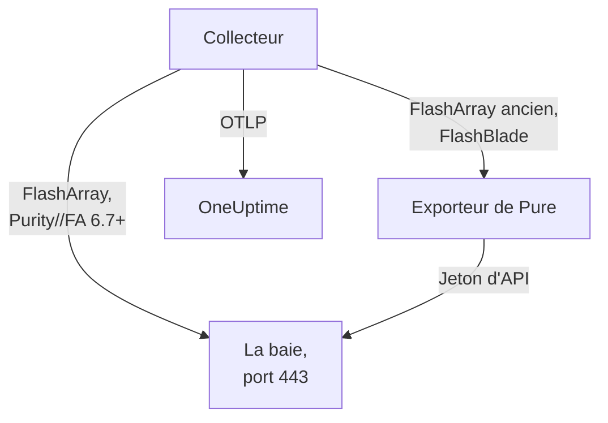

# Agent pour baies de stockage

L'agent Storage Array de OneUptime surveille les baies de stockage : capacité et réduction de données, latence, IOPS et bande passante, volumes, hôtes, pods et réplication, santé du matériel, systèmes de fichiers et buckets. C'est un OpenTelemetry Collector standard qui collecte les endpoints OpenMetrics de la baie avec le jeton d'API d'un utilisateur en lecture seule, appose l'identité de votre baie sur chaque métrique et l'envoie à OneUptime. Les [moniteurs de baies de stockage](/docs/monitor/storage-array-monitor) alertent sur ce qui arrive.

:::cards
- [Installer l'agent](#installer-lagent): Un utilisateur en lecture seule, puis le script d'installation ou Docker Compose.
- [Ce que l'agent collecte](#ce-que-collecte-lagent): Chaque endpoint, et les pages construites à partir de lui.
- [Surveiller plusieurs baies](#surveiller-plusieurs-baies): Un agent par baie, sur une seule machine.
- [Dépannage](#dépannage): Un script de diagnostic, et les problèmes habituels.
:::

## Fonctionnement

Storage Arrays est un produit qui fonctionne de la même façon pour chaque fabricant. Il prend en charge :

| Baie | Comment l'agent la lit | Configuration du collecteur |
| --- | --- | --- |
| **Pure Storage FlashArray**, Purity//FA 6.7 et ultérieur | L'endpoint OpenMetrics propre à la baie (`https://<array>/metrics/...?namespace=purefa`) : rien ne tourne à côté du collecteur | `otel-collector-config.yaml` (par défaut) |
| **Pure Storage FlashArray**, Purity//FA plus ancien | L'exporteur OpenMetrics FlashArray de Pure, que le même fichier Compose exécute comme service `pure-fa-exporter` | `otel-collector-config.flasharray-exporter.yaml` |
| **Pure Storage FlashBlade** | L'exporteur OpenMetrics FlashBlade de Pure, que le même fichier Compose exécute comme service `pure-fb-exporter` | `otel-collector-config.flashblade.yaml` |

Pure Storage a pris le nom **Everpure** en février 2026. FlashArray, FlashBlade et Purity ont gardé leur nom, tout comme les métriques `purefa_*` et `purefb_*` : tout ce qui figure sur cette page s'applique donc aux baies vendues sous l'un ou l'autre nom.



Un agent surveille une baie : exécutez un agent par baie (voir [Surveiller plusieurs baies](#surveiller-plusieurs-baies)). La baie s'enregistre avec ses premières données, sous le nom que l'agent appose sur chaque métrique en tant que `storage.array.name`.

## Avant de commencer

- Docker Engine 20.10 ou ultérieur avec le plugin Docker Compose v2, sur une machine qui peut joindre l'interface d'administration de la baie en HTTPS (TCP 443).
- Un compte administrateur sur la baie, pour créer un utilisateur avec le rôle intégré **readonly** et un jeton d'API pour lui.
- Une clé d'ingestion. Créez-en une sous **Paramètres du projet → Télémétrie & APM → Clés d'ingestion** et copiez sa valeur.

### Où exécuter l'agent

L'agent communique avec l'interface d'administration de la baie en HTTPS : il peut donc tourner sur n'importe quelle machine dotée de Docker et d'une route vers le réseau d'administration sur TCP 443, comme un hôte de supervision ou une petite VM d'administration. Préférez une machine dont le stockage ne se trouve pas sur la baie qu'elle surveille : si la baie tombe, votre supervision ne doit pas tomber avec elle. L'écouteur syslog facultatif nécessite aussi que la baie joigne l'agent sur le port syslog (voir [Envoyer le syslog de la baie](#facultatif-envoyer-le-syslog-de-la-baie)).

## Installer l'agent

:::steps
### Créer l'utilisateur en lecture seule et le jeton d'API

L'agent ne fait que lire. Donnez-lui un utilisateur dédié avec le rôle intégré **readonly**, jamais un administrateur, et un jeton d'API pour cet utilisateur. Créez le jeton **sans date d'expiration**, sinon l'agent s'arrête le jour où le jeton expire.

:::tabs
@tab Purity CLI
Connectez-vous en SSH à la FlashArray en tant qu'administrateur. La première commande demande le mot de passe du nouvel utilisateur ; la seconde affiche son jeton d'API, un UUID :

```bash
pureadmin create --role readonly oneuptime
pureadmin create --api-token oneuptime
```
@tab FlashArray GUI
1. Ouvrez _Settings → Users and Policies_ (_Settings → Access_ sur les versions plus anciennes).
2. Dans le menu ⋮ du panneau **Users**, choisissez **Create User…**, nommez l'utilisateur `oneuptime` et donnez-lui le rôle readonly.
3. Dans le menu ⋮ du nouvel utilisateur, choisissez **Create API Token…**, laissez **Expires In** vide et copiez le jeton.
@tab FlashBlade
Créez de la même façon un utilisateur avec le rôle **readonly** et un jeton d'API pour lui : dans les paramètres utilisateur de l'interface FlashBlade, ou avec `pureadmin` dans la CLI Purity//FB. Sur une version sans utilisateurs locaux, utilisez un compte d'annuaire (LDAP ou Active Directory) dont le groupe correspond au rôle readonly. Les jetons d'API FlashBlade commencent par `T-`.
:::

### Vérifier si la FlashArray sert ses propres métriques

Pure documente l'endpoint OpenMetrics natif pour **Purity//FA 6.7.0 et ultérieur** (l'avis d'obsolescence de l'exporteur FlashArray de Pure indique 6.6.11 et ultérieur). Le plus rapide pour le savoir est de demander à la baie, depuis la machine sur laquelle l'agent tournera :

```bash
curl -k 'https://<array>/metrics/array?namespace=purefa' --header 'Authorization: Bearer <api-token>' | grep purefa_info
```

Une ligne `purefa_info{...} 1` signifie que la baie sert ses métriques nativement : utilisez la configuration par défaut. Un `404` signifie que non : utilisez la configuration avec exporteur, qui exécute l'exporteur de Pure à côté du collecteur. Pure a rendu cet exporteur obsolète : passez donc à la configuration native une fois la baie mise à niveau. Une FlashBlade passe toujours par l'exporteur FlashBlade de Pure : ignorez cette étape dans ce cas.

### Installer et démarrer l'agent

:::tabs
@tab install.sh
Téléchargez le script d'installation et exécutez-le sur la machine qui hébergera l'agent :

```bash
curl -sSL https://raw.githubusercontent.com/OneUptime/oneuptime/master/agents/StorageArrayAgent/install.sh -o install.sh
bash install.sh
```

Le script demande de quelle baie il s'agit (une FlashArray qui sert des métriques natives, une FlashArray sous un Purity//FA plus ancien, ou une FlashBlade), puis votre URL OneUptime, la clé d'ingestion, un nom pour la baie, l'adresse d'administration de la baie et le jeton d'API de l'utilisateur en lecture seule (lu sans écho). Il s'installe dans `/opt/oneuptime-storage-array-agent`, télécharge le fichier Compose et les trois configurations du collecteur, écrit un fichier en `0600` nommé `.env` avec la configuration et le profil Compose correspondants, et démarre l'agent avec Docker Compose. Il met chaque valeur entre guillemets pour Docker Compose, telle que vous l'avez saisie. Le relancer réutilise tout le contenu d'un `.env` existant au lieu de poser de nouveau les questions, et conserve un fichier que vous avez modifié sous `<file>.bak.<timestamp>` avant de le remplacer.
@tab Docker Compose
Téléchargez `docker-compose.yml` et les trois fichiers `otel-collector-config*.yaml` depuis le [répertoire StorageArrayAgent](https://github.com/OneUptime/oneuptime/tree/master/agents/StorageArrayAgent) dans un nouveau dossier :

```bash
curl -fsSLO https://raw.githubusercontent.com/OneUptime/oneuptime/master/agents/StorageArrayAgent/docker-compose.yml
curl -fsSLO https://raw.githubusercontent.com/OneUptime/oneuptime/master/agents/StorageArrayAgent/otel-collector-config.yaml
curl -fsSLO https://raw.githubusercontent.com/OneUptime/oneuptime/master/agents/StorageArrayAgent/otel-collector-config.flasharray-exporter.yaml
curl -fsSLO https://raw.githubusercontent.com/OneUptime/oneuptime/master/agents/StorageArrayAgent/otel-collector-config.flashblade.yaml
```

Créez un fichier `.env` à côté. Il contient le jeton d'API : gardez-le privé avec `chmod 600 .env`. Pour une FlashArray qui sert des métriques natives :

```bash title=".env"
ONEUPTIME_URL=YOUR_ONEUPTIME_URL
ONEUPTIME_TELEMETRY_INGESTION_KEY=YOUR_TELEMETRY_INGESTION_TOKEN
STORAGE_ARRAY_NAME=my-storage-array
STORAGE_SYSTEM=purestorage.flasharray
STORAGE_ARRAY_COLLECTOR_CONFIG=otel-collector-config.yaml
COMPOSE_PROFILES=
PURE_FA_ENDPOINT=fa-prod-01.example.com
PURE_FA_API_TOKEN=YOUR_READ_ONLY_API_TOKEN
PURE_FB_ENDPOINT=
PURE_FB_API_TOKEN=
STORAGE_ARRAY_INSECURE_SKIP_VERIFY=true
```

Pour une FlashArray sous un Purity//FA plus ancien, définissez `STORAGE_ARRAY_COLLECTOR_CONFIG=otel-collector-config.flasharray-exporter.yaml` et `COMPOSE_PROFILES=flasharray-exporter`. Pour une FlashBlade, définissez `STORAGE_SYSTEM=purestorage.flashblade`, `STORAGE_ARRAY_COLLECTOR_CONFIG=otel-collector-config.flashblade.yaml` et `COMPOSE_PROFILES=flashblade`, et renseignez `PURE_FB_ENDPOINT` et `PURE_FB_API_TOKEN` à la place de la paire `PURE_FA_*`. Démarrez l'agent :

```bash
docker compose up -d
```
:::

### Vérifier que l'agent s'exécute

```bash
docker compose ps
docker logs -f oneuptime-storage-array-agent
```

`docker compose ps` liste le collecteur (`oneuptime-storage-array-agent`) et, avec une configuration à exporteur, l'exporteur (`pure-fa-exporter` ou `pure-fb-exporter`). Les journaux du collecteur doivent afficher cette ligne une fois qu'il a démarré :

```text
Everything is ready. Begin running and processing data.
```

### Trouver la baie dans OneUptime

Ouvrez **Produits → Infrastructure → Storage Arrays → All Storage Arrays**. Après la première collecte (une minute environ), la baie est là avec sa capacité, ses performances, ses alertes ouvertes et son matériel. Les volumes, hôtes et pods suivent en moins de 2 minutes, les systèmes de fichiers et buckets d'une FlashBlade en moins de 5, et les répertoires FlashArray en moins de 30.
:::

## Variables d'environnement

Le script d'installation les écrit dans `/opt/oneuptime-storage-array-agent/.env` ; une installation Docker Compose les lit dans le `.env` situé à côté de `docker-compose.yml`. Après en avoir modifié une, exécutez `docker compose up -d` dans ce dossier.

| Variable | Obligatoire | Description |
| --- | --- | --- |
| `ONEUPTIME_URL` | Oui | Votre URL OneUptime, comme `https://oneuptime.com` ou votre instance auto-hébergée. Utilisez `http://` et son port si l'instance ne parle que HTTP. |
| `ONEUPTIME_TELEMETRY_INGESTION_KEY` | Oui | La clé d'ingestion de **Paramètres du projet → Télémétrie & APM → Clés d'ingestion**. |
| `STORAGE_ARRAY_NAME` | Oui | Le nom sous lequel la baie s'enregistre dans OneUptime, apposé sur chaque métrique comme attribut de ressource `storage.array.name`. Gardez-le stable : le modifier plus tard enregistre une seconde baie. Le collecteur refuse de démarrer sans lui. |
| `STORAGE_SYSTEM` | Non | La plateforme, apposée comme attribut de ressource `storage.system` : `purestorage.flasharray` ou `purestorage.flashblade`. Par défaut `purestorage.flasharray`. |
| `STORAGE_ARRAY_COLLECTOR_CONFIG` | Non | La configuration fournie du collecteur qui s'exécute : `otel-collector-config.yaml` (FlashArray native : par défaut), `otel-collector-config.flasharray-exporter.yaml` (FlashArray plus ancienne) ou `otel-collector-config.flashblade.yaml` (FlashBlade). |
| `COMPOSE_PROFILES` | Non | Démarre l'exporteur que collecte la configuration choisie : vide pour la configuration FlashArray native, `flasharray-exporter` ou `flashblade` pour les deux autres. |
| `PURE_FA_ENDPOINT` | FlashArray | L'adresse d'administration de la FlashArray : un nom d'hôte ou une IP, sans `https://`. |
| `PURE_FA_API_TOKEN` | FlashArray | Le jeton d'API de l'utilisateur FlashArray doté du rôle readonly. |
| `PURE_FB_ENDPOINT` | FlashBlade | L'adresse d'administration de la FlashBlade : un nom d'hôte ou une IP, sans `https://`. |
| `PURE_FB_API_TOKEN` | FlashBlade | Le jeton d'API de l'utilisateur FlashBlade doté du rôle readonly. |
| `STORAGE_ARRAY_INSECURE_SKIP_VERIFY` | Non | `true` accepte le certificat auto-signé de la baie sur l'endpoint natif ; `false` le vérifie. Par défaut `true`. Les exporteurs de Pure ne vérifient jamais le certificat de la baie : ce réglage ne s'applique donc pas à eux. |

## Comment l'agent collecte

- **Un job de collecte par endpoint, chacun lu aussi souvent que nécessaire.** FlashArray : `/metrics/array` toutes les 60 secondes ; `/metrics/volumes`, `/metrics/hosts` et `/metrics/pods` toutes les 2 minutes ; `/metrics/directories` toutes les 30 minutes, conformément au conseil de Pure, car l'espace des répertoires est coûteux à calculer pour la baie. FlashBlade : `/metrics/array` toutes les 60 secondes ; `/metrics/filesystems` et `/metrics/objectstore` toutes les 5 minutes, là encore selon le conseil de Pure de lire les endpoints des systèmes de fichiers et du stockage objet moins souvent que la baie.
- **Chaque job étiquette ses séries avec `scrape_endpoint: <endpoint>`.** Chaque endpoint exporte aussi `purefa_info` ou `purefb_info` : OneUptime sait ainsi de quelles familles un lot est la liste complète. C'est ainsi qu'un volume, un hôte, un pod, un système de fichiers ou un bucket supprimé quitte l'inventaire au lieu d'y traîner. Conservez les labels tels que livrés.
- **La latence par volume et par hôte garde trois dimensions.** Chaque volume et chaque hôte exporte sa latence selon jusqu'à seize `dimension`s. Une règle `metric_relabel_configs` garde `usec_per_read_op`, `usec_per_write_op` et `usec_per_mirrored_write_op` et supprime la ventilation par limite de débit QoS, file d'attente, SAN et temps de service, qui multiplie les séries d'une grande baie. La ventilation à l'échelle de la baie sur `purefa_array_performance_latency_usec` est conservée. Supprimez la règle pour garder aussi la ventilation par volume.
- **Le jeton d'API est un jeton Bearer.** La configuration native l'envoie à la baie elle-même ; les configurations à exporteur l'envoient à l'exporteur uniquement via le réseau Compose, et les ports des exporteurs ne sont jamais publiés.
- **Pas de `send_batch_max_size`.** OneUptime reconstruit l'inventaire à partir d'une collecte entière par requête : le processeur `batch` fourni ne répartit donc jamais une collecte entre plusieurs exports. Conservez les réglages de batch tels que livrés.

## Ce que collecte l'agent

Les conventions sémantiques de Pure sont communes à l'endpoint FlashArray natif et aux deux exporteurs. Chaque valeur est une jauge que la baie calcule elle-même (latences en microsecondes par opération, débit par seconde) : aucun taux n'est donc à calculer, et les objets sont nommés par des **labels de point de données** : `name` pour les volumes, pods, répertoires, systèmes de fichiers et buckets, `host` pour les hôtes, `component_name` pour le matériel FlashArray. L'agent ajoute les attributs de ressource `storage.array.name` et `storage.system`, si bien que OneUptime range tout sous votre baie :

| Endpoint | Familles de métriques | Ce que OneUptime en construit |
| --- | --- | --- |
| FlashArray `/metrics/array` | `purefa_info`, `purefa_alerts_open`, `purefa_array_space_*`, `purefa_array_performance_*`, `purefa_hw_component_status`, `purefa_hw_component_temperature_celsius`, `purefa_hw_controller_info`, `purefa_drive_capacity_bytes`, `purefa_network_interface_*` | Le nom, la version de Purity et l'ID système de la baie ; la capacité, l'espace utilisé et la réduction de données ; le nombre d'alertes ouvertes ; la santé de la baie ; la page **Hardware** (composants, disques, contrôleurs, interfaces réseau) |
| FlashArray `/metrics/volumes` | `purefa_volume_performance_*`, `purefa_volume_space_*`, `purefa_volume_qos_*` | La page **Volumes** : taille provisionnée et physique, réduction de données, latence en lecture et en écriture, IOPS et bande passante par volume |
| FlashArray `/metrics/hosts` | `purefa_host_connectivity_info`, `purefa_host_connections_info`, `purefa_host_performance_*`, `purefa_host_space_*` | La page **Hôtes** : connectivité (chemins redondants ou non), volumes connectés, latence, IOPS et bande passante par hôte |
| FlashArray `/metrics/pods` | `purefa_pod_performance_*`, `purefa_pod_space_*`, `purefa_pod_replica_links_*`, `purefa_pod_mediator_status` | La page **Replication** : pods ActiveCluster et ActiveDR, état et retard des liens de réplique |
| FlashArray `/metrics/directories` | `purefa_directory_performance_*`, `purefa_directory_space_*` | La page **Directories** (FlashArray File Services) |
| FlashBlade `/metrics/array` | `purefb_info`, `purefb_alerts_open`, `purefb_array_space_*`, `purefb_array_performance_*`, `purefb_hardware_health` | Le nom, la version de Purity et l'ID système de la FlashBlade ; la capacité et la réduction de données ; le nombre d'alertes ouvertes ; la santé de la baie ; la page **Hardware** |
| FlashBlade `/metrics/filesystems` | `purefb_file_systems_space_*`, `purefb_file_systems_performance_*` | La page **File Systems** : espace provisionné et utilisé, réduction de données, latence, IOPS et bande passante par système de fichiers |
| FlashBlade `/metrics/objectstore` | `purefb_buckets_space_*`, `purefb_buckets_quota_space_bytes`, `purefb_buckets_object_count`, `purefb_buckets_performance_*`, `purefb_object_store_accounts_*` | La page **Buckets** : espace, quota, nombre d'objets et performances par bucket, regroupés par compte |

La santé de la baie sur sa page **Vue d'ensemble** est **Critique** tant qu'elle signale une alerte critique ouverte, ou un composant matériel, un disque ou un contrôleur critique, en panne, manquant ou défaillant ; **Warning** tant qu'elle signale une alerte d'avertissement ouverte, ou un composant dégradé ou inconnu ; et **OK** sinon. Dans les critères de moniteur, les attributs de la baie prennent un préfixe `resource.` (`resource.storage.array.name`, `resource.storage.system`), tandis que les labels de point de données restent nus (`name`, `host`, `dimension`, `space`).

## Facultatif — Envoyer le syslog de la baie

Par défaut, l'agent n'envoie que des métriques : la page **Journaux** de la baie reste donc vide. Les baies transfèrent leurs alertes et leurs événements d'audit en syslog, et chaque configuration fournie du collecteur contient une paire de récepteurs `syslog` commentée (TCP et UDP sur le port 5514, RFC 3164), reliée à un pipeline `logs` commenté qui appose `storage.array.name` pour que les journaux arrivent sur votre baie.

:::steps
### Activer les récepteurs

Décommentez les deux récepteurs `syslog/*` et le pipeline `logs` dans la configuration du collecteur que vous utilisez. Les horodatages RFC 3164 ne portent aucun fuseau horaire : réglez `location` sur le fuseau horaire de la baie, sauf si son horloge est en UTC.

### Ouvrir le port

Décommentez le bloc `ports:` dans `docker-compose.yml` pour que la machine publie `5514/tcp` et `5514/udp`, puis exécutez `docker compose up -d`. Ouvrez le port dans le pare-feu de la machine pour le réseau d'administration de la baie.

### Pointer la baie vers l'agent

Faites-le en tant qu'administrateur, pas avec l'utilisateur de supervision en lecture seule. Sur une FlashArray, ouvrez _Settings → System → Syslog Servers_, ajoutez `udp://<agent-host>:5514` (ou `tcp://<agent-host>:5514`) et envoyez un message de test. Sur une FlashBlade, ajoutez un serveur syslog avec la même URI dans ses paramètres syslog. Les deux baies acceptent la forme `PROTOCOL://HOST:PORT`, y compris via leurs API REST (`syslog-servers`).
:::

Un récepteur syslog n'écoute que sur un seul transport, c'est pourquoi TCP et UDP sont deux récepteurs : laissez-en un commenté si vous n'avez besoin que de l'autre. L'image standard du collecteur lit le syslog tel quel : aucune image personnalisée n'est nécessaire.

## Étiqueter la baie avec des étiquettes de projet

Un attribut de ressource qui commence par `oneuptime.label.` devient une étiquette de projet sur la baie de stockage : `oneuptime.label.<dimension>=<value>` correspond à l'étiquette `<dimension>:<value>`. Ajoutez les attributs au processeur `resource` de la configuration du collecteur que vous utilisez, à côté de `storage.array.name` :

```yaml
processors:
  resource:
    attributes:
      # ...existing attributes...
      - key: oneuptime.label.team
        value: storage
        action: upsert
      - key: oneuptime.label.env
        value: production
        action: upsert
```

Le collecteur ne lit sa configuration qu'au démarrage : exécutez `docker compose restart oneuptime-storage-array-agent`. La baie affiche alors les étiquettes `team:storage` et `env:production`. Les étiquettes sont comparées sans tenir compte de la casse : une étiquette `Production` existante est donc réutilisée plutôt que dupliquée, et l'agent ne retire jamais une étiquette que quelqu'un a ajoutée dans OneUptime.

## Surveiller plusieurs baies

Un agent lit une baie. Pour en surveiller plusieurs depuis la même machine, installez chacune dans son propre dossier avec son propre `.env`, comme `INSTALL_DIR=/opt/oneuptime-storage-array-agent-fa02 bash install.sh`, et donnez à chacune son propre `container_name` dans son `docker-compose.yml` (comme `oneuptime-storage-array-agent-fa02`) : deux conteneurs ne peuvent pas partager un nom. Passez le dossier au script de diagnostic avec `-d`.

## Exécuter comme service systemd

Pour démarrer l'agent avec la machine et le relancer en cas d'échec, installez son unité systemd. Elle suppose que l'agent se trouve dans `/opt/oneuptime-storage-array-agent`, là où le script d'installation le place :

```bash
sudo curl -fsSL https://raw.githubusercontent.com/OneUptime/oneuptime/master/agents/StorageArrayAgent/systemd/oneuptime-storage-array-agent.service -o /etc/systemd/system/oneuptime-storage-array-agent.service
sudo systemctl daemon-reload
sudo systemctl enable --now oneuptime-storage-array-agent
```

## Mettre à jour l'agent

L'agent signale comme **Version de l'agent** la version du collecteur qu'épinglent ses fichiers. Lorsque celle-ci est plus ancienne que la version qu'épingle cette version de OneUptime, un signe d'avertissement apparaît à côté, sur la page **Vue d'ensemble** de la baie. Sélectionnez-le pour voir ces commandes. Un agent installé avant que ses fichiers ne signalent une version n'en affiche aucune tant qu'il n'a pas été mis à jour de cette façon.

L'image du collecteur est épinglée dans `docker-compose.yml` et ses configurations sont des fichiers situés à côté : tirer les images ne suffit donc pas à faire avancer l'agent. Relancez `install.sh` : il réutilise chaque valeur de votre `.env` existant (aucune question n'est reposée), actualise `docker-compose.yml` et les trois configurations du collecteur (un fichier que vous avez modifié est conservé sous `<file>.bak.<timestamp>`), et recrée l'agent pour que le collecteur lise sa nouvelle configuration. Un agent installé en dehors de `/opt/oneuptime-storage-array-agent` a besoin de son dossier : `INSTALL_DIR=<folder> bash install.sh`.

```bash
curl -sSL https://raw.githubusercontent.com/OneUptime/oneuptime/master/agents/StorageArrayAgent/install.sh -o install.sh
bash install.sh
```

Vous l'avez plutôt installé avec Docker Compose ? Dans le dossier de l'agent, téléchargez de nouveau le fichier Compose et les trois configurations du collecteur (et refaites toute modification que vous y aviez apportée), puis tirez les images et recréez l'agent :

```bash
curl -fsSLO https://raw.githubusercontent.com/OneUptime/oneuptime/master/agents/StorageArrayAgent/docker-compose.yml
curl -fsSLO https://raw.githubusercontent.com/OneUptime/oneuptime/master/agents/StorageArrayAgent/otel-collector-config.yaml
curl -fsSLO https://raw.githubusercontent.com/OneUptime/oneuptime/master/agents/StorageArrayAgent/otel-collector-config.flasharray-exporter.yaml
curl -fsSLO https://raw.githubusercontent.com/OneUptime/oneuptime/master/agents/StorageArrayAgent/otel-collector-config.flashblade.yaml
docker compose pull
docker compose up -d --force-recreate
```

## Désinstaller l'agent

```bash
cd /opt/oneuptime-storage-array-agent
docker compose down
```

Supprimez ensuite l'utilisateur en lecture seule et son jeton d'API sur la baie si vous n'en avez plus besoin.

## Dépannage

:::details Exécutez d'abord le script de diagnostic
L'agent est livré avec un script, [`troubleshoot.sh`](https://github.com/OneUptime/oneuptime/blob/master/agents/StorageArrayAgent/troubleshoot.sh), qui vérifie toute la chaîne : le runtime de conteneurs ; l'endpoint de la baie exactement comme le collecteur l'atteint (l'endpoint natif ou l'exporteur de Pure : DNS, TLS, si une FlashArray a bien l'endpoint natif, et si la baie accepte le jeton d'API, que le script passe à curl sur stdin) ; le nom de la baie apposé sur chaque métrique ; la forme du jeton ; les métriques propres au collecteur ; et si OneUptime accepte la clé d'ingestion. Cette dernière vérification est la plus importante. OneUptime refuse une clé erronée avec `401` (`422` pour une clé désactivée ou une clé de navigateur), et le collecteur traite les deux comme définitifs : il supprime le lot et journalise une seule erreur `Exporting failed`, facile à manquer alors que le conteneur reste en bonne santé. Le script interroge `GET <url>/otlp/v1/validate` depuis le réseau de l'agent pour obtenir directement `200` (valide) ou `401` (invalide), et se rabat sur `POST /fluentd/v1/logs` avec les serveurs plus anciens.

```bash
curl -sSL https://raw.githubusercontent.com/OneUptime/oneuptime/master/agents/StorageArrayAgent/troubleshoot.sh -o troubleshoot.sh
bash troubleshoot.sh    # add -d <dir> if you installed outside /opt/oneuptime-storage-array-agent
```

Il se termine par un verdict qui nomme la cause la plus probable.
:::

:::details Aucune baie n'apparaît dans OneUptime
1. Lisez les journaux du collecteur : `docker logs oneuptime-storage-array-agent`. `server returned HTTP status 401` signifie que la baie a refusé le jeton d'API, `404` que la FlashArray n'a pas d'endpoint natif, `x509` que la vérification TLS est active face au certificat auto-signé de la baie, `no such host` ou `connection refused` un `PURE_FA_ENDPOINT` ou un `PURE_FB_ENDPOINT` erroné, et un `401` à l'export une clé d'ingestion erronée.
2. Interrogez la baie depuis le réseau de l'agent. L'image du collecteur n'a ni shell ni curl : interrogez donc depuis un conteneur de son réseau. `docker run --rm --network container:oneuptime-storage-array-agent curlimages/curl -sk -H 'Authorization: Bearer <api-token>' 'https://<array>/metrics/array?namespace=purefa'` doit afficher des lignes `purefa_*`.
3. Vérifiez que `STORAGE_ARRAY_NAME` est défini : la baie est retrouvée par son attribut de ressource `storage.array.name`, et le collecteur refuse de démarrer sans lui.
:::

:::details La baie apparaît comme déconnectée
Une baie passe à l'état déconnecté quand OneUptime n'a rien reçu d'elle pendant 15 minutes ; OneUptime vérifie toutes les 5 minutes, et le temps pendant lequel il ne recevait lui-même pas de données ne compte pas. Vérifiez que le collecteur tourne (`docker compose ps`), que ses journaux ne montrent aucune erreur de collecte ni d'export, et que la machine joint toujours la baie et votre URL OneUptime. La baie repasse à l'état connecté avec ses données suivantes.
:::

:::details La FlashArray répond 404
Son Purity//FA n'a pas d'endpoint OpenMetrics natif. Relancez `install.sh` et choisissez l'option Purity plus ancien, ou définissez `STORAGE_ARRAY_COLLECTOR_CONFIG=otel-collector-config.flasharray-exporter.yaml` et `COMPOSE_PROFILES=flasharray-exporter` dans `.env` et exécutez `docker compose up -d`. Après la mise à niveau de la baie vers Purity//FA 6.7 ou ultérieur, revenez à la configuration native et supprimez le profil.
:::

:::details La baie refuse le jeton d'API
Vérifiez que vous avez collé le jeton d'API et non le mot de passe de l'utilisateur, que l'utilisateur existe toujours et a le rôle readonly, et que le jeton n'a pas expiré. Créez un nouveau jeton (`pureadmin create --api-token oneuptime` sur une FlashArray), placez-le dans `.env` et exécutez `docker compose up -d`. Via les exporteurs de Pure, un jeton refusé apparaît dans le journal du collecteur comme un HTTP `400` de l'exporteur, dont le corps indique `failed to login`.
:::

:::details Erreurs x509 ou TLS
Les baies présentent par défaut un certificat auto-signé, auquel aucune image Docker ne fait confiance. Définissez `STORAGE_ARRAY_INSECURE_SKIP_VERIFY=true` (le choix pratique sur un réseau d'administration privé), ou installez sur la baie un certificat d'une AC à laquelle l'image du collecteur fait confiance.
:::

:::details pure-fa-exporter ou pure-fb-exporter ne se résout pas
L'exporteur ne tourne pas : `COMPOSE_PROFILES` doit correspondre à `STORAGE_ARRAY_COLLECTOR_CONFIG` (`flasharray-exporter` pour la configuration avec l'exporteur FlashArray, `flashblade` pour la configuration FlashBlade). Corrigez `.env` et exécutez `docker compose up -d` ; `docker compose ps` liste alors l'exporteur.
:::

:::details Des volumes ou hôtes supprimés restent dans l'inventaire
OneUptime retire un objet quand une collecte complète de son endpoint ne le contient plus, ce qu'il reconnaît au label `scrape_endpoint`. Si vous avez remplacé la configuration fournie du collecteur par la vôtre, conservez les labels `scrape_endpoint` sur ses jobs de collecte ; sinon, les objets ne quittent l'inventaire que lorsqu'ils deviennent obsolètes.
:::

:::details Les métriques arrivent sous la mauvaise baie
OneUptime enregistre une baie de stockage par son `storage.array.name`, que l'agent tire de `STORAGE_ARRAY_NAME`. Le modifier après les premières données crée une seconde baie au lieu de renommer la première.
:::

:::details Envoyer des métriques sans l'agent
L'agent n'est qu'une configuration standard du collecteur : les collecteurs que vous exécutez déjà peuvent donc faire le même travail. Copiez les jobs de collecte et le processeur `resource` de la configuration fournie dans la vôtre. L'attribut de ressource `storage.array.name` est ce qui enregistre la baie dans OneUptime, et les suppressions de `service.name` / `service.instance.id` évitent que les données soient rangées sous un service : gardez les deux, et gardez les labels `scrape_endpoint`.
:::

## Étapes suivantes

:::cards
- [Surveillance des baies de stockage](/docs/monitor/storage-array-monitor): Alerter sur les alertes, la capacité, la latence, le matériel, les chemins d'hôte, la réplication et les systèmes de fichiers.
- [Agent VMware](/docs/telemetry/vmware): VMware tourne sur la baie ? Voyez aussi ses datastores et ses VM.
- [Collecteur OpenTelemetry sur l'hôte](/docs/telemetry/host-otel-collector): La vue système des machines qui utilisent la baie.
:::
