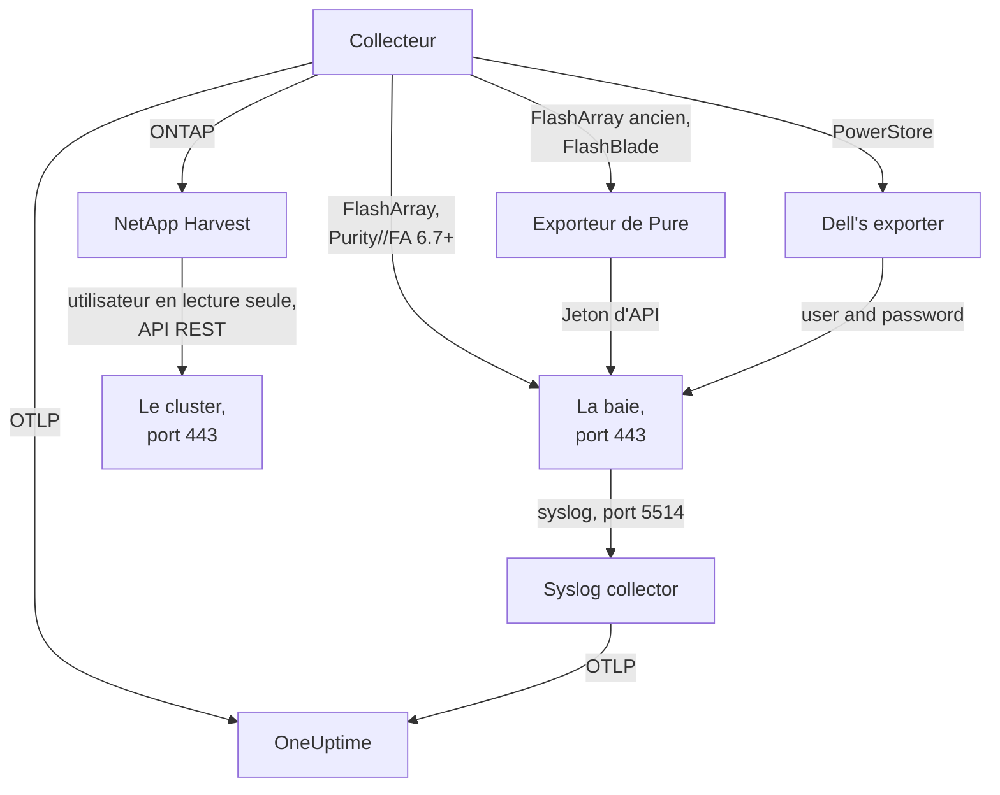

# Agent pour baies de stockage

L'agent Baie de stockage de OneUptime surveille les baies de stockage : capacité et réduction de données, latence, IOPS et bande passante, volumes, hôtes, pods et réplication, santé du matériel, systèmes de fichiers et buckets, et sur NetApp ONTAP ses agrégats, SVM, LUN et relations SnapMirror. C'est un OpenTelemetry Collector standard qui collecte les endpoints OpenMetrics de la baie avec le jeton d'API d'un utilisateur en lecture seule (ou, pour ONTAP, Harvest, l'exporteur de NetApp, qui tourne à côté de lui), appose l'identité de votre baie sur chaque métrique et l'envoie à OneUptime. Les [moniteurs de baies de stockage](/docs/monitor/storage-array-monitor) alertent sur ce qui arrive.

:::cards
- [Installer l'agent](#installer-lagent): Un utilisateur en lecture seule, puis le script d'installation ou Docker Compose.
- [Dell PowerScale](#dell-powerscale): SNMP sur le cluster, chaque nœud interrogé, et ce que montrent ses pages.
- [Ce que l'agent collecte](#ce-que-collecte-lagent): Chaque endpoint, et les pages construites à partir de lui.
- [Surveiller plusieurs baies](#surveiller-plusieurs-baies): Un agent par baie, sur une seule machine.
- [Dépannage](#dépannage): Un script de diagnostic, et les problèmes habituels.
:::

## Fonctionnement

Storage Arrays est un produit qui fonctionne de la même façon pour chaque fabricant. Il prend en charge :

| Baie | `storage.system` | Comment l'agent la lit | Configuration du collecteur |
| --- | --- | --- | --- |
| **Pure Storage FlashArray**, Purity//FA 6.7 et ultérieur | `purestorage.flasharray` | L'endpoint OpenMetrics propre à la baie (`https://<array>/metrics/...?namespace=purefa`) : rien ne tourne à côté du collecteur | `otel-collector-config.yaml` (par défaut) |
| **Pure Storage FlashArray**, Purity//FA plus ancien | `purestorage.flasharray` | L'exporteur OpenMetrics FlashArray de Pure, que le même fichier Compose exécute comme service `pure-fa-exporter` | `otel-collector-config.flasharray-exporter.yaml` |
| **Pure Storage FlashBlade** | `purestorage.flashblade` | L'exporteur OpenMetrics FlashBlade de Pure, que le même fichier Compose exécute comme service `pure-fb-exporter` | `otel-collector-config.flashblade.yaml` |
| **Dell PowerStore** | `dell.powerstore` | Le PowerStore Metrics Exporter de Dell, que le même fichier Compose construit et exécute comme service `powerstore-exporter` ; les alertes du cluster arrivent par syslog à son service `powerstore-syslog` | `otel-collector-config.powerstore.yaml` |
| **NetApp ONTAP** 9.12.1 et ultérieur (AFF, FAS, ASA, ONTAP Select, Cloud Volumes ONTAP), et **Amazon FSx for NetApp ONTAP** | `netapp.ontap` | [NetApp Harvest](https://github.com/NetApp/harvest) 26.11, que le même fichier Compose exécute comme service `netapp-harvest` : il se connecte à l'API REST du cluster avec un utilisateur en lecture seule et son mot de passe | `otel-collector-config.netapp-ontap.yaml` |
| **Dell PowerScale** (Isilon), OneFS 8.0 et ultérieur | `dell.powerscale` | Chaque nœud en SNMP (l'ISILON-MIB de Dell), avec le récepteur SNMP propre au collecteur : rien ne tourne à côté du collecteur | `otel-collector-config.powerscale.yaml` |

ONTAP n'a pas d'endpoint de métriques qui lui soit propre : l'agent exécute donc à côté du collecteur l'exporteur open source de NetApp, Harvest. Harvest lit l'API REST du cluster et sert ce qu'il a lu sur le réseau Compose, chaque série étant nommée `netapp_<object>_<counter>` ; le collecteur les collecte et les transmet. Harvest n'écrit jamais sur le cluster, et son rapport AutoSupport à NetApp est désactivé.

Pure Storage a pris le nom **Everpure** en février 2026. FlashArray, FlashBlade et Purity ont gardé leur nom, tout comme les métriques `purefa_*` et `purefb_*` : tout ce qui figure sur cette page s'applique donc aux baies vendues sous l'un ou l'autre nom.

Un cluster **Dell PowerScale** se lit autrement : l'agent interroge chacun de ses nœuds en SNMP, avec une communauté en lecture seule ou un utilisateur SNMPv3 et sans jeton d'API. [Dell PowerScale](#dell-powerscale) le couvre de l'activation de SNMP jusqu'à ce que montrent ses pages ; les étapes d'installation ci-dessous sont celles de Pure Storage.



Un agent surveille une baie : exécutez un agent par baie (voir [Surveiller plusieurs baies](#surveiller-plusieurs-baies)). La baie s'enregistre avec ses premières données, sous le nom que l'agent appose sur chaque métrique en tant que `storage.array.name`.

## Avant de commencer

- Docker Engine 20.10 ou ultérieur avec le plugin Docker Compose v2, sur une machine qui peut joindre l'interface d'administration de la baie en HTTPS (TCP 443).
- Un compte administrateur sur la baie, pour créer un utilisateur avec le rôle intégré **readonly** et un jeton d'API pour lui. Sur ONTAP, un administrateur du cluster (sur Amazon FSx for NetApp ONTAP, `fsxadmin`), pour créer un utilisateur REST en lecture seule avec un mot de passe.
- Pour un Dell PowerStore, une machine x86-64 (Dell ne construit son exportateur que pour x86-64) et un utilisateur PowerStore pour l'agent : voir [Dell PowerStore](#dell-powerstore).
- Une clé d'ingestion. Créez-en une sous **Paramètres du projet → Télémétrie & APM → Clés d'ingestion** et copiez sa valeur.

### Où exécuter l'agent

L'agent communique avec l'interface d'administration de la baie en HTTPS : il peut donc tourner sur n'importe quelle machine dotée de Docker et d'une route vers le réseau d'administration sur TCP 443, comme un hôte de supervision ou une petite VM d'administration. Préférez une machine dont le stockage ne se trouve pas sur la baie qu'elle surveille : si la baie tombe, votre supervision ne doit pas tomber avec elle. L'écouteur syslog facultatif nécessite aussi que la baie joigne l'agent sur le port syslog (voir [Envoyer le syslog de la baie](#facultatif-envoyer-le-syslog-de-la-baie)).

## Installer l'agent

:::steps
### Créer l'utilisateur en lecture seule et le jeton d'API

L'agent ne fait que lire. Donnez-lui un utilisateur dédié avec le rôle intégré **readonly**, jamais un administrateur, et un jeton d'API pour cet utilisateur. Créez le jeton **sans date d'expiration**, sinon l'agent s'arrête le jour où le jeton expire.

:::tabs
@tab Purity CLI
Connectez-vous en SSH à la FlashArray en tant qu'administrateur. La première commande demande le mot de passe du nouvel utilisateur ; la seconde affiche son jeton d'API, un UUID :

```bash
pureadmin create --role readonly oneuptime
pureadmin create --api-token oneuptime
```
@tab FlashArray GUI
1. Ouvrez _Settings → Users and Policies_ (_Settings → Access_ sur les versions plus anciennes).
2. Dans le menu ⋮ du panneau **Users**, choisissez **Create User…**, nommez l'utilisateur `oneuptime` et donnez-lui le rôle readonly.
3. Dans le menu ⋮ du nouvel utilisateur, choisissez **Create API Token…**, laissez **Expires In** vide et copiez le jeton.
@tab FlashBlade
Créez de la même façon un utilisateur avec le rôle **readonly** et un jeton d'API pour lui : dans les paramètres utilisateur de l'interface FlashBlade, ou avec `pureadmin` dans la CLI Purity//FB. Sur une version sans utilisateurs locaux, utilisez un compte d'annuaire (LDAP ou Active Directory) dont le groupe correspond au rôle readonly. Les jetons d'API FlashBlade commencent par `T-`.
@tab ONTAP CLI
Connectez-vous en SSH à l'adresse d'administration du cluster en tant qu'administrateur. La première commande crée un rôle REST qui peut lire toutes les API et rien d'autre ; la seconde crée un utilisateur HTTP qui le détient, et demande son mot de passe :

```bash
security login rest-role create -role oneuptime-readonly -api /api -access readonly
security login create -user-or-group-name oneuptime -application http -authentication-method password -role oneuptime-readonly
```

L'agent se connecte avec cet utilisateur et ce mot de passe. Aucun jeton d'API n'intervient.
@tab ONTAP System Manager
1. Ouvrez _Cluster → Settings → Users and Roles_.
2. Sous **Roles**, choisissez **Add**, nommez le rôle `oneuptime-readonly`, saisissez `/api` comme **REST API path** et choisissez l'accès **Read-Only**.
3. Sous **Users**, choisissez **Add**, nommez l'utilisateur `oneuptime`, donnez-lui le nouveau rôle, ajoutez la méthode de connexion **HTTP** avec **Password**, et définissez le mot de passe.
@tab Amazon FSx for NetApp ONTAP
Connectez-vous en SSH à l'endpoint d'administration du système de fichiers (son nom DNS ou son IP, depuis la console FSx) en tant que `fsxadmin`, et créez l'utilisateur avec le rôle en lecture seule prédéfini de FSx. La commande demande son mot de passe :

```bash
security login create -user-or-group-name oneuptime -application http -authentication-method password -role fsxadmin-readonly
```

AWS gère le matériel du système de fichiers : FSx ne répond donc à aucune question sur les disques, les tiroirs ou les capteurs, et la page **Matériel** de la baie liste ses nœuds et ses ports, et le signale.
:::

### Vérifier si la FlashArray sert ses propres métriques

Pure documente l'endpoint OpenMetrics natif pour **Purity//FA 6.7.0 et ultérieur** (l'avis d'obsolescence de l'exporteur FlashArray de Pure indique 6.6.11 et ultérieur). Le plus rapide pour le savoir est de demander à la baie, depuis la machine sur laquelle l'agent tournera :

```bash
curl -k 'https://<array>/metrics/array?namespace=purefa' --header 'Authorization: Bearer <api-token>' | grep purefa_info
```

Une ligne `purefa_info{...} 1` signifie que la baie sert ses métriques nativement : utilisez la configuration par défaut. Un `404` signifie que non : utilisez la configuration avec exporteur, qui exécute l'exporteur de Pure à côté du collecteur. Pure a rendu cet exporteur obsolète : passez donc à la configuration native une fois la baie mise à niveau. Une FlashBlade passe toujours par l'exporteur FlashBlade de Pure, et un cluster ONTAP par NetApp Harvest : ignorez cette étape dans ces cas.

### Installer et démarrer l'agent

Chaque instance de OneUptime sert le script d'installation et les fichiers de l'agent de sa propre version : les commandes ci-dessous les téléchargent depuis `https://oneuptime.com`, donc sur une instance auto-hébergée, remplacez cette adresse par votre URL. Le script d'installation est d'abord enregistré sous `install.sh`, pour que vous puissiez le lire avant de l'exécuter.

:::tabs
@tab install.sh
Téléchargez le script d'installation et exécutez-le sur la machine qui hébergera l'agent :

```bash
curl -fsSL https://oneuptime.com/install/storage-array-agent -o install.sh
bash install.sh
```

Le script demande de quelle baie il s'agit (une FlashArray qui sert des métriques natives, une FlashArray sous un Purity//FA plus ancien, une FlashBlade, ou un cluster NetApp ONTAP), puis votre URL OneUptime, la clé d'ingestion, un nom pour la baie, l'adresse d'administration de la baie et le jeton d'API de l'utilisateur en lecture seule, ou pour ONTAP le nom et le mot de passe de l'utilisateur en lecture seule (lus sans écho). Il s'installe dans `/opt/oneuptime-storage-array-agent`, télécharge le fichier Compose, chaque configuration du collecteur et les quatre fichiers de Harvest, écrit un fichier en `0600` nommé `.env` avec la configuration et le profil Compose correspondants, et démarre l'agent avec Docker Compose. Il met chaque valeur entre guillemets pour Docker Compose, telle que vous l'avez saisie. Le relancer réutilise tout le contenu d'un `.env` existant au lieu de poser de nouveau les questions, et conserve un fichier que vous avez modifié sous `<file>.bak.<timestamp>` avant de le remplacer.
@tab Docker Compose
Téléchargez `docker-compose.yml` et les trois fichiers `otel-collector-config*.yaml` depuis votre OneUptime dans un nouveau dossier :

```bash
curl -fsSLO https://oneuptime.com/install/storage-array-agent/docker-compose.yml
curl -fsSLO https://oneuptime.com/install/storage-array-agent/otel-collector-config.yaml
curl -fsSLO https://oneuptime.com/install/storage-array-agent/otel-collector-config.flasharray-exporter.yaml
curl -fsSLO https://oneuptime.com/install/storage-array-agent/otel-collector-config.flashblade.yaml
```

Créez un fichier `.env` à côté. Il contient le jeton d'API : gardez-le privé avec `chmod 600 .env`. Pour une FlashArray qui sert des métriques natives :

```bash title=".env"
ONEUPTIME_URL=YOUR_ONEUPTIME_URL
ONEUPTIME_TELEMETRY_INGESTION_KEY=YOUR_TELEMETRY_INGESTION_TOKEN
STORAGE_ARRAY_NAME=my-storage-array
STORAGE_SYSTEM=purestorage.flasharray
STORAGE_ARRAY_COLLECTOR_CONFIG=otel-collector-config.yaml
COMPOSE_PROFILES=
PURE_FA_ENDPOINT=fa-prod-01.example.com
PURE_FA_API_TOKEN=YOUR_READ_ONLY_API_TOKEN
PURE_FB_ENDPOINT=
PURE_FB_API_TOKEN=
POWERSCALE_ENDPOINT=
POWERSCALE_SNMP_COMMUNITY=
STORAGE_ARRAY_INSECURE_SKIP_VERIFY=true
POWERSTORE_ENDPOINT=
POWERSTORE_PASSWORD=
POWERSTORE_USERNAME=
POWERSTORE_BULK_METRICS=
POWERSTORE_API_VERSION=
POWERSTORE_REQUEST_LIMIT=
POWERSTORE_SYSLOG_PORT=
```

Pour un Dell PowerStore, téléchargez aussi `otel-collector-config.powerstore.yaml`, `powerstore-exporter.Dockerfile` et `powerstore-syslog.yaml`, définissez `STORAGE_SYSTEM=dell.powerstore`, `STORAGE_ARRAY_COLLECTOR_CONFIG=otel-collector-config.powerstore.yaml` et `COMPOSE_PROFILES=powerstore`, et renseignez `POWERSTORE_ENDPOINT`, `POWERSTORE_USERNAME` et `POWERSTORE_PASSWORD`, le mot de passe entre apostrophes.

Pour une FlashArray sous un Purity//FA plus ancien, définissez `STORAGE_ARRAY_COLLECTOR_CONFIG=otel-collector-config.flasharray-exporter.yaml` et `COMPOSE_PROFILES=flasharray-exporter`. Pour une FlashBlade, définissez `STORAGE_SYSTEM=purestorage.flashblade`, `STORAGE_ARRAY_COLLECTOR_CONFIG=otel-collector-config.flashblade.yaml` et `COMPOSE_PROFILES=flashblade`, et renseignez `PURE_FB_ENDPOINT` et `PURE_FB_API_TOKEN` à la place de la paire `PURE_FA_*`.

Pour un cluster NetApp ONTAP ou Amazon FSx for NetApp ONTAP, téléchargez aussi la configuration ONTAP et les quatre fichiers de Harvest :

```bash
curl -fsSLO https://oneuptime.com/install/storage-array-agent/otel-collector-config.netapp-ontap.yaml
curl -fsSLO https://oneuptime.com/install/storage-array-agent/netapp-harvest.yml
curl -fsSLO https://oneuptime.com/install/storage-array-agent/netapp-harvest-rest.yaml
curl -fsSLO https://oneuptime.com/install/storage-array-agent/netapp-harvest-keyperf.yaml
curl -fsSLO https://oneuptime.com/install/storage-array-agent/netapp-harvest-restperf.yaml
```

et utilisez ce `.env`. Gardez le mot de passe entre guillemets simples, comme ici : Docker Compose le lit alors exactement tel qu'il est écrit, quoi qu'il contienne. Un mot de passe qui contient un `'` se met plutôt entre guillemets doubles, avec `\"`, `\\` et `$$` pour un `"`, un `\` et un `$` :

```bash title=".env"
ONEUPTIME_URL=YOUR_ONEUPTIME_URL
ONEUPTIME_TELEMETRY_INGESTION_KEY=YOUR_TELEMETRY_INGESTION_TOKEN
STORAGE_ARRAY_NAME=ontap-prod-01
STORAGE_SYSTEM=netapp.ontap
STORAGE_ARRAY_COLLECTOR_CONFIG=otel-collector-config.netapp-ontap.yaml
COMPOSE_PROFILES=netapp-ontap
NETAPP_ONTAP_ENDPOINT=ontap-prod-01.example.com
NETAPP_ONTAP_USERNAME=oneuptime
NETAPP_ONTAP_PASSWORD='YOUR_READ_ONLY_USER_PASSWORD'
STORAGE_ARRAY_INSECURE_SKIP_VERIFY=true
```

Démarrez l'agent :

```bash
docker compose up -d
```
:::

### Vérifier que l'agent s'exécute

```bash
docker compose ps
docker logs -f oneuptime-storage-array-agent
```

`docker compose ps` liste le collecteur (`oneuptime-storage-array-agent`) et, avec une configuration à exporteur, l'exporteur (`pure-fa-exporter`, `pure-fb-exporter` ou `netapp-harvest`). Les journaux du collecteur doivent afficher cette ligne une fois qu'il a démarré :

```text
Everything is ready. Begin running and processing data.
```

### Trouver la baie dans OneUptime

Ouvrez **Produits → Infrastructure → Baies de stockage → Toutes les baies de stockage**. Après la première collecte (une minute environ), la baie est là avec sa capacité, ses performances, ses alertes ouvertes et son matériel. Les volumes, hôtes et pods suivent en moins de 2 minutes, les systèmes de fichiers et buckets d'une FlashBlade en moins de 5, et les répertoires FlashArray en moins de 30. Un cluster ONTAP apparaît dès que Harvest l'a lu, et tout son inventaire en 3 minutes environ, l'intervalle auquel Harvest interroge sa configuration. La page **Topologie** de la baie dessine ses hôtes, volumes, systèmes de fichiers et son matériel sur une seule carte : voir [Topologie](/docs/telemetry/topology#ouvrir-la-carte-propre-à-une-ressource).
:::

## Dell PowerStore

L'agent lit un cluster PowerStore via le PowerStore Metrics Exporter de Dell, version `powerstore-metrics-exporter_v1.0.3`. Dell le publie comme binaire, pas comme image, si bien que le service `powerstore-exporter` construit à son premier démarrage l'image que documente Dell à partir de `powerstore-exporter.Dockerfile`, en vérifiant le SHA-256 du binaire ; cette construction a besoin une fois de `quay.io` et `github.com`.

L'exportateur de Dell se connecte avec un nom d'utilisateur et un mot de passe, car PowerStore n'a pas de jetons d'API. Dans PowerStore Manager, ajoutez sous _Settings → Users_ un utilisateur local réservé à l'agent, avec le rôle **Storage Operator** : l'exportateur lit les performances dans l'archive de métriques en masse de cinq minutes de PowerStore, qu'il active lui-même et qu'exigent PowerStoreOS 4.1 et versions ultérieures, et le README de Dell indique que le rôle Operator ne peut pas l'activer. Sur un PowerStoreOS plus ancien, le rôle en lecture seule **Operator** suffit avec `POWERSTORE_BULK_METRICS=false`. Seul l'exportateur lit le mot de passe, depuis `.env`.

L'exportateur de Dell ne lit aucune alerte, alors le cluster envoie les siennes : le service `powerstore-syslog` reçoit son syslog distant sur le port 5514, en TCP et UDP, et classe chaque ligne sur la page **Journaux** de la baie avec l'enregistrement de PowerStore en attributs (`powerstore.alert.id`, `powerstore.alert.state`, `powerstore.event.code`) et une gravité tirée des codes d'événement de Dell (`powerstore.alert.severity`). Dans PowerStore Manager, ouvrez _Settings → Security → Remote Logging_, ajoutez cette machine sur le port 5514 et ouvrez le port dans son pare-feu. Le syslog sur TLS au port 6514 est décrit dans `powerstore-syslog.yaml`.

L'exportateur de Dell ne remonte ni hôtes ni sessions de réplication, donc cette version n'en a pas.

## Variables d'environnement

Le script d'installation les écrit dans `/opt/oneuptime-storage-array-agent/.env` ; une installation Docker Compose les lit dans le `.env` situé à côté de `docker-compose.yml`. Après en avoir modifié une, exécutez `docker compose up -d` dans ce dossier.

| Variable | Obligatoire | Description |
| --- | --- | --- |
| `ONEUPTIME_URL` | Oui | Votre URL OneUptime, comme `https://oneuptime.com` ou votre instance auto-hébergée. Utilisez `http://` et son port si l'instance ne parle que HTTP. |
| `ONEUPTIME_TELEMETRY_INGESTION_KEY` | Oui | La clé d'ingestion de **Paramètres du projet → Télémétrie & APM → Clés d'ingestion**. |
| `STORAGE_ARRAY_NAME` | Oui | Le nom sous lequel la baie s'enregistre dans OneUptime, apposé sur chaque métrique comme attribut de ressource `storage.array.name`. Gardez-le stable : le modifier plus tard enregistre une seconde baie. Le collecteur refuse de démarrer sans lui. |
| `STORAGE_SYSTEM` | Non | La plateforme, apposée comme attribut de ressource `storage.system` : `purestorage.flasharray`, `purestorage.flashblade` ou `netapp.ontap`. Par défaut `purestorage.flasharray`. |
| `STORAGE_ARRAY_COLLECTOR_CONFIG` | Non | La configuration fournie du collecteur qui s'exécute : `otel-collector-config.yaml` (FlashArray native : par défaut), `otel-collector-config.flasharray-exporter.yaml` (FlashArray plus ancienne), `otel-collector-config.flashblade.yaml` (FlashBlade) ou `otel-collector-config.netapp-ontap.yaml` (ONTAP). |
| `COMPOSE_PROFILES` | Non | Démarre l'exporteur que collecte la configuration choisie : vide pour la configuration FlashArray native, `flasharray-exporter`, `flashblade` ou `netapp-ontap` pour les autres. |
| `PURE_FA_ENDPOINT` | FlashArray | L'adresse d'administration de la FlashArray : un nom d'hôte ou une IP, sans `https://`. |
| `PURE_FA_API_TOKEN` | FlashArray | Le jeton d'API de l'utilisateur FlashArray doté du rôle readonly. |
| `PURE_FB_ENDPOINT` | FlashBlade | L'adresse d'administration de la FlashBlade : un nom d'hôte ou une IP, sans `https://`. |
| `PURE_FB_API_TOKEN` | FlashBlade | Le jeton d'API de l'utilisateur FlashBlade doté du rôle readonly. |
| `POWERSTORE_ENDPOINT` | PowerStore | L'adresse de gestion du cluster PowerStore : un nom d'hôte ou une IP, sans `https://`. |
| `POWERSTORE_USERNAME` | PowerStore | L'utilisateur PowerStore avec lequel l'exportateur de Dell se connecte. |
| `POWERSTORE_PASSWORD` | PowerStore | Le mot de passe de cet utilisateur. Seul l'exportateur le lit. |
| `POWERSTORE_BULK_METRICS` | Non | `true` lit les performances dans l'archive de métriques en masse de PowerStore ; `false` lit chaque objet un par un. Vaut `true` par défaut. |
| `POWERSTORE_API_VERSION` | Non | `v3` pour PowerStoreOS 3.6 et versions ultérieures, ou `v1`. Vaut `v3` par défaut. |
| `POWERSTORE_REQUEST_LIMIT` | Non | Le nombre de requêtes que l'exportateur envoie au cluster à la fois. Vaut `16` par défaut. |
| `POWERSTORE_SYSLOG_PORT` | Non | Le port sur lequel cette machine reçoit le syslog du cluster, en TCP et UDP. Vaut `5514` par défaut. |
| `NETAPP_ONTAP_ENDPOINT` | ONTAP | L'adresse d'administration du cluster (sur FSx, l'endpoint d'administration du système de fichiers) : un nom d'hôte ou une IP, sans `https://`. |
| `NETAPP_ONTAP_USERNAME` | ONTAP | L'utilisateur REST en lecture seule, comme `oneuptime`. |
| `NETAPP_ONTAP_PASSWORD` | ONTAP | Son mot de passe. Seul Harvest le lit, exactement tel qu'il est écrit. |
| `POWERSCALE_NODES` | PowerScale | Les adresses de tous les nœuds, séparées par des virgules, jamais le nom de la zone SmartConnect. Le script d'installation en tire les interrogations ci-dessous. |
| `POWERSCALE_ENDPOINT` | PowerScale | Le nœud par lequel sont lus la santé, la capacité et les quotas du cluster lui-même : le premier de `POWERSCALE_NODES`. |
| `POWERSCALE_SNMP_RECEIVERS` | PowerScale | Les interrogations que le collecteur exécute : `snmp/cluster`, `snmp/quotas`, puis `snmp/node-1` et les suivantes, une par nœud. |
| `POWERSCALE_NODE_<n>` | PowerScale | L'adresse du nœud `<n>`, de `1` à `252`. Une adresse IPv6 s'écrit entre crochets, par exemple `[fd00::11]`. |
| `POWERSCALE_SNMP_VERSION` | Non | `v2c` ou `v3`. Par défaut `v2c`. |
| `POWERSCALE_SNMP_COMMUNITY` | SNMP v2c | La communauté en lecture seule du cluster. |
| `POWERSCALE_SNMP_USER` | SNMPv3 | L'utilisateur SNMPv3 en lecture seule du cluster. |
| `POWERSCALE_SNMP_SECURITY_LEVEL` | Non | `auth_priv`, `auth_no_priv` ou `no_auth_no_priv`. Par défaut `auth_priv`. |
| `POWERSCALE_SNMP_AUTH_PROTOCOL` | Non | `MD5`, `SHA`, `SHA224`, `SHA256`, `SHA384` ou `SHA512`, tel que `isi snmp settings view` l'affiche. Par défaut `SHA`. |
| `POWERSCALE_SNMP_AUTH_PASSWORD` | SNMPv3 | Le mot de passe d'authentification de l'utilisateur SNMPv3. |
| `POWERSCALE_SNMP_PRIVACY_PROTOCOL` | Non | `DES`, `AES`, `AES192`, `AES256`, `AES192C` ou `AES256C`. Par défaut `AES`. |
| `POWERSCALE_SNMP_PRIVACY_PASSWORD` | SNMPv3 | Le mot de passe de confidentialité de l'utilisateur SNMPv3, au niveau `auth_priv`. |
| `STORAGE_ARRAY_INSECURE_SKIP_VERIFY` | Non | `true` accepte le certificat auto-signé de la baie sur l'endpoint natif et dans Harvest ; `false` le vérifie. Par défaut `true`. Les exporteurs de Pure ne vérifient jamais le certificat de la baie : ce réglage ne s'applique donc pas à eux. |

## Comment l'agent collecte

- **Un job de collecte par endpoint, chacun lu aussi souvent que nécessaire.** FlashArray : `/metrics/array` toutes les 60 secondes ; `/metrics/volumes`, `/metrics/hosts` et `/metrics/pods` toutes les 2 minutes ; `/metrics/directories` toutes les 30 minutes, conformément au conseil de Pure, car l'espace des répertoires est coûteux à calculer pour la baie. FlashBlade : `/metrics/array` toutes les 60 secondes ; `/metrics/filesystems` et `/metrics/objectstore` toutes les 5 minutes, là encore selon le conseil de Pure de lire les endpoints des systèmes de fichiers et du stockage objet moins souvent que la baie.
- **Chaque job étiquette ses séries avec `scrape_endpoint: <endpoint>`.** Chaque endpoint exporte aussi `purefa_info` ou `purefb_info` : OneUptime sait ainsi de quelles familles un lot est la liste complète. C'est ainsi qu'un volume, un hôte, un pod, un système de fichiers ou un bucket supprimé quitte l'inventaire au lieu d'y traîner. Conservez les labels tels que livrés.
- **La latence par volume et par hôte garde trois dimensions.** Chaque volume et chaque hôte exporte sa latence selon jusqu'à seize `dimension`s. Une règle `metric_relabel_configs` garde `usec_per_read_op`, `usec_per_write_op` et `usec_per_mirrored_write_op` et supprime la ventilation par limite de débit QoS, file d'attente, SAN et temps de service, qui multiplie les séries d'une grande baie. La ventilation à l'échelle de la baie sur `purefa_array_performance_latency_usec` est conservée. Supprimez la règle pour garder aussi la ventilation par volume.
- **Le jeton d'API est un jeton Bearer.** La configuration native l'envoie à la baie elle-même ; les configurations à exporteur l'envoient à l'exporteur uniquement via le réseau Compose, et les ports des exporteurs ne sont jamais publiés.
- **Un PowerStore toutes les 5 minutes.** L'exportateur de Dell sert chaque partie du cluster à `/metrics/<cluster>/<part>` : la configuration lit `cluster` toutes les 60 secondes, son signal de vie, et `appliance`, `capacity`, `hardware`, `port`, `volume`, `volumeGroup`, `nas` et `file` toutes les 5 minutes, car PowerStore les calcule par échantillons de cinq minutes.
- **Pas de `send_batch_max_size`.** OneUptime reconstruit l'inventaire à partir d'une collecte entière par requête : le processeur `batch` fourni ne répartit donc jamais une collecte entre plusieurs exports. Conservez les réglages de batch tels que livrés.
- **ONTAP : Harvest interroge le cluster, le collecteur collecte auprès de Harvest.** Harvest lit la configuration et l'état du cluster toutes les 3 minutes, ses performances chaque minute (latences en microsecondes par opération, opérations et octets par seconde) et ses événements EMS toutes les 3 minutes, et sert les données les plus récentes de chacun sur `netapp-harvest:12990`, que le collecteur interroge toutes les 60 secondes avec le label `scrape_endpoint: harvest`. Les trois fichiers `netapp-harvest-*.yaml` limitent Harvest à ce que lit OneUptime. Les propres séries `netapp_metadata_*` de Harvest indiquent quels objets il a listés en entier : ainsi, un volume supprimé quitte l'inventaire, tandis qu'un objet que Harvest n'a pas pu lire garde son dernier décompte. Le collecteur supprime les mesures que Harvest fait de lui-même et les séries de performances par disque, et transforme la planification de chaque relation SnapMirror en `netapp_snapmirror_schedule_seconds` (une planification horaire vaut 3600), à laquelle SnapMirror Behind Schedule compare le retard.

## Ce que collecte l'agent

Les conventions sémantiques de Pure sont communes à l'endpoint FlashArray natif et aux deux exporteurs ; celles d'ONTAP sont celles de Harvest, décrites après le tableau. Chaque valeur est une jauge que la baie calcule elle-même (latences en microsecondes par opération, débit par seconde) : aucun taux n'est donc à calculer, et les objets sont nommés par des **labels de point de données** : `name` pour les volumes, pods, répertoires, systèmes de fichiers et buckets, `host` pour les hôtes, `component_name` pour le matériel FlashArray. L'agent ajoute les attributs de ressource `storage.array.name` et `storage.system`, si bien que OneUptime range tout sous votre baie :

| Endpoint | Familles de métriques | Ce que OneUptime en construit |
| --- | --- | --- |
| FlashArray `/metrics/array` | `purefa_info`, `purefa_alerts_open`, `purefa_array_space_*`, `purefa_array_performance_*`, `purefa_hw_component_status`, `purefa_hw_component_temperature_celsius`, `purefa_hw_controller_info`, `purefa_drive_capacity_bytes`, `purefa_network_interface_*` | Le nom, la version de Purity et l'ID système de la baie ; la capacité, l'espace utilisé et la réduction de données ; le nombre d'alertes ouvertes ; la santé de la baie ; la page **Matériel** (composants, disques, contrôleurs, interfaces réseau) |
| FlashArray `/metrics/volumes` | `purefa_volume_performance_*`, `purefa_volume_space_*`, `purefa_volume_qos_*` | La page **Volumes** : taille provisionnée et physique, réduction de données, latence en lecture et en écriture, IOPS et bande passante par volume |
| FlashArray `/metrics/hosts` | `purefa_host_connectivity_info`, `purefa_host_connections_info`, `purefa_host_performance_*`, `purefa_host_space_*` | La page **Hôtes** : connectivité (chemins redondants ou non), volumes connectés, latence, IOPS et bande passante par hôte |
| FlashArray `/metrics/pods` | `purefa_pod_performance_*`, `purefa_pod_space_*`, `purefa_pod_replica_links_*`, `purefa_pod_mediator_status` | La page **Réplication** : pods ActiveCluster et ActiveDR, état et retard des liens de réplique |
| FlashArray `/metrics/directories` | `purefa_directory_performance_*`, `purefa_directory_space_*` | La page **Répertoires** (FlashArray File Services) |
| FlashBlade `/metrics/array` | `purefb_info`, `purefb_alerts_open`, `purefb_array_space_*`, `purefb_array_performance_*`, `purefb_hardware_health` | Le nom, la version de Purity et l'ID système de la FlashBlade ; la capacité et la réduction de données ; le nombre d'alertes ouvertes ; la santé de la baie ; la page **Matériel** |
| FlashBlade `/metrics/filesystems` | `purefb_file_systems_space_*`, `purefb_file_systems_performance_*` | La page **Systèmes de fichiers** : espace provisionné et utilisé, réduction de données, latence, IOPS et bande passante par système de fichiers |
| FlashBlade `/metrics/objectstore` | `purefb_buckets_space_*`, `purefb_buckets_quota_space_bytes`, `purefb_buckets_object_count`, `purefb_buckets_performance_*`, `purefb_object_store_accounts_*` | La page **Buckets** : espace, quota, nombre d'objets et performances par bucket, regroupés par compte |
| PowerStore `cluster`, `appliance`, `capacity` | `powerstore_cluster`, `powerstore_metro_*`, `powerstore_appliance`, `powerstore_perf_*`, `powerstore_cap_*` | Le nom et l'état du cluster ; la page **Appliances** : capacité, réduction des données, latence, IOPS et bande passante de chaque appliance |
| PowerStore `hardware`, `port` | `powerstore_hardware_*`, `powerstore_wear_metrics_by_drive`, `powerstore_fc_port_*`, `powerstore_eth_port_*`, `powerstore_metricFcPort_*`, `powerstore_metricEthPort_*` | La page **Matériel** : nœuds, ventilateurs, alimentations, batteries, disques et ports frontaux, chacun avec son appliance |
| PowerStore `volume`, `volumeGroup`, `nas`, `file` | `powerstore_volume_*`, `powerstore_metricVolume_*`, `powerstore_volumegroup_*`, `powerstore_metricVg_*`, `powerstore_nas_server_operational_status`, `powerstore_metricNas_*`, `powerstore_filesystem_*`, `powerstore_metricFilesystem_*` | Les pages **Volumes**, **Groupes de volumes**, **Serveurs NAS** et **Systèmes de fichiers** |
| ONTAP, via Harvest | `netapp_cluster_*`, `netapp_node_*`, `netapp_aggr_*`, `netapp_svm_*`, `netapp_volume_*`, `netapp_lun_*`, `netapp_snapmirror_*` | Le nom, la version et l'UUID du cluster ; sa capacité (la somme de ses agrégats de données) et sa réduction de données ; la page **Volumes** ; les pages **Agrégats**, **SVM**, **LUN** et **SnapMirror**, une page par objet |
| Matériel ONTAP, via Harvest | `netapp_disk_*`, `netapp_shelf_*`, `netapp_environment_sensor_*`, `netapp_net_port_*`, `netapp_nic_*`, `netapp_fcp_*` | La page **Matériel** : nœuds, disques, tiroirs, leurs alimentations, ventilateurs, modules et capteurs, les capteurs des nœuds, et les ports Ethernet et Fibre Channel |
| Problèmes ouverts et événements d'ONTAP | `netapp_health_*`, `netapp_ems_events` | Le nombre d'alertes ouvertes et la carte **Alertes actives** (disques défectueux, défauts de tiroir, basculement HA, ports hors service, alertes de santé du système), et les modèles EMS |
| PowerScale `snmp/cluster` | `powerscale_cluster_*`, `powerscale_ifs_*` | Le nom, la version de OneFS, la santé et les nombres de nœuds du cluster ; la capacité de `/ifs` ; le débit, le réseau et le CPU sur l'ensemble du cluster |
| PowerScale `snmp/quotas` | `powerscale_quota_*` | La page **Quotas** : l'utilisation de chaque quota, ses limites et à quel point il en est proche |
| PowerScale `snmp/node-<n>` | `powerscale_node_*`, `powerscale_protocol_*`, `powerscale_drive_*`, `powerscale_fan_*`, `powerscale_temperature_*`, `powerscale_power_sensor_*`, `powerscale_interface_*`, `powerscale_chassis_*` | La page **Nœuds** : la santé, le CPU, le débit et les performances des protocoles de chaque nœud ; la page **Matériel** : ses disques, capteurs et ports |

Sur ONTAP, chaque série est celle de Harvest : un objet est nommé par ses labels (`volume` au sein de son `svm`, `aggr`, `lun`, `node`, `disk`, `shelf`, `destination_location` pour une relation SnapMirror), un état est un `netapp_*_new_status` valant 1 ou 0 ou une série `netapp_*_labels` dont les labels le disent, et chaque problème ouvert est une série `netapp_health_*_alerts` qui existe tant qu'il dure.

La colonne **Santé** de **Toutes les baies de stockage** lit les alertes et le matériel de la baie elle-même dans ses dernières données : **Critique** tant qu'elle signale une alerte critique ouverte, ou un composant matériel, un disque ou un contrôleur critique, en panne, manquant ou défaillant ; **Avertissement** tant qu'elle signale une alerte d'avertissement ouverte, ou un composant dégradé ou inconnu ; **OK** sinon ; et **Inconnu** tant que l'agent est déconnecté. La **Vue d'ensemble** de la baie en juge davantage, comme le dit la section suivante. Dans les critères de moniteur, les attributs de la baie prennent un préfixe `resource.` (`resource.storage.array.name`, `resource.storage.system`), tandis que les labels de point de données restent nus (`name`, `host`, `dimension`, `space`).

L'état d'un PowerStore est celui de son matériel, car ses alertes arrivent sous forme de journaux. L'agent calcule lui-même `powerstore_cap_physical_used_percent` et `powerstore_filesystem_logical_used_percent`, et lit l'état d'un nœud comme 1 tant qu'il est Healthy.

## Ce que montrent les pages de la baie

La **Vue d'ensemble** de la baie indique sa santé, **Sain**, **Dégradé** ou **Défaillant**, d'après ce qui demande de l'attention, et le liste sous **Attention requise**, le plus urgent d'abord, chaque élément à un geste de l'endroit où regarder :

- **La baie elle-même.** Une alerte ouverte que la baie a levée avec une sévérité critique est critique, et une de sévérité avertissement demande un coup d'œil. Au-delà de 80 % de sa capacité utilisable, elle demande un coup d'œil, et au-delà de 90 %, elle est critique, là où se déclenchent les alertes Capacity Above 80% et Capacity Above 90%. Un FlashArray dont la latence moyenne de lecture ou d'écriture dépasse 5 ms, ou un FlashBlade dont les lectures prennent plus de 10 ms, demande un coup d'œil.
- **Matériel.** Un composant, un disque, un contrôleur ou une interface réseau que la baie signale critique, en panne, manquant ou défaillant est critique : sa redondance a disparu jusqu'au remplacement de la pièce. Celui qu'elle signale dégradé, inconnu, non reconnu ou pas prêt demande un coup d'œil. Les pièces non installées, éteintes ou inutilisées ne sont jamais listées.
- **Hôtes.** Un hôte qui n'atteint plus la baie par les deux contrôleurs demande un coup d'œil, avec la raison : par un seul contrôleur, par des chemins inégaux ou sans aucun chemin.
- **Pods.** Un pod dont la baie signale le lien de réplica comme défaillant est critique, et celui qui a plus d'une minute de retard demande un coup d'œil.
- **Systèmes de fichiers.** Un système de fichiers FlashBlade à qui il reste moins de 10 % de sa taille provisionnée demande un coup d'œil.
- **Les objets propres d'un cluster ONTAP.** Un volume, un agrégat ou une LUN qu'ONTAP signale hors ligne, un disque défectueux, un composant de tiroir en erreur, un capteur de nœud au-delà de son seuil critique et un port hors service sont critiques ; un SVM arrêté, un nœud dont un ventilateur ou une alimentation est en panne et un capteur au-delà de son seuil d'avertissement demandent un coup d'œil, avec les propres mots d'ONTAP pour la raison. Une relation SnapMirror qu'ONTAP signale comme défaillante est critique, et celle qui a plus d'un intervalle et demi de planification de retard demande un coup d'œil.

Les listes **Hôtes**, **Réplication** et **Systèmes de fichiers** indiquent l'état de chaque élément selon les mêmes règles, avec la raison en dessous, tout comme les listes **Volumes**, **Agrégats**, **SVM**, **LUN** et **SnapMirror** d'un cluster ONTAP, dont chaque ligne ouvre une page dédiée : son état, ce qui demande de l'attention, ce qui est ouvert dessus, les alertes du cluster qui le surveillent, ce qu'ONTAP signale à son sujet et ses graphiques. Les pages de chaque plateforme parlent sa propre langue : un volume ONTAP indique son SVM, son agrégat et son taux de remplissage, et sa page trace les séries d'ONTAP. Sur Amazon FSx for NetApp ONTAP, la page **Matériel** liste les nœuds et les ports et explique pourquoi il n'y a ni disques ni tiroirs. La page d'un hôte et celle d'un système de fichiers disent ce qui demande de l'attention et quelles alertes de la baie le surveillent, avec un geste pour activer les autres, et la page de chaque élément, celle d'un volume et d'un bucket aussi, dit ce qui est ouvert dessus. Tant que l'agent est déconnecté, la santé affiche **Santé inconnue** : le dernier rapport de la baie n'est plus la vérité. Chaque seuil ci-dessus est celui où se déclenche son modèle d'alerte, comme le liste le [moniteur de baie de stockage](/docs/monitor/storage-array-monitor).

Sur un PowerStore, les onglets **Appliances**, **Groupes de volumes** et **Serveurs NAS** listent les parties que seul un PowerStore possède, et la page **Matériel** nomme l'appliance de chaque partie, car chaque appliance nomme ses parties de la même façon.

## Facultatif — Envoyer le syslog de la baie

Le collecteur syslog d'un PowerStore tourne tel qu'il est livré (voir [Dell PowerStore](#dell-powerstore)) : cette section concerne les baies de Pure.

Par défaut, l'agent n'envoie que des métriques : la page **Journaux** de la baie reste donc vide. Les baies transfèrent leurs alertes et leurs événements d'audit en syslog, et chaque configuration fournie du collecteur contient une paire de récepteurs `syslog` commentée (TCP et UDP sur le port 5514, RFC 3164), reliée à un pipeline `logs` commenté qui appose `storage.array.name` pour que les journaux arrivent sur votre baie.

:::steps
### Activer les récepteurs

Décommentez les deux récepteurs `syslog/*` et le pipeline `logs` dans la configuration du collecteur que vous utilisez. Les horodatages RFC 3164 ne portent aucun fuseau horaire : réglez `location` sur le fuseau horaire de la baie, sauf si son horloge est en UTC.

### Ouvrir le port

Décommentez le bloc `ports:` dans `docker-compose.yml` pour que la machine publie `5514/tcp` et `5514/udp`, puis exécutez `docker compose up -d`. Ouvrez le port dans le pare-feu de la machine pour le réseau d'administration de la baie.

### Pointer la baie vers l'agent

Faites-le en tant qu'administrateur, pas avec l'utilisateur de supervision en lecture seule. Sur une FlashArray, ouvrez _Settings → System → Syslog Servers_, ajoutez `udp://<agent-host>:5514` (ou `tcp://<agent-host>:5514`) et envoyez un message de test. Sur une FlashBlade, ajoutez un serveur syslog avec la même URI dans ses paramètres syslog. Les deux baies acceptent la forme `PROTOCOL://HOST:PORT`, y compris via leurs API REST (`syslog-servers`).
:::

Un récepteur syslog n'écoute que sur un seul transport, c'est pourquoi TCP et UDP sont deux récepteurs : laissez-en un commenté si vous n'avez besoin que de l'autre. L'image standard du collecteur lit le syslog tel quel : aucune image personnalisée n'est nécessaire.

## Étiqueter la baie avec des étiquettes de projet

Un attribut de ressource qui commence par `oneuptime.label.` devient une étiquette de projet sur la baie de stockage : `oneuptime.label.<dimension>=<value>` correspond à l'étiquette `<dimension>:<value>`. Ajoutez les attributs au processeur `resource` de la configuration du collecteur que vous utilisez, à côté de `storage.array.name` :

```yaml
processors:
  resource:
    attributes:
      # ...existing attributes...
      - key: oneuptime.label.team
        value: storage
        action: upsert
      - key: oneuptime.label.env
        value: production
        action: upsert
```

Le collecteur ne lit sa configuration qu'au démarrage : exécutez `docker compose restart oneuptime-storage-array-agent`. La baie affiche alors les étiquettes `team:storage` et `env:production`. Les étiquettes sont comparées sans tenir compte de la casse : une étiquette `Production` existante est donc réutilisée plutôt que dupliquée, et l'agent ne retire jamais une étiquette que quelqu'un a ajoutée dans OneUptime.

## Surveiller plusieurs baies

Un agent lit une baie. Pour en surveiller plusieurs depuis la même machine, installez chacune dans son propre dossier avec son propre `.env`, comme `INSTALL_DIR=/opt/oneuptime-storage-array-agent-fa02 bash install.sh`, et donnez à chacune son propre `container_name` dans son `docker-compose.yml` (comme `oneuptime-storage-array-agent-fa02`) : deux conteneurs ne peuvent pas partager un nom. Passez le dossier au script de diagnostic avec `-d`.

Un deuxième agent PowerStore a aussi besoin de son propre port syslog : définissez `POWERSTORE_SYSLOG_PORT`, par exemple `5515`, dans son `.env`.

## Exécuter comme service systemd

Pour démarrer l'agent avec la machine et le relancer en cas d'échec, installez son unité systemd. Elle suppose que l'agent se trouve dans `/opt/oneuptime-storage-array-agent`, là où le script d'installation le place :

```bash
sudo curl -fsSL https://oneuptime.com/install/storage-array-agent/systemd/oneuptime-storage-array-agent.service -o /etc/systemd/system/oneuptime-storage-array-agent.service
sudo systemctl daemon-reload
sudo systemctl enable --now oneuptime-storage-array-agent
```

## Mettre à jour l'agent

L'agent signale comme **Version de l'agent** la version du collecteur qu'épinglent ses fichiers. Lorsque celle-ci est plus ancienne que la version qu'épingle cette version de OneUptime, un signe d'avertissement apparaît à côté, sur la page **Vue d'ensemble** de la baie. Sélectionnez-le pour voir ces commandes. Un agent installé avant que ses fichiers ne signalent une version n'en affiche aucune tant qu'il n'a pas été mis à jour de cette façon.

L'image du collecteur est épinglée dans `docker-compose.yml` et ses configurations sont des fichiers situés à côté : tirer les images ne suffit donc pas à faire avancer l'agent. Relancez `install.sh` : il réutilise chaque valeur de votre `.env` existant (aucune question n'est reposée), actualise `docker-compose.yml`, chaque configuration du collecteur et les fichiers de Harvest (un fichier que vous avez modifié est conservé sous `<file>.bak.<timestamp>`), et recrée l'agent pour que le collecteur lise sa nouvelle configuration. Un agent installé en dehors de `/opt/oneuptime-storage-array-agent` a besoin de son dossier : `INSTALL_DIR=<folder> bash install.sh`.

```bash
curl -fsSL https://oneuptime.com/install/storage-array-agent -o install.sh
bash install.sh
```

Vous l'avez plutôt installé avec Docker Compose ? Dans le dossier de l'agent, téléchargez de nouveau le fichier Compose et les configurations du collecteur (pour ONTAP, la configuration ONTAP et les quatre fichiers de Harvest aussi, et refaites toute modification que vous y aviez apportée), puis tirez les images et recréez l'agent :

```bash
curl -fsSLO https://oneuptime.com/install/storage-array-agent/docker-compose.yml
curl -fsSLO https://oneuptime.com/install/storage-array-agent/otel-collector-config.yaml
curl -fsSLO https://oneuptime.com/install/storage-array-agent/otel-collector-config.flasharray-exporter.yaml
curl -fsSLO https://oneuptime.com/install/storage-array-agent/otel-collector-config.flashblade.yaml
curl -fsSLO https://oneuptime.com/install/storage-array-agent/otel-collector-config.powerscale.yaml
docker compose pull
docker compose up -d --force-recreate
```

Un agent PowerStore télécharge aussi à nouveau `otel-collector-config.powerstore.yaml`, `powerstore-exporter.Dockerfile` et `powerstore-syslog.yaml` ; `docker compose up` reconstruit l'image de l'exportateur quand une nouvelle version déplace son tag.

## Désinstaller l'agent

```bash
cd /opt/oneuptime-storage-array-agent
docker compose down
```

Supprimez ensuite l'utilisateur en lecture seule et son jeton d'API sur la baie si vous n'en avez plus besoin. Sur ONTAP, exécutez `security login delete -user-or-group-name oneuptime -application http -authentication-method password`, puis `security login rest-role delete -role oneuptime-readonly -api /api`.

Sur un PowerStore, exécutez `docker compose --profile powerstore down`, pour que l'exportateur et le collecteur syslog s'arrêtent aussi.

## Dell PowerScale

L'agent lit un cluster Dell PowerScale (Isilon) en SNMP, à partir de l'ISILON-MIB de Dell, avec le récepteur SNMP propre au collecteur : aucun jeton d'API, et rien ne tourne à côté du collecteur. Un cluster est une baie de stockage, et ses nœuds, quotas, disques, capteurs et ports forment son inventaire.

- **Chaque nœud est interrogé à sa propre adresse.** Un nœud ne répond en SNMP que pour ses propres disques, capteurs et ports : l'agent interroge donc chaque nœud par son adresse sur le réseau que l'agent joint, jamais par le nom de la zone SmartConnect, qui confie chaque interrogation au nœud de son choix. Un cluster compte jusqu'à 252 nœuds.
- **Les objets du cluster lui-même sont lus une seule fois, par le premier nœud :** sa santé, sa capacité, son débit, son CPU et ses nombres de nœuds toutes les 60 secondes (`snmp/cluster`), et ses SmartQuotas toutes les 5 minutes (`snmp/quotas`). La santé, le CPU, les performances des protocoles (NFS, SMB, S3, HDFS et les autres), les disques, capteurs et ports de chaque nœud sont lus sur le nœud lui-même toutes les 60 secondes (`snmp/node-<n>`).
- **Les mesures que OneFS donne sous forme de texte ou dans d'autres unités** (mesures des capteurs, CPU en dixièmes de pour cent, débit en bits) sont converties en nombres par le collecteur avant l'envoi, de sorte que chaque graphique et chaque modèle lit une jauge simple.

### Activer SNMP sur le cluster

Connectez-vous en SSH à n'importe quel nœud en tant qu'administrateur : OneFS applique les paramètres SNMP à tout le cluster. Si le cluster répond déjà en SNMP pour un autre outil, donnez à l'agent la même communauté en lecture seule ou le même utilisateur SNMPv3 et passez cette étape. Sinon, activez le service SNMP et SNMP v2c avec une communauté en lecture seule qui vous est propre, et non la communauté par défaut de OneFS, `I$ilonpublic` :

```bash
isi snmp settings modify --service yes
isi snmp settings modify --snmp-v1-v2c-access yes -c '<read-only-community>'
```

Ou activez SNMPv3, qui authentifie et chiffre chaque interrogation. OneFS a un seul utilisateur SNMPv3 en lecture seule, `general` tant que vous ne le renommez pas : donnez-lui des mots de passe d'au moins huit caractères, sans espaces :

```bash
isi snmp settings modify --service yes
isi snmp settings modify --snmp-v3-access yes -u '<read-only-user>' --snmp-v3-password '<authentication-password>' --snmp-v3-priv-password '<privacy-password>'
```

`isi snmp settings view` affiche les paramètres, avec les protocoles d'authentification et de confidentialité de l'utilisateur. Autorisez UDP 161 depuis la machine de l'agent vers chaque nœud, et listez les adresses des nœuds avec `isi network interfaces list`.

### Installer l'agent sur un cluster PowerScale

Exécutez le script d'installation avec la configuration PowerScale :

```bash
curl -fsSL https://oneuptime.com/install/storage-array-agent -o install.sh
STORAGE_ARRAY_COLLECTOR_CONFIG=otel-collector-config.powerscale.yaml bash install.sh
```

Le script demande votre URL OneUptime, la clé d'ingestion et un nom pour le cluster, puis les adresses de tous les nœuds, séparées par des virgules, et la version SNMP, puis la communauté en lecture seule, ou l'utilisateur SNMPv3 et ses deux mots de passe, chacun lu sans écho. Un utilisateur dont les protocoles ne sont pas SHA et AES a besoin de `POWERSCALE_SNMP_AUTH_PROTOCOL` et `POWERSCALE_SNMP_PRIVACY_PROTOCOL` devant `bash install.sh`, et un utilisateur sans confidentialité, de `POWERSCALE_SNMP_SECURITY_LEVEL=auth_no_priv`. Le script écrit une interrogation par nœud dans `.env` :

```bash title=".env"
STORAGE_SYSTEM=dell.powerscale
STORAGE_ARRAY_COLLECTOR_CONFIG=otel-collector-config.powerscale.yaml
POWERSCALE_ENDPOINT='10.20.0.11'
POWERSCALE_SNMP_COMMUNITY='YOUR_READ_ONLY_COMMUNITY'
POWERSCALE_SNMP_VERSION='v2c'
POWERSCALE_NODES='10.20.0.11,10.20.0.12,10.20.0.13'
POWERSCALE_SNMP_RECEIVERS='[snmp/cluster, snmp/quotas, snmp/node-1, snmp/node-2, snmp/node-3]'
POWERSCALE_NODE_1='10.20.0.11'
POWERSCALE_NODE_2='10.20.0.12'
POWERSCALE_NODE_3='10.20.0.13'
```

Quand le cluster gagne un nœud, ajoutez son adresse à `POWERSCALE_NODES` dans `.env` et relancez `install.sh` : il écrit l'interrogation du nœud et recrée l'agent. Avec Docker Compose, téléchargez `docker-compose.yml` et `otel-collector-config.powerscale.yaml`, et mettez ces lignes dans le `.env` du démarrage rapide à la place de ses lignes `STORAGE_SYSTEM`, `STORAGE_ARRAY_COLLECTOR_CONFIG` et `POWERSCALE_*`. `troubleshoot.sh` demande à chaque nœud le nom du cluster avec `snmpget` quand la machine l'a.

### Ce que montrent les pages d'un PowerScale

La **Vue d'ensemble** du cluster prend sa santé de celle que signale OneFS, compte ses nœuds et ses quotas, et trace la latence et la charge de chaque protocole, le débit, les nœuds les plus chargés et la capacité utilisée. **Nœuds** liste chaque nœud avec sa santé, son modèle, sa version de OneFS, son CPU et son débit ; **Quotas** liste chaque quota avec la part de sa limite qu'il utilise, le plus grand en premier ; **Matériel** liste les disques de chaque nœud, ses ventilateurs et ses capteurs de température et d'alimentation avec leurs mesures, ainsi que ses ports. La capacité est celle de `/ifs`, et l'espace que OneFS réserve aux disques de secours virtuels (virtual hot spares) compte comme utilisé : il n'est pas disponible pour les écritures.

### Ce que l'agent ne lit pas encore

- **Les événements de OneFS et ses pools de stockage.** SNMP ne transporte ni les uns ni les autres : ils viennent de l'API de OneFS, qu'une sonde OneUptime lira ([#11249](https://github.com/OneUptime/oneuptime/issues/11249)). En attendant, envoyez les événements sous forme de traps SNMP à une [sonde personnalisée](/docs/probe/custom-probe), et ajoutez-y les nœuds du cluster comme [équipements réseau](/docs/monitor/network-device-monitor) : les traps arrivent sur UDP 162, et les critères **Trap SNMP reçu (OID du trap)** alertent sur eux. Pour les traps SNMPv3, donnez aux équipements réseau l'utilisateur SNMPv3 du cluster ([Traps et informs SNMPv3](/docs/monitor/network-device-monitor#traps-et-informs-snmpv3)). Sur le cluster, créez le canal et envoyez-y une alerte :

```bash
isi event channels create oneuptime snmp --host <probe-address> --community '<trap-community>' --use-snmp-trap true
isi event alerts modify <alert> --channel oneuptime
```

- **Réduction des données**, que OneFS ne signale que par son API, arrive avec la même sonde.

## Dépannage

:::details Exécutez d'abord le script de diagnostic
L'agent est livré avec un script, [`troubleshoot.sh`](https://oneuptime.com/install/storage-array-agent/troubleshoot.sh), qui vérifie toute la chaîne : le runtime de conteneurs ; l'endpoint de la baie exactement comme le collecteur l'atteint (l'endpoint natif ou l'exporteur de Pure : DNS, TLS, si une FlashArray a bien l'endpoint natif, et si la baie accepte le jeton d'API, que le script passe à curl sur stdin) ; le nom de la baie apposé sur chaque métrique ; la forme du jeton ; les métriques propres au collecteur ; et si OneUptime accepte la clé d'ingestion. Cette dernière vérification est la plus importante. OneUptime refuse une clé erronée avec `401` (`422` pour une clé désactivée ou une clé de navigateur), et le collecteur traite les deux comme définitifs : il supprime le lot et journalise une seule erreur `Exporting failed`, facile à manquer alors que le conteneur reste en bonne santé. Le script interroge `GET <url>/otlp/v1/validate` depuis le réseau de l'agent pour obtenir directement `200` (valide) ou `401` (invalide), et se rabat sur `POST /fluentd/v1/logs` avec les serveurs plus anciens.

```bash
curl -fsSL https://oneuptime.com/install/storage-array-agent/troubleshoot.sh -o troubleshoot.sh
bash troubleshoot.sh    # add -d <dir> if you installed outside /opt/oneuptime-storage-array-agent
```

Il se termine par un verdict qui nomme la cause la plus probable.
:::

:::details Aucune baie n'apparaît dans OneUptime
1. Lisez les journaux du collecteur : `docker logs oneuptime-storage-array-agent`. `server returned HTTP status 401` signifie que la baie a refusé le jeton d'API, `404` que la FlashArray n'a pas d'endpoint natif, `x509` que la vérification TLS est active face au certificat auto-signé de la baie, `no such host` ou `connection refused` un `PURE_FA_ENDPOINT` ou un `PURE_FB_ENDPOINT` erroné, et un `401` à l'export une clé d'ingestion erronée.
2. Interrogez la baie depuis le réseau de l'agent. L'image du collecteur n'a ni shell ni curl : interrogez donc depuis un conteneur de son réseau. `docker run --rm --network container:oneuptime-storage-array-agent curlimages/curl -sk -H 'Authorization: Bearer <api-token>' 'https://<array>/metrics/array?namespace=purefa'` doit afficher des lignes `purefa_*`.
3. Vérifiez que `STORAGE_ARRAY_NAME` est défini : la baie est retrouvée par son attribut de ressource `storage.array.name`, et le collecteur refuse de démarrer sans lui.
:::

:::details La baie apparaît comme déconnectée
Une baie passe à l'état déconnecté quand OneUptime n'a rien reçu d'elle pendant 15 minutes ; OneUptime vérifie toutes les 5 minutes, et le temps pendant lequel il ne recevait lui-même pas de données ne compte pas. Vérifiez que le collecteur tourne (`docker compose ps`), que ses journaux ne montrent aucune erreur de collecte ni d'export, et que la machine joint toujours la baie et votre URL OneUptime. La baie repasse à l'état connecté avec ses données suivantes.
:::

:::details La FlashArray répond 404
Son Purity//FA n'a pas d'endpoint OpenMetrics natif. Relancez `install.sh` et choisissez l'option Purity plus ancien, ou définissez `STORAGE_ARRAY_COLLECTOR_CONFIG=otel-collector-config.flasharray-exporter.yaml` et `COMPOSE_PROFILES=flasharray-exporter` dans `.env` et exécutez `docker compose up -d`. Après la mise à niveau de la baie vers Purity//FA 6.7 ou ultérieur, revenez à la configuration native et supprimez le profil.
:::

:::details La baie refuse le jeton d'API
Vérifiez que vous avez collé le jeton d'API et non le mot de passe de l'utilisateur, que l'utilisateur existe toujours et a le rôle readonly, et que le jeton n'a pas expiré. Créez un nouveau jeton (`pureadmin create --api-token oneuptime` sur une FlashArray), placez-le dans `.env` et exécutez `docker compose up -d`. Via les exporteurs de Pure, un jeton refusé apparaît dans le journal du collecteur comme un HTTP `400` de l'exporteur, dont le corps indique `failed to login`.
:::

:::details Erreurs x509 ou TLS
Les baies présentent par défaut un certificat auto-signé, auquel aucune image Docker ne fait confiance. Définissez `STORAGE_ARRAY_INSECURE_SKIP_VERIFY=true` (le choix pratique sur un réseau d'administration privé), ou installez sur la baie un certificat d'une AC à laquelle l'image du collecteur fait confiance.
:::

:::details pure-fa-exporter, pure-fb-exporter ou netapp-harvest ne se résout pas
L'exporteur ne tourne pas : `COMPOSE_PROFILES` doit correspondre à `STORAGE_ARRAY_COLLECTOR_CONFIG` (`flasharray-exporter` pour la configuration avec l'exporteur FlashArray, `flashblade` pour la configuration FlashBlade, `netapp-ontap` pour la configuration ONTAP). Corrigez `.env` et exécutez `docker compose up -d` ; `docker compose ps` liste alors l'exporteur.
:::

:::details ONTAP : Harvest ne peut pas se connecter, ou un objet manque
Lisez le journal de Harvest : `docker compose logs netapp-harvest`. Un `401` ou `Unauthorized` signifie que le cluster a refusé l'utilisateur ou son mot de passe : vérifiez que l'utilisateur a la méthode de connexion **http** et le rôle REST en lecture seule (`security login show -user-or-group-name oneuptime`), corrigez `.env` et exécutez `docker compose up -d`. Un `403` ou `not authorized` sur un objet signifie que le rôle n'atteint pas cette API ; le rôle ci-dessus atteint tout `/api`. Sur Amazon FSx for NetApp ONTAP, FSx répond ainsi pour les disques, les tiroirs et les capteurs, quel que soit le demandeur : c'est normal, et la page **Matériel** le signale. `connection refused` ou `no such host` signifie un `NETAPP_ONTAP_ENDPOINT` erroné : c'est l'adresse d'administration du cluster (sur FSx, l'endpoint d'administration), pas celle d'un nœud ou d'un SVM. Le script de diagnostic vérifie aussi tout cela.
:::

:::details Un PowerStore n'envoie rien
Lisez le journal de l'exportateur avec `docker compose logs powerstore-exporter` : un `401` signifie un nom d'utilisateur ou un mot de passe erroné, et un `403` sur `latest_five_min_metrics` signifie que le rôle de l'utilisateur ne peut pas activer l'archive de métriques en masse (donnez-lui **Storage Operator**, ou définissez `POWERSTORE_BULK_METRICS=false` sur un PowerStoreOS antérieur à 4.1). L'exportateur a besoin d'une minute après son démarrage avant de répondre. Aucune alerte sur la page **Journaux** : vérifiez les réglages _Remote Logging_ du cluster, le pare-feu sur le port 5514 et `docker compose logs powerstore-syslog`.
:::

:::details Un cluster ou un nœud PowerScale n'envoie rien
`Error scraping metrics` avec `request timeout` dans le journal du collecteur désigne un nœud qui ne répond pas en SNMP depuis la machine de l'agent : SNMP est désactivé pour la version qu'utilise l'agent, la communauté ou l'utilisateur SNMPv3 n'est pas celui du cluster, ou UDP 161 est bloqué. `bash troubleshoot.sh` interroge chaque nœud avec `snmpget`. Un nœud qui répond mais qui manque dans **Nœuds** n'est pas dans `POWERSCALE_NODES` : ajoutez-le et relancez `install.sh`.
:::

:::details Des volumes ou hôtes supprimés restent dans l'inventaire
OneUptime retire un objet quand une collecte complète de son endpoint ne le contient plus, ce qu'il reconnaît au label `scrape_endpoint`. Si vous avez remplacé la configuration fournie du collecteur par la vôtre, conservez les labels `scrape_endpoint` sur ses jobs de collecte ; sinon, les objets ne quittent l'inventaire que lorsqu'ils deviennent obsolètes.
:::

:::details Les métriques arrivent sous la mauvaise baie
OneUptime enregistre une baie de stockage par son `storage.array.name`, que l'agent tire de `STORAGE_ARRAY_NAME`. Le modifier après les premières données crée une seconde baie au lieu de renommer la première.
:::

:::details Envoyer des métriques sans l'agent
L'agent n'est qu'une configuration standard du collecteur : les collecteurs que vous exécutez déjà peuvent donc faire le même travail. Copiez les jobs de collecte et le processeur `resource` de la configuration fournie dans la vôtre. L'attribut de ressource `storage.array.name` est ce qui enregistre la baie dans OneUptime, et les suppressions de `service.name` / `service.instance.id` évitent que les données soient rangées sous un service : gardez les deux, et gardez les labels `scrape_endpoint`.
:::

## Étapes suivantes

:::cards
- [Surveillance des baies de stockage](/docs/monitor/storage-array-monitor): Alerter sur les alertes, la capacité, la latence, le matériel, les chemins d'hôte, la réplication et les systèmes de fichiers.
- [Agent VMware](/docs/telemetry/vmware): VMware tourne sur la baie ? Voyez aussi ses datastores et ses VM.
- [Collecteur OpenTelemetry sur l'hôte](/docs/telemetry/host-otel-collector): La vue système des machines qui utilisent la baie.
:::
