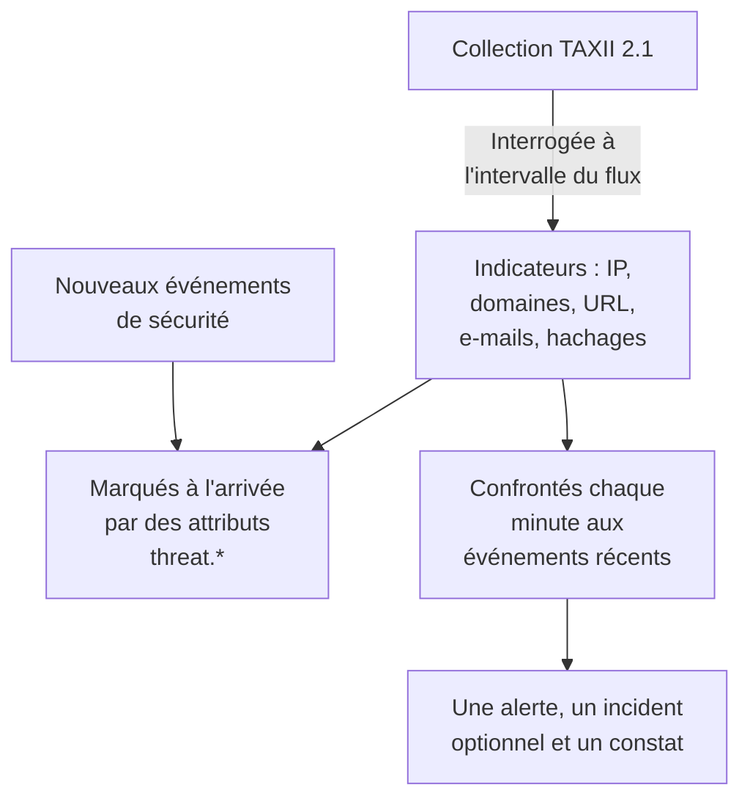

# Renseignement sur les menaces (STIX/TAXII)

Un flux de renseignement apporte dans OneUptime des adresses IP, des domaines, des URL, des adresses e-mail et des hachages de fichiers malveillants connus, et vous prévient quand vos [événements de sécurité](/docs/telemetry/security-events) en mentionnent un. Chaque flux s'abonne à une collection TAXII 2.1 d'indicateurs STIX 2.1 : votre propre serveur MISP, OpenCTI ou OpenTAXII, ou la collection d'un fournisseur. OneUptime ne fournit aucun contenu de flux : vous apportez les collections, comme vous apportez les règles Sigma.

:::cards
- [S'abonner à un flux](#sabonner-à-un-flux): Un serveur TAXII, une collection et un mode de connexion.
- [Ce qui est ingéré](#ce-qui-est-ingéré): Les motifs d'indicateurs que conserve OneUptime, et pour combien de temps.
- [Comment les correspondances sont trouvées](#comment-les-correspondances-sont-trouvées): Marquées à l'arrivée des événements et confrontées chaque minute.
- [Niveaux de menace](#niveaux-de-menace): Comment la confiance d'un indicateur devient une gravité.
:::

## Fonctionnement



## Avant de commencer

- Un serveur TAXII 2.1 qui publie des objets STIX 2.1 de type `indicator`, et l'ID de la collection à interroger. Un flux se connecte de façon anonyme, avec un jeton bearer ou avec l'authentification HTTP basique.
- Les serveurs qui exigent un certificat client TLS (TLS mutuel), comme CISA AIS, ne sont pas pris en charge. Le serveur ATT&CK public de MITRE publie des techniques et des groupes plutôt que des indicateurs, donc un flux qui pointe vers lui reste vide.
- Un rôle qui peut créer des flux : Project Owner, Project Admin, Security Admin ou Security Member. Security Viewer peut lire les flux et les indicateurs. Voir [Rôles](/docs/permissions/reference#rôles).

## S'abonner à un flux

:::steps
### Ouvrir Threat Intel

Ouvrez **Produits → Événements de sécurité → Threat Intel**.

### Créer le flux

Cliquez sur **Créer : Flux de renseignements sur les menaces** et remplissez ses quatre étapes : **Informations de base**, **TAXII Server**, **Authentification** et **En cas de correspondance**. Les champs figurent dans le tableau ci-dessous.

### Vérifier la première interrogation

En une minute ou deux, la ligne du flux affiche **Dernière interrogation**, et **Résumé de la dernière interrogation** indique ce que l'interrogation a récupéré. Les indicateurs apparaissent dans le tableau **Indicateurs**, sous les flux.
:::

| Champ | Ce qu'il faut saisir |
| --- | --- |
| **TAXII API Root URL** | La racine de l'API TAXII 2.1 du serveur, par exemple `https://taxii.example.com/api1/`. Les collections sont adressées en dessous. |
| **ID de la collection** | La collection qui publie les indicateurs. |
| **Poll Interval (Minutes)** | La fréquence de récupération des nouveaux objets : de 1 à 1440 minutes, 60 par défaut. |
| **Confiance minimale** | Les indicateurs dont la `confidence` STIX est inférieure sont ignorés : de 0 à 100, et 0 garde tout. Les indicateurs sans confiance passent toujours. |
| **Jeton d'API** | Un jeton bearer, pour une collection qui en demande un. |
| **Nom d'utilisateur Basic Auth** et **Mot de passe Basic Auth** | Pour une collection qui utilise l'authentification HTTP basique. Laissez les deux et le jeton vides pour une collection publique. |
| **Créer une alerte en cas de correspondance** | Activé par défaut : chaque indicateur correspondant ouvre une alerte. |
| **Gravité de l'alerte** | La gravité de chaque alerte ouverte par ce flux. Laissez-la vide pour prendre le niveau de menace de chaque indicateur. |
| **Créer un incident en cas de correspondance** | Désactivé par défaut. Les incidents déclenchent l'escalade d'astreinte, les SLA et les pages de statut, et pour les correspondances d'indicateurs les alertes suffisent en général. |
| **Gravité de l'incident** | Comme **Gravité de l'alerte**, pour les incidents. |
| **Write Detection Finding on Match** | Activé par défaut : chaque correspondance écrit un constat dans le flux d'événements. |

Les jetons et les mots de passe sont chiffrés et ne sont plus jamais affichés après l'enregistrement. Pour les changer, choisissez **Update Credentials** dans la ligne du flux, puis **Jeton d'API (Bearer)**, **Basic Auth** ou **Anonyme (effacer les identifiants enregistrés)** : votre choix remplace la connexion du flux, donc enregistrer un jeton efface un mot de passe enregistré, et inversement.

### Comment un flux est interrogé

Chaque interrogation demande les objets ajoutés depuis la précédente, via le curseur TAXII `added_after`, et lit jusqu'à 10 pages de 500 objets. Une grande collection se synchronise donc en plusieurs interrogations : **Résumé de la dernière interrogation** indique quand il reste des pages. Pour terminer plus vite une grosse première synchronisation, baissez le **Poll Interval (Minutes)**, jusqu'à 1, le temps qu'elle rattrape son retard.

Les interrogations se présentent avec l'user agent `OneUptime/<version> (+https://oneuptime.com)`. Si le pare-feu du fournisseur répond `403`, demandez-lui de l'autoriser : beaucoup de pare-feux bloquent les requêtes qui ressemblent à un script anonyme.

Un flux désactivé n'est ni interrogé ni confronté. Les indicateurs qu'il possède déjà continuent de marquer les nouveaux événements jusqu'à leur expiration.

## Ce qui est ingéré

OneUptime conserve les objets STIX de type `indicator` dont le motif est une simple égalité sur l'un de ces types :

| Type | Exemple de motif |
| --- | --- |
| Adresse IPv4 (`ipv4-addr`) | `[ipv4-addr:value = '198.51.100.7']` |
| Adresse IPv6 (`ipv6-addr`) | `[ipv6-addr:value = '2001:db8::7']` |
| Nom de domaine (`domain-name`) | `[domain-name:value = 'evil.example']` |
| URL (`url`) | `[url:value = 'http://evil.example/payload']` |
| Adresse e-mail (`email-addr`) | `[email-addr:value = 'billing@evil.example']` |
| Hachage de fichier, SHA-256 (`file-hash-sha256`) | `[file:hashes.'SHA-256' = 'e3b0…b855']` |
| Hachage de fichier, SHA-1 (`file-hash-sha1`) | `[file:hashes.'SHA-1' = 'da39…0709']` |
| Hachage de fichier, MD5 (`file-hash-md5`) | `[file:hashes.MD5 = 'd41d…427e']` |

Les comparaisons reliées par `OR`, dans un même `[...]` ou entre plusieurs, conviennent, et chaque valeur devient un indicateur à part :

```text
[domain-name:value = 'evil.example' OR domain-name:value = 'evil2.example']
[ipv4-addr:value = '198.51.100.7'] OR [url:value = 'http://evil.example/x']
```

Tout autre motif, avec `AND`, `FOLLOWEDBY`, `NOT`, `LIKE`, `MATCHES`, un qualificatif temporel comme `WITHIN` ou un autre type d'objet, est entièrement ignoré et compté comme non pris en charge dans **Résumé de la dernière interrogation**. Ne traduire qu'une partie d'un motif `AND` correspondrait à bien plus que ce que voulait l'auteur du flux.

### Combien de temps un indicateur reste actif

- Un indicateur correspond de son `valid_from` à son `valid_until`. Sans `valid_until`, il reste actif 365 jours à partir de `valid_from`, et l'interroger de nouveau ne prolonge pas ce délai.
- Un indicateur révoqué, ou mis à jour avec un `valid_until` dans le passé, cesse de correspondre dès que la mise à jour est interrogée. De même pour une valeur que le fournisseur retire d'un motif mis à jour.
- Les valeurs sont stockées en minuscules et confrontées sans tenir compte de la casse.

Le tableau **Indicateurs** liste les indicateurs tels qu'ils sont stockés, avec un **Statut** **Actif**, **Expiré** ou **Revoked**. Un indicateur interrogé de nouveau peut apparaître deux fois pendant un moment, et une ligne expirée ou révoquée reste listée jusqu'à ce que le nettoyage du stockage la retire, jusqu'à environ un mois après son expiration. La confrontation vérifie toujours la validité et la révocation, donc une telle ligne ne correspond jamais.

## Comment les correspondances sont trouvées

### Marqués à l'arrivée

Chaque événement de sécurité entrant, depuis l'API d'ingestion ou une connexion, est confronté à vos indicateurs actifs avant d'être stocké. Quand l'un de ses observables (les IP, hôtes, domaines, hachages et utilisateurs extraits de l'événement) égale la valeur d'un indicateur, l'événement reçoit ces attributs :

| Attribut | Valeur |
| --- | --- |
| `threat.matched` | Toujours `"true"` sur un événement marqué |
| `threat.indicator_id` | L'ID de l'indicateur STIX |
| `threat.indicator_type` | Le type de l'indicateur, par exemple `ipv4-addr` ou `file-hash-sha256` |
| `threat.indicator_value` | La valeur correspondante, en minuscules |
| `threat.feed` / `threat.feed_id` | Le flux d'où vient l'indicateur |
| `threat.confidence` | La confiance STIX de l'indicateur |
| `threat.match_count` | Combien d'observables de l'événement ont correspondu à un indicateur |

Quand plusieurs indicateurs correspondent à un événement, celui à la plus forte confiance remplit ces valeurs. Ce sont des attributs ordinaires, donc vous pouvez les rechercher dans **Événements**, filtrer avec eux les moniteurs d'événements de sécurité et les utiliser dans des règles de détection :

```yaml title="threat-intel-logon.yml"
title: High-confidence indicator in a successful logon
level: critical
detection:
  selection:
    threat.matched: 'true'
    threat.confidence|gte: 80
    className: Authentication
    statusName: Success
  condition: selection
```

Le marquage ne connaît que les indicateurs qui existent à l'arrivée d'un événement : les événements ne sont jamais marqués de nouveau plus tard.

### Confrontés chaque minute

Chaque minute, les indicateurs actifs de chaque flux activé sont confrontés aux événements dont l'heure d'événement tombe depuis la vérification précédente du flux. Cela rattrape le renseignement arrivé après le marquage d'un événement.

- La première vérification couvre les 15 dernières minutes. Après une panne, la vérification suivante rattrape au plus les 24 dernières heures.
- Chaque fenêtre est vérifiée une fois. Le renseignement qui arrive après la vérification de sa fenêtre ne s'applique qu'aux événements ultérieurs.
- Un événement arrivé en retard, avec une heure antérieure à la vérification précédente, est encore marqué à l'arrivée, mais n'est pas confronté.
- Chaque vérification confronte au plus 100 valeurs d'indicateurs par flux : celles vues dans le plus d'événements.

### Ce que fait une correspondance

- Une alerte, intitulée `[Threat Intel] <feed name> — <indicator value>`, une par flux et par valeur tant qu'elle reste ouverte. Une fois résolue, la correspondance suivante en ouvre une nouvelle. Les alertes ne sont pas résolues automatiquement.
- Un incident, uniquement avec **Créer un incident en cas de correspondance**, dédupliqué de la même façon.
- Un constat de renseignement, avec **Write Detection Finding on Match** : un événement `Detection Finding` (classe OCSF 2004) du produit `OneUptime Threat Intel`, avec le niveau de menace de l'indicateur comme gravité, et ces attributs :

| Attribut | Valeur |
| --- | --- |
| `oneuptime.threat.feed_id` / `oneuptime.threat.feed_name` | Le flux |
| `oneuptime.threat.indicator_id` | L'ID de l'indicateur STIX |
| `oneuptime.threat.indicator_type` / `oneuptime.threat.indicator_value` | Ce qui a correspondu |
| `oneuptime.threat.confidence` | La confiance de l'indicateur |
| `oneuptime.threat.match_count` | Combien d'événements se trouvent derrière ce constat |

Les constats ne sont jamais confrontés eux-mêmes, donc une correspondance ne peut pas en déclencher une autre.

## Niveaux de menace

Les indicateurs n'ont pas de niveau Sigma : leur `confidence` STIX fixe plutôt un niveau de menace.

| Confiance de l'indicateur | Niveau de menace |
| --- | --- |
| De 90 à 100 | Critical |
| De 70 à 89 | High |
| De 40 à 69 | Medium |
| De 1 à 39 | Low |
| Non évalué (0 ou absent) | Medium |

Un indicateur non évalué compte comme Medium : quelqu'un a tout de même choisi de le mettre dans un flux. Le niveau de menace est la gravité du constat, et choisit la gravité de l'alerte parmi les gravités de votre projet, dans cet ordre :

1. La **Gravité de l'alerte** (ou **Gravité de l'incident**) du flux, si elle est réglée : elle s'applique à chaque correspondance du flux.
2. Votre gravité nommée d'après le niveau de menace, comme High, quelle que soit la casse.
3. Par rang : Critical et High prennent votre gravité la plus élevée, Medium et Low la plus basse.

Le niveau de menace appartient à chaque indicateur, pas au flux, donc un même flux peut ouvrir une alerte Critical et une alerte Low dans la même minute. **Confiance minimale** filtre sur le même nombre : un minimum de 70 ne garde que les indicateurs High et Critical, plus les non évalués, qui passent toujours.

## Surveiller les correspondances d'un flux

L'action **Créer un moniteur** dans la ligne d'un flux ouvre un nouveau moniteur d'événements de sécurité qui compte les constats du flux : classe d'événements `Detection Finding`, filtrée sur l'ID du flux dans `oneuptime.threat.feed_id` (jamais sur son nom, qu'un renommage changerait), sur la dernière heure. Utilisez-le pour une soudaine vague de correspondances, ou pour un flux d'ordinaire actif qui se tait.

## Conservation et facturation

Les indicateurs sont de la configuration, pas de la télémétrie, et ne sont pas facturés comme données ingérées. Les constats écrits par une correspondance sont des événements de sécurité ordinaires, facturés et conservés comme les autres : voir [Événements de sécurité](/docs/telemetry/security-events#conservation-et-facturation).

## Dépannage

:::details Dernière erreur est renseignée après une interrogation
`401` ou `403` : les identifiants sont faux ou absents ; remplacez-les avec **Update Credentials**. Un `403` peut aussi venir du pare-feu du fournisseur qui bloque l'user agent. `404` : vérifiez la **TAXII API Root URL**, qui se termine généralement par un chemin comme `/api1/`, et l'**ID de la collection**. L'erreur disparaît à la prochaine interrogation réussie.
:::

:::details Le flux est interrogé, mais aucun indicateur n'apparaît
Lisez **Résumé de la dernière interrogation**. Aucun objet récupéré : la collection est vide ou ne publie pas d'indicateurs. Motifs non pris en charge : le fournisseur utilise des fonctions de motif que cette page indique comme ignorées. Sous la confiance minimale : baissez la **Confiance minimale**. Déjà inactifs : le fournisseur a envoyé des indicateurs déjà révoqués ou expirés.
:::

:::details Des indicateurs existent, mais rien ne correspond
La confrontation compare la valeur d'un indicateur aux observables d'un événement, pas à chaque champ : ouvrez dans **Événements** un événement qui aurait dû correspondre et vérifiez que ses observables contiennent la valeur. Seuls les indicateurs au statut **Actif** correspondent. Vérifiez **Erreur de la dernière correspondance** sur le flux.
:::

:::details Une correspondance n'a pas ouvert d'alerte
**Créer une alerte en cas de correspondance** est désactivé, ou une alerte pour le même flux et la même valeur est encore ouverte, et les correspondances suivantes s'y ajoutent. Un projet a besoin d'au moins une gravité d'alerte pour qu'un flux ouvre des alertes.
:::

## Étapes suivantes

:::cards
- [Événements de sécurité](/docs/telemetry/security-events): Envoyer des événements, les rechercher et écrire des règles de détection.
- [Google SecOps](/docs/integrations/google-secops): Faire entrer les détections et les événements de Chronicle.
- [Référence des autorisations](/docs/permissions/reference): Les rôles de sécurité, et ce que chacun peut faire.
:::
