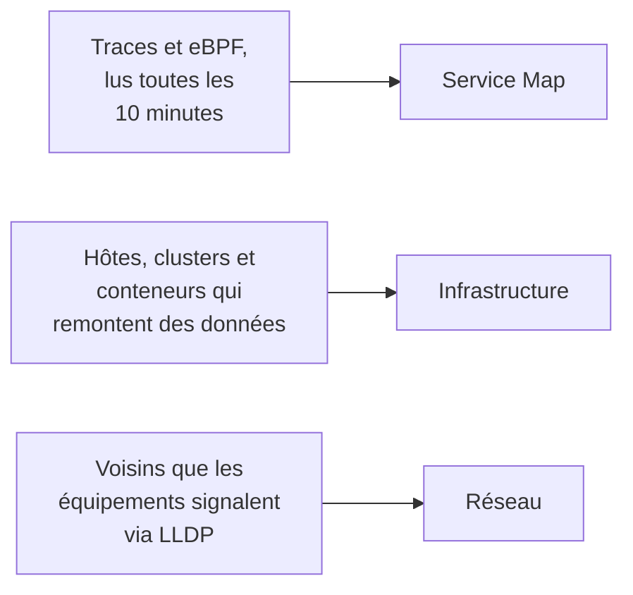

# Topologie

La topologie dessine comment vos systèmes sont reliés : quels services en appellent d'autres, ce qui tourne où, et comment vos équipements réseau sont câblés. OneUptime la construit à partir de la télémétrie que vous envoyez déjà, il n'y a donc rien à dessiner à la main, et elle montre d'un coup d'œil où se trouvent les erreurs et les incidents.

:::cards
- [Ouvrir la topologie](#ouvrir-la-topologie): Trois vues d'une même page.
- [Lire la carte des services](#lire-la-carte-des-services): Qui appelle qui, et à quel point les appels sont sains.
- [Explorer votre infrastructure](#explorer-votre-infrastructure): Où tourne chaque service.
- [Ouvrir la carte propre à une ressource](#ouvrir-la-carte-propre-à-une-ressource): Un vCenter, un cluster ou un hôte en détail.
- [Voir votre réseau](#voir-votre-réseau): Les équipements et leurs liens, en direct.
:::

## Comment la carte est construite

Chaque vue de la topologie est construite à partir d'un type de télémétrie différent :

- **Seul ce qui était actif est dessiné.** Une vue montre les services et les ressources qui ont remonté des données dans la période, et les connexions observées pendant celle-ci. Activez **Afficher les inactifs** pour dessiner aussi ceux qui sont restés silencieux.
- **Les appels sont comptés sur une fenêtre récente.** OneUptime cherche les appels entre services toutes les 10 minutes, et les chiffres de trafic couvrent les 15 dernières minutes, pas toute la période.
- **La vue réseau est en direct.** Elle montre vos équipements tels qu'ils sont connectés maintenant, elle n'a donc pas de période.

## Avant de commencer

- **De la télémétrie qui arrive.** La carte des services a besoin de traces : voir [OpenTelemetry](/docs/telemetry/open-telemetry). La vue de l'infrastructure a besoin d'un hôte ou d'un cluster qui remonte des données : voir l'[agent Kubernetes](/docs/telemetry/kubernetes-agent). La vue réseau a besoin d'équipements réseau : voir [Surveillance des équipements réseau](/docs/monitor/network-device-monitor).
- **Un rôle qui lit la télémétrie.** Project Owner, Project Admin, Project Member, Viewer, Telemetry Admin, Telemetry Member ou Telemetry Viewer, ou un rôle personnalisé avec la permission Read Telemetry Service.

## Ouvrir la topologie

Allez dans **Produits → Observabilité → Topologie**. **Inventaire → Topology Map** ouvre la même page. Elle s'ouvre sur la **Service Map**, pour la période **Dernier jour**.

| Vue | La question à laquelle elle répond |
| --- | --- |
| **Service Map** | Quels services dépendent les uns des autres ? |
| **Infrastructure** | Qu'est-ce qui tourne où dans votre infrastructure ? |
| **Réseau** | Comment vos équipements réseau sont-ils connectés ? |

À côté du sélecteur de période, **Afficher les inactifs** ajoute ce qui n'a rien remonté dans la période, et le bouton d'actualisation recharge la vue. **Ce qui est affiché · À propos de ces données** explique ce que la vue dessine et à quelle fréquence elle est calculée. La barre d'adresse garde la vue où vous êtes, donc un lien partagé ouvre la même vue.

## Lire la carte des services

La **Service Map** dessine chaque service qui a remonté des données, ainsi que les bases de données, les API et les brokers de messages qu'il appelle, même quand ceux-ci n'envoient aucune télémétrie. Les flèches vont de l'appelant vers l'appelé, et les lignes plus épaisses portent plus de requêtes. Les chiffres au-dessus indiquent combien de services, de dépendances et de connexions elle dessine, et combien demandent de l'attention.

Chaque service affiche son statut, calculé à partir des appels qu'il a reçus pendant les 15 dernières minutes :

| Statut | Quand |
| --- | --- |
| **Sain** | Au plus 1 % des appels reçus ont échoué. |
| **Some errors** | Plus de 1 % et moins de 5 % ont échoué. |
| **High error rate** | 5 % ou plus ont échoué. |
| **Entry point** | Il n'a reçu aucun appel, mais en a passé : un frontend web ou une tâche planifiée. |
| **No calls observed** | Il n'a ni passé ni reçu d'appel. |

Un service avec un incident ou une alerte actifs en affiche plutôt le nombre, et comme un service avec **Some errors** ou un **High error rate**, il compte comme demandant de l'attention.

:::steps
### Trouver les services qui demandent de l'attention

Cliquez sur **Attention requise** pour ne garder que ces services et leurs connexions directes, ou cherchez un nom dans le champ au-dessus de la carte.

### Ouvrir un service

Cliquez sur un service pour voir ses requêtes, ses erreurs et sa latence moyenne des 15 dernières minutes, ses **Incidents actifs** et ses **Alertes actives**, et des liens vers **Traces de ce service** et ses **Détails de l'inventaire**.

### Ouvrir une connexion

Cliquez sur une flèche pour voir son débit de requêtes, son taux d'erreur et sa latence moyenne. Entre deux services que vous instrumentez, elle a aussi un **Historique** des appels, des erreurs et de la latence.
:::

**Étiquettes de connexion** écrit un chiffre sur chaque flèche : **Taux de requêtes**, **Taux d'erreur** ou **Latence moyenne**, ou rien tant que vous ne survolez pas. **Tableau** liste les mêmes services avec leurs **Requêtes**, **Taux d'erreur**, **Latence moy.** et **Connexions**, et **Afficher sur la carte** dessine l'un d'eux.

## Explorer votre infrastructure

**Infrastructure** montre où tournent vos services : clusters, hôtes, pods, conteneurs et les autres ressources qui remontent des données. Les réplicas d'une même charge de travail sont regroupés en une seule entrée, et vous pouvez ouvrir n'importe quoi pour regarder dedans.

- **Parcourez-la à votre façon.** Affichez-la en **Liste** ou en **Carte**, de toute votre infrastructure jusqu'à un seul pod. Les chiffres au-dessus indiquent combien de ressources et de charges de travail elle dessine, combien de services elle peut placer, et combien de ressources silencieuses elle laisse de côté.
- **Trouvez une ressource.** Cherchez-la par son nom, et cliquez sur **Voir les détails** pour ouvrir sa page.
- **Passez d'une vue à l'autre.** Un service listé sur une ressource s'ouvre sur la **Service Map**, et les ressources sur lesquelles tourne un service s'ouvrent dans **Infrastructure**.

## Ouvrir la carte propre à une ressource

Un vCenter, un cluster Kubernetes, un hôte, un hôte Docker ou Podman, un cluster Docker Swarm, Proxmox ou Ceph et une baie de stockage ont chacun leur propre page **Topologie**. Elle dessine cette ressource en détail, à partir de son propre inventaire : ce qui se trouve dans quoi, chaque élément coloré selon son état, et chaque incident et alerte ouverts sur l'élément qu'ils concernent.

- **Lisez-la comme un arbre.** La ressource est en haut, et les éléments de chaque élément sont dessinés à sa droite, reliés à lui par une ligne qui devient rouge ou orange là où quelque chose demande votre attention. Les éléments qui contiennent un problème s'ouvrent d'eux-mêmes, le bouton rond d'un élément l'ouvre ou le ferme, et les touches fléchées parcourent la carte.
- **Trouvez ce qui demande votre attention.** **Attention requise** ne garde que les éléments en difficulté et le chemin vers chacun, et la recherche trouve un élément n'importe où dans la ressource.
- **Regardez de plus près.** Cliquez sur un élément pour voir ce qu'il est et un lien vers sa propre page, et sur **Se concentrer sur cet élément** pour ne dessiner que cet élément, ce qu'il contient et ce à quoi il est lié.
- **Allez dans les deux sens.** **Ouvrir dans Topologie** ouvre la ressource dans **Infrastructure**, et son bouton **Ouvrir la topologie du vCenter**, **Ouvrir la topologie du cluster**, **Ouvrir la topologie de l'hôte** ou **Ouvrir la topologie de la baie de stockage** ramène à sa carte.

## Voir votre réseau

**Réseau** est la carte en direct de vos équipements réseau, construite à partir des voisins qu'ils signalent via LLDP, et via CDP sur les équipements Cisco. Elle n'a pas de sélecteur de période : les connexions s'actualisent d'elles-mêmes.

Si vous regroupez des équipements en sites, la vue s'ouvre sur vos sites : choisissez-en un, ou passez à **Tous les appareils**. **Options de la carte** agence la carte et choisit ce qu'elle inclut, et **Exporter en PDF** enregistre la carte que vous voyez. Les pages des équipements réseau dessinent la même carte : voir [Topologie du réseau](/docs/monitor/network-device-monitor#topologie-du-réseau).

## Dépannage

:::details La carte des services montre des services mais aucune connexion
OneUptime cherche les appels entre services dans vos traces toutes les 10 minutes. Il en voit un quand une requête porte le contexte de trace, l'en-tête `traceparent`, d'un service instrumenté au suivant, comme le font les instrumentations HTTP et gRPC d'OpenTelemetry ; quand un service signale des spans client pour les bases de données et les API qu'il appelle ; ou quand l'agent Kubernetes tourne avec eBPF.
:::

:::details Un service que j'ai retiré est toujours sur la carte
Il a remonté des données pendant la période. Choisissez une période plus courte, ou attendez que sa dernière télémétrie sorte de la période. Avec **Afficher les inactifs**, la carte dessine aussi ce qui a cessé de remonter des données.
:::

:::details La carte indique qu'une partie seulement est affichée
Un très gros projet atteint les limites de la carte, et un avis indique combien de ressources ou de connexions elle affiche. Cherchez un service, ou utilisez **Afficher sur la carte** dans le tableau, pour en dessiner une partie lisible.
:::

## Étapes suivantes

:::cards
- [Catalogue de services](/docs/telemetry/services): Tout sur un service.
- [Explorateur de traces](/docs/telemetry/traces-explorer): Les requêtes derrière chaque flèche.
- [Vue d'ensemble de l'inventaire](/docs/inventory/overview): Chaque ressource que la carte dessine.
- [Surveillance des équipements réseau](/docs/monitor/network-device-monitor): Mettre votre réseau sur la carte.
:::
