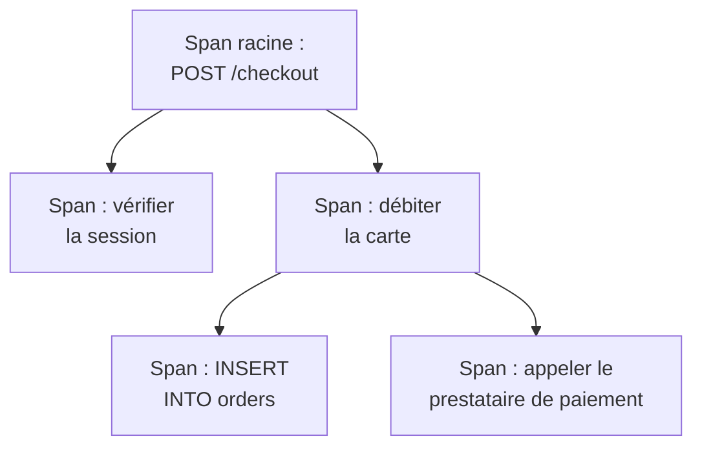

# Explorateur de traces

L'explorateur de traces retrouve les requêtes qui ont traversé vos services : les lentes, celles qui ont échoué, celles qui ont touché le compte d'un client précis. Cherchez et filtrez les spans que vos services envoient, puis ouvrez une trace pour voir chaque étape de la requête en cascade, en graphique en flammes ou en carte des services.

:::cards
- [Trouver une requête](#trouver-une-requête): Chercher des spans, puis filtrer par service, statut ou type.
- [Lire une trace](#lire-une-trace): Où le temps est passé, et quelle étape a échoué.
- [Représenter vos spans en graphiques](#représenter-vos-spans-en-graphiques): Nombres de requêtes et temps de réponse, regroupés à votre façon.
- [Analyses des traces](#analyses-des-traces): Taux d'erreur, latence et requêtes les plus lentes.
:::

## Traces et spans

Une trace est une requête sur son chemin à travers votre système. Chaque étape qu'elle franchit, comme un gestionnaire HTTP, une requête en base de données ou un appel à un autre service, est un span, et les spans s'imbriquent dans les spans qui les ont lancés. Le premier span d'une trace, sans parent, est son span racine : le point d'entrée de la requête.

Chaque ligne de l'explorateur est un span : un service très sollicité remplit donc la liste de ses requêtes en base et de ses appels internes. Pour lister une ligne par requête, choisissez **Root spans** sous **Span Type** dans la barre latérale.

L'explorateur a quatre onglets :

| Onglet | À quoi il sert |
| --- | --- |
| **Lecteur** | Chercher et filtrer des spans, et ouvrir leurs traces. Il s'ouvre sur la dernière heure, les plus récents d'abord, 50 spans par page. |
| **Analyses** | Débits de requêtes, taux d'erreur et latence par service, et les requêtes qui méritent un coup d'œil. |
| **Guide de configuration** | Comment envoyer des traces avec OpenTelemetry, avec l'une de vos clés d'ingestion. |
| **Paramètres** | Ce qui arrive aux spans à leur arrivée : **Pipelines**, **Filtres de suppression**, **Règles de masquage** et **Règles d'enregistrement**. |

## Avant de commencer

- **Des traces qui arrivent.** Instrumentez vos services avec [OpenTelemetry](/docs/telemetry/open-telemetry). L'onglet **Guide de configuration** montre le code pour votre langage.
- **Un rôle qui peut lire la télémétrie.** Project Owner, Project Admin, Project Member, Viewer, Telemetry Admin, Telemetry Member ou Telemetry Viewer, ou un rôle personnalisé avec la permission Read Telemetry Service Traces. Sa portée décide de quels spans vous voyez : voir [Télémétrie](/docs/permissions/index#télémétrie).

## Trouver une requête

:::steps
### Ouvrir le Lecteur

Ouvrez **Produits → Observabilité → Traces**. Le **Lecteur** liste les spans de la dernière heure, les plus récents d'abord, chacun avec son statut, son service, son nom et sa durée.

### Choisir la plage de temps

Choisissez une plage dans le sélecteur de temps, ou faites glisser la souris sur le graphique au-dessus de la liste pour zoomer sur un pic. Double-cliquez sur le graphique pour dézoomer. Voir [Zoomer sur une plage temporelle](/docs/telemetry/charts-and-time-ranges).

### Chercher

Tapez une requête et appuyez sur Entrée, par exemple `service:checkout status:error duration:>500`. Les mots seuls cherchent dans les noms de span, et `@key:value` cherche dans un attribut comme `@http.route:/orders`. Voir [Syntaxe de recherche](/docs/telemetry/search-syntax#traces).

### Affiner avec des filtres

Cliquez sur une valeur de la barre latérale **Filtres** pour l'ajouter comme puce. La barre latérale filtre par **Service**, par l'hôte, le cluster ou l'autre ressource qui a envoyé le span, par **Statut**, **Span Type**, **Possède une exception**, **Type de span**, **Nom du span**, **Service Instance** et **Nom de l'hôte**.

### Ouvrir un span

Cliquez sur une ligne pour la déplier : ses attributs, et les journaux et exceptions qu'elle a enregistrés. Cliquez sur **See full trace** pour ouvrir toute sa trace.
:::

Votre recherche, vos puces et la plage de temps sont gardées dans l'adresse de la page : un rafraîchissement, un favori ou un lien partagé ouvre les mêmes spans.

## Lire une trace

La page d'une trace commence par les chiffres de la requête :

| Chiffre | Ce que c'est |
| --- | --- |
| Durée | Le temps qu'a pris toute la requête. |
| Spans | Le nombre de spans de la trace. |
| Services | Le nombre de services que la requête a traversés. |
| Erreurs | Le nombre de spans terminés avec un statut d'erreur. Cliquez dessus pour n'afficher qu'eux. |
| Profondeur | La plus longue chaîne de spans imbriqués. |

En dessous, choisissez l'une des quatre vues :

| Vue | Ce qu'elle montre |
| --- | --- |
| **Waterfall** | Chaque span sur une ligne de temps, imbriqué sous le span qui l'a lancé. Activez **Critical path** pour mettre en évidence la chaîne de spans qui a déterminé la durée de la requête. |
| **Graphique en flammes** | Le même arbre en barres empilées, où les barres les plus larges ont pris le plus de temps. |
| **Service map** | Les services que la requête a traversés, et les appels entre eux. |
| **Opérations** | Une ligne par service et nom de span, avec ses appels, ses erreurs, son temps propre et son temps total. Une opération appelée 10 fois ou plus depuis un même span parent est signalée : souvent une requête N+1 ou une boucle qu'on pourrait regrouper. |

Cliquez sur un span dans n'importe quelle vue pour ouvrir son panneau, avec des onglets pour ses attributs, ses événements, ses journaux, ses exceptions et ses liens, ainsi que son profil ou son appel LLM s'il en a un. Cherchez parmi les spans de la trace par nom, ID ou service avec la zone de recherche à côté des vues (appuyez sur `/`), et activez **Errors only** pour ne garder que les spans en échec.

Une grande trace charge 500 spans à la fois. Cliquez sur le bouton en bas de la trace pour en charger davantage, ou tous.

> [!TIP]
> **Corriger les performances avec l'IA** cherche dans la trace un schéma de performance connu : une requête N+1, un span qui prend l'essentiel du temps, ou des appels faits les uns après les autres qui pourraient s'exécuter en parallèle. S'il en trouve un, il lance une tâche IA qui ouvre une pull request pour le corriger. Voir [Tâches de correction](/docs/ai/ai-agent).

## Représenter vos spans en graphiques

Le graphique au-dessus de la liste trace le nombre de spans dans le temps, réparti par statut. Choisissez une autre mesure dans l'en-tête du graphique pour tracer à la place leur temps de réponse moyen, médian (P50) ou P95.

Pour aller plus loin, passez la liste de **Spans** à **Analytique**. Choisissez une série temporelle, un classement ou un tableau ; mesurez des nombres de requêtes, des nombres d'erreurs ou des temps de réponse (moyenne, P50, P90, P95, P99, minimum ou maximum) ; et regroupez par nom de span, service, statut, type de span ou n'importe quel attribut, puis par un second champ. Un classement ou un tableau montre les 5 à 100 premiers groupes.

## Suivre, enregistrer et partager

- Cliquez sur **En pause** au-dessus de la liste pour activer les mises à jour en direct. Le bouton affiche alors **En direct**, et la liste cherche de nouveaux spans toutes les 10 secondes. Cliquez de nouveau pour mettre en pause.
- **Saved Views** garde une recherche, ses filtres et la plage de temps sous un nom, pour tout le projet. Les vues enregistrées fonctionnent comme dans l'[Explorateur de journaux](/docs/telemetry/logs-explorer#enregistrer-une-vue).
- Les boutons **Journaux** et **Métriques** ouvrent ces explorateurs sur la même fenêtre de temps, avec autant de votre filtrage qu'ils peuvent en utiliser. Pointez un bouton pour voir ce qu'il ne peut pas reprendre.

## Analyses des traces

L'onglet **Analyses** résume les requêtes d'une plage de temps :

- le nombre de requêtes, le taux d'erreur, et la latence P50, P95 et P99 ;
- un tableau de santé de vos services, trié par taux d'erreur, pour que les services qui demandent de l'attention viennent en premier ;
- les requêtes en échec les plus récentes, et les plus lentes.

Limitez-le à certains services avec la liste déroulante à côté du sélecteur de temps.

## Ce qui arrive aux spans à leur arrivée

L'onglet **Paramètres** contient les règles que OneUptime applique aux spans à leur arrivée, comme pour les journaux. Elles agissent sur les spans qui arrivent ensuite, pas sur ceux déjà stockés.

| Règle | Ce qu'elle fait |
| --- | --- |
| **Filtres de suppression** | Écarter les spans que vous ne voulez pas garder, ou n'en garder qu'un échantillon. |
| **Règles de masquage** | Masquer les données sensibles dans les attributs des spans. |
| **Pipelines** | Modifier et enrichir les spans : chaque pipeline retient des spans avec un filtre, puis exécute ses processeurs dans l'ordre. |
| **Règles d'enregistrement** | Transformer chaque minute les nombres de spans, les nombres d'erreurs et les durées en nouvelles métriques. Voir [Règles d'enregistrement de journaux](/docs/telemetry/log-recording-rules). |

## Dépannage

:::details Une trace indique qu'aucun span n'a été trouvé
Les spans arrivent en général dans la minute qui suit la fin de la requête. Cliquez sur **Actualiser** sur la page de la trace pour vérifier de nouveau.
:::

:::details Certains spans sont au premier niveau de la cascade
Ils nomment un span parent que OneUptime n'a pas reçu, souvent parce que le service qui a écrit le parent n'envoie pas encore ses traces à OneUptime. Instrumentez aussi ce service.
:::

:::details La liste montre bien plus de lignes que de requêtes
Chaque ligne est un span, pas une requête. Choisissez **Root spans** sous **Span Type** dans la barre latérale pour lister une ligne par requête.
:::

## Étapes suivantes

:::cards
- [Syntaxe de recherche](/docs/telemetry/search-syntax): Chaque filtre que comprend la zone de recherche.
- [Surveillance des traces](/docs/monitor/traces-monitor): Être alerté des requêtes en échec ou lentes.
- [Suivi des exceptions](/docs/telemetry/exceptions): Trier les erreurs que vos spans enregistrent.
- [Explorateur de journaux](/docs/telemetry/logs-explorer): Lire les lignes de journal qu'une requête a écrites.
:::
