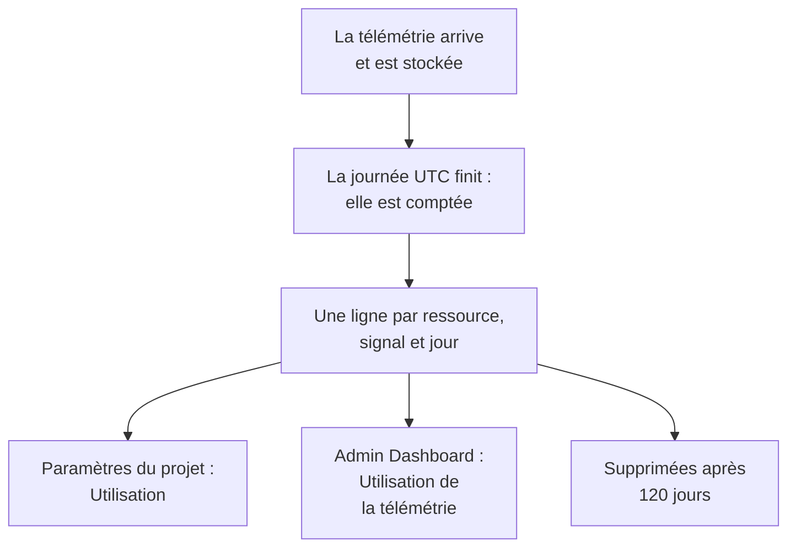

# Utilisation de la télémétrie

Voyez combien de télémétrie envoie chaque projet, et chaque service ou ressource qu'il contient : journaux, métriques, traces et leurs exceptions, profils, relectures de session et événements de sécurité. L'utilisation est comptée sur chaque installation de OneUptime, avec ou sans facturation, pour que vous trouviez ce qui remplit votre stockage sans interroger ClickHouse.

:::cards
- [Comment l'utilisation est comptée](#comment-lutilisation-est-comptée): Une fois par jour, pour chaque ressource et chaque signal.
- [Voir l'utilisation d'un projet](#voir-lutilisation-dun-projet): Paramètres du projet → Télémétrie & APM → Utilisation.
- [Voir l'utilisation de tous les projets](#voir-lutilisation-de-tous-les-projets): L'Admin Dashboard, pour l'administrateur de l'instance.
- [Combien de temps l'utilisation est conservée](#combien-de-temps-lutilisation-est-conservée): 120 jours, sauf si vous changez ce nombre.
:::

## Comment l'utilisation est comptée

Une fois par jour, après la fin d'une journée en UTC, OneUptime compte ce que chaque ressource de chaque projet a envoyé ce jour-là, pour chaque signal, et conserve ce compte sous la forme d'une ligne par ressource, signal et jour.



- **Une journée est comptée une fois terminée.** Chaque journée est comptée au plus tard vers 08:00 UTC le lendemain, donc l'utilisation d'aujourd'hui apparaît demain. Une journée qui n'a pas pu être comptée est réessayée pendant une semaine.
- **La taille est la taille stockée.** Chaque signal est compté comme la taille des lignes dans lesquelles il est stocké, avant compression. Les relectures de session sont comptées comme les octets que les enregistreurs ont envoyés.
- **Les traces incluent leurs exceptions, et les profils leurs échantillons.**
- **La télémétrie propre à OneUptime n'est pas comptée.** Les relevés des moniteurs, des alertes, des incidents et des SLO, les relevés de l'Observabilité des données et les métriques de budget des relectures de session sont écrits par OneUptime lui-même.
- **Sur OneUptime Cloud, c'est à partir de ces lignes que la télémétrie est facturée.** Sur une installation sans facturation, l'utilisation est comptée sans frais, et rien n'est facturé pour elle, même si la facturation est activée plus tard.
- **Un budget est compté à part de l'utilisation.** Un [budget d'ingestion](/docs/telemetry/ingestion-budgets) compte la télémétrie à son arrivée, décompressée, et peut donc arrêter la télémétrie d'une journée le jour même. Tant qu'un budget est défini, cette page s'ouvre sur les budgets du jour.

## Avant de commencer

- **Un rôle qui lit la télémétrie du projet.** Propriétaire du projet, Administrateur du projet, Membre du projet, Lecteur, Administrateur de la télémétrie, Membre de la télémétrie ou Lecteur de la télémétrie, ou l'un des rôles de facturation. Le rôle doit couvrir tout le projet : un rôle limité à certaines étiquettes n'affiche pas l'utilisation.
- **De la télémétrie dans le projet.** L'utilisation est comptée pour la télémétrie qu'envoient les [clés d'ingestion](/docs/telemetry/ingestion-keys) du projet.

## Voir l'utilisation d'un projet

:::steps
### Ouvrir Utilisation

Allez dans **Paramètres du projet → Télémétrie & APM → Utilisation**. **Télémétrie & APM** est replié au départ dans le menu latéral : cliquez dessus pour l'ouvrir.

### Choisir une plage

La page s'ouvre sur **30 derniers jours**. Choisissez **7 derniers jours** ou **90 derniers jours** dans la liste en haut à droite de la carte **Utilisation de la télémétrie**. Une plage se termine hier, le jour le plus récent qui a été compté.

### Trouver ce qui a augmenté

La carte **Utilisation par ressource** liste chaque service et chaque ressource qui a envoyé quelque chose sur la plage, les plus volumineux en premier. Cliquez sur le titre d'une colonne pour trier selon celle-ci, et sur le nom d'une ressource pour ouvrir sa page.
:::

La page a trois cartes :

| Carte | Ce qu'elle montre |
| --- | --- |
| **Utilisation de la télémétrie** | Le **Total** de la plage, un total pour chaque signal, et un graphique de chaque jour, ses signaux empilés. |
| **Utilisation par ressource** | Chaque **Ressource** avec son type, une colonne pour chaque signal, le **Total** et, sous **Conservation**, la durée pendant laquelle sa télémétrie est conservée. |
| **Historique d'utilisation de la télémétrie** | Une ligne par signal, ressource et jour, avec des filtres pour **Produit**, **Jour** et **Service**. |

La télémétrie qui ne nommait aucun service est listée comme **Service inconnu**. Une ressource supprimée depuis, ou dont votre rôle ne lit pas le type, est listée par son type et le début de son ID.

## Qui voit quoi

| Rôle | Voit |
| --- | --- |
| Propriétaire du projet, Administrateur du projet, Administrateur de la facturation, Membre de la facturation, Lecteur de la facturation, Manage Billing | Combien chaque ressource a envoyé et combien de temps c'est conservé, et sur OneUptime Cloud ce que cela a coûté |
| Membre du projet, Lecteur, Administrateur de la télémétrie, Membre de la télémétrie, Lecteur de la télémétrie | Combien chaque ressource a envoyé et combien de temps c'est conservé |

Le coût de l'utilisation n'est affiché que sur OneUptime Cloud : une installation sans facturation ne facture rien pour elle. Voir [Facturation et utilisation](/docs/configuration/billing#historique-dutilisation) pour les prix.

## Voir l'utilisation de tous les projets

Sur une installation auto-hébergée, l'administrateur de l'instance voit l'utilisation de tous les projets dans l'Admin Dashboard :

:::steps
### Ouvrir Utilisation de la télémétrie

Dans l'Admin Dashboard, ouvrez le menu et cliquez sur **Utilisation de la télémétrie**. La liste montre chaque projet qui a envoyé quelque chose sur la plage, les plus volumineux en premier, avec une colonne pour chaque signal et le **Total**.

### Trouver les projets les plus volumineux

Choisissez une plage en haut à droite de la carte, et cliquez sur le titre d'une colonne pour trier selon celle-ci : **Total**, un signal, ou **Projet** pour le nom.

### Ouvrir un projet

Cliquez sur le nom d'un projet. Sa page **Utilisation de la télémétrie**, sous **Projets** dans l'Admin Dashboard, montre son utilisation par jour, signal et ressource, telle que ses membres la voient.
:::

## Combien de temps l'utilisation est conservée

L'utilisation est conservée 120 jours, sauf si vous changez ce nombre, avec ou sans facturation. C'est la durée de conservation des comptes d'utilisation, pas celle de la télémétrie elle-même : pour celle-ci, voir [Rétention des données](/docs/telemetry/data-retention).

:::steps
### Ouvrir la rétention des données

Dans l'Admin Dashboard, allez dans **Paramètres → Rétention des données**.

### Fixer le nombre de jours

Sur la carte **Rétention de l'utilisation de la télémétrie**, cliquez sur **Modifier la rétention de l'utilisation de la télémétrie**, saisissez **Rétention de l'utilisation de la télémétrie (jours)** de 30 à 1095, et cliquez sur **Enregistrer les modifications**. Laissez le champ vide pour 120 jours.
:::

L'utilisation plus ancienne est supprimée une fois par jour. La rétention n'est jamais inférieure à 30 jours : une journée comptée n'est jamais supprimée puis comptée à nouveau.

## Lire l'utilisation avec l'API

`GET /api/telemetry-usage/project` répond avec l'utilisation d'un projet sur une plage de jours UTC, telle que la page la montre. Appelez-le avec une [clé d'API](/docs/permissions/index#clés-dapi) qui a l'un des rôles ci-dessus :

```bash
curl 'https://oneuptime.com/api/telemetry-usage/project?startDay=2026-10-01&endDay=2026-10-31' \
  -H "ApiKey: $ONEUPTIME_API_KEY"
```

`startDay` et `endDay` sont des jours écrits `YYYY-MM-DD`, tous deux inclus, et une plage peut durer jusqu'à 1095 jours. La réponse contient les totaux, chaque jour par signal et chaque ressource par signal, en GB, avec le coût uniquement là où la facturation est activée et où la clé lit la facturation.

## Dépannage

:::details La page Utilisation affiche « Aucune utilisation de la télémétrie pour l'instant »
Une journée est comptée une fois terminée en UTC, au plus tard vers 08:00 UTC le lendemain : un projet qui a commencé à envoyer aujourd'hui montre son premier jour demain. Vérifiez que le projet reçoit de la télémétrie dans les explorateurs.
:::

:::details Les nombres sont plus grands que mon disque ClickHouse
L'utilisation est la taille des lignes avant compression. ClickHouse compresse ce qu'il stocke, donc le disque qu'il occupe est plusieurs fois plus petit.
:::

:::details Une ressource est listée par son type et un ID
La ressource a été supprimée depuis qu'elle a envoyé la télémétrie, ou votre rôle ne lit pas ce type de ressource. Son utilisation est tout de même comptée.
:::

## Étapes suivantes

:::cards
- [Filtres de suppression et règles de masquage](/docs/telemetry/drop-filters-and-scrub-rules): Ne plus stocker la télémétrie dont vous n'avez pas besoin.
- [Rétention des données](/docs/telemetry/data-retention): Conserver la télémétrie aussi longtemps que nécessaire, et pas plus.
- [Facturation et utilisation](/docs/configuration/billing): Ce que coûte la télémétrie sur OneUptime Cloud.
- [Clés d'ingestion](/docs/telemetry/ingestion-keys): Envoyer de la télémétrie dans votre projet.
- [Budgets d'ingestion](/docs/telemetry/ingestion-budgets): Plafonner la quantité de chaque signal qu'un projet envoie en une journée.
:::
