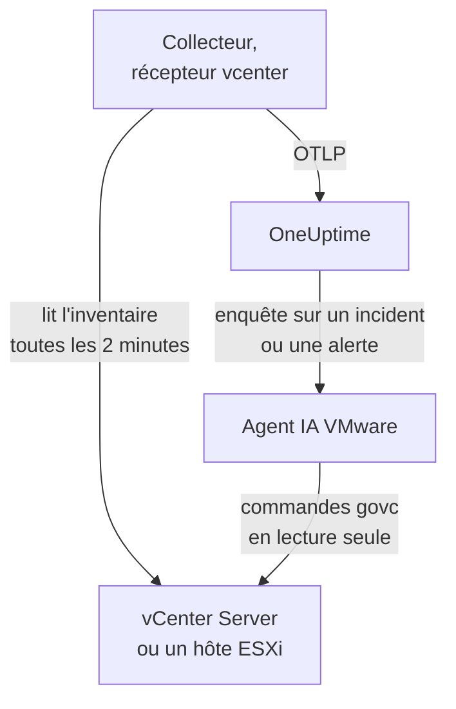

# Agent VMware

L'agent VMware de OneUptime surveille VMware vSphere : vCenter Server, les hôtes ESXi, les machines virtuelles, les datastores, les clusters, les pools de ressources et vSAN. C'est un OpenTelemetry Collector standard dont le [récepteur `vcenter`](https://github.com/open-telemetry/opentelemetry-collector-contrib/tree/main/receiver/vcenterreceiver) lit l'API vSphere avec un utilisateur en lecture seule, appose le nom de votre vCenter sur chaque métrique et l'envoie à OneUptime : aucun plugin sur vCenter, et rien à l'intérieur des VM. Les [moniteurs VMware](/docs/monitor/vmware-monitor) alertent sur ce qui arrive.

:::cards
- [Installer l'agent](#installer-lagent): Un utilisateur en lecture seule, puis le script d'installation, Docker Compose ou systemd.
- [Ce que l'agent collecte](#ce-que-collecte-lagent): Chaque objet vSphere, son identité et ses métriques.
- [Agent IA](#agent-ia): Laisser OneUptime AI lire le vCenter pendant qu'elle enquête.
- [Dépannage](#dépannage): Un script de diagnostic, et les problèmes habituels.
:::

## Fonctionnement

Un agent surveille un endpoint vSphere : un **vCenter Server**, qui couvre chaque datacenter, cluster et hôte qu'il gère, ou un **hôte ESXi autonome** qu'aucun vCenter ne gère. Exécutez un agent par vCenter. Le collecteur parcourt tout l'inventaire une fois par collecte (toutes les 2 minutes par défaut) et envoie une ressource par objet. Le même fichier Compose exécute à côté l'agent IA VMware, pour OneUptime AI. Vous préférez vous passer de Docker ? Le même collecteur, avec la même configuration, s'exécute aussi comme service systemd sur n'importe quelle machine Linux.



Le vCenter s'enregistre avec ses premières données, sous le nom que l'agent appose sur chaque métrique en tant que `vmware.vcenter.name`. Pour surveiller un vCenter sans exécuter d'agent du tout, voir [VMware sans agent](/docs/telemetry/vmware-agentless) : l'une de vos probes collecte les mêmes données avec un compte en lecture seule.

## Avant de commencer

- Docker Engine 20.10 ou ultérieur avec le plugin Docker Compose v2 ou, pour installer sans Docker, une machine Linux (x86_64 ou arm64) avec systemd 235 ou ultérieur. Dans les deux cas, la machine doit joindre vCenter en HTTPS (TCP 443).
- vCenter Server ou ESXi 7.0 ou ultérieur : le récepteur prend en charge vSphere 7 et 8.
- Un compte capable de créer un utilisateur vSphere et de lui attribuer un rôle sur l'objet vCenter de premier niveau.
- Une clé d'ingestion. Créez-en une sous **Paramètres du projet → Télémétrie & APM → Clés d'ingestion** et copiez sa valeur.

### Où exécuter l'agent

L'agent communique avec vCenter en HTTPS : il n'a donc pas besoin de tourner à proximité, et idéalement il ne devrait tourner ni sur la vCenter Server Appliance ni dans une VM du cluster qu'il surveille : si ce cluster tombe, votre supervision tombe avec lui. Une petite VM d'administration sur un matériel distinct, un hôte de supervision, ou toute machine qui exécute Docker (ou, sans Docker, toute machine Linux avec systemd) et joint vCenter sur TCP 443 est le bon endroit. L'écouteur syslog facultatif nécessite aussi que les hôtes ESXi joignent l'agent sur le port syslog (voir [Envoyer le syslog ESXi](#facultatif-envoyer-le-syslog-esxi)).

## Installer l'agent

:::steps
### Créer l'utilisateur vSphere en lecture seule

L'agent ne fait que lire : l'inventaire, les compteurs de performance et les statistiques vSAN. Donnez-lui un compte dédié avec le rôle intégré **Read-Only**, jamais un administrateur.

:::tabs
@tab vSphere Client
1. Créez le compte : ouvrez _Menu → Administration → Single Sign On → Users and Groups_, choisissez le domaine `vsphere.local` (ou votre source d'identité), cliquez sur **Add**, nommez l'utilisateur `oneuptime` et définissez un mot de passe. L'utilisateur est alors `oneuptime@vsphere.local`.
2. Attribuez le rôle : sélectionnez l'objet **vCenter Server** de premier niveau dans l'inventaire _Hosts and Clusters_, ouvrez l'onglet **Permissions**, cliquez sur **Add**, choisissez l'utilisateur, réglez le rôle sur **Read-Only** et cochez **Propagate to children**.
@tab govc
Depuis une machine disposant d'identifiants d'administrateur :

```bash
govc sso.user.create -p 'a-strong-password' -R ReadOnly oneuptime
govc permissions.set -principal oneuptime@vsphere.local -role ReadOnly -propagate=true /
```
@tab PowerCLI
Depuis une session connectée à vCenter en tant qu'administrateur :

```powershell
New-SsoPersonUser -UserName oneuptime -Password 'a-strong-password'
New-VIPermission -Entity (Get-Folder -NoRecursion) -Principal 'VSPHERE.LOCAL\oneuptime' -Role ReadOnly -Propagate:$true
```
@tab ESXi Host Client
Pour un hôte ESXi autonome (sans vCenter), créez l'utilisateur sous _Host → Manage → Security & Users → Users_ et donnez-lui le rôle Read-Only sous _Host → Manage → Security & Users → Permissions_. Ou, dans le shell de l'hôte, exécutez `esxcli system account add`, puis `esxcli system permission set --id oneuptime --role ReadOnly`.
:::

> [!IMPORTANT]
> La propagation est l'étape qu'on oublie. Le récepteur parcourt les datacenters, les clusters, les hôtes, les VM, les datastores et les pools de ressources, et chaque objet que l'utilisateur ne peut pas voir est omis sans bruit. Un rôle Read-Only attribué sur l'objet vCenter _sans_ propagation donne un inventaire vide, et un tableau de bord rempli de zéros.

### Installer et démarrer l'agent

:::tabs
@tab install.sh
Téléchargez le script d'installation et exécutez-le sur la machine qui hébergera l'agent :

```bash
curl -sSL https://raw.githubusercontent.com/OneUptime/oneuptime/master/agents/VMwareAgent/install.sh -o install.sh
bash install.sh
```

Le script demande votre URL OneUptime, la clé d'ingestion, un nom pour le vCenter, l'endpoint vCenter et les identifiants en lecture seule (il lit le mot de passe sans l'afficher), puis si l'agent IA peut appliquer des corrections (si oui, un utilisateur vSphere qui lui est propre et les VM qu'il ne doit jamais modifier). Il s'installe dans `/opt/oneuptime-vmware-agent`, écrit un fichier en `0600` nommé `.env` et démarre l'agent avec Docker Compose. Il met chaque valeur entre guillemets pour Docker Compose, telle que vous l'avez saisie : un mot de passe contenant `$`, `#`, des espaces ou des guillemets fonctionne donc tel que saisi. Relancer le script réutilise tout le contenu d'un `.env` existant au lieu de poser de nouveau les questions, et c'est ainsi que vous [mettez à jour l'agent](#mettre-à-jour-lagent).
@tab Docker Compose
Téléchargez `docker-compose.yml` et `otel-collector-config.yaml` depuis le [répertoire VMwareAgent](https://github.com/OneUptime/oneuptime/tree/master/agents/VMwareAgent) dans un nouveau dossier, puis créez un fichier `.env` à côté. Il contient un mot de passe : gardez-le privé avec `chmod 600 .env` :

```bash title=".env"
ONEUPTIME_URL=YOUR_ONEUPTIME_URL
ONEUPTIME_TELEMETRY_INGESTION_KEY=YOUR_TELEMETRY_INGESTION_TOKEN
VMWARE_VCENTER_NAME=my-vcenter
VCENTER_ENDPOINT=https://vcsa.example.com
VCENTER_USERNAME=oneuptime@vsphere.local
VCENTER_PASSWORD=a-strong-password
VCENTER_INSECURE_SKIP_VERIFY=true
VCENTER_COLLECTION_INTERVAL=2m
```

Un mot de passe contenant `$`, `#`, des espaces ou des guillemets se met entre guillemets simples (voir [vCenter refuse la connexion](#dépannage)). Démarrez l'agent :

```bash
docker compose up -d
```
@tab systemd
L'agent n'a pas besoin de Docker : c'est un binaire OpenTelemetry Collector et un fichier de configuration. Sur une machine Linux (x86_64 ou arm64) avec systemd 235 ou ultérieur (Ubuntu 18.04, Debian 10, RHEL 8 ou plus récent), exécutez la version de `otelcol-contrib` qu'épingle l'agent, avec le même `otel-collector-config.yaml`, comme service systemd. L'unité que l'agent fournit pour cela, [`oneuptime-vmware-agent-native.service`](https://github.com/OneUptime/oneuptime/blob/master/agents/VMwareAgent/systemd/oneuptime-vmware-agent-native.service), exécute le collecteur sous un utilisateur éphémère non privilégié, sans capabilities et sans rien où il puisse écrire.

Téléchargez le collecteur, la configuration et l'unité, et installez-les dans `/opt/oneuptime-vmware-agent` :

```bash
cd "$(mktemp -d)"
VERSION=0.161.0   # the collector release the agent pins
ARCH=$(uname -m | sed 's/x86_64/amd64/;s/aarch64/arm64/')
curl -fL -o otelcol-contrib.tar.gz \
  https://github.com/open-telemetry/opentelemetry-collector-releases/releases/download/v${VERSION}/otelcol-contrib_${VERSION}_linux_${ARCH}.tar.gz
curl -fsSLO https://raw.githubusercontent.com/OneUptime/oneuptime/master/agents/VMwareAgent/otel-collector-config.yaml
curl -fsSL -o oneuptime-vmware-agent.service \
  https://raw.githubusercontent.com/OneUptime/oneuptime/master/agents/VMwareAgent/systemd/oneuptime-vmware-agent-native.service

sudo install -d -m 0755 /opt/oneuptime-vmware-agent
sudo tar --no-same-owner --preserve-permissions -xzf otelcol-contrib.tar.gz -C /opt/oneuptime-vmware-agent otelcol-contrib
sudo install -m 0644 otel-collector-config.yaml /opt/oneuptime-vmware-agent/otel-collector-config.yaml
sudo install -m 0644 oneuptime-vmware-agent.service /etc/systemd/system/oneuptime-vmware-agent.service
```

Les réglages vont dans `/opt/oneuptime-vmware-agent/.env` : les mêmes variables que le `.env` de l'installation Docker. Il contient un mot de passe : rendez-le lisible par root seul avant de l'ouvrir :

```bash
sudo touch /opt/oneuptime-vmware-agent/.env
sudo chmod 600 /opt/oneuptime-vmware-agent/.env
sudoedit /opt/oneuptime-vmware-agent/.env
```

Mettez-y ceci :

```bash
ONEUPTIME_URL=YOUR_ONEUPTIME_URL
ONEUPTIME_TELEMETRY_INGESTION_KEY=YOUR_TELEMETRY_INGESTION_TOKEN
VMWARE_VCENTER_NAME=my-vcenter
VCENTER_ENDPOINT=https://vcsa.example.com
VCENTER_USERNAME="oneuptime@vsphere.local"
VCENTER_PASSWORD="a-strong-password"
VCENTER_INSECURE_SKIP_VERIFY=true
VCENTER_COLLECTION_INTERVAL=2m
```

systemd lit ce fichier, pas un shell : gardez le nom d'utilisateur et le mot de passe entre guillemets doubles, en écrivant chaque `\` comme `\\` et chaque `"` comme `\"` — `DOMAIN\user` devient `"DOMAIN\\user"` —, tandis que `$`, `#`, `'` et les espaces s'écrivent tels quels. C'est la forme que toutes les versions de systemd lisent de la même façon ; les plus anciennes (celle de RHEL 8, par exemple) suppriment une barre oblique inverse même entre guillemets simples. Démarrez ensuite l'agent, et faites-le démarrer à chaque démarrage de la machine :

```bash
sudo systemctl daemon-reload
sudo systemctl enable oneuptime-vmware-agent
sudo systemctl restart oneuptime-vmware-agent
```

Cette installation n'exécute que le collecteur : l'[agent IA](#agent-ia) n'est livré que sous forme d'image de conteneur. Exécutez un agent par vCenter : si vous quittez l'installation Docker, exécutez d'abord `docker compose down` là-bas, sinon chaque métrique arrive en double.
:::

### Vérifier l'installation

Vérifiez que l'agent tourne, et lisez les journaux du collecteur :

```bash
docker compose ps
docker logs -f oneuptime-vmware-agent
```

Installé avec systemd ? Vérifiez plutôt le service et son journal :

```bash
systemctl status oneuptime-vmware-agent --no-pager
sudo journalctl -u oneuptime-vmware-agent -f
```

Les journaux du collecteur doivent afficher cette ligne une fois qu'il a démarré :

```text
Everything is ready. Begin running and processing data.
```

### Trouver le vCenter dans OneUptime

Rien n'est envoyé avant la fin du premier parcours complet de l'inventaire : patientez donc un intervalle de collecte (2 minutes par défaut). Ouvrez ensuite **Produits → Infrastructure → VMware → Tous les vCenter** : le vCenter s'y trouve, avec ses datacenters, ses clusters, ses hôtes ESXi, ses machines virtuelles, ses datastores et ses pools de ressources.
:::

## Variables d'environnement

Docker Compose les lit dans le `.env` situé à côté de `docker-compose.yml` ; l'installation systemd les lit dans `/opt/oneuptime-vmware-agent/.env`, et son unité fournit les mêmes valeurs par défaut.

| Variable | Obligatoire | Description |
| --- | --- | --- |
| `ONEUPTIME_URL` | Oui | Votre URL OneUptime, comme `https://oneuptime.com` ou votre instance auto-hébergée. Utilisez `http://` et son port si l'instance ne parle que HTTP. |
| `ONEUPTIME_TELEMETRY_INGESTION_KEY` | Oui | La clé d'ingestion de **Paramètres du projet → Télémétrie & APM → Clés d'ingestion**. |
| `VMWARE_VCENTER_NAME` | Oui | Le nom du vCenter dans OneUptime, apposé sur chaque métrique comme attribut de ressource `vmware.vcenter.name`. Gardez-le stable : le modifier plus tard enregistre un second vCenter. Par défaut `vmware-vcenter`. |
| `VCENTER_ENDPOINT` | Oui | Le schéma et l'hôte du vCenter Server ou d'un hôte ESXi autonome, **sans** `/sdk`, comme `https://vcsa.example.com`. |
| `VCENTER_USERNAME` | Oui | L'utilisateur vSphere doté du rôle Read-Only, comme `oneuptime@vsphere.local` (ou `DOMAIN\user` pour une source d'identité Active Directory). |
| `VCENTER_PASSWORD` | Oui | Le mot de passe de cet utilisateur. S'il contient `$`, `#`, des espaces ou des guillemets, mettez-le entre guillemets simples dans le `.env` de l'installation Docker (`install.sh` le fait pour vous), et entre guillemets doubles dans celui de l'installation systemd (voir [Dépannage](#dépannage)). |
| `VCENTER_INSECURE_SKIP_VERIFY` | Non | `true` accepte le certificat auto-signé (VMCA) par défaut de vCenter ; `false` garde la vérification TLS active. Par défaut `false`. |
| `VCENTER_COLLECTION_INTERVAL` | Non | La fréquence de lecture de tout l'inventaire. Passez-la à `5m` ou `10m` pour les très grands vCenter. Par défaut `2m`. |

Les réglages propres à l'agent IA se trouvent sous [Agent IA](#agent-ia).

## Ce que collecte l'agent

À chaque `VCENTER_COLLECTION_INTERVAL`, le récepteur parcourt tout l'inventaire vSphere et envoie une ressource OpenTelemetry par objet. L'identité de chaque objet se trouve dans ses **attributs de ressource** — `vcenter.datacenter.name`, `vcenter.cluster.name`, `vcenter.host.name`, `vcenter.vm.name` / `vcenter.vm.id`, `vcenter.datastore.name`, `vcenter.resource_pool.name` / `vcenter.resource_pool.inventory_path` — et l'agent ajoute `vmware.vcenter.name` par-dessus, si bien que OneUptime range tout sous votre vCenter :

| Objet vSphere | Identité (attributs de ressource) | Métriques |
| --- | --- | --- |
| Datacenter | `vcenter.datacenter.name` | `vcenter.datacenter.cluster.count`, `vcenter.datacenter.host.count`, `vcenter.datacenter.vm.count`, `vcenter.datacenter.datastore.count`, `vcenter.datacenter.disk.space`, `vcenter.datacenter.cpu.limit`, `vcenter.datacenter.memory.limit` |
| Cluster | + `vcenter.cluster.name` | `vcenter.cluster.cpu.effective`, `vcenter.cluster.cpu.limit`, `vcenter.cluster.memory.effective`, `vcenter.cluster.memory.limit`, `vcenter.cluster.host.count`, `vcenter.cluster.vm.count`, `vcenter.cluster.vm_template.count`, `vcenter.cluster.vsan.*` (débit, opérations, latence, congestions) |
| Hôte ESXi | + `vcenter.host.name` (et `vcenter.cluster.name` quand l'hôte est dans un cluster) | `vcenter.host.cpu.usage` / `.capacity` / `.utilization` / `.reserved`, `vcenter.host.memory.usage` / `.utilization` / `.capacity`, `vcenter.host.disk.latency.avg` / `.latency.max` / `.throughput`, `vcenter.host.network.usage` / `.throughput` / `.packet.rate` / `.packet.drop.rate` / `.packet.error.rate`, `vcenter.host.vsan.*` |
| Machine virtuelle | + `vcenter.host.name`, `vcenter.vm.name`, `vcenter.vm.id` (UUID d'instance) ; `vcenter.resource_pool.*` ou `vcenter.virtual_app.*` | `vcenter.vm.disk.usage`, `vcenter.vm.disk.utilization`, `vcenter.vm.memory.usage` / `.utilization` / `.ballooned` / `.swapped` / `.swapped_ssd` ; VM allumées uniquement : `vcenter.vm.cpu.usage`, `vcenter.vm.cpu.readiness`, `vcenter.vm.cpu.utilization`, `vcenter.vm.disk.latency.avg` / `.latency.max` / `.throughput`, `vcenter.vm.network.*`, `vcenter.vm.vsan.*` |
| Modèle de VM | `vcenter.vm_template.name`, `vcenter.vm_template.id` | `vcenter.vm.disk.usage` uniquement |
| Datastore | + `vcenter.datastore.name` | `vcenter.datastore.disk.usage`, `vcenter.datastore.disk.utilization` |
| Pool de ressources | + `vcenter.resource_pool.name`, `vcenter.resource_pool.inventory_path` | `vcenter.resource_pool.cpu.usage` / `.cpu.shares`, `vcenter.resource_pool.memory.usage` / `.memory.shares` / `.memory.ballooned` / `.memory.swapped` / `.memory.granted` |

Les métriques de comptage et de capacité se déclinent selon des **attributs de point de données**, qui sont précisément ce sur quoi vous filtrez et regroupez dans les critères de moniteur :

| Attribut | Valeurs | Porté par |
| --- | --- | --- |
| `direction` | `read` / `write` pour le disque, `transmitted` / `received` pour le réseau | Latence et débit disque, débit réseau et taux de paquets |
| `disk_state` | `available` / `used` | `vcenter.datastore.disk.usage`, `vcenter.vm.disk.usage`, `vcenter.datacenter.disk.space` |
| `status` | `red` / `yellow` / `green` / `gray` (le statut global de l'objet dans vSphere) | `vcenter.datacenter.cluster.count` / `.host.count` / `.vm.count` |
| `power_state` | Hôtes : `on` / `off` / `standby` / `unknown` ; VM : `on` / `off` / `suspended` / `unknown` | `vcenter.datacenter.host.count` / `.vm.count`, `vcenter.cluster.vm.count` |
| `effective` | `true` / `false` (stockés sous forme de chaînes) | `vcenter.cluster.host.count` |
| `object` | L'instance de carte réseau, de disque ou de vCPU (comme `vmnic0`) | Séries disque et réseau par périphérique des hôtes et des VM |
| `cpu_reservation_type` | `total` / `used` | `vcenter.host.cpu.reserved` |
| `type` | Mémoire : `guest` / `host` / `overhead`, `private` / `shared` ; vSAN : `read` / `write` / `unmap` | Séries mémoire des pools de ressources, latence et opérations vSAN |

Les unités sont les unités OTLP propres au récepteur, que OneUptime met à l'échelle pour l'affichage : `MHz` pour l'utilisation et la capacité CPU, `%` pour l'utilisation et le CPU ready, `MiBy` pour la mémoire des hôtes, des VM et des pools de ressources, `By` pour la mémoire des clusters et des datacenters et pour tout l'espace disque, `ms` pour la latence disque des hôtes et des VM, et `us` (microsecondes) pour la latence vSAN. Dans les critères de moniteur, les attributs d'identité prennent un préfixe `resource.` (`resource.vcenter.host.name`, `resource.vmware.vcenter.name`), tandis que les attributs de point de données restent nus (`disk_state`, `power_state`, `status`).

`vcenter.host.memory.capacity` est désactivée par défaut en amont ; la configuration fournie l'active, car OneUptime divise par elle pour l'utilisation mémoire des hôtes. Un commentaire dans `otel-collector-config.yaml` liste les autres métriques facultatives (`vcenter.vm.cpu.time`, `vcenter.vm.memory.granted`, `vcenter.host.memory.active`, `vcenter.host.memory.ballooned`, `vcenter.host.memory.granted`, `vcenter.vm.network.broadcast.packet.rate`, `vcenter.vm.network.multicast.packet.rate`) : activez n'importe laquelle de la même manière.

### État d'alimentation des VM

Le récepteur n'envoie aucune métrique d'état d'alimentation pour une VM. Il envoie `vcenter.vm.cpu.*` **uniquement pour les VM allumées** : OneUptime déduit donc l'état de ce qui est arrivé dans chaque collecte. Une VM qui a remonté des métriques CPU est **Powered on** ; une VM qui n'a remonté que l'utilisation mémoire et disque est **Powered off** (ou suspendue : vSphere ne distingue pas les deux ici). Les modèles de VM n'ont pas d'état d'alimentation. Cela lit **une collecte entière à la fois**, c'est pourquoi le processeur `batch` fourni a un grand `send_batch_size` et, à dessein, aucun `send_batch_max_size` : une collecte répartie sur deux exports remettrait à zéro les comptages d'inventaire et ferait passer des VM à « éteintes ». Conservez les réglages de batch tels que livrés.

## Le vCenter dans OneUptime


La page **Vue d'ensemble** répond d'abord à la question « ce vCenter est-il en bonne santé » : les hôtes effectifs, le CPU et la mémoire des hôtes pondérés par la capacité, le datastore le plus plein et le pire temps de CPU ready d'une VM. Quand quelque chose est dégradé, elle nomme l'objet responsable : vous n'avez pas à le chercher.

### Hôtes ESXi


### Machines virtuelles


Les machines virtuelles éteintes et les modèles sont listés aussi. vCenter ne remonte les compteurs CPU que pour les VM allumées : leurs colonnes CPU affichent donc N/A plutôt qu'un zéro trompeur.

### Datastores


## Facultatif — Envoyer le syslog ESXi

Par défaut, l'agent n'envoie que des métriques : la page **Journaux** du vCenter reste donc vide. Les hôtes ESXi (et vCenter lui-même) peuvent transférer leur syslog vers n'importe quel écouteur, et le `otel-collector-config.yaml` fourni contient une paire de récepteurs `syslog` commentée (TCP et UDP sur le port 5514, RFC 3164 : le format propre à ESXi), reliée à un pipeline `logs` commenté qui appose `vmware.vcenter.name` pour que les journaux arrivent sur votre vCenter.

:::steps
### Activer les récepteurs

Décommentez les deux récepteurs `syslog/*` et le pipeline `logs` dans `otel-collector-config.yaml`.

### Ouvrir le port

Décommentez le bloc `ports:` dans `docker-compose.yml` pour que la machine publie `5514/tcp` et `5514/udp`, puis exécutez `docker compose up -d`. Avec systemd, il n'y a aucun port à publier, puisque le collecteur écoute sur la machine elle-même : exécutez plutôt `sudo systemctl restart oneuptime-vmware-agent`. Ouvrez le port dans le pare-feu de la machine pour le réseau d'administration ESXi.

### Pointer chaque hôte ESXi vers l'agent

Dans le vSphere Client, sélectionnez l'hôte, ouvrez _Configure → System → Advanced System Settings_, modifiez `Syslog.global.logHost` et réglez-le sur `udp://<agent-host>:5514` (ou `tcp://<agent-host>:5514` ; séparez plusieurs cibles par des virgules). Autorisez ensuite le trafic sortant sous _Configure → System → Firewall → Edit → syslog_. Ou, sur chaque hôte, avec `esxcli` :

```bash
esxcli system syslog config set --loghost='udp://<agent-host>:5514'
esxcli system syslog reload
esxcli network firewall ruleset set --ruleset-id=syslog --enabled=true
```

Avec PowerCLI, sur tout un cluster : `Get-VMHost | Get-AdvancedSetting -Name Syslog.global.logHost | Set-AdvancedSetting -Value 'udp://<agent-host>:5514' -Confirm:$false`.
:::

Un récepteur syslog n'écoute que sur un seul transport, c'est pourquoi TCP et UDP sont deux récepteurs : laissez-en un commenté si vous n'avez besoin que de l'autre. Pour le syslog TLS (`ssl://`), terminez-le devant l'agent ; le récepteur lui-même parle TCP et UDP en clair. L'image standard du collecteur lit le syslog tel quel : aucune image personnalisée n'est nécessaire.

## Étiqueter le vCenter avec des étiquettes de projet

Un attribut de ressource qui commence par `oneuptime.label.` devient une étiquette de projet sur le vCenter : `oneuptime.label.<dimension>=<value>` correspond à l'étiquette `<dimension>:<value>`. Ajoutez les attributs au processeur `resource` dans `otel-collector-config.yaml`, à côté de `vmware.vcenter.name` :

```yaml
processors:
  resource:
    attributes:
      # ...existing attributes...
      - key: oneuptime.label.team
        value: platform
        action: upsert
      - key: oneuptime.label.env
        value: production
        action: upsert
```

Le collecteur ne lit sa configuration qu'au démarrage : exécutez `docker compose restart oneuptime-vmware-agent`, ou `sudo systemctl restart oneuptime-vmware-agent` avec systemd. Le vCenter affiche alors les étiquettes `team:platform` et `env:production`. Les étiquettes sont comparées sans tenir compte de la casse : une étiquette `Production` existante est donc réutilisée plutôt que dupliquée, et l'agent ne retire jamais une étiquette que quelqu'un a ajoutée dans OneUptime.

## Exécuter comme service systemd

L'installation Docker peut aussi tourner sous systemd, pour démarrer avec la machine et redémarrer en cas d'échec. Son unité enveloppe Docker Compose et suppose que l'agent se trouve dans `/opt/oneuptime-vmware-agent`, là où le script d'installation le place :

```bash
sudo curl -fsSL https://raw.githubusercontent.com/OneUptime/oneuptime/master/agents/VMwareAgent/systemd/oneuptime-vmware-agent.service -o /etc/systemd/system/oneuptime-vmware-agent.service
sudo systemctl daemon-reload
sudo systemctl enable --now oneuptime-vmware-agent
```

L'installation sans Docker est déjà un service systemd, avec sa propre unité.

## Mettre à jour l'agent

L'agent signale comme **Version de l'agent** la version du collecteur qu'épinglent ses fichiers. Lorsque celle-ci est plus ancienne que la version qu'épingle cette version de OneUptime, un signe d'avertissement apparaît à côté, sur la page **Vue d'ensemble** du vCenter et dans la liste **Tous les vCenter**. Sélectionnez-le pour voir ces commandes. Un agent installé avant que ses fichiers ne signalent une version n'en affiche aucune tant qu'il n'a pas été mis à jour de cette façon.

Le collecteur est épinglé dans `docker-compose.yml` (ou, sans Docker, par la version que vous avez téléchargée) et sa configuration est un fichier situé à côté : tirer les images ne suffit donc pas à faire avancer l'agent :

:::tabs
@tab install.sh
Relancez `install.sh` : il réutilise chaque valeur de votre `.env` existant (aucune question n'est reposée), actualise `docker-compose.yml` et `otel-collector-config.yaml`, et recrée l'agent pour que le collecteur lise sa nouvelle configuration.

```bash
curl -sSL https://raw.githubusercontent.com/OneUptime/oneuptime/master/agents/VMwareAgent/install.sh -o install.sh
bash install.sh
```
@tab Docker Compose
Dans le dossier de l'agent, téléchargez de nouveau les deux fichiers (et refaites toute modification que vous y aviez apportée), puis tirez les images et recréez l'agent :

```bash
curl -fsSLO https://raw.githubusercontent.com/OneUptime/oneuptime/master/agents/VMwareAgent/docker-compose.yml
curl -fsSLO https://raw.githubusercontent.com/OneUptime/oneuptime/master/agents/VMwareAgent/otel-collector-config.yaml
docker compose pull
docker compose up -d --force-recreate
```
@tab systemd
Relancez les commandes d'installation : elles téléchargent la version qu'épingle ce OneUptime avec le dernier `otel-collector-config.yaml` et la dernière unité, et laissent votre `.env` tel quel (refaites toute modification apportée à la configuration). Redémarrez ensuite le service :

```bash
cd "$(mktemp -d)"
VERSION=0.161.0   # the collector release the agent pins
ARCH=$(uname -m | sed 's/x86_64/amd64/;s/aarch64/arm64/')
curl -fL -o otelcol-contrib.tar.gz \
  https://github.com/open-telemetry/opentelemetry-collector-releases/releases/download/v${VERSION}/otelcol-contrib_${VERSION}_linux_${ARCH}.tar.gz
curl -fsSLO https://raw.githubusercontent.com/OneUptime/oneuptime/master/agents/VMwareAgent/otel-collector-config.yaml
curl -fsSL -o oneuptime-vmware-agent.service \
  https://raw.githubusercontent.com/OneUptime/oneuptime/master/agents/VMwareAgent/systemd/oneuptime-vmware-agent-native.service

sudo install -d -m 0755 /opt/oneuptime-vmware-agent
sudo tar --no-same-owner --preserve-permissions -xzf otelcol-contrib.tar.gz -C /opt/oneuptime-vmware-agent otelcol-contrib
sudo install -m 0644 otel-collector-config.yaml /opt/oneuptime-vmware-agent/otel-collector-config.yaml
sudo install -m 0644 oneuptime-vmware-agent.service /etc/systemd/system/oneuptime-vmware-agent.service
sudo systemctl daemon-reload
sudo systemctl restart oneuptime-vmware-agent
```
:::

## Désinstaller l'agent

:::tabs
@tab Docker Compose
```bash
cd /opt/oneuptime-vmware-agent
docker compose down
```
@tab systemd
```bash
sudo systemctl disable --now oneuptime-vmware-agent
sudo rm /etc/systemd/system/oneuptime-vmware-agent.service
sudo systemctl daemon-reload
sudo rm -r /opt/oneuptime-vmware-agent
```
:::

Retirez ensuite la permission de l'utilisateur `oneuptime` dans vCenter si vous n'en avez plus besoin, ainsi que l'utilisateur propre à l'agent IA si vous en avez créé un.

## Agent IA

Le `docker-compose.yml` de l'agent exécute aussi l'**Agent IA VMware**, `oneuptime-vmware-ai-agent` (image `oneuptime/resource-ai-agent:release`). Pendant que OneUptime AI enquête sur un incident ou une alerte sur ce vCenter, elle exécute à travers lui des commandes `govc` en lecture seule — `govc vm.info web-01`, `govc events -n 50 /DC/vm/web-01`, `govc metric.sample -n 12 /DC/vm/web-01 cpu.usage.average` — et, uniquement si vous l'autorisez, applique des corrections comme le rallumage d'une VM. Il s'enregistre comme le vCenter nommé `VMWARE_VCENTER_NAME`, comme le collecteur, et apparaît sur la page **IA → Agent IA** du vCenter dans OneUptime.

- **Les enquêtes IA sont activées par défaut.** Dès que l'agent se connecte, OneUptime AI enquête avec lui sur les incidents et les alertes de ce vCenter, et la page **Vue d'ensemble** du vCenter affiche l'état de l'agent. Pour arrêter, définissez `ONEUPTIME_AI_INVESTIGATION=false` là où l'agent s'exécute (**Modifier**, sous **Ce que l'IA peut faire** sur la page de l'agent IA, montre comment), ou ne lancez pas l'agent.
- **Le rôle vSphere est la limite stricte.** Les enquêtes se connectent avec l'utilisateur **Read-Only** du collecteur (`VCENTER_USERNAME` / `VCENTER_PASSWORD`), qui peut lire et rien d'autre. Les corrections nécessitent un utilisateur propre à l'agent IA dont le rôle peut allumer, éteindre et réinitialiser les VM (`VirtualMachine.Interact.PowerOn`, `PowerOff` et `Reset`), attribué uniquement sur les dossiers que l'IA peut corriger et défini comme `ONEUPTIME_AI_VCENTER_USERNAME` / `ONEUPTIME_AI_VCENTER_PASSWORD`.
- Il est en **lecture seule**, sauf si vous définissez `ONEUPTIME_AI_ALLOW_WRITES=true` ; `ONEUPTIME_AI_WRITE_TARGETS` (noms de VM et d'hôtes ou chemins d'inventaire) limite ce qu'une correction peut toucher. Il ne modifie jamais la VM nommée d'après l'hôte de `VCENTER_ENDPOINT` — normalement l'appliance vCenter — et ne reconnaît l'appliance que par ce nom : quand `VCENTER_ENDPOINT` est une adresse IP, ou que la VM de l'appliance porte un autre nom, ajoutez cette VM à `ONEUPTIME_AI_PROTECTED_TARGETS`, avec la VM sur laquelle tourne l'agent. `ONEUPTIME_AI_FIXES`, dans le même `.env`, indique comment les corrections s'exécutent — `ask-for-approval` (une personne approuve chacune), `automatic` ou `bypass-approval` — et la page de l'agent IA l'affiche en lecture seule ([Ce que l'IA peut faire, défini par l'agent](/docs/ai/infrastructure-ai-agents#what-ai-may-do-set-by-the-agent)).
- Pour vérifier le certificat de vCenter au lieu d'ignorer la vérification, montez son AC dans le conteneur et définissez `VCENTER_CA_FILE` ; sur un vCenter avec plusieurs datacenters, définissez `GOVC_DATACENTER`.
- Il s'exécute en UID 1000 sans capabilities, et n'exécute jamais d'opérations invité, de snapshots, `esxcli` ni rien qui crée ou détruise une VM. Supprimez le service `oneuptime-vmware-ai-agent` de `docker-compose.yml` si vous n'utilisez pas OneUptime AI.
- L'installation sans Docker n'a pas d'agent IA : il n'est livré que sous forme d'image de conteneur. Pour en ajouter un, exécutez-le avec Docker sur n'importe quelle machine qui joint vCenter — téléchargez `docker-compose.yml`, écrivez à côté un `.env` avec les réglages de `/opt/oneuptime-vmware-agent/.env`, entre guillemets simples comme le veut Docker Compose, et démarrez l'agent IA seul avec `docker compose up -d oneuptime-vmware-ai-agent` (pas le collecteur, qui tourne déjà).

Ce qu'il peut exécuter, comment fonctionnent les corrections et comment le dépanner : [Infrastructure AI Agents](/docs/ai/infrastructure-ai-agents#vmware-vcenter). Le README de l'agent contient les commandes exactes pour le rôle de corrections.

## Dépannage

:::details Exécutez d'abord le script de diagnostic
L'agent est livré avec un script, [`troubleshoot.sh`](https://github.com/OneUptime/oneuptime/blob/master/agents/VMwareAgent/troubleshoot.sh), qui vérifie toute la chaîne : le runtime de conteneurs, si vCenter répond et accepte les identifiants, le nom du vCenter apposé sur chaque métrique, la forme du jeton, les métriques propres au collecteur, et si OneUptime accepte la clé d'ingestion. Cette dernière vérification est la plus importante. OneUptime refuse une clé erronée avec `401` (`422` pour une clé désactivée ou une clé de navigateur), et le collecteur traite les deux comme définitifs : il supprime le lot et journalise une seule erreur `Exporting failed`, facile à manquer alors que le conteneur reste en bonne santé. Le script interroge `GET <url>/otlp/v1/validate` depuis le réseau de l'agent pour obtenir directement `200` (valide) ou `401` (invalide), en se rabattant sur `POST /fluentd/v1/logs` avec les serveurs plus anciens, et demande `<VCENTER_ENDPOINT>/sdk/vimServiceVersions.xml` de la même façon : les échecs DNS, pare-feu et TLS apparaissent exactement comme le collecteur les rencontre.

```bash
curl -sSL https://raw.githubusercontent.com/OneUptime/oneuptime/master/agents/VMwareAgent/troubleshoot.sh -o troubleshoot.sh
bash troubleshoot.sh    # add -d <dir> if you installed outside /opt/oneuptime-vmware-agent
```

Il se termine par un verdict qui nomme la cause la plus probable.
:::

:::details Installé sans Docker
Le script de diagnostic a besoin de Docker. Sans lui, le collecteur tourne sur la machine elle-même : vérifiez donc directement la même chaîne, à savoir le service et son journal, l'API de vCenter sur le chemin réseau du collecteur, si OneUptime accepte la clé d'ingestion (`"valid":true` avec `"keyType":"Server"`), et les compteurs propres au collecteur, qu'il sert sur `127.0.0.1:8890` plutôt que `8888` pour pouvoir tourner à côté d'un autre collecteur :

```bash
systemctl status oneuptime-vmware-agent --no-pager
sudo journalctl -u oneuptime-vmware-agent -n 100 --no-pager
curl -sk https://<vcenter-host>/sdk/vimServiceVersions.xml
curl -s -H "x-oneuptime-token: <key>" https://<oneuptime-host>/otlp/v1/validate
curl -s http://127.0.0.1:8890/metrics | grep -E 'otelcol_(receiver_accepted|exporter_sent|exporter_send_failed)_metric_points'
```

Le journal se lit comme celui du conteneur : les entrées ci-dessous s'appliquent. Un service qui redémarre sans cesse journalise pourquoi : `Failed with result 'resources'` signifie que systemd ne peut pas lire `/opt/oneuptime-vmware-agent/.env`, et `cannot unmarshal the configuration` ou `requires positive value` signifie qu'une valeur qu'il contient n'est pas acceptée par le collecteur. systemd lit `.env` selon ses propres règles, et les versions plus anciennes (celle de RHEL 8, par exemple) suppriment une barre oblique inverse même entre guillemets simples : gardez le nom d'utilisateur et le mot de passe entre guillemets doubles, en écrivant chaque `\` comme `\\` et chaque `"` comme `\"`, la seule forme que toutes les versions lisent telle qu'écrite. Comme le collecteur fait confiance au magasin d'AC de la machine, vous pouvez garder la vérification TLS active : ajoutez le certificat racine de vCenter (les fichiers `.0` sous `certs/lin/` dans `https://<vcenter>/certs/download.zip`) à `/usr/local/share/ca-certificates/` avec un nom en `.crt` et exécutez `update-ca-certificates` sur Debian et Ubuntu, ou à `/etc/pki/ca-trust/source/anchors/` et exécutez `update-ca-trust` sur RHEL, puis redémarrez le service.
:::

:::details Aucun vCenter n'apparaît dans OneUptime
1. Lisez les journaux du collecteur : `docker logs oneuptime-vmware-agent`. Une erreur de connexion (`incorrect user name or password`, `InvalidLogin`) signifie des identifiants erronés, `x509: certificate signed by unknown authority` signifie que la vérification TLS est active face à un certificat auto-signé, `connection refused` ou `no such host` signifie un `VCENTER_ENDPOINT` erroné, et un `401` à l'export signifie une clé d'ingestion erronée.
2. Vérifiez que vCenter répond depuis le réseau de l'agent. L'image du collecteur n'a ni shell ni curl : interrogez donc depuis un conteneur de son réseau. `docker run --rm --network container:oneuptime-vmware-agent curlimages/curl -sk https://<vcenter-host>/sdk/vimServiceVersions.xml` doit afficher un document XML qui nomme `urn:vim25`.
3. Vérifiez que `VMWARE_VCENTER_NAME` est défini : le vCenter est retrouvé par son attribut de ressource `vmware.vcenter.name`.
4. Patientez un intervalle de collecte : rien n'est envoyé avant la fin du premier parcours complet de l'inventaire.
:::

:::details Le vCenter apparaît comme déconnecté
Un vCenter passe à l'état déconnecté quand OneUptime n'a rien reçu de lui pendant 15 minutes ; OneUptime vérifie toutes les 5 minutes, et le temps pendant lequel il ne recevait lui-même pas de données ne compte pas. Vérifiez que le collecteur tourne, que ses journaux ne montrent aucune erreur d'export et qu'une collecte se termine dans le délai `VCENTER_COLLECTION_INTERVAL` (voir l'entrée sur les grands inventaires ci-dessous). Le vCenter repasse à l'état connecté avec ses données suivantes.
:::

:::details Erreurs x509 ou TLS
Les appliances vCenter présentent un certificat émis par leur propre VMCA, auquel aucune image Docker ne fait confiance. Définissez `VCENTER_INSECURE_SKIP_VERIFY=true` (le choix pratique sur un réseau d'administration privé), ou remplacez le certificat machine de vCenter par un certificat d'une AC à laquelle l'image du collecteur fait confiance. Ne pointez **pas** l'endpoint vers une URL `http://` : vCenter ne sert son API qu'en HTTPS.
:::

:::details vCenter refuse la connexion (401 ou InvalidLogin)
Utilisez le principal complet — `oneuptime@vsphere.local`, ou `DOMAIN\user` / `user@domain.example` pour une source d'identité Active Directory — et vérifiez comment le mot de passe est écrit dans `.env`. Docker Compose v2 développe les références `$VAR` dans les valeurs sans guillemets et entre guillemets doubles, et lit un espace suivi de `#` comme le début d'un commentaire : un mot de passe contenant `$`, `#`, des espaces ou des guillemets doit donc être entre guillemets simples — `VCENTER_PASSWORD='p@ss$word'` — ce qu'écrit justement `install.sh`. Un mot de passe qui contient lui-même un guillemet simple se met entre guillemets doubles, avec chaque `$` écrit `$$` et `"` / `\` échappés par une barre oblique inverse. Un compte verrouillé (trop de tentatives échouées) refuse aussi un mot de passe correct : vérifiez _Administration → Single Sign On → Users and Groups_.
:::

:::details Des hôtes apparaissent, mais aucune VM, aucun datastore ni cluster (NoPermission)
Le rôle Read-Only a été attribué sur l'objet vCenter sans **Propagate to children**, ou sur un objet plus restreint que la racine du vCenter. Les objets que l'utilisateur ne peut pas voir sont omis sans bruit. Corrigez la permission sur l'objet vCenter de premier niveau avec la propagation activée ; la collecte suivante remplit l'inventaire.
:::

:::details Toutes les VM apparaissent éteintes
L'état d'alimentation d'une VM est déduit des points de données `vcenter.vm.cpu.*` qui arrivent dans la même collecte que ses points de données mémoire et disque (voir [État d'alimentation des VM](#état-dalimentation-des-vm)). Si vous avez modifié le processeur `batch` et ajouté un `send_batch_max_size`, un grand inventaire est réparti sur plusieurs exports et les points de données CPU arrivent dans une autre requête que le reste : remettez les réglages de batch fournis.
:::

:::details Grands inventaires : collectes lentes, erreurs vpxd.stats.maxQueryMetrics
Chaque collecte parcourt tout l'inventaire et fait une requête de performance par lot d'objets. Pour les vCenter qui comptent des milliers de VM :

- Passez `VCENTER_COLLECTION_INTERVAL` à `5m` ou `10m`. Une collecte qui dure plus longtemps que l'intervalle est sautée, pas superposée : un intervalle trop court ne laisse donc que des trous.
- Le récepteur demande jusqu'à `max_query_metrics: 256` entités par requête de performance. vCenter plafonne cela avec `vpxd.stats.maxQueryMetrics` (256 par défaut dans vCenter 7 et 8). Si un administrateur l'a abaissé, le collecteur journalise `The maximum number of performance metrics per query exceeded` : abaissez `max_query_metrics` dans `otel-collector-config.yaml` en conséquence, ou augmentez le réglage de vCenter sous _vCenter → Configure → Advanced Settings_.
- Surveillez la mémoire du collecteur : le `memory_limiter` fourni autorise 512 MiB. Si le journal indique que le limiteur supprime des données, augmentez `limit_mib` (et donnez plus de mémoire au conteneur).
:::

:::details Surveiller un hôte ESXi autonome (sans vCenter)
Pointez `VCENTER_ENDPOINT` vers l'hôte lui-même (`https://esxi01.example.com`), avec un utilisateur ESXi local doté du rôle Read-Only. Tout ce que sait un hôte est collecté : l'hôte, ses VM, ses datastores et ses pools de ressources. Un hôte autonome n'a ni objet datacenter ni objet cluster, si bien que ces pages restent vides, et il n'a pas d'API REST vCenter, si bien que le script de diagnostic indique que la vérification des identifiants n'est pas concluante (le journal du collecteur a la réponse dans ce cas).
:::

:::details Les métriques arrivent sous le mauvais vCenter
OneUptime enregistre un vCenter par son `vmware.vcenter.name`, que l'agent tire de `VMWARE_VCENTER_NAME`. Le modifier après les premières données crée un second vCenter au lieu de renommer le premier.
:::

:::details Envoyer des métriques sans l'agent
vSphere n'a pas de push OpenTelemetry propre : l'agent (ou tout OpenTelemetry Collector doté du récepteur `vcenter`) est donc le point d'entrée. Si vous exécutez déjà des collecteurs, ajoutez le récepteur `vcenter` à l'un d'eux au lieu d'exécuter cet agent : copiez le récepteur `vcenter` et le processeur `resource` du `otel-collector-config.yaml` fourni dans votre propre configuration. L'attribut de ressource `vmware.vcenter.name` est ce qui enregistre le vCenter dans OneUptime, et les suppressions de `service.name` / `service.instance.id` évitent que les données soient rangées sous un service : gardez les deux.
:::

## Étapes suivantes

:::cards
- [Surveillance VMware](/docs/monitor/vmware-monitor): Alerter sur les hôtes, les VM, les datastores, les clusters, les datacenters et vSAN.
- [VMware sans agent](/docs/telemetry/vmware-agentless): Laisser plutôt une probe collecter le vCenter.
- [Infrastructure AI Agents](/docs/ai/infrastructure-ai-agents): Ce que l'agent IA VMware peut exécuter, et comment fonctionnent les corrections.
- [Collecteur OpenTelemetry sur l'hôte](/docs/telemetry/host-otel-collector): La vue système à l'intérieur des VM, ou de la machine de l'agent.
:::
