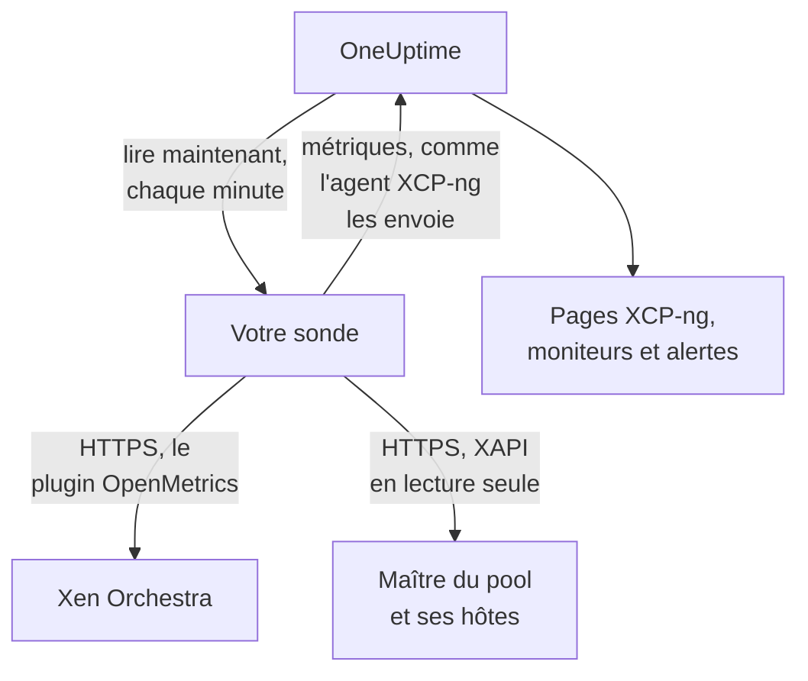

# XCP-ng sans agent

Surveillez des pools XCP-ng sans rien installer : une sonde OneUptime les lit, soit via le Xen Orchestra qui les gère, soit, pour un pool sans Xen Orchestra, directement depuis la XAPI du maître du pool. Chaque pool obtient les mêmes pages, les mêmes [moniteurs XCP-ng](/docs/monitor/xcp-ng-monitor) et les mêmes modèles qu'un pool envoyé par l'[agent XCP-ng](/docs/telemetry/xcp-ng). Il n'y a aucun agent à installer, mettre à jour ou maintenir en marche.

:::cards
- [Avant de commencer](#avant-de-commencer) : une sonde qui joint Xen Orchestra ou le pool, et un accès en lecture seule.
- [Connecter Xen Orchestra](#connecter-xen-orchestra) : tous les pools qu'il gère, via une seule connexion.
- [Connecter un pool sans Xen Orchestra](#connecter-un-pool-sans-xen-orchestra) : un seul pool, lu depuis son maître.
- [Alarmes, HA et sauvegardes](#alarmes-ha-et-sauvegardes) : ce qu'une sonde lit au-delà des métriques, et les alertes qu'elle propose.
- [Dépannage](#dépannage) : ce que signifie chaque message et ce qui y remédie.
:::

## Fonctionnement

Chaque minute, la sonde lit chaque connexion et envoie ce qu'elle a lu à OneUptime :

- **Xen Orchestra** : la sonde lit le plugin OpenMetrics de Xen Orchestra avec le secret du plugin, exactement comme l'agent XCP-ng, de sorte que chaque pool géré par Xen Orchestra arrive avec les mêmes séries. Avec un jeton d'API, elle lit aussi les alarmes, la HA et les sauvegardes de chaque pool depuis l'API REST de Xen Orchestra.
- **La XAPI d'un pool** : la sonde se connecte au maître du pool et effectue les lectures que le plugin de Xen Orchestra effectue lui-même : les enregistrements du pool, et les métriques de chaque hôte en marche, lues sur cet hôte. Elle en tire les mêmes séries que celles que sert le plugin, de sorte que le pool se lit exactement comme via Xen Orchestra. Elle place aussi les messages XAPI du pool, comme une VM qui a planté ou un hôte perdu par la HA, dans le fil du pool.

Chaque pool s'enregistre par son UUID lors de sa première lecture, comme les pools de l'agent, et apparaît sous **XCP-ng → Tous les pools**.

## Quelle façon de se connecter

| | Xen Orchestra, depuis une sonde | La XAPI d'un pool, depuis une sonde | L'agent XCP-ng |
|---|---|---|---|
| Ce que vous exécutez | Une sonde que vous exécutez déjà, ou une nouvelle | Une sonde que vous exécutez déjà, ou une nouvelle | L'agent, sur une machine à lui |
| Ce qu'il lit | Tous les pools que gère Xen Orchestra | Un seul pool | Tous les pools que gère Xen Orchestra |
| Ce qu'il faut | Le secret du plugin OpenMetrics, et un jeton d'API en lecture seule facultatif | Un compte du pool : root, ou un utilisateur Active Directory ayant le rôle read-only | Le secret du plugin OpenMetrics |
| Où sont gardés les secrets | Chiffrés dans OneUptime, envoyés uniquement à la sonde | Chiffrés dans OneUptime, envoyés uniquement à la sonde | Dans le fichier `.env` de l'agent |
| Alarmes, HA et sauvegardes | Les trois, et les correctifs manquants, avec un jeton d'API | Alarmes et HA, sans les sauvegardes | Non inclus |

Les trois envoient les mêmes séries. Un pool n'est lu que par l'un d'eux à la fois, pour que son historique reste une seule ligne, quel que soit celui qui le lit.

## Avant de commencer

- **Une sonde qui joint l'adresse sur TCP 443.** Il s'agit généralement d'une [sonde personnalisée](/docs/probe/custom-probe) sur le même réseau. Sur OneUptime Cloud, les sondes partagées ne reçoivent jamais de secrets XCP-ng : ajoutez une sonde à vous. Sur une instance auto-hébergée, les sondes de l'instance peuvent aussi lire.
- **Pour Xen Orchestra :** Xen Orchestra 6.9 ou ultérieur avec son plugin OpenMetrics activé : suivez [Activer le plugin OpenMetrics](/docs/telemetry/xcp-ng#activer-le-plugin-openmetrics) et copiez son secret. En option, un jeton d'API d'un utilisateur de Xen Orchestra ayant le rôle intégré **Read only** : OneUptime vérifie qu'il ne fait que lire, et vous avertit avant son expiration.
- **Pour un pool sans Xen Orchestra :** XCP-ng 8.2 ou ultérieur, et l'adresse de son maître. Les rôles de XAPI ne s'appliquent qu'aux utilisateurs Active Directory : son unique compte local, `root`, peut donc tout modifier dans le pool. Pour un accès en lecture seule, joignez le pool à Active Directory et donnez à un utilisateur le rôle `read-only`.

> [!IMPORTANT]
> Connectez un pool via Xen Orchestra ou via sa XAPI, pas les deux : la deuxième connexion qui lit un pool le laisse à la première.

## Connecter Xen Orchestra

:::steps
### Ouvrir les connexions
Dans OneUptime, ouvrez **XCP-ng → Connexions** et cliquez sur **Connecter XCP-ng**.

### Choisir Xen Orchestra
Sous **Ce qu'il faut lire**, choisissez **Xen Orchestra**. Saisissez l'**Adresse de Xen Orchestra**, celle à laquelle vous l'ouvrez dans un navigateur, par exemple `https://xo.example.com`, et choisissez la sonde qui le joint.

### Saisir le secret du plugin
Collez le **Secret OpenMetrics**. Ajoutez un **Jeton d'API** de l'utilisateur en lecture seule si vous en avez un.

### Tester la connexion et approuver le certificat
Cliquez sur **Tester la connexion**. Xen Orchestra signe son propre certificat, le test l'affiche donc : vérifiez son empreinte, puis cliquez sur **Approuver ce certificat**. Le résultat liste les pools que sert Xen Orchestra, avec leurs hôtes, leurs VM et leurs référentiels de stockage.

### Le nommer et le connecter
Le nom est par défaut le nom d'hôte de Xen Orchestra, et chaque pool qu'il lit l'affiche. Cliquez sur **Connecter XCP-ng**, et la page de la connexion s'ouvre.
:::

## Connecter un pool sans Xen Orchestra

:::steps
### Partir des connexions
Dans OneUptime, ouvrez **XCP-ng → Connexions** et cliquez sur **Connecter XCP-ng**.

### Choisir le pool
Sous **Ce qu'il faut lire**, choisissez **Un pool sans Xen Orchestra**. Saisissez l'**Adresse du maître du pool**, par exemple `https://10.0.0.10`, et choisissez la sonde qui le joint.

### Saisir le compte
Saisissez le **Nom d'utilisateur** et le **Mot de passe** : `root`, ou un utilisateur Active Directory ayant le rôle read-only, écrit avec son domaine, par exemple `EXAMPLE\oneuptime`.

### Tester la connexion et approuver le certificat du maître
Cliquez sur **Tester la connexion**. Chaque hôte XCP-ng signe son propre certificat, le test affiche donc celui du maître : vérifiez son empreinte, puis cliquez sur **Approuver ce certificat**. Le résultat indique quelle version de XCP-ng exécute le maître et ce que le compte peut lire, et vous avertit quand le compte peut modifier le pool.

### Nommer le pool et le connecter
Cliquez sur **Connecter XCP-ng**, et la page de la connexion s'ouvre.
:::

La page de la connexion indique où en est sa lecture. Elle affiche **Vérification** jusqu'à la première lecture, qui commence dans la minute, puis **Collecte en cours**, et les pools lus apparaissent sous **Pools lus**.

Si aucune sonde ne vient pour la connexion pendant 20 minutes, parce qu'elle est hors ligne ou trop ancienne, la page affiche **Pas de collecte** et le signale. Quand aucune sonde ne peut lire la connexion, elle affiche **Pas de collecte** aussitôt et indique quoi changer : un secret, un nom d'utilisateur ou un mot de passe manque, aucune sonde n'est définie pour la lire, sa sonde ne peut pas la lire (une sonde partagée sur OneUptime Cloud, ou celle d'un autre projet), ou sa sonde est déconnectée.

## Les pools que l'agent envoie déjà

Un pool que l'agent XCP-ng a enregistré est repris par la première connexion qui le lit : son historique se poursuit sur une seule ligne, et le fil du pool indique que l'agent peut être arrêté.

> [!WARNING]
> Arrêtez l'agent XCP-ng dès qu'une sonde lit ses pools. Tant que les deux tournent, chaque métrique arrive deux fois.

Pour revenir en arrière, ouvrez la page **Paramètres** du pool. Sa carte **Collecte des données** propose **Utiliser l'agent XCP-ng** pour un pool lu par une sonde, et **Collecter avec une sonde** pour un pool envoyé par l'agent. Un pool repassé à l'agent lui reste attribué, quoi que lise la connexion.

## Certificats

La sonde ne saute jamais la vérification des certificats. Chaque connexion effectue une négociation TLS complète, puis :

- sans certificat approuvé, le certificat doit provenir d'une autorité à laquelle la machine de la sonde fait confiance, pour l'adresse saisie ;
- avec un certificat approuvé, l'adresse doit présenter exactement ce certificat, identifié par son empreinte SHA-256, quel que soit le nom qu'il porte. Le certificat propre de Xen Orchestra ne nomme aucune adresse, et c'est ainsi qu'il est approuvé.

Pour vérifier une empreinte, exécutez `openssl s_client -connect xo.example.com:443 </dev/null | openssl x509 -noout -fingerprint -sha256` depuis la machine de la sonde, et comparez-la au certificat lui-même : sur un maître de pool, `openssl x509 -noout -fingerprint -sha256 -in /etc/xensource/xapi-ssl.pem`.

Pour un pool, vous approuvez le certificat du maître. Le pool liste lui-même le certificat que sert chacun de ses hôtes, et la sonde lit chaque autre hôte en l'épinglant à celui-ci. Quand un autre hôte devient maître, la sonde ne le suit que vers un hôte dont le pool s'est porté garant lors de sa dernière lecture. Quand un certificat change, la lecture s'arrête avec **Le certificat a changé** et le nouveau certificat s'affiche : rien n'est envoyé tant que vous ne l'avez pas approuvé, sur la page de la connexion.

## Les secrets enregistrés

Le secret, le jeton et le mot de passe sont chiffrés et en écriture seule : personne ne peut les relire, et l'API ne les renvoie jamais. Ils ne sont envoyés qu'à la sonde qui lit la connexion, qui les garde en mémoire.

Un secret enregistré n'est envoyé qu'à l'adresse, via la sonde et au certificat pour lesquels il a été saisi. Modifier l'adresse, la sonde ou le certificat approuvé dans **Modifier la connexion** demande de le saisir à nouveau : personne qui peut modifier la connexion ne peut donc l'envoyer ailleurs, et un jeton d'API enregistré qui n'est pas saisi à nouveau est oublié. Approuver le certificat que la sonde a trouvé à l'adresse enregistrée les conserve. **Supprimer le jeton d'API** supprime le jeton de OneUptime : révoquez-le aussi dans Xen Orchestra.

## Le jeton d'API

Un jeton d'API est facultatif : les métriques arrivent via le secret du plugin, et le jeton lit les alarmes, la HA et les sauvegardes de chaque pool. Avec un jeton, chaque lecture le vérifie au plus une fois par heure :

- **Il ne fait que lire.** Un jeton dont l'utilisateur est administrateur, ou dont le rôle peut modifier quoi que ce soit, échoue au test et apparaît comme un problème sur la page de la connexion. OneUptime ne conserve que des jetons en lecture seule.
- **Il lit ce dont OneUptime a besoin.** Xen Orchestra répond à une liste qu'un utilisateur ne peut pas lire par une liste vide : le jeton doit donc lire les alarmes, les messages et les journaux de sauvegarde. Le rôle intégré **Read only** lit les trois.
- **Quand il expire.** Xen Orchestra oublie un jeton dès qu'il expire. Deux semaines avant, la page de la connexion et le fil de chaque pool qu'elle lit le signalent. Créez un nouveau jeton pour le même utilisateur et saisissez-le dans **Modifier la connexion**.

## Alarmes, HA et sauvegardes

En plus des métriques, une sonde lit ce que XCP-ng et Xen Orchestra signalent sur chaque pool. Ce qu'elle lit dépend de la connexion :

| | Xen Orchestra, avec un jeton d'API | La XAPI d'un pool |
|---|---|---|
| Messages et alarmes XAPI | Lus | Lus |
| La HA et le maître du pool | Lus | Lus, avec le plan propre à la HA |
| Tâches de sauvegarde et leurs exécutions | Lues | Non lues : les sauvegardes relèvent de Xen Orchestra |
| Correctifs manquants | Lus toutes les six heures, si l'offre Xen Orchestra les inclut | Non lus : c'est Xen Orchestra qui les détermine |

Une connexion Xen Orchestra sans jeton d'API ne lit que les métriques, comme l'agent XCP-ng.

- **Sur les pages du pool.** La **Vue d'ensemble** du pool affiche l'état de sa HA et les dernières exécutions de chaque tâche de sauvegarde, la page d'un hôte ses correctifs manquants, et la page d'une VM sa dernière sauvegarde. Les messages de priorité 1 à 4, un changement de maître, la HA activée, désactivée ou qui ne peut plus tolérer la panne d'un hôte, et les exécutions de sauvegarde en échec arrivent dans le **Fil d'activité** du pool, et chaque message et chaque exécution de sauvegarde est un enregistrement sur la page **Journaux** du pool.
- **Sous forme d'alertes.** Les **Recommandations** du pool proposent un modèle pour chacun sous **Alarmes XCP-ng** et **Sauvegardes** : VM Crashed, HA Host Failed, HA State File Lost, HA Protected VM Restart Failed, Storage Failed to Plug, Storage GC Out of Space, XAPI Alarm, Pool Master Changed et Backup Job Failed. Le [moniteur XCP-ng](/docs/monitor/xcp-ng-monitor) ajoute HA Cannot Tolerate a Host Failure et VM Not Backed Up.
- **À partir de la première lecture.** Ce que XAPI a dit avant la première lecture d'un pool n'est pas signalé, et chaque message n'est signalé qu'une fois. La première lecture des journaux de sauvegarde remonte une semaine et un jour en arrière, de sorte que les dernières exécutions de chaque tâche apparaissent aussitôt.

## Référence

| Paramètre | Par défaut | Remarques |
|---|---|---|
| Lire toutes les | 1 minute | De 1 à 60 minutes. Chaque minute correspond à l'agent XCP-ng ; lisez un gros Xen Orchestra moins souvent pour le ménager. |
| Lectures simultanées | 4 par sonde | Une lecture plus lente que son intervalle est sautée, jamais empilée. |
| Plus grande lecture | Environ 48 Mio | Les plus gros Xen Orchestra ont besoin de l'agent XCP-ng. |
| Messages XAPI | 200 par lecture | À partir du moment où le pool est connecté, chacun remis une fois, le plus ancien d'abord. |
| Exécutions de sauvegarde | 20 par lecture | La première lecture remonte une semaine et un jour en arrière. Une exécution que Xen Orchestra indique encore comme en attente après trois jours n'est plus attendue. |
| Correctifs manquants | Toutes les 6 heures | Via Xen Orchestra, jusqu'à 100 hôtes par vérification. |
| Test de connexion | 90 secondes pour démarrer | Un test qu'aucune sonde ne prend en charge à temps, ou qui dure plus de 150 secondes, est considéré comme échoué. |

## Dépannage

:::details Le certificat n'est pas approuvé
Xen Orchestra et les hôtes XCP-ng signent leurs propres certificats par défaut. Comparez l'empreinte affichée au certificat, puis cliquez sur **Approuver ce certificat**.
:::

:::details Le certificat a changé
Rien n'est envoyé tant que vous n'approuvez pas le nouveau certificat. Si vous l'avez renouvelé, vérifiez la nouvelle empreinte, approuvez-le, puis saisissez à nouveau les secrets dans **Modifier la connexion**.
:::

:::details Xen Orchestra a refusé le secret
Copiez à nouveau le secret depuis **Settings → Plugins → openmetrics** dans Xen Orchestra, et saisissez-le dans **Modifier la connexion**.
:::

:::details Le plugin OpenMetrics ne répond pas
Chargez **openmetrics** sous **Settings → Plugins** dans Xen Orchestra, et activez **Auto-load** pour qu'il revienne après un redémarrage.
:::

:::details Ce Xen Orchestra n'a pas de plugin OpenMetrics
Le plugin nécessite Xen Orchestra 6.9 ou ultérieur et, sur une Xen Orchestra Appliance, une licence Premium. Sans elle, connectez plutôt chaque pool via sa XAPI.
:::

:::details Aucun pool n'est connecté
Xen Orchestra ne signale aucun pool connecté. Ajoutez ou reconnectez vos pools dans Xen Orchestra, puis testez à nouveau.
:::

:::details Le jeton d'API peut modifier Xen Orchestra
OneUptime ne conserve que des jetons en lecture seule. Créez-en un pour un utilisateur qui a une copie du rôle intégré **Read only**, et aucun autre rôle.
:::

:::details Le jeton d'API ne peut pas lire les alarmes, les messages ou les sauvegardes
Donnez à l'utilisateur du jeton une copie du rôle intégré **Read only** de Xen Orchestra, qui lit les trois.
:::

:::details Le jeton d'API a expiré
Créez un nouveau jeton pour l'utilisateur en lecture seule dans Xen Orchestra, et saisissez-le dans **Modifier la connexion**. Les métriques continuent d'arriver entre-temps.
:::

:::details XAPI a refusé la connexion
Vérifiez le nom d'utilisateur et le mot de passe. Un utilisateur Active Directory s'écrit avec son domaine, par exemple `EXAMPLE\oneuptime`.
:::

:::details Cet hôte n'est pas le maître du pool
Un membre du pool répond avec l'adresse de son maître, que le message indique. Saisissez cette adresse, puis testez à nouveau.
:::

:::details Le compte ne peut pas lire le pool
Donnez à l'utilisateur Active Directory le rôle read-only sur le pool, ou utilisez un compte qui l'a.
:::

:::details La sonde ne reçoit aucune réponse
Le réseau de la sonde ne peut pas joindre l'adresse sur TCP 443. Autorisez-le dans le pare-feu, ou choisissez une sonde sur le même réseau.
:::

:::details La sonde n'a pas pris cela en charge
La sonde est hors ligne, ou exécute une version de OneUptime antérieure à la lecture de XCP-ng. Vérifiez qu'elle est connectée dans le tableau **Sondes personnalisées**, et mettez-la à jour.
:::

:::details Cette connexion est trop volumineuse pour être lue depuis une sonde
Ses métriques dépassent la taille d'un envoi de sonde. Utilisez l'[agent XCP-ng](/docs/telemetry/xcp-ng) pour celle-ci.
:::

## Étapes suivantes

:::cards
- [Moniteur XCP-ng](/docs/monitor/xcp-ng-monitor) : alertez sur les pools, les hôtes, les VM et les référentiels de stockage.
- [Sonde personnalisée](/docs/probe/custom-probe) : exécutez une sonde sur le réseau des pools.
- [Agent XCP-ng](/docs/telemetry/xcp-ng) : lisez plutôt Xen Orchestra avec l'agent.
:::
