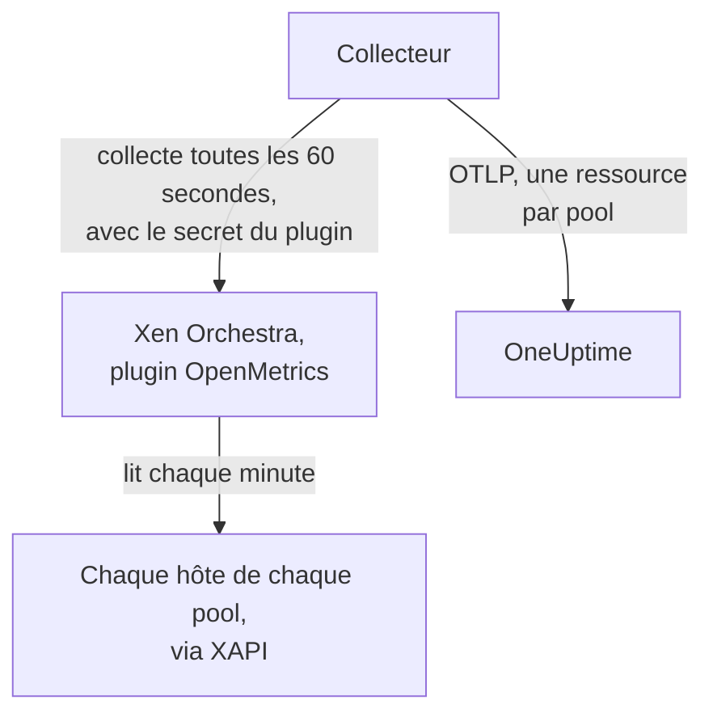

# Agent XCP-ng

L'agent XCP-ng de OneUptime surveille les pools XCP-ng que gère un Xen Orchestra : leurs hôtes, leurs VM, leurs référentiels de stockage et leurs disques virtuels. C'est un OpenTelemetry Collector standard qui lit le plugin OpenMetrics propre à Xen Orchestra avec le secret du plugin et envoie ce qu'il lit à OneUptime, où chaque pool apparaît avec son inventaire. Aucun mot de passe d'un pool ou de Xen Orchestra n'atteint jamais l'agent. Les [moniteurs XCP-ng](/docs/monitor/xcp-ng-monitor) alertent sur ce qui arrive. Pour lire les mêmes pools sans rien installer, depuis une sonde OneUptime, consultez [XCP-ng sans agent](/docs/telemetry/xcp-ng-agentless).

:::cards
- [Installer l'agent](#installer-lagent): Activer le plugin, puis le script d'installation ou Docker Compose.
- [Le certificat de Xen Orchestra](#le-certificat-de-xen-orchestra): Comment l'agent fait confiance à Xen Orchestra, jamais en sautant la vérification.
- [Ce que collecte l'agent](#ce-que-collecte-lagent): Chaque série du plugin, et les compteurs qui sont en fait des débits.
- [Dépannage](#dépannage): Un script de diagnostic, et les problèmes habituels.
:::

## Ce que vous obtenez

- **Chaque pool à part.** Chaque pool que gère le Xen Orchestra devient un pool XCP-ng dans OneUptime, reconnu à son UUID XAPI et nommé comme Xen Orchestra le nomme. Deux pools derrière un même Xen Orchestra font deux pools, et renommer un pool dans OneUptime est sans risque : la télémétrie lui est rattachée par son UUID.
- **Son inventaire.** Les hôtes, les VM, les référentiels de stockage et les disques virtuels du pool, avec leur état et leurs métriques. Les domaines de contrôle (dom0) se présentent comme des VM, et les pages du pool les masquent sauf si vous les demandez.
- **Un agent par Xen Orchestra.** Le plugin sert chaque pool auquel son Xen Orchestra est connecté : un seul agent les lit donc tous, et un pool connecté plus tard apparaît à la lecture suivante.

## Fonctionnement

L'agent est un conteneur que vous exécutez avec Docker Compose sur une machine : un OpenTelemetry Collector standard, sans image propre à OneUptime. Toutes les 60 secondes, il demande `/openmetrics/metrics` à Xen Orchestra, avec le secret du plugin comme jeton Bearer, sur l'adresse et le certificat propres à Xen Orchestra. Le plugin lit les métriques de chaque hôte via XAPI avec une résolution de 60 secondes. Le collecteur garde les séries des pools, les regroupe par pool et les envoie à OneUptime par OTLP.



Chaque pool s'enregistre avec ses premières données, sous l'UUID que l'agent appose sur ses séries comme `xcp_ng.pool.id`, et le nom que lui donne Xen Orchestra, `xcp_ng.pool.name`. Un pool sans nom dans Xen Orchestra s'appelle « Pool » suivi du début de son UUID, jusqu'à ce que vous le renommiez.

## Avant de commencer

- Xen Orchestra 6.9 ou ultérieur, connecté aux pools que vous voulez surveiller, avec son plugin OpenMetrics. Sur une Xen Orchestra Appliance (XOA), le plugin exige une licence Premium ; un Xen Orchestra compilé depuis les sources l'inclut.
- Docker Engine 20.10 ou ultérieur avec le plugin Docker Compose v2, `curl` et `openssl`, sur une machine qui peut joindre Xen Orchestra en HTTPS.
- Un certificat sur Xen Orchestra qui nomme l'adresse à laquelle l'agent se connecte. Le certificat autosigné que Xen Orchestra crée pour lui-même n'en nomme aucune, si bien qu'aucun client TLS actuel ne peut le vérifier, et un Xen Orchestra compilé depuis les sources sert du HTTP simple tant que vous ne lui en donnez pas un : voir [Le certificat de Xen Orchestra](#le-certificat-de-xen-orchestra).
- Une clé d'ingestion. Créez-en une sous **Paramètres du projet → Télémétrie & APM → Clés d'ingestion** et copiez sa valeur.
- Du HTTPS sortant de cette machine vers votre URL OneUptime.

### Versions prises en charge

| | Pris en charge | Pourquoi |
| --- | --- | --- |
| Xen Orchestra | 6.9 ou ultérieur, avec le plugin OpenMetrics `xo-server-openmetrics` 1.9 | Son plugin garde son secret quand Xen Orchestra redémarre, contient les correctifs des fuites de mémoire de la collecte et sert chaque série que lisent les pages du pool : l'état des hôtes et des VM, les référentiels de stockage et les disques virtuels. Un plugin plus ancien pouvait créer un nouveau secret à un redémarrage, ce qui bloquait l'agent jusqu'à ce que quelqu'un le recopie. |
| XCP-ng | 8.3 LTS | Pris en charge par Vates jusqu'au 30 novembre 2028. XCP-ng 8.2 a atteint sa fin de vie le 16 septembre 2025. |
| XenServer | Pas encore essayé | Xen Orchestra rapporte un pool XenServer qu'il gère avec les mêmes séries ; cela devrait donc fonctionner, mais personne n'en a encore essayé un avec OneUptime. |

### Où exécuter l'agent

L'agent parle à Xen Orchestra en HTTPS : il peut donc s'exécuter sur n'importe quelle machine dotée de Docker et d'une route vers lui : la machine de Xen Orchestra elle-même, un hôte de supervision ou une petite VM d'administration. Préférez une machine dont la VM ne tourne pas sur les pools qu'elle surveille : si un pool tombe, votre supervision ne doit pas tomber avec lui. Un agent lit un Xen Orchestra ; pour plusieurs, voir [Lire plusieurs Xen Orchestra](#lire-plusieurs-xen-orchestra).

## Activer le plugin OpenMetrics

L'agent lit chaque pool via le plugin OpenMetrics de Xen Orchestra, avec le secret du plugin.

:::steps
### Activer le plugin

Dans Xen Orchestra, ouvrez *Settings → Plugins*, trouvez **openmetrics** et activez-le. À son premier démarrage, il crée un secret, et Xen Orchestra le conserve d'un redémarrage à l'autre.

### Copier son secret

Ouvrez les paramètres du plugin et copiez son **Prometheus secret** : vous le donnerez à l'agent à l'étape suivante. Vous pouvez aussi y saisir un secret de votre choix et l'enregistrer. Gardez-le privé : quiconque le détient peut lire les métriques de chaque pool.

### Vérifier qu'il répond

Le plugin répond sur l'adresse et avec le certificat propres à Xen Orchestra, à `/openmetrics/metrics`, et seulement à une requête qui porte son secret. Son contrôle de santé n'en demande aucun ; cette seule requête peut donc sauter la vérification du certificat avec `-k`, ce que l'agent ne fait jamais :

```bash
curl -k https://xo.example.com/openmetrics/health
```

Il répond `{"status":"ok"}` tant que le plugin tourne. Un `404` signifie que le plugin n'est pas activé.
:::

## Installer l'agent

:::steps
### Installer et démarrer l'agent

Chaque instance de OneUptime sert le script d'installation et les fichiers de l'agent de sa propre version : les commandes ci-dessous les téléchargent depuis `https://oneuptime.com`, donc sur une instance auto-hébergée, remplacez cette adresse par votre URL. Le script d'installation est d'abord enregistré sous `install.sh`, pour que vous puissiez le lire avant de l'exécuter.

:::tabs
@tab install.sh
Téléchargez le script d'installation et exécutez-le sur la machine qui hébergera l'agent :

```bash
curl -fsSL https://oneuptime.com/install/xcp-ng-agent -o install.sh
bash install.sh
```

Le script demande votre URL OneUptime, la clé d'ingestion, l'adresse de Xen Orchestra telle que vous l'ouvrez dans un navigateur (comme `https://xo.example.com` ou `https://10.0.0.5:8443`), le secret du plugin (non affiché pendant la saisie) et le nom à donner à ce Xen Orchestra dans OneUptime. Il lit ensuite le certificat de Xen Orchestra : un certificat auquel cette machine fait déjà confiance est vérifié avec son bundle de CA ; tout autre est affiché avec son empreinte SHA-256, et vous répondez **y** pour faire confiance à ce certificat et à rien d'autre, une fois l'empreinte comparée à celle de la machine de Xen Orchestra. Il ne désactive jamais la vérification. Enfin, il demande au plugin ses métriques avec le secret et indique quels pools Xen Orchestra rapporte, avant d'installer quoi que ce soit. Il s'installe dans `/opt/oneuptime-xcp-ng-agent`, écrit avec les droits `0600` un fichier `.env` ainsi que `xo-ca.pem`, les certificats auxquels l'agent fait confiance pour Xen Orchestra, et démarre l'agent avec Docker Compose. Relancer le script réutilise tout ce que contient ce `.env` au lieu de reposer les questions, et c'est ainsi que vous [mettez à jour l'agent](#mettre-à-jour-lagent).
@tab Docker Compose
Téléchargez `docker-compose.yml` et `otel-collector-config.yaml` depuis votre OneUptime dans un nouveau dossier :

```bash
mkdir oneuptime-xcp-ng-agent && cd oneuptime-xcp-ng-agent
curl -fsSLO https://oneuptime.com/install/xcp-ng-agent/docker-compose.yml
curl -fsSLO https://oneuptime.com/install/xcp-ng-agent/otel-collector-config.yaml
```

Créez un fichier `.env` à côté d'eux. Il contient le secret du plugin ; gardez-le donc privé avec `chmod 600 .env` :

```bash title=".env"
ONEUPTIME_URL=YOUR_ONEUPTIME_URL
ONEUPTIME_TELEMETRY_INGESTION_KEY=YOUR_TELEMETRY_INGESTION_TOKEN
XO_SCHEME=https
XO_ADDRESS=xo.example.com
XO_OPENMETRICS_SECRET='your-plugin-secret'
XO_NAME='Xen Orchestra'
XO_TLS_SERVER_NAME=
```

`XO_ADDRESS` est le `host` ou le `host:port` de Xen Orchestra, sans `https://`. Mettez le secret du plugin entre apostrophes simples et écrivez chaque `$` qu'il contient sous la forme `$$` : le collecteur relit la valeur une fois de plus, et prendrait un `$` pour le début d'une variable. Un secret qui contient un `'` ne peut pas aller entre apostrophes simples : laissez le script d'installation l'écrire, ou choisissez un autre secret dans Xen Orchestra.

Enregistrez ensuite le certificat de Xen Orchestra sous `xo-ca.pem` à côté de `docker-compose.yml` : l'agent vérifie Xen Orchestra avec ce fichier et rien d'autre. Pour faire confiance au certificat propre à Xen Orchestra, lisez-le, et comparez son empreinte avec celle de la machine de Xen Orchestra avant de l'utiliser :

```bash
openssl s_client -connect xo.example.com:443 -servername xo.example.com </dev/null 2>/dev/null \
  | openssl x509 -out xo-ca.pem
openssl x509 -in xo-ca.pem -noout -fingerprint -sha256
```

Si une CA à vous a émis le certificat, copiez plutôt le certificat de cette CA dans `xo-ca.pem` ; si c'est une CA publique, copiez le bundle de CA de cette machine (`cp /etc/ssl/certs/ca-certificates.crt xo-ca.pem`). Démarrez l'agent :

```bash
docker compose up -d
```
:::

### Vérifier que l'agent s'exécute

```bash
docker compose ps
docker logs -f oneuptime-xcp-ng-agent
```

`docker compose ps` liste le collecteur, `oneuptime-xcp-ng-agent`. Ses journaux doivent afficher cette ligne une fois qu'il a démarré :

```text
Everything is ready. Begin running and processing data.
```

### Trouver les pools dans OneUptime

Ouvrez **Produits → Infrastructure → XCP-ng → Tous les pools**. Chaque pool que rapporte Xen Orchestra apparaît environ une minute après la première collecte, sous le nom que lui donne Xen Orchestra, avec ses hôtes, ses VM et son stockage. Sa page **Topologie** les dessine sur une seule carte : voir [Topologie](/docs/telemetry/topology#ouvrir-la-carte-propre-à-une-ressource).
:::

## Le certificat de Xen Orchestra

L'agent vérifie le certificat de Xen Orchestra à chaque lecture, avec `xo-ca.pem` et rien d'autre, et ne saute jamais la vérification : le secret du plugin voyage dans chaque requête. `xo-ca.pem` contient l'une de ces trois choses :

- **Le certificat propre à Xen Orchestra**, épinglé par son empreinte SHA-256 (`XO_TLS_FINGERPRINT`) : l'agent fait confiance à ce certificat et à aucun autre.
- **La CA qui l'a émis** (`XO_CA_FILE`), pour un certificat émis par une CA à vous.
- **Le bundle de CA de cette machine**, pour un certificat auquel cette machine fait déjà confiance, comme celui d'une CA publique.

Dans tous les cas, le certificat doit nommer l'adresse à laquelle l'agent se connecte. L'agent vérifie les noms pour lesquels un certificat est émis, ses noms alternatifs du sujet (subject alternative names), comme le fait tout client TLS actuel, et jamais son sujet. Le certificat autosigné que Xen Orchestra crée pour lui-même n'en nomme aucun : l'agent ne peut donc pas lui faire confiance, épinglé ou non, et échoue avec `x509: certificate is not valid for any names` ; le script d'installation s'arrête sur un tel certificat et explique pourquoi.

### Donner à Xen Orchestra un certificat qui nomme son adresse

Utilisez un certificat émis par votre propre CA ou par une CA publique, ou créez-en un autosigné qui nomme l'adresse de Xen Orchestra, sur la machine de Xen Orchestra, avec son nom et son adresse dans ses noms alternatifs du sujet :

```bash
sudo mkdir -p /etc/ssl/xo
sudo openssl req -x509 -newkey rsa:2048 -nodes -days 825 \
  -subj "/CN=xo.example.com" \
  -addext "subjectAltName=DNS:xo.example.com,IP:10.0.0.5" \
  -keyout /etc/ssl/xo/key.pem -out /etc/ssl/xo/cert.pem
```

Pointez l'écouteur HTTPS de xo-server vers les deux fichiers, que l'utilisateur sous lequel tourne xo-server (root par défaut) doit pouvoir lire, dans un fichier de configuration à part : `/etc/xo-server/config.httpscert.toml` sur une XOA, ou à côté du `config.toml` de xo-server pour un Xen Orchestra compilé depuis les sources. Les écouteurs de Xen Orchestra sont numérotés, et le deuxième, `http.listen.1`, est son écouteur HTTPS :

```toml
[http.listen.1]
port = 443
cert = '/etc/ssl/xo/cert.pem'
key = '/etc/ssl/xo/key.pem'
```

Redémarrez ensuite xo-server avec `systemctl restart xo-server`, puis installez l'agent, ou relancez le script d'installation : il lit le nouveau certificat et affiche son empreinte à vérifier. Ou laissez Xen Orchestra demander lui-même un certificat Let's Encrypt, comme une XOA sait le faire (voir la documentation de Xen Orchestra) : il est reconnu publiquement, l'agent n'a donc besoin d'aucun réglage. Avec un certificat qui nomme Xen Orchestra par un autre nom que l'adresse de `XO_ADDRESS`, définissez `XO_TLS_SERVER_NAME` sur ce nom ; le script d'installation le renseigne à partir du certificat quand il le peut.

Quand un certificat épinglé est renouvelé, l'agent cesse de lire Xen Orchestra jusqu'à ce qu'il fasse confiance au nouveau. Relancez le script d'installation : il affiche la nouvelle empreinte et s'arrête, sans rien changer. Vérifiez cette empreinte sur la machine de Xen Orchestra, puis relancez le script une fois de plus avec elle : `XO_TLS_FINGERPRINT=<new fingerprint> bash install.sh`. Installé avec Docker Compose, réécrivez `xo-ca.pem` et exécutez `docker compose up -d --force-recreate`.

## Variables d'environnement

Le script d'installation les écrit dans `/opt/oneuptime-xcp-ng-agent/.env` ; une installation Docker Compose les lit dans le `.env` situé à côté de `docker-compose.yml`. Après en avoir modifié une, exécutez `docker compose up -d` dans ce dossier.

| Variable | Obligatoire | Description |
| --- | --- | --- |
| `ONEUPTIME_URL` | Oui | Votre URL OneUptime, comme `https://oneuptime.com` ou votre instance auto-hébergée. Utilisez `http://` et son port si l'instance ne parle que HTTP. |
| `ONEUPTIME_TELEMETRY_INGESTION_KEY` | Oui | La clé d'ingestion de **Paramètres du projet → Télémétrie & APM → Clés d'ingestion**. |
| `XO_URL` | Script d'installation | L'adresse de Xen Orchestra telle que vous l'ouvrez dans un navigateur, comme `https://xo.example.com` ou `https://10.0.0.5:8443`. Le script d'installation en déduit `XO_SCHEME` et `XO_ADDRESS`. |
| `XO_SCHEME` | Non | `https`, la valeur par défaut. `http` seulement dans un labo : le secret traverse alors le réseau en clair. |
| `XO_ADDRESS` | Oui | Le `host` ou le `host:port` de Xen Orchestra, sans schéma. |
| `XO_OPENMETRICS_SECRET` | Oui | Le secret du plugin OpenMetrics, envoyé comme jeton Bearer. Chaque `$` qu'il contient s'écrit `$$`. |
| `XO_NAME` | Non | Le nom de ce Xen Orchestra dans OneUptime, apposé comme `xen_orchestra.name` sur chaque pool qu'il lit et affiché dans les **Paramètres** de chaque pool. Par défaut, l'adresse de Xen Orchestra. |
| `XO_TLS_FINGERPRINT` | Script d'installation | L'empreinte SHA-256 du certificat propre à Xen Orchestra, telle que l'affiche `openssl x509 -fingerprint -sha256`, deux-points facultatifs, quand l'agent fait confiance à ce certificat et à rien d'autre. Le script d'installation refuse un certificat qui ne lui correspond pas. |
| `XO_CA_FILE` | Script d'installation | Un bundle de CA qui a émis le certificat de Xen Orchestra ; le script d'installation vérifie le certificat avec lui et le copie dans `xo-ca.pem`. |
| `XO_TLS_SERVER_NAME` | Non | Le nom avec lequel le certificat de Xen Orchestra est vérifié, quand `XO_ADDRESS` est une adresse que le certificat ne liste pas. Vide : l'hôte de `XO_ADDRESS`. |

## Ce que collecte l'agent

Chaque minute, l'agent lit le plugin, qui lit via XAPI les bases de données round-robin de chaque hôte avec une résolution de 60 secondes. Il garde les séries `xcp_*`, et déplace le pool de chaque série vers la ressource sur laquelle il les envoie, sous la forme `xcp_ng.pool.id` (l'UUID du pool, qui ne change jamais) et `xcp_ng.pool.name` :

| Catégorie | Séries |
| --- | --- |
| Pool | `xcp_pool_connected`, présente tant que Xen Orchestra est connecté au pool |
| Hôtes | `xcp_host_status` (son état d'alimentation et s'il est activé), `xcp_host_uptime_seconds`, `xcp_host_cpu_average`, `xcp_host_cpu_core_usage`, `xcp_host_load`, `xcp_host_load_average`, `xcp_host_memory_*`, `xcp_host_running_vcpus`, `xcp_host_network_*` par interface physique, `xcp_host_disk_*` par référentiel de stockage, `xcp_host_power_consumption_watts` |
| VM | `xcp_vm_status`, `xcp_vm_uptime_seconds`, `xcp_vm_cpu_usage`, `xcp_vm_cpu_core_usage`, `xcp_vm_runstate_*` (contention du CPU), `xcp_vm_memory_*`, `xcp_vm_network_*` par interface, `xcp_vm_disk_*` par disque, `xcp_vm_power_consumption_watts` |
| Stockage | `xcp_sr_physical_size_bytes`, `xcp_sr_physical_usage_bytes`, `xcp_sr_virtual_size_bytes`, `xcp_vdi_virtual_size_bytes`, `xcp_vdi_physical_usage_bytes` |
| XOSTOR | `xcp_xostor_*`, sur les pools qui exécutent XOSTOR |

Les domaines de contrôle se présentent comme des VM avec `is_control_domain="true"`. Chaque série de Xen Orchestra garde son nom et ses étiquettes, comme `uuid`, `host_name`, `vm_name`, `sr_name` et `tags` ; la [Surveillance XCP-ng](/docs/monitor/xcp-ng-monitor#métriques-collectées) les liste toutes.

### Les compteurs qui sont des débits

Xen Orchestra type huit séries de débit comme des compteurs et les nomme `_total`, alors que chacune contient le débit par seconde de XAPI : `xcp_host_network_receive_bytes_total`, `xcp_host_network_transmit_bytes_total`, `xcp_vm_network_receive_bytes_total`, `xcp_vm_network_transmit_bytes_total`, `xcp_vm_network_receive_errors_total`, `xcp_vm_network_transmit_errors_total`, `xcp_vm_disk_read_bytes_total` et `xcp_vm_disk_write_bytes_total`. Lus comme des compteurs, tous les graphiques de débit réseau et disque seraient faux : un débit qui baisse se lit comme une remise à zéro du compteur. Le processeur `transform/xcp-ng-rates` de l'agent les transforme en jauges, noms et valeurs inchangés, si bien que OneUptime les stocke comme les débits qu'ils sont, en octets ou en erreurs par seconde. OneUptime convertit aussi ceux qui arrivent encore comme des compteurs, depuis un collecteur que vous avez configuré vous-même.

### Ce qu'ajoute OneUptime

OneUptime dérive pour chaque pool quatre séries 0/1 à mesure que ses données arrivent, que lisent les modèles d'alerte :

| Série | 1 tant que |
| --- | --- |
| `xcp_ng.host.running` | Xen Orchestra rapporte l'hôte Running ; 0 tant qu'il est Halted, ou que son état est Unknown |
| `xcp_ng.host.enabled` | l'hôte est activé ; 0 en mode maintenance ou pendant son évacuation, quand XAPI ne démarre aucune VM dessus |
| `xcp_ng.vm.running` | la VM est Running ; 0 tant qu'elle est Halted, Paused ou Suspended |
| `xcp_ng.vm.stopped_after_running` | une VM qui a tourné au cours des dernières 24 heures est Halted ou Paused |

Avec une sonde connectée à Xen Orchestra ou au XAPI du pool, OneUptime dérive aussi celles-ci de ce que la sonde lit au-delà des métriques ; l'agent n'en lit rien :

| Série | Valeur |
| --- | --- |
| `xcp_ng.pool.ha.enabled` | 1 tant que la HA du pool est activée, sinon 0 |
| `xcp_ng.pool.ha.can_tolerate_host_failure` | 1 tant que HA peut encore survivre à la panne d'un hôte, sinon 0 : le plan propre à HA via XAPI, un hôte en marche et activé en plus de celui qui tombe en panne via Xen Orchestra |
| `xcp_ng.pool.ha.host_failures_to_tolerate` | le nombre de pannes d'hôtes que HA doit tolérer (via XAPI uniquement) |
| `xcp_ng.pool.ha.plan_exists_for` | le nombre de pannes d'hôtes que couvre son plan actuel (via XAPI uniquement) |
| `xcp_ng.vm.backup_overdue` | 1 tant qu'une VM qu'inclut une tâche de sauvegarde planifiée n'a eu aucune sauvegarde réussie dans son intervalle plus un quart, une heure au moins (via Xen Orchestra uniquement) |
| `xcp_ng.host.missing_patches` | le nombre de correctifs qui manquent à un hôte, vérifiés toutes les six heures (via Xen Orchestra uniquement) |

Il appose aussi sur chaque point `xcp_ng.scope` (`pool`, `host`, `vm`, `sr`, `vdi` ou `xostor`) et `xcp_ng.id` (l'UUID de cet objet), sur lesquels filtrent les moniteurs et les tableaux de bord : voir [Identité des ressources](/docs/monitor/xcp-ng-monitor#identité-des-ressources).

### Ce que l'agent ne garde pas

- Les propres séries de processus de Xen Orchestra (`xo_*`), qui n'appartiennent à aucun pool, et les propres séries de collecte du collecteur.
- La puissance d'un hôte que Xen Orchestra lit par IPMI : le plugin envoie cette mesure sans son pool, elle n'appartient donc elle non plus à aucun pool. La part estimée de chaque VM, `xcp_vm_power_consumption_watts`, est gardée.

## Ce que montrent les pages d'un pool

Ouvrez un pool depuis **Produits → Infrastructure → XCP-ng → Tous les pools**. Son menu contient :

| Page | Ce qu'elle montre |
| --- | --- |
| **Vue d'ensemble** | La santé du pool et ce qui demande de l'attention, ses hôtes, ses VM et son stockage, ses VM et ses hôtes les plus chargés, et le Xen Orchestra depuis lequel il est lu, avec la version de l'agent. |
| **Hôtes**, **VM**, **Stockage** | Chaque hôte, VM et référentiel de stockage, chacun avec une page à lui et ses graphiques. **VM** masque les domaines de contrôle sauf si vous les demandez, et la page d'un référentiel de stockage liste ses disques virtuels. |
| **Topologie** | Le pool, ses hôtes, les VM de chacun et les référentiels de stockage qu'elles utilisent, sur une seule carte. |
| **Utilisation des ressources** | Des graphiques des hôtes, des VM, du stockage, des disques et du réseau du pool dans le temps, une ligne par hôte, VM ou référentiel de stockage. |
| **Recommandations** | Les [modèles d'alerte](/docs/monitor/xcp-ng-monitor#modèles-dalerte-prêts-à-lemploi) à activer, un moniteur chacun. |
| **Métriques**, **Journaux** | Chaque série du pool dans les explorateurs, limitée à lui. L'agent n'envoie que des métriques : **Journaux** ne liste donc que les journaux que vous envoyez avec le `xcp_ng.pool.id` du pool. |
| **Incidents**, **Alertes**, **Maintenance planifiée** | Ceux qui nomment le pool. |
| **Fil d'activité** | Ce qui est arrivé au pool dans OneUptime : quand il a été ajouté, modifié, archivé ou restauré, qui sont ses propriétaires, et les règles de propriétaire et d'étiquettes qui se sont appliquées à lui. |
| **Propriétaires** | Qui est prévenu à son sujet, à la main ou par des règles de propriétaire. |
| **Paramètres** | Son nom, le Xen Orchestra depuis lequel il est lu, son nom là-bas et la version de l'agent, avec la durée de conservation de sa télémétrie. |
| **Documentation** | Cette installation, avec votre URL et votre clé déjà renseignées. |

La **Vue d'ensemble** du pool indique sa santé, **Sain**, **Dégradé** ou **Défaillant**, à partir de ce qui demande de l'attention, et le liste sous **Attention requise**, le plus urgent d'abord :

- **Critique :** un hôte Halted, ou dans un état que Xen Orchestra ne peut pas déterminer (Unknown) ; un référentiel de stockage plein à plus de 95 %, où les VM ne peuvent plus écrire.
- **À examiner :** un hôte désactivé, en mode maintenance ou en cours d'évacuation ; une VM Halted ou Paused qui a tourné au cours des dernières 24 heures ; un référentiel de stockage plein à plus de 90 %, où l'alerte Storage Repository Near Full se déclenche, ou alloué au-delà de sa taille par le thin provisioning.

Une VM suspendue (Suspended) l'a été volontairement et ne compte jamais, pas plus qu'une VM que personne n'a vue tourner depuis un jour, ni un domaine de contrôle. Les bibliothèques ISO et les supports amovibles ne contiennent aucun disque de VM : les chiffres de stockage du pool les laissent donc de côté.

Quand Xen Orchestra cesse de rapporter un pool pendant 15 minutes, le pool passe à **Déconnecté**, et ses pages gardent ce qu'il a rapporté en dernier. Un hôte, une VM, un référentiel de stockage ou un disque virtuel qui n'apparaît plus dans les rapports de Xen Orchestra quitte l'inventaire 15 minutes plus tard ; arrêter une VM ne la retire jamais.

## Étiqueter les pools avec des étiquettes de projet

Un attribut de ressource qui commence par `oneuptime.label.` devient une étiquette de projet sur chaque pool que lit l'agent : `oneuptime.label.<dimension>=<value>` est l'étiquette `<dimension>:<value>`. Ajoutez les attributs au processeur `resource` de `otel-collector-config.yaml`, à côté de `oneuptime.agent.version` :

```yaml
processors:
  resource:
    attributes:
      # ...existing attributes...
      - key: oneuptime.label.team
        value: platform
        action: upsert
      - key: oneuptime.label.env
        value: production
        action: upsert
```

Le collecteur ne lit sa configuration qu'au démarrage : exécutez `docker compose restart oneuptime-xcp-ng-agent`. Les pools affichent alors les étiquettes `team:platform` et `env:production`. Les étiquettes sont comparées sans tenir compte de la casse : une étiquette `Production` existante est donc réutilisée plutôt que dupliquée, et l'agent ne retire jamais une étiquette que quelqu'un a ajoutée dans OneUptime. Relancer le script d'installation remplace un `otel-collector-config.yaml` modifié et garde le vôtre à côté sous `otel-collector-config.yaml.bak.<timestamp>`.

## Lire plusieurs Xen Orchestra

Un agent lit un Xen Orchestra et chaque pool qu'il gère. Pour lire un deuxième Xen Orchestra depuis la même machine, installez un deuxième agent dans son propre dossier avec son propre `.env`, comme `INSTALL_DIR=/opt/oneuptime-xcp-ng-agent-lab bash install.sh`, et donnez-lui son propre `container_name` dans son `docker-compose.yml` (comme `oneuptime-xcp-ng-agent-lab`) : deux conteneurs ne peuvent pas partager un nom. Donnez à chacun son propre `XO_NAME`, pour que les **Paramètres** de chaque pool disent quel Xen Orchestra le lit, et passez le dossier au script de diagnostic avec `-d`.

Ne laissez jamais deux agents lire le même pool, via deux Xen Orchestra qui le gèrent tous les deux : c'est un seul pool dans OneUptime, par son UUID, et il serait rapporté deux fois.

## Exécuter comme service systemd

Pour que l'agent démarre avec la machine et redémarre en cas d'échec, installez son unité systemd. Elle suppose que l'agent se trouve dans `/opt/oneuptime-xcp-ng-agent`, là où le script d'installation le place :

```bash
sudo curl -fsSL https://oneuptime.com/install/xcp-ng-agent/systemd/oneuptime-xcp-ng-agent.service -o /etc/systemd/system/oneuptime-xcp-ng-agent.service
sudo systemctl daemon-reload
sudo systemctl enable --now oneuptime-xcp-ng-agent
```

## Mettre à jour l'agent

L'agent signale comme **Version de l'agent** la version du collecteur qu'épinglent ses fichiers, dans la **Vue d'ensemble** et les **Paramètres** de chaque pool. Lorsque celle-ci est plus ancienne que la version qu'épingle cette version de OneUptime, un signe d'avertissement apparaît à côté. Sélectionnez-le pour voir ces commandes.

L'image du collecteur est épinglée dans `docker-compose.yml` et sa configuration est un fichier situé à côté : tirer l'image ne suffit donc pas à faire avancer l'agent. Relancez `install.sh` : il réutilise chaque valeur de votre `.env` existant (aucune question n'est reposée), vérifie le certificat de Xen Orchestra de la même façon, actualise `docker-compose.yml` et `otel-collector-config.yaml` (un fichier que vous avez modifié est conservé sous `<file>.bak.<timestamp>`), tire l'image et recrée l'agent pour que le collecteur lise sa nouvelle configuration. Un agent installé hors de `/opt/oneuptime-xcp-ng-agent` a besoin de son dossier : `INSTALL_DIR=<folder> bash install.sh`.

```bash
curl -fsSL https://oneuptime.com/install/xcp-ng-agent -o install.sh
bash install.sh
```

Vous l'avez plutôt installé avec Docker Compose ? Dans le dossier de l'agent, téléchargez de nouveau les deux fichiers (et refaites toute modification que vous y aviez apportée), puis tirez l'image et recréez l'agent. Votre `.env` et `xo-ca.pem` restent :

```bash
curl -fsSLO https://oneuptime.com/install/xcp-ng-agent/docker-compose.yml
curl -fsSLO https://oneuptime.com/install/xcp-ng-agent/otel-collector-config.yaml
docker compose pull
docker compose up -d --force-recreate
```

## Désinstaller l'agent

```bash
cd /opt/oneuptime-xcp-ng-agent
docker compose down
```

Désactivez ensuite le plugin OpenMetrics dans Xen Orchestra si rien d'autre ne le lit.

## Dépannage

:::details Exécutez d'abord le script de diagnostic
L'agent est livré avec un script, [`troubleshoot.sh`](https://oneuptime.com/install/xcp-ng-agent/troubleshoot.sh), qui vérifie toute la chaîne dans l'ordre que suivent les données : le conteneur ; l'adresse de Xen Orchestra depuis le propre réseau de l'agent ; le contrôle de santé du plugin ; le certificat de Xen Orchestra avec `xo-ca.pem`, et si un certificat épinglé est toujours celui qu'il présente ; le secret du plugin ; les pools que rapporte Xen Orchestra ; la forme de la clé d'ingestion ; les propres métriques du collecteur ; et si OneUptime accepte la clé d'ingestion. Cette dernière vérification est la plus importante. OneUptime refuse une mauvaise clé avec `401` (`422` pour une clé désactivée ou une clé de navigateur), et le collecteur traite les deux comme définitives : il abandonne le lot et journalise une seule erreur `Exporting failed`, facile à manquer pendant que le conteneur reste sain. Le script interroge `GET <url>/otlp/v1/validate` depuis le réseau de l'agent pour obtenir directement `200` (valide) ou `401` (invalide), et se rabat sur `POST /fluentd/v1/logs` sur les serveurs plus anciens. Il n'affiche jamais le secret ni la clé.

```bash
curl -fsSL https://oneuptime.com/install/xcp-ng-agent/troubleshoot.sh -o troubleshoot.sh
bash troubleshoot.sh    # add -d <dir> if you installed outside /opt/oneuptime-xcp-ng-agent
```

Il se termine par un verdict qui nomme la cause la plus probable.
:::

:::details Xen Orchestra refuse le secret (401)
Le collecteur journalise `server returned HTTP status 401 Unauthorized`. Recopiez le secret depuis *Settings → Plugins → openmetrics*, définissez `XO_OPENMETRICS_SECRET` sur cette valeur dans `.env`, entre apostrophes simples et avec chaque `$` écrit `$$`, et exécutez `docker compose up -d` dans le dossier de l'agent. Avant la 6.8, Xen Orchestra pouvait créer un nouveau secret à un redémarrage : mettez-le à jour.
:::

:::details Le plugin ne répond pas (404, 500, 502 ou 503)
Xen Orchestra répond, mais pas son plugin OpenMetrics. Activez le plugin sous *Settings → Plugins → openmetrics*, et vérifiez que Xen Orchestra est en 6.9 ou ultérieur. Une XOA a besoin d'une licence Premium pour le plugin. `/openmetrics/health` répond `{"status":"ok"}` sans secret tant que le plugin tourne.
:::

:::details Erreurs de certificat
- `x509: certificate is not valid for any names` : le certificat ne nomme aucune adresse, comme le certificat autosigné propre à Xen Orchestra. [Donnez à Xen Orchestra un certificat qui nomme son adresse](#donner-à-xen-orchestra-un-certificat-qui-nomme-son-adresse).
- `x509: certificate is valid for <names>, not <address>` : connectez-vous à l'un de ces noms, ou définissez `XO_TLS_SERVER_NAME` sur l'un d'eux.
- `x509: cannot validate certificate for <IP> because it doesn't contain any IP SANs` : `XO_ADDRESS` est une adresse IP que le certificat ne liste pas. Définissez `XO_TLS_SERVER_NAME` sur un nom qu'il liste, ou relancez le script d'installation, qui le fait.
- `x509: certificate signed by unknown authority` : `xo-ca.pem` ne contient ni ce certificat ni la CA qui l'a émis. Le certificat a été renouvelé, ou le fichier en contient un autre : vérifiez la nouvelle empreinte sur la machine de Xen Orchestra et lancez le script d'installation avec elle, `XO_TLS_FINGERPRINT=<new fingerprint> bash install.sh`, ou réécrivez le fichier.
- `unable to read CA cert` : `xo-ca.pem` manque ou ne peut pas être lu. Relancez le script d'installation.
:::

:::details La collecte expire (context deadline exceeded)
Xen Orchestra a mis plus de 50 secondes, la limite de l'agent, à rassembler les métriques, si bien que cette lecture n'envoie rien : le plus souvent, un hôte de l'un de ses pools ne lui répond pas. Vérifiez les hôtes des pools dans Xen Orchestra ; l'agent relit une minute plus tard.
:::

:::details Un pool apparaît comme Déconnecté
OneUptime marque un pool comme Déconnecté quand rien n'a été lu pour lui pendant 15 minutes ; OneUptime vérifie toutes les 5 minutes, et le temps pendant lequel il ne recevait pas lui-même de données ne compte pas.

1. Si tous les pools de ce Xen Orchestra sont déconnectés, vérifiez l'agent : `docker compose ps` et `docker logs oneuptime-xcp-ng-agent`, dans le dossier de l'agent.
2. Si un seul l'est, Xen Orchestra a cessé de le rapporter : sous *Settings → Servers* dans Xen Orchestra, le serveur du pool doit être connecté. Les hôtes, les VM et le stockage du pool restent tels que Xen Orchestra les a rapportés en dernier.
:::

:::details Un pool manque
Xen Orchestra ne rapporte que les pools auxquels il est connecté, et l'agent ne lit que ce Xen Orchestra. Connectez le serveur du pool sous *Settings → Servers* dans Xen Orchestra ; le pool apparaît dans OneUptime à la lecture suivante. Un pool que gère un autre Xen Orchestra a besoin de son propre agent, à côté de ce Xen Orchestra.
:::

:::details Les graphiques de débit semblent faux
Les huit séries `_total` qui contiennent des débits doivent atteindre OneUptime comme des jauges. Si vous avez remplacé le `otel-collector-config.yaml` fourni par le vôtre, gardez son processeur `transform/xcp-ng-rates`. Lisez-les telles quelles, en octets ou en erreurs par seconde : un débit par seconde de celles-ci serait un débit de débit.
:::

:::details Envoyer des métriques sans l'agent
L'agent est une seule configuration de collecteur standard : un collecteur que vous exécutez déjà peut donc faire le même travail. Copiez le job de collecte et les processeurs de la configuration fournie dans la vôtre. L'attribut de ressource `xcp_ng.pool.id` est ce qui enregistre chaque pool dans OneUptime, le processeur `groupbyattrs` fait de chaque pool une ressource, et les suppressions de `service.name` et `service.instance.id` empêchent les données d'être classées sous un service : gardez les trois, ainsi que `transform/xcp-ng-rates`.
:::

## Ce que le plugin ne couvre pas encore

Le plugin OpenMetrics de Xen Orchestra sert des métriques ; une partie de ce que vous surveillez sur un pool XCP-ng n'y figure donc pas encore :

- Les **alarmes**, sauf celles de XOSTOR, l'**état HA**, le **maître du pool**, les **correctifs manquants** et les **sauvegardes** : une sonde OneUptime les lit depuis l'API REST de Xen Orchestra ou depuis le XAPI du pool ([#10997](https://github.com/OneUptime/oneuptime/issues/10997)), voir [XCP-ng sans agent](/docs/telemetry/xcp-ng-agentless).
- Les **instantanés** de chaque VM et l'**état des liens** des interfaces physiques d'un hôte (PIF), qu'aucune sonde ne lit encore non plus ([#11328](https://github.com/OneUptime/oneuptime/issues/11328)).
- Les **pools sans Xen Orchestra**, ou derrière une XOA sans la licence Premium qu'exige le plugin : une sonde OneUptime les lit directement via XAPI ([#10999](https://github.com/OneUptime/oneuptime/issues/10999)), voir [XCP-ng sans agent](/docs/telemetry/xcp-ng-agentless).
- **Se connecter sans agent** : une sonde OneUptime lit elle-même le plugin de Xen Orchestra, comme pour VMware ([#10996](https://github.com/OneUptime/oneuptime/issues/10996)), sur la même page.

## Étapes suivantes

:::cards
- [Surveillance XCP-ng](/docs/monitor/xcp-ng-monitor): Alerter sur les pools, les hôtes, les VM et les référentiels de stockage.
- [Agent Proxmox](/docs/telemetry/proxmox): Surveiller les clusters Proxmox VE de la même façon.
- [Collecteur OpenTelemetry sur l'hôte](/docs/telemetry/host-otel-collector): La vue du système d'exploitation à l'intérieur de vos VM.
:::
