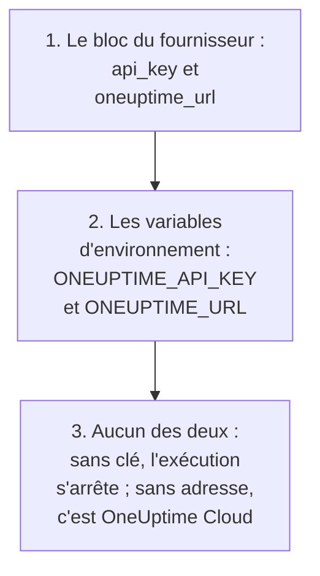

# Guide complet

Ce guide couvre ce qui vient après votre premier apply : comment le fournisseur trouve sa clé API, comment organiser une configuration pour un ou plusieurs projets, comment les ressources se réfèrent les unes aux autres, comment lire des enregistrements que vous ne gérez pas, comment protéger l'état et comment mettre à jour. Vous découvrez le fournisseur ? Commencez par le [Démarrage rapide](/docs/terraform/quick-start).

:::cards
- [Configurer le fournisseur](#configurer-le-fournisseur): La clé API et l'adresse, et où le fournisseur les lit.
- [Organiser une configuration](#organiser-une-configuration): Des fichiers, des projets, et de nombreuses ressources à partir d'un seul bloc.
- [Lire ce qui existe déjà](#lire-ce-qui-existe-déjà): Les sources de données, et comment une recherche correspond.
- [Protéger l'état](#protéger-létat): Un backend distant, et ce qu'il ne faut jamais commiter.
:::

## Configurer le fournisseur

Le fournisseur prend deux réglages. Chacun vient du bloc du fournisseur, ou sinon d'une variable d'environnement :

| Réglage | Variable d'environnement | Quand aucun des deux n'est renseigné |
| --- | --- | --- |
| `api_key` | `ONEUPTIME_API_KEY` | Le fournisseur s'arrête avant toute planification : `Missing API Key` |
| `oneuptime_url` | `ONEUPTIME_URL` | `https://oneuptime.com`, c'est-à-dire OneUptime Cloud |



`oneuptime_url` est l'adresse de votre instance OneUptime, sans `/api` : le fournisseur ajoute `https://` quand l'adresse n'a pas de schéma, et `/api` à la fin. `api_key` est sensible : Terraform ne l'affiche donc jamais.

La clé doit être une clé API du projet que vous gérez, autorisée à créer, lire, modifier et supprimer chaque type d'enregistrement de votre configuration : voir [Créer une clé API du projet](/docs/terraform/quick-start#créer-une-clé-api-du-projet). La clé API maître d'une instance OneUptime auto-hébergée n'appartient à aucun projet : une création faite avec elle échoue donc avec `ProjectId required`.

### Donner sa clé au fournisseur

:::tabs
@tab Variable d'environnement
```bash
export ONEUPTIME_API_KEY="<your-api-key>"
# Only on a self-hosted OneUptime:
export ONEUPTIME_URL="https://oneuptime.example.com"
```

```hcl title="main.tf"
provider "oneuptime" {}
```
@tab Variable Terraform
```hcl title="variables.tf"
variable "oneuptime_api_key" {
  description = "API key of the OneUptime project"
  type        = string
  sensitive   = true
}

provider "oneuptime" {
  api_key = var.oneuptime_api_key
}
```

```hcl title="terraform.tfvars"
oneuptime_api_key = "<your-api-key>"
```
:::

Une variable d'environnement garde la clé hors de tout fichier. Un fichier de variables est pratique sur votre propre machine : ajoutez `terraform.tfvars` à `.gitignore`. Dans un pipeline, renseignez `TF_VAR_oneuptime_api_key` au lieu d'écrire le fichier.

### L'exécuter en CI/CD

Donnez la clé au job comme secret, dans la variable d'environnement `ONEUPTIME_API_KEY` :

:::tabs
@tab GitHub Actions
```yaml title=".github/workflows/oneuptime.yml"
name: OneUptime
on:
  push:
    branches: [main]

jobs:
  apply:
    runs-on: ubuntu-latest
    env:
      ONEUPTIME_API_KEY: ${{ secrets.ONEUPTIME_API_KEY }}
    steps:
      - uses: actions/checkout@v4
      - uses: hashicorp/setup-terraform@v3
      - run: terraform init -input=false
      - run: terraform plan -input=false -out=tfplan
      - run: terraform apply -input=false tfplan
```
@tab GitLab CI
```yaml title=".gitlab-ci.yml"
apply:
  image:
    name: hashicorp/terraform:latest
    entrypoint: [""]
  rules:
    - if: $CI_COMMIT_BRANCH == $CI_DEFAULT_BRANCH
  script:
    - terraform init -input=false
    - terraform plan -input=false -out=tfplan
    - terraform apply -input=false tfplan
```
:::

Dans GitHub, ajoutez le secret sous **Settings → Secrets and variables → Actions** ; dans GitLab, ajoutez une variable CI/CD masquée du même nom. Gardez l'état dans un [backend distant](#protéger-létat), pour que chaque exécution parte de l'état laissé par la précédente.

## Organiser une configuration

Une organisation qui fonctionne bien :

```text
oneuptime/
├── main.tf          # the terraform and provider blocks
├── variables.tf     # input variables
├── outputs.tf       # the IDs other configurations need
├── shared.tf        # labels, teams and monitor statuses
├── monitors.tf      # monitors and monitor groups
├── status-pages.tf  # status pages and their domains
└── on-call.tf       # on-call policies and escalation rules
```

- **Une configuration pour chaque projet.** Une clé API appartient à un projet, donc une configuration en gère naturellement un.
- **Les enregistrements partagés une seule fois.** Définissez les étiquettes, les équipes et les statuts de moniteur dans un fichier, et référez-vous-y par leur adresse partout ailleurs.

### Gérer plusieurs projets

Pour gérer plus d'un projet depuis une configuration, donnez au fournisseur un alias pour chacun, chacun avec la clé de ce projet. Une ressource nomme l'alias qu'elle utilise avec `provider` :

```hcl
provider "oneuptime" {
  alias   = "production"
  api_key = var.production_api_key
}

provider "oneuptime" {
  alias   = "staging"
  api_key = var.staging_api_key
}

resource "oneuptime_label" "staging_critical" {
  provider = oneuptime.staging

  name  = "critical"
  color = "#FF5733"
}
```

Déclarez `production_api_key` et `staging_api_key` comme variables marquées `sensitive`, comme ci-dessus.

### De nombreuses ressources à partir d'un seul bloc

`for_each` crée une ressource pour chaque entrée d'une map. Ces moniteurs partagent leurs critères et ne diffèrent que par leur nom et leur adresse :

```hcl
variable "websites" {
  type = map(string)
  default = {
    homepage = "https://example.com"
    docs     = "https://docs.example.com"
  }
}

resource "oneuptime_monitor" "website" {
  for_each = var.websites

  name                = "Website: ${each.key}"
  monitor_type        = "Website"
  monitoring_interval = "*/5 * * * *"

  monitor_steps = [{
    monitor_destination      = each.value
    monitor_destination_type = "URL"

    criteria = [
      {
        name                  = "Offline"
        filter_condition      = "Any"
        change_monitor_status = true
        monitor_status_id     = data.oneuptime_monitor_status.offline.id

        filters = [
          {
            check_on    = "Is Online"
            filter_type = "False"
          }
        ]
      }
    ]
  }]
}
```

Ajoutez un site à la map, et l'apply suivant crée son moniteur. Retirez-en un, et il le supprime.

## Faire référence à d'autres ressources

Une ressource qui nomme un attribut d'une autre en dépend, et Terraform ordonne le travail selon ces références. Ici, l'étiquette est créée en premier et supprimée en dernier, car le moniteur et la page de statut la nomment :

```mermaid title="Terraform crée d'abord ce à quoi une ressource fait référence"
flowchart TB
    L["oneuptime_label<br/>payments"] --> M["oneuptime_monitor<br/>checkout_api"]
    L --> SP["oneuptime_status_page<br/>payments"]
    M --> R["oneuptime_status_page_resource<br/>checkout_api"]
    SP --> R
```

```hcl
resource "oneuptime_label" "payments" {
  name        = "payments"
  description = "Payment infrastructure"
  color       = "#2ECC71"
}

resource "oneuptime_monitor" "checkout_api" {
  name         = "Checkout API"
  description  = "Availability of the checkout API"
  monitor_type = "Manual"
  labels       = [oneuptime_label.payments.id]
}

resource "oneuptime_status_page" "payments" {
  name                  = "Payments Status"
  page_title            = "Payments Status"
  is_public_status_page = true
  labels                = [oneuptime_label.payments.id]
}

resource "oneuptime_status_page_resource" "checkout_api" {
  status_page_id = oneuptime_status_page.payments.id
  monitor_id     = oneuptime_monitor.checkout_api.id
  display_name   = "Checkout API"
}
```

Vous avez rarement besoin de `depends_on` : ajoutez-le seulement pour un ordre que Terraform ne peut pas voir dans les attributs. Les listes d'ID comme `labels` sont des ensembles : changer leur ordre ne change rien.

## Lire ce qui existe déjà

Chaque ressource a une source de données du même nom. Une source de données lit un enregistrement que cette configuration ne gère pas, créé dans le tableau de bord ou par une autre configuration, pour que vous puissiez y faire référence sans le reprendre.

```hcl
data "oneuptime_label" "critical" {
  name = "critical"
}

data "oneuptime_monitor_status" "offline" {
  is_offline_state = true
}

data "oneuptime_status_page" "main" {
  id = "5f8a1b2c-3d4e-4f6a-8b9c-0d1e2f3a4b5c"
}

resource "oneuptime_monitor" "database" {
  name         = "Database Health"
  monitor_type = "Manual"
  labels       = [data.oneuptime_label.critical.id]
}
```

Comment une recherche correspond :

| Vous renseignez | Elle trouve | Erreurs |
| --- | --- | --- |
| `id` | L'enregistrement qui a cet ID | `Not Found` quand aucun enregistrement ne l'a |
| N'importe quels autres arguments simples, un ou plusieurs | Le seul enregistrement qui correspond à tous | `Not Found` quand aucun ne correspond, `Ambiguous Match` quand plusieurs correspondent |
| `id` et un autre argument, ou rien | Rien | `Invalid Lookup` |

Les arguments simples sont du texte, des nombres et vrai ou faux : un nom, une priorité, un indicateur comme `is_offline_state`. On ne peut pas chercher par des listes, des valeurs JSON, des horodatages ou des secrets. Pour reprendre un enregistrement plutôt que seulement le lire, [importez-le](/docs/terraform/importing-resources) à la place.

## Protéger l'état

L'état de Terraform contient les ID et les attributs de tout ce qu'il gère, secrets compris. Gardez-le dans un backend distant qui le verrouille, pour qu'une équipe partage un seul état et que deux exécutions ne l'écrivent jamais en même temps. Tout backend standard convient, par exemple un bucket S3 :

```hcl
terraform {
  backend "s3" {
    bucket       = "my-terraform-state"
    key          = "oneuptime/production.tfstate"
    region       = "us-east-1"
    encrypt      = true
    use_lockfile = true
  }
}
```

`use_lockfile` demande Terraform 1.10 ou OpenTofu 1.10, ou plus récent. Avant eux, le backend S3 verrouille avec une table DynamoDB (`dynamodb_table`).

- **Ne modifiez jamais l'état à la main.** Utilisez `terraform state mv` et `terraform state rm`.
- **Ne commitez jamais `terraform.tfstate`, ni un fichier `.tfvars` qui contient un secret.**

## La dérive, et ce qui n'en cause pas

`terraform plan` compare OneUptime avec votre configuration et liste ce qui diffère. Certaines différences ne sont jamais montrées :

- **Les heures sont comparées comme des instants.** `2030-06-01T02:00:00Z` et la façon dont le serveur écrit le même instant sont égales.
- **Les valeurs par défaut que le serveur ajoute** aux étapes d'un moniteur ou à une valeur JSON ne sont pas une différence avec ce que vous avez écrit.
- **Ce que le serveur tient à jour**, comme le statut actuel d'un moniteur, n'en est pas une non plus.

Une valeur que vous calculez à chaque exécution en est une, en revanche : `timestamp()` donne une nouvelle heure à chaque exécution, donc un plan la montre toujours. Écrivez plutôt des heures fixes :

```hcl
resource "oneuptime_scheduled_maintenance_event" "database_upgrade" {
  title       = "Database upgrade"
  description = "Planned PostgreSQL upgrade"
  starts_at   = "2030-06-01T02:00:00Z"
  ends_at     = "2030-06-01T04:00:00Z"
}
```

## Mettre à jour le fournisseur

:::steps
### Lire les notes de version

Le [Terraform Registry](https://registry.terraform.io/providers/oneuptime/oneuptime) et les [versions GitHub du fournisseur](https://github.com/OneUptime/terraform-provider-oneuptime/releases) listent ce qui a changé.

### Relever la contrainte de version

`{{TERRAFORM_PROVIDER_VERSION}}` prend déjà toutes les versions {{TERRAFORM_PROVIDER_MAJOR}}.x. Une nouvelle version majeure demande une nouvelle contrainte.

### Télécharger la nouvelle version

```bash
terraform init -upgrade
```

### Planifier avant d'appliquer

Lancez `terraform plan`, et n'appliquez que si le plan est vide ou montre les changements que vous attendez.
:::

Sur une instance OneUptime auto-hébergée, mettez d'abord à jour OneUptime, puis le fournisseur : le fournisseur ne doit pas être plus récent que votre instance OneUptime. Voir la [Configuration auto-hébergée](/docs/terraform/self-hosted).

## Prochaines étapes

:::cards
- [Étapes de moniteur](/docs/terraform/monitor-steps): Décider ce qu'un moniteur vérifie et ce que signifie chaque résultat.
- [Exemples](/docs/terraform/examples): Des configurations prêtes à l'emploi pour les ressources courantes.
- [Importer des ressources](/docs/terraform/importing-resources): Placer sous Terraform ce que vous avez créé dans le tableau de bord.
- [Dépannage](/docs/terraform/troubleshooting): Les erreurs courantes et comment les corriger.
:::
