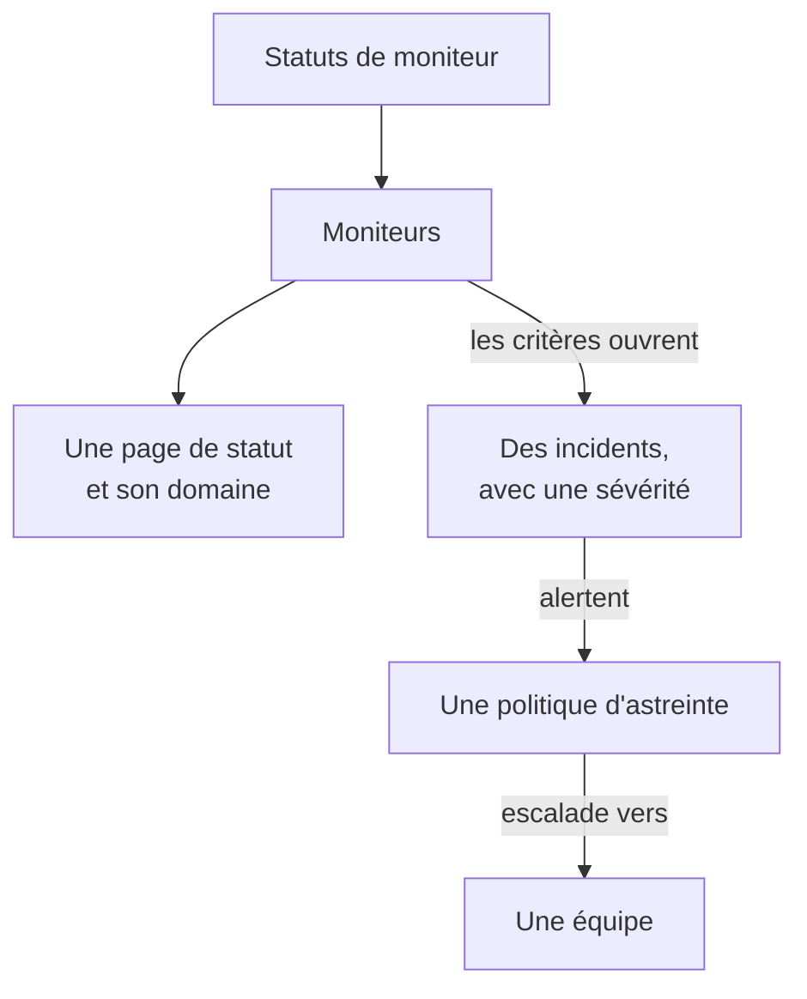

# Exemples

Des configurations prêtes à l'emploi pour les ressources par lesquelles commencent la plupart des projets. Chaque bloc s'applique tel quel par-dessus la configuration du fournisseur ci-dessous, et la plupart viennent des tests de bout en bout du fournisseur, qui les appliquent à une vraie instance OneUptime à chaque changement.

:::cards
- [Moniteurs](#moniteurs): Des moniteurs de site web, d'API, ping, port, certificat SSL, heartbeat et manuels.
- [Pages de statut](#pages-de-statut): Une page de statut avec un groupe et un moniteur, et un domaine personnalisé.
- [Équipes et astreinte](#équipes-et-astreinte): Une équipe, et une politique d'astreinte qui l'alerte.
- [Incidents et maintenance](#incidents-et-maintenance): Les sévérités, les états, un incident déclaré et une fenêtre de maintenance.
:::



## Configuration du fournisseur

Chaque exemple suppose cette configuration, avec la clé API dans la variable d'environnement `ONEUPTIME_API_KEY` :

```hcl title="main.tf"
terraform {
  required_providers {
    oneuptime = {
      source  = "oneuptime/oneuptime"
      version = "{{TERRAFORM_PROVIDER_VERSION}}"
    }
  }
}

provider "oneuptime" {
  # On a self-hosted OneUptime, add your OneUptime's address:
  # oneuptime_url = "https://oneuptime.example.com"
}
```

## Étiquettes

Les étiquettes trient et filtrent les enregistrements. La plupart des ressources prennent un ensemble d'ID d'étiquettes dans `labels` :

```hcl
resource "oneuptime_label" "production" {
  name        = "production"
  description = "Production infrastructure"
  color       = "#FF5733"
}
```

## Moniteurs

Les moniteurs ci-dessous fixent leur statut avec trois des statuts avec lesquels chaque projet commence, lus avec des sources de données :

```hcl
data "oneuptime_monitor_status" "operational" {
  name = "Operational"
}

data "oneuptime_monitor_status" "degraded" {
  name = "Degraded"
}

data "oneuptime_monitor_status" "offline" {
  name = "Offline"
}
```

Les `monitor_steps` de chaque moniteur disent ce qu'il vérifie et comment chaque résultat est jugé : les [Étapes de moniteur](/docs/terraform/monitor-steps) expliquent chaque attribut.

### Moniteur de site web

Hors ligne quand le site ne répond pas, en ligne quand il répond avec 200. Le test de bout en bout `35-monitor-with-steps` applique un moniteur avec ces vérifications :

```hcl
resource "oneuptime_monitor" "website" {
  name                = "Website"
  description         = "Homepage availability and status code"
  monitor_type        = "Website"
  monitoring_interval = "*/5 * * * *"
  labels              = [oneuptime_label.production.id]

  monitor_steps = [{
    monitor_destination      = "https://example.com"
    monitor_destination_type = "URL"
    request_type             = "GET"

    criteria = [
      {
        name                  = "Offline"
        description           = "The website does not respond"
        filter_condition      = "Any"
        change_monitor_status = true
        monitor_status_id     = data.oneuptime_monitor_status.offline.id

        filters = [
          {
            check_on    = "Is Online"
            filter_type = "False"
          }
        ]
      },
      {
        name                  = "Online"
        description           = "The website responds with 200"
        filter_condition      = "All"
        change_monitor_status = true
        monitor_status_id     = data.oneuptime_monitor_status.operational.id

        filters = [
          {
            check_on    = "Is Online"
            filter_type = "True"
          },
          {
            check_on    = "Response Status Code"
            filter_type = "Equal To"
            value       = "200"
          }
        ]
      }
    ]
  }]
}
```

### Moniteur d'API

Un `POST` avec des en-têtes et un corps JSON, dégradé quand la réponse est lente. Le test de bout en bout `35-monitor-with-steps` applique un moniteur d'API semblable :

```hcl
resource "oneuptime_monitor" "orders_api" {
  name         = "Orders API"
  description  = "Health check of the orders API"
  monitor_type = "API"

  monitor_steps = [{
    monitor_destination      = "https://api.example.com/v1/health"
    monitor_destination_type = "URL"
    request_type             = "POST"
    request_headers = {
      "Content-Type" = "application/json"
      "Accept"       = "application/json"
    }
    request_body = jsonencode({ check = "health" })

    criteria = [
      {
        name                  = "Offline"
        description           = "The API does not answer, or answers with an error"
        filter_condition      = "Any"
        change_monitor_status = true
        monitor_status_id     = data.oneuptime_monitor_status.offline.id

        filters = [
          {
            check_on    = "Is Online"
            filter_type = "False"
          },
          {
            check_on    = "Response Status Code"
            filter_type = "Greater Than Or Equal To"
            value       = "500"
          }
        ]
      },
      {
        name                  = "Slow"
        description           = "The API takes more than two seconds"
        filter_condition      = "All"
        change_monitor_status = true
        monitor_status_id     = data.oneuptime_monitor_status.degraded.id

        filters = [
          {
            check_on    = "Response Time (in ms)"
            filter_type = "Greater Than"
            value       = "2000"
          }
        ]
      },
      {
        name                  = "Online"
        description           = "The API answers in time"
        filter_condition      = "All"
        change_monitor_status = true
        monitor_status_id     = data.oneuptime_monitor_status.operational.id

        filters = [
          {
            check_on    = "Is Online"
            filter_type = "True"
          }
        ]
      }
    ]
  }]
}
```

### Moniteur Ping

Un moniteur Ping prend un nom d'hôte ou une adresse IP au lieu d'une URL :

```hcl
resource "oneuptime_monitor" "gateway" {
  name         = "Gateway"
  description  = "The gateway answers ping"
  monitor_type = "Ping"

  monitor_steps = [{
    monitor_destination      = "gateway.example.com"
    monitor_destination_type = "Hostname"

    criteria = [
      {
        name                  = "Unreachable"
        filter_condition      = "Any"
        change_monitor_status = true
        monitor_status_id     = data.oneuptime_monitor_status.offline.id

        filters = [
          {
            check_on    = "Is Online"
            filter_type = "False"
          }
        ]
      },
      {
        name                  = "Reachable"
        filter_condition      = "All"
        change_monitor_status = true
        monitor_status_id     = data.oneuptime_monitor_status.operational.id

        filters = [
          {
            check_on    = "Is Online"
            filter_type = "True"
          }
        ]
      }
    ]
  }]
}
```

### Moniteur de port

Un moniteur de port ajoute le `port` à vérifier, sous forme de nombre :

```hcl
resource "oneuptime_monitor" "database_port" {
  name         = "Database port"
  description  = "PostgreSQL accepts connections"
  monitor_type = "Port"

  monitor_steps = [{
    monitor_destination      = "db.example.com"
    monitor_destination_type = "Hostname"
    port                     = 5432

    criteria = [
      {
        name                  = "Closed"
        filter_condition      = "Any"
        change_monitor_status = true
        monitor_status_id     = data.oneuptime_monitor_status.offline.id

        filters = [
          {
            check_on    = "Is Online"
            filter_type = "False"
          }
        ]
      },
      {
        name                  = "Open"
        filter_condition      = "All"
        change_monitor_status = true
        monitor_status_id     = data.oneuptime_monitor_status.operational.id

        filters = [
          {
            check_on    = "Is Online"
            filter_type = "True"
          }
        ]
      }
    ]
  }]
}
```

### Moniteur de certificat SSL

Hors ligne quand le certificat n'est pas valide, dégradé quand il expire dans 14 jours ou moins, comme l'est un nouveau moniteur de certificat SSL dans le tableau de bord :

```hcl
resource "oneuptime_monitor" "certificate" {
  name         = "example.com certificate"
  description  = "The TLS certificate of example.com"
  monitor_type = "SSL Certificate"

  monitor_steps = [{
    monitor_destination      = "https://example.com"
    monitor_destination_type = "URL"

    criteria = [
      {
        name                  = "Not valid"
        description           = "Expired, self-signed, untrusted or not reachable"
        filter_condition      = "Any"
        change_monitor_status = true
        monitor_status_id     = data.oneuptime_monitor_status.offline.id

        filters = [
          {
            check_on    = "Is Not A Valid Certificate"
            filter_type = "True"
          }
        ]
      },
      {
        name                  = "Expires soon"
        description           = "Valid, and expires in 14 days or less"
        filter_condition      = "All"
        change_monitor_status = true
        monitor_status_id     = data.oneuptime_monitor_status.degraded.id

        filters = [
          {
            check_on    = "Is Valid Certificate"
            filter_type = "True"
          },
          {
            check_on    = "Expires In Days"
            filter_type = "Less Than Or Equal To"
            value       = "14"
          }
        ]
      },
      {
        name                  = "Valid"
        filter_condition      = "All"
        change_monitor_status = true
        monitor_status_id     = data.oneuptime_monitor_status.operational.id

        filters = [
          {
            check_on    = "Is Valid Certificate"
            filter_type = "True"
          }
        ]
      }
    ]
  }]
}
```

### Moniteur manuel

Un moniteur manuel ne vérifie rien : vous fixez son statut vous-même. Il n'a besoin d'aucun `monitor_steps` :

```hcl
resource "oneuptime_monitor" "payment_provider" {
  name         = "Payment provider"
  description  = "Set by hand during the provider's incidents"
  monitor_type = "Manual"
}
```

### Moniteur heartbeat

Un moniteur de requêtes entrantes attend des requêtes au lieu d'en envoyer : ici, une tâche de sauvegarde qui se signale chaque nuit. Il passe hors ligne quand aucune requête n'est arrivée depuis 25 heures :

```hcl
resource "oneuptime_monitor" "nightly_backup" {
  name         = "Nightly backup"
  description  = "The backup job sends a heartbeat when it finishes"
  monitor_type = "Incoming Request"

  monitor_steps = [{
    criteria = [
      {
        name                  = "No heartbeat"
        filter_condition      = "Any"
        change_monitor_status = true
        monitor_status_id     = data.oneuptime_monitor_status.offline.id

        filters = [
          {
            check_on    = "Incoming Request"
            filter_type = "Not Recieved In Minutes"
            value       = "1500"
          }
        ]
      },
      {
        name                  = "Heartbeat received"
        filter_condition      = "All"
        change_monitor_status = true
        monitor_status_id     = data.oneuptime_monitor_status.operational.id

        filters = [
          {
            check_on    = "Incoming Request"
            filter_type = "Recieved In Minutes"
            value       = "1500"
          }
        ]
      }
    ]
  }]
}

output "nightly_backup_heartbeat_key" {
  value     = oneuptime_monitor.nightly_backup.incoming_request_secret_key
  sensitive = true
}
```

La tâche envoie sa requête à `https://oneuptime.com/heartbeat/YOUR_SECRET_KEY`, avec la clé qu'affiche `terraform output -raw nightly_backup_heartbeat_key` : voir la [Surveillance des requêtes entrantes](/docs/monitor/incoming-request-monitor). L'agent d'un moniteur de serveur s'identifie de la même façon, avec `server_monitor_secret_key`.

### Groupe de moniteurs

Un groupe de moniteurs montre un ensemble de moniteurs avec un seul statut :

```hcl
resource "oneuptime_monitor_group" "storefront" {
  name        = "Storefront"
  description = "Everything the shop needs"
}

resource "oneuptime_monitor_group_resource" "website" {
  monitor_group_id = oneuptime_monitor_group.storefront.id
  monitor_id       = oneuptime_monitor.website.id
}

resource "oneuptime_monitor_group_resource" "orders_api" {
  monitor_group_id = oneuptime_monitor_group.storefront.id
  monitor_id       = oneuptime_monitor.orders_api.id
}
```

## Pages de statut

### Une page de statut avec un groupe et un moniteur

Une page de statut affiche des ressources, et peut les ranger en groupes. Le test de bout en bout `42-status-page-resources` applique cette configuration :

```hcl
resource "oneuptime_status_page" "public" {
  name                  = "Public Status"
  description           = "Customer-facing status page"
  page_title            = "System Status"
  page_description      = "Check our system status and incident history"
  is_public_status_page = true
}

resource "oneuptime_status_page_group" "services" {
  status_page_id = oneuptime_status_page.public.id
  name           = "Services"
}

resource "oneuptime_status_page_resource" "website" {
  status_page_id       = oneuptime_status_page.public.id
  status_page_group_id = oneuptime_status_page_group.services.id
  monitor_id           = oneuptime_monitor.website.id
  display_name         = "Website"
}
```

### Un domaine personnalisé

Trois ressources travaillent ensemble : un domaine de votre projet, la page de statut, et le domaine de la page de statut qui les relie. Le serveur remplit `full_domain` et le jeton de vérification CNAME : ne les renseignez pas. Les tests de bout en bout `12-status-page-domain` et `25-status-page-with-domain` appliquent cette configuration :

```hcl
resource "oneuptime_domain" "company" {
  domain = "example.com"
}

resource "oneuptime_status_page_domain" "status" {
  domain_id      = oneuptime_domain.company.id
  status_page_id = oneuptime_status_page.public.id
  subdomain      = "status"
}

output "status_page_address" {
  # The subdomain and the domain, such as status.example.com.
  value = oneuptime_status_page_domain.status.full_domain
}
```

Un nouveau domaine doit passer la vérification DNS avant que la page de statut réponde sur ce domaine.

## Équipes et astreinte

### Une équipe et ses membres

```hcl
resource "oneuptime_team" "sre" {
  name        = "SRE"
  description = "Site reliability engineering"
}

variable "alice_user_id" {
  description = "Alice's user ID, the last part of the address of her page under Users"
  type        = string
}

resource "oneuptime_team_member" "alice" {
  team_id = oneuptime_team.sre.id
  user_id = var.alice_user_id
}
```

Une personne qui fait déjà partie du projet rejoint l'équipe tout de suite. Toute autre personne est invitée, et fait partie de l'équipe dès qu'elle accepte. Le test de bout en bout `33-team-crud` applique l'équipe.

### Une politique d'astreinte qui alerte une équipe

La première règle de la politique alerte l'équipe, et la politique recommence, jusqu'à deux fois, quand personne n'accuse réception :

```hcl
resource "oneuptime_on_call_policy" "primary" {
  name                                             = "Primary on-call"
  description                                      = "First line for production incidents"
  repeat_policy_if_no_one_acknowledges             = true
  repeat_policy_if_no_one_acknowledges_no_of_times = 2
}

resource "oneuptime_escalation_rule" "first_line" {
  on_call_duty_policy_id    = oneuptime_on_call_policy.primary.id
  name                      = "Page the SRE team"
  description               = "Moves on after 5 minutes without an acknowledgement"
  order                     = 1
  escalate_after_in_minutes = 5
}

resource "oneuptime_team_on_call_duty_escalation_rule" "sre" {
  on_call_duty_policy_id                 = oneuptime_on_call_policy.primary.id
  on_call_duty_policy_escalation_rule_id = oneuptime_escalation_rule.first_line.id
  team_id                                = oneuptime_team.sre.id
}
```

Les critères d'un moniteur alertent la politique par `on_call_policy_ids` sur les incidents qu'ils ouvrent : voir [Incidents et alertes](/docs/terraform/monitor-steps#incidents-et-alertes).

## Incidents et maintenance

### Sévérités et états

Les sévérités classent l'impact d'un incident, et les états sont les étapes de sa vie. `order` est la place où chacun est listé :

```hcl
resource "oneuptime_incident_severity" "sev1" {
  name        = "SEV-1"
  description = "Full outage, all hands"
  color       = "#E74C3C"
  order       = 1
}

resource "oneuptime_incident_state" "mitigated" {
  name        = "Mitigated"
  description = "Impact contained, fix in progress"
  color       = "#F39C12"
  order       = 3
}
```

`oneuptime_alert_severity` et `oneuptime_alert_state` fonctionnent de la même façon pour les alertes. Les tests de bout en bout `03-incident-severity` et `04-incident-state` les appliquent.

### Déclarer un incident

Ce sont en général les moniteurs qui ouvrent les incidents, mais un incident est aussi une ressource, ce qui convient à un game day. C'est un vrai incident : gardez donc un exercice hors de vos pages de statut :

```hcl
resource "oneuptime_incident" "drill" {
  title                     = "Disaster recovery drill"
  description               = "A game day: we fail over the database"
  incident_severity_id      = oneuptime_incident_severity.sev1.id
  is_visible_on_status_page = false

  should_status_page_subscribers_be_notified_on_incident_created = false
}
```

Le test de bout en bout `28-incident-crud` applique un incident.

### Maintenance planifiée

Une fenêtre de maintenance aux heures fixes, affichée sur vos pages de statut :

```hcl
resource "oneuptime_scheduled_maintenance_event" "database_upgrade" {
  title                       = "Database maintenance"
  description                 = "Planned PostgreSQL upgrade: writes pause briefly"
  starts_at                   = "2030-06-01T02:00:00Z"
  ends_at                     = "2030-06-01T04:00:00Z"
  is_visible_on_status_page   = true
  monitors                    = [oneuptime_monitor.website.id]
  change_monitor_status_to_id = data.oneuptime_monitor_status.degraded.id
}
```

Les heures sont au format RFC 3339, et le même instant écrit autrement n'est pas un changement. Le test de bout en bout `30-scheduled-maintenance-crud` applique des événements de maintenance.

Pour mettre les moniteurs de l'événement dans un statut pendant qu'il se déroule, attachez-les avec `monitors` et réglez `change_monitor_status_to_id` sur l'un de vos statuts de moniteur : les moniteurs passent à ce statut quand l'événement commence, et reviennent à opérationnel quand il se termine. Terraform modifie `change_monitor_status_to_id` sur place jusqu'au début de l'événement. Une fois l'événement commencé, ses moniteurs sont déjà dans ce statut, et un apply qui le modifie échoue avec « Change Monitor Status to can no longer be changed: this event has already started. »

## Sondes

Une sonde à vous exécute des vérifications depuis votre réseau. Sa clé est le secret avec lequel la sonde s'identifie : passez-la donc dans une variable :

```hcl
variable "probe_key" {
  description = "The key the probe signs in with"
  type        = string
  sensitive   = true
}

resource "oneuptime_probe" "eu_west" {
  key           = var.probe_key
  name          = "EU West"
  description   = "Probe in our eu-west-1 network"
  probe_version = "1.0.0"

  should_auto_enable_probe_on_new_monitors = true
}
```

Lancez la sonde avec `PROBE_ID` réglé sur l'`id` de la sonde et `PROBE_KEY` sur la clé : voir les [Sondes personnalisées](/docs/probe/custom-probe). Le test de bout en bout `23-probe-crud` applique des sondes.

## Prochaines étapes

:::cards
- [Étapes de moniteur](/docs/terraform/monitor-steps): Chaque attribut des vérifications et des critères d'un moniteur.
- [Importer des ressources](/docs/terraform/importing-resources): Placer sous Terraform ce que vous avez créé dans le tableau de bord.
- [Guide complet](/docs/terraform/complete-guide): Les sources de données, l'état, la CI/CD et les mises à jour.
:::
