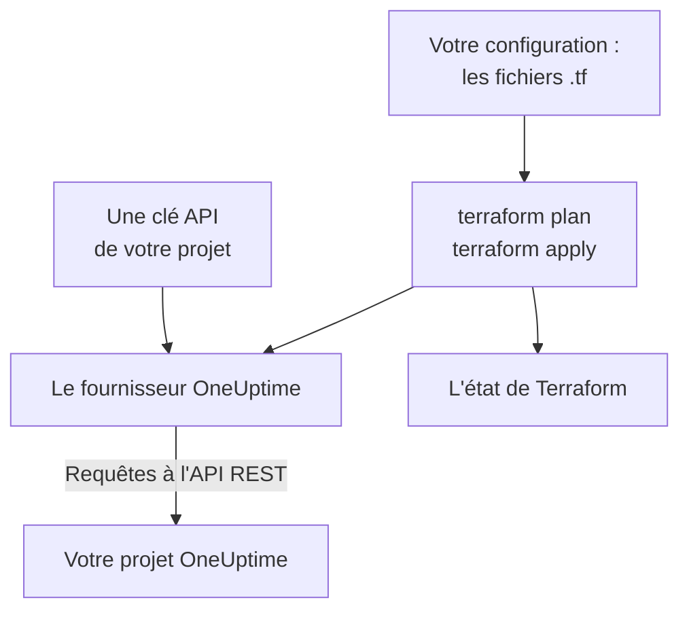

# Vue d'ensemble de Terraform

Le fournisseur Terraform de OneUptime gère votre projet OneUptime sous forme de code. Décrivez les moniteurs, les pages de statut, les politiques d'astreinte, les équipes, les étiquettes et les autres enregistrements de votre projet dans des fichiers `.tf`, voyez ce qui va changer avec `terraform plan`, et appliquez le changement avec `terraform apply`. Il fonctionne avec OneUptime Cloud et avec une instance OneUptime auto-hébergée, et avec OpenTofu aussi bien qu'avec Terraform.

:::cards
- [Comment fonctionne le fournisseur](#comment-fonctionne-le-fournisseur): Votre configuration, le plan et les requêtes à l'API qui les suivent.
- [Installer le fournisseur](#installer-le-fournisseur): Le bloc du fournisseur, et la version à choisir.
- [Laisser le tableau de bord l'écrire](#laisser-le-tableau-de-bord-lécrire): Une configuration et des blocs d'import pour ce que vous avez déjà.
- [Ce que vous pouvez gérer](#ce-que-vous-pouvez-gérer): Les ressources, les sources de données et la façon d'écrire leurs attributs.
:::

## Comment fonctionne le fournisseur

Le fournisseur est un plugin que Terraform télécharge depuis un registre. Lors de `terraform apply`, il transforme chaque changement du plan en une requête à l'API REST de OneUptime, faite avec une clé API de votre projet. Terraform garde dans son état ce qu'il a créé, si bien que le plan suivant ne montre que ce qui a changé depuis.



Une clé API appartient à un projet et décide de ce que Terraform peut y lire et y modifier, donc une configuration gère un projet. Pour en gérer plusieurs, donnez au fournisseur un [alias](/docs/terraform/complete-guide#gérer-plusieurs-projets) pour chacun.

## Avant de commencer

- **Terraform 1.5 ou plus récent, ou OpenTofu 1.6 ou plus récent.** Les blocs `import` que le tableau de bord écrit ont besoin de ces versions.
- **Une clé API de votre projet.** Le [Démarrage rapide](/docs/terraform/quick-start#créer-une-clé-api-du-projet) montre comment en créer une dans **Paramètres du projet → Avancé → Clés API**.
- **Sur OneUptime Cloud, l'offre Growth ou supérieure.** Les clés API d'un projet ne fonctionnent qu'avec elle.

## Installer le fournisseur

Ajoutez le fournisseur dans un fichier `.tf`. `terraform init` le télécharge depuis le Terraform Registry, et `tofu init` depuis l'OpenTofu Registry :

```hcl title="main.tf"
terraform {
  required_providers {
    oneuptime = {
      source  = "oneuptime/oneuptime"
      version = "{{TERRAFORM_PROVIDER_VERSION}}"
    }
  }
}

provider "oneuptime" {
  # The API key comes from the ONEUPTIME_API_KEY environment variable.
  # On a self-hosted OneUptime, add your OneUptime's address:
  # oneuptime_url = "https://oneuptime.example.com"
}
```

Gardez la clé hors de vos fichiers : exportez-la avant de lancer Terraform, ou passez-la dans une variable marquée `sensitive`. Le [Guide complet](/docs/terraform/complete-guide#configurer-le-fournisseur) présente toutes les façons de donner au fournisseur sa clé et son adresse.

### Choisir une version

Les versions du fournisseur suivent celles de OneUptime : le fournisseur {{TERRAFORM_PROVIDER_MAJOR}}.x est généré à partir de OneUptime {{TERRAFORM_PROVIDER_MAJOR}}.x. La contrainte ci-dessus, `{{TERRAFORM_PROVIDER_VERSION}}`, prend la version {{TERRAFORM_PROVIDER_MAJOR}}.x la plus récente, ce qui convient à OneUptime Cloud. Sur une instance OneUptime auto-hébergée, prenez le fournisseur le plus récent qui n'est pas plus récent que votre instance : la [Configuration auto-hébergée](/docs/terraform/self-hosted) montre comment le fixer.

## Laisser le tableau de bord l'écrire

Vous n'avez pas à écrire à la main une ressource que vous avez déjà. Chaque ressource du tableau de bord OneUptime (un moniteur, une page de statut, un workflow, une politique d'astreinte et les autres) a une section **Développeurs** dans son menu latéral, repliée jusqu'à ce que vous l'ouvriez. Sa page **Terraform** écrit la configuration pour vous, remplie à partir de votre propre projet.

:::steps
### Ouvrir la ressource

Ouvrez le moniteur, la page de statut ou l'autre ressource que Terraform doit gérer.

### Ouvrir sa page Terraform

Dans le menu latéral, ouvrez **Développeurs**, puis **Terraform**.

### Copier la configuration

La page écrit la configuration de la ressource à partir de ses réglages actuels, avec un bloc `import`. Un commentaire après chaque ID nomme l'enregistrement vers lequel il pointe (`incident_severity_id = "..." # Critical Incident`).

### Planifier et appliquer

Lancez `terraform plan` : le plan montre la ressource importée et rien à modifier. Appliquez-le, et Terraform gère la ressource à partir de là.
:::

Sous la configuration, **Aller plus loin** propose ce que l'on ajoute souvent à côté de la ressource, en s'y référant par son adresse : une équipe propriétaire pour un incident, un groupe de moniteurs pour une page de statut, une règle d'escalade pour une politique d'astreinte.

Les pages de liste (par exemple **Incidents** ou **Moniteurs**) ont la même section. Là, la page **Terraform** écrit une nouvelle ressource avec les champs que la plupart des gens renseignent, à partir des enregistrements de votre projet : un incident avec l'une de vos sévérités, un moniteur avec les critères qu'un nouveau moniteur reçoit dans le tableau de bord, relié à vos statuts. Elle propose des **Configurations courantes** toutes prêtes (une page de statut avec un groupe et un moniteur, une politique d'astreinte qui alerte une équipe, une rotation d'astreinte hebdomadaire), et un bloc `import` pour chaque ressource que vous avez déjà (les 100 premières), prêt pour `terraform plan -generate-config-out`. Les deux pages donnent aussi le bloc du fournisseur pour votre instance OneUptime : la bonne `oneuptime_url`, et une contrainte de version qui correspond à votre instance.

Les secrets ne sont jamais affichés sur ces pages. Quand la configuration en a besoin d'un (par exemple l'en-tête `Authorization` d'un moniteur), elle le lit dans une variable Terraform marquée `sensitive`. Les secrets dont elle n'a pas besoin sont laissés de côté, et Terraform les laisse tels quels dans OneUptime.

La même section a une page **API**, avec des commandes `curl` pour la ressource, et une page **Assistants IA**, qui connecte Claude, GitHub Copilot ou Cursor au [serveur MCP](/docs/ai/mcp-server).

## Ce que vous pouvez gérer

Le fournisseur a une ressource pour chaque type d'enregistrement que vous pouvez créer par l'API de OneUptime, nommée `oneuptime_<name>`. Voici celles par lesquelles commencent la plupart des configurations :

| Ressource | Ce que c'est |
| --- | --- |
| `oneuptime_monitor` | Un moniteur : site web, API, ping, port, certificat SSL, serveur, requête entrante, manuel et tous les autres types |
| `oneuptime_monitor_status` | Un statut de moniteur, comme Operational, Degraded ou Offline |
| `oneuptime_monitor_group` | Un groupe de moniteurs, affiché avec un seul statut |
| `oneuptime_status_page` | Une page de statut publique ou privée |
| `oneuptime_status_page_domain` | Un domaine personnalisé d'une page de statut |
| `oneuptime_domain` | Un domaine de votre projet, vérifié pour les pages de statut |
| `oneuptime_label` | Une étiquette, pour trier et filtrer les enregistrements |
| `oneuptime_team`, `oneuptime_team_member` | Une équipe, et qui en fait partie |
| `oneuptime_on_call_policy`, `oneuptime_escalation_rule` | Une politique d'astreinte, et les règles qu'elle alerte dans l'ordre |
| `oneuptime_incident`, `oneuptime_incident_severity`, `oneuptime_incident_state` | Les incidents, leurs sévérités et leurs états |
| `oneuptime_alert`, `oneuptime_alert_severity`, `oneuptime_alert_state` | Les alertes, leurs sévérités et leurs états |
| `oneuptime_scheduled_maintenance_event` | Une fenêtre de maintenance planifiée |
| `oneuptime_probe` | Une sonde à vous, qui vérifie depuis votre réseau |

Le [Terraform Registry](https://registry.terraform.io/providers/oneuptime/oneuptime/latest/docs) liste chaque ressource avec chacun de ses attributs.

### Lire ce qui existe déjà

Chaque ressource a une source de données du même nom, comme `data "oneuptime_label"`. Une source de données lit un enregistrement que cette configuration ne gère pas, par exemple un enregistrement créé dans le tableau de bord. Cherchez-le par son `id`, ou par ses autres arguments simples : chacun de ceux que vous renseignez doit correspondre, et un seul enregistrement peut correspondre à tous.

```hcl
data "oneuptime_monitor_status" "offline" {
  name = "Offline"
}

# Any plain argument works. Set several, and all of them must match.
data "oneuptime_monitor_status" "offline_state" {
  is_offline_state = true
}
```

Aucune correspondance, ou plus d'une, est une erreur plutôt qu'une réponse vide ou arbitraire. Le [Guide complet](/docs/terraform/complete-guide#lire-ce-qui-existe-déjà) donne les règles.

### Ressources renommées

Les noms des ressources gardent entiers des mots comme IoT et vCenter : `oneuptime_iot_fleet` et `oneuptime_vcenter`, là où les anciens fournisseurs avaient `oneuptime_io_t_fleet` et `oneuptime_v_center` (et de même pour leurs règles d'étiquettes, leurs propriétaires et leurs flux). Les anciens noms fonctionnent toujours comme alias obsolètes, et un plan qui en utilise un le signale. Pour changer, renommez la ressource dans votre configuration et ajoutez un bloc `moved` : Terraform garde alors la ressource existante au lieu de la remplacer :

```hcl
# Was: resource "oneuptime_io_t_fleet" "factory"
resource "oneuptime_iot_fleet" "factory" {
  name = "Factory floor"
}

moved {
  from = oneuptime_io_t_fleet.factory
  to   = oneuptime_iot_fleet.factory
}
```

Déplacer une ressource vers un autre type demande Terraform 1.8 ou plus récent. Avec un moteur plus ancien, gardez l'ancien nom pour l'instant : il continue de fonctionner.

## Comment s'écrivent les attributs

Les attributs suivent l'API de OneUptime, en snake_case :

| Type de valeur | Comment l'écrire | Exemple |
| --- | --- | --- |
| Du texte, des nombres, vrai ou faux | Tels quels | `is_public_status_page = false` |
| Une référence à un autre enregistrement | Son ID, en général l'`id` d'une autre ressource | `incident_severity_id = oneuptime_incident_severity.sev1.id` |
| Une liste de références | Un ensemble d'ID, dont l'ordre ne change rien | `labels = [oneuptime_label.critical.id]` |
| Une couleur, un domaine et d'autres valeurs enveloppées | Leur valeur simple | `color = "#FF5733"` |
| Une date et une heure | Du texte au format RFC 3339 | `starts_at = "2030-06-01T02:00:00Z"` |
| Les vérifications d'un moniteur | Des attributs imbriqués typés : voir [Étapes de moniteur](/docs/terraform/monitor-steps) | `monitor_steps = [{ ... }]` |
| D'autres réglages structurés | Du JSON, écrit avec `jsonencode()` | `log_monitor = jsonencode({ ... })` |

Deux types de valeurs appartiennent au serveur, et vous les laissez de côté :

- **Les ID à l'intérieur d'une ressource.** Les étapes et les critères d'un moniteur, et leurs modèles d'incident et d'alerte, ont des ID que le serveur attribue et conserve d'un apply à l'autre, si bien que les incidents continuent de pointer vers les critères qui les ont déclenchés.
- **Ce que le serveur tient à jour.** Le statut actuel d'un moniteur, ou le moment où il a reçu son dernier heartbeat, peut changer entre `terraform plan` et la fin de `terraform apply`. Le fournisseur garde la valeur planifiée pour tout ce que vous n'avez pas renseigné, et le rafraîchissement suivant lit celle du serveur : cela ne fait jamais échouer un apply et n'apparaît jamais comme un changement.

## Obtenir de l'aide

- Bogues et demandes de fonctionnalités : [github.com/OneUptime/oneuptime/issues](https://github.com/OneUptime/oneuptime/issues).
- Le fournisseur est généré à partir de la spécification OpenAPI de OneUptime dans le [dépôt principal de OneUptime](https://github.com/OneUptime/oneuptime). Le dépôt publié du fournisseur est en lecture seule : signalez donc les problèmes dans le dépôt principal.

## Prochaines étapes

:::cards
- [Démarrage rapide](/docs/terraform/quick-start): Créer une clé API et appliquer vos premières ressources en dix minutes.
- [Guide complet](/docs/terraform/complete-guide): L'authentification, l'organisation du projet, les sources de données, l'état et les mises à jour.
- [Étapes de moniteur](/docs/terraform/monitor-steps): Décider ce qu'un moniteur vérifie et ce que signifie chaque résultat.
- [Exemples](/docs/terraform/examples): Des configurations prêtes à l'emploi pour les ressources courantes.
- [Importer des ressources](/docs/terraform/importing-resources): Placer sous Terraform ce que vous avez créé dans le tableau de bord.
:::
