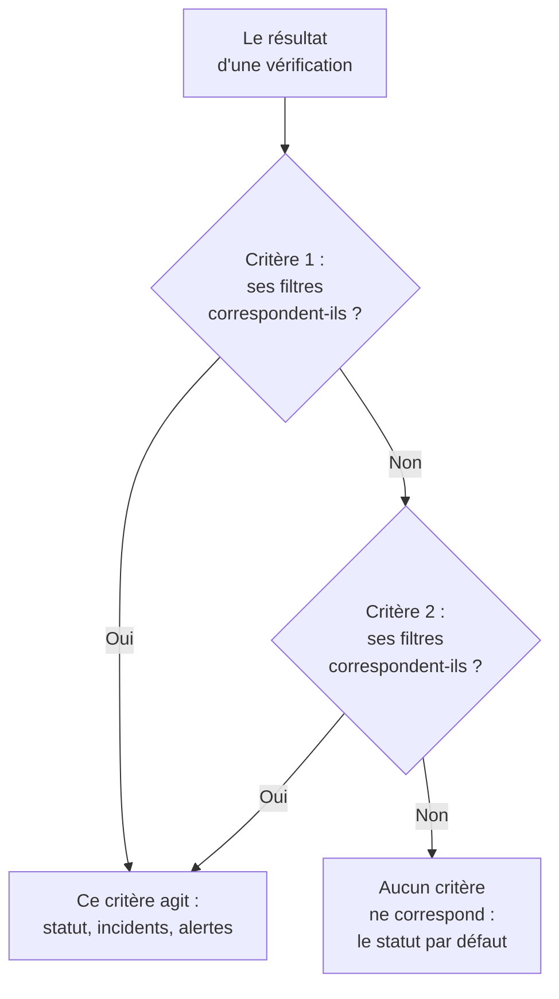
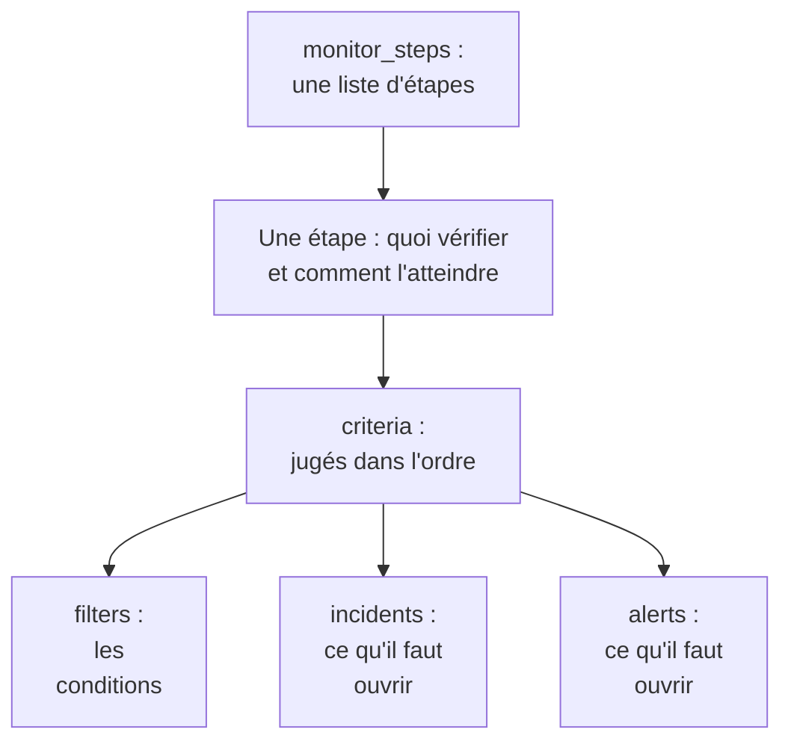

# Étapes de moniteur

`monitor_steps` est l'attribut de `oneuptime_monitor` qui dit ce qu'un moniteur vérifie et comment chaque résultat est jugé : l'adresse à vérifier, la requête à envoyer, et les critères qui transforment un résultat en statut de moniteur, en incident ou en alerte. Cette page en explique chaque partie.

:::cards
- [Comment une vérification est jugée](#comment-une-vérification-est-jugée): Les critères dans l'ordre, et le premier qui correspond.
- [Écrire les étapes](#écrire-les-étapes): Leur forme, un exemple complet, et les deux règles pour les valeurs.
- [Référence des filtres](#référence-des-filtres): Ce qu'un filtre peut vérifier, et comment il compare.
- [Erreurs courantes](#erreurs-courantes): Ce qui se passe mal le plus souvent, et la correction.
:::

## Comment une vérification est jugée

Chaque vérification donne un résultat : la réponse d'une sonde, la valeur renvoyée par un script, ou la télémétrie que la vérification lit. Les critères de l'étape le jugent ensuite dans leur ordre. Le premier critère dont les filtres correspondent décide de ce qui se passe : il peut changer le statut du moniteur, ouvrir des incidents et ouvrir des alertes. Les critères qui le suivent ne sont pas examinés pour cette vérification.



L'ordre des critères compte donc : placez d'abord les critères qui alertent, le plus grave en premier, et le critère de bonne santé en dernier. Les [Attributs d'un critère](#attributs-dun-critère) expliquent pourquoi, et la seule exception.

## Écrire les étapes

`monitor_steps` est une liste d'objets typés écrits directement en HCL. Il n'y a ni `jsonencode()`, ni enveloppe `{_type, value}`, ni clé en camelCase, ni ID à écrire : le fournisseur transforme votre HCL au format de l'API, et le serveur donne son ID à chaque étape, à chaque critère, à chaque modèle d'incident et à chaque modèle d'alerte. Il garde ces ID d'un apply à l'autre, en associant chaque critère et chaque modèle à celui qu'il remplace par son nom, sinon par sa position, si bien que les résultats des sondes restent avec leur étape et que les incidents continuent de pointer vers les critères qui les ont déclenchés.



La plus petite étape utile vérifie une adresse et a un critère avec un filtre :

```hcl
resource "oneuptime_monitor" "example" {
  name         = "Example"
  description  = "The smallest monitor_steps"
  monitor_type = "Website"

  monitor_steps = [{
    monitor_destination      = "https://example.com"
    monitor_destination_type = "URL"
    request_type             = "GET"

    criteria = [
      {
        name             = "Check if online"
        description      = "The website responds"
        filter_condition = "All"

        filters = [
          {
            check_on    = "Is Online"
            filter_type = "True"
          }
        ]
      }
    ]
  }]
}
```

Deux règles valent partout dans `monitor_steps` :

- **Laissez de côté ce que vous n'utilisez pas.** Un attribut que vous ne renseignez pas n'est pas envoyé à l'API. N'écrivez jamais `[]`, `{}` ou `""` comme valeur de remplacement : le fournisseur refuse les chaînes, listes et maps vides, pour qu'une valeur absente signifie toujours « non renseigné ».
- **Les valeurs des filtres sont des chaînes.** La `value` d'un filtre est une chaîne, même pour un nombre : `value = "200"`, pas `value = 200`. Les réglages numériques comme `port` sont des nombres.

:::details Passer du fournisseur 1.x, où monitor_steps était du JSON
Dans le fournisseur 1.x, `monitor_steps` était une chaîne JSON écrite avec `jsonencode({ _type = "MonitorSteps", value = { ... } })`. Réécrivez-la avec les attributs typés de cette page : retirez les enveloppes `_type` et `value`, écrivez les clés en camelCase en snake_case (`monitorDestination` devient `monitor_destination` et `monitor_destination_type`, `filterCondition` devient `filter_condition`, `checkOn` devient `check_on`), et supprimez chaque `id`. Le serveur attribue désormais tous les ID, ce qui met aussi fin aux ID aléatoires codés en dur de l'issue [#2291](https://github.com/OneUptime/oneuptime/issues/2291). Un état enregistré sous forme de chaîne JSON n'est pas mis à jour tout seul : appliquez la nouvelle configuration.
:::

### Un exemple complet

Ce moniteur de site web vérifie ce que vérifie le moniteur de site web des tests de bout en bout du fournisseur (test `35-monitor-with-steps`) : hors ligne quand le site ne répond pas, en ligne quand il répond avec 200.

```hcl
resource "oneuptime_monitor_status" "operational" {
  name                 = "Operational"
  description          = "Monitor is operational"
  color                = "#2ecc71"
  priority             = 1
  is_operational_state = true
}

resource "oneuptime_monitor_status" "offline" {
  name                 = "Offline"
  description          = "Monitor is offline"
  color                = "#e74c3c"
  priority             = 3
  is_operational_state = false
}

resource "oneuptime_monitor" "website" {
  name         = "Website"
  description  = "Website monitor with explicit steps"
  monitor_type = "Website"

  monitor_steps = [{
    monitor_destination      = "https://example.com" # what to check
    monitor_destination_type = "URL"                 # URL, Hostname or IP
    request_type             = "GET"                 # the HTTP method

    criteria = [ # judged in order: the first match decides
      {
        name                  = "Offline"
        description           = "Check if website is offline"
        filter_condition      = "Any"
        change_monitor_status = true
        create_incidents      = false
        create_alerts         = false
        monitor_status_id     = oneuptime_monitor_status.offline.id

        filters = [
          {
            check_on    = "Is Online"
            filter_type = "False"
          }
        ]
      },
      {
        name                  = "Online"
        description           = "Check if website is online"
        filter_condition      = "All" # All: every filter, Any: at least one
        change_monitor_status = true
        create_incidents      = false
        create_alerts         = false
        monitor_status_id     = oneuptime_monitor_status.operational.id

        filters = [
          {
            check_on    = "Is Online"
            filter_type = "True"
          },
          {
            check_on    = "Response Status Code"
            filter_type = "Equal To"
            value       = "200" # a string, even for a number
          }
        ]
      }
    ]
  }]
}
```

Un critère fait référence à un statut par sa ressource, comme le fait ici `oneuptime_monitor_status.offline.id`, ou à un statut que votre projet a déjà par une [source de données](/docs/terraform/complete-guide#lire-ce-qui-existe-déjà).

## Attributs d'une étape

Chaque élément de `monitor_steps` est une chose à vérifier :

| Attribut | Type | Utilisé par | Remarques |
| --- | --- | --- | --- |
| `monitor_destination` | string | Site web, API, Ping, IP, Port, Certificat SSL, NTP | L'URL, le nom d'hôte ou l'adresse IP à vérifier. Demande `monitor_destination_type`. |
| `monitor_destination_type` | string | les mêmes | `URL`, `Hostname` ou `IP`, selon ce que prend le type de moniteur : une URL pour les moniteurs de site web, d'API et de certificat SSL ; un nom d'hôte ou une adresse IP pour les moniteurs Ping, IP, Port et NTP. |
| `port` | number | Port, NTP | Le port TCP à vérifier, comme `443`. Pour NTP, le port UDP sur lequel répond le serveur de temps : `123` quand il n'est pas renseigné. |
| `request_type` | string | Site web, API | La méthode HTTP : `GET`, `POST`, `PUT`, `DELETE`, `HEAD` ou `PATCH`. Le serveur utilise `GET` quand elle n'est pas renseignée. |
| `request_headers` | map(string) | Site web, API | Les en-têtes à envoyer : `{ "Accept" = "application/json" }`. |
| `request_body` | string | API | Le corps de la requête, sous forme de texte. |
| `do_not_follow_redirects` | bool | Site web, API | S'arrêter à la première réponse au lieu de suivre les redirections. |
| `allow_self_signed_certificates` | bool | Site web, API | Accepter un certificat TLS auto-signé. |
| `tls_client_certificate` | string | Site web, API | Un certificat client pour le TLS mutuel : PEM, ou une référence `{{monitorSecrets.name}}`. |
| `tls_client_key` | string (sensible) | Site web, API | La clé privée du certificat client. Renseignez-la avec le certificat. |
| `tls_client_key_passphrase` | string (sensible) | Site web, API | La phrase secrète de la clé privée. |
| `request_timeout_in_ms` | number | Vérifications faites par une sonde | La durée que peut prendre une tentative, en millisecondes. La sonde ramène toute valeur au-dessus de 60000 à 60000. |
| `retry_count` | number | Vérifications faites par une sonde | Les nouvelles tentatives après un premier essai échoué : `0` vérifie une fois, `3` jusqu'à quatre fois. La sonde ramène toute valeur au-dessus de 3 à 3. |
| `custom_code` | string | Custom JavaScript Code, Synthetic | Le script que l'étape exécute. |
| `screen_size_types` | list(string) | Synthetic | `Mobile`, `Tablet` et `Desktop`. |
| `browser_types` | list(string) | Synthetic | `Chromium` et `Firefox`. |
| `retry_count_on_error` | number | Synthetic | Les nouvelles tentatives quand le script échoue : `0` l'exécute une fois. |
| `criteria` | list (obligatoire) | Tous | Comment chaque résultat est jugé : voir [Attributs d'un critère](#attributs-dun-critère). |

### Réglages de chaque type de moniteur

Les types de moniteur qui ont plus à régler qu'une adresse gardent leurs réglages (une requête de logs, une connexion à une base de données, un cluster à surveiller) dans un attribut à eux, sous forme de JSON brut écrit avec `jsonencode()` : `log_monitor`, `trace_monitor`, `llm_monitor`, `metric_monitor`, `exception_monitor`, `profile_monitor`, `dns_monitor`, `domain_monitor`, `dnssec_monitor`, `sql_monitor`, `database_monitor`, `external_status_page_monitor`, `network_device_monitor`, `kubernetes_monitor`, `docker_monitor`, `docker_swarm_monitor`, `host_monitor`, `podman_monitor`, `proxmox_monitor`, `vmware_monitor`, `ceph_monitor`, `storage_array_monitor`, `iot_monitor` et `probe_status_monitor`.

Leur JSON est le même que celui du tableau de bord, avec des clés en camelCase. Un ID y est écrit comme l'API en écrit un : `{ _type = "ObjectID", value = "..." }`. Un moniteur Logs qui compte les erreurs d'un service :

```hcl
resource "oneuptime_service" "checkout" {
  name = "checkout"
}

resource "oneuptime_monitor" "checkout_errors" {
  name         = "Checkout errors"
  monitor_type = "Logs"

  monitor_steps = [{
    log_monitor = jsonencode({
      attributes          = {}
      body                = "error"
      severityTexts       = ["Error"]
      telemetryServiceIds = [{ _type = "ObjectID", value = oneuptime_service.checkout.id }]
      lastXSecondsOfLogs  = 300
    })

    criteria = [
      {
        name             = "Errors found"
        filter_condition = "Any"

        filters = [
          {
            check_on    = "Log Count"
            filter_type = "Greater Than"
            value       = "0"
          }
        ]
      }
    ]
  }]
}
```

> [!TIP]
> Le plus simple pour obtenir ce JSON juste : configurez le moniteur dans le tableau de bord, puis ouvrez sa section **Développeurs** et **Terraform**. La page écrit les `monitor_steps` du moniteur, `jsonencode()` compris.

## Attributs d'un critère

Chaque élément de `criteria` est une règle : quand ses filtres correspondent, faire ce qu'elle dit.

Les critères sont jugés à partir du haut, et le premier qui correspond décide : placez donc d'abord les critères qui alertent, le plus grave en premier (critique, puis avertissement), et le critère de bonne santé en dernier. Un critère de bonne santé tout en haut est la façon la plus courante de construire un moniteur qui n'alerte jamais : une règle large comme `Is Online` est `True`, ou une valeur de métrique `Greater Than` `0`, correspond à presque chaque vérification, et les critères en dessous ne sont jamais examinés. Placé en dernier, il ne correspond que si rien au-dessus n'a correspondu, ce qui est bien ce que vous voulez.

Les moniteurs de métriques groupés sont la seule exception. Quand la requête d'un moniteur de métriques est groupée (`groupByAttributeKeys` renseigné dans le JSON de `metric_monitor`, à `metricViewConfig.queryConfigs[].metricQueryData.groupByAttributeKeys`), le moniteur lève une alerte ou un incident pour chaque groupe (chaque hôte, conteneur ou point de montage), et chaque critère est jugé : un critère critique et un critère d'avertissement peuvent donc se déclencher pour des hôtes différents lors de la même vérification. Un hôte qui enfreint les deux n'est alerté qu'une fois, par le premier critère qui correspond : le plus grave passe donc toujours en premier. Voir [Surveillance des métriques](/docs/monitor/metrics-monitor).

| Attribut | Type | Ce que c'est |
| --- | --- | --- |
| `name` | string (obligatoire) | Le nom que montre le tableau de bord. |
| `description` | string | La description que montre le tableau de bord. |
| `filter_condition` | string (obligatoire) | `All` : chaque filtre doit correspondre. `Any` : un seul suffit. |
| `filters` | list (obligatoire) | Les conditions, au moins une : voir [Référence des filtres](#référence-des-filtres). |
| `change_monitor_status` | bool | Si une correspondance change le statut du moniteur. |
| `monitor_status_id` | string | L'ID du `oneuptime_monitor_status` vers lequel changer. Renseignez-le quand `change_monitor_status` vaut `true`. |
| `create_incidents` | bool | Si une correspondance ouvre des incidents. |
| `incidents` | list | Les incidents à ouvrir. Laissez-le de côté, sauf avec `create_incidents = true`. |
| `create_alerts` | bool | Si une correspondance ouvre des alertes. |
| `alerts` | list | Les alertes à ouvrir. Laissez-le de côté, sauf avec `create_alerts = true`. |
| `is_enabled` | bool | `true` sur le serveur quand il n'est pas renseigné. Mettez `false` pour garder un critère sans juger avec lui. |
| `incident_grouping` | string (JSON) | Moniteurs de requêtes entrantes seulement : un incident pour chaque valeur trouvée dans la requête, comme `jsonencode({ groupByJSONPath = "..." })`. |
| `open_for_every_email` | bool | Moniteurs d'e-mails entrants seulement : `true` ouvre un incident (et une alerte) pour chaque e-mail correspondant, au lieu d'un seul à la fois. |

### Incidents et alertes

Un élément de `incidents` prend `title` et `description` (tous deux obligatoires), `incident_severity_id`, `auto_resolve_incident`, `remediation_notes`, `on_call_policy_ids`, `label_ids`, `owner_team_ids`, `owner_user_ids`, `show_incident_on_status_page` et `is_private`. Un élément de `alerts` prend les mêmes, avec `alert_severity_id` et `auto_resolve_alert`, et sans `show_incident_on_status_page`.

Ce critère passe le moniteur hors ligne, ouvre un incident qui alerte la politique d'astreinte, et le résout quand le site revient :

```hcl
criteria = [
  {
    name                  = "Offline"
    description           = "The site is unreachable"
    filter_condition      = "Any"
    change_monitor_status = true
    monitor_status_id     = oneuptime_monitor_status.offline.id
    create_incidents      = true

    filters = [
      {
        check_on    = "Is Online"
        filter_type = "False"
      }
    ]

    incidents = [
      {
        title                 = "Website is down"
        description           = "The website did not respond to the probe."
        incident_severity_id  = oneuptime_incident_severity.critical.id
        auto_resolve_incident = true
        on_call_policy_ids    = [oneuptime_on_call_policy.primary.id]
      }
    ]
  }
]
```

## Référence des filtres

Un filtre a `check_on` (ce qu'il regarde), `filter_type` (comment il compare) et `value` (avec quoi il compare, sous forme de chaîne ; laissez-la de côté pour les vérifications vrai-ou-faux comme `True` et `False`).

Un filtre peut aussi juger une fenêtre de temps au lieu de la dernière vérification : renseignez `evaluate_over_time = true`, la durée de la fenêtre dans `evaluate_over_time_minutes`, et dans `evaluate_over_time_type` la façon de lire la fenêtre : `Average`, `Sum`, `Maximum Value`, `Minimum Value`, `All Values` ou `Any Value`.

`All Values` signifie que chaque vérification de la fenêtre a enfreint la règle : il ne correspond donc qu'une fois la fenêtre couverte par des données. Un moniteur qui vient d'être créé attend que sa fenêtre se remplisse au lieu de correspondre dès sa première vérification. Donnez-lui une fenêtre d'au moins deux fois le `monitoring_interval` du moniteur ; sinon, la fenêtre contient une seule vérification, et « toutes les valeurs » veut dire la même chose que « n'importe quelle valeur ». `Any Value` correspond, à dessein, dès une vérification qui enfreint la règle.

`evaluate_over_time_no_data_policy` dit ce que fait le filtre tant que la fenêtre ne contient pas assez de données : `Ignore` (la valeur par défaut) ne correspond pas, `Trigger` traite les données manquantes comme la panne, comme le fait un heartbeat, et `Treat As Zero` compare la fenêtre comme un seul zéro.

### Ce qu'un filtre peut vérifier

Les valeurs de `check_on` que chaque type de moniteur utilise le plus. L'éditeur de critères du tableau de bord propose les mêmes, et les liste toutes :

| Type de moniteur | Valeurs de `check_on` |
| --- | --- |
| Site web / API | `Is Online`, `Response Time (in ms)`, `Response Status Code`, `Response Body`, `Response Header`, `Response Header Value`, `JavaScript Expression`, `Is Request Timeout` |
| Ping / IP | `Is Online`, `Response Time (in ms)`, `Packet Loss (in %)`, `Jitter (in ms)`, `Is Request Timeout` |
| Port | `Is Online`, `Response Time (in ms)` (le temps de connexion total du tableau de bord), `Port DNS Lookup Time (in ms)`, `Port TCP Connect Time (in ms)`, `Is Request Timeout` |
| Certificat SSL | `Is Valid Certificate`, `Is Not A Valid Certificate`, `Is Self Signed Certificate`, `Is Expired Certificate`, `Expires In Days`, `Expires In Hours` |
| Requête entrante | `Incoming Request`, `Request Body`, `Request Header`, `Request Header Value`, `JavaScript Expression` |
| E-mail entrant | `Email Received`, `Email Subject`, `Email From Address`, `Email To Address`, `Email Body` |
| Serveur | `Is Online`, `CPU Usage (in %)`, `Memory Usage (in %)`, `Disk Usage (in %)` (avec `disk_path`), `Server Process Name` |
| Logs | `Log Count` |
| Traces | `Span Count` |
| Exceptions | `Exception Count` |
| Profils | `Profile Count`, `Function Share (in %)` |
| IA / LLM | `Bad AI Answers (in %)`, `Bad AI Answers`, `AI Answers` |
| Métriques | `Metric Value` (les filtres de métriques peuvent prendre du JSON dans `metric_monitor_options`) |
| Code personnalisé / Synthetic | `Result Value` (peut comparer un champ des données renvoyées, nommé dans le JSON de `custom_code_monitor_options`, par ex. `jsonencode({ resultValuePath = "status" })` — voir plus bas), `Error`, `Execution Time (in ms)` |
| DNS | `DNS Is Online`, `DNS Response Time (in ms)`, `DNS Record Value`, `DNS Record Exists` |
| Domaine | `Domain Expires In Days`, `Domain Is Expired`, `Domain Registrar`, `Domain Name Server` |
| DNSSEC | `DNSSEC Chain Is Valid`, `DNSSEC DS Record Exists At Parent`, `DNSSEC Signature Expires In Days` |
| Requête SQL | `SQL Is Online`, `SQL Query Row Count`, `SQL Query Scalar Value` |
| Santé de la base de données | `Database Is Online`, `Database Metric` (avec du JSON dans `database_monitor_options` qui nomme la série, par ex. `jsonencode({ metricType = "oneuptime.monitor.database.connections.used.percent" })`), `Database Collection Error` |
| Page de statut externe | `External Status Page Is Online`, `External Status Page Active Incidents`, `External Status Page Component Status` |
| NTP | `NTP Is Online`, `NTP Is Synchronized`, `NTP Stratum`, `NTP Clock Offset (in ms)`, `NTP Response Time (in ms)`, `NTP Root Dispersion (in ms)` (`NTP Is Online` et `NTP Is Synchronized` ne prennent pas de `value`) |
| Équipement réseau (SNMP) | `SNMP Device Is Online` (il répond au ping ou au SNMP), `SNMP Walk Is Succeeding` (false quand il répond mais ne peut pas être parcouru), `SNMP OID Value` (les filtres SNMP peuvent prendre du JSON dans `snmp_monitor_options`) |

### Comment un filtre compare

| Type | Valeurs de `filter_type` |
| --- | --- |
| Vrai ou faux | `True`, `False` |
| Nombres | `Equal To`, `Not Equal To`, `Greater Than`, `Less Than`, `Greater Than Or Equal To`, `Less Than Or Equal To` |
| Texte | `Contains`, `Not Contains`, `Starts With`, `Ends With`, `Is Empty`, `Is Not Empty` |
| Heartbeats | `Recieved In Minutes`, `Not Recieved In Minutes` (écrits comme l'API les écrit) |
| Processus du serveur | `Is Executing`, `Is Not Executing` |
| Scripts | `Evaluates To True` |
| Anomalies, pour les métriques, les logs et les traces | `Anomalously High`, `Anomalously Low`, `Anomalous` |

Un filtre qui correspond quand un certificat SSL expire dans 14 jours ou moins :

```hcl
filters = [
  {
    check_on    = "Expires In Days"
    filter_type = "Less Than Or Equal To"
    value       = "14"
  }
]
```

Le fournisseur vérifie `check_on`, `filter_type` et les autres listes fixes au moment du plan, si bien qu'une faute de frappe échoue avant que quoi que ce soit ne soit envoyé à l'API. Les valeurs sont les noms que l'API donne aux options de l'éditeur de critères du tableau de bord.

### Comparer un champ du résultat d'un script

Le script d'un moniteur de code personnalisé ou d'un moniteur Synthetic renvoie `data`, et un filtre `Result Value` le compare. Quand `data` est un objet ou un tableau, `custom_code_monitor_options` nomme le champ à comparer : le **Chemin du champ** du filtre Result Value du tableau de bord. Utilisez des points pour les champs imbriqués et `[n]` pour les éléments de tableau, et laissez l'attribut de côté pour comparer toute la valeur :

```hcl
monitor_steps = [{
  custom_code = <<-EOT
    const response = await axios.get("https://api.example.com/health");
    // For example { status: "UP", checks: [{ name: "db", latency: 12 }] }
    return { data: response.data };
  EOT

  criteria = [
    {
      name             = "Unhealthy"
      filter_condition = "Any"
      filters = [
        {
          check_on                    = "Result Value"
          filter_type                 = "Not Equal To"
          value                       = "UP"
          custom_code_monitor_options = jsonencode({ resultValuePath = "status" })
        },
        {
          check_on                    = "Result Value"
          filter_type                 = "Greater Than"
          value                       = "500"
          custom_code_monitor_options = jsonencode({ resultValuePath = "checks[0].latency" })
        }
      ]
    }
  ]
}]
```

`Greater Than` et les autres conditions numériques ne correspondent qu'à un champ qui est un nombre, et un champ absent des données renvoyées ne correspond qu'à `Is Empty`. Voir [Alerter sur les données renvoyées](/docs/monitor/custom-code-monitor#alerter-sur-les-données-renvoyées) pour le fonctionnement des chemins et des conditions.

## Erreurs courantes

1. **Des valeurs de remplacement vides.** `incidents = []`, `request_headers = {}` et `description = ""` sont refusés : laissez plutôt l'attribut de côté.
2. **Un nombre là où va une chaîne.** La `value` d'un filtre est une chaîne, même pour un nombre : `value = "200"`. Les réglages numériques comme `port`, `retry_count`, `request_timeout_in_ms` et `evaluate_over_time_minutes` prennent des nombres.
3. **Le mauvais type de destination.** `monitor_destination_type = "URL"` avec un simple nom d'hôte, ou `Hostname` avec une URL complète, fait échouer la vérification. Les moniteurs de site web et d'API prennent des URL ; les moniteurs Ping, IP et Port prennent des noms d'hôte ou des adresses IP.
4. **Un changement de statut sans statut.** `change_monitor_status = true` sans `monitor_status_id` correspond, et n'a aucun statut vers lequel changer.
5. **Les ID.** Aucun élément de `monitor_steps` n'a d'attribut `id`. Si vous passez de l'ancien JSON, supprimez-les : le serveur attribue les ID.
6. **Du JSON écrit à la main.** Écrivez `log_monitor` et les autres réglages avec `jsonencode()`, pour que Terraform les mette entre guillemets et écrive le JSON de la même façon à chaque fois. Pour `metric_monitor`, donnez tout l'objet que le tableau de bord écrit : le serveur le normalise.

## Quand aucun critère ne correspond

Une vérification à laquelle aucun critère ne correspond met le moniteur dans son statut par défaut : le statut opérationnel du projet, celui que le tableau de bord choisit pour un nouveau moniteur. Ses incidents ouverts dont les critères ont choisi la résolution automatique sont aussi résolus. Pour décider vous-même de chaque issue, terminez la liste par un large critère de bonne santé, comme le font les exemples de cette page.

## Un moniteur sans étapes

`monitor_steps` est facultatif, mais un moniteur créé sans lui n'a aucun critère pour juger un résultat : les sondes ignorent un moniteur sans étapes, et il reste dans le statut où il a commencé. Votre état garde l'attribut vide, et le plan reste propre. Un moniteur manuel n'a jamais besoin d'étapes : vous fixez son statut vous-même. Tout autre type a besoin d'au moins une étape pour vérifier quoi que ce soit.

## Le format de transfert

Derrière le fournisseur, l'API parle toujours son propre JSON, où chaque objet riche est enveloppé sous la forme `{_type, value}` :

```json
{
  "_type": "MonitorSteps",
  "value": {
    "monitorStepsInstanceArray": [
      {
        "_type": "MonitorStep",
        "value": {
          "monitorDestination": { "_type": "URL", "value": "https://example.com" },
          "requestType": "GET",
          "monitorCriteria": {
            "_type": "MonitorCriteria",
            "value": { "monitorCriteriaInstanceArray": [ { "_type": "MonitorCriteriaInstance", "value": { "...": "..." } } ] }
          }
        }
      }
    ]
  }
}
```

Le fournisseur construit cela à partir de votre HCL quand il écrit, et le relit en HCL, en laissant de côté ce que gère le serveur (les ID et les valeurs par défaut qu'il ajoute). Vous ne le rencontrez que si vous lisez vous-même les réponses de l'API, par exemple dans un script qui lit `monitorSteps`.

## Prochaines étapes

:::cards
- [Exemples](/docs/terraform/examples): Des moniteurs Ping, Port, de certificat SSL et d'API, prêts à l'emploi.
- [Guide complet](/docs/terraform/complete-guide): Les sources de données, l'état et les mises à jour.
- [Surveillance des métriques](/docs/monitor/metrics-monitor): Les requêtes de métriques, le regroupement et les anomalies.
- [Dépannage](/docs/terraform/troubleshooting): Y compris un résultat incohérent après un apply sur un moniteur.
:::
