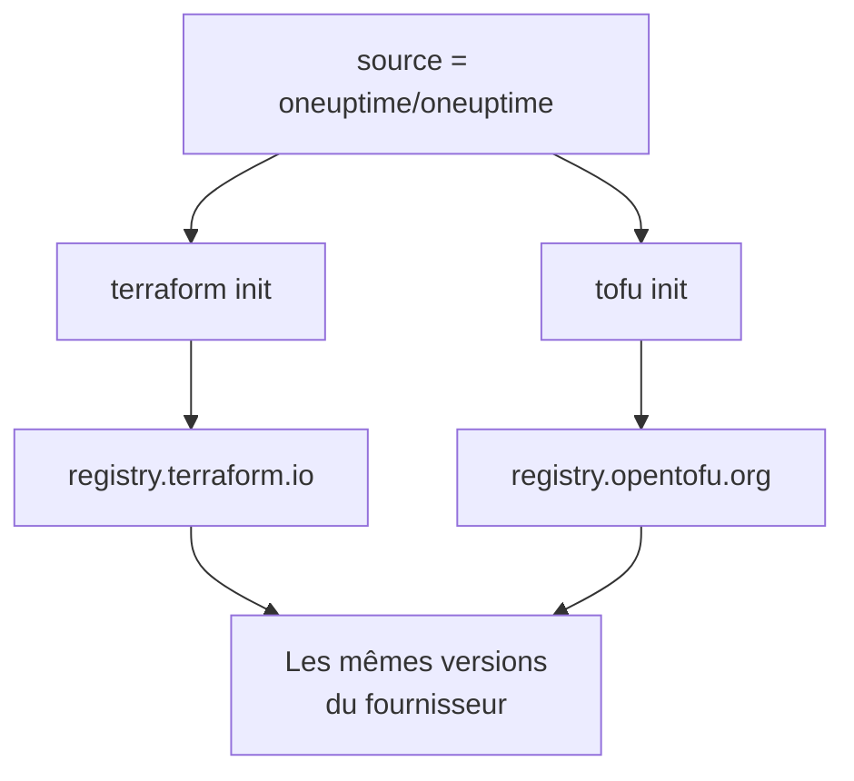

# OpenTofu

Le fournisseur OneUptime fonctionne avec [OpenTofu](https://opentofu.org) comme avec Terraform. Il est publié dans l'[OpenTofu Registry](https://search.opentofu.org/provider/oneuptime/oneuptime/latest), et chaque version réussit les mêmes tests de bout en bout avec les deux avant d'être publiée. Votre configuration ne change pas : exécutez `tofu` partout où cette documentation exécute `terraform`.

:::cards
- [Utiliser le fournisseur avec OpenTofu](#utiliser-le-fournisseur-avec-opentofu): La même configuration, exécutée avec `tofu`.
- [Ce qui diffère de Terraform](#ce-qui-diffère-de-terraform): Les registres, les fichiers de verrouillage, les fichiers `.tofu` et les versions.
- [Passer une configuration à OpenTofu](#passer-une-configuration-à-opentofu): Basculez une configuration existante en quatre étapes.
- [Un module réutilisable](#un-module-réutilisable): Des moniteurs, une politique d'astreinte et une page de statut pour un service.
:::

## Utiliser le fournisseur avec OpenTofu

Il vous faut OpenTofu 1.6 ou ultérieur. Déclarez le fournisseur comme vous le feriez pour Terraform :

```hcl title="main.tf"
terraform {
  required_providers {
    oneuptime = {
      source  = "oneuptime/oneuptime"
      version = "{{TERRAFORM_PROVIDER_VERSION}}"
    }
  }
}

provider "oneuptime" {
  # The API key comes from the ONEUPTIME_API_KEY environment variable.
  # On a self-hosted OneUptime, add your OneUptime's address:
  # oneuptime_url = "https://oneuptime.example.com"
}
```

Puis exécutez-le avec `tofu` :

```bash
export ONEUPTIME_API_KEY="<your-api-key>"
tofu init
tofu plan
tofu apply
```

`tofu init` télécharge le fournisseur depuis l'OpenTofu Registry. Tout ce qui figure dans le [Démarrage rapide](/docs/terraform/quick-start), le [Guide complet](/docs/terraform/complete-guide), [Étapes du moniteur](/docs/terraform/monitor-steps), [Exemples](/docs/terraform/examples) et [Importer des ressources](/docs/terraform/importing-resources) s'applique tel quel, et la configuration qu'écrivent les pages **Terraform** du tableau de bord fonctionne sans changement.

### Garder le registre hors de l'adresse source

`source = "oneuptime/oneuptime"` ne nomme aucun registre, donc chaque moteur la lit dans le sien :



Laissez le nom d'hôte de côté. Avec lui, chaque moteur utilise ce registre : avec `registry.terraform.io/oneuptime/oneuptime`, OpenTofu télécharge lui aussi depuis le Terraform Registry, et Terraform refuse la copie de l'OpenTofu Registry avec `authentication signature from unknown issuer`.

## Ce qui diffère de Terraform

| Sujet | Avec OpenTofu |
| --- | --- |
| Le registre | `oneuptime/oneuptime` est `registry.opentofu.org/oneuptime/oneuptime`, qui publie les mêmes versions que le Terraform Registry. |
| Signatures | `tofu init` indique que la validation de la signature a été ignorée : l'OpenTofu Registry ne détient aucune clé de signature pour ce fournisseur, donc OpenTofu vérifie le téléchargement avec les sommes de contrôle du registre. |
| Le bloc `terraform` | Reste `terraform` : il fait partie du langage, et OpenTofu le lit tel quel. |
| Fichiers `.tofu` | OpenTofu 1.8 et ultérieur lit aussi les fichiers `.tofu`, et ignore un fichier `.tf` à côté duquel se trouve un fichier `.tofu` du même nom. Terraform ne lit que les fichiers `.tf`. |
| `required_version` | Les versions d'OpenTofu commencent à 1.6.0, donc `>= 1.5.0`, écrit pour Terraform, admet n'importe quel OpenTofu. |
| Le fichier de verrouillage | Nomme `registry.opentofu.org/oneuptime/oneuptime`. Changer de moteur réécrit cette entrée : commitez le changement. |
| État | OpenTofu lit tel quel un état que Terraform a écrit. |
| Variables | `TF_VAR_name` définit aussi une variable avec OpenTofu. |
| Le fichier de configuration de la CLI | `~/.tofurc` ou `~/.terraformrc`, ou le fichier que nomme `TF_CLI_CONFIG_FILE`. |
| Un bloc `removed` | Son bloc `lifecycle` nécessite OpenTofu 1.10 ou ultérieur. Sans lui, OpenTofu oublie la ressource et garde l'enregistrement, là où Terraform le détruit. |
| Passer à un type de ressource renommé | Un bloc `moved` de `oneuptime_io_t_fleet` vers `oneuptime_iot_fleet`, ou entre les autres types renommés, nécessite OpenTofu 1.12 ou ultérieur. |

## Passer une configuration à OpenTofu

Une configuration que gère Terraform passe à OpenTofu telle quelle, avec son état :

:::steps
### Installer OpenTofu

Installez OpenTofu : la 1.6 suffit pour le fournisseur, et la 1.12 ou ultérieure déplace aussi une ressource vers un type renommé, comme `oneuptime_io_t_fleet` vers `oneuptime_iot_fleet`.

### Initialiser avec tofu

Dans le dossier de la configuration, exécutez `tofu init`. Il télécharge le fournisseur depuis l'OpenTofu Registry, et indique qu'il a modifié le fichier de verrouillage : l'entrée du fournisseur nomme maintenant l'OpenTofu Registry.

### Planifier

Exécutez `tofu plan`. Il lit l'état laissé par Terraform, et répond `No changes.`

### Commiter le fichier de verrouillage

Commitez `.terraform.lock.hcl`, et exécutez désormais la configuration avec `tofu`, en CI aussi.
:::

## Un module réutilisable

[`Examples/opentofu/`](https://github.com/OneUptime/oneuptime/tree/master/Examples/opentofu) dans le dépôt de OneUptime contient des configurations prêtes à exécuter, et un module qui met en place un service : un moniteur de site web pour chaque adresse que vous lui donnez, une étiquette sur tout ce qu'il crée, une politique d'astreinte avec une règle d'escalade, et une page de statut qui liste les moniteurs. C'est du HCL simple, il fonctionne donc aussi avec Terraform.

```hcl title="main.tf"
module "storefront" {
  source = "github.com/OneUptime/terraform-provider-oneuptime//modules/monitoring-and-incident-response?ref=vX.Y.Z"

  service_name          = "storefront"
  status_page_is_public = true

  monitors = {
    homepage = { url = "https://example.com" }
    checkout = { url = "https://example.com/checkout" }
    api      = { url = "https://api.example.com/health", expected_status_code = "204" }
  }
}
```

Remplacez `vX.Y.Z` par une version publiée du fournisseur, comme la plus récente des [versions du fournisseur](https://github.com/OneUptime/terraform-provider-oneuptime/releases) : le module est publié avec le fournisseur, et son dépôt change à chaque version.

Le module ne crée ni statuts de moniteur ni gravités d'incident. Il cherche par leur nom ceux avec lesquels chaque projet démarre : `Operational`, `Offline` et `Critical Incident`. Si votre projet les a renommés, définissez `operational_monitor_status_name`, `offline_monitor_status_name` ou `incident_severity_name`.

Sa règle d'escalade n'alerte personne tant que vous ne dites pas qui : ajoutez-lui une équipe avec les sorties du module :

```hcl title="main.tf"
resource "oneuptime_team" "storefront" {
  name = "Storefront"
}

resource "oneuptime_team_on_call_duty_escalation_rule" "storefront" {
  on_call_duty_policy_id                 = module.storefront.on_call_policy_id
  on_call_duty_policy_escalation_rule_id = module.storefront.escalation_rule_id
  team_id                                = oneuptime_team.storefront.id
}
```

## Étapes suivantes

:::cards
- [Démarrage rapide](/docs/terraform/quick-start): Créez une clé API et appliquez vos premières ressources.
- [Utilisation du registre](/docs/terraform/registry): Comment les versions sont numérotées, et le fichier de verrouillage.
- [Configuration auto-hébergée](/docs/terraform/self-hosted): Votre propre OneUptime, et un miroir pour les machines hors ligne.
- [Dépannage](/docs/terraform/troubleshooting): Les erreurs courantes et comment les corriger.
:::
