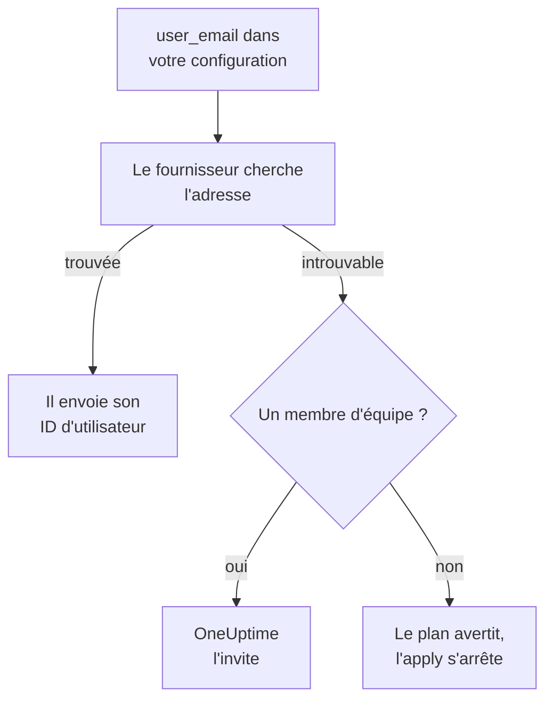

# Personnes et équipes

Gardez dans votre configuration Terraform qui fait partie de votre projet : les équipes et leurs membres, qui est d'astreinte et qui est propriétaire de quoi. Désignez chaque personne par son adresse e-mail : le fournisseur la trouve, et invite toute personne nouvelle dans le projet.

:::cards
- [Désigner les personnes par leur adresse e-mail](#désigner-les-personnes-par-leur-adresse-e-mail): L'attribut à côté de chaque ID d'utilisateur.
- [Accueillir quelqu'un](#accueillir-quelquun): Invitez quelqu'un, et donnez-lui une équipe, des astreintes et quelque chose dont il est propriétaire.
- [Faire partir quelqu'un](#faire-partir-quelquun): Retirez quelqu'un, et ce que OneUptime retire avec lui.
- [Importer les membres que vous avez déjà](#importer-les-membres-que-vous-avez-déjà): Par leur équipe et leur adresse.
:::

## Comment ça marche

Le fournisseur cherche l'adresse parmi les personnes du projet de la clé d'API : ses membres, et les personnes invitées à le rejoindre. Il envoie à l'API l'ID de la personne qu'il trouve. Un membre d'équipe désigné par une adresse que personne n'a dans le projet invite plutôt cette adresse.



Seul le projet de la clé d'API est consulté. Personne en dehors n'est jamais trouvé, et le fournisseur ne peut pas savoir si une adresse a un compte ailleurs.

## Avant de commencer

- **Une clé d'API qui peut lire les équipes du projet.** C'est par elles que le fournisseur trouve les personnes.
- **Pour ajouter quelqu'un de nouveau, une clé qui peut inviter des personnes.** Voir [Inviter des personnes](/docs/permissions/inviting-people).

## Désigner les personnes par leur adresse e-mail

Chaque ressource qui désigne une personne accepte son adresse e-mail à côté de son ID d'utilisateur. Indiquez l'un des deux :

| ID d'utilisateur | Adresse e-mail |
| --- | --- |
| `user_id` | `user_email` |
| `owner_users` | `owner_user_emails` |
| `assigned_to_user_id` | `assigned_to_user_email` |
| `override_user_id` | `override_user_email` |

L'adresse est trouvée quelle que soit la casse, et gardée dans le state telle que vous l'avez écrite. L'ID d'utilisateur est rempli, pour que d'autres ressources puissent y faire référence.

## Accueillir quelqu'un

Cette configuration ajoute Alice, nouvelle dans le projet, à une équipe, lui donne des astreintes dès son premier jour, et fait de Bob, déjà dans le projet, le propriétaire d'un moniteur :

```hcl title="people.tf"
resource "oneuptime_team" "sre" {
  name        = "SRE"
  description = "Site reliability engineering"
}

# New to the project: OneUptime invites her.
resource "oneuptime_team_member" "alice" {
  team_id    = oneuptime_team.sre.id
  user_email = "alice@example.com"
}

resource "oneuptime_on_call_policy_schedule" "weekly" {
  name     = "SRE weekly"
  timezone = "UTC"
}

resource "oneuptime_on_call_schedule_layer" "weekly" {
  on_call_duty_policy_schedule_id = oneuptime_on_call_policy_schedule.weekly.id
  name                            = "Weekly"
  starts_at                       = "2030-01-07T09:00:00Z"
  hand_off_time                   = "2030-01-14T09:00:00Z"
}

# Named through her membership, so she is invited first.
resource "oneuptime_on_call_schedule_layer_user" "alice" {
  on_call_duty_policy_schedule_id       = oneuptime_on_call_policy_schedule.weekly.id
  on_call_duty_policy_schedule_layer_id = oneuptime_on_call_schedule_layer.weekly.id
  user_id                               = oneuptime_team_member.alice.user_id
}

resource "oneuptime_monitor" "api" {
  name         = "Public API"
  monitor_type = "Manual"
}

# In the project already: named by his address.
resource "oneuptime_monitor_user_owner" "api" {
  monitor_id = oneuptime_monitor.api.id
  user_email = "bob@example.com"
}
```

`terraform apply` invite Alice par e-mail, comme le fait une invitation depuis le tableau de bord. OneUptime lui crée un compte si elle n'en a pas. `has_accepted_invitation` reste `false` jusqu'à ce qu'elle accepte, et son acceptation n'est pas un changement dans le plan. Une personne déjà dans le projet rejoint aussitôt une nouvelle équipe.

Pour mettre d'astreinte une personne que cette configuration invite, ou en faire un propriétaire, faites référence à son adhésion avec `user_id = oneuptime_team_member.<name>.user_id` : Terraform l'invite alors avant de la désigner ailleurs. Une adresse que personne n'a dans le projet est un avertissement dans le plan, et une erreur dans l'apply.

## Trouver quelqu'un

La source de données `oneuptime_user` cherche quelqu'un par `email`, `name` ou `id`, et lit son ID d'utilisateur, son nom, s'il a rejoint le projet, et les équipes dont il fait partie :

```hcl
data "oneuptime_user" "alice" {
  email = "alice@example.com"
}

output "alice_teams" {
  value = data.oneuptime_user.alice.team_ids
}
```

## Faire partir quelqu'un

Retirez les adhésions de la personne de votre configuration et appliquez-la. Sortie de sa dernière équipe du projet, elle est sortie du projet, et OneUptime la retire de chaque planning d'astreinte, règle d'escalade et remplacement, et de ce dont elle est propriétaire : de tout, sauf des incidents, alertes et événements de maintenance terminés. Retirez dans le même changement les blocs qui la désignent, sinon le plan suivant les recrée pour quelqu'un qui n'est plus dans le projet.

Son compte OneUptime reste le sien : elle ne quitte que le projet. Une équipe qui doit garder un membre refuse de perdre le dernier qui a accepté.

## Importer les membres que vous avez déjà

Aucun écran n'affiche l'ID d'une adhésion : importez-la donc par l'ID de son équipe et l'adresse de la personne :

```bash
terraform import oneuptime_team_member.alice 6b1d1c2e-4f3a-4b5c-8d6e-7f8091a2b3c4/alice@example.com
```

L'adresse reste telle que vous l'avez écrite : écrivez-la donc comme dans votre configuration. L'ID propre de l'adhésion l'importe aussi, et l'adresse est alors lue depuis OneUptime, en minuscules.

## Quand quelqu'un change d'adresse

Une personne qui change son adresse dans OneUptime reste la même personne pour Terraform : rien ne change tant que vous n'écrivez pas la nouvelle adresse, et alors seul `user_email` change.

## Dépannage

:::details Le plan indique qu'une adresse n'est pas encore dans ce projet
Personne dans le projet, ni parmi les invités, n'a cette adresse. Invitez d'abord la personne avec un `oneuptime_team_member`. Si cette adhésion est dans la même configuration, faites-y référence avec `user_id = oneuptime_team_member.<name>.user_id` au lieu de l'adresse. Si elle a changé d'adresse dans OneUptime, utilisez la nouvelle.
:::

:::details L'apply indique que l'utilisateur a déjà été invité dans cette équipe
La personne fait déjà partie de l'équipe. Importez cette adhésion au lieu de la créer, comme dans [Importer les membres que vous avez déjà](#importer-les-membres-que-vous-avez-déjà).
:::

## Étapes suivantes

:::cards
- [Importer des ressources](/docs/terraform/importing-resources): Placez le reste de votre projet sous Terraform.
- [Inviter des personnes](/docs/permissions/inviting-people): Comment fonctionnent les invitations dans OneUptime.
- [Exemples](/docs/terraform/examples): Des configurations prêtes à l'emploi pour les ressources courantes.
:::
