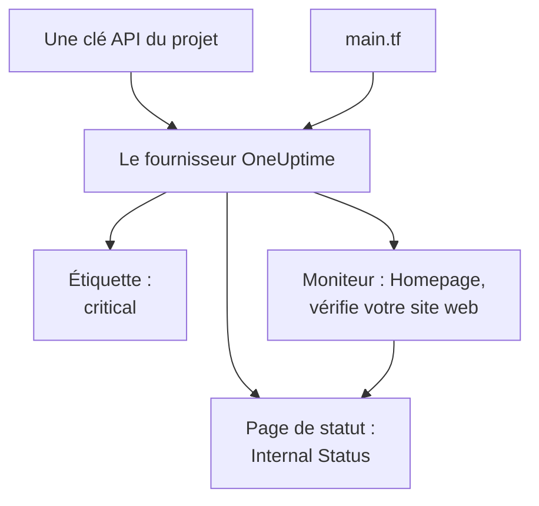

# Démarrage rapide

Ce guide vous mène de zéro à un projet OneUptime géré par Terraform en une dizaine de minutes. Vous créez une clé API, vous orientez Terraform vers votre projet, puis vous appliquez une étiquette, un moniteur qui vérifie votre site web et une page de statut privée qui l'affiche. Ensuite, vous modifiez l'un d'eux et vous faites le ménage.

:::cards
- [Avant de commencer](#avant-de-commencer): Terraform, un projet, et une offre avec des clés API.
- [Créer vos premières ressources](#créer-vos-premières-ressources): D'une clé API à un plan appliqué, en six étapes.
- [Modifier une ressource](#modifier-une-ressource): Modifier la configuration, planifier et appliquer.
- [Dépannage](#dépannage): Les erreurs sur lesquelles une première exécution peut s'arrêter.
:::



## Avant de commencer

- **Terraform 1.5 ou plus récent, ou OpenTofu 1.6 ou plus récent.** Avec OpenTofu, lancez `tofu` partout où ce guide lance `terraform`.
- **Un projet OneUptime** sur [oneuptime.com](https://oneuptime.com) ou sur votre propre instance OneUptime, dans lequel vous pouvez créer des clés API.
- **Sur OneUptime Cloud, l'offre Growth ou supérieure.** Les clés API d'un projet ne fonctionnent qu'avec elle.

## Créer vos premières ressources

:::steps
### Créer une clé API du projet

Dans le tableau de bord OneUptime, ouvrez **Paramètres du projet → Avancé → Clés API** et cliquez sur **Créer : Clé API**. Donnez-lui un **Nom**, comme `terraform`, et sous **Accès**, choisissez **Administrateur du projet** : Terraform crée, lit, modifie et supprime chaque type d'enregistrement qu'il gère, et **Administrateur du projet** peut faire tout cela. Pour une clé plus restreinte, choisissez **Choisir les autorisations plus tard** et n'ajoutez sur la page de la clé que les autorisations dont vous avez besoin.

La clé expire dans un an. Pour choisir une autre date, ouvrez **Plus de champs** avant de la créer, ou modifiez la date plus tard sur la page de la clé. Une fois la clé créée, sa page s'ouvre : copiez la **Clé API** depuis la carte **Détails de la clé API**.

### Rendre la clé disponible pour Terraform

Placez la clé dans la variable d'environnement `ONEUPTIME_API_KEY` du shell dans lequel vous lancez Terraform, pour qu'elle n'arrive jamais dans un fichier :

:::tabs
@tab Linux
```bash
export ONEUPTIME_API_KEY="<your-api-key>"
```
@tab macOS
```bash
export ONEUPTIME_API_KEY="<your-api-key>"
```
@tab Windows
```powershell
$env:ONEUPTIME_API_KEY = "<your-api-key>"
```
:::

### Orienter Terraform vers OneUptime

Créez un dossier vide, et dedans un fichier nommé `main.tf` :

```hcl title="main.tf"
terraform {
  required_providers {
    oneuptime = {
      source  = "oneuptime/oneuptime"
      version = "{{TERRAFORM_PROVIDER_VERSION}}"
    }
  }
}

provider "oneuptime" {
  # The API key comes from ONEUPTIME_API_KEY.
  # On a self-hosted OneUptime, add your OneUptime's address:
  # oneuptime_url = "https://oneuptime.example.com"
}
```

Sur une instance OneUptime auto-hébergée, lisez la [Configuration auto-hébergée](/docs/terraform/self-hosted) avant de choisir une version du fournisseur.

### Décrire vos ressources

Ajoutez ces blocs à `main.tf`. Ils lisent deux des statuts de moniteur avec lesquels chaque projet commence, et créent une étiquette, un moniteur qui vérifie `https://example.com` toutes les cinq minutes (mettez-y votre propre site web) et une page de statut privée qui affiche le moniteur :

```hcl title="main.tf"
data "oneuptime_monitor_status" "operational" {
  name = "Operational"
}

data "oneuptime_monitor_status" "offline" {
  name = "Offline"
}

resource "oneuptime_label" "critical" {
  name        = "critical"
  description = "Resources that page on-call when down"
  color       = "#FF5733"
}

resource "oneuptime_monitor" "homepage" {
  name                = "Homepage"
  description         = "Checks that the homepage responds"
  monitor_type        = "Website"
  monitoring_interval = "*/5 * * * *"
  labels              = [oneuptime_label.critical.id]

  monitor_steps = [{
    monitor_destination      = "https://example.com"
    monitor_destination_type = "URL"
    request_type             = "GET"

    criteria = [
      {
        name                  = "Offline"
        description           = "The homepage does not respond"
        filter_condition      = "Any"
        change_monitor_status = true
        monitor_status_id     = data.oneuptime_monitor_status.offline.id

        filters = [
          {
            check_on    = "Is Online"
            filter_type = "False"
          }
        ]
      },
      {
        name                  = "Online"
        description           = "The homepage responds"
        filter_condition      = "All"
        change_monitor_status = true
        monitor_status_id     = data.oneuptime_monitor_status.operational.id

        filters = [
          {
            check_on    = "Is Online"
            filter_type = "True"
          }
        ]
      }
    ]
  }]
}

resource "oneuptime_status_page" "internal" {
  name                  = "Internal Status"
  description           = "Status of our internal services"
  page_title            = "Service Status"
  is_public_status_page = false
}

resource "oneuptime_status_page_resource" "homepage" {
  status_page_id = oneuptime_status_page.internal.id
  monitor_id     = oneuptime_monitor.homepage.id
  display_name   = "Homepage"
}

output "monitor_id" {
  value = oneuptime_monitor.homepage.id
}
```

Les `monitor_steps` du moniteur disent ce qu'il vérifie et ce que signifie chaque résultat : après chaque vérification, le premier critère qui correspond fixe son statut. [Étapes de moniteur](/docs/terraform/monitor-steps) explique chaque partie.

### Planifier et appliquer

:::tabs
@tab Terraform
```bash
terraform init
terraform plan
terraform apply
```
@tab OpenTofu
```bash
tofu init
tofu plan
tofu apply
```
:::

`init` télécharge le fournisseur. Le plan se termine par `Plan: 4 to add, 0 to change, 0 to destroy.` Tapez `yes` pour l'appliquer ; une fois terminé, Terraform affiche l'ID du nouveau moniteur.

### Vérifier le tableau de bord

Dans le tableau de bord OneUptime :

- **Moniteurs** liste `Homepage`, avec l'étiquette `critical`. Sa première vérification arrive en quelques minutes.
- **Pages de statut** liste `Internal Status`, qui affiche `Homepage`.
- **Paramètres du projet → Basique → Étiquettes** liste `critical`, dans la couleur que vous avez choisie.

Relancez `terraform plan`. Il répond `No changes.` : OneUptime contient exactement ce que dit la configuration.
:::

## Modifier une ressource

Modifiez la configuration, pas le tableau de bord. Passez la `color` de l'étiquette à `"#2ECC71"` dans `main.tf`, puis planifiez et appliquez :

```bash
terraform plan
terraform apply
```

Le plan se termine par `Plan: 0 to add, 1 to change, 0 to destroy.` : l'étiquette est modifiée sur place. Un changement que quelqu'un fait dans le tableau de bord sur une ressource gérée par Terraform apparaît dans le plan suivant, et l'appliquer remet ce que dit la configuration.

## Faire le ménage

Si c'était un essai, supprimez ce que la configuration a créé :

```bash
terraform destroy
```

Cela supprime l'étiquette, le moniteur, la page de statut et sa ressource. Les deux statuts de moniteur restent : les sources de données ne font que les lire.

## Dépannage

:::details Message « Missing API Key »
Le fournisseur n'a trouvé aucune clé API. Exportez `ONEUPTIME_API_KEY` dans le shell où vous lancez Terraform, ou renseignez `api_key` dans le bloc du fournisseur, puis relancez la commande.
:::

:::details Message « the OneUptime API returned status 400: Invalid API Key »
La clé est mal saisie, expirée ou supprimée, ou elle appartient à une autre instance OneUptime que celle vers laquelle pointe `oneuptime_url`. Copiez de nouveau la clé depuis sa page, ou créez-en une nouvelle.
:::

:::details Message « the OneUptime API returned status 402: API keys need the Growth plan »
Sur OneUptime Cloud, les clés API d'un projet ne fonctionnent qu'avec l'offre Growth ou supérieure. Passez le projet à une offre supérieure dans **Paramètres du projet → Facturation et factures → Facturation**, et la même clé fonctionne de nouveau.
:::

:::details Message « the OneUptime API returned status 422: You do not have permissions to create Monitor »
La clé n'a aucune autorisation pour ce type d'enregistrement. Sur la page de la clé, donnez-lui **Administrateur du projet**, ou l'autorisation que nomme le message.
:::

:::details Message « No monitor status matches {name = "Offline"} »
Les statuts de moniteur de votre projet ont d'autres noms. Utilisez les noms que vous voyez dans **Moniteurs → Paramètres → Statut du moniteur**, ou cherchez plutôt le statut par `is_offline_state = true`.
:::

## Prochaines étapes

:::cards
- [Guide complet](/docs/terraform/complete-guide): L'authentification, l'organisation du projet, les sources de données, l'état et les mises à jour.
- [Étapes de moniteur](/docs/terraform/monitor-steps): Décider ce qu'un moniteur vérifie et ce que signifie chaque résultat.
- [Exemples](/docs/terraform/examples): Des configurations prêtes à l'emploi pour les ressources courantes.
- [Importer des ressources](/docs/terraform/importing-resources): Placer sous Terraform ce que vous avez créé dans le tableau de bord.
:::
