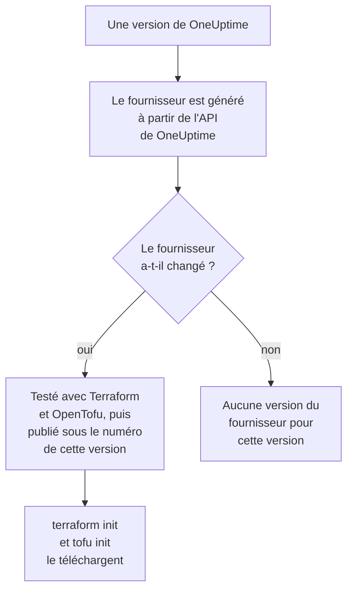

# Utilisation du registre

Le fournisseur OneUptime est publié dans le [Terraform Registry](https://registry.terraform.io/providers/oneuptime/oneuptime) et dans l'[OpenTofu Registry](https://search.opentofu.org/provider/oneuptime/oneuptime/latest). `terraform init` et `tofu init` le téléchargent depuis là : il n'y a rien à installer à la main. Cette page explique ce qui est publié, comment les versions sont numérotées et comment passer à une version plus récente.

:::cards
- [Ce qui est publié](#ce-qui-est-publié): Le fournisseur pour chaque plateforme, sa référence et ses versions.
- [Comment les versions sont numérotées](#comment-les-versions-sont-numérotées): La version d'un fournisseur est la version de OneUptime qui l'a publié.
- [Le fichier de verrouillage](#le-fichier-de-verrouillage): La version et les sommes de contrôle que chaque machine installe.
- [Passer à une version plus récente](#passer-à-une-version-plus-récente): Lire ce qui a changé, la télécharger et planifier.
:::

## Ce qui est publié

Chaque version de OneUptime génère le fournisseur à partir de la propre API de OneUptime. Quand le fournisseur a changé, la version le publie, sous le numéro de cette version, une fois qu'il a réussi ses tests de bout en bout avec Terraform et avec OpenTofu :



| Quoi | Où |
| --- | --- |
| Le fournisseur, pour Linux, macOS, Windows, FreeBSD, OpenBSD et Solaris | Téléchargé par `terraform init` et `tofu init`, avec des sommes de contrôle que OneUptime signe |
| La référence de chaque ressource et source de données, avec chacun de ses attributs | La documentation du registre, regroupée par produit : moniteurs, pages de statut, incidents, astreinte et les autres |
| Un guide pour utiliser le fournisseur avec OpenTofu | Les guides du registre |
| Chaque version, la plus récente en premier | La liste des versions du registre |

La référence indique ce qu'est chaque attribut. Cette documentation montre comment les utiliser ensemble : commencez par la [Vue d'ensemble de Terraform](/docs/terraform/index).

## Comment les versions sont numérotées

La version d'un fournisseur est celle de la version de OneUptime qui l'a publié : le fournisseur {{TERRAFORM_PROVIDER_MAJOR}}.0.20 est arrivé avec OneUptime {{TERRAFORM_PROVIDER_MAJOR}}.0.20. Une version dont le fournisseur n'a pas changé n'en publie aucun, donc les versions ont des trous, et une contrainte qui nomme une seule version exacte peut nommer une version qui n'existe pas. Écrivez plutôt une plage :

| Vous utilisez | Contrainte | Terraform installe |
| --- | --- | --- |
| OneUptime Cloud | `{{TERRAFORM_PROVIDER_VERSION}}` | Le fournisseur {{TERRAFORM_PROVIDER_MAJOR}}.x le plus récent |
| Un OneUptime auto-hébergé | Une plage qui se termine à la version de votre OneUptime, comme `>= {{TERRAFORM_PROVIDER_MAJOR}}.0, <= {{TERRAFORM_PROVIDER_MAJOR}}.0.40` | Le fournisseur le plus récent qui n'est pas plus récent que votre OneUptime |

Sur un OneUptime auto-hébergé, un fournisseur plus récent que votre OneUptime peut envoyer des paramètres que votre OneUptime n'a pas encore : [Configuration auto-hébergée](/docs/terraform/self-hosted#choisir-la-version-du-fournisseur) montre comment écrire sa plage.

```hcl title="main.tf"
terraform {
  required_providers {
    oneuptime = {
      source  = "oneuptime/oneuptime"
      version = "{{TERRAFORM_PROVIDER_VERSION}}"
    }
  }
}
```

L'adresse source ne nomme aucun registre : Terraform la lit dans le Terraform Registry, et OpenTofu dans l'OpenTofu Registry, qui publient les mêmes versions.

## Le fichier de verrouillage

`terraform init` enregistre la version qu'il a choisie, et les sommes de contrôle de ses téléchargements, dans `.terraform.lock.hcl`. Commitez ce fichier : chaque machine et chaque exécution de CI installent alors exactement cette version, jusqu'à ce que vous en choisissiez une autre. Les sommes de contrôle couvrent chaque plateforme que publie le registre, si bien qu'un fichier de verrouillage sert aussi bien les machines sous Linux, macOS et Windows.

```hcl title=".terraform.lock.hcl"
provider "registry.terraform.io/oneuptime/oneuptime" {
  version     = "{{TERRAFORM_PROVIDER_MAJOR}}.0.20"
  constraints = "{{TERRAFORM_PROVIDER_VERSION}}"
  hashes = [
    "h1:...",
    "zh:...",
  ]
}
```

Le fichier de verrouillage nomme le registre. OpenTofu écrit `registry.opentofu.org/oneuptime/oneuptime` là où Terraform écrit `registry.terraform.io/oneuptime/oneuptime`, donc changer de moteur modifie le fichier de verrouillage : `init` remplace l'entrée, et vous demande de commiter le changement.

## Passer à une version plus récente

:::steps
### Lire ce qui a changé

[Les versions de OneUptime](https://github.com/OneUptime/oneuptime/releases) disent ce que chaque version a changé, le fournisseur compris. [Les versions du fournisseur](https://github.com/OneUptime/terraform-provider-oneuptime/releases) renvoient aux changements depuis la précédente.

### La télécharger

```bash
terraform init -upgrade
```

`init -upgrade` prend la version la plus récente que permet votre contrainte, l'affiche et met à jour `.terraform.lock.hcl`. La contrainte `{{TERRAFORM_PROVIDER_VERSION}}` prend chaque version {{TERRAFORM_PROVIDER_MAJOR}}.x ; une nouvelle version majeure demande une nouvelle contrainte.

### Planifier avant d'appliquer

Exécutez `terraform plan`, et n'appliquez que lorsqu'il est vide ou montre les changements que vous attendez. Commitez le fichier de verrouillage mis à jour.
:::

Sur un OneUptime auto-hébergé, mettez d'abord à jour OneUptime, puis montez la fin de la plage du fournisseur.

## Où se trouve le code

Le fournisseur est généré à partir de l'API de OneUptime dans le [dépôt principal de OneUptime](https://github.com/OneUptime/oneuptime), et chaque version est construite à partir de la version qui l'a publiée. Son propre dépôt, [OneUptime/terraform-provider-oneuptime](https://github.com/OneUptime/terraform-provider-oneuptime), contient ce que le générateur a écrit, donc les changements se font dans le dépôt principal : signalez les problèmes, ceux de la documentation compris, sur [github.com/OneUptime/oneuptime/issues](https://github.com/OneUptime/oneuptime/issues).

## Étapes suivantes

:::cards
- [Configuration auto-hébergée](/docs/terraform/self-hosted): La plage de versions pour votre propre OneUptime, et un miroir pour les machines hors ligne.
- [OpenTofu](/docs/terraform/opentofu): Le même fournisseur et la même configuration, avec `tofu`.
- [Guide complet](/docs/terraform/complete-guide): L'authentification, l'organisation du projet, les sources de données, l'état et les mises à jour.
- [Dépannage](/docs/terraform/troubleshooting): Les erreurs courantes et comment les corriger.
:::
