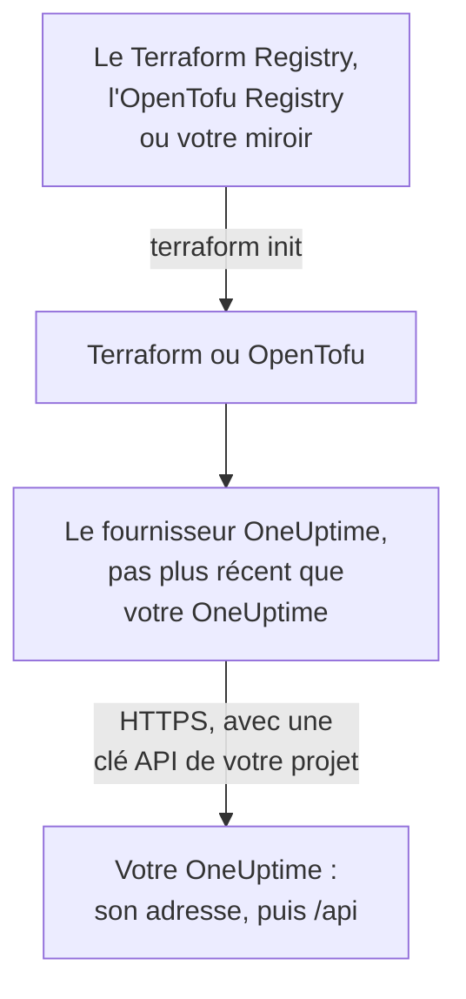

# Configuration auto-hébergée

Le fournisseur fonctionne avec votre propre OneUptime comme avec OneUptime Cloud : les mêmes ressources, les mêmes attributs et les mêmes clés API de projet. Ce qu'il vous revient de définir : l'adresse de votre OneUptime, la version du fournisseur qui lui correspond et, là où vous en avez besoin, un miroir pour les machines sans accès à internet et la confiance envers une autorité de certification privée.

:::cards
- [Pointer le fournisseur vers votre OneUptime](#pointer-le-fournisseur-vers-votre-oneuptime): Son adresse, et une clé API de votre projet.
- [Choisir la version du fournisseur](#choisir-la-version-du-fournisseur): Le fournisseur le plus récent qui n'est pas plus récent que votre OneUptime.
- [Sans accès à internet](#sans-accès-à-internet): Faites un miroir du fournisseur dans votre réseau.
- [TLS et certificats](#tls-et-certificats): Une autorité de certification privée, les proxys et le HTTP simple.
:::



## Pointer le fournisseur vers votre OneUptime

Définissez `oneuptime_url` avec l'adresse à laquelle vous ouvrez le tableau de bord : le schéma et l'hôte, sans chemin. Le fournisseur ajoute `https://` quand l'adresse n'a pas de schéma, et `/api` à la fin, si bien que `https://oneuptime.example.com` envoie chaque requête à `https://oneuptime.example.com/api`.

```hcl title="main.tf"
terraform {
  required_providers {
    oneuptime = {
      source  = "oneuptime/oneuptime"
      version = "{{TERRAFORM_PROVIDER_MATCHING}}"
    }
  }
}

provider "oneuptime" {
  oneuptime_url = "https://oneuptime.example.com"
  # The API key comes from the ONEUPTIME_API_KEY environment variable.
}
```

L'adresse peut venir plutôt de la variable d'environnement `ONEUPTIME_URL`, de sorte qu'une configuration peut pointer vers plusieurs installations :

```bash
export ONEUPTIME_URL="https://oneuptime.example.com"
export ONEUPTIME_API_KEY="<your-api-key>"
```

L'adresse est l'hôte sur lequel votre installation est servie : `HOST` et `HTTP_PROTOCOL` dans `config.env` avec Docker Compose, et `host` et `httpProtocol` dans les valeurs du chart Helm.

La clé est une clé API du projet que vous gérez, créée dans le tableau de bord de votre OneUptime sous **Paramètres du projet → Avancé → Clés API**, comme sur OneUptime Cloud. La clé API maîtresse d'un OneUptime auto-hébergé n'appartient à aucun projet, donc une création faite avec elle échoue sur `ProjectId required`.

> [!TIP]
> Votre OneUptime écrit ce bloc pour vous. Ouvrez n'importe quelle ressource ou liste dans le tableau de bord, puis **Développeurs** et **Terraform** dans son menu latéral : le bloc du fournisseur qu'il affiche contient l'adresse de votre OneUptime, et une plage de versions qui lui correspond.

## Choisir la version du fournisseur

Utilisez le fournisseur publié le plus récent qui n'est pas plus récent que votre OneUptime. Les versions du fournisseur suivent celles de OneUptime : une version de OneUptime qui modifie le fournisseur le publie sous son propre numéro de version, et un fournisseur plus récent que votre OneUptime peut envoyer des paramètres que votre OneUptime n'a pas encore.

Écrivez donc une plage qui se termine à la version de votre OneUptime, comme le fait le tableau de bord. Le bloc ci-dessus prend `{{TERRAFORM_PROVIDER_MATCHING}}`, la plage pour le OneUptime d'où vient cette documentation : quand vous la lisez sur votre propre OneUptime, cette plage est la vôtre. Sinon, écrivez votre propre version :

:::steps
### Trouver la version de votre OneUptime

Demandez-la à votre OneUptime :

```bash
curl https://oneuptime.example.com/version
```

La réponse est du JSON, comme `{"version":"{{TERRAFORM_PROVIDER_MAJOR}}.0.40","commit":"..."}`. En tant qu'administrateur principal, vous pouvez aussi ouvrir l'étiquette d'édition dans l'en-tête du tableau de bord d'administration : voir [Trouver votre version actuelle](/docs/installation/upgrading#trouvez-votre-version-actuelle).

### L'écrire dans la plage

La plage commence à la version majeure et se termine à la vôtre. Pour un OneUptime {{TERRAFORM_PROVIDER_MAJOR}}.0.40 :

```hcl title="main.tf"
terraform {
  required_providers {
    oneuptime = {
      source  = "oneuptime/oneuptime"
      version = ">= {{TERRAFORM_PROVIDER_MAJOR}}.0, <= {{TERRAFORM_PROVIDER_MAJOR}}.0.40"
    }
  }
}
```

Terraform prend le fournisseur le plus récent de la plage. Une version de OneUptime qui n'a pas modifié le fournisseur n'en publie aucun, et la plage saute les versions qui n'existent pas.

### Télécharger le fournisseur

Exécutez `terraform init`. Il affiche la version qu'il a installée et l'enregistre dans `.terraform.lock.hcl`.
:::

Lors d'une mise à jour, mettez d'abord à jour OneUptime. Montez ensuite la fin de la plage à sa nouvelle version, et exécutez `terraform init -upgrade`.

## Sans accès à internet

Quand les machines qui exécutent Terraform ne peuvent pas joindre le registre, copiez une fois le fournisseur dans votre réseau, et pointez Terraform vers la copie.

:::steps
### Faire un miroir du fournisseur

Sur une machine avec accès à internet, dans un dossier contenant votre configuration, téléchargez le fournisseur pour chaque plateforme que font tourner vos machines. Sans `-platform`, la commande ne télécharge le fournisseur que pour sa propre plateforme :

:::tabs
@tab Terraform
```bash
terraform providers mirror -platform=linux_amd64 -platform=darwin_arm64 /srv/terraform-mirror
```
@tab OpenTofu
```bash
tofu providers mirror -platform=linux_amd64 -platform=darwin_arm64 /srv/terraform-mirror
```
:::

Le dossier contient le fournisseur sous l'adresse du registre, comme `registry.terraform.io/oneuptime/oneuptime/`. Copiez-le dans votre réseau.

### Pointer Terraform vers le miroir

Écrivez un fichier de configuration de la CLI qui installe le fournisseur OneUptime depuis le dossier, et tout le reste comme d'habitude :

:::tabs
@tab Terraform
```hcl title="mirror.tfrc"
provider_installation {
  filesystem_mirror {
    path    = "/srv/terraform-mirror"
    include = ["registry.terraform.io/oneuptime/oneuptime"]
  }
  direct {
    exclude = ["registry.terraform.io/oneuptime/oneuptime"]
  }
}
```
@tab OpenTofu
```hcl title="mirror.tfrc"
provider_installation {
  filesystem_mirror {
    path    = "/srv/terraform-mirror"
    include = ["registry.opentofu.org/oneuptime/oneuptime"]
  }
  direct {
    exclude = ["registry.opentofu.org/oneuptime/oneuptime"]
  }
}
```
:::

Nommez-le dans `TF_CLI_CONFIG_FILE`, que lisent à la fois Terraform et OpenTofu : `export TF_CLI_CONFIG_FILE=/etc/terraform/mirror.tfrc`.

### Initialiser

Exécutez `terraform init` : il installe le fournisseur depuis le miroir. Il avertit que le fichier de verrouillage n'a maintenant de sommes de contrôle que pour cette plateforme. Pour les enregistrer pour chaque plateforme, exécutez `terraform providers lock` avec les mêmes options `-platform` sur la machine qui a accès à internet, et commitez `.terraform.lock.hcl` avec votre configuration.
:::

Refaites le miroir chaque fois que vous montez la plage de versions.

## TLS et certificats

Le fournisseur vérifie le certificat de votre OneUptime auprès du magasin de confiance de la machine qui exécute Terraform, et aucun paramètre ne permet de sauter la vérification. Quand le certificat vient d'une autorité de certification privée, ajoutez cette autorité au magasin de confiance de chaque machine et de chaque runner de CI qui exécute Terraform :

:::tabs
@tab Debian / Ubuntu
```bash
sudo cp my-ca.crt /usr/local/share/ca-certificates/
sudo update-ca-certificates
```
@tab RHEL / Fedora
```bash
sudo cp my-ca.crt /etc/pki/ca-trust/source/anchors/
sudo update-ca-trust
```
:::

Sous Linux, là où vous ne pouvez pas modifier le magasin de confiance, comme dans un conteneur de CI, définissez `SSL_CERT_FILE` avec un fichier qui contient votre autorité et les autorités publiques. Sous macOS et Windows, ajoutez l'autorité au magasin de certificats du système.

- **Proxys.** Le fournisseur envoie ses requêtes par le proxy de `HTTPS_PROXY`, sauf vers les hôtes de `NO_PROXY`. Un proxy inverse devant OneUptime doit laisser passer sans modification chaque chemin `/api` et l'en-tête `APIKey`.
- **HTTP simple.** Une adresse `http://` fonctionne, pour une installation de test. La clé API voyage avec chaque requête, utilisez donc HTTPS pour tout le reste.

## Dépannage

:::details Message « x509: certificate signed by unknown authority »
La machine qui exécute Terraform ne fait pas confiance au certificat de votre OneUptime : ajoutez votre autorité de certification comme le montre [TLS et certificats](#tls-et-certificats).
:::

:::details Message « invalid character '<' looking for beginning of value »
Une page web a répondu au lieu de l'API : `oneuptime_url` contient un chemin, ou un proxy a répondu. Définissez-le avec l'adresse seule de votre OneUptime.
:::

:::details Message « no available releases match the given constraints »
Aucun fournisseur publié ne correspond à la contrainte de version, par exemple une contrainte qui nomme une seule version que OneUptime n'a jamais publiée. Écrivez une plage, comme le montre [Choisir la version du fournisseur](#choisir-la-version-du-fournisseur).
:::

:::details Message « ProjectId required »
La clé est la clé API maîtresse, qui n'appartient à aucun projet. Créez une clé API du projet, sous **Paramètres du projet → Avancé → Clés API**.
:::

[Dépannage](/docs/terraform/troubleshooting) contient les autres erreurs, et ce que signifie chacune.

## Étapes suivantes

:::cards
- [Démarrage rapide](/docs/terraform/quick-start): Créez une clé API et appliquez vos premières ressources.
- [Utilisation du registre](/docs/terraform/registry): Où le fournisseur est publié, et comment les versions sont numérotées.
- [Dépannage](/docs/terraform/troubleshooting): Les erreurs courantes et comment les corriger.
- [Mise à niveau](/docs/installation/upgrading): Mettez à jour votre OneUptime, avant de monter la plage du fournisseur.
:::
