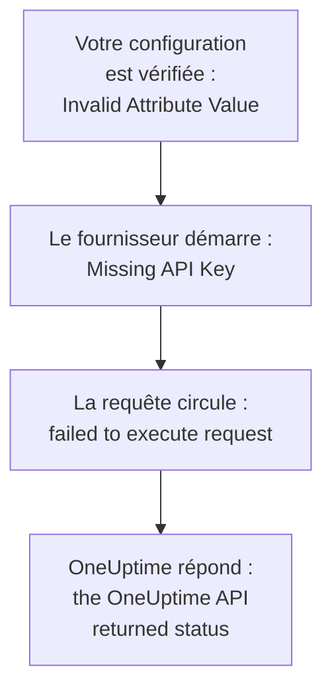

# Dépannage

Cherchez dans le tableau ci-dessous le message que Terraform a affiché, ou ce que vous avez vu se produire : chaque ligne mène à sa solution. Les sections qui suivent le tableau expliquent chaque erreur, regroupées selon leur origine.

:::cards
- [Trouver votre erreur](#trouver-votre-erreur): Chaque message et symptôme de cette page, avec sa solution.
- [Clés API, permissions et forfaits](#clés-api-permissions-et-forfaits): Quand OneUptime refuse la clé du fournisseur.
- [Des plans qui ne se stabilisent pas](#des-plans-qui-ne-se-stabilisent-pas): Des changements qui reviennent, et des ressources qui quittent l'état.
- [Se connecter à un OneUptime auto-hébergé](#se-connecter-à-un-oneuptime-auto-hébergé): L'adresse, les certificats et les proxys.
:::

## Trouver votre erreur

| Message ou symptôme | Que faire |
| --- | --- |
| `Missing API Key` | Donnez sa clé au fournisseur : voir [`Missing API Key` ou `Invalid API Key`](#missing-api-key-ou-invalid-api-key) |
| `Invalid API Key` | Recopiez la clé, ou créez-en une nouvelle : voir [`Missing API Key` ou `Invalid API Key`](#missing-api-key-ou-invalid-api-key) |
| `ProjectId required` | Utilisez une clé API du projet, pas une clé maîtresse : voir [`ProjectId required`](#projectid-required) |
| `You do not have permissions to create Monitor` | Donnez à la clé la permission que nomme le message : voir [Il manque une permission à la clé](#il-manque-une-permission-à-la-clé) |
| `API keys need the Growth plan` | Ramenez le projet au forfait Growth : voir [Paiement requis](#paiement-requis) |
| `402` pour une ressource ou un paramètre | Passez à un forfait supérieur, ou laissez le paramètre à sa valeur par défaut : voir [Paiement requis](#paiement-requis) |
| `This project has been blocked` | Demandez à un administrateur principal de débloquer le projet : voir [Un projet bloqué](#un-projet-bloqué) |
| `references records that are not in this project` | Utilisez l'ID d'un enregistrement de votre propre projet : voir [Des ID d'un autre projet](#des-id-dun-autre-projet) |
| `Not Found` ou `Ambiguous Match` venant d'une source de données | Corrigez les arguments de la recherche : voir [Des recherches qui ne trouvent rien ou en trouvent plusieurs](#des-recherches-qui-ne-trouvent-rien-ou-en-trouvent-plusieurs) |
| `Cannot import non-existent remote object` | Vérifiez l'ID et les permissions de la clé : voir [Importer des ressources](/docs/terraform/importing-resources#dépannage) |
| `Provider produced inconsistent result after apply` | Mettez à jour le fournisseur : voir [Résultat incohérent après l'apply](#résultat-incohérent-après-lapply) |
| Un plan crée une ressource que vous n'avez pas ajoutée | La clé ne peut plus la lire, et OneUptime a répondu `404` : rendez à la clé son accès en lecture, puis importez la ressource avec `terraform import` : voir [Une ressource quitte l'état, et l'apply suivant la recrée](#une-ressource-quitte-létat-et-lapply-suivant-la-recrée) |
| Une `priority` ou un `order` change après l'apply | Donnez à chacun un numéro qu'aucun autre ne détient : voir [Une priorité ou un ordre qui bouge](#une-priorité-ou-un-ordre-qui-bouge) |
| `Invalid Configuration for Read-Only Attribute` | Retirez l'attribut de la configuration : voir [Attributs en lecture seule](#attributs-en-lecture-seule) |
| `has been renamed to` | Renommez le type de ressource, avec un bloc `moved` : voir [Un type de ressource renommé](#un-type-de-ressource-renommé) |
| Un moniteur créé avec Terraform n'affiche jamais ses vérifications | Mettez à jour OneUptime : voir [Moniteurs créés avant les ID d'étapes](#moniteurs-créés-avant-les-id-détapes) |
| `must contain at least 1 elements` | Omettez l'attribut au lieu de le laisser vide : voir [Valeurs vides](#valeurs-vides) |
| Du JSON du tableau de bord dans un fichier `.tf` | Écrivez-le en HCL : voir [Le JSON du tableau de bord](#le-json-du-tableau-de-bord) |
| `no available releases match the given constraints` | Utilisez une plage de versions, pas une seule version exacte : voir [Une version jamais publiée](#une-version-jamais-publiée) |
| `x509: certificate signed by unknown authority` | Faites confiance à votre autorité de certification : voir [Certificats](#certificats) |
| `invalid character '<' looking for beginning of value` | Pointez `oneuptime_url` vers votre OneUptime lui-même : voir [Une page web au lieu de l'API](#une-page-web-au-lieu-de-lapi) |
| `connection refused` ou `Client.Timeout exceeded` | Vérifiez l'adresse, le réseau et tout proxy : voir [Des connexions qui échouent](#des-connexions-qui-échouent) |

## Lire une erreur

Une erreur nomme l'étape qui a échoué, et son message dit d'où elle vient :



- Une erreur qui survient avant toute requête, comme `Invalid Attribute Value`, concerne votre configuration : le fournisseur la vérifie avant de parler à OneUptime.
- `failed to execute request` signifie que la requête n'a jamais reçu de réponse : voir [Se connecter à un OneUptime auto-hébergé](#se-connecter-à-un-oneuptime-auto-hébergé).
- `the OneUptime API returned status` est la réponse de OneUptime : le statut et le message qui le suit disent ce que OneUptime a refusé.

Le fournisseur nomme ce qu'il faisait : `Unable to create monitor` et `Unable to update monitor` pour un changement, et `Unable to parse label response` quand il lit une ressource. Une lecture que OneUptime refuse est signalée avec le résumé `Parse Error`, mais le message qui suit est la réponse de OneUptime, pas un problème d'analyse.

## Clés API, permissions et forfaits

### `Missing API Key` ou `Invalid API Key`

`Missing API Key` arrête le fournisseur avant qu'il ne fasse la moindre requête : ni `api_key` dans le bloc du fournisseur, ni la variable d'environnement `ONEUPTIME_API_KEY` ne sont définies. Exportez la variable dans le shell où vous exécutez Terraform, ou passez la clé dans une variable marquée `sensitive`.

`Invalid API Key` est la réponse de OneUptime à une clé qu'il ne connaît pas : une clé mal tapée, expirée ou supprimée, ou une clé d'un autre OneUptime que celui vers lequel pointe `oneuptime_url`. Recopiez la clé depuis sa page sous **Paramètres du projet → Avancé → Clés API**, ou créez-en une nouvelle.

### `ProjectId required`

Le fournisseur a besoin d'une clé API du projet qu'il gère : c'est de là que vient le projet. La clé API maîtresse d'un OneUptime auto-hébergé n'appartient à aucun projet, donc chaque création faite avec elle échoue sur `ProjectId required`. Créez une clé API du projet, comme dans [Créer une clé API de projet](/docs/terraform/quick-start#créer-une-clé-api-du-projet), et utilisez-la à la place.

### Il manque une permission à la clé

`You do not have permissions to create Monitor` et les messages du même genre arrivent avec le statut `422` : la clé n'a pas le droit de faire cela avec ce type d'enregistrement. Ils nomment les permissions qui le permettraient. Ouvrez la page de la clé sous **Paramètres du projet → Avancé → Clés API** et donnez-lui l'une d'elles, ou **Administrateur du projet**. Une importation n'a besoin que de la permission de lecture.

### Paiement requis

- **402 Payment Required à chaque requête** — `API keys need the Growth plan...` : sur OneUptime Cloud, le projet est en dessous de **Growth**, et les clés API d'un projet - celle du fournisseur comprise - cessent de fonctionner en dessous. Chaque appel du fournisseur est refusé, `terraform plan` compris, jusqu'à ce que le projet revienne sur Growth ; alors la même clé fonctionne de nouveau, sans rien à changer dans votre configuration. Passez au forfait supérieur dans **Paramètres du projet → Facturation et factures → Facturation**, ou gérez le projet dans le tableau de bord en attendant. Voir [Les clés API et SCIM en dessous de leur forfait](/docs/api-reference/api-reference#clés-api-et-scim-sous-leur-offre).
- **402 Payment Required** — vous avez atteint une limite de votre forfait OneUptime, ou la configuration active un paramètre que votre forfait n'inclut pas (une page de statut privée, des rapports par e-mail, un tableau de bord public, une liste d'adresses IP autorisées...), que `terraform apply` crée la ressource avec lui ou la modifie plus tard. Terraform affiche le message de OneUptime tel quel. Passez au forfait supérieur, ou réduisez la configuration.

Remettre un tel paramètre à sa valeur par défaut, c'est-à-dire désactiver la fonction, fonctionne avec tous les forfaits, si bien qu'une configuration qui désactive des fonctions payantes s'applique après la fin d'un essai ou le passage à un forfait inférieur.

Il en va de même pour les ressources que vend votre forfait et qu'un projet conserve après être passé à un forfait inférieur - fournisseurs SSO, connexions SCIM, clés API, plannings d'astreinte, et règles et résumés Slack et Microsoft Teams : en dessous du forfait (tant que le projet reste sur Growth, dont la propre clé API du fournisseur a besoin), celles que le projet a déjà peuvent toujours être lues (donc `terraform plan` et `import` fonctionnent), supprimées (donc les retirer de la configuration, ou `terraform destroy`, s'applique) et désactivées là où elles ont un attribut `is_enabled`. Les créer, les modifier ou les réactiver répond toujours 402.

D'autres ressources que vend votre forfait, comme les modèles, les champs personnalisés et les groupes de moniteurs, ont toujours besoin du forfait pour être lues, donc un plan qui les actualise répond 402 ; elles peuvent tout de même être supprimées, par exemple avec `terraform destroy -refresh=false`.

Les permissions d'une clé API ne sont pas supprimées une par une en dessous de Growth, puisque supprimer une permission de blocage donnerait plus d'accès à la clé : exécutez `terraform state rm` sur les ressources de permission, puis détruisez la clé, et ses permissions partent avec elle.

### Un projet bloqué

`This project has been blocked. Please contact your administrator.` arrive avec le statut `403` : un administrateur principal a bloqué le projet, et tant qu'il ne l'a pas débloqué, personne d'autre qu'un administrateur principal n'y agit, pas même les clés API du projet.

## Enregistrements et recherches

### Des ID d'un autre projet

Chaque ID qu'une ressource nomme - les étiquettes d'un moniteur, la page de statut d'un groupe de page de statut, le site d'un équipement réseau, les équipes d'une règle d'escalade - doit être un enregistrement du projet auquel appartient votre clé API. L'ID d'un enregistrement d'un autre projet, un ID qui n'existe pas et l'ID d'un enregistrement que la clé ne peut pas lire reçoivent tous la même réponse, qui nomme le champ et l'ID :

```text
This network device references records that are not in this project: Network Site "…". Please pick values from this project and try again.
```

Cela signifie généralement qu'un ID a été copié depuis la configuration ou l'état d'un autre projet, ou que l'enregistrement a été supprimé en dehors de Terraform. Faites référence à l'enregistrement par sa ressource ou une source de données de la même configuration (`oneuptime_label.critical.id`) plutôt que par un ID littéral, et appliquez de nouveau. Une personne nommée comme utilisateur doit être membre du projet.

### Des recherches qui ne trouvent rien ou en trouvent plusieurs

Une source de données trouve exactement un enregistrement, ou arrête le plan. `Not Found` indique qu'aucun enregistrement n'a l'`id`, ou qu'aucun ne correspond aux arguments que vous avez définis ; `Ambiguous Match` indique que plusieurs correspondent. Corrigez les arguments, définissez-en davantage pour réduire la recherche à un seul, ou cherchez l'enregistrement par son `id`. [Lire ce qui existe déjà](/docs/terraform/complete-guide#lire-ce-qui-existe-déjà) en donne les règles.

## Des plans qui ne se stabilisent pas

### Résultat incohérent après l'apply

`Provider produced inconsistent result after apply` signifie que le fournisseur a renvoyé d'autres valeurs que celles qu'il avait planifiées. Les anciens fournisseurs le faisaient avec des valeurs que le serveur calcule : les valeurs par défaut que le serveur ajoute dans `monitor_steps`, des horodatages que le serveur écrivait autrement, des valeurs enveloppées comme `probe_version`, et des attributs que le serveur tient à jour, comme le moment où un moniteur de requêtes entrantes a reçu son dernier battement. Ils lisaient aussi un nombre décimal comme null quand l'API l'envoyait sous forme de texte, si bien que chaque apply d'une règle de couleur de barre de page de statut échouait sur `uptime_percent_greater_than_or_equal_to`. Les fournisseurs actuels gèrent tout cela : les horodatages sont comparés comme des instants, les listes d'étiquettes sont des ensembles, les nombres sont relus tels que vous les avez écrits, et un attribut que vous n'avez pas défini garde sa valeur planifiée jusqu'à ce que la prochaine actualisation lise celle du serveur.

:::steps
1. Mettez à jour le fournisseur : gardez `version = "{{TERRAFORM_PROVIDER_VERSION}}"` dans l'exigence du fournisseur, et exécutez `terraform init -upgrade`.
2. Appliquez de nouveau. Une ressource que l'apply en échec a marquée comme tainted est remplacée une fois, et les plans sont vides ensuite. Pour garder plutôt la ressource telle quelle, retirez d'abord la marque par son adresse : `terraform untaint oneuptime_status_page_history_chart_bar_color.operational`.
:::

Si un fournisseur actuel échoue encore ainsi, signalez-le sur [github.com/OneUptime/oneuptime/issues](https://github.com/OneUptime/oneuptime/issues), avec la version du fournisseur, le type de ressource, le plus petit bloc `resource` qui échoue, et l'erreur entière. L'erreur nomme l'attribut dont la valeur a changé, ce qui est la chose la plus utile à envoyer.

### Une ressource quitte l'état, et l'apply suivant la recrée

Une lecture par ID répond `404` aussi bien pour un enregistrement qui n'existe pas que pour un enregistrement que la clé API ne peut pas lire : l'API ne dit rien d'un enregistrement qu'elle ne vous montre pas. Terraform prend un `404` lors de l'actualisation pour une ressource supprimée en dehors de Terraform. Il la retire de l'état, et le `terraform apply` suivant la recrée, à côté de celle qui est toujours là.

Cela arrive quand la clé qui gère une ressource ne peut plus la lire : sa permission de lecture a été limitée à des étiquettes que la ressource ne porte pas, ou aux ressources que possèdent ses équipes, ou un blocage lui retire la ressource - ou les étiquettes ou les propriétaires de la ressource ont changé.

**Avant de planifier :**

- Donnez à la clé, pour chaque type de ressource qu'elle gère, une permission de lecture qui atteint chaque ressource qu'elle gère : avec la portée **Tous**, ou limitée aux étiquettes que portent ces ressources. Les permissions de mise à jour et de suppression d'une clé n'atteignent que ce qu'elle peut lire.
- Lisez le plan avant de l'appliquer : une ressource prévue pour être créée que vous n'avez pas ajoutée est une ressource que la clé ne peut plus lire.

**Quand l'état a déjà perdu une ressource :** rendez à la clé son accès en lecture, puis [importez](/docs/terraform/importing-resources) la ressource au lieu d'appliquer, afin que Terraform adopte celle qui existe plutôt que d'en créer une seconde. Si une copie a déjà été créée, supprimez celle que vous ne voulez pas.

### Une priorité ou un ordre qui bouge

Les statuts de moniteur, les états et gravités d'incidents et d'alertes, et les autres listes que vous ordonnez dans le tableau de bord ne détiennent chaque numéro qu'une fois. Un numéro qu'aucun autre ne détient est conservé tel qu'écrit. Un numéro qu'un autre détient déjà est repris, et ceux qui se trouvent sur le chemin descendent d'un rang, comme le fait un glisser-déposer dans le tableau de bord. Ainsi, deux d'entre eux configurés avec le même numéro échangent leurs places à chaque apply.

Donnez à chacun son propre numéro avec des écarts entre eux, comme `101`, `102` et `103`, et réordonnez ceux que gère Terraform dans Terraform, pas en les faisant glisser dans le tableau de bord.

### Attributs en lecture seule

`Invalid Configuration for Read-Only Attribute` arrête le plan quand une configuration définit un attribut que seul OneUptime écrit. Qui a créé un enregistrement, et qui l'a archivé, résolu ou pris en compte, est enregistré à partir de la requête : la personne connectée, et personne pour une requête faite avec une clé API, ce qui est la façon dont Terraform se connecte. Ainsi `created_by_user_id`, et tout autre attribut se terminant par `_by_user_id`, peut être lu depuis une ressource ou une source de données, mais pas défini. Il en va de même pour `archived_at` : définir `is_archived` enregistre le moment où la ressource a été archivée, et l'appliquer de nouveau sans changement conserve ce moment. Retirez l'attribut du bloc de ressource ; rien d'autre ne change dans la ressource.

### Un type de ressource renommé

`has been renamed to` avertit qu'un type de ressource porte un nouveau nom. Les types de ressource gardent désormais entiers des mots comme IoT et vCenter : `oneuptime_iot_fleet` et `oneuptime_vcenter`, là où les anciens fournisseurs les coupaient (`oneuptime_io_t_fleet`, `oneuptime_v_center`). Les anciens noms continuent de fonctionner comme alias obsolètes. Pour basculer sans rien remplacer, renommez la ressource dans votre configuration et indiquez à Terraform qu'elle a été déplacée :

```hcl
resource "oneuptime_iot_fleet" "factory" {
  name = "Factory floor"
}

moved {
  from = oneuptime_io_t_fleet.factory
  to   = oneuptime_iot_fleet.factory
}
```

`terraform plan` montre alors le déplacement et aucun autre changement. Déplacer entre types de ressource nécessite Terraform 1.8 ou ultérieur, ou OpenTofu 1.12 ou ultérieur ; avec une version plus ancienne, gardez l'ancien nom, qui continue de fonctionner. Les sources de données ont été renommées de la même façon : changez le nom, et rien d'autre.

### Moniteurs créés avant les ID d'étapes

Les ID à l'intérieur des étapes d'un moniteur - de chaque étape, critère, et modèle d'incident et d'alerte - sont attribués par le serveur. Les anciennes versions de OneUptime ne donnaient d'ID qu'aux critères, et un nouveau jeu à chaque écriture, si bien qu'un moniteur écrit par l'API, comme l'était chaque moniteur créé par le fournisseur, était enregistré avec une étape sans ID. Ses sondes le vérifiaient toujours et son statut changeait toujours, mais la page du moniteur ne trouvait pas ses vérifications, ses incidents ne pouvaient pas se résoudre d'eux-mêmes, et chaque `terraform apply` qui modifiait `monitor_steps` détachait les incidents ouverts de leurs critères.

Le OneUptime actuel donne à chacun d'eux un ID à la création, les conserve à chaque apply, et complète ceux qui manquent sur les moniteurs existants lors de la mise à jour. Rien ne change dans votre configuration : il n'y a toujours aucun ID à écrire. Un incident que l'ancien comportement a laissé ouvert se ferme au prochain rétablissement du moniteur, tant que le critère qui l'a ouvert est toujours là ; un incident dont un apply précédent a remplacé le critère doit être résolu une fois à la main.

## Configuration que le fournisseur refuse

### Valeurs vides

Le fournisseur refuse une liste, une map ou un texte vides dans `monitor_steps` et ses parties, comme `monitor_steps = []`, `request_headers = {}` ou `request_body = ""` :

```text
Attribute monitor_steps list must contain at least 1 elements, got: 0
```

Omettez plutôt l'attribut : un attribut absent n'est pas défini. [Étapes du moniteur](/docs/terraform/monitor-steps) indique ce que prend chaque partie.

### Le JSON du tableau de bord

Le JSON que le tableau de bord et l'API affichent pour une ressource est ce qu'envoie l'API, pas une configuration Terraform : dans Terraform, les noms d'attributs sont en snake_case, les valeurs s'écrivent autrement, et de nombreux champs appartiennent au serveur. Collé dans un fichier `.tf`, il ne fonctionne pas.

- Pour adopter la ressource, [importez-la](/docs/terraform/importing-resources) : la page **Terraform** du tableau de bord écrit la configuration pour vous.
- Pour en écrire une nouvelle, partez des [Exemples](/docs/terraform/examples).
- Pour les étapes d'un moniteur, écrivez l'attribut typé `monitor_steps` que décrit [Étapes du moniteur](/docs/terraform/monitor-steps) : retirez les enveloppes `{_type, value}`, écrivez les clés camelCase en snake_case, et omettez chaque `id`.

## Versions et registre

### Une version jamais publiée

`no available releases match the given constraints` signifie qu'aucune version publiée ne correspond à la contrainte de version. Toutes les versions de OneUptime ne publient pas de fournisseur : une version dont le fournisseur n'a pas changé n'en publie aucun, donc une contrainte qui nomme une seule version exacte peut nommer une version qui n'existe pas. Utilisez plutôt une plage :

```hcl
terraform {
  required_providers {
    oneuptime = {
      source  = "oneuptime/oneuptime"
      version = "{{TERRAFORM_PROVIDER_VERSION}}"
    }
  }
}
```

Sur un OneUptime auto-hébergé, plafonnez la plage à la version de votre OneUptime, comme le montre [Configuration auto-hébergée](/docs/terraform/self-hosted#choisir-la-version-du-fournisseur). [Utilisation du registre](/docs/terraform/registry#comment-les-versions-sont-numérotées) explique comment les versions sont numérotées.

## Se connecter à un OneUptime auto-hébergé

### Certificats

`x509: certificate signed by unknown authority` signifie que la machine qui exécute Terraform ne fait pas confiance au certificat que présente votre OneUptime, généralement un certificat d'une autorité de certification privée. Le fournisseur le vérifie auprès du magasin de confiance de cette machine. Ajoutez-y votre autorité de certification, sur chaque machine et chaque runner de CI qui exécute Terraform : voir [TLS et certificats](/docs/terraform/self-hosted#tls-et-certificats). Aucun paramètre ne permet de sauter la vérification.

### Une page web au lieu de l'API

`invalid character '<' looking for beginning of value` signifie qu'une page web a répondu là où le fournisseur attendait l'API : `oneuptime_url` a un chemin après l'hôte, comme `/dashboard`, ou un proxy devant OneUptime a répondu à la place. Définissez `oneuptime_url` avec l'adresse seule de votre OneUptime, comme `https://oneuptime.example.com` : le fournisseur ajoute `/api` lui-même.

### Des connexions qui échouent

`failed to execute request` avec `connection refused`, `no such host` ou `Client.Timeout exceeded` signifie qu'aucune réponse n'est revenue. Vérifiez que l'adresse et le port sont corrects et joignables depuis l'endroit où Terraform s'exécute, et définissez `HTTPS_PROXY` si la machine accède à internet par un proxy. Le fournisseur attend jusqu'à 60 secondes chaque réponse. Il retente une lecture ou une suppression jusqu'à trois fois quand aucune réponse n'arrive, ou que la réponse est `429`, `502`, `503` ou `504`, mais jamais une création ou une modification : après l'échec d'une création de cette façon, regardez dans le tableau de bord avant d'appliquer de nouveau, au cas où elle aurait été faite.

## Obtenir plus de détails

Le fournisseur écrit ses avertissements dans le journal de Terraform. Exécutez la commande avec `TF_LOG_PROVIDER=WARN` pour les voir, et avec `TF_LOG_PATH` pour les garder dans un fichier :

```bash
TF_LOG_PROVIDER=WARN TF_LOG_PATH=terraform.log terraform plan
```

`OneUptime rejected a column in the select; dropping it and retrying` nomme une colonne que OneUptime n'a pas voulu envoyer à la clé du fournisseur, généralement faute d'une permission. Cet attribut reste vide dans l'état, il peut donc apparaître comme un changement à chaque plan.

## Toujours bloqué ?

Ouvrez un ticket sur [github.com/OneUptime/oneuptime/issues](https://github.com/OneUptime/oneuptime/issues) avec la version du fournisseur (`terraform version` l'affiche après `init`), le bloc de ressource et l'erreur entière. Le fournisseur est généré à partir du code de OneUptime, ses tickets sont donc suivis dans le dépôt principal.

## Étapes suivantes

:::cards
- [Importer des ressources](/docs/terraform/importing-resources): Adoptez ce que vous avez créé dans le tableau de bord, et corrigez les erreurs d'importation.
- [Configuration auto-hébergée](/docs/terraform/self-hosted): L'adresse, la version et les certificats de votre propre OneUptime.
- [Guide complet](/docs/terraform/complete-guide): L'authentification, les sources de données, l'état et les mises à jour.
- [Étapes du moniteur](/docs/terraform/monitor-steps): Chaque attribut des vérifications d'un moniteur.
:::
