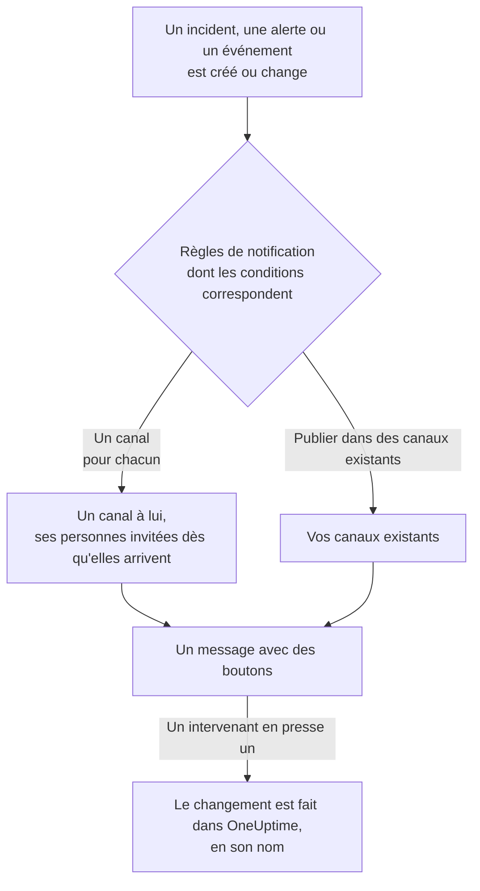

# Slack

Connectez OneUptime à Slack pour publier dans vos canaux les incidents, alertes, épisodes, maintenances planifiées, moniteurs et mises à jour d'astreinte, donner à chaque incident un canal à lui et laisser les intervenants agir sans quitter Slack : prendre en compte, résoudre, ajouter des notes, alerter l'astreinte et déclarer des incidents.

:::cards
- [Connecter Slack](#connecter-slack): Installez OneUptime dans votre espace de travail, puis associez votre propre compte.
- [Demander à chacun de connecter son compte](#demander-à-chacun-de-connecter-son-compte): Écrivez en une seule fois à tous les membres qui n'ont pas encore connecté leur compte.
- [Règles de notification](#règles-de-notification): Décidez quels événements sont publiés où, et lesquels ont un canal à eux.
- [Qui est dans le canal d'un enregistrement](#qui-est-dans-le-canal-dun-enregistrement): Voyez qui s'y trouve, rejoignez-le et ajoutez des personnes, depuis la page de l'enregistrement.
- [La commande /oneuptime](#la-commande-oneuptime): Déclarez des incidents, planifiez des maintenances, voyez qui est d'astreinte et interrogez l'IA.
- [Groupes d'utilisateurs d'astreinte](#groupes-dutilisateurs-dastreinte): Alignez un groupe d'utilisateurs sur les personnes d'astreinte, et alertez-le.
- [Agir sur les incidents, alertes et événements depuis Slack](#agir-sur-les-incidents-alertes-et-événements-depuis-slack): Les boutons des messages de OneUptime.
:::

## Fonctionnement

Deux connexions rendent cela possible :

- **La connexion du projet**, faite une fois : l'application de OneUptime installée dans votre espace de travail Slack. Elle publie les messages, crée les canaux et invite les personnes.
- **La connexion propre à chaque personne** : son compte Slack associé à son compte OneUptime. Les boutons, les commandes et les réactions emoji agissent au nom de cette personne, avec ses autorisations dans le projet.

Un espace de travail Slack peut être connecté à plus d'un projet, par exemple la production et la préproduction. Un bouton ou un formulaire agit dans le projet de l'enregistrement qu'il concerne. Une commande ou un message à OneUptime agit dans le projet du canal où il est écrit, par exemple le canal d'un incident, ou sinon dans le seul projet où votre compte Slack est connecté. Quand rien ne permet de le savoir, OneUptime vous demande de quel projet il s'agit, avec un bouton pour chaque projet dont vous faites partie, et continue dans celui que vous choisissez. Dans une conversation avec OneUptime AI, votre choix vaut pour le reste du fil.

## Avant de commencer

- **Un rôle qui peut connecter le projet :** **Propriétaire du projet**, **Administrateur du projet** ou **Membre du projet**. Désinstaller l'application demande **Propriétaire du projet** ou **Administrateur du projet**.
- **Un espace de travail Slack** où vous pouvez installer des applications.
- **Le plan Growth sur OneUptime Cloud** pour les règles de notification et les résumés. Voir [Règles de notification sous le plan Growth](#règles-de-notification-sous-le-plan-growth).
- **Sur un serveur auto-hébergé,** une application Slack configurée pour lui au préalable. Voir [Intégration Slack](/docs/self-hosted/slack-integration).

## Connecter Slack

:::steps
### Installer OneUptime dans votre espace de travail Slack

Allez dans **Paramètres du projet** > **Espace de travail** > **Slack** et cliquez sur **Se connecter avec Slack**. Choisissez l'espace de travail et autorisez OneUptime. Slack vous renvoie sur la même page, qui nomme maintenant l'espace de travail auquel le projet est connecté. Tant qu'aucun espace de travail n'est connecté, la section **Espace de travail** des menus Incidents, Alertes, Maintenance planifiée, Moniteurs et Astreinte contient **Connecter Slack ou Teams**, qui mène aussi ici.

### Connecter votre propre compte Slack

Installer l'application associe le compte de la personne qui l'a installée. Tous les autres associent leur propre compte Slack dans **Paramètres utilisateur** > **Espace de travail** > **Slack** avec **Connect my account with Slack**, pour agir sur les incidents et recevoir des messages directs en leur nom. Cette section apparaît dès que le projet est connecté à Slack. Pour faire venir toute une équipe d'un coup, voir [Demander à chacun de connecter son compte](#demander-à-chacun-de-connecter-son-compte).

### Ajouter une règle de notification

Allez dans **Incidents** > **Espace de travail** > **Slack**. La section **Espace de travail** ne liste que les espaces de discussion que votre projet a connectés, donc **Slack** y apparaît dès qu'il est connecté. Créez une règle, par exemple une qui crée un canal Slack pour chaque nouvel incident avec tous ceux qui y travaillent : les personnes appelées, le responsable d'incident et les propriétaires. Voir [Règles de notification](#règles-de-notification).

### Tester la règle

Cliquez sur **Tester la règle** sur la ligne de la règle. Un message de test arrive dans les canaux que la règle nomme. Voir [Tester une règle](#tester-une-règle).
:::

## Demander à chacun de connecter son compte

Personne ne peut connecter le compte Slack de quelqu'un d'autre, pas même un administrateur : chacun se connecte avec son propre compte. Pour faire venir toute une équipe, un **Propriétaire du projet** ou un **Administrateur du projet** demande à tout le monde à la fois de connecter son compte, dans **Paramètres du projet** > **Espace de travail** > **Slack**. La carte **Members' Slack accounts** indique combien de membres ont connecté leur compte. **Ask everyone to connect** envoie à chaque membre qui ne l'a pas encore fait un message direct de OneUptime dans Slack, avec un bouton **Connect Slack account** qui connecte son compte en un clic.

- **Qui reçoit un message.** Chaque membre du projet qui n'a pas connecté son compte Slack, retrouvé dans Slack par son adresse e-mail. Quiconque a été sollicité dans les dernières 24 heures ne l'est pas de nouveau : redemander le lendemain ne relance donc que les personnes qui n'ont toujours pas connecté leur compte.
- **Ce que dit la carte.** Où en sont les messages pendant leur envoi, puis qui a fait la demande et combien de membres ont reçu un message. Les membres que OneUptime n'a pas trouvés dans Slack par leur adresse e-mail sont nommés sur la carte : ils connectent eux-mêmes leur compte dans **Paramètres utilisateur** > **Espace de travail** > **Slack**.
- **Ce que connecte le bouton.** Le compte Slack de la personne qui le presse et se connecte, à son propre compte OneUptime. Transmis à quelqu'un d'autre, le message ne connecte rien au membre à qui il était destiné.

## Règles de notification

Une règle de notification dit quels événements sont publiés dans Slack, et où. Chaque produit a ses propres règles, sous **Espace de travail** > **Slack** dans son menu :

| Produit | Onglets de sa page **Slack** |
| --- | --- |
| **Incidents** | **Incidents**, **Épisodes d'incident**, **Résumé** |
| **Alertes** | **Alertes**, **Épisodes d'alerte**, **Résumé** |
| **Maintenance planifiée** | Une liste de règles |
| **Moniteurs** | Une liste de règles |
| **Astreinte** | Une liste de règles |

Créer une règle passe par quatre étapes :

| Étape | Ce que vous définissez |
| --- | --- |
| **Basique** | **Nom de la règle** et **Description de la règle**. |
| **Conditions** | Pour quels événements est la règle, par exemple selon la gravité, l'état, l'étiquette, le moniteur ou des mots du titre. Elles sont vérifiées à la création d'un événement, puis à chaque mise à jour que OneUptime publie à son sujet : une règle pour les incidents pris en compte agit donc quand un incident est pris en compte. Une nouvelle règle est pour chaque événement, par exemple **Tous les incidents**. Pour la restreindre, choisissez **Uniquement les incidents qui correspondent aux conditions** et ajoutez les conditions. Avec deux ou plus, **Condition de correspondance** dit si toutes doivent correspondre, ou une seule. |
| **Destination** | Où elle publie : **Publier dans des canaux existants** avec les noms des canaux, **Créer un canal pour chaque incident** (ou alerte, épisode, événement, moniteur ou politique d'astreinte) avec qui le rejoint, ou les deux. Sous l'étape, **Ce que fait cette règle** le dit en phrases, comme la carte de la règle. |
| **Appel vidéo** | Incidents et alertes uniquement : lancer un appel pour chacun. Voir [Appels vidéo](/docs/workspace-connections/video-calls). |

Un canal que la règle crée porte le nom de son enregistrement : l'incident INC-42 reçoit `inc-42`, l'alerte ALT-7 reçoit `alt-7`, et dans un projet sans préfixes de numéro, l'incident 42 reçoit `incident-42`. Le texte de **Préfixe du nom de canal** se place devant, donc `prod-` donne `prod-inc-42`, et le formulaire montre le nom pendant que vous tapez. Pour un événement de maintenance planifiée, le préfixe remplace son préfixe de numéro : SM-5 reçoit `sm-5`, et `maint-` donne `maint-5`. Slack accepte les lettres minuscules, les chiffres, `-` et `_`, jusqu'à 80 caractères. Si un canal porte déjà ce nom, par exemple celui d'un autre projet ou un canal archivé, OneUptime ajoute `-2`, `-3` et ainsi de suite.

Une règle crée son canal la première fois qu'un événement lui correspond : à la création de l'événement, ou plus tard, quand une mise à jour le fait correspondre alors qu'il est encore ouvert. Une règle pour les incidents pris en compte crée le canal quand l'incident est pris en compte. Un incident, une alerte ou un épisode privé reçoit un canal privé.

**Qui rejoint le canal** liste qui la règle ajoute à son canal, chacun dès qu'il rejoint l'enregistrement, pas seulement à la création du canal : **Intervenants d'astreinte, dès qu'ils sont appelés**, **Responsable d'incident et autres rôles d'incident, dès qu'ils sont attribués** (incidents et épisodes d'incident) et **Propriétaires, dès qu'ils sont ajoutés**, tous cochés pour une nouvelle règle, et les personnes, équipes et plannings d'astreinte de **Inviter aussi** à la création du canal. Le responsable d'incident est généralement attribué quand quelqu'un prend en compte l'incident pour la première fois, et rejoint son canal à ce moment-là. Une règle enregistrée avant que les rôles d'incident aient leur propre case les ajoute quand elle ajoute les propriétaires ou les intervenants d'astreinte, et sa case s'affiche cochée. Un canal existant dans lequel une règle publie ne reçoit personne.

Pour un planning d'astreinte de **Inviter aussi**, les personnes d'astreinte dans ce planning à la création du canal le rejoignent, telles que la page du planning les affiche, et ne sont pas alertées. Pour n'ajouter des personnes qu'aux canaux de certains incidents, donnez à une deuxième règle ces conditions et ces personnes, avec le même **Préfixe du nom de canal** que la première : les règles auxquelles un incident correspond à la création de son canal partagent ce canal, et chacune y ajoute ses propres personnes.

Chaque mise à jour ultérieure de l'enregistrement — un changement d'état, une note, un nouveau propriétaire — est publiée dans ses canaux, et dans les canaux existants que ses règles nomment tant que leurs conditions correspondent. Avec **Archiver le canal quand l'incident est résolu** activé, ou son équivalent pour les alertes, épisodes, événements, moniteurs et politiques d'astreinte, la règle qui a créé un canal l'archive quand l'enregistrement est résolu, terminé ou supprimé, quoi que disent alors ses conditions. Un incident, une alerte ou un épisode créé déjà résolu ne reçoit pas de canal à lui ; son message de création va quand même dans les canaux que vos règles nomment. Voir [Déclaré déjà pris en compte ou résolu](/docs/incidents/declaring-incidents#déclaré-déjà-pris-en-compte-ou-résolu).

Un incident, une alerte, un épisode ou un événement de maintenance planifiée qui a son propre canal affiche **Ouvrir dans Slack** dans l'en-tête de sa page dans OneUptime, à côté de ses boutons d'état. Ce bouton ouvre ce canal dans un nouvel onglet, dans l'application Slack ou dans le navigateur. Un enregistrement qui a deux canaux à lui les liste tous les deux sous le bouton. Un enregistrement qui a des canaux à la fois dans Slack et dans Microsoft Teams a à la place un seul bouton **Ouvrir le canal**, qui les liste tous. Les canaux existants où vos règles publient ne sont pas proposés.

Un canal reste lisible : chaque événement est publié une seule fois, et le premier état d'un enregistrement figure dans le message qui annonce l'enregistrement, pas dans un message à part. Une exécution d'une politique d'astreinte est un seul message, modifié au fil de l'escalade : qui a été alerté, combien de fois et comment, qui ne l'a pas été et pourquoi, et qui l'a pris en compte. Un nouveau message n'est publié que lorsque quelqu'un doit agir : une règle d'escalade n'a atteint personne, ou l'exécution s'est terminée sans que personne ne le prenne en compte. Une personne dont le compte Slack n'est pas connecté à OneUptime est ajoutée par le compte Slack associé à son adresse e-mail. Une personne que OneUptime ne trouve d'aucune de ces deux façons, ou qui a un compte invité dans Slack, ne peut pas être ajoutée à un canal ; OneUptime le dit une fois par canal, dans un seul message qui les nomme toutes et qui est modifié quand la liste s'allonge. Envoyez-leur le lien **Connect Slack account** de ce message pour qu'elles connectent leur compte en une étape. Le fait que les propriétaires de l'enregistrement ou les abonnés de la page de statut ont été prévenus reste dans son fil d'activité dans OneUptime.

**Paramètres du projet** > **Espace de travail** > **Slack** liste les canaux que OneUptime voit, avec **Envoyer le test** à côté de chacun. OneUptime rejoint de lui-même un canal public la première fois qu'il y publie. Un canal privé n'est listé, et ne peut recevoir de publication, qu'après que l'application OneUptime y a été invitée dans Slack.

## Qui est dans le canal d'un enregistrement

Un incident, une alerte, un épisode ou un événement de maintenance planifiée qui a son propre canal Slack affiche une carte **Canal Slack** sur sa page dans OneUptime. La carte montre le canal, sous la forme d'un lien qui l'ouvre dans Slack, s'il est privé, et qui s'y trouve, vous en premier. Depuis la carte, sans administrateur Slack :

- **Rejoindre le canal** vous ajoute, quand vous n'êtes pas dans le canal.
- **Ajouter des personnes** ouvre une liste des personnes et des équipes du projet : choisissez une personne pour l'ajouter, ou une équipe pour ajouter tous ses membres.

L'application OneUptime les ajoute, comme elle ajoute les personnes du canal d'une règle. L'application reste dans les canaux qu'elle crée : cela fonctionne donc aussi pour un canal privé que tout le monde a quitté.

- **Qui peut ajouter des personnes.** Quiconque peut modifier l'enregistrement : **Propriétaire du projet**, **Administrateur du projet**, **Membre du projet**, **Administrateur des incidents** et **Membre des incidents** pour un incident, ou **Edit Incident** dans un rôle personnalisé, et la même autorisation pour une alerte, un épisode ou un événement (**Edit Alert**, par exemple). Les autres voient qui est dans le canal, et comment y entrer.
- **Qui peut être ajouté.** Une personne que OneUptime trouve dans Slack : par le compte Slack qu'elle a connecté, ou sinon par l'adresse e-mail que Slack a pour elle. La carte nomme les personnes qu'elle n'a pas pu ajouter, et pourquoi, comme un invité que Slack tient à l'écart du canal.
- **Ce qui est consigné.** Qui a été ajouté, et par qui, dans le fil d'activité de l'enregistrement (**Membre ajouté au canal**) et dans **Paramètres du projet** > **Notifications** > **Journaux de notification**, sur l'onglet **Espace de travail**.
- **Retirer quelqu'un.** OneUptime ne fait qu'ajouter : retirez quelqu'un du canal dans Slack.

## Tester une règle

**Tester la règle** sur la ligne d'une règle publie un message de test pour cette règle dans les canaux qu'elle nomme, pour que vous le voyiez arriver. Si la règle crée un canal pour chaque événement, le test en crée un aussi et y invite les personnes de la règle.

Comme **Envoyer le test** à côté d'un canal dans **Paramètres du projet** > **Espace de travail** > **Slack**, il demande l'autorisation de créer des règles de notification : **Propriétaire du projet**, **Administrateur du projet**, **Membre du projet**, **Administrateur des paramètres**, **Membre des paramètres**, ou **Create Workspace Notification Rule** et **Read Workspace Notification Rule** dans un rôle personnalisé. Pour quelqu'un qui peut seulement voir les règles, comme un **Lecteur**, **Tester la règle** est verrouillé, et son info-bulle dit ce qu'il faut ; l'API refuse son test avec "You do not have permission to send test notifications in this project." Sur OneUptime Cloud, tester une règle demande le plan **Growth**, comme en ajouter une.

Sur OneUptime Cloud, **Envoyer le test** à côté d'un canal demande aussi le plan **Growth**, car publier dans un canal est ce que font les règles et les résumés. **Envoyer un test maintenant** sur un résumé demande l'autorisation de créer des résumés (**Create Workspace Notification Summary** et **Read Workspace Notification Summary** dans un rôle personnalisé) et, sur OneUptime Cloud, le plan **Growth** ; pour tous les autres, il est verrouillé, et son info-bulle dit ce qu'il faut. Un client MCP connecté en lecture seule ne peut envoyer aucun test.

## Résumés

L'onglet **Résumé** de **Incidents** > **Espace de travail** > **Slack** (et des **Alertes**) publie un récapitulatif récurrent dans les canaux que vous nommez : combien d'incidents ou d'alertes il y a eu, à quelle vitesse ils ont été pris en compte et résolus, et une liste avec des liens. Un nouveau résumé part chaque semaine et couvre les 7 derniers jours. Laissez **Envoyer le premier rapport à** vide, et le premier part à 09:00 au début de la semaine, du jour ou du mois suivant ; le formulaire dit quand.

Un résumé part à l'heure de son **Fuseau horaire**, qui commence sur le vôtre. Il y garde son heure toute l'année : un résumé réglé sur 09:00 à Berlin part toujours à 09:00 à Berlin après le changement d'heure, et les dates de son message sont aussi celles de Berlin. Par l'API, envoyez `timezone` sous la forme d'un nom de fuseau horaire IANA, par exemple `Europe/Berlin`. Un résumé créé sans fuseau prend celui du profil de la personne qui l'a créé, ou UTC lorsqu'une clé d'API le crée.

Le formulaire d'un résumé a quatre étapes : **Informations de base** (son nom et les canaux), **Planification**, **Contenu** (**Quoi inclure**) et **Filtres** (quels incidents ou alertes il compte).

## Règles de notification sous le plan Growth

Sur OneUptime Cloud, les règles de notification et les résumés font partie du plan **Growth** et au-delà. Un projet en dessous garde les règles et les résumés qu'il a déjà, et ils continuent de publier dans Slack. Ainsi, la page **Slack** de chaque produit (Incidents, Alertes, Maintenance planifiée, Astreinte, Moniteurs) affiche la note de plan avec eux en dessous (**Règles de notification encore configurées**, **Résumés encore configurés**) : supprimez une règle, ou désactivez ou supprimez un résumé. Ajouter ou modifier des règles et des résumés demande **Growth**.

## Être alerté dans Slack

Pour être alerté par message direct quand vous êtes d'astreinte, ajoutez Slack parmi vos méthodes de notification :

:::steps
1. Connectez votre propre compte Slack (voir [Connecter Slack](#connecter-slack)).
2. Allez dans **Paramètres utilisateur** > **Méthodes de notification**, ouvrez l'onglet **Workspace Apps** et cliquez sur **Ajouter un compte Slack**.
3. Cliquez sur **Send Test Message** sur sa ligne. Le message arrive dans vos messages directs Slack.
:::

L'ajouter l'ajoute aussitôt à vos règles d'astreinte, si bien que les alertes vous atteignent dans Slack dès lors. Changez les alertes qu'il reçoit dans **Paramètres utilisateur** > **Règles d'astreinte**.

## Enregistrer des messages comme notes

Réagissez à un message dans le canal d'un incident, d'une alerte, d'un épisode ou d'un événement de maintenance planifiée, et OneUptime l'enregistre comme note sur cet enregistrement, puis le confirme par une réponse dans le fil :

| Réaction | Enregistré comme |
| --- | --- |
| 📌 Un emoji épingle, ou le propre **Pin to channel** de Slack | Une note privée, visible seulement par votre équipe |
| 📢 Un emoji mégaphone ou haut-parleur | Une note publique, affichée sur la page de statut. Incidents et événements de maintenance planifiée uniquement. Sur un incident privé, une note privée, et la confirmation dit pourquoi. |

La note reprend le message tel que Slack l'affichait : sa mise en forme, ses liens et son code, les personnes et les canaux qu'il mentionne par leur nom, et ses fichiers et images sous forme de liens. Une note publique laisse de côté les fichiers et les images, puisqu'ils ne s'ouvrent que pour votre équipe.

Ce sont les mots de la personne qui a écrit le message : son nom dans OneUptime quand son compte Slack est connecté, sinon le nom qu'affiche Slack. Une note privée est placée dans la chronologie au moment où le message a été publié, même si elle est enregistrée bien plus tard. Une note publique est placée au moment où elle est enregistrée, c'est-à-dire quand la page de statut l'affiche. La chronologie indique qui l'a enregistrée. La note n'est pas republiée dans le canal, où le message se trouve déjà.

La note est enregistrée en votre nom, avec vos autorisations. Si votre compte Slack n'est pas encore connecté, OneUptime vous demande de le connecter, dans un message que vous seul voyez, avec un bouton qui enregistre le message dès que c'est fait. Un message n'est enregistré qu'une fois, quel que soit le nombre de personnes qui réagissent.

## La commande /oneuptime

OneUptime a une seule commande dans Slack, `/oneuptime`. Le mot que vous tapez après indique quoi faire ; tout autre texte après est une question pour OneUptime AI.

| Commande | Ce qu'elle fait |
| --- | --- |
| `/oneuptime help` | Liste les commandes, avec des exemples. |
| `/oneuptime incident [title or number]` | Ouvre le formulaire d'incident, avec le titre rempli. Le numéro d'un incident, comme `42` ou `INC-42`, affiche plutôt cet incident : voir [Gérer un incident depuis Slack](#gérer-un-incident-depuis-slack). |
| `/oneuptime maintenance [title]` | Ouvre le formulaire de maintenance planifiée, avec le titre rempli. |
| `/oneuptime oncall` | Liste qui est d'astreinte en ce moment dans chaque planning d'astreinte que vous pouvez voir, jusqu'à quand, et qui est le suivant. |
| `/oneuptime page [who] [message]` | Alerte les personnes que vous mentionnez avec @ au sujet de votre message, ou ouvre un formulaire pour choisir qui alerter. Voir [Alerter quelqu'un depuis Slack](#alerter-quelquun-depuis-slack). |
| `/oneuptime ask [question]`, ou toute question | OneUptime AI répond sur vos journaux, traces, métriques, incidents et moniteurs. |

Les réponses à `help` et `oncall` sont des messages que vous seul voyez, sous la commande. Un premier mot qui ressemble à une commande mal tapée, comme `incidnet`, reçoit la commande à laquelle il ressemble, pas une réponse de OneUptime AI. Les formulaires d'incident et de maintenance agissent en votre nom : voir [Créer des incidents et des maintenances depuis Slack](#créer-des-incidents-et-des-maintenances-depuis-slack).

> [!NOTE]
> `/oneuptime incident` et `/oneuptime maintenance` remplacent `/incident` et `/maintenance`, qui pouvaient entrer en conflit avec les commandes du même nom d'autres apps Slack. Une app Slack créée à partir d'un manifeste antérieur les garde, et elles ouvrent les mêmes formulaires, jusqu'à ce que l'app soit mise à jour : voir [Applications créées à partir d'un manifeste plus ancien](/docs/self-hosted/slack-integration#applications-créées-à-partir-dun-manifeste-plus-ancien).

## L'accueil de OneUptime dans Slack

Ouvrez OneUptime sous **Apps** dans la barre latérale de Slack : son onglet **Home** montre ce qui se passe dans le projet, tel que vous pouvez le voir, relu à chaque ouverture.

- **Votre astreinte.** Les plannings d'astreinte dans lesquels vous êtes d'astreinte en ce moment, et jusqu'à quand, ou sinon votre prochain créneau.
- **Ce qui est ouvert.** Les incidents et alertes ouverts les plus récents que vous pouvez lire, chacun avec un lien vers sa page dans OneUptime.
- **Ses boutons.** **Declare incident**, **Schedule maintenance** et **Page someone** ouvrent les mêmes formulaires que `/oneuptime incident`, `/oneuptime maintenance` et `/oneuptime page`, et **Who's on call** répond comme `/oneuptime oncall`.

L'accueil lit en votre nom, il lui faut donc votre propre compte Slack connecté. Tant qu'il ne l'est pas, l'accueil affiche un bouton **Connect Slack account**, et vous montre votre accueil dès que vous l'avez connecté.

Dans un espace de travail Slack connecté à plus d'un projet, l'accueil montre un projet à la fois. Si votre compte Slack est connecté dans au moins deux d'entre eux, le menu **Switch project**, à côté du nom du projet, liste les autres dont vous êtes membre. Choisissez-en un pour voir son accueil, et l'accueil s'ouvre ensuite sur lui, tant que vous en êtes toujours membre. Tant que vous n'en avez choisi aucun, il montre celui de vos projets qui a été connecté à Slack en premier.

Quand quelqu'un ajoute OneUptime à un canal, il y publie un message de bienvenue : comment lui poser une question, et où ajouter une règle de notification qui publie dans le canal. La première fois que vous ouvrez son onglet **Messages**, il vous y souhaite la bienvenue : ce qu'il fait dans Slack, et comment commencer.

## Interroger OneUptime AI depuis Slack

Posez vos questions sur vos journaux, traces, métriques, incidents et moniteurs en langage courant. Mentionnez OneUptime avec @ dans un canal, ou envoyez-lui un message direct, et il répond dans le fil. `/oneuptime ask which monitors are down?` publie sa réponse dans le canal. Les deux demandent votre propre compte Slack connecté, et l'IA activée pour le projet. Les réponses dans Slack ne font que lire : pour changer quelque chose, utilisez les boutons. Voir [Demander à l'IA](/docs/ai/ask-ai).

OneUptime ne répond qu'à ce qui lui est adressé.

- **Dans votre propre conversation, répondez simplement.** Une question que vous posez dans un canal, hors d'un fil, ouvre une conversation dans le fil qui se trouve dessous : répondez-y pour poursuivre sans mentionner OneUptime à nouveau, et toute autre personne s'y joint en le mentionnant.
- **Dans tout autre fil, mentionnez OneUptime.** Sous le message d'un incident, par exemple, mentionnez-le à chaque fois : ce que les gens s'y écrivent entre eux ne reçoit aucune réponse.
- **Si votre compte Slack n'est pas connecté.** OneUptime vous demande une fois par conversation de le connecter, dans un message que vous seul voyez, avec un bouton **Connect Slack account**.

## Créer des incidents et des maintenances depuis Slack

`/oneuptime incident` et `/oneuptime maintenance` ouvrent un formulaire que vous remplissez et soumettez en votre nom : en tant que compte OneUptime auquel votre compte Slack est connecté (voir [Connecter Slack](#connecter-slack)), avec les autorisations de ce compte dans le projet. Si votre compte Slack n'est pas connecté, ou si votre compte OneUptime n'est plus membre du projet, OneUptime vous dit quoi faire là où vous avez lancé la commande, dans un message que vous seul voyez, et aucun formulaire ne s'ouvre. Les raccourcis **Create New Incident** et **Create Scheduled Event** ouvrent les mêmes formulaires.

- **Qui peut les utiliser.** Les personnes qui peuvent déclarer un incident ou créer un événement de maintenance planifiée dans OneUptime : **Propriétaire du projet**, **Administrateur du projet**, **Membre du projet**, **Administrateur des incidents** et **Membre des incidents** pour un incident (**Create Incident** dans un rôle personnalisé), et **Administrateur de la maintenance planifiée** et **Membre de la maintenance planifiée** pour un événement (**Create Scheduled Maintenance**). Tous les autres en sont informés là où ils l'ont lancée, et aucun formulaire ne s'ouvre.
- **Ce qu'un formulaire propose.** Chaque liste — gravités, moniteurs, états de moniteur, politiques d'astreinte et étiquettes — contient ce que vous pouvez lire, comme la même liste dans OneUptime : avec un rôle limité à certaines étiquettes, les moniteurs et politiques d'astreinte portant ces étiquettes. Une liste que vous ne pouvez pas lire du tout est retirée du formulaire. Les politiques d'astreinte archivées ne sont jamais proposées.
- **Ce qu'un formulaire peut nommer.** L'incident ou l'événement est créé avec vos propres autorisations et vous est attribué. Un moniteur, une politique d'astreinte, une étiquette, une gravité ou un état que vous ne pouvez pas lire, ou qui appartient à un autre projet, est refusé comme un élément que le projet n'a pas, même depuis un formulaire ouvert avant que votre accès change, et rien n'est créé. OneUptime vous dit pourquoi dans le canal, dans un message que vous seul voyez.

**Execute On-Call Policy** sur un incident, une alerte ou un épisode fonctionne de la même façon : il demande l'autorisation d'exécuter une politique d'astreinte (**Propriétaire du projet**, **Administrateur du projet**, **Membre du projet**, **Administrateur des astreintes** et **Membre des astreintes**, ou **Create On-Call Duty Policy Execution Log** dans un rôle personnalisé) et de lire cet incident, cette alerte ou cet épisode, et propose les politiques d'astreinte actives que vous pouvez lire.

## Alerter quelqu'un depuis Slack

`/oneuptime page @nawaz The checkout API is throwing 500s` alerte Nawaz immédiatement. Il reçoit un appel téléphonique, un SMS, une notification push ou un e-mail, selon ses propres règles d'astreinte, et chacun lui dit qui l'a alerté, par quelle équipe ou quel planning, et votre message. Ce sur quoi porte l'appel dépend de l'endroit où vous lancez la commande :

- **Dans le canal propre d'un incident ou d'une alerte**, celui que OneUptime a créé pour lui, l'appel porte sur cet incident ou cette alerte, et rien de nouveau n'est créé. Un message y est facultatif : `/oneuptime page @nawaz` suffit. Les personnes que vous alertez sont alertées jusqu'à ce que l'une d'elles réponde, depuis l'appel ou en accusant réception de l'incident ou de l'alerte ; si quelqu'un d'autre en accuse réception, l'appel continue, et le résoudre l'arrête.
- **Partout ailleurs**, comme dans un autre canal, un message direct, l'onglet **Home** de l'application ou le canal d'un incident ou d'une alerte résolus, OneUptime crée une alerte dont le titre est votre message, et alerte jusqu'à ce que quelqu'un accuse réception de l'alerte. Le formulaire le dit, et la réponse que vous seul voyez aussi, avant que quiconque soit alerté.
- **Qui est alerté immédiatement.** Les personnes que vous mentionnez avec @, et les personnes d'astreinte dans les plannings que suit un groupe d'utilisateurs que vous mentionnez avec @ (voir [Groupes d'utilisateurs d'astreinte](#groupes-dutilisateurs-dastreinte)), quand un message les suit, ou sans message dans le canal propre d'un incident ou d'une alerte. OneUptime reconnaît une personne au compte OneUptime auquel son compte Slack est connecté, ou sinon à l'adresse e-mail que Slack a pour elle. Personne en dehors du projet n'est alerté.
- **Tout le reste ouvre un formulaire.** Sans personne mentionnée avec @, sans message là où l'appel en demande un, avec `@here`, avec un groupe d'utilisateurs qui ne suit aucun planning d'astreinte que vous pouvez voir, ou avec une personne que OneUptime ne reconnaît pas, le formulaire **Page someone** s'ouvre avec ce que vous avez tapé déjà rempli, et indique qui il n'a pas pu choisir. Dans le canal propre d'un incident ou d'une alerte, il s'ouvre sur cet incident ou cette alerte. Choisissez des personnes, une équipe, un planning d'astreinte, qui alerte la personne d'astreinte dans ce planning en ce moment, ou une politique d'astreinte, qui alerte selon ses règles d'escalade, puis soumettez-le. Un nom que vous tapez en premier, comme dans `/oneuptime page Primary The disk is full`, choisit le planning, l'équipe ou la politique de ce nom.
- **Où cela s'affiche.** Le canal en affiche le suivi comme un seul message, tenu à jour : qui a été alerté et comment, chaque équipe par son nom suivi de ses membres, votre message, et qui a accusé réception. Là où OneUptime ne peut pas publier, comme dans un canal privé auquel il n'a pas été invité, un message que vous seul voyez indique qui a été alerté, avec un lien vers l'incident ou l'alerte.
- **Qui peut alerter.** Dans le canal propre d'un incident ou d'une alerte, toute personne qui peut exécuter une politique d'astreinte (**Propriétaire du projet**, **Administrateur du projet**, **Membre du projet**, **Administrateur des astreintes** et **Membre des astreintes**, ou **Create On-Call Duty Policy Execution Log** dans un rôle personnalisé) et lire cet incident ou cette alerte. Partout ailleurs, l'appel crée une alerte, il demande donc aussi l'autorisation d'en créer une : **Propriétaire du projet**, **Administrateur du projet** et **Membre du projet**, ou **Membre des astreintes** avec **Membre des alertes** (**Create On-Call Duty Policy Execution Log** et **Create Alert** dans un rôle personnalisé). Alerter directement des personnes, une équipe ou un planning, sans politique d'astreinte derrière l'alerte, demande aussi l'accès à toutes les politiques d'astreinte du projet. Tous les autres en sont informés là où ils ont lancé la commande, et personne n'est alerté. Sur OneUptime Cloud, alerter demande le plan Growth : en dessous, OneUptime indique le plan nécessaire, et personne n'est alerté.

## Groupes d'utilisateurs d'astreinte

Alignez un groupe d'utilisateurs Slack, comme `@payments-oncall`, sur les personnes d'astreinte dans un ou plusieurs plannings d'astreinte, pour que chacun puisse le mentionner avec @ afin de les joindre. OneUptime modifie les membres du groupe à chaque passation et à chaque remplacement, et le vérifie toutes les 15 minutes.

:::steps
### Connecter un groupe d'utilisateurs à un planning

Ouvrez le planning dans **Astreinte** > **Plannings d'astreinte**. Dans sa carte **Groupes d'utilisateurs Slack**, cliquez sur **Connecter un groupe d'utilisateurs**, puis choisissez l'un des groupes d'utilisateurs de votre espace de travail, ou **Créer un groupe d'utilisateurs** avec un nom et un identifiant. Ses membres sont aussitôt remplacés par les personnes d'astreinte.

### Le connecter aussi au planning secondaire

Pour un groupe qui contient l'astreinte principale et l'astreinte secondaire, connectez le même groupe sur la page du planning secondaire. Un groupe peut suivre autant de plannings que vous voulez.
:::

- **Ce que montre la carte.** Qui est dans chaque groupe en ce moment, les autres plannings qu'il suit, et s'il est **À jour**. Une personne d'astreinte qui ne peut pas être ajoutée au groupe est nommée, avec la raison : OneUptime trouve une personne par son compte Slack connecté, ou sinon par l'adresse e-mail que Slack a pour elle, et Slack exclut les invités des groupes d'utilisateurs.
- **Personne d'astreinte.** Slack ne peut pas conserver un groupe d'utilisateurs vide, donc OneUptime désactive le groupe jusqu'à ce que quelqu'un soit d'astreinte, puis le réactive.
- **L'alerter.** `/oneuptime page @payments-oncall The checkout API is down` alerte les personnes d'astreinte dans les plannings que suit le groupe. Voir [Alerter quelqu'un depuis Slack](#alerter-quelquun-depuis-slack).
- **Ce dont Slack a besoin.** Les groupes d'utilisateurs font partie des formules payantes de Slack, et un espace de travail peut ne permettre qu'à ses propriétaires et administrateurs de les modifier : la carte dit lequel des deux, et quoi faire. Si Slack a été connecté avant que OneUptime puisse tenir des groupes d'utilisateurs à jour, reconnectez-le une fois dans **Paramètres du projet** > **Espace de travail** > **Slack**.
- **Qui peut en connecter un.** Les rôles qui peuvent modifier les plannings : **Propriétaire du projet**, **Administrateur du projet**, **Membre du projet**, **Administrateur des astreintes** et **Membre des astreintes**, ou **Edit On-Call Duty Policy Schedule** dans un rôle personnalisé. Sur OneUptime Cloud, en connecter un nécessite la formule **Growth**.
- **Déconnecter.** OneUptime cesse de modifier le groupe. Le groupe et ses membres restent dans Slack tels quels.

## Gérer un incident depuis Slack

Le message d'un incident a quatre boutons, **Acknowledge Incident**, **Resolve Incident**, **Add Note** et **View Incident**, et le reste dans son menu, le bouton à trois points qui les suit :

| Élément du menu | Ce qu'il fait |
| --- | --- |
| **Change Severity** | Définit la gravité de l'incident. |
| **Change Incident State** | Fait passer l'incident à un état suivant. |
| **Assign Role** | Donne à quelqu'un un rôle sur l'incident, comme **Incident Commander**. Un rôle réservé à une seule personne lui revient. |
| **Page Someone** | Alerte des personnes, une équipe, la personne d'astreinte dans un planning, ou une politique d'astreinte au sujet de l'incident, avec un message facultatif. Les personnes sont alertées jusqu'à ce que l'une d'elles réponde ; une politique alerte jusqu'à ce que quelqu'un accuse réception de l'incident. |
| **Edit Custom Fields** | Définit les champs personnalisés de l'incident, chacun rempli avec ce que contient l'incident. Un champ laissé vide est effacé. |

`/oneuptime incident 42` affiche l'incident 42, avec ces boutons et son menu, dans un message que vous seul voyez. Tapez le numéro tel que OneUptime l'affiche : `42`, `#42` ou `INC-42`. Dans le canal propre à un incident, `/oneuptime incident` seul affiche cet incident.

- **Qui peut les utiliser.** Les personnes qui peuvent faire le même changement dans OneUptime. **Change Severity** et **Edit Custom Fields** demandent l'autorisation de modifier l'incident : **Propriétaire du projet**, **Administrateur du projet**, **Membre du projet**, **Administrateur des incidents** et **Membre des incidents**, ou **Edit Incident** dans un rôle personnalisé. **Assign Role** demande **Create Incident Member**, et **Delete Incident Member** pour transmettre un rôle réservé à une seule personne. **Page Someone** demande ce que demande **Execute On-Call Policy**. Tous les autres apprennent pourquoi, et aucun formulaire ne s'ouvre.
- **Ce que proposent les formulaires.** Ce que vous pouvez lire dans le projet. Un champ personnalisé copié depuis le moniteur de l'incident n'y figure pas, car il serait copié à nouveau, et un formulaire contient 40 champs : modifiez les autres dans OneUptime.
- **Ce qui se passe.** Le formulaire se ferme, et le changement est fait en votre nom, comme dans OneUptime : le fil de l'incident, et avec lui les canaux de l'incident, disent ce qui a changé, chaque champ personnalisé avec sa nouvelle valeur. Une valeur qui ne convient pas à son champ, comme du texte pour un nombre, est signalée sous le champ, et le formulaire reste ouvert. **Page Someone** indique qui a été alerté, ou pourquoi personne ne l'a été ; un incident déjà résolu n'alerte personne.
- **Messages publiés avant le menu.** Ils gardent leur bouton **Execute On-Call Policy**, qui fonctionne toujours : **Page Someone** alerte aussi une politique d'astreinte. Les alertes et les épisodes gardent le leur.

## Agir sur les incidents, alertes et événements depuis Slack

Les boutons des messages Slack de OneUptime agissent eux aussi en votre nom : en tant que compte OneUptime auquel votre compte Slack est connecté, avec les autorisations de ce compte dans le projet. **Acknowledge**, **Resolve**, **Change State**, **Add Note** et **Execute On-Call Policy** sur un incident, une alerte ou un épisode, et **Mark as Ongoing**, **Mark as Complete**, **Change State** et **Add Note** sur un événement de maintenance planifiée, font chacun le changement que la même action fait dans OneUptime, et il vous y est attribué : la chronologie des états et le fil de l'enregistrement montrent que vous avez changé son état, et la note est la vôtre. Une note enregistrée depuis un message avec une réaction emoji est publiée de la même façon.

- **Qui peut les utiliser.** Les personnes qui peuvent faire le même changement dans OneUptime. Prendre en compte, résoudre ou changer l'état d'un incident demande l'autorisation de changer son état : **Propriétaire du projet**, **Administrateur du projet**, **Membre du projet**, **Administrateur des incidents** et **Membre des incidents**, ou **Create Incident State Timeline** dans un rôle personnalisé. Une alerte, un épisode ou un événement de maintenance planifiée demande la même autorisation pour son propre type (**Create Alert State Timeline**, par exemple), et une note demande l'autorisation de publier ce type de note. Tous les autres en sont informés, et rien ne change.
- **Quels enregistrements.** Ceux que vous pouvez lire, comme dans OneUptime : avec un rôle limité à certaines étiquettes, les incidents, alertes, épisodes et événements portant ces étiquettes. Un bouton sur tout autre enregistrement dit pourquoi, et rien ne change : sur un incident que votre rôle n'atteint pas, "your access in this project does not include this incident. Ask a project admin for access to it." ; sur un incident privé dont vous n'êtes pas propriétaire, "this incident is private, so only its owners and the project's owners and admins can see it. Ask one of them to add you as an owner." ; et sur un incident supprimé depuis, "the incident was not found. It may have been deleted." Sur OneUptime Cloud, un changement que le plan du projet n'inclut pas est refusé avec le plan qu'il demande.
- **Ce que propose Change State.** Les états que vous pouvez lire et vers lesquels l'enregistrement peut passer ensuite, dans l'ordre du projet : aucun avant l'état où il se trouve, pour un épisode comme pour un incident, une alerte ou un événement de maintenance planifiée, car un changement d'état ne fait jamais remonter un enregistrement dans sa liste (voir [L'ordre est une vraie contrainte, pas une préférence d'affichage](/docs/incidents/states-and-severities#lordre-est-une-vraie-contrainte-pas-une-préférence-daffichage)). Si vous n'en pouvez lire aucun, on vous dit "No incident states are available to you in this project. Ask a project admin for access to them." ; si l'enregistrement est dans le dernier état qu'il peut atteindre, on vous dit "There is no later state to move this incident to." Aucun des deux n'ouvre un formulaire vide.
- **Add Note sur un incident ou un épisode privé.** Un incident ou un épisode privé n'accepte aucune note publique : son formulaire ne demande donc pas de type de note et ajoute une note privée. Un formulaire ouvert avant qu'il devienne privé ajoute lui aussi une note privée, et le dit. Voir [Les incidents privés n'acceptent que des notes privées](/docs/incidents/notes-owners-and-feed#les-incidents-privés-nacceptent-que-des-notes-privées).
- **Où vous recevez la réponse.** Sous le message qui porte le bouton, dans un message que vous seul voyez ; par message direct seulement si Slack le refuse. Un bouton pressé trop tard dit qui est passé avant vous, et quand, par exemple "Incident INC-2 was already acknowledged by Simon Lee at 6:07 PM."
- **Si votre compte Slack n'est pas connecté.** La réponse vous demande de le connecter, avec un bouton **Connect Slack account**. Le bouton ouvre vos propres paramètres Slack dans OneUptime et connecte votre compte en une étape, après vous être connecté à OneUptime si besoin. OneUptime termine ensuite ce que vous avez pressé, en votre nom, et répond sous le même message ; pour un bouton qui ouvre un formulaire, ou une commande, il vous demande de le presser ou de la relancer. Le bouton fonctionne une fois, pendant 30 minutes, et seulement pour le compte Slack qui l'a pressé : connecté à Slack sous le nom de quelqu'un d'autre, il ne connecte rien.

## Déconnecter

- **Déconnecter** ne dissocie que votre propre compte Slack, et retire avec lui votre méthode de notification Slack.
- **Uninstall OneUptime from Slack**, dans **Paramètres du projet** > **Espace de travail** > **Slack**, déconnecte le projet. OneUptime cesse de publier dans Slack, et les menus **Espace de travail** cessent de le lister. Les règles de notification et les résumés sont conservés pour quand vous vous reconnectez.

> [!WARNING]
> Désinstaller dissocie aussi le compte Slack de chaque membre du projet, et retire les méthodes de notification Slack et les règles d'astreinte qui les utilisaient. Les personnes alertées dans Slack sont alertées sur leurs autres méthodes de notification jusqu'à ce qu'elles ajoutent à nouveau Slack.

## Vos données Slack

OneUptime ne lit dans Slack que ce dont ces fonctionnalités ont besoin, avec les autorisations que vous accordez en l'installant :

- **Les messages adressés à OneUptime.** Un message qui le mentionne avec @, un message que vous lui envoyez en message direct, et vos réponses dans une conversation avec lui, avec les messages précédents de ce fil ou de ce message direct, pour que OneUptime AI puisse répondre. Slack lui envoie aussi les autres messages des canaux et des messages directs de groupe où il se trouve ; OneUptime n'y répond pas et ne les conserve pas.
- **Les messages que vous enregistrez comme notes.** Un message auquel vous réagissez avec 📌 ou 📢, ou que vous épinglez, dans le canal d'un incident, d'une alerte, d'un épisode ou d'un événement de maintenance planifiée, enregistré comme note sur cet enregistrement avec le nom de son auteur.
- **Les noms des canaux et des personnes.** Les canaux dans lesquels il peut publier, pour que vous puissiez les choisir, les noms des personnes, pour montrer qui a écrit ou fait quelque chose, et qui est dans le canal propre d'un enregistrement, lu quand la page de l'enregistrement l'affiche.
- **Les adresses e-mail.** L'adresse e-mail que Slack a pour une personne, pour associer son compte Slack à son compte OneUptime quand elle ne l'a pas connecté : pour l'alerter, pour la placer dans un groupe d'utilisateurs d'astreinte, pour l'ajouter au canal d'un enregistrement, ou pour lui demander de le connecter.
- **Les groupes d'utilisateurs.** Les groupes d'utilisateurs de votre espace de travail, pour en choisir un pour un planning d'astreinte, et les personnes d'un groupe que vous connectez, pour le garder aligné sur les personnes d'astreinte.

Ce que OneUptime en conserve — le nom de l'espace de travail, ses canaux, les comptes Slack que les personnes connectent, les notes et les groupes d'utilisateurs — est stocké avec votre projet. La [Politique de confidentialité](https://oneuptime.com/legal/privacy) explique comment OneUptime traite vos données.

## Dépannage

:::details Une règle ne publie rien
Vérifiez les conditions de la règle avec **Tester la règle** : si le test arrive, les conditions de la règle ne correspondaient pas à l'événement. S'il n'arrive pas, la page Slack dit pourquoi. Pour un canal privé, invitez d'abord l'application OneUptime dans le canal depuis Slack. Chaque message que OneUptime publie, et chacun que Slack a refusé, figure dans **Paramètres du projet** > **Notifications** > **Journaux de notification**, dans l'onglet **Espace de travail**.
:::

:::details Quelqu'un manque dans le canal d'une règle
La carte de la règle dit sous **Ensuite** qui la règle invite. Chaque type de personne rejoint le canal dès qu'il rejoint l'enregistrement : les personnes appelées dès qu'elles sont appelées, le responsable d'incident dès qu'il est attribué, un propriétaire dès qu'il est ajouté, et ceux qui étaient déjà sur l'enregistrement à la création du canal. Une personne que OneUptime ne trouve pas dans Slack, ni par le compte qu'elle a connecté ni par son adresse e-mail, ne peut pas être ajoutée ; OneUptime la nomme dans le canal, avec un lien pour connecter son compte. Pour ajouter quelqu'un tout de suite, appuyez sur **Ajouter des personnes** sur la carte **Canal Slack** de l'enregistrement.
:::

:::details Tout le monde a quitté un canal privé
Ouvrez l'incident, l'alerte, l'épisode ou l'événement dans OneUptime et appuyez sur **Rejoindre le canal** sur sa carte **Canal Slack**, puis sur **Ajouter des personnes** pour faire revenir les autres. Il faut l'autorisation de modifier l'enregistrement, pas un administrateur Slack : l'application OneUptime est toujours dans le canal, et c'est elle qui les ajoute. Si la carte dit que OneUptime ne voit pas le canal, le canal a été supprimé, ou l'application en a été retirée : une personne du canal peut rajouter l'application en tapant `/invite @OneUptime`.
:::

:::details Slack n'a pas été connecté
Quand Slack vous renvoie sans connexion, la page d'où vous êtes parti indique **Slack n'a pas été connecté**, et une phrase dit pourquoi : il vous manque l'autorisation, le lien a déjà servi ou a expiré, vous vous êtes connecté à un autre espace de travail, ou le serveur n'est pas configuré pour Slack. Voir [La connexion n'a pas abouti](/docs/self-hosted/slack-integration#la-connexion-na-pas-abouti) pour chaque phrase et ce qu'il faut faire.
:::

:::details Un bouton ou une commande dit que mon compte Slack n'est pas connecté
Pressez **Connect Slack account** dans cette réponse pour le connecter en une étape, ou associez-le dans **Paramètres utilisateur** > **Espace de travail** > **Slack** avec **Connect my account with Slack**. Si vous n'êtes plus membre du projet, OneUptime le dit à la place, et n'agit sur rien pour vous.
:::

:::details OneUptime ne répond pas à une réponse dans un fil
Une réponse sans mention ne reçoit de réponse que dans votre propre conversation avec OneUptime AI : le fil sous une question que vous lui avez posée dans un canal. Dans tout autre fil, comme celui sous le message d'un incident, mentionnez OneUptime avec @. Si votre compte Slack n'est pas connecté, OneUptime vous demande de le connecter une fois par conversation, pas à chaque message : pressez **Connect Slack account** dans ce message, ou associez-le dans **Paramètres utilisateur** > **Espace de travail** > **Slack**. Voir [Interroger OneUptime AI depuis Slack](#interroger-oneuptime-ai-depuis-slack).
:::

:::details Les notifications arrivent, mais les boutons et les commandes ne font rien
Sur un serveur auto-hébergé, Slack doit pouvoir joindre OneUptime pour les boutons, les formulaires et les commandes ; les notifications n'ont besoin que d'un accès sortant. Voir [Accès réseau pour les déploiements auto-hébergés](/docs/self-hosted/slack-integration#accès-réseau-pour-les-déploiements-auto-hébergés).
:::

## Étapes suivantes

:::cards
- [Microsoft Teams](/docs/workspace-connections/microsoft-teams): Les mêmes notifications et actions dans Microsoft Teams.
- [Appels vidéo](/docs/workspace-connections/video-calls): Donnez à chaque incident un appel, publié avec ses mises à jour.
- [Intégration Slack](/docs/self-hosted/slack-integration): Configurer l'application Slack sur un serveur auto-hébergé.
- [Déclarer un incident](/docs/incidents/declaring-incidents): Toutes les façons dont un incident commence, et ce qui s'exécute alors.
:::
