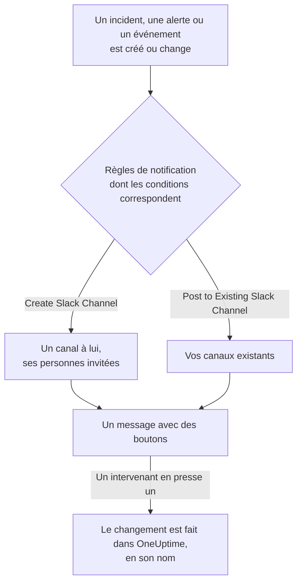

# Slack

Connectez OneUptime à Slack pour publier dans vos canaux les incidents, alertes, épisodes, maintenances planifiées, moniteurs et mises à jour d'astreinte, donner à chaque incident un canal à lui et laisser les intervenants agir sans quitter Slack : prendre en compte, résoudre, ajouter des notes, alerter l'astreinte et déclarer des incidents.

:::cards
- [Connecter Slack](#connecter-slack): Installez OneUptime dans votre espace de travail, puis associez votre propre compte.
- [Règles de notification](#règles-de-notification): Décidez quels événements sont publiés où, et lesquels ont un canal à eux.
- [Créer des incidents et des maintenances depuis Slack](#créer-des-incidents-et-des-maintenances-depuis-slack): `/incident` et `/maintenance`, en votre nom.
- [Agir sur les incidents, alertes et événements depuis Slack](#agir-sur-les-incidents-alertes-et-événements-depuis-slack): Les boutons des messages de OneUptime.
:::

## Fonctionnement

Deux connexions rendent cela possible :

- **La connexion du projet**, faite une fois : l'application de OneUptime installée dans votre espace de travail Slack. Elle publie les messages, crée les canaux et invite les personnes.
- **La connexion propre à chaque personne** : son compte Slack associé à son compte OneUptime. Les boutons, les commandes et les réactions emoji agissent au nom de cette personne, avec ses autorisations dans le projet.

## Avant de commencer

- **Un rôle qui peut connecter le projet :** **Project Owner**, **Project Admin** ou **Project Member**. Désinstaller l'application demande **Project Owner** ou **Project Admin**.
- **Un espace de travail Slack** où vous pouvez installer des applications.
- **Le plan Growth sur OneUptime Cloud** pour les règles de notification et les résumés. Voir [Règles de notification sous le plan Growth](#règles-de-notification-sous-le-plan-growth).
- **Sur un serveur auto-hébergé,** une application Slack configurée pour lui au préalable. Voir [Intégration Slack](/docs/self-hosted/slack-integration).

## Connecter Slack

:::steps
### Installer OneUptime dans votre espace de travail Slack

Allez dans **Paramètres du projet** > **Espace de travail** > **Slack** et cliquez sur **Se connecter avec Slack**. Choisissez l'espace de travail et autorisez OneUptime. Slack vous renvoie sur la même page, qui nomme maintenant l'espace de travail auquel le projet est connecté. Tant qu'aucun espace de travail n'est connecté, la section **Espace de travail** des menus Incidents, Alertes, Maintenance planifiée, Moniteurs et Astreinte contient **Connecter Slack ou Teams**, qui mène aussi ici.

### Connecter votre propre compte Slack

Installer l'application associe le compte de la personne qui l'a installée. Tous les autres associent leur propre compte Slack dans **Paramètres utilisateur** > **Espace de travail** > **Slack** avec **Connect my account with Slack**, pour agir sur les incidents et recevoir des messages directs en leur nom. Cette section apparaît dès que le projet est connecté à Slack.

### Ajouter une règle de notification

Allez dans **Incidents** > **Espace de travail** > **Slack**. La section **Espace de travail** ne liste que les espaces de discussion que votre projet a connectés, donc **Slack** y apparaît dès qu'il est connecté. Créez une règle, par exemple une qui crée un canal Slack pour chaque nouvel incident et invite les propriétaires de l'incident. Voir [Règles de notification](#règles-de-notification).

### Tester la règle

Cliquez sur **Tester la règle** sur la ligne de la règle. Un message de test arrive dans les canaux que la règle nomme. Voir [Tester une règle](#tester-une-règle).
:::

## Règles de notification

Une règle de notification dit quels événements sont publiés dans Slack, et où. Chaque produit a ses propres règles, sous **Espace de travail** > **Slack** dans son menu :

| Produit | Onglets de sa page **Slack** |
| --- | --- |
| **Incidents** | **Incidents**, **Épisodes d'incident**, **Summary** |
| **Alertes** | **Alertes**, **Épisodes d'alerte**, **Summary** |
| **Maintenance planifiée** | Une liste de règles |
| **Moniteurs** | Une liste de règles |
| **Astreinte** | Une liste de règles |

Créer une règle passe par quatre étapes :

| Étape | Ce que vous définissez |
| --- | --- |
| **Basique** | **Nom de la règle** et **Description de la règle**. |
| **Conditions** | Pour quels événements la règle se déclenche, par exemple selon la gravité, l'état, l'étiquette, le moniteur ou des mots du titre. Sans condition, elle se déclenche pour chaque événement. Avec deux ou plus, **Condition de correspondance** dit si toutes doivent correspondre, ou une seule. |
| **Destination** | Où elle publie : **Post to Existing Slack Channel** avec les noms des canaux, **Create Slack Channel** avec le nom du nouveau canal et qui est invité, ou les deux. |
| **Appel vidéo** | Incidents et alertes uniquement : lancer un appel pour chacun. Voir [Appels vidéo](/docs/workspace-connections/video-calls). |

Un canal que la règle crée prend le nom de **New Slack Channel Name** suivi du numéro de l'enregistrement, par exemple `oneuptime-incident-42`, et seul un canal créé reçoit les personnes que la règle invite : les propriétaires de l'enregistrement, les équipes et utilisateurs choisis et, pour les incidents et les alertes, les personnes d'astreinte au fur et à mesure qu'elles sont alertées. Un incident, une alerte ou un épisode privé reçoit un canal privé. Chaque mise à jour ultérieure de l'enregistrement — un changement d'état, une note, un nouveau propriétaire — est publiée dans ses canaux et dans les canaux existants que ses règles nomment. Un incident, une alerte ou un épisode créé déjà résolu ne reçoit pas de canal à lui ; son message de création va quand même dans les canaux que vos règles nomment. Voir [Déclaré déjà pris en compte ou résolu](/docs/incidents/declaring-incidents#déclaré-déjà-pris-en-compte-ou-résolu).

**Paramètres du projet** > **Espace de travail** > **Slack** liste les canaux que OneUptime voit, avec **Envoyer le test** à côté de chacun. OneUptime rejoint de lui-même un canal public la première fois qu'il y publie. Un canal privé n'est listé, et ne peut recevoir de publication, qu'après que l'application OneUptime y a été invitée dans Slack.

## Tester une règle

**Tester la règle** sur la ligne d'une règle publie un message de test pour cette règle dans les canaux qu'elle nomme, pour que vous le voyiez arriver. Si la règle crée un canal pour chaque événement, le test en crée un aussi et y invite les personnes de la règle.

Comme **Envoyer le test** à côté d'un canal dans **Paramètres du projet** > **Espace de travail** > **Slack**, il demande l'autorisation de créer des règles de notification : **Project Owner**, **Project Admin**, **Project Member**, **Settings Admin**, **Settings Member**, ou **Create Workspace Notification Rule** et **Read Workspace Notification Rule** dans un rôle personnalisé. Pour quelqu'un qui peut seulement voir les règles, comme un **Viewer**, **Tester la règle** est verrouillé, et son info-bulle dit ce qu'il faut ; l'API refuse son test avec "You do not have permission to send test notifications in this project." Sur OneUptime Cloud, tester une règle demande le plan **Growth**, comme en ajouter une.

Sur OneUptime Cloud, **Envoyer le test** à côté d'un canal demande aussi le plan **Growth**, car publier dans un canal est ce que font les règles et les résumés. **Envoyer un test maintenant** sur un résumé demande l'autorisation de créer des résumés (**Create Workspace Notification Summary** et **Read Workspace Notification Summary** dans un rôle personnalisé) et, sur OneUptime Cloud, le plan **Growth** ; pour tous les autres, il est verrouillé, et son info-bulle dit ce qu'il faut. Un client MCP connecté en lecture seule ne peut envoyer aucun test.

## Résumés

L'onglet **Summary** de **Incidents** > **Espace de travail** > **Slack** (et des **Alertes**) publie un récapitulatif récurrent dans les canaux que vous nommez : combien d'incidents ou d'alertes il y a eu, à quelle vitesse ils ont été pris en compte et résolus, et une liste avec des liens. Un nouveau résumé part chaque semaine et couvre les 7 derniers jours. Laissez **Envoyer le premier rapport à** vide, et le premier part à 09:00 au début de la semaine, du jour ou du mois suivant ; le formulaire dit quand.

Un résumé part à l'heure de son **Fuseau horaire**, qui commence sur le vôtre. Il y garde son heure toute l'année : un résumé réglé sur 09:00 à Berlin part toujours à 09:00 à Berlin après le changement d'heure, et les dates de son message sont aussi celles de Berlin. Par l'API, envoyez `timezone` sous la forme d'un nom de fuseau horaire IANA, par exemple `Europe/Berlin`. Un résumé créé sans fuseau prend celui du profil de la personne qui l'a créé, ou UTC lorsqu'une clé d'API le crée.

Le formulaire d'un résumé a quatre étapes : **Informations de base** (son nom et les canaux), **Planification**, **Contenu** (**Quoi inclure**) et **Filtres** (quels incidents ou alertes il compte).

## Règles de notification sous le plan Growth

Sur OneUptime Cloud, les règles de notification et les résumés font partie du plan **Growth** et au-delà. Un projet en dessous garde les règles et les résumés qu'il a déjà, et ils continuent de publier dans Slack. Ainsi, la page **Slack** de chaque produit (Incidents, Alertes, Maintenance planifiée, Astreinte, Moniteurs) affiche la note de plan avec eux en dessous (**Règles de notification encore configurées**, **Résumés encore configurés**) : supprimez une règle, ou désactivez ou supprimez un résumé. Ajouter ou modifier des règles et des résumés demande **Growth**.

## Être alerté dans Slack

Pour être alerté par message direct quand vous êtes d'astreinte, ajoutez Slack parmi vos méthodes de notification :

:::steps
1. Connectez votre propre compte Slack (voir [Connecter Slack](#connecter-slack)).
2. Allez dans **Paramètres utilisateur** > **Méthodes de notification**, ouvrez l'onglet **Workspace Apps** et cliquez sur **Ajouter un compte Slack**.
3. Cliquez sur **Send Test Message** sur sa ligne. Le message arrive dans vos messages directs Slack.
:::

L'ajouter l'ajoute aussitôt à vos règles d'astreinte, si bien que les alertes vous atteignent dans Slack dès lors. Changez les alertes qu'il reçoit dans **Paramètres utilisateur** > **Règles d'astreinte**.

## Enregistrer des messages comme notes

Réagissez à un message dans le canal d'un incident, d'une alerte, d'un épisode ou d'un événement de maintenance planifiée, et OneUptime l'enregistre comme note sur cet enregistrement, puis le confirme par une réponse dans le fil :

| Réaction | Enregistré comme |
| --- | --- |
| 📌 Un emoji épingle, ou le propre **Pin to channel** de Slack | Une note privée, visible seulement par votre équipe |
| 📢 Un emoji mégaphone ou haut-parleur | Une note publique, affichée sur la page de statut. Incidents et événements de maintenance planifiée uniquement. |

La note est enregistrée en votre nom, avec vos autorisations, donc votre propre compte Slack doit être connecté. Un message n'est enregistré qu'une fois, quel que soit le nombre de personnes qui réagissent.

## Interroger OneUptime AI depuis Slack

Posez vos questions sur vos journaux, traces, métriques, incidents et moniteurs en langage courant. Mentionnez OneUptime avec @ dans un canal, ou envoyez-lui un message direct, et il répond dans le fil ; répondez-y pour poursuivre. `/oneuptime ask which monitors are down?` publie sa réponse dans le canal. Les deux demandent votre propre compte Slack connecté, et l'IA activée pour le projet. Les réponses dans Slack ne font que lire : pour changer quelque chose, utilisez les boutons. Voir [Demander à l'IA](/docs/ai/ask-ai).

## Créer des incidents et des maintenances depuis Slack

`/incident` et `/maintenance` ouvrent un formulaire que vous remplissez et soumettez en votre nom : en tant que compte OneUptime auquel votre compte Slack est connecté (voir [Connecter Slack](#connecter-slack)), avec les autorisations de ce compte dans le projet. Si votre compte Slack n'est pas connecté, ou si votre compte OneUptime n'est plus membre du projet, OneUptime vous dit par message direct quoi faire, et aucun formulaire ne s'ouvre. Les raccourcis **Create New Incident** et **Create Scheduled Event** ouvrent les mêmes formulaires.

- **Qui peut les utiliser.** Les personnes qui peuvent déclarer un incident ou créer un événement de maintenance planifiée dans OneUptime : **Project Owner**, **Project Admin**, **Project Member**, **Incident Admin** et **Incident Member** pour un incident (**Create Incident** dans un rôle personnalisé), et **Scheduled Maintenance Admin** et **Scheduled Maintenance Member** pour un événement (**Create Scheduled Maintenance**). Tous les autres en sont informés par message direct, et aucun formulaire ne s'ouvre.
- **Ce qu'un formulaire propose.** Chaque liste — gravités, moniteurs, états de moniteur, politiques d'astreinte et étiquettes — contient ce que vous pouvez lire, comme la même liste dans OneUptime : avec un rôle limité à certaines étiquettes, les moniteurs et politiques d'astreinte portant ces étiquettes. Une liste que vous ne pouvez pas lire du tout est retirée du formulaire. Les politiques d'astreinte archivées ne sont jamais proposées.
- **Ce qu'un formulaire peut nommer.** L'incident ou l'événement est créé avec vos propres autorisations et vous est attribué. Un moniteur, une politique d'astreinte, une étiquette, une gravité ou un état que vous ne pouvez pas lire, ou qui appartient à un autre projet, est refusé comme un élément que le projet n'a pas, même depuis un formulaire ouvert avant que votre accès change, et rien n'est créé. OneUptime vous dit pourquoi par message direct.

**Execute On-Call Policy** sur un incident, une alerte ou un épisode fonctionne de la même façon : il demande l'autorisation d'exécuter une politique d'astreinte (**Project Owner**, **Project Admin**, **Project Member**, **On-Call Admin** et **On-Call Member**, ou **Create On-Call Duty Policy Execution Log** dans un rôle personnalisé) et de lire cet incident, cette alerte ou cet épisode, et propose les politiques d'astreinte actives que vous pouvez lire.

## Agir sur les incidents, alertes et événements depuis Slack

Les boutons des messages Slack de OneUptime agissent eux aussi en votre nom : en tant que compte OneUptime auquel votre compte Slack est connecté, avec les autorisations de ce compte dans le projet. **Acknowledge**, **Resolve**, **Change State**, **Add Note** et **Execute On-Call Policy** sur un incident, une alerte ou un épisode, et **Mark as Ongoing**, **Mark as Complete**, **Change State** et **Add Note** sur un événement de maintenance planifiée, font chacun le changement que la même action fait dans OneUptime, et il vous y est attribué : la chronologie des états et le fil de l'enregistrement montrent que vous avez changé son état, et la note est la vôtre. Une note enregistrée depuis un message avec une réaction emoji est publiée de la même façon.

- **Qui peut les utiliser.** Les personnes qui peuvent faire le même changement dans OneUptime. Prendre en compte, résoudre ou changer l'état d'un incident demande l'autorisation de changer son état : **Project Owner**, **Project Admin**, **Project Member**, **Incident Admin** et **Incident Member**, ou **Create Incident State Timeline** dans un rôle personnalisé. Une alerte, un épisode ou un événement de maintenance planifiée demande la même autorisation pour son propre type (**Create Alert State Timeline**, par exemple), et une note demande l'autorisation de publier ce type de note. Tous les autres en sont informés par message direct, et rien ne change.
- **Quels enregistrements.** Ceux que vous pouvez lire, comme dans OneUptime : avec un rôle limité à certaines étiquettes, les incidents, alertes, épisodes et événements portant ces étiquettes. Un bouton sur tout autre enregistrement, ou sur un enregistrement d'un autre projet, reçoit pour réponse que l'enregistrement "was not found in this project, or you do not have access to it.", et rien ne change. Sur OneUptime Cloud, un changement que le plan du projet n'inclut pas est refusé avec le plan qu'il demande.
- **Ce que propose Change State.** Les états que vous pouvez lire et vers lesquels l'enregistrement peut passer ensuite, dans l'ordre du projet : aucun avant l'état où il se trouve, pour un épisode comme pour un incident, une alerte ou un événement de maintenance planifiée, car un changement d'état ne fait jamais remonter un enregistrement dans sa liste (voir [L'ordre est une vraie contrainte, pas une préférence d'affichage](/docs/incidents/states-and-severities#lordre-est-une-vraie-contrainte-pas-une-préférence-daffichage)). Si vous n'en pouvez lire aucun, on vous dit "No incident states are available to you in this project. Ask a project admin for access to them." ; si l'enregistrement est dans le dernier état qu'il peut atteindre, on vous dit "There is no later state to move this incident to." Aucun des deux n'ouvre un formulaire vide.

## Déconnecter

- **Déconnecter** ne dissocie que votre propre compte Slack, et retire avec lui votre méthode de notification Slack.
- **Uninstall OneUptime from Slack**, dans **Paramètres du projet** > **Espace de travail** > **Slack**, déconnecte le projet. OneUptime cesse de publier dans Slack, et les menus **Espace de travail** cessent de le lister. Les règles de notification et les résumés sont conservés pour quand vous vous reconnectez.

> [!WARNING]
> Désinstaller dissocie aussi le compte Slack de chaque membre du projet, et retire les méthodes de notification Slack et les règles d'astreinte qui les utilisaient. Les personnes alertées dans Slack sont alertées sur leurs autres méthodes de notification jusqu'à ce qu'elles ajoutent à nouveau Slack.

## Dépannage

:::details Une règle ne publie rien
Vérifiez les conditions de la règle avec **Tester la règle** : si le test arrive, les conditions de la règle ne correspondaient pas à l'événement. S'il n'arrive pas, la page Slack dit pourquoi. Pour un canal privé, invitez d'abord l'application OneUptime dans le canal depuis Slack. Chaque message que OneUptime publie, et chacun que Slack a refusé, figure dans **Paramètres du projet** > **Notifications** > **Journaux de notification**, dans l'onglet **Espace de travail**.
:::

:::details Slack n'a pas été connecté
Quand Slack vous renvoie sans connexion, la page d'où vous êtes parti indique **Slack n'a pas été connecté**, et une phrase dit pourquoi : il vous manque l'autorisation, le lien a déjà servi ou a expiré, vous vous êtes connecté à un autre espace de travail, ou le serveur n'est pas configuré pour Slack. Voir [La connexion n'a pas abouti](/docs/self-hosted/slack-integration#la-connexion-na-pas-abouti) pour chaque phrase et ce qu'il faut faire.
:::

:::details Un bouton ou une commande dit que mon compte Slack n'est pas connecté
Associez-le dans **Paramètres utilisateur** > **Espace de travail** > **Slack** avec **Connect my account with Slack**. Si vous n'êtes plus membre du projet, OneUptime le dit à la place, et n'agit sur rien pour vous.
:::

:::details Les notifications arrivent, mais les boutons et les commandes ne font rien
Sur un serveur auto-hébergé, Slack doit pouvoir joindre OneUptime pour les boutons, les formulaires et les commandes ; les notifications n'ont besoin que d'un accès sortant. Voir [Accès réseau pour les déploiements auto-hébergés](/docs/self-hosted/slack-integration#accès-réseau-pour-les-déploiements-auto-hébergés).
:::

## Étapes suivantes

:::cards
- [Microsoft Teams](/docs/workspace-connections/microsoft-teams): Les mêmes notifications et actions dans Microsoft Teams.
- [Appels vidéo](/docs/workspace-connections/video-calls): Donnez à chaque incident un appel, publié avec ses mises à jour.
- [Intégration Slack](/docs/self-hosted/slack-integration): Configurer l'application Slack sur un serveur auto-hébergé.
- [Déclarer un incident](/docs/incidents/declaring-incidents): Toutes les façons dont un incident commence, et ce qui s'exécute alors.
:::
