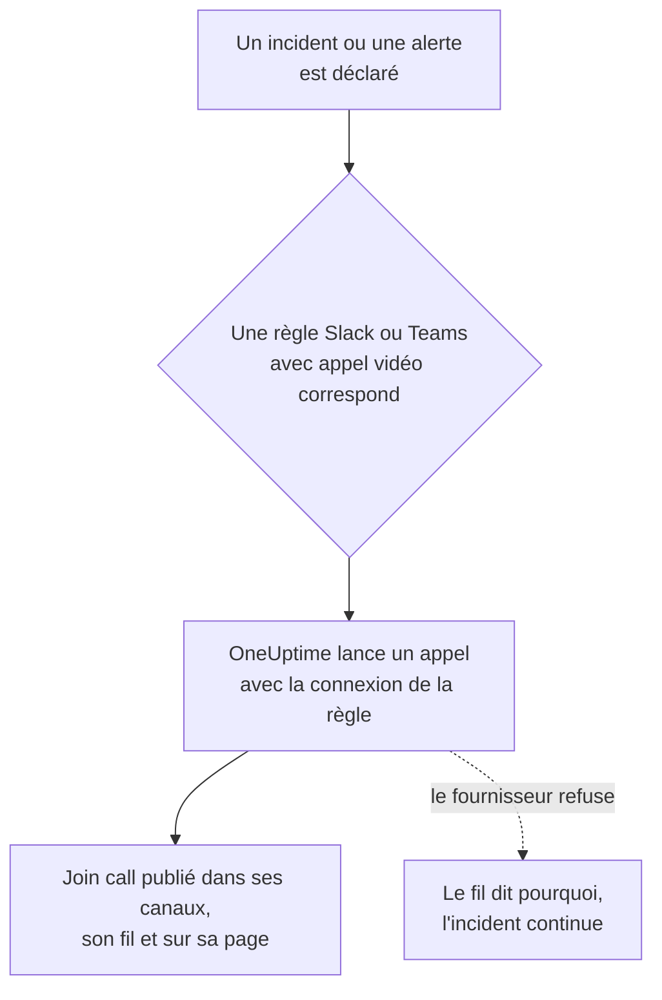

# Appels vidéo

Donnez à chaque incident et à chaque alerte son propre appel. Quand une règle de notification Slack ou Microsoft Teams se déclenche pour un nouvel incident ou une nouvelle alerte, OneUptime lance une réunion dédiée (une réunion Zoom, un Google Meet, une réunion Microsoft Teams ou le huddle du canal Slack de l'incident) et publie un bouton **Rejoindre l'appel** partout où vont les mises à jour de l'incident. Les intervenants rejoignent en un clic, et personne n'a à créer une réunion à 3 h du matin et à faire circuler le lien.

:::cards
- [Fonctionnement](#fonctionnement): Une règle lance l'appel, et les intervenants le rejoignent d'où qu'ils soient.
- [Connecter en un clic](#connecter-en-un-clic): Zoom, Google Meet ou Microsoft Teams, en se connectant.
- [Fournisseurs](#fournisseurs): L'identité de service de votre propre application, un lien de réunion permanent ou un huddle Slack.
- [Lancer un appel à la main](#lancer-un-appel-à-la-main): Depuis la page d'un incident ou d'une alerte.
- [Transcriptions des appels](#transcriptions-des-appels): Ce qui s'est dit pendant l'appel d'un incident, et la cause racine que l'IA de OneUptime y lit.
:::

## Fonctionnement



:::steps
### Connecter un fournisseur

Allez dans **Paramètres du projet** > **Espace de travail** > **Appels vidéo** et connectez Zoom, Google Meet ou Microsoft Teams, ou ajoutez un lien de réunion permanent. Sur OneUptime Cloud, connecter Zoom, Google Meet ou Microsoft Teams se fait en un clic : connectez-vous et autorisez OneUptime à créer des réunions (voir [Connecter en un clic](#connecter-en-un-clic)). Les huddles Slack n'ont besoin de rien d'autre que la connexion Slack du projet.

### L'activer dans une règle

Ouvrez une règle de notification Slack ou Microsoft Teams pour les incidents ou les alertes (**Incidents** > **Espace de travail** > **Slack**, par exemple). À l'étape **Appel vidéo** de la règle, activez **Start a video call for the incident** et choisissez où se tient l'appel.

### Rejoindre en un clic

Quand la règle se déclenche, OneUptime lance un appel pour l'incident et le publie avec un bouton **Rejoindre l'appel** dans les canaux où vont les mises à jour de l'incident et dans le fil de l'incident. La page de l'incident affiche l'appel dans sa carte **Appel vidéo** et un bouton **Rejoindre l'appel** dans son en-tête.
:::

Les conditions de la règle décident quels incidents reçoivent un appel. Pour une conférence sur les seuls incidents Sev1, donnez à la règle une condition **Gravité**. Les appels démarrent pour les incidents et les alertes déclarés en cours. Un incident créé déjà résolu ne reçoit pas d'appel.

### Un appel par incident

Un appel est lancé une fois par incident pour chaque lieu où un appel se tient. Les règles qui choisissent la même connexion partagent un appel, et une règle ne lance jamais un second appel pour un incident qui en a déjà un de cette connexion. Les règles qui choisissent des lieux différents lancent chacune leur propre appel, par exemple une réunion Zoom pour les intervenants et le huddle du canal Slack de l'incident.

### Quand un appel ne peut pas démarrer

Déclarer un incident n'attend jamais un fournisseur d'appels vidéo. L'appel est lancé après la création de l'incident, si bien qu'un fournisseur lent ou en panne ne retarde jamais l'incident ni ses notifications d'astreinte.

Si le fournisseur refuse (un secret expiré, une autorisation manquante, un hôte supprimé), le fil de l'incident indique que l'appel de la règle n'a pas pu être lancé, avec la raison du fournisseur, pour que les intervenants sachent en lancer un depuis la page de l'incident. L'exécution de la règle figure dans les journaux de notification de l'espace de travail comme **Démarrer un appel vidéo**, et la ligne de la connexion dans **Paramètres du projet** > **Espace de travail** > **Appels vidéo** affiche l'erreur jusqu'à ce qu'un appel démarre à nouveau.

### Incidents privés

Une réunion porte le nom de l'incident pour lequel elle est créée, avec son numéro et son titre, et sa description renvoie à l'incident. Pour un incident privé, le titre est omis, car toutes les personnes invitées à la réunion peuvent lire son nom.

## Connecter en un clic

Sur OneUptime Cloud, connecter Zoom, Google Meet ou Microsoft Teams prend un clic et rien à configurer chez le fournisseur :

:::steps
1. Allez dans **Paramètres du projet** > **Espace de travail** > **Appels vidéo** et cliquez sur **Connecter** sur Zoom, Google Meet ou Microsoft Teams.
2. Cliquez sur **Continue to Zoom** (ou Google, ou Microsoft), connectez-vous et autorisez OneUptime à créer des réunions.
3. Vous revenez sur la page des appels vidéo avec la connexion faite. **Démarrer une réunion de test** la vérifie de bout en bout ; choisissez ensuite la connexion dans une règle de notification Slack ou Microsoft Teams.
:::

Chaque réunion est créée au nom du compte avec lequel vous vous connectez, qui en est l'hôte. Connectez-vous avec un compte partagé, comme incidents@example.com, plutôt qu'avec le vôtre, pour que les appels continuent de démarrer quand des personnes partent. La ligne de la connexion montre sous quel compte elle est connectée.

| Fournisseur | Se connecter avec | Ce que OneUptime peut faire |
| --- | --- | --- |
| Zoom | Un utilisateur Zoom. Les réunions dont l'hôte est un utilisateur Basic (gratuit) se terminent au bout de 40 minutes. | Créer des réunions pour cet utilisateur (`meeting:write:meeting`) et lire qui il est (`user:read:user`). Pour les [transcriptions des appels](#transcriptions-des-appels), lire les transcriptions des enregistrements cloud de ses réunions (`cloud_recording:read:list_recording_files`, `cloud_recording:read:meeting_transcript`). |
| Google Meet | Un compte Google qui peut utiliser Google Meet. | Créer des espaces Meet au nom de ce compte (`meetings.space.created`) et lire son adresse e-mail. |
| Microsoft Teams | Un compte professionnel ou scolaire avec Microsoft Teams. Les comptes Microsoft personnels ne peuvent pas créer de réunions Teams. | Créer des réunions en ligne au nom de ce compte (l'autorisation déléguée `OnlineMeetings.ReadWrite`) et rester connecté (`offline_access`). Pour [enregistrer et transcrire les appels d'incident](#enregistrer-et-transcrire-chaque-appel), ajouter les réunions à son calendrier (`Calendars.ReadWrite`) et lire leurs transcriptions (`OnlineMeetingTranscript.Read.All`, qu'un administrateur approuve). |

Une connexion faite en se connectant garde les paramètres qui décident qui attend : **Who can join** pour Google Meet et **Who skips the lobby** pour Microsoft Teams. Modifiez-les avec **Modifier** sur la ligne de la connexion.

Une connexion Zoom faite avant que OneUptime lise les transcriptions des appels lance les appels comme avant, mais ne peut lire leurs transcriptions qu'après une nouvelle connexion : **Reconnect** sur sa ligne demande à Zoom les autorisations de transcription.

Une connexion Microsoft Teams faite pendant que l'option **Enregistrer et transcrire les appels d'incident** était désactivée lance les appels comme avant, sans les enregistrer. Une fois l'option activée, **Reconnect** sur sa ligne demande aussi à Microsoft les autorisations de calendrier et de transcription.

### Rester connecté

OneUptime conserve le jeton d'actualisation de la connexion, chiffré, et l'actualise au moins une fois par semaine, si bien qu'il n'expire jamais faute d'usage, aussi longtemps que le projet reste sans incident. Si la connexion cesse de fonctionner (le compte a retiré OneUptime, a été supprimé ou suspendu, ou la politique de votre organisation demande une nouvelle connexion), la ligne de la connexion affiche **Ne fonctionne pas** avec la raison, le jour où OneUptime le remarque, pas au prochain incident. **Reconnect** sur la ligne la reconnecte.

Les connexions établies avec le même compte partagent une seule connexion, dans tous les projets : Zoom ne garde qu'une connexion par compte, donc connecter à nouveau le même utilisateur Zoom la remplace pour toutes.

### Reconnecter et supprimer

**Reconnect** sur la ligne d'une connexion la reconnecte, avec le même compte ou un autre. Utilisez-le après que le compte a retiré OneUptime, ou pour déplacer les réunions d'incident vers un autre compte.

Supprimer une connexion retire l'accès de OneUptime chez Zoom et Google dès qu'aucune autre connexion n'utilise cette connexion de compte. Pour Microsoft, retirez OneUptime dans **My Apps** (myapps.microsoft.com) du compte. Retirer OneUptime de votre compte Zoom dans le Zoom App Marketplace supprime sa connexion de toutes les connexions établies avec ce compte, et elles affichent **Ne fonctionne pas** jusqu'à leur reconnexion.

### Si Microsoft demande un administrateur

Certaines organisations Microsoft 365 ne laissent que les administrateurs approuver des applications. Si Microsoft dit qu'il vous faut l'approbation d'un administrateur, demandez à un administrateur Microsoft 365 de connecter Microsoft Teams, ou d'approuver OneUptime dans le [centre d'administration Microsoft Entra](https://entra.microsoft.com/) sous **Enterprise applications** > **Admin consent requests**. Un projet qui enregistre ses appels Teams a besoin de cette approbation dans chaque organisation, une seule fois : seul un administrateur peut autoriser une application à lire les transcriptions de réunion.

### Utiliser plutôt votre propre application

Pour vous connecter avec une identité de service plutôt qu'avec la connexion d'une personne — une application Zoom de type Server-to-Server OAuth, un compte de service Google avec délégation au niveau du domaine, ou un enregistrement d'application Microsoft Entra — cliquez sur **Use your own Zoom app** (ou Google, ou Microsoft) dans la boîte de dialogue Connecter. [Fournisseurs](#fournisseurs) explique chacun. Sur un serveur auto-hébergé sans applications en un clic configurées, **Connecter** ouvre directement ce formulaire ; voir [Connexion en un clic sur un serveur auto-hébergé](#connexion-en-un-clic-sur-un-serveur-auto-hébergé) pour les configurer.

## Lancer un appel à la main

La carte **Appel vidéo** de la page d'un incident ou d'une alerte propose **Démarrer l'appel** (ou **En démarrer un autre** dès qu'il y en a un). Choisissez l'une des connexions du projet, le huddle du canal Slack de l'incident, ou collez votre propre lien de réunion. L'appel est publié dans les canaux et le fil de l'incident comme celui qu'une règle lance.

**Supprimer** sur la carte retire un appel de la page de l'incident. La réunion elle-même n'est pas supprimée, et toute personne ayant le lien peut encore la rejoindre.

Lancer et retirer des appels demande l'autorisation de travailler sur les incidents (ou les alertes) : **Propriétaire du projet**, **Administrateur du projet**, **Membre du projet**, **Administrateur des incidents** ou **Membre des incidents**, ou **Create Incident Video Call** et **Delete Incident Video Call** dans un rôle personnalisé. Toute personne qui peut lire l'incident voit ses appels.

## Transcriptions des appels

Ce que les intervenants disent pendant un appel, ce qu'ils ont vérifié, ce qu'ils soupçonnent et ce qu'ils ont décidé, est la meilleure trace de la façon dont un incident a été traité, et cela disparaît à la fin de l'appel. L'appel d'un incident garde sa transcription, et l'IA de OneUptime la lit pour trouver la cause racine que l'appel désigne. Rien de ce qu'elle lit n'atteint l'incident avant qu'un intervenant ne l'utilise.

:::steps
### Récupérer la transcription après l'appel

Sur la carte **Appel vidéo** de l'incident, **Récupérer depuis Zoom**, **Récupérer depuis Google Meet** ou **Récupérer depuis Microsoft Teams** lit la transcription d'une réunion que OneUptime y a lancée (pour Microsoft Teams, une réunion lancée pendant que chaque appel est enregistré et transcrit). Pour tout autre appel, **Ajouter la transcription** prend le fichier enregistré par l'outil de réunion (`.vtt`, `.srt` ou `.txt`, jusqu'à 5 Mo) ou la transcription collée. Avec [chaque appel enregistré et transcrit](#enregistrer-et-transcrire-chaque-appel), OneUptime la récupère de lui-même une fois l'appel terminé.

### L'IA de OneUptime la lit

En une ou deux minutes, la carte **OneUptime AI** de l'incident affiche la **Cause racine suggérée**, marquée **Non confirmée**, avec les lignes de la transcription sur lesquelles elle repose, citées avec leur heure et leur intervenant. En dessous, repliée, se trouve la suite de ce que l'appel a dit : les constats, répartis entre **Confirmé pendant l'appel** et **Hypothèses**, puis ce qui a été essayé, les décisions, les suivis et les questions ouvertes. Ce que l'IA de OneUptime y a lu est aussi publié dans le fil de l'incident, et de là dans les canaux Slack et Microsoft Teams de l'incident.

### L'utiliser, ou la masquer

**Utiliser comme cause racine** ouvre la suggestion, citations comprises, dans l'éditeur de la cause racine. Modifiez ce qu'il faut, puis enregistrez : elle devient la cause racine de l'incident comme votre propre modification, consignée dans son fil. **Masquer** met la suggestion de côté, et **Annuler** la fait revenir.
:::

L'IA de OneUptime ne suggère une cause que si l'appel en nomme une, avec les lignes qui le disent, et elle cite ces lignes telles que la transcription les contient. Quand l'appel n'a pas établi la cause, la carte affiche **Trop peu a été dit pendant l'appel pour suggérer une cause racine** au lieu de deviner.

### Enregistrer et transcrire chaque appel

Pour que personne n'ait à penser à enregistrer un appel ou à récupérer sa transcription, activez **Enregistrer et transcrire les appels d'incident** dans **Paramètres du projet** > **Espace de travail** > **Appels vidéo**. Tant que l'option est activée :

- OneUptime demande à Zoom d'enregistrer dans le cloud chaque réunion d'incident qu'il lance, à Google Meet de la transcrire, et à Microsoft Teams de l'enregistrer et de la transcrire automatiquement. Le message qui publie l'appel l'annonce avant que quiconque ne le rejoigne.
- Une fois l'appel terminé, OneUptime récupère la transcription de lui-même, comme le ferait **Récupérer depuis Zoom**, et l'IA de OneUptime la lit. D'ici là, la carte **Appel vidéo** indique qu'elle l'attend.
- Ce que l'IA de OneUptime a lu va dans le fil de l'incident et dans ses canaux Slack et Microsoft Teams : la cause racine suggérée, marquée comme non confirmée, puis ce qui a été confirmé, essayé et décidé, les suivis et les questions ouvertes.
- Quand l'incident est résolu avant que la transcription n'arrive, le brouillon automatique de post-mortem l'attend, pour reprendre ce qui s'est dit pendant l'appel : jusqu'à six heures pendant que le fournisseur prépare la transcription, et une heure quand rien n'en annonce encore une.

L'option est désactivée par défaut, car elle enregistre des personnes : tous les participants à ces appels voient qu'ils sont enregistrés ou transcrits, alors vérifiez que votre organisation l'autorise. Zoom ne garde une transcription que si le compte enregistre dans le cloud avec la transcription audio activée, et Google Meet seulement sur une édition de Google Workspace qui propose les transcriptions. Les huddles Slack et les liens de réunion ne sont pas enregistrés, pas plus que les appels des alertes : ajoutez leurs transcriptions à la main.

Microsoft ne laisse les applications lire que les transcriptions des réunions Teams inscrites dans un calendrier : OneUptime place donc chaque réunion d'incident dans le calendrier de son organisateur et active l'enregistrement et la transcription automatiques dans les options de la réunion. Pour cela, la connexion a besoin de deux autorisations Microsoft Graph de plus, `Calendars.ReadWrite` et `OnlineMeetingTranscript.Read.All` : ajoutez-les à votre enregistrement d'application (voir [Microsoft Teams](#microsoft-teams)), ou utilisez **Reconnect** sur une connexion faite en se connectant. La stratégie de réunion Teams de l'organisateur doit autoriser l'enregistrement dans le cloud, la transcription et l'enregistrement automatique, et votre organisation ne doit pas avoir désactivé l'accès des applications aux transcriptions. Un appel que OneUptime ne peut pas placer dans le calendrier démarre quand même, sans enregistrement, et sa carte **Appel vidéo** indique pourquoi.

### Ce que garde chaque fournisseur

| Appel | Comment il obtient sa transcription | Ce qu'il lui faut |
| --- | --- | --- |
| Zoom | **Récupérer depuis Zoom** | Une réunion enregistrée dans le cloud avec sa transcription audio activée, ou avec le résumé de réunion d'AI Companion activé. La connexion a besoin des scopes de transcription (voir [Zoom](#zoom)), et une connexion faite avant eux a besoin de **Reconnect**. Zoom prépare une transcription après la réunion, généralement en moins de deux fois sa durée. |
| Google Meet | **Récupérer depuis Google Meet** | Les transcriptions activées pendant l'appel, sur une édition de Google Workspace qui les propose. Rien d'autre à configurer : OneUptime lit les transcriptions des réunions qu'il a créées. Google garde une transcription lisible par les applications pendant 30 jours. |
| Microsoft Teams | **Récupérer depuis Microsoft Teams** | Une réunion que OneUptime a lancée pendant que [chaque appel est enregistré et transcrit](#enregistrer-et-transcrire-chaque-appel) : Microsoft ne laisse les applications lire que les transcriptions des réunions inscrites dans un calendrier, et garde une réunion pendant 60 jours. Pour toute autre réunion Teams, **Ajouter la transcription** : dans Teams, ouvrez le récapitulatif de la réunion, puis sa transcription, et téléchargez-la en fichier `.vtt`. |
| Lien de réunion ou huddle Slack | **Ajouter la transcription** | La transcription que gardent l'outil de réunion ou les notes du huddle. |

### Qui peut faire quoi

Récupérer, ajouter, remplacer et supprimer une transcription, la faire relire et masquer une suggestion demandent l'autorisation de lancer les appels de l'incident : **Propriétaire du projet**, **Administrateur du projet**, **Membre du projet**, **Administrateur des incidents** ou **Membre des incidents**, ou **Create Incident Video Call** dans un rôle personnalisé. **Utiliser comme cause racine** demande l'autorisation de modifier la cause racine de l'incident. Toute personne qui peut lire l'incident voit les transcriptions de ses appels et ce que l'IA de OneUptime y a lu.

### Ce que lit l'IA de OneUptime

Lire une transcription est un travail d'IA comme une investigation : il ne s'exécute que lorsque l'IA est activée pour le projet, et compte dans l'utilisation d'IA et les limites quotidiennes du projet (voir [Maîtrise des coûts](/docs/ai/ai-sre#maîtrise-des-coûts)). Une longue transcription est lue par parties. Quand l'IA est désactivée, la transcription est conservée et la carte indique qu'elle n'a pas été lue. Supprimer une transcription supprime ce que l'IA de OneUptime y a lu, et conserve la cause racine de l'incident. Un brouillon de post-mortem par l'IA lit aussi ce qui s'est dit pendant les appels de l'incident (voir [Post-mortems](/docs/incidents/postmortems)).

## Fournisseurs

Cette section traite de la connexion d'un fournisseur avec l'identité de service de votre propre application : une application Zoom de type Server-to-Server OAuth, un compte de service Google, un enregistrement d'application Microsoft Entra. Une identité de service ne dépend jamais d'une personne, elle continue donc de fonctionner quel que soit le départ. Pour vous connecter plutôt en vous identifiant, voir [Connecter en un clic](#connecter-en-un-clic).

Les identifiants sont chiffrés au repos et ne sont jamais renvoyés par l'API. Quand vous modifiez une connexion, un identifiant laissé vide conserve celui qui est enregistré.

**Démarrer la réunion de test** dans le formulaire de connexion, et **Tester** sur la ligne d'une connexion, créent une vraie réunion avec les paramètres de la connexion et affichent son lien. C'est la seule vérification qui prouve que les identifiants, l'autorisation côté fournisseur et l'hôte fonctionnent ensemble. Rien n'est publié nulle part.

Connecter un fournisseur demande **Propriétaire du projet**, **Administrateur du projet** ou **Administrateur des paramètres**, ou **Create Video Call Connection** et **Edit Video Call Connection** dans un rôle personnalisé.

### Zoom

OneUptime crée une réunion Zoom pour chaque incident via une application Zoom de type **Server-to-Server OAuth**, dont l'hôte est un utilisateur Zoom sous licence de votre choix.

:::steps
1. Dans le [Zoom App Marketplace](https://marketplace.zoom.us/), choisissez **Develop** > **Build App** et créez une application **Server-to-Server OAuth**. En créer une demande un administrateur du compte Zoom, ou un rôle qui autorise les applications Server-to-Server OAuth.
2. Sur la page **Scopes** de l'application, ajoutez **meeting:write:meeting:admin** (créer une réunion pour un utilisateur). Une application créée avant les scopes granulaires peut utiliser **meeting:write:admin** à la place. Pour que OneUptime puisse aussi lire les [transcriptions des appels](#transcriptions-des-appels), ajoutez **cloud_recording:read:list_recording_files:admin** et **cloud_recording:read:meeting_transcript:admin** (ou **recording:read:admin** pour une application créée avant les scopes granulaires).
3. Cliquez sur **Activate** pour l'application, puis copiez l'**Account ID**, le **Client ID** et le **Client secret** de sa page **App Credentials** dans le formulaire de connexion.
4. Saisissez le **Meeting host** : l'e-mail d'un utilisateur Zoom sous licence, idéalement un compte de service comme incidents@example.com, pour que les réunions continuent de fonctionner quand des personnes partent. Les réunions dont l'hôte est un utilisateur Basic (gratuit) se terminent au bout de 40 minutes.
5. Les intervenants rejoignent sans attendre l'hôte, car l'hôte est un compte de service qui ne rejoint jamais. Vérifiez que le paramètre **Waiting room** de votre compte Zoom n'est pas verrouillé sur activé, sinon personne ne peut entrer.
:::

| Champ | Où le trouver |
| --- | --- |
| Account ID | La page **App Credentials** de l'application |
| Client ID | La page **App Credentials** de l'application |
| Client secret | La page **App Credentials** de l'application |
| Meeting host | L'e-mail de l'utilisateur Zoom sous licence qui héberge chaque réunion |

### Google Meet

OneUptime crée un Google Meet pour chaque incident avec la Google Meet REST API, via un compte de service Google Cloud qui agit en tant qu'utilisateur Google Workspace grâce à la délégation au niveau du domaine.

:::steps
1. Dans la [console Google Cloud](https://console.cloud.google.com/), choisissez ou créez un projet et activez-y la **Google Meet REST API**.
2. Sous **IAM & Admin** > **Service accounts**, créez un compte de service. Ouvrez-le, allez dans **Keys** > **Add key** > **Create new key**, choisissez **JSON**, et collez le fichier téléchargé dans le formulaire de connexion comme **Service account JSON key**.
3. Dans la [console d'administration Google](https://admin.google.com/), ouvrez **Security** > **Access and data control** > **API controls** > **Manage Domain Wide Delegation** et cliquez sur **Add new**. Saisissez le **Client ID** numérique du compte de service et le scope `https://www.googleapis.com/auth/meetings.space.created`.
4. Saisissez dans **Create meetings as** l'utilisateur Google Workspace au nom duquel agit le compte de service : un compte dédié comme incidents@example.com. Chaque réunion appartient à cet utilisateur.
:::

**Who can join** décide qui rejoint sans demander : avec **People in your organization join directly, others ask to join** (la valeur par défaut), les personnes extérieures à votre Google Workspace demandent à rejoindre et quelqu'un dans l'appel les admet. Avec **Anyone with the link joins directly**, personne n'attend.

La délégation au niveau du domaine peut mettre quelques minutes à fonctionner. Si le test indique juste après l'ajout de la délégation que Google n'a pas laissé le compte de service agir au nom de l'utilisateur, attendez quelques minutes et testez à nouveau.

### Microsoft Teams

OneUptime crée une réunion Microsoft Teams pour chaque incident avec Microsoft Graph, via un enregistrement d'application Microsoft Entra qui organise les réunions pour le compte d'un utilisateur Teams sous licence.

:::steps
1. Dans le [centre d'administration Microsoft Entra](https://entra.microsoft.com/), ouvrez **App registrations** > **New registration** et enregistrez une application à locataire unique. Copiez son **Directory (tenant) ID** et son **Application (client) ID**.
2. Sous **API permissions**, ajoutez l'autorisation Microsoft Graph de type **application** **OnlineMeetings.ReadWrite.All** (et, pour aussi [enregistrer et transcrire les appels d'incident](#enregistrer-et-transcrire-chaque-appel), **Calendars.ReadWrite** et **OnlineMeetingTranscript.Read.All**), puis cliquez sur **Grant admin consent**.
3. Sous **Certificates & secrets**, créez un secret client et collez sa **Value**, pas son Secret ID, dans le formulaire de connexion comme **Secret client**.
4. Choisissez l'organisateur : un utilisateur Teams sous licence, idéalement un compte de service. Copiez son **Object ID** depuis **Users** dans le centre d'administration Entra vers **Organizer object ID**.
5. Autorisez l'application à créer des réunions pour l'organisateur avec une stratégie d'accès d'application. Dans Teams PowerShell, après `Connect-MicrosoftTeams`, exécutez les deux commandes ci-dessous.
:::

```powershell
New-CsApplicationAccessPolicy -Identity OneUptime-Meetings -AppIds "<application-client-id>"
Grant-CsApplicationAccessPolicy -PolicyName OneUptime-Meetings -Identity "<organizer-object-id>"
```

La stratégie peut mettre jusqu'à 30 minutes à s'appliquer. D'ici là, le test indique que l'application n'est pas autorisée à créer des réunions pour l'organisateur.

La même stratégie permet à l'application de lire les transcriptions des réunions de l'organisateur. `Calendars.ReadWrite` permet à une application de modifier tous les calendriers de votre organisation : pour restreindre cette autorisation au calendrier de l'organisateur, accordez-la avec [RBAC pour les applications dans Exchange Online](https://learn.microsoft.com/exchange/permissions-exo/application-rbac), dans une étendue limitée à l'organisateur, plutôt que sous **API permissions**.

**Who skips the lobby** décide qui rejoint sans attendre : avec **People in your organization skip the lobby** (la valeur par défaut), toute autre personne attend dans la salle d'attente jusqu'à ce que quelqu'un dans la réunion l'admette. Avec **Everyone skips the lobby**, personne n'attend.

### Lien de réunion

Un lien de réunion permanent est la même salle pour chaque incident : une salle de réunion personnelle Zoom, une réunion récurrente Microsoft Teams ou Google Meet, une salle personnelle Webex ou une salle Jitsi. Rien n'est créé par incident, il n'y a donc rien à autoriser.

:::steps
1. Créez, dans l'outil que votre équipe utilise déjà, une réunion qui n'expire jamais.
2. Collez son lien https pour rejoindre dans le formulaire de connexion comme **Lien de réunion**.
:::

Chaque incident et chaque alerte lancés avec cette connexion partagent la salle, donc deux incidents simultanés la partagent aussi. Vérifiez que la réunion laisse les personnes entrer sans l'hôte.

### Huddles Slack

Une règle Slack peut lancer à la place le huddle du canal Slack de l'incident. Il n'y a rien à connecter : choisissez **Huddle Slack** à l'étape **Appel vidéo** de la règle.

Le huddle se tient dans le canal que la règle crée pour l'incident ou, quand la règle publie plutôt dans des canaux existants, dans le premier d'entre eux. La règle doit donc créer un canal ou publier dans un canal existant. Le bouton **Rejoindre le huddle** ouvre le huddle du canal dans Slack. Le premier intervenant à l'ouvrir démarre le huddle, et tous ceux qui suivent le rejoignent. Slack ne permet pas à une application de démarrer un huddle, donc personne n'est dans le huddle tant que quelqu'un ne l'a pas ouvert.

Un huddle Slack n'existe que pour les règles Slack. Une règle Microsoft Teams lance ses appels avec l'une des connexions d'appel vidéo du projet.

## Utiliser l'API

Un appel est un enregistrement sur l'incident (`IncidentVideoCall`) ou sur l'alerte (`AlertVideoCall`). Créez-en un avec l'`_id` de l'incident et l'un des éléments suivants :

- `videoCallConnectionId` : lancer une nouvelle réunion avec cette connexion.
- `provider` réglé sur `SlackHuddle` : le huddle du canal Slack de l'incident.
- `joinUrl` (et éventuellement `title`) : votre propre lien de réunion.

```json
{
  "data": {
    "projectId": "<project-id>",
    "incidentId": "<incident-id>",
    "videoCallConnectionId": "<connection-id>"
  }
}
```

`POST /api/video-call-connection/test` lance une réunion de test avec une connexion enregistrée (`{ "connectionId": "..." }`) ou avec des paramètres pas encore enregistrés (`{ "provider": "Zoom", "config": { ... }, "secrets": { ... } }`), et renvoie son `joinUrl`.

Le `authMethod` d'une connexion dit comment elle se connecte : `OAuth` pour une connexion faite en s'identifiant, `AppCredentials` pour une avec les identifiants de votre propre application, et rien pour un lien de réunion. Une connexion faite en s'identifiant ne se crée qu'en s'identifiant, dans le tableau de bord. Par l'API, vous pouvez la renommer et changer son `config`, et son `connectedAccount` dit sous quel compte elle est connectée.

## Connexion en un clic sur un serveur auto-hébergé

OneUptime Cloud a ses propres applications Zoom, Google et Microsoft pour la connexion en un clic. Un serveur auto-hébergé la propose pour chaque fournisseur dont vous configurez l'application. Sans elle, **Connecter** ouvre le formulaire pour votre propre application.

Créez une application OAuth par fournisseur et enregistrez-y cette URI de redirection, avec l'hôte de votre serveur :

| Fournisseur | URI de redirection | Variables d'environnement | Valeurs Helm |
| --- | --- | --- | --- |
| Zoom | `https://<host>/api/video-call-oauth/zoom/callback` | `ZOOM_APP_CLIENT_ID`, `ZOOM_APP_CLIENT_SECRET`, `ZOOM_APP_WEBHOOK_SECRET_TOKEN` | `zoomApp.clientId`, `zoomApp.clientSecret`, `zoomApp.webhookSecretToken` |
| Google Meet | `https://<host>/api/video-call-oauth/google-meet/callback` | `GOOGLE_MEET_APP_CLIENT_ID`, `GOOGLE_MEET_APP_CLIENT_SECRET` | `googleMeetApp.clientId`, `googleMeetApp.clientSecret` |
| Microsoft Teams | `https://<host>/api/video-call-oauth/microsoft-teams/callback` | `MICROSOFT_TEAMS_MEETINGS_APP_CLIENT_ID`, `MICROSOFT_TEAMS_MEETINGS_APP_CLIENT_SECRET` | `microsoftTeamsMeetingsApp.clientId`, `microsoftTeamsMeetingsApp.clientSecret` |

- **Zoom** : dans le [Zoom App Marketplace](https://marketplace.zoom.us/), choisissez **Develop** > **Build App** et créez une **General App**, gérée par les utilisateurs. Sous **Basic Information**, ajoutez l'URI de redirection comme OAuth Redirect URL dans les onglets **Development** et **Production** et dans la liste d'autorisation OAuth, et dans l'onglet **Production** réglez l'URL du point de terminaison **Deauthorization Notification** sur `https://<host>/api/video-call-oauth/zoom/events`. Sous **Scopes**, ajoutez `meeting:write:meeting` et `user:read:user`. Pour qu'elle puisse lire les [transcriptions des appels](#transcriptions-des-appels), ajoutez aussi `cloud_recording:read:list_recording_files` et `cloud_recording:read:meeting_transcript`. Le **Secret Token** sous **Features** > **Access** est `ZOOM_APP_WEBHOOK_SECRET_TOKEN`. Les identifiants **Development** ne fonctionnent que pour les utilisateurs de votre propre compte Zoom ; les identifiants **Production** fonctionnent pour tous une fois que Zoom a examiné et publié l'application.
- **Google Meet** : dans la [console Google Cloud](https://console.cloud.google.com/), activez la **Google Meet REST API**, configurez l'écran de consentement OAuth (**Google Auth Platform**) avec les scopes `openid`, `email` et `https://www.googleapis.com/auth/meetings.space.created`, et créez un client OAuth de type **Web application** avec l'URI de redirection. Publiez l'application en production : une application laissée en test perd ses connexions au bout de sept jours. Google examine les applications qui demandent le scope Meet ; tant qu'il ne l'a pas fait, les personnes voient un avertissement avant de se connecter.
- **Microsoft Teams** : dans le [centre d'administration Microsoft Entra](https://entra.microsoft.com/), enregistrez une application pour **Accounts in any organizational directory**, ajoutez l'URI de redirection comme URI de redirection **Web**, ajoutez les autorisations déléguées Microsoft Graph `openid`, `profile`, `email`, `offline_access` et `OnlineMeetings.ReadWrite` (ainsi que `Calendars.ReadWrite` et `OnlineMeetingTranscript.Read.All`, que demande un projet qui [enregistre et transcrit ses appels](#enregistrer-et-transcrire-chaque-appel)), et créez un secret client. Utilisez un enregistrement à part, pas celui du bot Microsoft Teams (`MICROSOFT_TEAMS_APP_CLIENT_ID`). Tant que l'application n'a pas d'éditeur vérifié, la plupart des organisations ont besoin d'un administrateur pour y consentir. Si votre organisation n'autorise pas les applications multilocataires, enregistrez-la pour **Accounts in this organizational directory only** et donnez à `MICROSOFT_TEAMS_MEETINGS_APP_TENANT_ID` (Helm `microsoftTeamsMeetingsApp.tenantId`) la valeur de son **Directory (tenant) ID** : les connexions passent alors par votre locataire, où seuls les membres et les invités de votre organisation peuvent se connecter. Si votre locataire Microsoft 365 se trouve dans un cloud du gouvernement américain, inscrivez l'application dans le centre d'administration Microsoft Entra de ce cloud et définissez `MICROSOFT_TEAMS_CLOUD`, comme pour le [bot Microsoft Teams](/docs/self-hosted/microsoft-teams-integration#clouds-du-gouvernement-américain) : ses connexions et ses réunions passent alors par les hôtes de ce cloud.

Les ID client sont publics : ils sont envoyés au tableau de bord pour qu'il sache quels fournisseurs se connectent en un clic. Gardez secrets les secrets et le jeton secret du webhook. Chaque jour, le worker actualise les connexions qui doivent l'être, il a donc besoin des mêmes valeurs que l'application.

## Dépannage

:::details Aucun appel n'a été lancé pour un incident
Vérifiez que la règle correspondait à l'incident (**Tester la règle**), que son étape **Appel vidéo** est activée, et que l'incident a été déclaré en cours : un incident créé déjà résolu ne reçoit pas d'appel. Une règle qui a déjà lancé un appel pour l'incident avec cette connexion n'en lance pas un autre.
:::

:::details Le fil dit que l'appel n'a pas pu être lancé
Le fournisseur a refusé, et le fil donne sa raison. Lancez en attendant un appel depuis la page de l'incident. Puis exécutez **Tester** sur la ligne de la connexion : il montre la même raison pendant que vous corrigez la configuration chez le fournisseur, par exemple un secret client expiré ou une autorisation manquante.
:::

:::details Une connexion affiche Ne fonctionne pas
Sa connexion de compte a cessé de fonctionner : le compte a retiré OneUptime, a été supprimé ou suspendu, ou doit se reconnecter. Cliquez sur **Reconnect** sur sa ligne. D'ici là, les appels qu'elle devrait lancer ne peuvent pas démarrer.
:::

:::details Des personnes attendent dans une salle d'attente
Modifiez **Who can join** (Google Meet) ou **Who skips the lobby** (Microsoft Teams) avec **Modifier** sur la ligne de la connexion. Pour Zoom, vérifiez que le paramètre **Waiting room** du compte n'est pas verrouillé sur activé.
:::

:::details Récupérer depuis Zoom ne trouve aucune transcription
Zoom ne garde une transcription que d'une réunion enregistrée dans le cloud avec sa transcription audio activée, ou avec le résumé de réunion d'AI Companion activé, et la prépare après la fin de la réunion. La carte indique de quoi il s'agit : réessayez plus tard, ou activez l'un des deux pour vos réunions d'incident. En attendant, **Ajouter la transcription** prend une transcription que vous avez enregistrée.
:::

:::details La carte Appel vidéo attend toujours une transcription
Une fois l'appel terminé, OneUptime la demande à Zoom, à Google Meet ou à Microsoft Teams toutes les quelques minutes, de moins en moins souvent à mesure que l'appel vieillit, pendant trois jours après le début de l'appel. La transcription arrive quelques minutes après que le fournisseur l'a préparée, et Zoom met jusqu'à environ deux fois la durée de l'appel. **Récupérer depuis Zoom** la demande tout de suite. Quand le fournisseur ne garde aucune transcription, la carte l'indique : vérifiez que le compte Zoom enregistre dans le cloud avec la transcription audio activée, que votre édition de Google Workspace propose les transcriptions, ou que la stratégie de réunion Teams de l'organisateur autorise l'enregistrement automatique.
:::

:::details Un appel Microsoft Teams n'a pas été enregistré
OneUptime n'a pas pu placer la réunion dans le calendrier de son organisateur : il a donc lancé l'appel de la manière habituelle, sans enregistrement, et la carte **Appel vidéo** indique pourquoi. Le plus souvent, il manque à la connexion `Calendars.ReadWrite` ou `OnlineMeetingTranscript.Read.All` : ajoutez-les à l'enregistrement d'application et accordez le consentement administrateur, ou utilisez **Reconnect** sur une connexion faite en se connectant. Les appels lancés ensuite sont enregistrés.
:::

:::details L'IA de OneUptime n'a pas pu lire une transcription
La carte indique pourquoi : l'IA est désactivée pour le projet, le projet a atteint une limite quotidienne d'IA, ou le fournisseur d'IA a refusé. Une fois le problème réglé, **Réessayer** sur la carte la relit.
:::

## Étapes suivantes

:::cards
- [Slack](/docs/workspace-connections/slack): Les règles qui lancent les appels, et les canaux où elles publient.
- [Microsoft Teams](/docs/workspace-connections/microsoft-teams): Les mêmes règles et appels dans Microsoft Teams.
- [Intégration Microsoft Teams](/docs/self-hosted/microsoft-teams-integration): Configurer le bot Teams sur un serveur auto-hébergé.
- [Déclarer un incident](/docs/incidents/declaring-incidents): Ce qui se passe quand un incident commence.
:::
