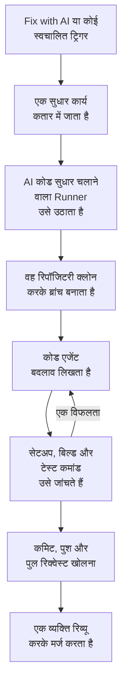

# सुधार कार्य

सुधार कार्य एक पुल रिक्वेस्ट है जिसे OneUptime AI आपके कोड में लिखता है। आप इसे किसी अपवाद, ट्रेस, सेवा या जांच से शुरू करते हैं, या OneUptime इसे खुद शुरू करता है; एक [Runner](/docs/runbooks/agents) रिपॉजिटरी क्लोन करता है, नई ब्रांच पर बदलाव लिखता है, उसे बिल्ड और टेस्ट करता है, और पुल रिक्वेस्ट खोलता है। हर एक को कोई व्यक्ति रिव्यू और मर्ज करता है: Runner ब्रांच पुश कर सकता है और पुल रिक्वेस्ट खोल सकता है, इससे ज़्यादा कुछ नहीं।

:::cards
- [सुधार रन कैसे चलता है](#सुधार-रन-कैसे-चलता-है): एक क्लिक से पुल रिक्वेस्ट तक, कदम-दर-कदम।
- [सुधार कार्य कहां से शुरू होते हैं](#सुधार-कार्य-कहां-से-शुरू-होते-हैं): वे बटन जो इसे शुरू करते हैं, और हर पुल रिक्वेस्ट क्या करता है।
- [शुरू करने से पहले](#शुरू-करने-से-पहले): एक मॉडल, एक कनेक्टेड रिपॉजिटरी और एक Runner।
- [जब सुधार विफल हो](#जब-सुधार-विफल-हो): उस रन का क्या होता है जो त्रुटि देता है, अटक जाता है या इंतज़ार करता है।
:::

> [!TIP]
> आप इसे GitHub से भी शुरू कर सकते हैं। किसी issue या पुल रिक्वेस्ट में OneUptime GitHub App का ज़िक्र करें और वह वहीं लागू करता है, संशोधित करता है या रिव्यू करता है: देखें [GitHub App](/docs/ai/github-app)। यह वही एजेंट, वही Runner और वही बजट है; सिर्फ़ ट्रिगर अलग है।

## सुधार रन कैसे चलता है



1. आप किसी अनसुलझे अपवाद पर **Fix with AI** पर क्लिक करते हैं, या कोई दूसरा बटन या ट्रिगर कार्य शुरू करता है (देखें [सुधार कार्य कहां से शुरू होते हैं](#सुधार-कार्य-कहां-से-शुरू-होते-हैं))।
2. कार्य कतार में जाता है, और **AI कोड सुधार चलाता है** चालू वाला कोई उपलब्ध Runner उसे उठा लेता है।
3. Runner कार्य का संदर्भ लाता है। किसी अपवाद के लिए यह उसका प्रकार, उसका संदेश और उसका स्टैक ट्रेस है।
4. वह रिपॉजिटरी को अपने अलग वर्कस्पेस में क्लोन करता है और एक ब्रांच बनाता है। किसी अपवाद के सुधार का नाम `oneuptime-fix-exception-` होता है, जिसके बाद रन की id के पहले अक्षर आते हैं।
5. आपके प्रोजेक्ट के LLM प्रदाता से चलने वाला एक कोड एजेंट कोड पढ़ता है और बदलाव लिखता है। LLM कॉल OneUptime सर्वर करता है, इसलिए Runner के पास आपके प्रदाता की API कुंजी कभी नहीं होती, और हर कॉल मापी जाती है और AI लॉग में दिखती है।
6. अगर रिपॉजिटरी में सत्यापन कमांड हैं, तो आपका अपना Runner कुछ भी कमिट करने से पहले बदलाव को बिल्ड और टेस्ट करता है, और विफलता को ठीक करने के लिए कोड एजेंट को लौटाता है (देखें [पुल रिक्वेस्ट से पहले सत्यापन](#पुल-रिक्वेस्ट-से-पहले-सत्यापन))।
7. Runner कमिट करता है, ब्रांच पुश करता है, पुल रिक्वेस्ट खोलता है और वर्कस्पेस मिटा देता है।

जिस पेज से कार्य शुरू हुआ था, वह उसकी लाइव स्थिति दिखाता है। हर कार्य **उत्पाद → कोड → कार्य** के तहत सूचीबद्ध है: किसी एक को खोलकर उसका **अवलोकन**, उसके **लॉग** (Runner ने जो भी फ़ाइल पढ़ी या लिखी और जो भी कमांड चलाई, हर एक के लिए एक पंक्ति) और उसके **पुल रिक्वेस्ट** देखें।

हर रन उन बजट के भीतर रहता है जिन्हें सर्वर लागू करता है: अधिकतम **40 LLM कॉल** और **100,000 आउटपुट टोकन**। जो रन इनमें से किसी तक पहुंचता है, वह लूप में घूमने के बजाय अब तक के काम के सारांश के साथ खत्म होता है। सुधार रन प्रोजेक्ट की दैनिक AI सीमाओं में भी गिने जाते हैं, जब प्रोजेक्ट उन्हें तय करता है।

## सुधार कार्य कहां से शुरू होते हैं

| कहां | क्लिक | पुल रिक्वेस्ट |
| --- | --- | --- |
| किसी अपवाद का **AI Assistance** पेज | **Fix with AI** | अपवाद के पीछे का बग ठीक करता है। |
| किसी अपवाद का **AI Assistance** पेज | **Generate Regression Test** | एक टेस्ट जोड़ता है जो अपवाद को दोहराता है और बग ठीक होने तक विफल होता है। |
| किसी अपवाद का **AI Assistance** पेज | **Improve Error Handling** | किसी अपेक्षित त्रुटि के लिए, जैसे अमान्य इनपुट: संदेश से उपयोगकर्ता डेटा हटाता है, इनपुट को पहले ही सत्यापित करता है और व्यवहार बदले बिना त्रुटि को संभाली गई के रूप में चिह्नित करता है। |
| किसी घटना या अलर्ट का **AI Investigation** कार्ड | **Open Fix PR from this analysis** | जांच द्वारा पोस्ट किए गए मूल कारण को ठीक करता है (देखें [जांचों से स्वचालित कोड सुधार](#जांचों-से-स्वचालित-कोड-सुधार))। |
| एक ट्रेस | **Fix performance with AI** | ट्रेस में मिले धीमे पैटर्न को ठीक करता है, जैसे N+1 क्वेरी या एक हावी धीमा span। |
| किसी सेवा का **लॉग** पेज | **Improve Logging** | व्यवहार बदले बिना सेवा के लॉग को संरचित, सही गंभीरता वाला और उसके ट्रेस से जुड़ा बनाता है। |
| किसी सेवा का **ट्रेस** पेज | **Improve Tracing** | व्यवहार बदले बिना वहां span और एट्रिब्यूट जोड़ता है जहां सेवा की ट्रेसिंग नहीं है। |

किसी अपवाद का **AI Assistance** पेज खोलने के लिए, **उत्पाद → अवलोकनीयता → अपवाद** के तहत अपवाद खोलें और उसके साइड मेन्यू में **AI Assistance** चुनें। सुलझे हुए या संग्रहीत अपवाद को पहले अनसुलझा चिह्नित करना होगा।

OneUptime AI खुद भी सुधार कार्य शुरू करता है: ऐसी जांच से जो कोड बदलाव पाती है, ऐसी जांच से जो टेलीमेट्री न होने के कारण बिना निष्कर्ष के खत्म होती है, और अपवादों व धीमे ट्रेस के बारे में AI Insights से। हर एक का अपना स्विच है; देखें [स्वचालित कोड सुधार](/docs/ai/ai-sre#स्वचालित-कोड-सुधार)।

## पुल रिक्वेस्ट से पहले सत्यापन

एक कोड रिपॉजिटरी अपने **सेटिंग्स** पेज पर, **कोड रिपॉजिटरीज़** के तहत, अधिकतम तीन सत्यापन कमांड रख सकती है:

| कमांड | उदाहरण | यह कब चलती है |
| --- | --- | --- |
| **Setup Command** | `npm ci` | सबसे पहले, निर्भरताएं इंस्टॉल करने के लिए। |
| **Build Command** | `npm run build` | सेटअप के बाद। |
| **Test Command** | `npm test` | सबसे आखिर में। |

जब इनमें से कोई सेट हो, तो हर सुधार रन पुल रिक्वेस्ट खुलने से पहले अपना बदलाव जांचता है:

1. जब कोड एजेंट काम पूरा कर लेता है, तो कमांड क्रम से रिपॉजिटरी के रूट में, Runner पर, क्लोन किए गए वर्कस्पेस में चलती हैं। हर एक को अधिकतम 15 मिनट मिलते हैं और वह `CI=true` के साथ चलती है, ताकि कुछ भी किसी प्रॉम्प्ट का इंतज़ार न करे; पहली विफलता पूरा दौर रोक देती है।
2. विफलता होने पर, विफल कमांड के आउटपुट का अंतिम हिस्सा उसी कोड एजेंट के पास मरम्मत कार्य के रूप में लौटता है, इस निर्देश के साथ कि वह टेस्ट कमज़ोर करने या छोड़ने के बजाय अपना बदलाव ठीक करे, और कमांड फिर से चलती हैं। वह अधिकतम **2** मरम्मत प्रयास करता है। वे रन का LLM बजट साझा करते हैं, और उनके बदलाव सुधार वाले कमिट में ही जाते हैं।
3. नतीजा, पास, फ़ेल या छोड़ा गया (कोई कमांड सेट नहीं, या साझा Runner), पुल रिक्वेस्ट के विवरण के Verification सेक्शन में लिखा जाता है और कार्य के पुल रिक्वेस्ट पर दर्ज होता है।

जो बदलाव फिर भी सत्यापन में विफल रहता है, उसे फेंका नहीं जाता: पुल रिक्वेस्ट फिर भी खुलता है, साफ़ चिह्नित "Verification failed" सेक्शन के साथ जो विफल कमांड का नाम बताता है और उसके आउटपुट के साथ खत्म होता है। काम बना रहता है, और रिव्यू करने वाला फ़ैसला करता है। जिस रिपॉजिटरी में कोई कमांड सेट नहीं है, उसे हरे बिल्ड का संकेत देने के बजाय छोड़ा गया बताया जाता है।

कमांड रिपॉजिटरी सेटिंग्स हैं जिन्हें आपकी टीम लिखती है, और वे आपके अपने Runner पर चलती हैं: वही भरोसे का मॉडल जो किसी रनबुक के Bash चरणों का है। AI उन्हें कभी नहीं लिखता या बदलता। OneUptime के साझा Runner उन्हें कभी नहीं चलाते: साझा Runner पर सुधार लिखा जाता है और समीक्षा के लिए खोला जाता है, सत्यापन को छोड़ा गया बताया जाता है, और आपकी रिपॉजिटरी का अपना CI बदलाव की जाँच करता है। पुल रिक्वेस्ट खुलने से पहले सुधारों को बिल्ड और टेस्ट करवाने के लिए [अपना खुद का Runner चलाएं](#अपना-खुद-का-runner-चलाएं)।

## शुरू करने से पहले

सुधार कार्य को तीन चीज़ों की ज़रूरत होती है। अपवाद का **AI Assistance** पेज शुरू करने की पेशकश से पहले तीनों की जांच करता है, और बताता है कि क्या कमी है।

| क्या | OneUptime Cloud | सेल्फ-होस्टेड |
| --- | --- | --- |
| एक LLM प्रदाता | कुछ सेट नहीं करना है: जिस प्रोजेक्ट का अपना प्रदाता नहीं है, वह ग्लोबल प्रदाता का उपयोग करता है, जिसका भुगतान प्रोजेक्ट के AI क्रेडिट से होता है। **प्रोजेक्ट सेटिंग्स → एआई → LLM प्रदाता** के तहत आपका अपना प्रदाता पहले आता है। | सर्वर पर एक बार `GLOBAL_LLM_PROVIDER_*` एनवायरनमेंट वेरिएबल सेट करें, या प्रोजेक्ट में एक प्रदाता जोड़ें। |
| GitHub App से कनेक्ट की गई रिपॉजिटरी | **उत्पाद → कोड → कार्य**, फिर **कोड रिपॉजिटरीज़** और **Connect with GitHub App**। अगर ऐप GitHub खाते पर पहले से इंस्टॉल है, तो इसके बजाय **मौजूदा इंस्टॉलेशन कनेक्ट करें** पर क्लिक करें: उसे फिर से इंस्टॉल करने से वह कनेक्ट नहीं होता। Growth प्लान चाहिए। | वही, जब आपके इंस्टेंस के पास GitHub App हो (देखें [GitHub इंटीग्रेशन](/docs/self-hosted/github-integration))। |
| AI कोड सुधार चलाने वाला Runner | कुछ चलाना नहीं है: OneUptime के साझा Runner यह करते हैं। | Docker Compose की `runner` सेवा, या Helm चार्ट का Runner (`runner.enabled`, डिफ़ॉल्ट रूप से चालू), खुद को रजिस्टर करता है और AI कोड सुधार चलाता है। |

सेल्फ-होस्टेड इंस्टेंस पर, ग्लोबल प्रदाता `config.env` (Docker Compose) का या आपकी Helm वैल्यू का एक ब्लॉक है। सेल्फ-होस्टेड Ollama के लिए:

```bash
GLOBAL_LLM_PROVIDER_TYPE=Ollama
# An address the OneUptime server can reach, never localhost.
GLOBAL_LLM_PROVIDER_BASE_URL=http://ollama:11434
GLOBAL_LLM_PROVIDER_MODEL_NAME=llama3.1
# No GLOBAL_LLM_PROVIDER_API_KEY needed — Ollama is keyless.
```

कोई भी समर्थित प्रदाता काम करता है: सभी प्रदाताओं और हर एनवायरनमेंट वेरिएबल के लिए देखें [LLM प्रदाता](/docs/ai/llm-provider)।

आप रिपॉजिटरी को सेवाओं से नहीं जोड़ते। जब कोई कार्य शुरू होता है, तो OneUptime अपवाद के स्टैक ट्रेस के फ़ाइल पाथ को आपकी कनेक्टेड रिपॉजिटरी से मिलाकर रिपॉजिटरी ढूंढता है। अगर कुछ मेल नहीं खाता, तो वह सेवा जैसे नाम वाली रिपॉजिटरी पर जाता है, और फिर प्रोजेक्ट की इकलौती रिपॉजिटरी पर, जब सिर्फ़ एक हो। **AI Assistance** पेज दिखाता है कि उसे कौन-सी रिपॉजिटरी मिली।

### अपना खुद का Runner चलाएं

Runner को कहीं और चलाने के लिए, उदाहरण के लिए आपकी रिपॉजिटरी के पास की किसी मशीन पर:

:::steps
### Runner बनाएं

**रनबुक → Runbook एजेंट** के तहत एक Runner बनाएं और उसकी पंक्ति में **सेटअप निर्देश दिखाएं** पर क्लिक करें। कमांड में Runner की गुप्त कुंजी होती है, जिसे सिर्फ़ Project Owner, Project Admin या Runbook Admin पढ़ सकता है। यह ऐसा दिखता है:

```bash
docker run --name oneuptime-runner --restart unless-stopped \
  -e ONEUPTIME_RUNNER_ID=<runner-id> \
  -e ONEUPTIME_RUNNER_KEY=<runner-key> \
  -e ONEUPTIME_URL=<your-oneuptime-url> \
  -d oneuptime/runner:release
```

### AI कोड सुधार चालू करें

Runner पर **AI कोड सुधार चलाता है** चालू करें। यह डिफ़ॉल्ट रूप से बंद होता है, और Runner अपनी अगली heartbeat पर, लगभग एक मिनट के भीतर, बदलाव ले लेता है; कुछ भी रीस्टार्ट नहीं करना है।

### जांचें कि यह कनेक्ट होता है

Runner एक-दो मिनट में **रनबुक → Runbook एजेंट** पेज पर कनेक्टेड दिखता है। अगर नहीं, तो क्रेडेंशियल या नेटवर्क त्रुटि के लिए कंटेनर का लॉग (`docker logs oneuptime-runner`) पढ़ें।
:::

कंटेनर चलाने का कोई भी तरीका काम करता है (Docker Compose, Kubernetes वगैरह), बशर्ते उसके पास ये वेरिएबल हों और वह HTTPS पर आपके OneUptime इंस्टेंस तक पहुंच सके:

| वेरिएबल | यह क्या है |
| --- | --- |
| `ONEUPTIME_RUNNER_ID` | Runner की id, डैशबोर्ड से। |
| `ONEUPTIME_RUNNER_KEY` | Runner की गुप्त कुंजी। |
| `ONEUPTIME_URL` | आपके OneUptime इंस्टेंस का पता (OneUptime Cloud पर `https://oneuptime.com`)। |

> [!NOTE]
> OneUptime 12 से पहले, AI कोड सुधार एक अलग AI Agent कंपोनेंट पर चलते थे (`AI_AGENT_*` वेरिएबल वाली `oneuptime/ai-agent` इमेज)। यह Runner में मिल गया है: अगर आप अब भी इसे चलाते हैं, तो [v11 से v12 अपग्रेड गाइड](/docs/installation/upgrading) बताती है कि इसे कैसे बदलें।

## जांचों से स्वचालित कोड सुधार

जब कोई [AI जांच](/docs/ai/ai-sre) किसी घटना या अलर्ट पर मूल कारण विश्लेषण पोस्ट करती है, और उसका सावधान वर्गीकरण कोड में बदलाव की सिफ़ारिश करता है, तो जांच कार्ड **Open Fix PR from this analysis** पेश करता है: एक सुधार कार्य जिसका पूरा संदर्भ पोस्ट किया गया विश्लेषण है। बटन तब छिपा रहता है जब उपाय परिचालन संबंधी हो, सिर्फ़ इंफ्रास्ट्रक्चर का हो, बाहरी हो, अपेक्षित इनकार हो, उपयोगकर्ता की गलती हो, या निष्कर्षहीन हो। जब तक स्विच **जब किसी जांच में कोड में बदलाव मिले, तो फ़िक्स पुल रिक्वेस्ट खोलें** चालू है, योग्य सुधार बिना क्लिक के होते हैं। यह सुधार का हिस्सा है: यह **घटनाएं → एआई → सेटिंग्स** पर **नई घटनाओं को अपने आप ठीक करें** के नीचे है (और **अलर्ट → एआई → सेटिंग्स** पर **नए अलर्ट को अपने आप ठीक करें** के नीचे), सुधार चालू होने पर चालू हो जाता है, और सिर्फ़ तभी पुल रिक्वेस्ट खोलता है जब सुधार चालू हो। दोनों बंद से शुरू होते हैं, नए प्रोजेक्ट में भी।

जब तक यह चालू है, जो जांच एक भरोसेमंद, सबूत वाले मूल कारण के साथ खत्म होती है जिसे कोड बदलाव ठीक कर सकता है, वह वही सुधार कार्य कतार में डालती है जो बटन बनाता है। फ़ैसला एक सीमित वर्गीकरण है जिसे सर्वर जांचता है, विश्लेषण के टेक्स्ट से मिलाया गया कोई पैटर्न कभी नहीं: सिर्फ़ कोड सुधार का सकारात्मक निर्णय ही पुल रिक्वेस्ट खोलता है। सबूत की कमी, कोड से बाहर का उपाय और विफल वर्गीकरण, सभी का नतीजा कुछ न करना होता है।

बाकी सब बटन जैसा ही है:

- पुल रिक्वेस्ट रिव्यू के लिए तैयार खुलता है, पोस्ट किए गए विश्लेषण से लिखा हुआ, और उसे GitHub App से कनेक्ट की गई रिपॉजिटरी और **AI कोड सुधार चलाता है** चालू वाला Runner चाहिए।
- यह उस सिग्नल की दैनिक सुधार-कार्य सीमा (**Daily Incident AI Fix Task Limit** या **Daily Alert AI Fix Task Limit**, उसके AI सेटिंग्स पेज पर **और सेटिंग्स** के तहत) और रिपॉजिटरी के खुले पुल रिक्वेस्ट की सीमा में गिना जाता है, जब इनमें से कोई सेट हो। सेट न होने पर, कोई भी कुछ सीमित नहीं करता।
- हर ट्रिगर पहले उसी घटना या अलर्ट के लिए पहले से कतार में या चल रहे सुधार कार्य को खोजता है, इसलिए एक स्वचालित ट्रिगर और एक क्लिक आम तौर पर एक कार्य बनते हैं, दो पुल रिक्वेस्ट नहीं। यह जांच लिखने से पहले की एक रीड है, लॉक नहीं, इसलिए ठीक एक ही पल में आए दो ट्रिगर अब भी दोनों निकल सकते हैं।
- रन सिस्टम लिखता है, उसका श्रेय किसी को नहीं जाता, और कुछ भी अपने आप मर्ज नहीं होता।

## जब सुधार विफल हो

:::details रन में त्रुटि आती है
सुधार लागू नहीं हो सका, रिपॉजिटरी तक नहीं पहुंचा जा सका, या LLM कॉल विफल हुई। जिस पेज से कार्य शुरू हुआ था, वह कारण दिखाता है और फिर से कोशिश करने की पेशकश करता है। कार्य के **लॉग** पेज पर पूरा रन लॉग है।
:::

:::details Runner रन के बीच में रुक जाता है
जिस रन की heartbeat 12 मिनट से ज़्यादा समय से चुप है, उसे त्रुटि के साथ विफल कर दिया जाता है। वह कभी अपने आप फिर से कतार में नहीं जाता, क्योंकि Runner सुधार ब्रांच का कुछ हिस्सा पहले ही पुश कर चुका हो सकता है; उसे वहीं से फिर शुरू करें जहां से आपने शुरू किया था।
:::

:::details कोई Runner कार्य नहीं उठाता
जो कार्य 30 मिनट से ज़्यादा इंतज़ार करता है जबकि **AI कोड सुधार चलाता है** वाला कोई Runner कनेक्ट नहीं है, वह Runner जांचने के संदेश के साथ विफल हो जाता है, ताकि वह हमेशा प्रगति में न दिखे। जब कोई Runner ऑनलाइन लेकिन व्यस्त हो, तो कतार के कार्य अपनी बारी का इंतज़ार करते हैं।
:::

## गोपनीयता

आपकी रिपॉजिटरी का क्लोन Runner के कंटेनर के अंदर एक वर्कस्पेस में रहता है और रन खत्म होने पर मिटा दिया जाता है, चाहे वह सफल रहा हो या नहीं। Runner के पास आपके LLM प्रदाता की API कुंजी कभी नहीं होती: OneUptime सर्वर उसके लिए LLM कॉल करता है। OneUptime आपकी रिपॉजिटरी नहीं रखता और आपके कोड पर प्रशिक्षण नहीं करता। कार्य का लॉग हर चरण के आउटपुट के पहले 300 अक्षर रखता है, ताकि आप जांच सकें कि Runner ने क्या किया, और इसमें कोड के टुकड़े हो सकते हैं। अपने LLM प्रदाता (लोकल Ollama सहित) के साथ सेल्फ-होस्टेड Runner चलाएं, और आपका कोड कभी आपके इंफ्रास्ट्रक्चर से बाहर नहीं जाता।

## रोडमैप पर

योजना में है, और **आज उपलब्ध नहीं**:

- **GitLab समर्थन।** रिपॉजिटरी सिर्फ़ GitHub App के ज़रिए कनेक्ट होती हैं।
- **एक सुधार में ज़्यादा टेलीमेट्री।** किसी अपवाद के आसपास के ट्रेस, लॉग और मेट्रिक्स को स्टैक ट्रेस से आगे बढ़कर उसके सुधार में शामिल करना।

## अगले कदम

:::cards
- [GitHub App](/docs/ai/github-app): GitHub से ही बदलाव, संशोधन या रिव्यू मांगें।
- [AI SRE](/docs/ai/ai-sre): वे जांचें जिनके विश्लेषणों को सुधार कार्य पुल रिक्वेस्ट में बदल सकते हैं।
- [Runbook एजेंट](/docs/runbooks/agents): वह वर्कर जो हर सुधार रन पूरा करता है।
:::
