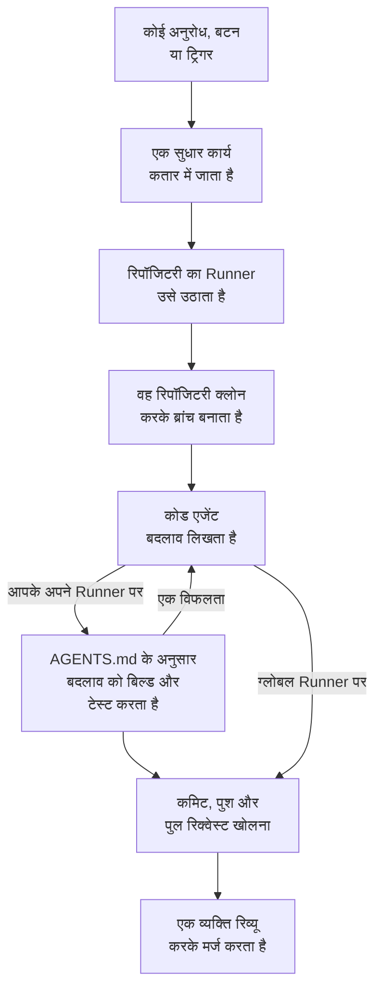

# कोड

कोड वह जगह है जहां आप OneUptime AI से अपनी रिपॉजिटरी में काम करने को कहते हैं, ठीक वैसे ही जैसे किसी कोडिंग एजेंट से कहते: कोई बग ठीक करना, टेस्ट लिखना, कोड समझाना, कोई बदलाव करना। यह उस बॉक्स के साथ खुलता है जहां आप पूछते हैं, जिसमें रिपॉजिटरी और ब्रांच चुनी जाती है और उसके नीचे सभी कार्य होते हैं; किसी कार्य का पेज एक बातचीत है जिसमें आप जवाब दे सकते हैं। OneUptime खुद भी अपवादों, ट्रेस और जांचों से कार्य शुरू करता है। एक [Runner](/docs/runbooks/agents) रिपॉजिटरी क्लोन करता है, नई ब्रांच पर बदलाव लिखता है, उसे बिल्ड और टेस्ट करता है, और पुल रिक्वेस्ट खोलता है। हर एक को कोई व्यक्ति रिव्यू और मर्ज करता है: Runner ब्रांच पुश कर सकता है और पुल रिक्वेस्ट खोल सकता है, इससे ज़्यादा कुछ नहीं।

:::cards
- [किसी रिपॉजिटरी में AI से कहें](#किसी-रिपॉजिटरी-में-ai-से-कहें): आपके अपने शब्दों में एक अनुरोध, उस संदर्भ के साथ जिसकी उसे ज़रूरत है।
- [किसी कार्य की बातचीत](#किसी-कार्य-की-बातचीत): AI ने क्या किया, क्या बदला, और आपका जवाब।
- [सुधार रन कैसे चलता है](#सुधार-रन-कैसे-चलता-है): एक क्लिक से पुल रिक्वेस्ट तक, कदम-दर-कदम।
- [सुधार कार्य कहां से शुरू होते हैं](#सुधार-कार्य-कहां-से-शुरू-होते-हैं): वे कार्य जो OneUptime शुरू करता है, और हर पुल रिक्वेस्ट क्या करता है।
- [सुधार में प्रोडक्शन टेलीमेट्री](#सुधार-में-प्रोडक्शन-टेलीमेट्री): बदलाव लिखते समय कोई सुधार प्रोडक्शन से क्या पढ़ता है।
- [पुल रिक्वेस्ट की प्रोडक्शन समीक्षा](#पुल-रिक्वेस्ट-की-प्रोडक्शन-समीक्षा): हर पुल रिक्वेस्ट जिस कोड को बदलता है, उसके बारे में प्रोडक्शन क्या कहता है।
- [रिपॉजिटरी जोड़ना](#रिपॉजिटरी-जोड़ना): GitHub, GitLab, Forgejo या Gitea, या कोई भी Git सर्वर।
- [शुरू करने से पहले](#शुरू-करने-से-पहले): एक मॉडल, एक कनेक्टेड रिपॉजिटरी और एक Runner।
- [जब सुधार विफल हो](#जब-सुधार-विफल-हो): उस रन का क्या होता है जो त्रुटि देता है, अटक जाता है या इंतज़ार करता है।
:::

> [!TIP]
> आप इसे GitHub से भी शुरू कर सकते हैं। किसी issue या पुल रिक्वेस्ट में OneUptime GitHub App का ज़िक्र करें और वह वहीं लागू करता है, संशोधित करता है या रिव्यू करता है: देखें [GitHub App](/docs/ai/github-app)। यह वही एजेंट, वही Runner और वही बजट है; सिर्फ़ ट्रिगर अलग है।

## किसी रिपॉजिटरी में AI से कहें

:::steps
### कोड खोलें

**उत्पाद → कोड** खोलें। यह **AI को क्या करना चाहिए?** के साथ खुलता है: वह बॉक्स जहां आप पूछते हैं, उसके नीचे सभी कार्य, सबसे नए पहले। अभी कोई रिपॉजिटरी न हो, तो इसके बजाय यह **GitHub जोड़ें** पेश करता है, और उसके नीचे GitLab, Forgejo या Gitea और कोई भी Git सर्वर (देखें [रिपॉजिटरी जोड़ना](#रिपॉजिटरी-जोड़ना))। साइड मेन्यू में **रिपॉजिटरी** उन रिपॉजिटरी की सूची दिखाता है जिनमें AI काम कर सकता है, और जिन तक OneUptime अब नहीं पहुंचता, उन्हें **कनेक्ट नहीं है** के नीचे समेट देता है। हर रिपॉजिटरी के पेज पर उसी रिपॉजिटरी के लिए वही बॉक्स होता है।

### रिपॉजिटरी और ब्रांच चुनें

बॉक्स उस रिपॉजिटरी से शुरू होता है जिसे आपने पिछली बार चुना था। उसकी निचली पंक्ति में कोई दूसरी चुनें, और उसके बगल में वह ब्रांच जिससे कार्य शुरू होता है: जब तक आप कोई दूसरी न चुनें, यह रिपॉजिटरी की मुख्य ब्रांच है, जिस पर **डिफ़ॉल्ट** लिखा होता है। AI आपकी चुनी हुई ब्रांच से अपनी ब्रांच बनाता है और उसी में अपना पुल रिक्वेस्ट खोलता है।

### बताएं कि आप क्या चाहते हैं

बदलाव, बग या सवाल अपने शब्दों में लिखें। जब तक कुछ पूछा न गया हो, कोड **ऐसे पूछकर देखें** के नीचे कुछ सुझाव देता है।

### संदर्भ जोड़ें

AI को जो चाहिए वह देने के लिए **संदर्भ जोड़ें** पर क्लिक करें: रिपॉजिटरी की कोई फ़ाइल या फ़ोल्डर, कोई नोट, कोई लिंक, या प्रोजेक्ट का कोई रिकॉर्ड। अनुरोध भेजते समय OneUptime हर रिकॉर्ड को आपकी अनुमतियों से पढ़ता है, और AI को जो दिया गया उसे सहेजकर रखता है।

### कार्य शुरू करें

**कार्य शुरू करें** पर क्लिक करें, या Enter दबाएं। कार्य का पेज खुलता है, और AI का काम वहीं होते-होते दिखता है।
:::

| संदर्भ | AI को क्या मिलता है |
| --- | --- |
| **फ़ाइल या फ़ोल्डर** | रिपॉजिटरी में एक पाथ, जिसे AI सबसे पहले पढ़ता है। |
| **नोट** | आपका चिपकाया हुआ टेक्स्ट: कोई त्रुटि, कोई स्पेसिफ़िकेशन, लॉग की कोई पंक्ति। |
| **लिंक** | संदर्भ के तौर पर एक वेब पता। |
| **घटना** या **अलर्ट** | उसकी स्थिति, विवरण और मूल कारण, जैसे वे अनुरोध भेजते समय हैं। |
| **अपवाद** | उसका संदेश और स्टैक ट्रेस। |
| **मॉनिटर** | उसका प्रकार, स्थिति और विवरण। |
| **ट्रेस** | उसके स्पैन: उनके नाम, समय और त्रुटियां। |
| **लॉग** | आपकी खोज वाली नवीनतम 20 लॉग पंक्तियां, पिछले एक घंटे, दिन या हफ़्ते से। |
| **प्रदर्शन प्रोफ़ाइल** | किसी फ़ंक्शन का समय उसकी सेवा की प्रोफ़ाइल में कहाँ जाता है: उसे कौन कॉल करता है, वह क्या कॉल करता है और उसकी सबसे गर्म लाइनें। |

एक अनुरोध में ज़्यादा से ज़्यादा 10 संदर्भ हो सकते हैं। OneUptime जो पढ़ता है उसमें मौजूद टोकन, कुंजियां, पासवर्ड और ईमेल पते AI के देखने से पहले छिपा दिए जाते हैं, जैसे हर उस जगह होता है जहां OneUptime AI आपका डेटा पढ़ता है।

## किसी कार्य की बातचीत

किसी कार्य का पेज एक बातचीत है: क्या पूछा गया और कौन सा संदर्भ जोड़ा गया, फिर AI की बारी – वह जो कदम उठाता है वे उठाते-उठाते दिखते हैं (उसने कौन सी फ़ाइलें पढ़ीं और बदलीं, क्या खोजा, कौन सी कमांड चलाईं), उसका जवाब, उसकी बदली हुई फ़ाइलें उनके diff के साथ, और पुल रिक्वेस्ट। पेज के ऊपर लिखा होता है कि कार्य कहां काम करता है (उसकी रिपॉजिटरी और वह ब्रांच जिससे वह शुरू हुआ), उसने कितनी पंक्तियां बदलीं, उसके पुल रिक्वेस्ट का एक बटन, और कार्य किस स्थिति में है:

| स्थिति | इसका मतलब |
| --- | --- |
| **कतार में** | यह किसी Runner के उठाने की प्रतीक्षा कर रहा है। |
| **काम जारी है…** | AI इस पर काम कर रहा है। **रोकें** इसे रोकता है; जो उसने पुश किया, वह ब्रांच पर रहता है। |
| **आपकी प्रतीक्षा में** | AI ने एक सवाल पूछा है। नीचे के बॉक्स में जवाब दें। |
| **हो गया** | AI ने काम पूरा किया: उसका जवाब, और कोड बदलने पर पुल रिक्वेस्ट। |
| **विफल** | बारी पूरी नहीं हो सकी, और वजह बताती है। **फिर से प्रयास करें** वही बात फिर से कहता है। |
| **रोका गया** | किसी ने इसे रोक दिया। **फिर से प्रयास करें** वही बात फिर से कहता है। |

आगे बढ़ने के लिए, सबसे नीचे के बॉक्स में लिखें, जो बातचीत स्क्रॉल होने पर भी दिखता रहता है: AI को जवाब दें, संदर्भ जोड़ें, या बदलाव मांगें। हर जवाब उसी कार्य की अगली बारी है: पुल रिक्वेस्ट खुला रहने तक वह उसी ब्रांच पर काम करती है और उसी पुल रिक्वेस्ट में पुश करती है। एक कार्य एक समय में एक ही बारी लेता है, इसलिए AI के काम करते समय बॉक्स इंतज़ार करता है। हर बारी का **लॉग** उसके किए हुए काम का शब्दशः रिकॉर्ड है। एक से ज़्यादा बारी वाले कार्य में, **लॉग** पेज के ऊपर एक चयनकर्ता उसकी बारियों के बीच ले जाता है।

जो कोई रिपॉजिटरी पढ़ सकता है, वह उसके कार्य भी पढ़ता है। AI से कहने, जवाब देने और कार्य रोकने के लिए रिपॉजिटरी में बदलाव की अनुमति चाहिए, और किसी बदलाव का diff देखने के लिए भी: बाकी सभी देखते हैं कि कौन सी फ़ाइलें बदलीं। OneUptime जो कार्य खुद शुरू करता है (नीचे), वे भी अपनी रिपॉजिटरी में होते हैं, ऐसी बातचीत के रूप में जिनमें आप जवाब दे सकते हैं।

## सुधार रन कैसे चलता है



1. आप कोड में **कार्य शुरू करें** पर, या किसी अनसुलझे अपवाद पर **AI से ठीक करें** पर क्लिक करते हैं, या कोई दूसरा बटन या ट्रिगर कार्य शुरू करता है (देखें [सुधार कार्य कहां से शुरू होते हैं](#सुधार-कार्य-कहां-से-शुरू-होते-हैं))।
2. कार्य अपनी रिपॉजिटरी की कतार में जाता है, और रिपॉजिटरी जिस Runner पर काम करती है वह उसे उठा लेता है: वह जिसे वह चुनती है, वरना प्रोजेक्ट का डिफ़ॉल्ट Runner, वरना कोई ग्लोबल Runner ([रिपॉजिटरी का Runner चुनें](#रिपॉजिटरी-का-runner-चुनें) देखें)।
3. Runner कार्य का संदर्भ लाता है। किसी अनुरोध के लिए यह उसके शब्द, जोड़ा गया संदर्भ और अब तक की बातचीत है; किसी अपवाद के लिए उसका प्रकार, उसका संदेश और उसका स्टैक ट्रेस।
4. वह रिपॉजिटरी को अपने अलग वर्कस्पेस में क्लोन करता है और एक ब्रांच बनाता है। किसी अपवाद के सुधार का नाम `oneuptime-fix-exception-` होता है, जिसके बाद रन की id के पहले अक्षर आते हैं। कोई अनुरोध उस ब्रांच से शुरू होता है जो पूछते समय चुनी गई थी, और उसका पुल रिक्वेस्ट उसी में खुलता है। जवाब इसके बजाय कार्य के खुले पुल रिक्वेस्ट की ब्रांच पर काम करता है।
5. आपके प्रोजेक्ट के LLM प्रदाता से चलने वाला एक कोड एजेंट कोड पढ़ता है और बदलाव लिखता है। LLM कॉल OneUptime सर्वर करता है, इसलिए Runner के पास आपके प्रदाता की API कुंजी कभी नहीं होती, और हर कॉल मापी जाती है और AI लॉग में दिखती है। किसी अपवाद, धीमे ट्रेस या घटना का सुधार काम करते समय प्रोडक्शन भी पढ़ता है: रिपॉजिटरी की सेवाओं के अपवाद, ट्रेस, लॉग और मेट्रिक्स (देखें [सुधार में प्रोडक्शन टेलीमेट्री](#सुधार-में-प्रोडक्शन-टेलीमेट्री))।
6. आपके अपने Runner पर, कोड एजेंट कुछ भी कमिट होने से पहले अपने बदलाव को उसी तरह बिल्ड और टेस्ट करता है जैसे रिपॉजिटरी की `AGENTS.md` कहती है, और जो विफल हो उसे ठीक करता है (देखें [पुल रिक्वेस्ट से पहले सत्यापन](#पुल-रिक्वेस्ट-से-पहले-सत्यापन))।
7. Runner कमिट करता है, ब्रांच पुश करता है, पुल रिक्वेस्ट खोलता है (अनुरोध के लिए सिर्फ़ तब, जब उसने कोड बदला हो) और वर्कस्पेस मिटा देता है।

जिस पेज से कार्य शुरू हुआ था, वह उसकी लाइव स्थिति दिखाता है। हर कार्य **उत्पाद → कोड** में अपनी रिपॉजिटरी के तहत सूचीबद्ध है: उसका पेज उसकी बातचीत है, और हर बारी के **लॉग** में Runner की पढ़ी या लिखी हर फ़ाइल और चलाई गई हर कमांड के लिए एक पंक्ति है।

हर रन उन बजट के भीतर रहता है जिन्हें सर्वर लागू करता है: अधिकतम **40 LLM कॉल** और **100,000 आउटपुट टोकन**। किसी रन की प्रोडक्शन टेलीमेट्री क्वेरी भी उन्हीं 40 कॉल में गिनी जाती हैं। जो रन इनमें से किसी तक पहुंचता है, वह लूप में घूमने के बजाय अब तक के काम के सारांश के साथ खत्म होता है। सुधार रन प्रोजेक्ट की दैनिक AI सीमाओं में भी गिने जाते हैं, जब प्रोजेक्ट उन्हें तय करता है।

## सुधार कार्य कहां से शुरू होते हैं

| कहां | क्लिक | पुल रिक्वेस्ट |
| --- | --- | --- |
| किसी अपवाद का **AI Assistance** पेज | **AI से ठीक करें** | अपवाद के पीछे का बग ठीक करता है। |
| किसी अपवाद का **AI Assistance** पेज | **Generate Regression Test** | एक टेस्ट जोड़ता है जो अपवाद को दोहराता है और बग ठीक होने तक विफल होता है। |
| किसी अपवाद का **AI Assistance** पेज | **त्रुटि प्रबंधन सुधारें** | किसी अपेक्षित त्रुटि के लिए, जैसे अमान्य इनपुट: संदेश से उपयोगकर्ता डेटा हटाता है, इनपुट को पहले ही सत्यापित करता है और व्यवहार बदले बिना त्रुटि को संभाली गई के रूप में चिह्नित करता है। |
| किसी घटना या अलर्ट का **AI Investigation** कार्ड | **Open Fix PR from this analysis** | जांच द्वारा पोस्ट किए गए मूल कारण को ठीक करता है (देखें [जांचों से स्वचालित कोड सुधार](#जांचों-से-स्वचालित-कोड-सुधार))। |
| ठीक करने लायक ट्रेस | **AI से परफ़ॉर्मेंस ठीक करें** | बटन जिस धीमे पैटर्न का नाम बताता है उसे ठीक करता है, जैसे कोई N+1 क्वेरी या साथ-साथ चल सकने वाली कॉल। |
| किसी सेवा का **लॉग** पेज | **लॉगिंग सुधारें** | व्यवहार बदले बिना सेवा के लॉग को संरचित, सही गंभीरता वाला और उसके ट्रेस से जुड़ा बनाता है। |
| किसी सेवा का **ट्रेस** पेज | **ट्रेसिंग सुधारें** | व्यवहार बदले बिना वहां span और एट्रिब्यूट जोड़ता है जहां सेवा की ट्रेसिंग नहीं है। |
| **प्रदर्शन प्रोफ़ाइल** में कोई फ़ंक्शन | **AI से ठीक करें** | प्रोफ़ाइल को सबूत मानकर फ़ंक्शन से वही काम कम समय या मेमोरी में करवाता है। |

ये बटन सिर्फ़ वहीं दिखते हैं जहाँ ये कोई कार्य शुरू कर सकते हैं। प्रोजेक्ट के लिए AI बंद होने पर इनमें से कोई नहीं दिखता, और किसी अपवाद के साइड मेन्यू में **AI Assistance** नहीं होता। **लॉगिंग सुधारें** और **ट्रेसिंग सुधारें** तब दिखते हैं जब रिपॉज़िटरी जुड़ी हो और कोई चीज़ AI को उसमें काम करने से न रोके, जैसे प्लान, खत्म हो चुके AI क्रेडिट या कोई ऑनलाइन Runner न होना, और **AI से परफ़ॉर्मेंस ठीक करें** सिर्फ़ ठीक करने लायक ट्रेस पर (देखें [ट्रेस एक्सप्लोरर](/docs/telemetry/traces-explorer))। किसी फ़ंक्शन का **AI से ठीक करें** केवल ऐप्लिकेशन के अपने कोड पर दिखता है जो प्रोफ़ाइल के समय या मेमोरी का कम से कम 5% लेता है, या जिसका हिस्सा तुलना वाली अवधि के बाद से 3 अंक या उससे ज़्यादा बढ़ा है ([निरंतर प्रोफ़ाइलिंग](/docs/telemetry/profiles) देखें)।

किसी अपवाद का **AI Assistance** पेज खोलने के लिए, **उत्पाद → अवलोकनीयता → अपवाद** के तहत अपवाद खोलें और उसके साइड मेन्यू में **AI Assistance** चुनें। सुलझे हुए या संग्रहीत अपवाद को पहले अनसुलझा चिह्नित करना होगा।

OneUptime AI खुद भी सुधार कार्य शुरू करता है: ऐसी जांच से जो कोड बदलाव पाती है, ऐसी जांच से जो टेलीमेट्री न होने के कारण बिना निष्कर्ष के खत्म होती है, और अपवादों व धीमे ट्रेस के बारे में AI Insights से। हर एक का अपना स्विच है; देखें [स्वचालित कोड सुधार](/docs/ai/ai-sre#स्वचालित-कोड-सुधार)।

## सुधार में प्रोडक्शन टेलीमेट्री

आपका कोड प्रोडक्शन में क्या करता है, यह OneUptime के पास होता है, इसलिए किसी सुधार को सिर्फ़ स्टैक ट्रेस के भरोसे काम नहीं करना पड़ता। काम करते समय कोड एजेंट उन सेवाओं की प्रोडक्शन टेलीमेट्री पर क्वेरी चला सकता है जिनसे यह रिपॉजिटरी जुड़ी है:

| यह क्या पढ़ता है | किसलिए |
| --- | --- |
| **अपवाद** | दी गई फ़ाइलों या किसी फ़ंक्शन में फेंके गए अपवादों के समूह: पिछले दिनों में कितनी बार, किस रिलीज़ से, और हाल में हुए किसी अपवाद का ट्रेस। |
| **ट्रेस** | किसी एंडपॉइंट या ऑपरेशन की लेटेंसी और त्रुटियों की प्रोफ़ाइल, और किसी एक ट्रेस के स्पैन। |
| **लॉग** | किसी सेवा की लॉग पंक्तियां, समय, गंभीरता, टेक्स्ट या ट्रेस के हिसाब से। |
| **मेट्रिक्स** | किसी सेवा का रिपोर्ट किया गया कोई मेट्रिक, समय के साथ; नाम के बिना, वे मेट्रिक्स जो वह सेवा रिपोर्ट करती है। |
| **घटनाएं** | वे घटनाएं जिन्होंने सेवाओं पर असर डाला, या जिनके लिए इस रिपॉजिटरी में OneUptime का कोई सुधार खोला गया था, उनके मूल कारण और पोस्टमॉर्टम के साथ। |
| **डिप्लॉय** | सेवाओं के हाल के डिप्लॉय और दूसरे बदलाव, हर एक के साथ OneUptime का यह निर्णय कि उसने अपनी सेवा को नुकसान पहुंचाया या नहीं। |

| कार्य | यह क्या जांचता है |
| --- | --- |
| किसी अपवाद पर **AI से ठीक करें** | वह अभी कितनी बार फेंका जाता है और किस रिलीज़ से, उसके लॉग और उसके किसी एक बार होने का ट्रेस। |
| **AI से परफ़ॉर्मेंस ठीक करें** | ऑपरेशन अपने सभी ट्रेस में कितना व्यस्त और कितना धीमा है, सिर्फ़ विश्लेषण किए गए ट्रेस में नहीं। जब ऑपरेशन अब धीमा नहीं रहता, तो यह कुछ नहीं बदलता। |
| **Open Fix PR from this analysis**, और जांचों से अपने आप खुले सुधार | घटना से पहले के डिप्लॉय, उसकी त्रुटियां, लॉग और धीमे ऑपरेशन, और यह कि क्या यह कारण पहले भी सामने आया था। |
| GitHub से `@oneuptime review` | बदले हुए कोड के बारे में प्रोडक्शन क्या कहता है (देखें [प्रोडक्शन संदर्भ के साथ समीक्षाएं](/docs/ai/github-app#प्रोडक्शन-संदर्भ-के-साथ-समीक्षाएं))। |

पुल रिक्वेस्ट का विवरण बताता है कि एजेंट ने क्या क्वेरी किया और उससे क्या पता चला। दूसरे कार्य, जैसे रिग्रेशन टेस्ट और लॉगिंग या ट्रेसिंग में सुधार, प्रोडक्शन पर क्वेरी नहीं चलाते।

एजेंट क्या पढ़ सकता है, यह OneUptime सर्वर खुद कार्य के आधार पर तय करता है:

- **सिर्फ़ पढ़ना।** क्वेरी OneUptime सर्वर पर चलती हैं, Runner पर कभी नहीं, जिसके पास टेलीमेट्री पढ़ सकने वाला कोई क्रेडेंशियल नहीं होता। वे जो भी करें, उससे आपका प्रोजेक्ट नहीं बदल सकता।
- **यह प्रोजेक्ट, और सिर्फ़ वे सेवाएं जिनसे यह रिपॉजिटरी जुड़ी है।** आपको उन्हें जोड़ना नहीं पड़ता: ये वे सेवाएं हैं जिनके लिए OneUptime यह रिपॉजिटरी ढूंढता है, उसी तरह जैसे वह किसी सुधार की रिपॉजिटरी ढूंढता है - उनके अपवादों के स्टैक ट्रेस उसकी फ़ाइलों से होकर गुज़रते हैं, उनका नाम उसके जैसा है, या वह प्रोजेक्ट की इकलौती रिपॉजिटरी है। किसी दूसरी सेवा की टेलीमेट्री नहीं पढ़ी जा सकती।
- **कोई निजी घटना नहीं**, और एजेंट के कोई नतीजा देखने से पहले टोकन, कुंजियां, पासवर्ड और ईमेल पते छिपा दिए जाते हैं, जैसे हर उस जगह होता है जहां OneUptime AI आपका डेटा पढ़ता है।
- **सीमित।** हर रन में अधिकतम **12** क्वेरी, और हर एक रन की 40 कॉल में गिनी जाती है।

जब कोई सेवा रिपॉजिटरी से मेल नहीं खाती, तो कार्य पहले की तरह प्रोडक्शन टेलीमेट्री के बिना चलता है।

## पुल रिक्वेस्ट की प्रोडक्शन समीक्षा

OneUptime जानता है कि आपका कोड प्रोडक्शन में क्या करता है, इसलिए वह पुल रिक्वेस्ट की समीक्षा उस जानकारी से कर सकता है जो diff पढ़ने वाले को नहीं दिखती। कोड में किसी रिपॉजिटरी के **सेटिंग्स** पेज पर **और सेटिंग्स** के नीचे **प्रोडक्शन के आधार पर पुल रिक्वेस्ट की समीक्षा करें** चालू करें, फिर लिखने की अनुमति वाला कोई भी व्यक्ति जो पुल रिक्वेस्ट खोलता है या उसमें पुश करता है, उस पर एक टिप्पणी आती है जो बताती है कि प्रोडक्शन बदले गए कोड के बारे में क्या दिखाता है। हर पुश पर टिप्पणी उसी जगह अपडेट होती है, और कोड में रिपॉजिटरी का **प्रोडक्शन समीक्षाएं** पेज हर समीक्षा को **फिर से समीक्षा करें** के साथ रखता है।

| यह क्या पढ़ता है | पुल रिक्वेस्ट जिस कोड को बदलता है, उसमें से |
| --- | --- |
| **अपवाद** | पिछले 7 दिनों में बदली गई पंक्तियों, फ़ंक्शन और फ़ाइलों में फेंके गए अपवाद, नए और अनहैंडल्ड अपवाद चिह्नित। |
| **ऑपरेशन** | पिछले घंटे में बदला गया कोड चलाने वाले ट्रेस किए गए ऑपरेशन: उनके स्पैन, त्रुटियां और p95। |
| **भारी फ़ंक्शन** | बदले गए कोड के वे फ़ंक्शन जो पिछले घंटे में सेवाओं की प्रोफ़ाइल का एक हिस्सा लेते हैं। |
| **घटनाएं** | पिछले 30 दिनों की सेवाओं की वे घटनाएं जो अभी खुली हैं, या जिनका मूल कारण या पोस्टमॉर्टम बदले गए कोड का नाम लेता है। कभी कोई निजी घटना नहीं। |
| **डिप्लॉय** | पिछले 7 दिनों के सेवाओं के वे डिप्लॉय जिन पर OneUptime को गिरावट का शक है। |

जब प्रोडक्शन कुछ दिखाता है, OneUptime AI उसे diff के साथ पढ़ता है और **किन बातों पर ध्यान दें** जोड़ता है: कुछ छोटे बिंदु, हर एक तथ्यों पर आधारित। यह सिर्फ़ तब चलता है जब प्रोजेक्ट के लिए AI चालू हो, एक पुल रिक्वेस्ट के लिए दिन में ज़्यादा से ज़्यादा 10 बार और एक रिपॉजिटरी के लिए 100 बार, और हर AI कॉल की तरह इसकी गिनती होती है; तथ्य हर बार इसके बिना पढ़े जाते हैं। जब प्रोडक्शन बदलाव के बारे में कुछ नहीं दिखाता, तो OneUptime कुछ भी पोस्ट नहीं करता।

- **सिर्फ़ कुल आंकड़े।** टिप्पणी में गिनती, अवधि और कोड के नाम होते हैं: कभी किसी अपवाद का संदेश, लॉग लाइन, घटना का शीर्षक या व्यक्तिगत डेटा नहीं।
- **सार्वजनिक रिपॉजिटरी को लिंक मिलता है।** सार्वजनिक रिपॉजिटरी के पुल रिक्वेस्ट कोई भी पढ़ सकता है, इसलिए वहां टिप्पणी सिर्फ़ OneUptime में समीक्षा का लिंक देती है, जिसे सिर्फ़ प्रोजेक्ट के सदस्य खोल सकते हैं। रिपॉजिटरी के **सेटिंग्स** पेज पर **और सेटिंग्स** में **प्रोडक्शन समीक्षा टिप्पणी** हर जगह **केवल समीक्षा का लिंक** पोस्ट कर सकता है, या **समीक्षा, सार्वजनिक रिपॉजिटरी पर भी**।
- **बाहरी योगदानकर्ता इसे शुरू नहीं कर सकते।** पुल रिक्वेस्ट की अपने आप समीक्षा तभी होती है जब उसका लेखक, और जिसने उसमें पुश किया, दोनों रिपॉजिटरी में लिख सकते हों। किसी और का पुल रिक्वेस्ट - किसी बाहरी योगदानकर्ता, fork या बॉट का - तब समीक्षा पाता है जब लिखने की अनुमति वाला कोई व्यक्ति उस पर `@oneuptime production review` टिप्पणी करे, या कोड में **फिर से समीक्षा करें** दबाए।
- **सिर्फ़ पढ़ना।** समीक्षा कुछ भी क्लोन नहीं करती और पुल रिक्वेस्ट का कुछ भी नहीं चलाती। उसका diff और शीर्षक OneUptime AI के लिए डेटा हैं, कभी निर्देश नहीं: AI के पास कोई टूल नहीं है, और वह जो लिखता है वह टिप्पणी में टेक्स्ट के रूप में रखा जाता है।

यह स्विच उन रिपॉजिटरी के लिए चालू होता है जिन्हें GitHub App अब से कनेक्ट करता है। इसके आने से पहले कनेक्ट हुई रिपॉजिटरी में यह तब तक बंद रहता है जब तक आप इसे चालू न करें।

## पुल रिक्वेस्ट से पहले सत्यापन

एक रिपॉजिटरी अपनी रूट में रखी `AGENTS.md` में, जिसे कोडिंग एजेंट पढ़ते हैं, बताती है कि उसे कैसे बिल्ड और टेस्ट किया जाता है। कुछ भी बदलने से पहले, कोड एजेंट उस ब्रांच से, जहां से कार्य शुरू होता है, रिपॉजिटरी की `AGENTS.md` (या, जब `AGENTS.md` न हो, उसकी `CLAUDE.md`) पढ़ता है और वैसे ही काम करता है जैसा वह कहती है। दोनों में से कोई न हो, तो वह रिपॉजिटरी की `CONTRIBUTING.md`, README, पैकेज स्क्रिप्ट, `Makefile` या CI वर्कफ़्लो से तरीका सीखता है। OneUptime में कुछ भी सेट अप नहीं करना है।

| AI कहां काम करता है | रिपॉजिटरी के बिल्ड और टेस्ट के साथ वह क्या करता है |
| --- | --- |
| आपका कोई Runner | पुल रिक्वेस्ट खुलने से पहले अपना बदलाव बिल्ड और टेस्ट करता है, जो विफल हो उसे ठीक करके फिर जांचता है, और अपने सारांश में बताता है कि उसने कौन-सी जांचें चलाईं। वह जो भी कमांड चलाता है, उसे 2 मिनट मिलते हैं, या धीमे इंस्टॉल, बिल्ड या टेस्ट सूट के लिए अधिकतम 10 मिनट, और उसके एनवायरनमेंट में Runner के अपने क्रेडेंशियल नहीं होते। |
| **ग्लोबल Runner** | कोई कमांड नहीं चलाता: बदलाव लिखता है और पुल रिक्वेस्ट खोलता है, और आपकी रिपॉजिटरी का अपना CI उसकी जांच करता है। |

fork से आए पुल रिक्वेस्ट की कोई भी चीज़ कभी रिपॉजिटरी के निर्देशों के रूप में नहीं पढ़ी जाती: संशोधन ऐसे पुल रिक्वेस्ट को अस्वीकार कर देता है, और समीक्षा बेस ब्रांच पढ़ती है।

### रिपॉजिटरी पर सेट की गई कमांड

कोड अब सेटअप, बिल्ड और टेस्ट कमांड नहीं पूछता, लेकिन जिस रिपॉजिटरी में वे पहले से या API या Terraform के ज़रिए सेट हैं, वह उन्हें रखती है। वे रिपॉजिटरी के **सेटिंग्स** पेज पर **और सेटिंग्स** के नीचे **बिल्ड और टेस्ट कमांड** कार्ड पर सिर्फ़ पढ़ने के लिए दिखती हैं, और **कमांड हटाएं** तीनों को हटा देता है। जब तक इनमें से कोई सेट हो, आपके अपने Runner पर हर सुधार रन पुल रिक्वेस्ट खुलने से पहले अपना बदलाव इनसे भी जांचता है:

1. जब कोड एजेंट काम पूरा कर लेता है, तो कमांड क्रम से रिपॉजिटरी के रूट में, Runner पर, क्लोन किए गए वर्कस्पेस में चलती हैं। हर एक को अधिकतम 15 मिनट मिलते हैं और वह `CI=true` के साथ चलती है, ताकि कुछ भी किसी प्रॉम्प्ट का इंतज़ार न करे; पहली विफलता पूरा दौर रोक देती है।
2. विफलता होने पर, विफल कमांड के आउटपुट का अंतिम हिस्सा उसी कोड एजेंट के पास मरम्मत कार्य के रूप में लौटता है, इस निर्देश के साथ कि वह टेस्ट कमज़ोर करने या छोड़ने के बजाय अपना बदलाव ठीक करे, और कमांड फिर से चलती हैं। वह अधिकतम **2** मरम्मत प्रयास करता है। वे रन का LLM बजट साझा करते हैं, और उनके बदलाव सुधार वाले कमिट में ही जाते हैं।
3. नतीजा, पास, फ़ेल या छोड़ा गया (कोई कमांड सेट नहीं, या ग्लोबल Runner), पुल रिक्वेस्ट के विवरण के Verification सेक्शन में लिखा जाता है और कार्य के पुल रिक्वेस्ट पर दर्ज होता है।

जो बदलाव फिर भी सत्यापन में विफल रहता है, उसे फेंका नहीं जाता: पुल रिक्वेस्ट फिर भी खुलता है, साफ़ चिह्नित "Verification failed" सेक्शन के साथ जो विफल कमांड का नाम बताता है और उसके आउटपुट के साथ खत्म होता है। काम बना रहता है, और रिव्यू करने वाला फ़ैसला करता है। जिस रिपॉजिटरी में कोई कमांड सेट नहीं है, उसे हरे बिल्ड का संकेत देने के बजाय छोड़ा गया बताया जाता है।

कमांड रिपॉजिटरी सेटिंग्स हैं जिन्हें आपकी टीम लिखती है, और वे आपके अपने Runner पर चलती हैं: वही भरोसे का मॉडल जो किसी रनबुक के Bash चरणों का है। AI उन्हें कभी नहीं लिखता या बदलता। ग्लोबल Runner, जिसे OneUptime हर प्रोजेक्ट के लिए चलाता है, उन्हें कभी नहीं चलाता: ग्लोबल Runner पर सुधार लिखा जाता है और समीक्षा के लिए खोला जाता है, सत्यापन को छोड़ा गया बताया जाता है, और आपकी रिपॉजिटरी का अपना CI बदलाव की जाँच करता है। पुल रिक्वेस्ट खुलने से पहले सुधारों को बिल्ड और टेस्ट करवाने के लिए [अपना खुद का Runner चलाएं](#अपना-खुद-का-runner-चलाएं)।

## सुधार मर्ज होने के बाद

सुधार मर्ज करने से कुछ ठीक नहीं होता, जब तक वह चलता नहीं। सुधार पुल रिक्वेस्ट मर्ज होते ही OneUptime उसे शामिल करने वाले किसी रिकॉर्ड किए गए डिप्लॉय की प्रतीक्षा करता है ([डिप्लॉय और बदलाव](/docs/telemetry/change-events) देखें) और उस डिप्लॉय में उस पर नज़र रखता है जिसके लिए सुधार था। Code में टास्क का पुल रिक्वेस्ट बताता है कि क्या हुआ, और अपवाद का **AI Assistance** पेज, इंसिडेंट के AI लॉग और वह AI इनसाइट भी बताते हैं जिससे सुधार आया:

| सुधार किसका | किस पर नज़र रखी जाती है | असर हुआ | असर नहीं हुआ |
| --- | --- | --- | --- |
| कोई अपवाद | क्या अपवाद फिर होता है | **प्रोडक्शन में ठीक हुआ** | **सुधार के बाद भी हो रहा है** |
| कोई धीमा ट्रेस या लेटेंसी इनसाइट | सुधार जिस ऑपरेशन का नाम लेता है उसका p99 | **प्रोडक्शन में तेज़** | **सुधार के बाद भी धीमा** |
| किसी इंसिडेंट या अलर्ट का मूल कारण | क्या उसका मॉनिटर एक और उठाता है | **प्रोडक्शन में ठीक हुआ** | **सुधार के बाद फिर हुआ** |
| गायब टेलीमेट्री, लॉगिंग या ट्रेसिंग | सुधार जो जोड़ता है, और सेवा की बाकी टेलीमेट्री | **प्रोडक्शन में पहुँच रहा है** | **सुधार के बाद टेलीमेट्री रुकी** |

जब तक कोई डिप्लॉय उसे नहीं पहुँचाता, सुधार पर **मर्ज हुआ, डिप्लॉय की प्रतीक्षा** लिखा रहता है, फिर नज़र रखे जाने के दौरान **डिप्लॉय हुआ, प्रोडक्शन में निगरानी जारी**। जिस सुधार को 14 दिनों के भीतर कोई रिकॉर्ड किया गया डिप्लॉय शामिल न करे, या जिसके बारे में प्रोडक्शन कुछ न बता सके, उस पर **प्रोडक्शन में सत्यापित नहीं** लिखा रहता है। नियम [स्वचालित कोड सुधार](/docs/ai/ai-sre#स्वचालित-कोड-सुधार) में हैं। रिग्रेशन टेस्ट, बेहतर एरर हैंडलिंग, रिव्यू और Code में अनुरोध पर नज़र नहीं रखी जाती: प्रोडक्शन यह नहीं दिखा सकता कि वे क्या बदलते हैं।

## रिपॉजिटरी जोड़ना

कोड के साइड मेन्यू में **रिपॉजिटरी** खोलें और **रिपॉजिटरी जोड़ें** पर क्लिक करें: कोड पूछता है कि आपका कोड कहाँ है, और हर जगह को उसके अपने तरीके से जोड़ता है। किसी रिपॉजिटरी में AI क्या करता है, यह इस पर निर्भर है कि वह कहाँ है:

| कोड कहाँ है | यह कैसे जुड़ता है | AI वहाँ क्या करता है |
| --- | --- | --- |
| **GitHub** | OneUptime GitHub App, जो उन रिपॉजिटरी पर इंस्टॉल होता है जिन्हें वह चुनता है। | इस पेज की हर चीज़, साथ में GitHub से कमांड (देखें [GitHub App](/docs/ai/github-app)) और [प्रोडक्शन समीक्षाएं](#पुल-रिक्वेस्ट-की-प्रोडक्शन-समीक्षा)। |
| **GitLab**, GitLab.com पर या आपका अपना | एक एक्सेस टोकन: `api` और `write_repository` स्कोप वाला, कम से कम Developer भूमिका वाला निजी, ग्रुप या प्रोजेक्ट टोकन। | टास्क और सुधार, हर बदलाव एक मर्ज रिक्वेस्ट में; ब्रांच चुनना; वह कोड जिससे कोई स्टैक ट्रेस या प्रोफ़ाइल गुज़रती है; कोई सुधार मर्ज हुआ या नहीं, और रिलीज़ के बाद प्रोडक्शन ने क्या दिखाया। |
| **Forgejo या Gitea**, Codeberg पर या आपका अपना | रिपॉजिटरी पर पढ़ने और लिखने की, और उपयोगकर्ता पर पढ़ने की पहुँच वाला एक्सेस टोकन। | GitLab जैसा ही, हर बदलाव एक पुल रिक्वेस्ट में। |
| **कोई भी Git सर्वर**, HTTPS पर | वह पता जिससे आप रिपॉजिटरी क्लोन करते हैं, एक उपयोगकर्ता नाम, और एक पासवर्ड या एक्सेस टोकन जो रिपॉजिटरी पढ़ सके और उसमें पुश कर सके। | AI रिपॉजिटरी क्लोन करता है और हर बदलाव एक नई ब्रांच पर पुश करता है, जिसका नाम उसके जवाब में होता है: पुल रिक्वेस्ट आप खोलते हैं। Bitbucket और Azure DevOps पर यह उस जगह का लिंक देता है जहाँ आप उसे खोलते हैं। |

टिप्पणियों से कमांड और प्रोडक्शन समीक्षाओं को GitHub App चाहिए, इसलिए अभी वे सिर्फ़ GitHub रिपॉजिटरी में काम करती हैं, और रिपॉजिटरी की **सेटिंग्स** यही बताती हैं।

GitLab, Forgejo या Gitea के लिए सर्वर का पता (GitLab.com और Codeberg पहले से भरे होते हैं) और टोकन दर्ज करें, फिर जोड़ने के लिए रिपॉजिटरी चुनें: सूची में सिर्फ़ वे होती हैं जिनमें टोकन पुश कर सकता है, और बाद में और जोड़ते समय वही टोकन फिर से इस्तेमाल हो सकता है। OneUptime हर टोकन को रखने से पहले उसके सर्वर से जाँचता है, उसे एन्क्रिप्ट करके रखता है और फिर कभी नहीं दिखाता। रिपॉजिटरी की **सेटिंग्स** उसका सर्वर, खाता और टोकन के आखिरी अक्षर दिखाती हैं, साथ में **एक्सेस टोकन बदलें**। जब सर्वर किसी ऐसे टोकन को अस्वीकार करता है जिसकी अवधि खत्म हो गई हो या जिसे रद्द कर दिया गया हो, तो उसकी रिपॉजिटरी **टोकन अस्वीकृत** दिखाती हैं और AI उनमें काम करना बंद कर देता है, जब तक टोकन बदलने से उसे इस्तेमाल करने वाली हर रिपॉजिटरी फिर से न जुड़ जाए। GitLab रिपॉजिटरी में सेटिंग्स GitLab की तरह मर्ज रिक्वेस्ट कहती हैं: **मर्ज रिक्वेस्ट**, **AI फ़िक्स मर्ज रिक्वेस्ट** और **अधिकतम खुली फ़िक्स मर्ज रिक्वेस्ट**।

### निजी नेटवर्क पर Git सर्वर

OneUptime Cloud सिर्फ़ इंटरनेट पर Git सर्वर तक पहुँचता है, कभी किसी निजी, लूपबैक या लिंक-लोकल पते तक नहीं। जिस सर्वर तक सिर्फ़ आपका नेटवर्क पहुँचता है, उसे **कोई भी Git सर्वर** के रूप में जोड़ें: कोड बताता है कि वह उस तक नहीं पहुँच सकता, और **फिर भी जोड़ें** उसे उस नेटवर्क पर आपके अपने किसी Runner के लिए जोड़ देता है। रिपॉजिटरी के **Runner** कार्ड पर वह Runner चुनें (देखें [रिपॉजिटरी का Runner चुनें](#रिपॉजिटरी-का-runner-चुनें))। कोई ग्लोबल Runner उसमें कभी काम नहीं करता, और OneUptime सर्वर पर उससे कुछ नहीं पढ़ता, इसलिए ब्रांच चुनने में सिर्फ़ उसकी मुख्य ब्रांच होती है। सेल्फ़-होस्टेड OneUptime और उसका ग्लोबल Runner अपने नेटवर्क के Git सर्वर तक पहुँचते हैं।

## शुरू करने से पहले

कार्य को तीन चीज़ों की ज़रूरत होती है। कोड का अनुरोध बॉक्स और अपवाद का **AI Assistance** पेज शुरू करने की पेशकश से पहले तीनों की जांच करते हैं, और बताते हैं कि क्या कमी है।

| क्या | OneUptime Cloud | सेल्फ-होस्टेड |
| --- | --- | --- |
| एक LLM प्रदाता | कुछ सेट नहीं करना है: जिस प्रोजेक्ट का अपना प्रदाता नहीं है, वह ग्लोबल प्रदाता का उपयोग करता है, जिसका भुगतान प्रोजेक्ट के AI क्रेडिट से होता है। **प्रोजेक्ट सेटिंग्स → एआई → LLM प्रदाता** के तहत आपका अपना प्रदाता पहले आता है। | सर्वर पर एक बार `GLOBAL_LLM_PROVIDER_*` एनवायरनमेंट वेरिएबल सेट करें, या प्रोजेक्ट में एक प्रदाता जोड़ें। |
| GitHub App से कनेक्ट की गई रिपॉजिटरी | **उत्पाद → कोड**, फिर **GitHub जोड़ें**। अगर ऐप GitHub खाते पर पहले से इंस्टॉल है, तो इसके बजाय **मौजूदा इंस्टॉलेशन कनेक्ट करें** पर क्लिक करें: उसे फिर से इंस्टॉल करने से वह कनेक्ट नहीं होता। Growth प्लान चाहिए। | वही, जब आपके इंस्टेंस के पास GitHub App हो (देखें [GitHub इंटीग्रेशन](/docs/self-hosted/github-integration))। |
| या GitLab, Forgejo या Gitea, या किसी भी Git सर्वर पर रिपॉजिटरी | कोड में **रिपॉजिटरी**, फिर **रिपॉजिटरी जोड़ें** (देखें [रिपॉजिटरी जोड़ना](#रिपॉजिटरी-जोड़ना))। Growth प्लान चाहिए। | वही, बिना किसी GitHub App को सेट अप किए। |
| AI कोड सुधार चलाने वाला Runner | कुछ चलाना नहीं है: जो रिपॉजिटरी कोई Runner नहीं चुनती, वह प्रोजेक्ट के डिफ़ॉल्ट Runner पर काम करती है, या उसके न होने पर OneUptime के ग्लोबल Runner पर। | Docker Compose की `runner` सेवा, या Helm चार्ट का Runner (`runner.enabled`, डिफ़ॉल्ट रूप से चालू), खुद को रजिस्टर करता है और हर उस रिपॉजिटरी में AI कोड सुधार चलाता है जो किसी ग्लोबल Runner पर काम करती है। |

सेल्फ-होस्टेड इंस्टेंस पर, ग्लोबल प्रदाता `config.env` (Docker Compose) का या आपकी Helm वैल्यू का एक ब्लॉक है। सेल्फ-होस्टेड Ollama के लिए:

```bash
GLOBAL_LLM_PROVIDER_TYPE=Ollama
# An address the OneUptime server can reach, never localhost.
GLOBAL_LLM_PROVIDER_BASE_URL=http://ollama:11434
GLOBAL_LLM_PROVIDER_MODEL_NAME=llama3.1
# No GLOBAL_LLM_PROVIDER_API_KEY needed — Ollama is keyless.
```

कोई भी समर्थित प्रदाता काम करता है: सभी प्रदाताओं और हर एनवायरनमेंट वेरिएबल के लिए देखें [LLM प्रदाता](/docs/ai/llm-provider)।

आप रिपॉजिटरी को सेवाओं से नहीं जोड़ते। जब कोई कार्य शुरू होता है, तो OneUptime अपवाद के स्टैक ट्रेस के फ़ाइल पाथ को आपकी कनेक्टेड रिपॉजिटरी से मिलाकर रिपॉजिटरी ढूंढता है। अगर कुछ मेल नहीं खाता, तो वह सेवा जैसे नाम वाली रिपॉजिटरी पर जाता है, और फिर प्रोजेक्ट की इकलौती रिपॉजिटरी पर, जब सिर्फ़ एक हो। **AI Assistance** पेज दिखाता है कि उसे कौन-सी रिपॉजिटरी मिली।

### रिपॉजिटरी का Runner चुनें

हर रिपॉजिटरी वह Runner चुनती है जिस पर AI उसमें काम करता है: कोड में उसके **सेटिंग्स** पेज पर **और सेटिंग्स** खोलें, **Runner** कार्ड पर **संपादित करें** पर क्लिक करें और कोई Runner चुनें। जो रिपॉजिटरी कोई Runner नहीं चुनती, वह प्रोजेक्ट के [डिफ़ॉल्ट Runner](/docs/runbooks/agents#प्रोजेक्ट-का-डिफ़ॉल्ट-runner) पर काम करती है, जो पहला विकल्प है और **प्रोजेक्ट डिफ़ॉल्ट** से चिह्नित है, और कोई दूसरा Runner डिफ़ॉल्ट बनने पर उसी के साथ चली जाती है। जिस प्रोजेक्ट में कोई डिफ़ॉल्ट Runner नहीं है, वहाँ वह **ग्लोबल Runner** पर काम करती है, जिसे OneUptime हर प्रोजेक्ट के लिए चलाता है। प्रोजेक्ट में डिफ़ॉल्ट Runner होने पर भी किसी रिपॉजिटरी को **ग्लोबल Runner** पर रखने के लिए उसे चुनें।

| Runner | कार्य के साथ यह क्या करता है |
| --- | --- |
| **ग्लोबल Runner** | बदलाव लिखता है और उसे बिल्ड या टेस्ट किए बिना पुल रिक्वेस्ट खोलता है: आपकी रिपॉजिटरी का अपना CI बदलाव की जाँच करता है। |
| आपका कोई Runner | आपके नियंत्रण वाले होस्ट पर, बदलाव को उसी तरह बिल्ड और टेस्ट भी करता है जैसे रिपॉजिटरी की `AGENTS.md` कहती है। |

किसी रिपॉजिटरी के कार्य और उसका टोकन सिर्फ़ वही Runner पाता है जिस पर वह रिपॉजिटरी काम करती है। जिस प्रोजेक्ट में **रनबुक → Runbook एजेंट** के तहत **ग्लोबल Runner इस्तेमाल करें** बंद है, वहाँ हर रिपॉजिटरी को प्रोजेक्ट का अपना कोई Runner चाहिए: वह जिसे वह चुनती है, या प्रोजेक्ट का डिफ़ॉल्ट Runner। किसी Runner के पेज पर वे रिपॉजिटरी दिखती हैं जो उस पर काम करती हैं।

### अपना खुद का Runner चलाएं

Runner को कहीं और चलाने के लिए, उदाहरण के लिए आपकी रिपॉजिटरी के पास की किसी मशीन पर:

:::steps
### Runner बनाएं

**रनबुक → Runbook एजेंट** के तहत एक Runner बनाएं और उसकी पंक्ति में **सेटअप निर्देश दिखाएं** पर क्लिक करें। कमांड में Runner की गुप्त कुंजी होती है, जिसे सिर्फ़ Project Owner, Project Admin या Runbook Admin पढ़ सकता है। यह ऐसा दिखता है:

```bash
docker run --name oneuptime-runner --restart unless-stopped \
  -e ONEUPTIME_RUNNER_ID=<runner-id> \
  -e ONEUPTIME_RUNNER_KEY=<runner-key> \
  -e ONEUPTIME_URL=<your-oneuptime-url> \
  -d oneuptime/runner:release
```

### इसे रिपॉजिटरी के लिए चुनें

कोड में रिपॉजिटरी के **सेटिंग्स** पेज पर **और सेटिंग्स** खोलें, **Runner** कार्ड पर **संपादित करें** पर क्लिक करें और Runner चुनें। Runner अपनी अगली heartbeat पर, लगभग एक मिनट के भीतर, बदलाव ले लेता है; कुछ भी रीस्टार्ट नहीं करना है।

### जांचें कि यह कनेक्ट होता है

Runner एक-दो मिनट में **रनबुक → Runbook एजेंट** पेज पर कनेक्टेड दिखता है। अगर नहीं, तो क्रेडेंशियल या नेटवर्क त्रुटि के लिए कंटेनर का लॉग (`docker logs oneuptime-runner`) पढ़ें।
:::

कंटेनर चलाने का कोई भी तरीका काम करता है (Docker Compose, Kubernetes वगैरह), बशर्ते उसके पास ये वेरिएबल हों और वह HTTPS पर आपके OneUptime इंस्टेंस तक पहुंच सके:

| वेरिएबल | यह क्या है |
| --- | --- |
| `ONEUPTIME_RUNNER_ID` | Runner की id, डैशबोर्ड से। |
| `ONEUPTIME_RUNNER_KEY` | Runner की गुप्त कुंजी। |
| `ONEUPTIME_URL` | आपके OneUptime इंस्टेंस का पता (OneUptime Cloud पर `https://oneuptime.com`)। |

> [!NOTE]
> OneUptime 12 से पहले, AI कोड सुधार एक अलग AI Agent कंपोनेंट पर चलते थे (`AI_AGENT_*` वेरिएबल वाली `oneuptime/ai-agent` इमेज)। यह Runner में मिल गया है: अगर आप अब भी इसे चलाते हैं, तो [v11 से v12 अपग्रेड गाइड](/docs/installation/upgrading) बताती है कि इसे कैसे बदलें।

## जांचों से स्वचालित कोड सुधार

जब कोई [AI जांच](/docs/ai/ai-sre) किसी घटना या अलर्ट पर मूल कारण विश्लेषण पोस्ट करती है, और उसका सावधान वर्गीकरण कोड में बदलाव की सिफ़ारिश करता है, तो जांच कार्ड **Open Fix PR from this analysis** पेश करता है: एक सुधार कार्य जिसका पूरा संदर्भ पोस्ट किया गया विश्लेषण है। बटन तब छिपा रहता है जब उपाय परिचालन संबंधी हो, सिर्फ़ इंफ्रास्ट्रक्चर का हो, बाहरी हो, अपेक्षित इनकार हो, उपयोगकर्ता की गलती हो, या निष्कर्षहीन हो। जब तक **घटनाएं → एआई → सेटिंग्स** पर **नई घटनाओं को अपने आप ठीक करें** चालू है (और **अलर्ट → एआई → सेटिंग्स** पर **नए अलर्ट को अपने आप ठीक करें**), योग्य सुधार बिना क्लिक के होते हैं। सुधार बंद से शुरू होता है, नए प्रोजेक्ट में भी। कोई AI नियम न हो तो हर योग्य सुधार खुलता है; नियमों के साथ सिर्फ़ उसके लिए जो किसी नियम से मेल खाता है, जब उस नियम में **सुधार के पुल रिक्वेस्ट** चालू हो (नए नियम में होता है), और उन्हीं कोड रिपॉजिटरी में जिनका वह नाम देता है।

जब तक सुधार चालू है, जो जांच एक भरोसेमंद, सबूत वाले मूल कारण के साथ खत्म होती है जिसे कोड बदलाव ठीक कर सकता है, वह वही सुधार कार्य कतार में डालती है जो बटन बनाता है। फ़ैसला एक सीमित वर्गीकरण है जिसे सर्वर जांचता है, विश्लेषण के टेक्स्ट से मिलाया गया कोई पैटर्न कभी नहीं: सिर्फ़ कोड सुधार का सकारात्मक निर्णय ही पुल रिक्वेस्ट खोलता है। सबूत की कमी, कोड से बाहर का उपाय और विफल वर्गीकरण, सभी का नतीजा कुछ न करना होता है।

बाकी सब बटन जैसा ही है:

- पुल रिक्वेस्ट रिव्यू के लिए तैयार खुलता है, पोस्ट किए गए विश्लेषण से लिखा हुआ, और उसे कनेक्ट की गई रिपॉजिटरी (मेल खाने वाले नियम नाम दें तो उनमें से एक) और उसमें काम करने के लिए ऑनलाइन Runner चाहिए: वह जिसे रिपॉजिटरी चुनती है, या ग्लोबल Runner।
- यह उस सिग्नल की दैनिक सुधार-कार्य सीमा (**Daily Incident AI Fix Task Limit** या **Daily Alert AI Fix Task Limit**, उसके AI सेटिंग्स पेज पर **और सेटिंग्स** के तहत) और रिपॉजिटरी के खुले पुल रिक्वेस्ट की सीमा में गिना जाता है, जब इनमें से कोई सेट हो। सेट न होने पर, कोई भी कुछ सीमित नहीं करता।
- हर ट्रिगर पहले उसी घटना या अलर्ट के लिए पहले से कतार में या चल रहे सुधार कार्य को खोजता है, इसलिए एक स्वचालित ट्रिगर और एक क्लिक आम तौर पर एक कार्य बनते हैं, दो पुल रिक्वेस्ट नहीं। यह जांच लिखने से पहले की एक रीड है, लॉक नहीं, इसलिए ठीक एक ही पल में आए दो ट्रिगर अब भी दोनों निकल सकते हैं।
- रन सिस्टम लिखता है, उसका श्रेय किसी को नहीं जाता, और कुछ भी अपने आप मर्ज नहीं होता।

## जब सुधार विफल हो

:::details रन में त्रुटि आती है
सुधार लागू नहीं हो सका, रिपॉजिटरी या उस ब्रांच तक नहीं पहुंचा जा सका जिससे अनुरोध शुरू हुआ था, या LLM कॉल विफल हुई। कार्य की बातचीत, और जिस पेज से वह शुरू हुआ था, वे कारण दिखाते हैं और फिर से कोशिश करने की पेशकश करते हैं। उस बारी के **लॉग** में पूरा रन लॉग है।
:::

:::details Runner रन के बीच में रुक जाता है
जिस रन की heartbeat 12 मिनट से ज़्यादा समय से चुप है, उसे त्रुटि के साथ विफल कर दिया जाता है। वह कभी अपने आप फिर से कतार में नहीं जाता, क्योंकि Runner सुधार ब्रांच का कुछ हिस्सा पहले ही पुश कर चुका हो सकता है; उसे वहीं से फिर शुरू करें जहां से आपने शुरू किया था। कोड एजेंट जो कमांड चलाता है, वह चलते रहने तक heartbeat जारी रखती है, ताकि लंबा बिल्ड या टेस्ट सूट रुके हुए Runner जैसा न समझा जाए।
:::

:::details कोई Runner कार्य नहीं उठाता
जो कार्य 30 मिनट से ज़्यादा इंतज़ार करता है जबकि उसे उठाने वाला Runner कनेक्ट नहीं है - वह जिसे उसकी रिपॉजिटरी चुनती है, कोई Runner न चुनने वाली रिपॉजिटरी के लिए प्रोजेक्ट का डिफ़ॉल्ट Runner, या ग्लोबल Runner - वह यह बताने वाले संदेश के साथ विफल हो जाता है कि कौन सा, ताकि वह हमेशा प्रगति में न दिखे। जब कोई Runner ऑनलाइन लेकिन व्यस्त हो, तो कतार के कार्य अपनी बारी का इंतज़ार करते हैं। कोड से पुराने Runner को कोड का कोई अनुरोध कभी नहीं मिलता: खुद चलाए जाने वाले Runner को सर्वर के साथ अपडेट करें।
:::

## गोपनीयता

आपकी रिपॉजिटरी का क्लोन Runner के कंटेनर के अंदर एक वर्कस्पेस में रहता है और रन खत्म होने पर मिटा दिया जाता है, चाहे वह सफल रहा हो या नहीं। Runner के पास आपके LLM प्रदाता की API कुंजी कभी नहीं होती: OneUptime सर्वर उसके लिए LLM कॉल करता है, और प्रोडक्शन टेलीमेट्री क्वेरी भी वही चलाता है। OneUptime आपकी रिपॉजिटरी नहीं रखता और आपके कोड पर प्रशिक्षण नहीं करता। कार्य का लॉग हर चरण के आउटपुट के पहले 300 अक्षर रखता है, ताकि आप जांच सकें कि Runner ने क्या किया, और इसमें कोड के टुकड़े हो सकते हैं। अपने LLM प्रदाता (लोकल Ollama सहित) के साथ सेल्फ-होस्टेड Runner चलाएं, और आपका कोड कभी आपके इंफ्रास्ट्रक्चर से बाहर नहीं जाता।

## अगले कदम

:::cards
- [GitHub App](/docs/ai/github-app): GitHub से ही बदलाव, संशोधन या रिव्यू मांगें।
- [AI SRE](/docs/ai/ai-sre): वे जांचें जिनके विश्लेषणों को सुधार कार्य पुल रिक्वेस्ट में बदल सकते हैं।
- [Runbook एजेंट](/docs/runbooks/agents): वह वर्कर जो हर सुधार रन पूरा करता है।
:::
