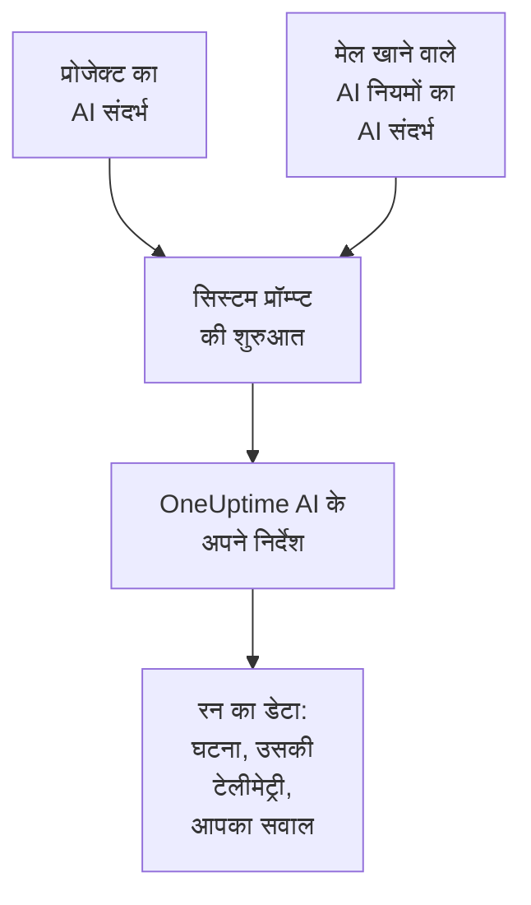

# AI संदर्भ

AI संदर्भ वह है जो आपकी टीम अपने सिस्टम के बारे में OneUptime AI के लिए लिखती है: वे आपस में कैसे जुड़े हैं, कौन-सा लक्षण किसकी ज़िम्मेदारी है, लॉग कहां हैं और आपकी टीम कौन-से शब्द इस्तेमाल करती है। OneUptime AI इसे हर जांच, हर सुधार, हर पोस्टमॉर्टम मसौदे और AI से पूछें की हर बातचीत में सबसे पहले पढ़ता है, इसलिए वह वहीं से शुरू करता है जो आपकी टीम पहले से जानती है।

:::cards
- [AI संदर्भ लिखें](#ai-संदर्भ-लिखें): प्रोजेक्ट की AI सेटिंग्स में एक कार्ड।
- [किसी AI नियम के अपने नोट्स](#किसी-ai-नियम-के-अपने-नोट्स): उस बारे में नोट्स जिससे एक नियम मेल खाता है।
- [इसे क्या पढ़ता है](#इसे-क्या-पढ़ता-है): वे सुविधाएं जो इसे पढ़ती हैं, और जो नहीं पढ़तीं।
- [किसी रन ने क्या पढ़ा](#किसी-रन-ने-क्या-पढ़ा): हर रन वे नोट्स दिखाता है जो उसे मिले।
:::

## यह कैसे काम करता है

OneUptime AI अपने सिस्टम प्रॉम्प्ट की बिल्कुल शुरुआत में AI संदर्भ रखता है, अपने निर्देशों और रन के डेटा से पहले: पहले प्रोजेक्ट के नोट्स, फिर मेल खाने वाले AI नियमों के नोट्स। वह इन्हें आपकी टीम की दी हुई पृष्ठभूमि की जानकारी की तरह पढ़ता है। ये इस बात का सबूत नहीं हैं कि अभी क्या हो रहा है, और ये OneUptime AI के अपने नियम कभी नहीं बदलते।

क्योंकि नोट्स सबसे पहले आते हैं और एक रन से अगले रन तक वही रहते हैं, वे प्रॉम्प्ट की उस शुरुआत का हिस्सा होते हैं जिसे प्रदाता कैश करते हैं। Anthropic के साथ OneUptime सिस्टम प्रॉम्प्ट को कैशिंग के लिए चिह्नित करता है; OpenAI, Azure OpenAI और प्रॉम्प्ट की दोहराई गई शुरुआत को कैश करने वाले बाकी प्रदाता यह खुद करते हैं। जो नोट्स नहीं बदले, उन्हें दोबारा पढ़ने में कम लागत आती है।

## AI संदर्भ लिखें

:::steps
### AI Features खोलें
**प्रोजेक्ट सेटिंग्स → एआई → AI Features** खोलें। **AI संदर्भ** कार्ड **AI सक्षम करें** के नीचे है।

### नोट्स लिखें
**AI संदर्भ जोड़ें** पर क्लिक करें, या नोट्स होने पर **संपादित करें** पर। Markdown में लिखें, या हर तरह के नोट के लिए एक शीर्षक पाने के लिए **रूपरेखा से शुरू करें** पर क्लिक करें।

### उन्हें सहेजें
**परिवर्तन सहेजें** पर क्लिक करें। कार्ड नोट्स दिखाता है, वे कितने लंबे हैं, और कोई मॉडल उन्हें लगभग कितने टोकन के रूप में पढ़ता है।
:::

वह लिखें जो आप टीम में नए आए किसी व्यक्ति को बताते:

| नोट का प्रकार | उदाहरण |
| --- | --- |
| आपके सिस्टम आपस में कैसे जुड़े हैं | `checkout-api` चेकआउट पेज चलाता है और `payments-db` पर निर्भर है। |
| कौन-सा लक्षण किसकी ज़िम्मेदारी है | चेकआउट पेज पर 502 भुगतान टीम की ज़िम्मेदारी है: पहले `payments-db` जांचें। |
| लॉग कहां हैं | चेकआउट के लॉग Loki में `app=checkout` के अंतर्गत हैं। |
| आपकी टीम के शब्द | PSP हमारा भुगतान सेवा प्रदाता है। |

> [!WARNING]
> कोई गोपनीय जानकारी न लिखें: जो भी देख सकता है कि किसी AI रन ने क्या किया, वह उस रन को मिले नोट्स पढ़ सकता है।

## किसी AI नियम के अपने नोट्स

किसी AI नियम के अपने नोट्स हो सकते हैं, उन घटनाओं या अलर्ट के बारे में जिनसे वह मेल खाता है: किसी एक उत्पाद की सेवाएं, उनके मालिक, उनके लॉग कहां हैं। इन्हें नियम के **AI संदर्भ** में लिखें, **और फ़ील्ड** के अंतर्गत, **LLM प्रदाता** के बाद। जो नियम हर बार सिर्फ़ अपनी रनबुक चलाता है, वह OneUptime AI से कुछ नहीं पूछता, इसलिए उसके लिए लिखने को कोई AI संदर्भ नहीं है।

- कोई जांच प्रोजेक्ट के नोट्स पढ़ती है, फिर हर उस चालू AI नियम के नोट्स जो जांच करता है और घटना या अलर्ट से मेल खाता है, नियमों के नामों के क्रम में।
- कोई सुधार प्रोजेक्ट के नोट्स पढ़ता है, फिर अपने नियम के।
- किसी घटना या अलर्ट पर बातचीत वही नोट्स पढ़ती है जो उसकी जांच पढ़ती है।

## इसे क्या पढ़ता है

| सुविधा | यह क्या पढ़ती है |
| --- | --- |
| AI SRE की जांचें, और नया अलर्ट खुलने पर उनकी दोबारा जांच | प्रोजेक्ट के नोट्स, और मेल खाने वाले AI नियमों के नोट्स |
| वे सुधार जो कोई AI नियम शुरू करता है: उनकी योजनाएं, कमांड और MCP सर्वर | प्रोजेक्ट के नोट्स, और उस नियम के नोट्स |
| AI से पूछें, और किसी घटना या अलर्ट पर बातचीत | प्रोजेक्ट के नोट्स; किसी घटना या अलर्ट पर मेल खाने वाले AI नियमों के नोट्स भी |
| Slack और Microsoft Teams में जवाब | प्रोजेक्ट के नोट्स |
| घटनाओं और एपिसोड के पोस्टमॉर्टम मसौदे | प्रोजेक्ट के नोट्स |
| AI Insights का ट्राइएज और सुरक्षा केस का ट्राइएज | प्रोजेक्ट के नोट्स |

जो कॉल सिर्फ़ मिली हुई चीज़ को दोबारा लिखते हैं या उसका आकलन करते हैं, वे इसे नहीं पढ़ते: नोट्स और सार्वजनिक नोट्स के मसौदे, कॉल के सारांश, किसी जांच का सारांश, भरोसा और ग्रेड, और किसी बातचीत का शीर्षक। लोग खुद जो प्रॉम्प्ट लिखते हैं, वे भी इसे नहीं पढ़ते, जैसे किसी वर्कफ़्लो या रनबुक का AI चरण।

## सीमाएं

| क्या | अधिकतम |
| --- | --- |
| प्रोजेक्ट का AI संदर्भ | 20,000 अक्षर |
| किसी AI नियम का AI संदर्भ | 5,000 अक्षर |
| एक रन जितना AI संदर्भ कुल मिलाकर पढ़ता है | 30,000 अक्षर |

फ़ॉर्म आपके टाइप करते समय अक्षर गिनता है और सीमा से ज़्यादा होने पर सहेजने से मना कर देता है, और API भी ऐसा ही करता है। कोई रन पहले प्रोजेक्ट के नोट्स पढ़ता है, फिर हर मेल खाने वाले नियम के नोट्स, उनके नामों के क्रम में। जिस नियम के नोट्स रन को 30,000 अक्षरों से आगे ले जाते, उसे पूरा छोड़ दिया जाता है, और रन की गतिविधि यह बताती है।

टोकन की गिनती एक अनुमान है: नोट्स का आकार UTF-8 बाइट में, 4 से भाग देकर, ऊपर की ओर पूर्णांकित। हर मॉडल टोकन अपने तरीके से गिनता है, इसलिए किसी प्रदाता की गिनती अलग हो सकती है, सबसे ज़्यादा उस टेक्स्ट के लिए जो अंग्रेज़ी में नहीं है।

## किसी रन ने क्या पढ़ा

हर रन उन नोट्स को अक्षरशः दर्ज करता है जो उसने पढ़े। उसकी गतिविधि में **प्रोजेक्ट का AI संदर्भ पढ़ा** दिखता है, या यह कि उसने कितने AI नियमों के नोट्स भी पढ़े, लगभग कितने टोकन के साथ। **देखें** नोट्स को वैसे ही खोलता है जैसे रन ने उन्हें पढ़ा था: पहले प्रोजेक्ट के, फिर हर नियम के उसके नाम के नीचे, भले ही बाद में वे बदल दिए गए हों। जब रन की सीमा के कारण किसी नियम के नोट्स छोड़ दिए गए हों, तो एक चेतावनी यह बताती है।

## इसे कौन बदल सकता है

- **प्रोजेक्ट स्वामी** और **प्रोजेक्ट एडमिन** प्रोजेक्ट का AI संदर्भ बदल सकते हैं। **प्रोजेक्ट सदस्य**, **दर्शक** और **Read Project** इसे पढ़ सकते हैं।
- किसी AI नियम के नोट्स नियम का हिस्सा हैं: जो भी नियम बदल सकता है, वह उन्हें बदल सकता है।
- नोट्स सिर्फ़ अपने ही प्रोजेक्ट के लिए पढ़े जाते हैं: कोई भी रन किसी दूसरे प्रोजेक्ट का AI संदर्भ नहीं पढ़ता।

API या Terraform से, प्रोजेक्ट के नोट्स प्रोजेक्ट का `aiContext` हैं, और किसी AI नियम के नोट्स उस नियम का अपना `aiContext` हैं।

## अगले कदम

:::cards
- [AI SRE](/docs/ai/ai-sre): OneUptime AI को हर नई घटना और अलर्ट की जांच करने दें।
- [AI से पूछें](/docs/ai/ask-ai): किसी बातचीत में अपने प्रोजेक्ट के डेटा के बारे में पूछें।
- [LLM प्रदाता](/docs/ai/llm-provider): वह मॉडल चुनें जो नोट्स पढ़ता है।
:::
