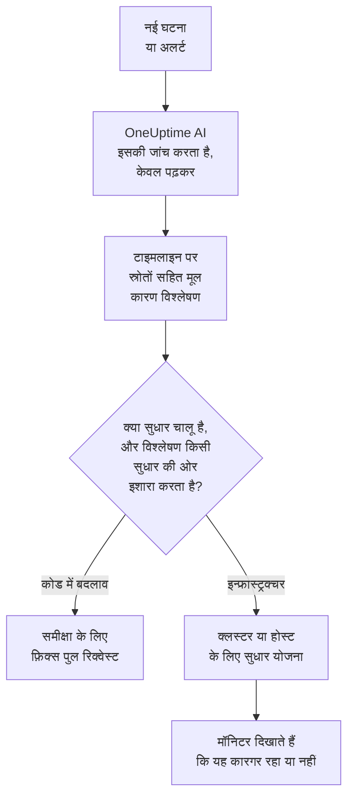
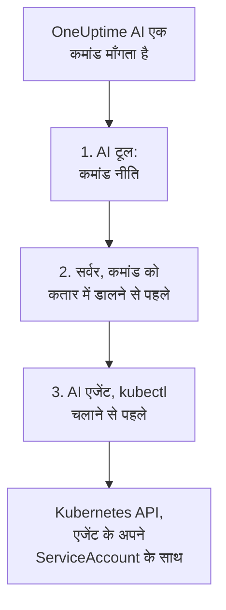

# AI SRE

OneUptime AI आपका AI साइट रिलायबिलिटी इंजीनियर है। जैसे ही कोई नई घटना या अलर्ट घोषित होता है, यह सक्रिय हो जाता है, आपकी अपनी टेलीमेट्री — लॉग, मेट्रिक्स, ट्रेस, अपवाद, मॉनिटर और हाल के बदलाव — से उसकी जांच करता है और घटना या अलर्ट की टाइमलाइन पर स्रोतों सहित मूल कारण विश्लेषण पोस्ट करता है, अक्सर ऑन-कॉल इंजीनियर के सूचना पढ़कर पूरी करने से पहले ही।

विश्लेषण के हर दावे के साथ एक स्रोत होता है जो सीधे उस सटीक डेटा तक ले जाता है जिस पर दावा टिका है, और जांच स्वयं **पूरी तरह केवल पढ़ने वाली** होती है: जांच के दौरान OneUptime AI आपके प्रोजेक्ट में कभी कुछ नहीं बदल सकता।

:::cards
- [यह कैसे काम करता है](#यह-कैसे-काम-करता-है): नई घटना से स्रोतों सहित विश्लेषण तक, और आपकी अनुमति हो तो सुधार तक।
- [AI जांच चालू करना](#ai-जांच-चालू-करना): स्विच, और उन्हें क्या चाहिए।
- [क्लस्टर एक्सेस — OneUptime AI को kubectl चलाने दें](#क्लस्टर-एक्सेस-oneuptime-ai-को-kubectl-चलाने-दें): Kubernetes के भीतर जांच करें, और सुधारें।
- [लागत नियंत्रण](#लागत-नियंत्रण): घटनाओं, अलर्ट और पूरे प्रोजेक्ट के लिए सीमाएं।
:::

## यह कैसे काम करता है

OneUptime AI किसी नई घटना या अलर्ट के लिए तीन काम करता है, और हर काम का अपना स्विच है:

- **यह जांच करता है** (डिफ़ॉल्ट रूप से चालू)। यह आपकी टेलीमेट्री, और उन क्लस्टर व होस्ट को पढ़ता है जहां कोई AI एजेंट चलता है, और स्रोतों सहित मूल कारण विश्लेषण पोस्ट करता है। जांच कुछ नहीं बदलती।
- **यह सुधार करता है** (डिफ़ॉल्ट रूप से बंद)। सुधार चालू होने पर एक भरोसेमंद विश्लेषण एक सुधार बन जाता है: आपके कोड में बदलाव के लिए एक पुल रिक्वेस्ट, या किसी क्लस्टर या होस्ट के लिए कमांड की एक योजना, जो उसी तरह चलती है जैसे उस क्लस्टर या होस्ट का AI एजेंट अनुमति देता है।
- **यह सीखता है।** AI Insights पेज बताते हैं कि बार-बार क्या गलत हो रहा है, जो दर्ज की गई हर चीज़ से निकाला जाता है।



जो विश्लेषण कोई कारण नहीं खोज पाता, वह चुपचाप पोस्ट होता है, किसी को सूचित किए बिना (देखें [शांत मोड](#शांत-मोड)), और बिना कारण के कुछ भी ठीक नहीं किया जाता।

## जांच क्या पोस्ट करती है

जांच पूरी होने पर OneUptime AI इन खंडों के साथ मूल कारण विश्लेषण पोस्ट करता है:

- **Summary** — एक या दो वाक्य, जिन्हें सूचित किया गया इंजीनियर पांच सेकंड में पढ़ सके।
- **Most likely root cause** — परिकल्पना, केवल उतने भरोसे के साथ जितना सबूत सहारा देते हैं, और हर तथ्यात्मक दावे के साथ स्रोत। अगर टेलीमेट्री काफ़ी नहीं है, तो AI साफ़ बताता है और अनुमान लगाने के बजाय यह सूची देता है कि उसने क्या जांचा।
- **Evidence** — मुख्य निष्कर्ष जो परिकल्पना का समर्थन करते हैं या उसे खारिज करते हैं, हर एक स्रोत सहित।
- **Suggested next steps** — ऑन-कॉल इंजीनियर के लिए ठोस कदम।

घटनाओं के लिए विश्लेषण घटना की फ़ीड में **और** घटना के आंतरिक नोट के रूप में पोस्ट होता है (जहां जवाब देने वाले मिलकर काम करते हैं)। अलर्ट के लिए यह अलर्ट की फ़ीड में पोस्ट होता है।

जांच चलते समय घटना या अलर्ट के पेज पर एक लाइव **AI Investigation** पैनल दिखता है जो हर कदम बताता है — कौन से टूल चले, उन्होंने क्या पाया और कितना समय लगा — ताकि आप इसे सोचते हुए देख सकें। अगर कोई जांच विफल होती है, तो पैनल खामोश खाली जगह के बजाय विफलता का कारण दिखाता है।

जांच तब तक चलती है जब तक पूरी न हो जाए: इसकी **कोई समय सीमा नहीं** है और न ही कोई छोटा क्वेरी बजट, इसलिए यह हर ज़रूरी क्वेरी और हर kubectl या इन्फ्रास्ट्रक्चर कमांड चला सकती है। लंबा कमांड आउटपुट (किसी व्यस्त नोड का `kubectl describe node`, किसी पॉड के लॉग) कभी नहीं काटा जाता — OneUptime AI उसे एक बार में एक पेज पढ़ता है। अगर आप पक्का रुकना चाहते हैं, तो हर सिग्नल प्रकार के लिए **जांच की समय सीमा** सेट करें (नीचे **लागत नियंत्रण** देखें)।

## जांच क्या पढ़ती है

जांच घटना या अलर्ट से और उस इन्फ्रास्ट्रक्चर से शुरू होती है जिससे वह जुड़ा है: वे होस्ट, Docker और Podman होस्ट, Kubernetes क्लस्टर, डेटाबेस और सेवाएँ जिन पर उसके मॉनिटर नज़र रखते हैं। वेबसाइट, API या सिंथेटिक मॉनिटर उसी पर नज़र रखता है जिससे आप उसे **मॉनिटर → अवलोकन → लिंक किए गए संसाधन** में जोड़ते हैं, इसलिए उसे उन होस्ट से जोड़ें जो वह परोसते हैं जिसकी वह जाँच करता है, और उसकी घटनाओं की हर जांच वहीं से शुरू होगी।

- उस इन्फ्रास्ट्रक्चर पर वे अलर्ट जो घटना से पहले के 30 मिनट में खुले, या अब भी खुले हैं, सबसे नए पहले, जैसे किसी धीमी साइट के पीछे वाले होस्ट का ऊँचे CPU का अलर्ट। निजी अलर्ट शामिल नहीं किए जाते।
- इन्फ्रास्ट्रक्चर के अपने मेट्रिक, उसी तरह पढ़े गए जैसे लोग उन्हें पढ़ते हैं। `system.cpu.utilization` और `system.memory.utilization` जैसे होस्ट मेट्रिक हर स्थिति के लिए एक बार रिपोर्ट होते हैं, और सभी स्थितियाँ मिलकर 100% होती हैं, इसलिए उन सबका एक औसत कुछ नहीं बताता। OneUptime AI उन्हें एक-एक स्थिति करके पढ़ता है (व्यस्त CPU यानी user और system), और कोई भी मेट्रिक हर कंटेनर, हर माउंट पॉइंट या किसी भी अन्य एट्रिब्यूट के हिसाब से पढ़ता है।
- किसी Docker या Podman होस्ट के कंटेनर: CPU, मेमोरी या रीस्टार्ट के हिसाब से सबसे व्यस्त कंटेनर, और वे जिन्होंने रिपोर्ट करना बंद कर दिया। रुका हुआ कंटेनर शून्य की जगह कुछ नहीं भेजता, इसलिए पूरे होस्ट के आँकड़े उसे छिपा देते हैं।

**AI Investigation** कार्ड पर जांच की गतिविधि बताती है कि उसने कितने खुले या हाल के अलर्ट पढ़े, और किन संसाधनों पर।

### नया अलर्ट खुलने पर फिर से जाँच

जांच उसी पल शुरू हो जाती है जब कोई घटना घोषित होती है, और कुछ मिनट के मेट्रिक माँगने वाला होस्ट अलर्ट उसके बाद खुल सकता है। जब घटना के 30 मिनट के भीतर, जांच के उसे पढ़ लेने के बाद, घटना के जुड़े इन्फ्रास्ट्रक्चर पर कोई अलर्ट खुलता है और घटना अब भी खुली होती है, तो OneUptime AI उस अलर्ट को हाथ में लेकर घटना की एक बार और जाँच करता है। नया विश्लेषण **Checked again** और उस अलर्ट से शुरू होता है जिसकी वजह से जाँच हुई, और उसकी गतिविधि भी यही बताती है।

यह हर घटना पर ज़्यादा से ज़्यादा एक बार होता है, नई जांच वाले ही स्विच और सीमाओं के साथ: **AI सक्षम करें**, _नई घटनाओं की जांच करें_, AI क्रेडिट, और दैनिक व समवर्तीता की सीमाएँ। चालू करने के लिए कुछ नहीं है। फ़ॉलो-अप जाँच कभी भी अपने-आप सुधार दोबारा नहीं चलाती और खुद कभी फ़ॉलो-अप नहीं होती, और किसी अलर्ट की जांच दोबारा नहीं जाँची जाती।

## घटना के बारे में OneUptime AI से बात करें

**AI Investigation** कार्ड एक बातचीत — **Ask OneUptime AI** — के साथ खत्म होता है, जिसे वे सभी देखते हैं जो घटना या अलर्ट देख सकते हैं। ऊपर जो भी हुआ हो, यह एक ही कार्ड है: किसी रिपोर्ट के नीचे आप आगे के सवाल पूछते हैं, और जब कोई स्वचालित जांच नहीं चली (या रिपोर्ट से पहले रुक गई), तो पहला सुझाव **What is the root cause?** होता है, जिससे OneUptime AI मांग पर जांच करता है।

- **आगे के सवाल पूछें** — "कौन से पॉड सबसे ज़्यादा मेमोरी लेते हैं?", "इसके शुरू होने से ठीक पहले क्या बदला?", "क्या कुछ और भी प्रभावित है?"। OneUptime AI अपनी रिपोर्ट के आधार पर आगे बढ़ता है, ताज़ा डेटा क्वेरी करता है (और जहां उसके पास एक्सेस है वहां केवल पढ़ने वाले kubectl या इन्फ्रास्ट्रक्चर कमांड चलाता है) और हर दावे का स्रोत देता है।
- **इससे काम करवाएं** — "इस घटना को स्वीकार करो", "स्टेटस अपडेट पोस्ट करो कि हम जांच कर रहे हैं", "डेटाबेस ऑन-कॉल को सूचित करो", "गंभीरता बढ़ाओ"। यह AI से पूछें वाली ही कार्रवाइयों का उपयोग करता है और हमेशा **आपकी अपनी अनुमतियों के साथ** काम करता है, इसलिए यह कभी भी आपसे ज़्यादा नहीं कर सकता।
- **चुनें कि यह कैसे काम करे** — संदेश बॉक्स के स्विच से, जिसके पास लिखा होता है कि चुने गए मोड का क्या मतलब है: _Auto-run_ (डिफ़ॉल्ट — साफ़ अनुरोध पर यह तुरंत काम करता है), _Ask to act_ (यह पहले एक अनुमोदन कार्ड दिखाता है, जिसे घटना पर मौजूद कोई भी व्यक्ति स्वीकार या अस्वीकार कर सकता है) या _केवल पढ़ने के लिए_।
- **एक साझा थ्रेड।** हर सवाल दिखाता है कि उसे किसने पूछा, सभी लोग एक ही बातचीत लाइव देखते हैं, और कोई भी चल रहे जवाब को रोक सकता है। किसी जवाब के चार्ट और तालिकाएं पूछने वाले को दिखाई जाती हैं; बाकी सब स्रोतों सहित जवाब देखते हैं। हर जवाब अपने **Sources** की सूची देता है, और जिस स्रोत का अपना पेज हो (लॉग, मेट्रिक्स, कोई मॉनिटर), वह उसे खोलता है। लंबा थ्रेड अपने सबसे नए संदेशों पर खुलता है, और उनके ऊपर एक बटन (जैसे **Show 6 earlier messages**) बाकी संदेश वापस लाता है।

## AI जांच चालू करना

स्वायत्त जांच **नए प्रोजेक्ट के लिए डिफ़ॉल्ट रूप से चालू** होती है। पोस्टमॉर्टम ड्राफ़्ट और AI Insights भी। सुधार बंद रहकर शुरू होता है, और उसके हिस्से वाले पुल रिक्वेस्ट भी (देखें [स्वचालित कोड सुधार](#स्वचालित-कोड-सुधार))। इस डिफ़ॉल्ट से पहले बना प्रोजेक्ट अपनी सेटिंग बनाए रखता है; जांच को चरण 3 की तरह चालू करें, या किसी भी Kubernetes क्लस्टर के **AI एजेंट** पेज पर **चालू करें** से (Project Owner या Project Admin)। इन्हें जांचने या बदलने के लिए:

:::steps
1. **कोई LLM प्रदाता कॉन्फ़िगर करें।** सेल्फ़-होस्टेड इंस्टॉलेशन अपनी कुंजी लाते हैं (या लोकल Ollama के साथ पूरी तरह अलग-थलग चलते हैं) — देखें [LLM प्रदाता](/docs/ai/llm-provider)। OneUptime Cloud के उपयोगकर्ता पहले से कॉन्फ़िगर किए गए ग्लोबल प्रदाता का उपयोग कर सकते हैं, जिसका बिल मापे गए AI टोकन के रूप में बनता है, इसलिए प्रोजेक्ट को AI क्रेडिट चाहिए: प्रोजेक्ट का कोई स्वामी या **Manage Billing** वाला कोई व्यक्ति उन्हें **प्रोजेक्ट सेटिंग्स → एआई → AI क्रेडिट** पर जोड़ता है, जहां **ऑटो रिचार्ज** उन्हें खत्म होने से बचाता है।
2. **पक्का करें कि प्रोजेक्ट के लिए AI सक्षम है** (डिफ़ॉल्ट रूप से है): **AI सक्षम करें**, **प्रोजेक्ट सेटिंग्स → एआई → AI Features** पर।
3. **हर सिग्नल प्रकार के लिए चुनें** (नए प्रोजेक्ट में दोनों चालू):
   - घटनाएं: **घटनाएं → एआई → सेटिंग्स** — _नई घटनाओं की जांच करें_ चालू करें।
   - अलर्ट: **अलर्ट → एआई → सेटिंग्स** — _नए अलर्ट की जांच करें_ चालू करें।
:::

इन पेजों पर AI का हर व्यवहार एक स्विच है जो पलटते ही सेव हो जाता है; कोई सेव बटन नहीं है। घटना पेज पर ऐसे तीन हैं, **OneUptime AI क्या करता है** के नीचे: _नई घटनाओं की जांच करें_, _नई घटनाओं को अपने आप ठीक करें_ और _घटना हल होने पर पोस्टमॉर्टम का मसौदा तैयार करें_। अलर्ट पेज पर यही हैं, पोस्टमॉर्टम के बिना। _नई घटनाओं को अपने आप ठीक करें_ (और _नए अलर्ट को अपने आप ठीक करें_) **बंद** रहकर शुरू होता है, नए प्रोजेक्ट में भी: यह OneUptime AI को आपका इन्फ्रास्ट्रक्चर बदलने देता है, इसलिए प्रोजेक्ट इसे खुद चालू करता है — देखें [किन घटनाओं की जांच और सुधार होता है](#किन-घटनाओं-की-जांच-और-सुधार-होता-है)। दो और स्विच इसका हिस्सा हैं, जो इसके चालू रहने तक इसके नीचे दिखते हैं: _जब किसी जांच में कोड में बदलाव मिले, तो फ़िक्स पुल रिक्वेस्ट खोलें_ और _छूटी हुई टेलीमेट्री जोड़ने वाला पुल रिक्वेस्ट खोलें_। सुधार चालू करने से दोनों चालू होते हैं, और बंद करने से दोनों बंद; इसके चालू रहते, जो आप नहीं चाहते उसे बंद कर दें। Project Owners और Project Admins इन्हें बदल सकते हैं; बाकी सबके लिए हर स्विच लॉक रहता है और बताता है कि उसे कौन सी अनुमति चाहिए।

ये पेज दो बातें तभी कहते हैं जब वे सच हों। अगर **AI सक्षम करें** बंद है, तो इन पर कुछ नहीं चलता, और पेज यह बात सबसे ऊपर कहता है, साथ में उन लोगों के लिए AI सक्षम करें स्विच भी दिखाता है जो इसे बदल सकते हैं (Project Owners, और Manage Billing वाला कोई भी); बाकी सबको बताया जाता है कि कौन बदल सकता है। अगर प्रोजेक्ट के पास कोई ऐसा LLM प्रदाता नहीं है जिसे OneUptime AI इस्तेमाल कर सके — बिल्कुल नहीं, या प्रदाता हैं पर कोई डिफ़ॉल्ट नहीं — तो पेज यह भी कहता है, **प्रोजेक्ट सेटिंग्स → एआई → LLM प्रदाता** के लिंक के साथ। OneUptime Cloud पर ग्लोबल प्रदाता गिना जाता है, इसलिए वहां कुछ नहीं कहा जाता।

घटनाओं और अलर्ट को अलग-अलग कॉन्फ़िगर किया जाता है, इसलिए आप हर सिग्नल प्रकार को अपनी समवर्तिता सीमा, दैनिक टोकन बजट, फ़िक्स-कार्य बजट और फ़ॉलो-अप पुल रिक्वेस्ट नीति दे सकते हैं। इनमें से कोई भी सीमा तब तक लागू नहीं होती जब तक आप उसे सेट न करें — वे हर पेज के नीचे **और सेटिंग्स** में मुड़ी रहती हैं; नीचे **लागत नियंत्रण** देखें। अलर्ट की कोई AI सेटिंग बदलने से घटना की संबंधित सेटिंग नहीं बदलती, और उल्टा भी।

सुधार जांच पर आधारित है: जब तक **नई घटनाओं को अपने आप ठीक करें** (या अलर्ट वाला) चालू है, **जब किसी जांच में कोड में बदलाव मिले, तो फ़िक्स पुल रिक्वेस्ट खोलें** उस जांच को, जो भरोसे से रिपॉज़िटरी में कोड बदलाव पहचानती है, अपने आप फ़िक्स पुल रिक्वेस्ट खोलने देता है — नीचे **स्वचालित कोड सुधार** देखें।

## क्लस्टर एक्सेस — OneUptime AI को kubectl चलाने दें

शुरू में जांच केवल उसी टेलीमेट्री का उपयोग कर सकती है जो आपके एजेंट भेजते हैं। Kubernetes सिग्नल के लिए यह अक्सर काफ़ी नहीं होता: "Pending में अटके पॉड" शेड्यूलिंग की समस्या है, जिसका निदान पॉड का विवरण देखकर और उसके इवेंट पढ़कर होता है, किसी मेट्रिक को देखकर नहीं। **Kubernetes AI एजेंट** OneUptime AI को ठीक यही करने देता है — और आपकी अनुमति हो तो जो मिले उसे ठीक करने भी।

हर क्लस्टर के पेज के साइड मेनू में **एआई** खंड होता है:

- **एजेंट** — क्लस्टर का **AI एजेंट** पेज: एजेंट जुड़ा है या नहीं, क्लस्टर पर AI क्या कर सकता है, और ध्यान देने वाली हर बात, हर एक के साथ उसे ठीक करने वाला कदम। यही व्याख्या घटना के जांच पैनल पर भी दिखती है, जब AI को केवल OneUptime के डेटा से जांच करनी पड़ी।
- **इनसाइट्स** — क्लस्टर का **AI Insights** पेज: OneUptime AI ने क्लस्टर के बारे में क्या पता लगाया — बार-बार क्या गलत होता है और क्यों, और उसका क्या करें (देखें [AI ने किसी क्लस्टर पर क्या सीखा](#ai-ने-किसी-क्लस्टर-पर-क्या-सीखा))।
- **लॉग** — क्लस्टर का **AI लॉग** पेज: OneUptime AI ने क्लस्टर पर जो कुछ किया, सबसे नया पहले (देखें [AI ने किसी क्लस्टर पर जो कुछ किया](#ai-ने-किसी-क्लस्टर-पर-जो-कुछ-किया))।

क्लस्टर का **अवलोकन** एक **AI एजेंट** कार्ड के साथ खत्म होता है, जो AI एजेंट पेज का सार देता है: एजेंट जुड़ा है या नहीं, **kubectl से जाँच करें** चालू है या नहीं, सुधार कैसे चलते हैं (**बंद**, **अनुमोदन माँगें**, **स्वचालित** या **अनुमोदन छोड़ें**) और किस पर ध्यान देना है, साथ में AI एजेंट पेज का लिंक, जहां इन्हें बदला जाता है।

### Kubernetes AI एजेंट — डिफ़ॉल्ट रूप से चालू, केवल पढ़ने वाला

[OneUptime Kubernetes एजेंट](/docs/telemetry/kubernetes-agent) का चार्ट डिफ़ॉल्ट रूप से Kubernetes AI एजेंट चलाता है: एक छोटा पॉड (`component=ai-agent`, इमेज `oneuptime/kubernetes-ai-agent`) जिसके पास **केवल पढ़ने वाला** ServiceAccount है। यह उसी API कुंजी से जुड़ता है जिसे चार्ट पहले से उपयोग करता है, इसलिए डैशबोर्ड में कुछ सेट नहीं करना पड़ता: एक मिनट के भीतर क्लस्टर का AI एजेंट पेज इसे **कनेक्टेड** दिखाता है और **kubectl से जाँच करें** चालू होता है — जब तक कि किसी ने वहां पहले से क्लस्टर के लिए AI सेटिंग्स न चुनी हों, जो जैसी हैं वैसी ही रहती हैं।

Kubernetes AI एजेंट के आने से पहले इंस्टॉल किए गए एजेंट पर, पहले अपना चार्ट इंडेक्स ताज़ा करें, फिर अपग्रेड करें:

```bash
helm repo update
helm upgrade kubernetes-agent oneuptime/kubernetes-agent \
  --namespace oneuptime-agent --reset-then-reuse-values \
  --set aiAgent.enabled=true
```

`kubernetes-agent` और `oneuptime-agent` वही रिलीज़ नाम और नेमस्पेस हैं जिनका उपयोग डैशबोर्ड के इंस्टॉल निर्देश करते हैं; अगर आपने एजेंट दूसरे नामों से इंस्टॉल किया है, तो अपने नाम इस्तेमाल करें (`helm list -A | grep kubernetes-agent` उन्हें दिखाता है)। `helm repo update` के बिना Helm उसी चार्ट को ले सकता है जिससे आपने इंस्टॉल किया था, जो `aiAgent` को नहीं जानता और `Additional property aiAgent is not allowed` के साथ विफल हो जाता है। सेल्फ़-होस्टेड OneUptime पर, चार्ट से पहले OneUptime को अपग्रेड करें — देखें [एजेंट अपग्रेड करना](/docs/telemetry/kubernetes-agent#एजेंट-अपग्रेड-करना)। AI एजेंट के बिना चार्ट चलाने के लिए `--set aiAgent.enabled=false` दें।

AI एजेंट पेज पर एजेंट की स्थिति के पास वाले **⋯** मेनू में **कनेक्शन का परीक्षण करें** एजेंट के ज़रिए `kubectl version` और `kubectl auth can-i --list` चलाता है और नतीजे दिखाता है: यह कहां तक पहुंच सकता है और क्या कर सकता है। अगर पेज कहता है कि एजेंट जुड़ा नहीं है, तो `kubectl logs -n oneuptime-agent -l component=ai-agent --tail=100` से उसका लॉग पढ़ें। जिस कुंजी में **Pinned Service Name** सेट है, वह एजेंट को रजिस्टर नहीं कर सकती — चार्ट को बिना इसके वाली कुंजी दें। जब सर्वर किसी रजिस्ट्रेशन को अस्वीकार करता है, तो लॉग बताता है कि अस्वीकृति अपने आप हटेगी (कोई पिछला एजेंट पॉड जो अब भी रिपोर्ट कर रहा है, या अपग्रेड के दौरान अब भी बंद हो रहा पुराना इन-क्लस्टर Runner) या क्या बदलना है। उसी मेनू में **एजेंट रीसेट करें** आपकी पुष्टि के बाद सर्वर से एजेंट की कुंजी भुला देता है; पॉड कुछ ही मिनटों में अपने आप दोबारा जुड़ जाता है।

Kubernetes AI एजेंट Runner नहीं है और कभी भी रनबुक → Runbook एजेंट में नहीं दिखता। यह हमेशा केवल अपने ServiceAccount का उपयोग करता है, इसलिए OneUptime इसे कभी कोई क्रेडेंशियल नहीं देता, इसे रनबुक के लिए कभी Bash/SSH होस्ट के रूप में उपयोग नहीं किया जाता, और इसे कभी स्वचालित सुधार नियम के कमांड Runner के रूप में स्वीकार नहीं किया जाता।

### AI क्या कर सकता है — एजेंट तय करता है

OneUptime AI किसी क्लस्टर पर क्या कर सकता है, यह वहीं तय होता है जहां एजेंट चलता है, चार्ट में, दो मानों से:

- `aiAgent.investigation` — `true`: जांच के दौरान AI क्लस्टर पर केवल पढ़ने वाला kubectl चला सकता है। `false`: यह फिर भी जांच करता है, उस डेटा से जो OneUptime के पास पहले से है।
- `aiAgent.fixes` — AI सुधार कैसे लागू करता है: `off`, `ask-for-approval`, `automatic` या `bypass-approval` (देखें [सुधार कैसे काम करते हैं](#सुधार-कैसे-काम-करते-हैं))। `off` को छोड़कर हर स्तर AI एजेंट को लिखने की पहुंच देता है; `off` के साथ उसके पास कोई पहुंच नहीं होती और वह खुद हर लिखने के अनुरोध को अस्वीकार कर देता है।

AI एजेंट हर हार्टबीट पर दोनों मान OneUptime को बताता है, और OneUptime उन्हें क्लस्टर पर लागू करता है। क्लस्टर के AI एजेंट पेज पर **AI क्या कर सकता है** इन्हें दिखाता है — **चालू** और सुधार का स्तर, चालू होने पर हरे रंग में — पर वहां इन्हें बदलने का कोई तरीका नहीं होता; **बदलें** हर विकल्प को उस सटीक `helm upgrade` के साथ दिखाता है जो उसे सेट करता है। कहीं और किया गया बदलाव — AI एजेंट पेज, API या Terraform पर — तब तक अस्वीकार होता है जब तक एजेंट इन्हें तय करता है।

जो रिलीज़ इनमें से कोई भी मान सेट नहीं करती, वह एजेंट को उसके डिफ़ॉल्ट उपयोग करने देती है (जांच चालू; सुधार बंद, या पुराने `aiAgent.remediation.enabled=true` के साथ ask-for-approval)। OneUptime ये डिफ़ॉल्ट केवल उस क्लस्टर पर लागू करता है जिसकी AI सेटिंग्स किसी ने उसके AI एजेंट पेज पर नहीं चुनीं: वहां चुनी गई सेटिंग्स जैसी हैं वैसी रहती हैं, और पेज वह कमांड दिखाता है जो उन्हें चार्ट में ले जाता है। उस क्लस्टर के साथ भी ऐसा ही होता है जिसका AI एजेंट इन्हें बताने के लिए बहुत पुराना है — दोनों मानों के साथ चार्ट अपग्रेड करने से वे चार्ट में चली जाती हैं।

### AI को जो मिले उसे ठीक करने दें

सुधार तब तक बंद रहते हैं जब तक आप उन्हें `aiAgent.fixes` से चालू न करें, जो AI एजेंट को लिखने की पहुंच भी देता है — आदर्श रूप से केवल उन नेमस्पेस में जिन्हें AI ठीक कर सकता है, और नोड ऑपरेशन बंद रखकर:

```bash
helm repo update
helm upgrade kubernetes-agent oneuptime/kubernetes-agent \
  --namespace oneuptime-agent --reset-then-reuse-values \
  --set aiAgent.enabled=true \
  --set aiAgent.investigation=true \
  --set aiAgent.fixes=ask-for-approval \
  --set "aiAgent.remediation.namespaces={web,api}" \
  --set aiAgent.remediation.nodeOperations=false
```

या पूरे क्लस्टर के लिए:

```bash
helm repo update
helm upgrade kubernetes-agent oneuptime/kubernetes-agent \
  --namespace oneuptime-agent --reset-then-reuse-values \
  --set aiAgent.enabled=true \
  --set aiAgent.investigation=true \
  --set aiAgent.fixes=ask-for-approval \
  --set-json 'aiAgent.remediation.namespaces=[]'
```

`{web,api}` को उन नेमस्पेस से बदलें जिन्हें AI ठीक कर सकता है। सूची में दिया हर नेमस्पेस पहले से मौजूद होना चाहिए: चार्ट हर एक में एक RoleBinding बनाता है और कभी कोई नेमस्पेस नहीं बनाता, इसलिए एक भी गायब नेमस्पेस पूरे इंस्टॉल या अपग्रेड को — कलेक्टर सहित — `namespaces "api" not found` के साथ विफल कर देता है। पहले उसे बनाएं, या सूची से हटाएं; किसी नेमस्पेस को मिटाने से पहले उसे सूची से हटाएं। अपग्रेड में फ़्लैग छोड़ देने से रिलीज़ में सहेजी गई सूची बनी रहती है, इसलिए पूरे क्लस्टर पर लौटने के लिए `--set-json 'aiAgent.remediation.namespaces=[]'` (Helm 3.10+) दें, जैसा दूसरा कमांड करता है — `={}` नहीं, जिसे Helm एक खाली नाम के रूप में पढ़ता है और चार्ट अस्वीकार कर देता है। `--set aiAgent.remediation.namespaces=null` `--reuse-values` के साथ सहेजी गई सूची को रीसेट नहीं करता: Helm सहेजी गई सूची बनाए रखता है। `aiAgent.remediation.nodeOperations=false` सुधारों को नोड से दूर रखता है; AI को नोड को कॉर्डन, अनकॉर्डन, ड्रेन और टेंट करने देने के लिए इसे `true` पर सेट करें (नोड का drain, taint या patch तब भी किसी इंसान का इंतज़ार करता है)।

ज़्यादा स्वायत्तता के लिए `ask-for-approval` की जगह `automatic` या `bypass-approval` का उपयोग करें, और सुधार फिर से बंद करने के लिए `--set aiAgent.fixes=off`, जो लिखने की पहुंच भी हटा देता है। सुधारों को दो प्रोजेक्ट स्विच भी चाहिए। **नई घटनाओं को अपने आप ठीक करें** (**घटनाएं → एआई → सेटिंग्स** पर) और **नए अलर्ट को अपने आप ठीक करें** (**अलर्ट → एआई → सेटिंग्स** पर) बंद रहकर शुरू होते हैं: जब तक इनमें से कोई चालू न हो, उस प्रकार का कुछ भी नया ठीक नहीं किया जाता। **AI सक्षम करें** (**प्रोजेक्ट सेटिंग्स → एआई → AI Features**) तब तक चालू रहता है जब तक किसी ने इसे बंद न किया हो; यह प्रोजेक्ट के लिए पूरा AI बंद कर देता है, चाहे किसी एजेंट का कॉन्फ़िगरेशन कुछ भी कहे।

### किसी क्लस्टर के सुधार किन घटनाओं पर लागू होते हैं

जब तक **नई घटनाओं को अपने आप ठीक करें** चालू है और कोई स्वचालित सुधार नियम सेट नहीं है, OneUptime AI हर उस नई घटना को ठीक करता है जिससे क्लस्टर जुड़ा है, उस मोड में जो उसका AI एजेंट पेज तय करता है — और अलर्ट के लिए **नए अलर्ट को अपने आप ठीक करें** के साथ भी यही। नियमों के साथ, यह केवल उन घटनाओं को ठीक करता है जिनसे OneUptime AI से ठीक करने वाला कोई नियम मेल खाता है (देखें [किन घटनाओं की जांच और सुधार होता है](#किन-घटनाओं-की-जांच-और-सुधार-होता-है))। जिससे यह जुड़ा नहीं है, उसे यह नहीं छूता — कारण क्लस्टर में कितना भी साफ़ क्यों न हो। कोई घटना या अलर्ट किसी क्लस्टर से तब जुड़ा होता है जब:

- जिस टेलीमेट्री से वह उठा, वह क्लस्टर का नाम लेती है (क्लस्टर के डेटा पर कोई मेट्रिक, लॉग या ट्रेस मॉनिटर);
- उसका मॉनिटर क्लस्टर का Kubernetes मॉनिटर है;
- उसका मॉनिटर **मॉनिटर → अवलोकन → लिंक किए गए संसाधन** के तहत क्लस्टर से जुड़ा है — किसी वेबसाइट, API या सिंथेटिक मॉनिटर को उस क्लस्टर से जोड़ने का तरीका, जो वह सेवा देता है जिसकी मॉनिटर जांच करता है;
- किसी ने उसे घोषित करते समय **अन्य प्रभावित संसाधन** के तहत क्लस्टर चुना (जुड़ा हुआ मॉनिटर चुनने पर वह आपके लिए वहां जुड़ जाता है)।

हर घटना और अलर्ट अपने **सुधार** कार्ड पर बताता है कि वह किसी क्लस्टर से जुड़ा था या नहीं और क्लस्टर के सुधारों ने क्या किया; देखें [स्वचालित सुधार ने क्या किया](#स्वचालित-सुधार-ने-क्या-किया)। यही बात किसी इन्फ्रास्ट्रक्चर संसाधन और उसके AI एजेंट पर भी लागू होती है।

### इसे कौन बदल सकता है

जब तक Kubernetes AI एजेंट जांच और सुधार तय करता है, उन्हें वही बदलता है जो क्लस्टर पर चार्ट के मान बदल सकता है; कहीं और किया गया बदलाव OneUptime अस्वीकार कर देता है। नीचे के नियम उस पर लागू होते हैं जो OneUptime में रहता है — kubectl अनुमति-सूची, और Runner व क्रेडेंशियल का बंधन — और उस क्लस्टर की जांच और सुधारों पर, जिसकी सेटिंग्स अब भी OneUptime में तय होती हैं (देखें [AI क्या कर सकता है — एजेंट तय करता है](#ai-क्या-कर-सकता-है-एजेंट-तय-करता-है))।

सुधार चालू करना — **बंद** से किसी दूसरे मोड में कोई भी बदलाव — और उन्हें ढीला करना — **स्वचालित** या **अनुमोदन छोड़ें** पर जाना, kubectl अनुमति-सूची लिखना, कोई Runner या क्रेडेंशियल बांधना, या ऐसे क्लस्टर से वह बंधन हटाना जिसमें Kubernetes AI एजेंट है — के लिए Project Owner, Project Admin या **Edit Auto Remediation Rule** अनुमति चाहिए, यानी वही लोग जो पूरी तरह स्वचालित सुधार नियम बना सकते हैं। क्रेडेंशियल बांधने के लिए **Read Runbook Credential** अनुमति भी चाहिए, जब तक आप Project Owner या Project Admin न हों। **एजेंट रीसेट करें** के लिए वही लोग चाहिए जो सुधार चालू कर सकते हैं। उन्हें सख्त करना — **बंद**, वापस **अनुमोदन माँगें** पर जाना, अनुमति-सूची खाली करना — हर उस व्यक्ति के लिए खुला है जो क्लस्टर संपादित कर सकता है।

### जांच क्या चला सकती है

एक्सेस होने पर, जांच AI एजेंट के ज़रिए **केवल पढ़ने वाला** kubectl चलाती है — `get`, `describe`, `logs`, `events`, `top`, `rollout status/history`, `auth can-i` — जितने कमांड उसे चाहिए, और हर कमांड का स्रोत किसी भी दूसरे सबूत की तरह देती है। आउटपुट कभी नहीं काटा जाता: एजेंट उसका एक मेगाबाइट तक रखता है, और OneUptime AI लंबे आउटपुट को एक बार में एक पेज पढ़ता है। तीन स्वतंत्र जांचें इसे केवल पढ़ने वाला बनाए रखती हैं: हर कमांड को श्रेणी देने वाली नीति, जांच के लिए कुछ और कतार में डालने से इनकार करने वाला सर्वर, और AI एजेंट, जो kubectl शुरू करने से पहले उसी नीति को दोबारा जांचता है। "केवल पढ़ने वाला — आपके सिस्टम में कुछ नहीं बदला गया" शब्दशः सच रहता है।



### सुधार कैसे काम करते हैं

AI एजेंट पेज पर **सुधार** की चार सेटिंग्स हैं (चार्ट का `aiAgent.fixes`: `off`, `ask-for-approval`, `automatic`, `bypass-approval`):

- **बंद** — AI केवल जांच करता है।
- **अनुमोदन माँगें** — मूल कारण विश्लेषण के बाद OneUptime AI kubectl से निदान करता है और वह सबसे छोटी kubectl योजना बनाता है जो कारण को संभाले, जैसे `kubectl rollout restart deployment/web -n web`। योजना घटना पर अपने तर्क, अपेक्षित असर और रोलबैक के साथ दिखती है; कोई इंसान एक क्लिक से उसे स्वीकार करता है, और OneUptime ठीक वही कमांड चलाता है। अगर मॉनिटर ठीक नहीं होते, तो रोलबैक चलता है और OneUptime AI एक और योजना बनाता है — फिर से अनुमोदन के लिए — विफल प्रयास को सामने रखकर, ताकि वह कोई दूसरा तरीका अपनाए या बताए कि किसी इंसान को किस पर ध्यान देना चाहिए।
- **स्वचालित** — सुरक्षित बदलाव अपने आप चलते हैं; ज़्यादा जोखिम वाला बदलाव कभी नहीं। जब किसी दौर को केवल ज़्यादा जोखिम वाले सुधार मिलते हैं, तो वह ठीक उन्हीं को एक क्लिक के अनुमोदन के लिए प्रस्तावित करके खत्म होता है। जब उसने कोई सुरक्षित सुधार भी चलाया हो, तो ज़्यादा जोखिम वाला सुधार विश्लेषण में रहता है और केवल तभी प्रस्तावित होता है जब सत्यापन दिखाए कि सुरक्षित सुधार से मॉनिटर ठीक नहीं हुए — फ़ॉलो-अप दौर द्वारा, जो अनुमोदन माँगता है। ज़्यादा जोखिम वाले किसी कमांड का स्वरूप AI एजेंट पेज पर अनुमति-सूची में डालें, तो वह भी अपने आप चलेगा। स्वचालित मोड सत्यापन से मॉनिटर के ठीक होने की पुष्टि होते ही सिग्नल को हल भी कर देता है, और इस पर प्रति क्लस्टर प्रति घंटे तीन बिना निगरानी वाले सुधारों का सर्किट ब्रेकर है: इससे आगे, या जब तक OneUptime AI का कोई दूसरा बिना निगरानी वाला दौर उसी क्लस्टर को बदल या सत्यापित कर रहा हो, कोई दौर अपनी योजना चलाने के बजाय अनुमोदन के लिए प्रस्तावित करता है।
- **अनुमोदन छोड़ें** — AI नहीं पूछता। नीति जिस भी बदलाव की अनुमति देती है, ज़्यादा जोखिम वाले बदलावों सहित, वह अपने आप चलता है, और विफल सत्यापन के बाद का फ़ॉलो-अप दौर भी; सत्यापन से ठीक होने की पुष्टि होते ही सिग्नल अपने आप हल हो जाता है। जिसे हर मोड में इंसान चाहिए (नीचे), वह अब भी इंसान का इंतज़ार करता है। कोई दौर अपनी योजना चलाने के बजाय अनुमोदन के लिए प्रस्तावित भी करता है, और घटना पर कारण बताता है, जब:
  - घंटेवार सर्किट ब्रेकर (प्रति क्लस्टर प्रति घंटे तीन बिना निगरानी वाले सुधार) ट्रिप हो गया है, या उसकी जांच नहीं हो सकती;
  - OneUptime AI का कोई दूसरा बिना निगरानी वाला दौर उसी क्लस्टर को अब भी बदल रहा है, या उस पर कोई सुधार अब भी सत्यापित कर रहा है — एक ही मॉनिटर का अलर्ट और घटना आम मामला है — या इसकी जांच नहीं हो सकती;
  - यह ऐसे सुधार के बाद का फ़ॉलो-अप दौर है जिसका रोलबैक पूरा नहीं हुआ।

**सुरक्षित** बदलाव ठीक एक नाम वाले ऑब्जेक्ट को छूता है: `rollout restart/undo/pause/resume`, `scale` (0 को छोड़कर किसी भी मान पर), नाम वाले पॉड को मिटाना, `cordon`/`uncordon`, और किसी एक नाम वाले Pod, Deployment, StatefulSet, DaemonSet, ReplicaSet, Job या CronJob पर सामान्य कुंजी के साथ `label`/`annotate` (कोई आरक्षित कुंजी नहीं, जैसे `*.kubernetes.io/…` या `*.k8s.io/…`)। नीति जो कुछ और अनुमति देती है वह **ज़्यादा जोखिम वाला** है: वही क्रियाएं किसी बिना नाम के प्रकार पर (`rollout restart deployment`), कई ऑब्जेक्ट पर, किसी सेलेक्टर के साथ या `--all` के साथ; 0 पर `scale`; किसी जॉब को मिटाना; `taint`; `drain`; `patch`; `set image/env/resources`; `create`; `--force` के साथ मिटाना; और किसी दूसरे प्रकार पर या आरक्षित कुंजी के साथ लेबल या एनोटेशन।

कुछ सीमाएं **हर** मोड में लागू रहती हैं, अनुमोदन छोड़ें सहित, और अनुमति-सूची की कोई प्रविष्टि उन्हें नहीं बदलती:

- **kube-system**, **kube-public** या **kube-node-lease** में लिखने के लिए हमेशा इंसान चाहिए। किसी कस्टम संसाधन का आकलन उस नेमस्पेस से होता है जिसमें वह लिखा जाता है, भले ही उसका नाम किसी बिल्ट-इन क्लस्टर-व्यापी प्रकार जैसा दिखे (`nodes.example.com`, `namespaces.example.com`)।
- किसी नोड का `drain`, `taint` या `patch` हमेशा इंसान चाहता है। नोड को ड्रेन करने से हर नेमस्पेस के पॉड बाहर हो जाते हैं — ऊपर के तीनों और एजेंट का अपना नेमस्पेस भी — और `NoExecute` टेंट भी उन्हें बाहर कर देता है, चाहे उसे `kubectl taint` लगाए या नोड का `patch`।
- AI एजेंट अपने नेमस्पेस में कभी कुछ नहीं बदलता — वहां का कोई सुधार Kubernetes एजेंट को, या खुद AI एजेंट को, स्केल करके हटा सकता है — न ही उन नेमस्पेस के बाहर कुछ, जिनमें उसका चार्ट उसे लिखने देता है (`aiAgent.remediation.namespaces`), न ही कोई नोड जब उसके चार्ट ने नोड ऑपरेशन बंद किए हों (`aiAgent.remediation.nodeOperations=false`)। OneUptime यह दायरा उस जानकारी से पढ़ता है जो AI एजेंट बताता है, और ऐसा सुधार तब अस्वीकार करता है जब OneUptime AI उसे प्रस्तावित करता है और फिर तब जब कोई उसे स्वीकार करता है, इसलिए वह कभी विफल सुधार के रूप में AI एजेंट तक नहीं पहुंचता; AI एजेंट भी `kubectl` शुरू करने से पहले उसे अस्वीकार करता है।
- विनाशकारी कमांड (नीचे) कभी नहीं चलते, इंसान के स्वीकार करने पर भी नहीं।

स्वचालित मोड की अनुमति-सूची का मिलान पार्स किए गए कमांड से शब्द-दर-शब्द होता है, खुले टेक्स्ट की तरह नहीं: `*` ठीक एक शब्द (कोई इमेज, कोई नाम) का स्थान लेता है, कभी अतिरिक्त ऑब्जेक्ट, फ़्लैग या दूसरे `-n` का नहीं, और कमांड जो भी फ़्लैग उपयोग करता है वह प्रविष्टि में लिखा होना चाहिए। `kubectl set image deployment/web * -n web` `web` में `web` के लिए नई इमेज की अनुमति देता है, और कुछ नहीं। किसी प्रविष्टि को अपनी क्रिया — और `rollout`, `set` या `create` का उप-कमांड — पूरा लिखना होगा, उसके लिए `*` का उपयोग नहीं, और वैकल्पिक शुरुआती `kubectl` के बाद उसमें एक से ज़्यादा शब्द होने चाहिए; इन नियमों को तोड़ने वाली प्रविष्टि, जैसे `scale` या `kubectl *`, कभी किसी बदलाव को पहले से स्वीकार नहीं कर सकती और सेव करते समय अस्वीकार हो जाती है।

:::details कमांड जो कभी नहीं चलते, और कमांड कैसे पढ़ा जाता है
कुछ कमांड **कभी** नहीं चलते, मोड कोई भी हो और इंसान के अनुमोदन के बावजूद। कमांड नीति उन्हें अस्वीकार करती है, और इसे तीन बार लागू किया जाता है — सर्वर के टूल द्वारा, उस नियंत्रण बिंदु द्वारा जहां सर्वर कमांड कतार में डालता है, और `kubectl` शुरू करने से पहले AI एजेंट द्वारा: `exec`, `attach`, `cp`, `port-forward`, `proxy`, `debug`, `run`, `edit`, `apply`, `replace`, `diff`, kubectl प्लगइन और उसकी सूची से बाहर की कोई भी क्रिया, कोई भी फ़ाइल इनपुट (`-f`, `-k`) या फ़ाइल पढ़ने वाला आउटपुट फ़ॉर्मेट (`-o jsonpath-file=`, `-o go-template-file=`, `-o custom-columns-file=`, `--template`, और अपने इनलाइन टेम्पलेट के बिना अकेला `-o jsonpath`/`go-template`/`custom-columns`), क्रेडेंशियल, प्रतिरूपण (`--as`, `--as-group`, `--as-uid`, `--as-user-extra`), क्लस्टर चुनने, `--kuberc`, रॉ API और विस्तृत लॉगिंग के फ़्लैग, **किसी भी** क्रिया के साथ Secret ऑब्जेक्ट — OneUptime AI कभी कोई Secret नहीं पढ़ता, बदलता, मिटाता या बनाता, और `create secret`, `create token` और `set env --resolve` भी उनके साथ अस्वीकार होते हैं — RBAC देने वाली कोई भी चीज़ (`create role`, `create clusterrole`, `create rolebinding`, `create clusterrolebinding`, `set subject`), `certificate approve`, `set serviceaccount`, `--image` के साथ `create deployment`, `create cronjob` या `create job` (`create job --from=cronjob/…` ज़्यादा जोखिम वाला बदलाव बना रहता है), `expose --overrides` या `--override-type` (ओवरराइड kubectl से Service के बजाय कोई Job, ClusterRoleBinding या किसी भी दूसरे प्रकार का ऑब्जेक्ट बनवा सकता है), ऐसा `patch` बॉडी जो JSON न हो (kubectl उसे YAML के रूप में पढ़ेगा, जिसके टैग ऐसा फ़ील्ड लिख सकते हैं जिसे कोई जांच नहीं देखती), ऐसे पैच जो किसी पॉड टेम्पलेट का ServiceAccount, वॉल्यूम या सुरक्षा सेटिंग्स बदलते हैं (होस्ट पोर्ट, यूज़र-नेमस्पेस से बाहर रहने वाला `hostUsers` और रनटाइम क्लास `runtimeClassName` सहित), ऐसे पैच जो पॉड टेम्पलेट के किसी पूरे हिस्से को उसमें फ़ील्ड सेट करने के बजाय बदल देते हैं (strategic-merge `$patch: replace`, पूरी `containers` सूची सेट करने वाला merge patch, या पॉड स्पेक को बदलने या हटाने वाला JSON patch) — जो उन सेटिंग्स का नाम लिए बिना उन्हें हटा देंगे — नाम के बजाय `--all` या सेलेक्टर से चुने गए Namespace ऑब्जेक्ट पर लेबल या एनोटेशन, RBAC ऑब्जेक्ट, CustomResourceDefinitions, APIServices, एडमिशन वेबहुक कॉन्फ़िगरेशन या एडमिशन नीतियों पर कोई भी लेखन — `patch`, `label`, `annotate`, `set` — `--all-namespaces` के साथ लेखन, `delete --all`, और नेमस्पेस, नोड, वॉल्यूम, CRD या क्लस्टर रोल को मिटाना। फ़्लैग उसी तरह पार्स किए जाते हैं जैसे kubectl उन्हें पार्स करता है, ताकि कोई वर्जित फ़्लैग या प्रकार किसी दूसरे के पीछे न छिप सके: जुड़े हुए छोटे फ़्लैग अक्षर-दर-अक्षर अलग किए जाते हैं (`-As` पकड़ा जाता है), वैकल्पिक मान वाले फ़्लैग (`--cascade`, `--dry-run`, `--validate`) कभी अगला शब्द नहीं निगलते, और `-n`/`--namespace`, `--request-timeout` और `--match-server-version` को छोड़कर हर फ़्लैग क्रिया के बाद आना चाहिए (और `rollout`, `set`, `create`, `auth`, `cluster-info` और `top` के उप-कमांड के बाद), क्योंकि kubectl फ़्लैग पार्स करने से पहले कमांड चुनता है। AI एजेंट अपना पिन किया हुआ kubectl (v1.36.4) साथ लाता है और kuberc बंद कर देता है, ताकि नीति की जांच के बाद कोई kuberc फ़ाइल किसी कमांड में डिफ़ॉल्ट या उपनाम न जोड़ सके। यह हर कमांड को अपने ServiceAccount के लिए एक निजी kubeconfig देता है जो माउंट की गई टोकन फ़ाइल की ओर इशारा करता है, टोकन की कॉपी कभी नहीं।
:::

### AI एजेंट का RBAC क्या सीमित करता है, और क्या नहीं

:::details चार्ट का RBAC क्या देता है
चार्ट का RBAC नीति से अलग एक परत है, और यह सीमित करता है कि AI एजेंट **कहां** लिख सकता है, यह नहीं कि कोई लेखन क्या कर सकता है। केवल पढ़ने की पहुंच (get/list/watch, पॉड लॉग) पूरे क्लस्टर में दी जाती है। `aiAgent.remediation.enabled` Deployments, StatefulSets, DaemonSets, ReplicaSets और उनके scale उप-संसाधन, Jobs, CronJobs, Pods और HPA पर patch/update जोड़ता है; Jobs और HPA पर create; और केवल Pods और Jobs पर delete। `aiAgent.remediation.nodeOperations` (डिफ़ॉल्ट रूप से चालू) पूरे क्लस्टर में नोड पर cordon, uncordon, taint और drain जोड़ता है; इसे `false` पर सेट करें तो चार्ट कोई नोड RBAC नहीं देता और AI एजेंट को बताता है (`ONEUPTIME_KUBECTL_ALLOW_NODE_OPERATIONS=false`), जो फिर kubectl शुरू करने से पहले किसी नोड पर cordon, uncordon, drain, taint और label/annotate/patch अस्वीकार करता है — और चूंकि AI एजेंट यह स्विच बताता है, OneUptime ऐसा सुधार प्रस्तावित या स्वीकार होते समय ही अस्वीकार कर देता है। यह कभी Secrets, `exec`, `attach`, `port-forward`, ServiceAccount टोकन, प्रतिरूपण, CRD या RBAC लेखन नहीं देता, इसलिए किसी दूसरे प्रकार को मिटाना, या किसी Service, ConfigMap, Ingress, Namespace या PVC पर लेबल लगाना, API सर्वर पर `Forbidden` के साथ विफल होता है, भले ही किसी इंसान ने उसे स्वीकार किया हो। दोनों परतें एक-दूसरे की नकल नहीं हैं: RBAC के लिए `apply`, `edit`, `replace`, `--all-namespaces` के साथ लेखन और `delete --all` सामान्य patch, update और delete कॉल हैं, और केवल नीति उन्हें रोकती है।
:::

:::warning लिखने की पहुंच का मतलब
फिर भी साफ़ समझ लें कि उस लिखने की पहुंच का क्या मतलब है: **किसी नेमस्पेस में वर्कलोड, पॉड और CronJobs पर patch/update, और Jobs पर create, उस नेमस्पेस के किसी भी ServiceAccount के रूप में कोई भी इमेज चलाने और उसके Secrets पढ़ने के बराबर है।** पॉड टेम्पलेट कोई भी इमेज, ServiceAccount और Secret वॉल्यूम नाम कर सकता है, और RBAC में "patch, पर पॉड टेम्पलेट नहीं" जैसी कोई क्रिया नहीं है — यह तथ्य कि कोई नियम `exec` या Secrets का नाम नहीं लेता, इसे नहीं बदलता। इसीलिए नीति यह बदलने से इनकार करती है कि कोई पॉड किस ServiceAccount, सुरक्षा सेटिंग्स, वॉल्यूम, कमांड या Secret वायरिंग के साथ चलता है (पॉड टेम्पलेट के सुरक्षा पैच, पॉड स्पेक या पूरी `containers` सूची बदलने वाले पैच, `set serviceaccount`, `create … --image`, `expose --overrides`, JSON के अलावा पैच बॉडी), इसीलिए सुरक्षित नेमस्पेस को हमेशा इंसान चाहिए, और इसीलिए `aiAgent.remediation.namespaces` मौजूद है। नीति इमेज बदलने से इनकार **नहीं** करती: `set image`, या किसी इमेज फ़ील्ड का पैच, ज़्यादा जोखिम वाला बदलाव है — नई इमेज वर्कलोड के अपने ServiceAccount के रूप में, उसके Secrets के साथ चलती है — जिसे कोई इंसान स्वीकार करता है, जब तक क्लस्टर अनुमोदन छोड़ता न हो या उसकी अनुमति-सूची उस कमांड का नाम न लेती हो। `aiAgent.remediation.namespaces` के बिना लिखने वाला रोल पूरे क्लस्टर में बंधा होता है — kube-system, kube-public, kube-node-lease और एजेंट के अपने नेमस्पेस सहित, क्योंकि RBAC पूरे क्लस्टर के बंधन से नेमस्पेस बाहर नहीं रख सकता — और वहां रेखा नीति और AI एजेंट संभालते हैं, RBAC नहीं। इसके साथ चार्ट रोल को ठीक उन्हीं नेमस्पेस में बांधता है जिनकी आप सूची देते हैं, OneUptime कहीं और के लेखन को प्रस्तावित या स्वीकार होते समय अस्वीकार करता है, और AI एजेंट kubectl शुरू करने से पहले उसे फिर अस्वीकार करता है।
:::

### AI ने किसी क्लस्टर पर क्या सीखा

क्लस्टर का **AI Insights** पेज (एआई → इनसाइट्स) बताता है कि पिछले 30 दिनों के आधार पर क्लस्टर के बारे में क्या जानने लायक है — AI ने क्या किया इसका ब्योरा नहीं, बल्कि उसने क्या पता लगाया:

- **OneUptime AI ने क्या पाया** — कुछ सबसे अहम बातें, सबसे ज़रूरी पहले, हर एक के साथ उसके पीछे की घटनाएं और अलर्ट और एक अगला कदम:
  - बार-बार लौटने वाली समस्या: कितनी बार (उसकी उठाई हर घटना और हर अलर्ट गिना जाता है, जांच हुई हो या नहीं) और वह कुल का कितना हिस्सा है, क्या वह इस हफ़्ते नई है या बिगड़ रही है, दिन का वह समय जब वह आमतौर पर शुरू होती है (आपके अपने समय क्षेत्र में), क्लस्टर के वे हिस्से जिन्हें वह प्रभावित करती है, नवीनतम जांच ने क्या पाया और उसकी रिपोर्ट पहला कौन सा कदम सुझाती है;
  - ऐसा सुधार जिसने अपनी समस्या हल नहीं की, और आपके अनुमोदन की प्रतीक्षा में सुधार;
  - किसी को सूचित किए जाने से पहले पकड़ा गया जोखिम: क्लस्टर की अपनी टेलीमेट्री के बारे में High या Medium गंभीरता वाली कोई खुली [इनसाइट](#इनसाइट्स-सक्रिय-पहचान);
  - कई अलग-अलग समस्याओं के पीछे का नोड, पॉड, नेमस्पेस या वर्कलोड, क्लस्टर में उसके अपने पेज के लिंक के साथ;
  - AI ने अपने आप क्या ठीक किया और क्या सुधार टिका रहा, और — जब आपकी टीम ने AI के प्रस्तावित हर सुधार को स्वीकार किया हो — यह कि AI ऐसे सुधार अपने आप लागू कर सकता था;
  - बार-बार लौटने वाली ऐसी समस्या जो किसी सुधार के बाद रुक गई।

  जब कुछ खास न दिखे, तो पेज यही कहता है।
- **अन्य समस्याएं** — AI ने जो कुछ और देखा, उसे उठाने वाले स्रोत के अनुसार समूहित (एक मॉनिटर एक समस्या है, चाहे वह कितने भी पॉड या नोड के लिए फ़ायर हुआ हो), सबसे ज़्यादा बार वाली पहले: कितनी बार, किन नेमस्पेस, वर्कलोड, पॉड या नोड को प्रभावित करती है, नवीनतम जांच ने क्या पाया और क्या सुझाती है, AI के प्रस्तावित सुधारों का क्या हुआ, और आपकी टीम और मूल्यांकन ने निष्कर्षों के बारे में क्या कहा। एक से ज़्यादा बार आई समस्या को **आवर्ती**, **इस हफ़्ते नया** या **बिगड़ रही है** चिह्नित किया जाता है।
- **समस्याएं कहां होती हैं** — क्लस्टर के वे हिस्से जो सबसे ज़्यादा सामने आए, और कितनी अलग-अलग समस्याओं में।
- **किसी को सूचित किए जाने से पहले पकड़ा गया** — क्लस्टर की अपनी टेलीमेट्री पर डिटेक्टरों द्वारा दर्ज बाकी खुली इनसाइट्स।
- **OneUptime AI ने यहां क्या किया** — फ़ुटनोट: कितनी जांचें, सुधार और कमांड हुए और उनमें से कितने विफल हुए, प्रति दिन जांचें, AI के प्रस्तावित सुधार कहां पहुंचे और लागू किए गए सुधारों ने समस्या हल की या नहीं, और AI के अपने काम में क्या गलत हुआ (विफल जांचें, कमांड जिन्हें एजेंट ने कभी नहीं उठाया, निष्कर्ष जिन्हें आपकी टीम ने खारिज किया), हर एक के साथ यह कि कहां देखें।

प्रोजेक्ट के लिए **AI सक्षम करें** बंद होने पर, या ऐसा कोई LLM प्रदाता न होने पर जिसे OneUptime AI इस्तेमाल कर सके, पेज सबसे ऊपर यह बताता है: कुछ भी नया जांचा नहीं जाता, इसलिए कुछ भी नया नहीं दिखता।

पेज पर सब कुछ उसी से आता है जो OneUptime पहले से दर्ज कर चुका है — घटनाएं और अलर्ट, उनकी जांचें और उनके निष्कर्ष, उन पर दिए गए फ़ैसले, सुधार और कमांड — और इसे बनाने के लिए किसी मॉडल को नहीं बुलाया जाता: जो शब्द खुद AI के हैं (कोई निष्कर्ष, कोई सुझाया गया कदम) उन्हें उसी जांच ने लिखा जिसने उन्हें पाया, और उन्हें उसी के शब्दों के रूप में दिखाया जाता है। जो भी क्लस्टर देख सकता है वह पेज देख सकता है, और पेज केवल उन्हीं घटनाओं और अलर्ट का नाम लेता है जिन्हें वह व्यक्ति पढ़ सकता है।

### AI ने किसी क्लस्टर पर जो कुछ किया

क्लस्टर का **AI लॉग** पेज (एआई → लॉग) OneUptime AI ने वहां जो कुछ किया उसका ब्योरा है, सबसे नया पहले: हर जांच अपनी घटना या अलर्ट और सारांश के साथ, हर प्रस्तावित या चलाया गया सुधार उसकी स्थिति के साथ, और हर kubectl कमांड — जांच का हो या सुधार का — कमांड, उसकी स्थिति और उसके चलने के समय के साथ। किसी जांच का सारांश उसका TL;DR होता है या, जब TL;DR नहीं लिखा जा सका, वह सारांश जिससे उसकी रिपोर्ट शुरू होती है। यह पेज पहले AI Insights कहलाता था; इसके पुराने पते का बुकमार्क अब AI Insights पेज खोलता है, जो यहां लिंक करता है।

### इसके बजाय Runner के ज़रिए (उन्नत)

जो क्लस्टर चार्ट नहीं चलाता — जो Kubernetes टेलीमेट्री किसी और तरीके से भेजता है — वह आपके चलाए Runner के ज़रिए OneUptime AI को kubectl एक्सेस दे सकता है (रनबुक → Runbook एजेंट)। API या Terraform से Runner और एक Kubernetes क्रेडेंशियल (API सर्वर URL + ServiceAccount टोकन, **रनबुक → Runbook एजेंट → क्रेडेंशियल** के तहत) को क्लस्टर से बांधें (क्लस्टर का **AI Access Runner** और **AI Access Credential**), और उस Runner के लिए **AI उपचार कमांड चलाता है** चालू करें। Runner के ज़रिए सुधारों को वही प्रोजेक्ट स्विच चाहिए जो AI एजेंट के ज़रिए सुधारों को: **AI सक्षम करें**, और **नई घटनाओं को अपने आप ठीक करें** (या अलर्ट वाला)। ऐसा Runner कहां लिख सकता है, इसे सीमित करने के लिए उसे `ONEUPTIME_KUBECTL_WRITE_NAMESPACES` के साथ शुरू करें (और सुधारों को नोड से दूर रखने के लिए `ONEUPTIME_KUBECTL_ALLOW_NODE_OPERATIONS=false` के साथ): Runner ये सीमाएं बताता है, इसलिए OneUptime इनके बाहर का सुधार प्रस्तावित या स्वीकार होते समय, Runner तक पहुंचने से पहले ही अस्वीकार कर देता है, और Runner उसे फिर अस्वीकार करता है। Runner से बंधा क्लस्टर Kubernetes AI एजेंट इंस्टॉल होने पर भी उसी का उपयोग करता रहता है; तब AI एजेंट पेज दिखाता है कि वह किस Runner और क्रेडेंशियल से होकर जाता है और, AI एजेंट जुड़ते ही, एजेंट की स्थिति के पास वाले **⋯** मेनू में **AI एजेंट पर स्विच करें** देता है।

पुराने चार्ट (`aiAccess.enabled=true`) से सेट किए गए क्लस्टर चार्ट अपग्रेड होने तक पिछले इन-क्लस्टर Runner के ज़रिए OneUptime AI तक पहुंचते हैं। अपग्रेड उस Runner को Kubernetes AI एजेंट से बदल देता है और उसकी सेटिंग्स आगे ले जाता है — देखें [एजेंट अपग्रेड करना](/docs/telemetry/kubernetes-agent#एजेंट-अपग्रेड-करना)।

## इन्फ्रास्ट्रक्चर एक्सेस — Docker, Podman, Swarm, Proxmox, VMware, Ceph, डेटाबेस और होस्ट

आपके बाकी इन्फ्रास्ट्रक्चर के लिए भी इसी तरह की पहुंच है। एक संसाधन AI एजेंट (इमेज `oneuptime/resource-ai-agent`) किसी Docker या Podman होस्ट, Docker Swarm क्लस्टर, Proxmox क्लस्टर, VMware vCenter, Ceph क्लस्टर या डेटाबेस सर्वर के कलेक्टर के साथ चलता है — या किसी Linux होस्ट पर अकेले — और जांच के दौरान OneUptime AI को वहां केवल पढ़ने वाले कमांड चलाने देता है (`docker logs`, `pvesh get`, `govc vm.info`, `ceph health detail`, डेटाबेस निदान की एक तय सूची, `systemctl status`, `journalctl`, …) और, केवल तब जब आप एजेंट को `ONEUPTIME_AI_ALLOW_WRITES=true` और किसी सुधार स्तर (`ONEUPTIME_AI_FIXES`) के साथ शुरू करें, Kubernetes क्लस्टर वाले ही चार मोड और तीन जांचों के साथ सुधार लागू करने देता है। क्लस्टर की तरह, ऐसे संसाधन पर AI क्या कर सकता है यह वहीं तय होता है जहां उसका एजेंट चलता है (`ONEUPTIME_AI_INVESTIGATION`, `ONEUPTIME_AI_FIXES`) और उसके AI एजेंट पेज पर केवल पढ़ने के लिए दिखाया जाता है। हर ऐसे संसाधन के पास वही **AI एजेंट**, **इनसाइट्स** और **लॉग** पेज होते हैं। इन्हें इंस्टॉल कैसे करें, हर एक क्या चला सकता है और इनका सुरक्षा मॉडल क्या है, इसके लिए देखें [बुनियादी ढांचे के AI एजेंट](/docs/ai/infrastructure-ai-agents)।

## शांत मोड

जो जांच कोई कारण तय नहीं कर पाती, वह अपना विश्लेषण टाइमलाइन पर आपके Slack/Teams वर्कस्पेस या ऑन-कॉल को पिंग किए **बिना** पोस्ट करती है। किसी अधूरे जवाब से कभी किसी को सूचित नहीं किया जाना चाहिए — विश्लेषण तब मौजूद रहता है जब कोई देखे, पर "अनिर्णायक" के लिए किसी को जगाया नहीं जाता। भरोसेमंद विश्लेषण वर्कस्पेस को सामान्य रूप से सूचित करते हैं।

कोई विश्लेषण भरोसेमंद माना जाए या नहीं, यह सर्वर द्वारा सत्यापित सिग्नल तय करता है, विश्लेषण का टेक्स्ट नहीं: जिस जांच ने कोई सबूत नहीं जुटाया (कोई सफल टेलीमेट्री क्वेरी नहीं, कोई स्रोत नहीं) उसे हमेशा अनिर्णायक माना जाता है, और अन्यथा एक अलग, सीमित जांच विश्लेषण को श्रेणी देती है। अगर वह जांच खुद विफल हो जाए, तो OneUptime AI सूचित करने की ओर झुकता है — शांत मोड विफल होने पर ज़्यादा आवाज़ करता है, कभी चुप नहीं रहता।

## स्वचालित कोड सुधार

रिपॉज़िटरी में कोड बदलाव की सलाह देने वाला भरोसेमंद विश्लेषण सूचित करने से एक कदम आगे जा सकता है: वह सुधार खोलता है। स्विच **जब किसी जांच में कोड में बदलाव मिले, तो फ़िक्स पुल रिक्वेस्ट खोलें** सुधार का हिस्सा है: यह **घटनाएं → एआई → सेटिंग्स** पर **नई घटनाओं को अपने आप ठीक करें** के नीचे, और **अलर्ट → एआई → सेटिंग्स** पर **नए अलर्ट को अपने आप ठीक करें** के नीचे रहता है, और केवल तभी पुल रिक्वेस्ट खोलता है जब वह स्विच चालू हो। दोनों **बंद** रहकर शुरू होते हैं, नए प्रोजेक्ट में भी; सुधार चालू करने से यह चालू होता है, और सुधार बंद करने से बंद। जब तक प्रोजेक्ट के पास GitHub App से जुड़ा रिपॉज़िटरी और कोड-सुधार क्षमता वाला Runner न हो, कुछ नहीं खुलता। जिस सिग्नल प्रकार के लिए यह सेटिंग चालू है, वह अपने आप वही फ़िक्स कार्य कतार में डालता है जो जांच पैनल पर **Open Fix PR from this analysis** बटन डालता है: एक AI एजेंट कार्य जो पोस्ट किए गए विश्लेषण को समीक्षा के लिए तैयार पुल रिक्वेस्ट में बदल देता है। बटन वही सिफ़ारिश उपयोग करता है और उन विश्लेषणों के लिए छिपा रहता है जिनका उपाय परिचालन, केवल इन्फ्रास्ट्रक्चर, बाहरी, अपेक्षित अस्वीकृति, उपयोगकर्ता की गलती या अनिर्णायक हो।

सुधार के नीचे दूसरा स्विच, **छूटी हुई टेलीमेट्री जोड़ने वाला पुल रिक्वेस्ट खोलें**, उन जांचों के लिए है जो इसलिए अनिर्णायक खत्म होती हैं कि उन्हें जिन लॉग, ट्रेस या मेट्रिक्स की ज़रूरत थी वे मौजूद नहीं थे: OneUptime AI एक पुल रिक्वेस्ट खोलता है जो शामिल कोड पाथ में वह इंस्ट्रुमेंटेशन जोड़ता है, आपकी टीम की समीक्षा के लिए। इसे GitHub App से जुड़ा रिपॉज़िटरी चाहिए, और यह भी सुधार के साथ चालू और बंद होता है।

पुल रिक्वेस्ट तब तक कुछ नहीं बदलता जब तक आपकी टीम उसे मर्ज न करे, पर सुधार उन्हें खोलने से ज़्यादा करता है। OneUptime AI के आपके क्लस्टर या होस्ट बदले बिना पुल रिक्वेस्ट पाने के लिए, सुधार चालू करें, हर Kubernetes क्लस्टर और होस्ट के **AI एजेंट** पेज पर **सुधार** बंद रखें (बंद उनका डिफ़ॉल्ट है), और कोई स्वचालित सुधार नियम न जोड़ें: सुधार चालू और कोई नियम न होने पर OneUptime AI केवल वहीं सुधार करता है जहां कोई AI एजेंट पेज इसकी अनुमति देता है। स्वचालित सुधार नियम उन सुधारों और रनबुक को सीमित करते हैं, पुल रिक्वेस्ट को नहीं: जब तक सुधार चालू है, योग्य हर जांच एक पुल रिक्वेस्ट खोल सकती है।

API या Terraform के ज़रिए ये तीन अलग प्रोजेक्ट फ़ील्ड हैं, और सर्वर वही सहेजता है जो आप लिखते हैं: `enableAutomaticIncidentRemediation` सुधार चालू करता है, और पुल रिक्वेस्ट तभी खुलते हैं जब यह चालू हो और उनका अपना फ़ील्ड भी चालू हो — `enableAutomaticIncidentCodeFixes` और `enableIncidentInstrumentationFixTasks` (अलर्ट के लिए `enableAutomaticAlertRemediation`, `enableAutomaticAlertCodeFixes` और `enableAlertInstrumentationFixTasks`)। सर्वर इनमें से किसी को अपने आप चालू या बंद नहीं करता, इसलिए पुल रिक्वेस्ट सहित सुधार चालू करने के लिए तीनों को एक ही अनुरोध में सेट करें।

भरोसा तय करने वाली वही सीमित, सर्वर-सत्यापित श्रेणीकरण यह भी तय करती है कि रिपॉज़िटरी में बदलाव उचित है या नहीं। केवल कोड-सुधार के रूप में सकारात्मक श्रेणीकरण ही पुल रिक्वेस्ट की पेशकश करता है या उसे अपने आप खोलता है। जिस जांच ने सर्वर-सत्यापित सबूत नहीं जुटाए, जो कोड के बिना उपाय सुझाती है, या जिसका श्रेणीकरण विफल रहा, वह कभी पुल रिक्वेस्ट नहीं खोलती — PR बनाना हमेशा कुछ न करने की ओर विफल होता है। बाकी सब मैनुअल बटन जैसा ही है: पुल रिक्वेस्ट समीक्षा के लिए तैयार खुलता है, उसे GitHub App से जुड़ा रिपॉज़िटरी और कोड-सुधार क्षमता वाला Runner चाहिए, सेट होने पर वह उस सिग्नल प्रकार की दैनिक फ़िक्स-कार्य सीमा और रिपॉज़िटरी की खुले-PR सीमा में गिना जाता है, और हर घटना या अलर्ट के लिए एक समय में अधिकतम एक फ़िक्स कार्य सक्रिय रह सकता है। जांच खुद केवल पढ़ने वाली रहती है — सुधार एक अलग, पूरी तरह लॉग किए गए एजेंट कार्य के रूप में चलता है। फ़िक्स पुल रिक्वेस्ट कैसे काम करते हैं, जिसमें हर पुल रिक्वेस्ट खुलने से पहले चलने वाला बिल्ड-और-टेस्ट सत्यापन भी शामिल है, इसके लिए देखें [सुधार कार्य](/docs/ai/ai-agent)।

## किन घटनाओं की जांच और सुधार होता है

हर सिग्नल प्रकार के AI सेटिंग्स पेज पर दो स्विच तय करते हैं कि OneUptime AI किसी नई घटना के साथ अपने आप क्या करता है: _नई घटनाओं की जांच करें_ (डिफ़ॉल्ट रूप से चालू) और _नई घटनाओं को अपने आप ठीक करें_ (डिफ़ॉल्ट रूप से बंद); अलर्ट की अपनी जोड़ी है। उसी पेज पर **और सेटिंग्स** के नीचे मुड़े नियम इनमें से हर एक को सीमित करते हैं। ज़्यादातर प्रोजेक्ट को इनकी ज़रूरत नहीं होती।

- **जांच नियम** — किन नई घटनाओं की जांच होती है। कोई नियम न हो तो सबकी। नियमों के साथ केवल उन घटनाओं की जो कम से कम एक सक्षम नियम से मेल खाती हैं; बाकी अपने **AI Investigation** कार्ड पर यह बताती हैं (**This incident was outside the investigation rules at creation**), और आप फिर भी उनके बारे में OneUptime AI से पूछ सकते हैं। नियम एक नाम और उसकी शर्तें होता है। जो नियम पढ़े नहीं जा सकते वे कभी किसी जांच को नहीं रोकते: घटना की जांच ऐसे होती है मानो कोई नियम न हो।
- **स्वचालित सुधार नियम** — जब तक _नई घटनाओं को अपने आप ठीक करें_ चालू है, किन नई घटनाओं को ठीक किया जाता है, और कैसे। कोई नियम न हो तो OneUptime AI हर नई घटना को उन Kubernetes क्लस्टर और होस्ट पर ठीक करता है जिनसे वह जुड़ी है, उस मोड में जो हर एक का AI एजेंट पेज तय करता है। नियमों के साथ केवल वही घटनाएं ठीक की जाती हैं जो कम से कम एक सक्षम नियम से मेल खाती हैं, हर एक उसी तरह जैसा उसके मेल खाने वाले नियम कहते हैं।

स्वचालित सुधार नियम तीन सवाल पूछता है:

1. **शर्तें** — यह किन घटनाओं से मेल खाता है: मॉनिटर, गंभीरता, लेबल, मॉनिटर लेबल, शीर्षक और विवरण, यानी प्रोजेक्ट के दूसरे घटना और अलर्ट नियमों वाली ही शर्तें। बिना शर्त वाला नियम हर घटना से मेल खाता है।
2. **किससे ठीक करें** — **OneUptime AI** घटना को उस क्लस्टर या होस्ट के AI एजेंट के ज़रिए ठीक करता है जिसे वह प्रभावित करती है; **रनबुक** नियम में नामित रनबुक चलाता है, हर बार एक ही तरह।
3. **अनुमोदन** — **ठीक करने से पहले पूछें**: जब तक कोई एक क्लिक से सुधार स्वीकार न करे, कुछ नहीं चलता। **बिना पूछे ठीक करें**: रनबुक तुरंत शुरू होते हैं, और OneUptime AI जहां भी AI एजेंट की सेटिंग्स अनुमति दें वहां बिना अनुमोदन के ठीक करता है — अनुमोदन माँगने पर सेट क्लस्टर या होस्ट फिर भी पूछता है।

जब कई नियम मेल खाते हैं, तो हर एक चलता है: OneUptime AI घटना को एक बार ठीक करता है, और हर रनबुक नियम अपने रनबुक चलाता है। अगर कोई भी मेल खाने वाला OneUptime AI नियम ठीक करने से पहले पूछता है, तो घटना के लिए OneUptime AI का हर सुधार पहले पूछता है, और **सुधार** कार्ड पर उसकी पंक्ति उस नियम का नाम लेती है।

नियमों के सरल होने से पहले सहेजा गया नियम वही करता रहता है जो वह करता था। जो नियम AI से Runner पर कमांड बनवाता था, या प्रोजेक्ट के किसी रनबुक को चुनवाता था, वह **OneUptime AI: Runner पर कमांड** या **OneUptime AI: रनबुक चुनता है** के रूप में दिखता है और अब भी वही करता है; वह क्लस्टर और होस्ट के सुधारों को चालू नहीं करता और न ही उनसे पुछवाता है। उसकी बाकी सेटिंग्स (कमांड अनुमति-सूची, कमांड Runner, सत्यापन अवधि) बनी रहती हैं, और API या Terraform से सेट की जाती हैं।

**Runner पर कमांड और वे क्रेडेंशियल जिनके साथ वे चलते हैं।** ऐसे नियम के लिए OneUptime AI जो SSH कमांड बनाता है, वह उस होस्ट पर चलता है जिस तक वह Runner को दिए गए क्रेडेंशियल में से किसी एक से पहुंचता है - वही जिसे OneUptime AI ने चुना। SSH कमांड वाली योजना को स्वीकार करना उस चुनाव की पुष्टि करता है, इसलिए इसके लिए रनबुक क्रेडेंशियल पढ़ने की अनुमति चाहिए (**Read Runbook Credential**, या Project Owner या Project Admin होना), ठीक वैसे ही जैसे किसी रनबुक चरण में क्रेडेंशियल का नाम लेने के लिए; इसके बिना अनुमोदन अस्वीकार हो जाता है, यह बताते हुए कि योजना कौन स्वीकार कर सकता है, और कुछ नहीं चलता। ऐसे नियम को बिना पूछे अपने कमांड चलाने देना - **बिना पूछे ठीक करें**, कमांड अनुमति-सूची के साथ - उसी अनुमति की मांग करता है जब कोई सेव इसे चालू करता है - ऐसे नियम को चालू करना भी शामिल - या अनुमति-सूची में पैटर्न या Runner जोड़ता है, अनुमति-सूची चाहे जैसे लिखी गई हो; नियम को सीमित करने, या इसे बंद करने के लिए यह नहीं चाहिए। SSH क्रेडेंशियल रखने वाले Runner के लिए **AI उपचार कमांड चलाता है** चालू करने के लिए भी वही अनुमति चाहिए, क्योंकि जो नियम किसी Runner का नाम नहीं लेता वह OneUptime AI के कमांड चलाने वाले हर Runner तक पहुंचता है। OneUptime AI के कमांड चलाने वाले Runner को SSH क्रेडेंशियल सौंपने के लिए - उस Runner के साथ क्रेडेंशियल बनाना, या क्रेडेंशियल में Runner जोड़ना - भी यही चाहिए, ताकि SSH क्रेडेंशियल ऐसे Runner तक केवल उसी व्यक्ति के ज़रिए पहुंचे जो उसे पढ़ सकता है, चाहे पहले क्रेडेंशियल सेव हो या स्विच (देखें [OneUptime AI के कमांड चलाने वाले Runner](/docs/runbooks/credentials#oneuptime-ai-की-कमांड-चलाने-वाले-runner))। किसी वर्कफ़्लो चरण को Project Admin की तरह काम करके यह अनुमति कभी उधार नहीं मिलती: ये बदलाव उसी व्यक्ति को करने होंगे जिसके पास यह अनुमति है। kubectl कमांड उस क्रेडेंशियल के साथ चलता है जो **AI एजेंट** पेज पर उसके क्लस्टर से बंधा है, और उसे केवल वही बांध सकता है जो रनबुक क्रेडेंशियल पढ़ सकता है (देखें [इसे कौन बदल सकता है](#इसे-कौन-बदल-सकता-है)), इसलिए उसे स्वीकार करने के लिए और कुछ नहीं चाहिए।

## स्वचालित सुधार विश्लेषण का इंतज़ार करता है

जब प्रोजेक्ट नई घटनाओं या अलर्ट को अपने आप ठीक करता है (**नई घटनाओं को अपने आप ठीक करें** और **नए अलर्ट को अपने आप ठीक करें**, साथ में **घटनाएं → एआई → सेटिंग्स** और **अलर्ट → एआई → सेटिंग्स** पर **और सेटिंग्स** के नीचे स्वचालित सुधार नियम), तो सुधार जांच का इंतज़ार करता है — **पहले मूल कारण विश्लेषण**:

- जब कोई नई घटना या अलर्ट **AI जांच को कतार में डालता है**, तो उस घटना या अलर्ट का स्वचालित सुधार तब तक टाल दिया जाता है जब तक जांच **निपट न जाए** — कोई भी अंतिम नतीजा: विश्लेषण पोस्ट हो जाए, दोबारा कोशिशों के बाद रन त्रुटि दे, कतार में उसकी अवधि खत्म हो जाए, या वह पुरानी पड़ जाए। तभी सुधार नियम चलते हैं, ताकि सुधार योजनाकार के पास इनपुट के रूप में हमेशा पोस्ट किया गया मूल कारण विश्लेषण हो, उससे होड़ करने के बजाय।
- जब **कोई जांच कतार में नहीं डाली जाती** (जांच बंद हैं, या आपकी सेट की गई गंभीरता की न्यूनतम सीमा, कूलडाउन या बजट ने उसे छोड़ दिया), तो घटना या अलर्ट बनते ही सुधार तुरंत चलता है, ठीक पहले की तरह। स्वचालित सुधार कभी इस पर निर्भर नहीं करता कि AI जांच की लेन चालू है या नहीं।
- जो घटना या अलर्ट **पहले से हल होकर बना**, उसकी न जांच होती है न सुधार: वह दर्ज होने से पहले ही खत्म हो चुका था। उसका **AI Investigation** कार्ड यह बताता है, और आप फिर भी उसके बारे में OneUptime AI से पूछ सकते हैं। देखें [पहले से स्वीकार या हल के रूप में घोषित](/docs/incidents/declaring-incidents#पहले-से-स्वीकार-या-सुलझी-हुई-घोषित)।

जो जांच विफल होती है, जिसकी अवधि खत्म होती है या जो पुरानी पड़ जाती है, वह भी सुधार को आगे बढ़ने देती है — टालना सुधार को नतीजा पता चलने तक रोकता है; उसे कभी रद्द नहीं करता।

जब सुधार इंतज़ार कर रहा होता है, तो घटना या अलर्ट का **सुधार** कार्ड यह बताता है, और जांच निपटने के बाद दिखाता है कि क्या हुआ।

स्वचालित सुधार दो स्विच पर निर्भर करता है। **नई घटनाओं को अपने आप ठीक करें** (या अलर्ट वाला), जो तब तक बंद रहता है जब तक प्रोजेक्ट इसे चालू न करे: इसके बंद रहने पर कोई नई घटना (या अलर्ट) ठीक नहीं की जाती। और **AI सक्षम करें** (**प्रोजेक्ट सेटिंग्स → एआई → AI Features**), प्रोजेक्ट का मुख्य AI स्विच: इसके बंद रहने पर कोई स्वचालित सुधार नियम नहीं चलता — वह भी नहीं जो बिना AI के रनबुक शुरू करता है — और कोई क्लस्टर या संसाधन ठीक नहीं किया जाता।

## स्वचालित सुधार ने क्या किया

हर घटना और अलर्ट के पास एक **सुधार** कार्ड होता है जो बताता है कि स्वचालित सुधार ने उसके साथ क्या किया — तब भी जब उसने कुछ नहीं किया। हर बार जब इंजन घटना या अलर्ट का मूल्यांकन करता है, तो वह उसे ठीक करने के हर तरीके के लिए एक पंक्ति दर्ज करता है:

- **हर वह Kubernetes क्लस्टर जिससे वह जुड़ा है** — OneUptime AI ने सुधार शुरू किया (और वह अनुमोदन माँगता है या अपने आप चलता है); क्लस्टर पर सुधार बंद हैं; सुधार चालू हैं पर अवरुद्ध हैं, कारण और उस अगले कदम के साथ जो क्लस्टर का AI एजेंट पेज देता है; क्लस्टर के पास उसके लिए पहले से एक सुधार है; या सुधार शुरू नहीं हो सका।
- **हर वह इन्फ्रास्ट्रक्चर संसाधन जिससे वह जुड़ा है** — यही सब, और यह कि किसी घटना को मिलने वाला एकमात्र AI सुधार किसी दूसरे जुड़े संसाधन को मिल गया।
- **स्वचालित सुधार नियम** — नियम सेट होने पर कोई मेल नहीं खाया (और कितने जांचे गए), इसलिए कुछ ठीक नहीं हुआ; या हर मेल खाने वाले नियम ने क्या किया: OneUptime AI से घटना ठीक करवाई (पहले पूछकर या नहीं), कोई रनबुक प्रस्तावित या शुरू किया, AI से कमांड बनवाए या कोई रनबुक चुनवाया, या नहीं कर सका, और क्यों।
- **प्रोजेक्ट** — **नई घटनाओं को अपने आप ठीक करें** (या अलर्ट वाला) बंद है; **AI सक्षम करें** बंद है, इसलिए कुछ नहीं चलता; घटना को पहले से उतने सुधार मिल चुके हैं जितने अधिकतम मिल सकते हैं; या मूल्यांकन किसी त्रुटि पर रुक गया।

जब घटना किसी भी क्लस्टर और किसी भी इन्फ्रास्ट्रक्चर संसाधन से जुड़ी नहीं होती, तो कार्ड यह एक पंक्ति में बताता है — कुछ भी ठीक न होने का सबसे आम कारण — उसके हर मॉनिटर के लिंक के साथ, जहां आप उन्हें उनसे जोड़ सकते हैं जिन पर वे नज़र रखते हैं, ताकि उनकी उठाई अगली घटना जुड़ी हो। हर पंक्ति वहां लिंक करती है जहां उसे बदला जाता है: क्लस्टर या संसाधन का AI एजेंट पेज, घटना (या अलर्ट) की AI सेटिंग्स, जहां उसका सुधार स्विच और उसके नियम हैं, **AI सक्षम करें**, या LLM प्रदाता। इसके दर्ज होने से पहले बनी घटनाएं और अलर्ट कार्ड तभी दिखाते हैं जब कुछ प्रस्तावित किया गया हो।

## OneUptime AI ने क्या सीखा, और उसने जो कुछ किया

घटनाओं और अलर्ट के साइड मेनू का **एआई** खंड दो पेजों पर खुलता है जो पीछे देखते हैं कि OneUptime AI ने उस सिग्नल प्रकार के लिए क्या किया। दोनों में से कोई कुछ नहीं बदलता: दोनों केवल वही दिखाते हैं जो दर्ज हुआ, और केवल उन घटनाओं (या अलर्ट) के लिए जिन्हें आप देख सकते हैं।

- **इनसाइट्स** (**घटनाएं → एआई → इनसाइट्स**, **अलर्ट → एआई → इनसाइट्स**) — वही AI Insights पेज जो किसी क्लस्टर के पास होता है (देखें [AI ने किसी क्लस्टर पर क्या सीखा](#ai-ने-किसी-क्लस्टर-पर-क्या-सीखा)), पिछले 30 दिनों की घटनाओं (या अलर्ट) पर, जो दर्ज हुआ उससे सर्वर पर निकाला गया:
  - **OneUptime AI ने क्या पाया** — कुछ सबसे अहम बातें, हर एक के साथ उसके पीछे की घटनाएं और एक अगला कदम: बार-बार लौटने वाली घटना (कितनी बार और वह कुल का कितना हिस्सा है, क्या वह इस हफ़्ते नई है या बिगड़ रही है, वह आमतौर पर कब शुरू होती है, उसे उठाने वाले मॉनिटर, AI ने क्या पाया और वह कौन सा कदम सुझाता है), ऐसा सुधार जिसने मदद नहीं की या जो अनुमोदन की प्रतीक्षा में है, वे घटनाएं जिन्हें AI ने नहीं देखा और क्यों (उस सेटिंग तक के रास्ते के साथ जो इसे तय करती है, उनके लिए जो उसे बदल सकते हैं), कई अलग-अलग समस्याओं के पीछे की सेवा या मॉनिटर, AI ने अपने आप क्या ठीक किया, और — जब आपकी टीम ने AI के प्रस्तावित हर सुधार को स्वीकार किया हो — AI को ऐसे सुधार अपने आप लागू करने देने का तरीका।
  - **अन्य समस्याएं** — AI ने जो बाकी देखा, उसे उठाने वाले मॉनिटर के अनुसार समूहित (मॉनिटर न हो तो शीर्षक के अनुसार), सबसे ज़्यादा बार वाली पहले: कितनी बार, उनके पीछे के मॉनिटर, वे किन होस्ट, पॉड या दूसरे हिस्सों को प्रभावित करती हैं, नवीनतम जांच ने क्या पाया और क्या सुझाती है, AI के प्रस्तावित सुधारों का क्या हुआ, और आपकी टीम और स्वचालित मूल्यांकन ने निष्कर्षों के बारे में क्या सोचा।
  - **बार-बार विफल होने वाले मॉनिटर** और **बार-बार विफल होने वाली सेवाएं** — 30 दिनों की सबसे ज़्यादा घटनाओं के पीछे के मॉनिटर, और उनसे सबसे ज़्यादा प्रभावित सेवाएं, जांच हुई हो या नहीं।
  - **OneUptime AI ने यहां क्या किया** — फ़ुटनोट: कितनी जांचें हुईं और 30 दिनों में बनी कितनी घटनाओं की AI ने जांच की, सुधार और कमांड और उनमें से कितने विफल हुए, प्रति दिन जांचें, सुधार और फ़िक्स पुल रिक्वेस्ट कहां पहुंचे, और AI ने बाकी की जांच क्यों नहीं की, उन AI सेटिंग्स तक के रास्ते के साथ जो यह तय करती हैं।

  सुधार की संख्याएं देखने के लिए स्वचालित सुधार सुझाव पढ़ने की अनुमति चाहिए; इसके बिना उन्हें छोड़ दिया जाता है, शून्य के रूप में नहीं दिखाया जाता।
- **लॉग** (**घटनाएं → एआई → लॉग**, **अलर्ट → एआई → लॉग**) — हर जांच, सुधार, फ़िक्स पुल रिक्वेस्ट और कमांड, सबसे नया पहले, हर एक अपनी घटना या अलर्ट से लिंक। किसी जांच का सारांश उसका TL;DR होता है या, जब TL;DR नहीं लिखा जा सका, वह सारांश जिससे उसकी रिपोर्ट शुरू होती है। इसे किसी एक प्रकार पर फ़िल्टर करें, और पीछे जाने के लिए **पुरानी प्रविष्टियां लोड करें** का उपयोग करें। कमांड के लिए Runner जॉब पढ़ने की अनुमति चाहिए और सुधारों के लिए स्वचालित सुधार सुझाव पढ़ने की; पेज बताता है कि वह आपकी भूमिका के लिए कौन से प्रकार छोड़ रहा है।

AI सेटिंग्स और स्वचालित सुधार नियम पहले `…/settings/ai` और `…/settings/auto-remediation-rules` पर थे, और नियम उसके बाद `…/ai/auto-remediation-rules` पर; वे पते अब भी काम करते हैं, और **एआई → सेटिंग्स** खोलते हैं, जहां अब नियम **और सेटिंग्स** के नीचे हैं।

## लागत नियंत्रण

नीचे की हर सीमा वैकल्पिक है, और कोई भी तब तक लागू नहीं होती जब तक आप उसे सेट न करें: स्वचालित जांच चालू होने पर हर नई घटना और अलर्ट की जांच होती है, गंभीरता चाहे जो हो, और कोई चीज़ यह सीमित नहीं करती कि कितनी जांचें या फ़िक्स कार्य चलें। अलर्ट की मात्रा घटनाओं से कहीं ज़्यादा हो सकती है, इसलिए जब आपको कोई ऊपरी सीमा चाहिए, तो ये ही नियंत्रण काम आते हैं।

ये हर सिग्नल प्रकार के AI सेटिंग्स पेज के नीचे **और सेटिंग्स** में मुड़े होते हैं, जांच नियमों और स्वचालित सुधार नियमों के साथ (देखें [किन घटनाओं की जांच और सुधार होता है](#किन-घटनाओं-की-जांच-और-सुधार-होता-है)), **घटनाएं → एआई → सेटिंग्स** और **अलर्ट → एआई → सेटिंग्स** पर, तीन खंडों में जिनमें से हर एक एक पेज पर संपादित होता है: **किन घटनाओं की जांच होती है** (या अलर्ट: गंभीरता की न्यूनतम सीमा और कूलडाउन), **जांच की सीमाएं** (समवर्तिता सीमा और समय सीमा) और **दैनिक सीमाएं** (टोकन और फ़िक्स-कार्य सीमाएं)। मुड़ा होने पर **और सेटिंग्स** दोनों नियम तालिकाओं और तीनों खंडों के नाम लेता है और बताता है कि डिफ़ॉल्ट क्या करते हैं — हर घटना (या अलर्ट) की जांच होती है, गंभीरता चाहे जो हो, सुधार चालू रहने तक हर एक ठीक किया जाता है, और कोई चीज़ यह सीमित नहीं करती कि OneUptime AI कितना करता है — और जैसे ही कोई नियम या सीमा सेट होती है, उसे रखने वाली तालिका या खंड दिखाता है। खोलने पर यह एक ही कार्ड है: हर तालिका और सीमाओं का हर समूह उसका एक खंड है, अपने शीर्षक और **संपादित करें** या **बनाएँ** बटन के साथ, और अगले खंड से एक विभाजक द्वारा अलग।

| नियंत्रण | व्यवहार |
| --- | --- |
| गंभीरता की न्यूनतम सीमा | केवल न्यूनतम गंभीरता या उससे ऊपर की घटनाओं या अलर्ट की जांच होती है। सेट न होने (डिफ़ॉल्ट) का मतलब है **हर गंभीरता**। |
| दोबारा जांच का कूलडाउन | किसी ऐसे मॉनिटर की दोहराई गई घटना या अलर्ट, जिसकी कूलडाउन के भीतर जांच हो चुकी हो, की दोबारा जांच नहीं होती — पहला विश्लेषण ही मान्य रहता है। सेट न होने (डिफ़ॉल्ट) या 0 का मतलब है **कोई कूलडाउन नहीं**: हर घटना और अलर्ट की जांच होती है। अधिकतम 1440 मिनट (एक दिन)। |
| समवर्तिता सीमा | इस सिग्नल प्रकार की कितनी जांचें एक साथ चलती हैं। घटनाओं और अलर्ट के अलग-अलग पूल हैं। सेट न होने (डिफ़ॉल्ट) का मतलब है **कोई सीमा नहीं**: हर जांच तुरंत शुरू होती है। आपकी सेट की गई सीमा कम से कम 1 होती है, बिना किसी अधिकतम के; तभी कतार में खड़ी जांचें खाली जगह का इंतज़ार करती हैं, और 30 मिनट बाद उनकी अवधि खत्म हो जाती है। |
| जांच की समय सीमा | वैकल्पिक। इतने मिनट बाद जांच रोकती है और जो मिला उसकी रिपोर्ट देती है। सेट न होने (डिफ़ॉल्ट) का मतलब है **कोई समय सीमा नहीं** — जांच पूरी होने तक चलती है, केवल 100 LLM कॉल और 300 टूल कॉल की बेकाबू-रोक सुरक्षा के साथ। पूरी हुई जांच इसके अलावा एक छोटी सी भरोसा-श्रेणीकरण कॉल (अधिकतम 20 आउटपुट टोकन) भी खर्च करती है, जिसे मापा जाता है और दैनिक टोकन सीमा में गिना जाता है। |
| दैनिक टोकन सीमा | इस सिग्नल प्रकार से जुड़े स्वायत्त AI काम के लिए प्रति UTC दिन अधिकतम टोकन, वैकल्पिक, जिसमें जांच, सुधार और फ़ॉलो-अप फ़िक्स कार्य शामिल हैं। घटनाओं और अलर्ट का उपयोग अलग-अलग गिना जाता है। जब एक सीमा पूरी होती है, तो अगले दिन तक केवल उस सिग्नल प्रकार का AI काम रुकता है — इंटरैक्टिव AI चैट कभी अवरुद्ध नहीं होती। सेट न होने (डिफ़ॉल्ट) का मतलब है **कोई सीमा नहीं**; उस लेन को रोकने के लिए **0** सेट करें। |
| दैनिक फ़िक्स-कार्य सीमा | प्रति UTC दिन बनाए जाने वाले घटना- या अलर्ट-से-जुड़े फ़िक्स कार्यों की अधिकतम संख्या। हर सिग्नल प्रकार की अपनी सीमा होती है। सेट न होने (डिफ़ॉल्ट) का मतलब है **कोई सीमा नहीं**; उस लेन के फ़िक्स कार्य रोकने के लिए 0 सेट करें। |

घटनाओं और अलर्ट से बाहर का AI काम — इनसाइट ट्राइएज, और अपवादों, इनसाइट्स व प्रदर्शन गिरावट के लिए फ़िक्स कार्य — की न अपनी कोई सेटिंग है और न तालिका की कोई सीमा; उस पर केवल प्रोजेक्ट की अपनी दैनिक सीमाएं (नीचे) लागू होती हैं। इसके पुल रिक्वेस्ट किसी रिपॉज़िटरी की **Max Open Fix Pull Requests** (रिपॉज़िटरी के **सेटिंग्स** पेज पर) में गिने जाते हैं, जैसे ही आप उसे सेट करें; सेट न होने का मतलब कोई सीमा नहीं, और 0 उस रिपॉज़िटरी के लिए AI फ़िक्स पुल रिक्वेस्ट रोक देता है।

### प्रोजेक्ट की अपनी दैनिक सीमाएं

तालिका की हर सीमा के ऊपर, प्रोजेक्ट यह सीमित कर सकता है कि OneUptime AI एक दिन में कितना उपयोग करे, चाहे वह कुछ भी कर रहा हो: AI से पूछें, जांचें, पोस्टमॉर्टम ड्राफ़्ट, फ़िक्स पुल रिक्वेस्ट, इनसाइट ट्राइएज, वर्कफ़्लो, रनबुक, और Slack या Microsoft Teams के सवाल, सब बराबर। सीमाएं **प्रोजेक्ट सेटिंग्स → AI Features** पर हैं, **और सेटिंग्स** के नीचे मुड़ी हुई, उसके **दैनिक सीमाएं** खंड में:

- **दैनिक AI टोकन सीमा**: किसी भी LLM प्रदाता के ज़रिए प्रोजेक्ट का AI हर दिन अधिकतम कितने टोकन उपयोग कर सकता है।
- **दैनिक AI खर्च सीमा (USD)**, OneUptime Cloud पर: पूरे अमेरिकी डॉलर में अधिकतम कितने AI क्रेडिट प्रोजेक्ट का AI हर दिन खर्च कर सकता है। केवल प्रोजेक्ट के AI क्रेडिट से बिल होने वाला AI गिना जाता है, इसलिए यह कभी उस AI को नहीं रोकती जो प्रोजेक्ट के अपने LLM प्रदाता पर चलता है। सेल्फ़-होस्टेड इंस्टॉलेशन AI का बिल नहीं बनाते, इसलिए वे यह सीमा नहीं देते।

सेट न होने (डिफ़ॉल्ट) का मतलब है **कोई सीमा नहीं**। सीमा कम से कम 1 की पूर्ण संख्या होती है; AI बंद करने के लिए **AI सक्षम करें** का उपयोग करें। एक दिन UTC दिन होता है, घटना और अलर्ट सीमाओं की तरह: उपयोग आधी रात UTC से गिना जाता है, और गिनती अगली आधी रात UTC से फिर शुरू होती है। मुड़ा होने पर खंड बताता है कि क्या लागू है और AI ने आज कितना उपयोग किया, जैसे "प्रतिदिन अधिकतम 200,000 टोकन। आज उपयोग किए: 45,210 टोकन।" सीमाएं केवल प्रोजेक्ट का कोई स्वामी या **Manage Billing** वाला कोई व्यक्ति बदल सकता है: वही लोग जो AI बंद कर सकते हैं।

सीमा पूरी होते ही नया AI काम आधी रात UTC तक रुक जाता है। जो कॉल पहले से चल रही है वह पूरी होती है, और उसके बाद की हर कॉल एक वाक्य के साथ अस्वीकार होती है जो बताता है कि कौन सी सीमा पूरी हुई, कितना उपयोग हुआ, और कौन और कहां इसे बदल सकता है: "A project owner or someone with Manage Billing can raise or remove the limit in Project Settings → AI Features → More settings." AI से पूछें, कोई **Generate with AI** बटन, कोई वर्कफ़्लो, कोई रनबुक चरण, और Slack व Microsoft Teams उसी वाक्य से जवाब देते हैं, और हर अस्वीकृत कॉल AI लॉग (**प्रोजेक्ट सेटिंग्स → एआई → AI लॉग**) में **Budget Exceeded** स्थिति के साथ दिखती है। स्वचालित जांचें, पोस्टमॉर्टम ड्राफ़्ट और इनसाइट ट्राइएज शुरू ही नहीं होते। इस बीच बनी कोई घटना या अलर्ट अपने AI जांच कार्ड में यह बताता है, साथ में उन लोगों के लिए सीमाओं का लिंक जो उन्हें बदल सकते हैं। घटना और अलर्ट की दैनिक टोकन सीमाएं प्रोजेक्ट की अपनी सीमा के नीचे भी लागू रहती हैं: AI उसी पर रुकता है जो पहले पूरी हो।

#### जब कोई सीमा पूरी हो जाए

**प्रोजेक्ट के स्वामियों को ईमेल भेजा जाता है।** किसी UTC दिन में पहली बार जब कोई सीमा OneUptime AI को रोकती है, तो हर प्रोजेक्ट स्वामी को एक ईमेल मिलता है: कौन सी सीमा, प्रोजेक्ट ने आज उसमें से कितना उपयोग किया, वह कब रीसेट होगी, और **प्रोजेक्ट सेटिंग्स → AI Features** का लिंक, जहां वे उसे बढ़ा या हटा सकते हैं। यह हर सीमा के लिए दिन में एक बार आता है: टोकन सीमा और खर्च सीमा अपना-अपना भेजती हैं, और उस दिन इससे ज़्यादा कुछ नहीं भेजा जाता, चाहे कितनी भी कॉल अस्वीकार हों। यह वही ईमेल है जो स्वामियों को बिलिंग के बारे में मिलता है, और यह उन्हीं की तरह प्रोजेक्ट के ईमेल लॉग में दिखता है।

**छोड़ी गई घटनाओं और अलर्ट की रीसेट के बाद जांच होती है।** जिस घटना या अलर्ट की जांच इसलिए नहीं हुई कि कोई सीमा पूरी हो चुकी थी, उसकी जांच तब होती है जब सीमा AI को रोकना बंद कर देती है: आधी रात UTC के बाद, या जैसे ही कोई स्वामी सीमा बढ़ाए या हटाए। केवल तब तक जब तक वह अब भी खुली हो और एक दिन से कम पुरानी हो, और केवल एक बार। उस समय की सेटिंग्स लागू होती हैं, जैसे किसी नई घटना या अलर्ट के लिए: जब तक AI सक्षम करें या स्वचालित जांच बंद है, कोई LLM प्रदाता या AI क्रेडिट नहीं है, या घटना या अलर्ट की दैनिक टोकन सीमा पूरी हो चुकी है, वह इंतज़ार करती रहती है; गंभीरता की न्यूनतम सीमा और कूलडाउन अब भी उसे छोड़ सकते हैं, और तब उसका कार्ड बताता है कि क्यों। जो रिकॉर्ड इस बीच हल हो गया, या जिसकी जांच के लिए किसी ने इस बीच OneUptime AI से कहा, उसकी दोबारा जांच नहीं होती। हर पांच मिनट में कुछ उठाए जाते हैं, सबसे नए पहले, और केवल तब तक जब तक प्रोजेक्ट की जांच कतार में और कुछ इंतज़ार न कर रहा हो, ताकि नई घटनाएं और अलर्ट पहले जाएं; अगर सीमा फिर पूरी हो जाए, तो बाकी अगले रीसेट का इंतज़ार करते हैं।

### जब AI क्रेडिट खत्म हो जाएं

OneUptime Cloud पर ग्लोबल प्रदाता वाले OneUptime AI का भुगतान प्रोजेक्ट के AI क्रेडिट से होता है, **प्रोजेक्ट सेटिंग्स → एआई → AI क्रेडिट** पर। उनके खत्म होने पर क्या होता है, यह उसी पेज के **ऑटो रिचार्ज** पर निर्भर करता है:

- **ऑटो रिचार्ज चालू**: जो AI कॉल सबसे पहले क्रेडिट खत्म पाती है, वह ऑटो रिचार्ज में सेट की गई राशि जोड़ती है, प्रोजेक्ट के कार्ड से भुगतान लेती है, और फिर चलती है। उसी पल आने वाली कॉल कार्ड से केवल एक बार भुगतान लेती हैं। जब क्रेडिट उसकी सीमा से नीचे हों तब ऑटो रिचार्ज चालू करने पर वे तुरंत जुड़ जाते हैं, ठीक वैसे ही जैसे SMS और कॉल बैलेंस का ऑटो रिचार्ज करता है।
- **ऑटो रिचार्ज बंद**: OneUptime AI रुक जाता है। हर AI कॉल यह बताते हुए अस्वीकार होती है कि क्रेडिट कौन और कहां जोड़ सकता है: "A project owner or someone with Manage Billing can add AI credits in Project Settings → AI Credits." हर अस्वीकृत कॉल AI लॉग (**प्रोजेक्ट सेटिंग्स → एआई → AI लॉग**) में **Insufficient Balance** स्थिति के साथ दिखती है। स्वचालित जांचें और पोस्टमॉर्टम ड्राफ़्ट शुरू नहीं होते, और AI एजेंट पेज और AI कार्य पेज बताते हैं कि प्रोजेक्ट के AI क्रेडिट खत्म हो गए हैं।
- **ऑटो रिचार्ज कार्ड से भुगतान नहीं ले सका** (कोई भुगतान तरीका नहीं है, या कार्ड अस्वीकार हुआ): OneUptime AI उसी तरह रुक जाता है, और स्वामियों को वह ईमेल मिलता है जो बताता है कि रिचार्ज विफल हुआ। ऑटो रिचार्ज एक घंटे बाद कार्ड से फिर कोशिश करता है। हाथ से क्रेडिट जोड़ना, या ऑटो रिचार्ज को फिर से सेव करना, तुरंत कोशिश करता है। तब तक **AI क्रेडिट** इसे खोलने वाले हर व्यक्ति को सबसे ऊपर यह बताता है: प्रोजेक्ट के किसी स्वामी या **Manage Billing** वाले व्यक्ति से भुगतान का तरीका जांचने या क्रेडिट जोड़ने को कहा जाता है, और बाकी सबको बताया जाता है कि कौन कर सकता है।

**प्रोजेक्ट के स्वामियों को ईमेल भेजा जाता है** जब OneUptime AI पहली बार क्रेडिट की कमी से रुकता है: जब आखिरी क्रेडिट खर्च करने वाली कॉल पूरी होती है, या जब कोई AI कॉल अस्वीकार होती है या कोई जांच छोड़ी जाती है। ईमेल बताता है कि क्या करना है और **AI क्रेडिट** से लिंक करता है। यह हर बार क्रेडिट खत्म होने पर एक बार आता है; क्रेडिट जोड़े जाने के बाद, अगली बार खत्म होने पर एक और आता है।

## भरोसा और सुरक्षा

- **हमेशा केवल पढ़ने वाला।** स्वायत्त जांचें केवल पढ़ने वाले चुने हुए टूल के सेट के साथ चलती हैं (मेट्रिक, लॉग, ट्रेस, अपवाद और बदलाव क्वेरी — जिसमें `baseline_anomaly` भी है, जो किसी मेट्रिक को सप्ताह के हर घंटे की उसकी सीखी हुई सामान्य सीमा से आंकता है)। AI किसी जांच से कुछ भी स्वीकार, हल, सूचित या संशोधित नहीं कर सकता।
- **स्रोत सर्वर पर बनाए जाते हैं**, उन टूल कॉल से जो वास्तव में चलीं — मॉडल ऐसे डेटा का स्रोत नहीं गढ़ सकता जिसे उसने कभी पढ़ा ही नहीं।
- **पूरा ऑडिट ट्रेल।** हर जांच एक AI रन के रूप में दर्ज होती है, घटनाओं के क्रमबद्ध ट्रेल के साथ (हर LLM कॉल और टूल कॉल), और हर LLM कॉल AI लॉग पेज (**प्रोजेक्ट सेटिंग्स → एआई → AI लॉग**) में टोकन गिनती और लागत के साथ मापी जाती है।
- **सीक्रेट छिपा दिए जाते हैं**, टूल नतीजों से, LLM को कुछ भी भेजे जाने से पहले (टोकन, क्रेडेंशियल, कुंजी पैटर्न)।
- **इमेज उस सामग्री से बाहर रहती हैं जिसे मॉडल पढ़ता है।** किसी घटना या अलर्ट के टेक्स्ट में एम्बेड की गई इमेज - विवरण में सिंथेटिक मॉनिटर का स्क्रीनशॉट, किसी नोट में चिपकाई गई तस्वीर - सैकड़ों किलोबाइट का base64 है जिसे मॉडल पढ़ नहीं सकता और जिसका बिल हर कॉल पर बनता। उसकी जगह एक छोटा नोट रखा जाता है, जैसे `[image omitted: JPEG, 340 KB]`, और जांच की गतिविधि बताती है कि क्या छोड़ा गया। 4,000 से ज़्यादा अक्षरों का कोई विवरण, मूल कारण या नोट भी इसी तरह काटा जाता है, और एक नोट के साथ खत्म होता है जो बताता है कि कितना छूटा है (ड्राफ़्ट किए गए पोस्टमॉर्टम या नोट में 16,000 अक्षर)। लोग फिर भी हर इमेज देखते हैं: केवल वह बदलता है जो मॉडल पढ़ता है।
- **सेल्फ़-होस्ट = किसी तीसरे पक्ष तक कोई डेटा नहीं।** आपके अपने LLM प्रदाता (लोकल Ollama सहित) के साथ टेलीमेट्री कभी आपके इन्फ्रास्ट्रक्चर से बाहर नहीं जाती।
- **यह जो लिखता है उससे कुछ नहीं होता।** OneUptime AI आपकी टेलीमेट्री से लिखता है, और टेलीमेट्री में उसे दिशा देने के इरादे से लिखा टेक्स्ट हो सकता है। इसका Markdown जहां भी जाए - फ़ीड की रिपोर्ट और आंतरिक नोट, ड्राफ़्ट किया गया पोस्टमॉर्टम, इसके लिखे नोट, स्टेटस अपडेट और घटना विवरण, और Slack व Microsoft Teams में इसके जवाब - यह अपने शीर्षक, सूचियां, तालिकाएं और कोड बनाए रखता है, पर इसमें `<!channel>` जैसा Slack मेंशन किसी को सूचित नहीं करता, इमेज लिंक के रूप में दिखती है, लिंक अपने शब्द और पता वैसे ही दिखाता है जैसे लिखे गए हैं (खाली पता एक लिंक ही रहता है जो दिखाता है कि वह कहां जाता है), और HTML टैग टेक्स्ट के रूप में दिखता है।

## स्वचालित पोस्टमॉर्टम

जांचों से अलग, घटना हल होने पर OneUptime AI अपने आप पोस्टमॉर्टम का मसौदा बना सकता है। यह इसका अपना स्विच है — **घटना हल होने पर पोस्टमॉर्टम का मसौदा तैयार करें**, घटना AI सेटिंग्स पेज (**घटनाएं → एआई → सेटिंग्स**) पर — ताकि आप मसौदा बनाए बिना जांच कर सकें, या जांच किए बिना मसौदा बना सकें। यह **नए प्रोजेक्ट के लिए डिफ़ॉल्ट रूप से चालू** है; इस डिफ़ॉल्ट से पहले बना प्रोजेक्ट अपनी सेटिंग बनाए रखता है। मसौदा कभी किसी मौजूदा पोस्टमॉर्टम नोट को ओवरराइट नहीं करता, और ऐसे पोस्टमॉर्टम में नहीं लिखा जाता जिसमें **स्थिति पृष्ठ पर प्रकाशित करें** पहले से चालू हो: वहां वह बिना समीक्षा के स्थिति पृष्ठ पर चला जाता, और सब्सक्राइबरों को उसकी सूचना दी जाती। यह उसी LLM प्रदाता का उपयोग करता है और इंसानी समीक्षा के लिए घटना के पोस्टमॉर्टम टैब में दिखता है।

## इनसाइट्स — सक्रिय पहचान

जांचें घटनाओं और अलर्ट पर प्रतिक्रिया करती हैं। **AI Insights** किसी को सूचित किए जाने से पहले समस्याओं पर नज़र रखते हैं: हर 15 मिनट में नियतात्मक डिटेक्टर आपकी टेलीमेट्री में ऐसी गड़बड़ी खोजते हैं जिसने (अब तक) किसी मॉनिटर को ट्रिगर नहीं किया। निगरानी लूप में **कोई AI नहीं** है — डिटेक्टर तय सीमाओं वाली सांख्यिकीय जांचें हैं, इसलिए सुविधा का हमेशा चालू रहने वाला हिस्सा कोई टोकन खर्च नहीं करता और कोई निष्कर्ष गढ़ नहीं सकता। सीमाएं जानबूझकर सतर्क रखी गई हैं: इनसाइट का मतलब है कि सचमुच कुछ बदला है, न कि कोई संख्या हल्की सी हिली।

डिटेक्टर किन चीज़ों पर नज़र रखते हैं:

| डिटेक्टर | कब फ़ायर होता है | गंभीरता |
| ------------------------- | ------------------------------------------------------------------------------------------------------------------------------------------------------------------------------------------------------------------------------------------------------------------------------------------ | ------------------------------------------------------------------------------------------------------- |
| नए अपवाद | पिछले 24 घंटों में पहली बार दिखा कोई अपवाद पहले ही 3+ बार हो चुका है | Medium; 50+ बार होने पर High |
| अपवादों में उछाल | कोई स्थापित अपवाद पिछले घंटे में 10+ बार तक उछलता है, अपनी सामान्य प्रति घंटा दर के 5×+ पर — लंबे समय से निष्क्रिय किसी अपवाद के फिर जागने सहित | Medium; 10× पर High |
| त्रुटि-लॉग में उछाल | पूरे प्रोजेक्ट में Error/Fatal लॉग की मात्रा पिछले घंटे में 100+ तक पहुंचती है, पिछले दिन के प्रति घंटा औसत के 3×+ पर; इनसाइट सबसे ज़्यादा योगदान देने वाली सेवाओं के नाम बताती है | Medium; 10× पर High |
| ट्रेस लेटेंसी में गिरावट | पिछले घंटे में किसी सेवा की p99 लेटेंसी कम से कम 1 सेकंड है और उसकी पिछले 24 घंटों की p99 के 2×+ है, सार्थक होने लायक ट्रैफ़िक के साथ। डिटेक्टर एक प्रतिनिधि धीमे ट्रेस की गहराई में जाता है और जो मिला उसे — N+1 क्वेरी पैटर्न, प्रमुख धीमे स्पैन — इनसाइट पर सबूत के रूप में दर्ज करता है | Medium; 4× पर High |
| मेट्रिक बहाव | किसी मेट्रिक का इस हफ़्ते का औसत पिछले हफ़्ते के उसी मेट्रिक की तुलना में 50%+ खिसक गया है | हमेशा Low — बहाव की दिशा यह नहीं बताती कि बदलाव बुरा है या नहीं, इसलिए बहाव कभी अपने आप ठीक नहीं किया जाता |

हर निष्कर्ष एक शांत इनबॉक्स में एक **इनसाइट** बन जाता है — डैशबोर्ड में **उत्पाद → AI → Insights**। इनबॉक्स उससे शुरू होता है जिसे पहले देखना चाहिए: सबसे अहम खुला निष्कर्ष (सबसे गंभीर, सबसे हाल में देखा गया) उसके ट्राइएज के निष्कर्ष के साथ, ज़्यादातर खुले निष्कर्षों के पीछे की सेवा जब कोई अलग दिखे, और इस हफ़्ते कितने नए हैं। इनसाइट्स **कभी किसी को सूचित नहीं करतीं और कभी घटना नहीं खोलतीं**; वे तब तक इंतज़ार करती हैं जब तक कोई देखे। बार-बार आने वाला निष्कर्ष डुप्लिकेट जमा करने के बजाय अपनी मौजूदा इनसाइट (आखिरी बार कब दिखा, कितनी बार हुआ) को ताज़ा करता है, आपका बंद किया गया निष्कर्ष 7 दिन तक आपके इनबॉक्स से बाहर रहता है, और हर स्कैन प्रति प्रोजेक्ट अधिकतम 10 नई इनसाइट्स दर्ज करता है।

जब कोई LLM प्रदाता कॉन्फ़िगर हो, तो हर नई इनसाइट को एक **ट्राइएज विश्लेषण** भी मिलता है: एक केवल पढ़ने वाली, स्रोतों सहित AI जांच — वही इंजन, वही ऑडिट ट्रेल और स्वायत्त जांचों जैसा ही प्रति रन बजट — जो संभावित मूल कारण, असर के दायरे और करने लायक एक अगली कार्रवाई का आकलन करती है। इनसाइट ट्राइएज किसी घटना या अलर्ट से जुड़ा नहीं होता, इसलिए यह कभी घटना या अलर्ट का टोकन बजट खर्च नहीं करता। नतीजा इनसाइट पेज पर सहेजा जाता है। प्रदाता के बिना भी आपको इनसाइट्स मिलती हैं; बस AI ट्राइएज नहीं होता।

वैकल्पिक रूप से, OneUptime AI सबसे मज़बूत सबूत वाले इनसाइट प्रकारों के लिए **फ़िक्स पुल रिक्वेस्ट** भी खोल सकता है: नए और उछाल वाले अपवाद (मौजूदा अपवाद-सुधार पाइपलाइन के ज़रिए) और ट्रेस लेटेंसी में गिरावट (इनसाइट पर दर्ज स्पैन सबूत पर आधारित)। त्रुटि-लॉग में उछाल और मेट्रिक बहाव कभी अपने आप ठीक नहीं किए जाते। हर स्वचालित फ़िक्स PR समीक्षा के लिए तैयार खुलता है और उसे इंसानी समीक्षा चाहिए — स्वचालित मर्ज मौजूद ही नहीं है। घटनाओं और अलर्ट से बाहर के AI काम की कोई दैनिक फ़िक्स-कार्य सीमा नहीं है, इसलिए इन पुल रिक्वेस्ट के सामने केवल रिपॉज़िटरी की खुले-PR सीमा आती है, अगर आप उसे सेट करें।

तीनों सेटिंग्स **नए प्रोजेक्ट के लिए डिफ़ॉल्ट रूप से चालू** हैं (इस डिफ़ॉल्ट से पहले बना प्रोजेक्ट अपनी सेटिंग बनाए रखता है), **उत्पाद → AI → Insights → सेटिंग्स** पर। हर एक ऐसा स्विच है जो पलटते ही सेव हो जाता है:

1. **समस्याओं के लिए टेलीमेट्री पर नज़र रखें** — निगरानी लूप, इनबॉक्स और ट्राइएज चालू करता है।
2. **जब कोई इनसाइट आपके कोड की ओर इशारा करे, तो फ़िक्स पुल रिक्वेस्ट खोलें** — योग्य इनसाइट्स के लिए फ़िक्स कार्य बनाना चालू करता है। इसके लिए वही सेटअप चाहिए जो मैनुअल "Fix with AI" फ़्लो को: GitHub App से जुड़ा रिपॉज़िटरी और एक LLM प्रदाता।
3. **अपेक्षित अपवादों को संग्रहीत करें** — जिन अपवाद समूहों को ट्राइएज अपेक्षित अस्वीकृति की श्रेणी में रखता है (अस्वीकृत साइन-इन, प्लान की सीमाएं, जानबूझकर किए गए सत्यापन को ट्रिगर करने वाले स्कैनर), उन्हें संग्रहीत किया जाता है, ताकि वे अनसुलझे के रूप में दिखना बंद हो जाएं। उपयोगकर्ता की गलतियां और इन्फ्रास्ट्रक्चर की स्थितियां कभी संग्रहीत नहीं होतीं, और आप किसी संग्रहीत समूह को **संग्रहीत** टैब से वापस ला सकते हैं।

**AI सक्षम करें** बंद होने पर भी इनसाइट्स मिलती हैं (डिटेक्टर कोई AI उपयोग नहीं करते), पर किसी का ट्राइएज, संग्रह या सुधार नहीं होता; सेटिंग्स पेज सबसे ऊपर यह बताता है। ऐसे LLM प्रदाता के बिना जिसे OneUptime AI इस्तेमाल कर सके, वह बताता है कि इनसाइट्स का ट्राइएज नहीं होता।

हर इनसाइट पर **पुष्टि करें** और **बंद करें** बटन होते हैं — इनका उपयोग तब भी करें जब आप निष्कर्ष पर कोई कार्रवाई न करें। आपके पुष्टि/बंद वोट से ही हर डिटेक्टर की सटीकता मापी जाती है, और यही मापी गई सटीकता तय करती है कि समय के साथ कौन से इनसाइट प्रकार ज़्यादा स्वचालन के हकदार हैं। बंद करने से वही निष्कर्ष अगले 7 दिनों तक आपके इनबॉक्स से बाहर भी रहता है।

## ज़रूरतें और सीमाएं

- कोई LLM प्रदाता कॉन्फ़िगर होना चाहिए (प्रोजेक्ट-विशिष्ट या क्लाउड का ग्लोबल प्रदाता)।
- जांचें केवल **नई बनाई गई** घटनाओं और अलर्ट पर ट्रिगर होती हैं — स्विच चालू करने से पिछले सिग्नलों की जांच नहीं होती।
- `baseline_anomaly` जांच को सप्ताह के हर घंटे की अपनी बेसलाइन भरोसेमंद होने से पहले लगभग दो हफ़्ते का मेट्रिक इतिहास चाहिए; उससे पहले वह अनुमान लगाने के बजाय "insufficient baseline data" बताती है।
- ग्लोबल प्रदाता वाले OneUptime Cloud पर जांचें मापे गए AI टोकन खर्च करती हैं (देखें **प्रोजेक्ट सेटिंग्स → एआई → AI क्रेडिट**)। बिना मापे उपयोग के लिए अपने प्रदाता की कुंजी लाएं, या दैनिक AI खर्च सीमा (प्रोजेक्ट सेटिंग्स → AI Features → और सेटिंग्स) से यह सीमित करें कि AI हर दिन कितना खर्च कर सकता है।

## समस्या निवारण

:::details किसी घटना की जांच नहीं हुई
उसका **AI Investigation** कार्ड कारण बताता है: प्रोजेक्ट के लिए AI बंद है, कोई LLM प्रदाता या AI क्रेडिट नहीं है, कोई सीमा पूरी हो गई, घटना जांच नियमों से बाहर थी या गंभीरता की न्यूनतम सीमा से नीचे, उसके मॉनिटर की कूलडाउन के भीतर जांच हो चुकी थी, या वह पहले से हल होकर बनी थी। कार्ड पर OneUptime AI से अभी उसकी जांच करने को कहें।
:::

:::details विश्लेषण कहता है कि उसे कोई कारण नहीं मिला
जांच को बहुत कम सबूत मिले: वह बताती है कि उसने क्या जांचा। पक्का करें कि सेवा वे लॉग, ट्रेस या मेट्रिक्स भेजती है जिनमें कारण दिखता, और क्लस्टर या होस्ट को एक AI एजेंट दें ताकि OneUptime AI उसके भीतर देख सके। **छूटी हुई टेलीमेट्री जोड़ने वाला पुल रिक्वेस्ट खोलें** चालू होने पर OneUptime AI एक पुल रिक्वेस्ट खोलता है जो वह जोड़ता है जो छूटा था।
:::

:::details कुछ भी ठीक नहीं हुआ
घटना के **सुधार** कार्ड पर हर उस तरीके के लिए एक पंक्ति होती है जिससे उसे ठीक किया जा सकता था, साथ में कारण कि क्यों नहीं हुआ और उस जगह का लिंक जहां इसे बदला जाता है: सुधार बंद, घटना से कोई क्लस्टर या होस्ट नहीं जुड़ा, AI एजेंट पेज पर सुधार बंद, या कोई मेल खाने वाला स्वचालित सुधार नियम नहीं।
:::

:::details OneUptime AI ने आज के लिए काम करना बंद कर दिया
कोई दैनिक सीमा या AI क्रेडिट खत्म हो गए। अस्वीकृति बताती है कि कौन सा और कौन इसे बदल सकता है; देखें [लागत नियंत्रण](#लागत-नियंत्रण)।
:::

## अगले कदम

:::cards
- [बुनियादी ढांचे के AI एजेंट](/docs/ai/infrastructure-ai-agents): OneUptime AI को Docker, Proxmox, VMware, Ceph, डेटाबेस और होस्ट के भीतर देखने दें।
- [सुधार कार्य](/docs/ai/ai-agent): फ़िक्स पुल रिक्वेस्ट कैसे लिखा और जांचा जाता है।
- [AI से पूछें](/docs/ai/ask-ai): अपने प्रोजेक्ट में किसी भी चीज़ के बारे में, किसी भी पेज से पूछें।
:::
