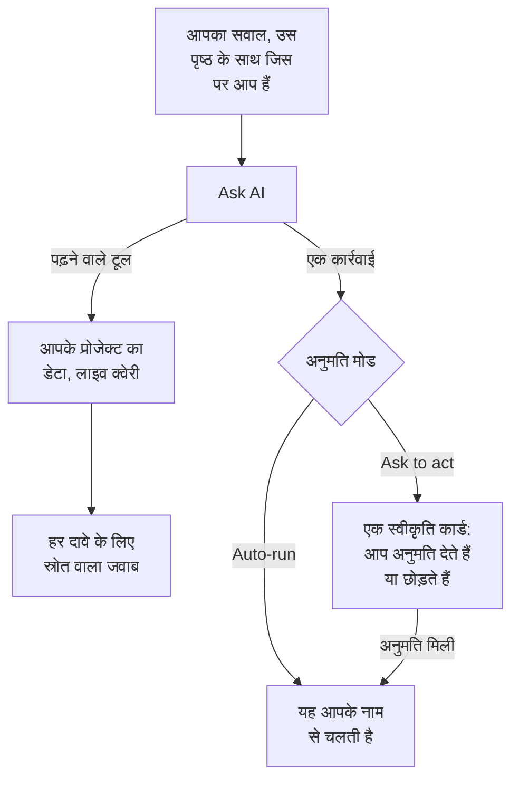

# AI से पूछें

AI से पूछें आपके प्रोजेक्ट के डेटा पर OneUptime की चैट है। इससे लॉग, ट्रेस, मेट्रिक्स, अपवाद, घटनाएं, अलर्ट, मॉनिटर, ऑन-कॉल, स्थिति पृष्ठ, SLO, रनबुक या वर्कफ़्लो के बारे में पूछें: यह आपके प्रोजेक्ट से लाइव क्वेरी करती है, हर दावे के साथ स्रोत देती है, और जब आप अनुमति दें, तो आपकी ओर से कार्रवाई करती है।

:::cards
- [AI से पूछें खोलें](#ai-से-पूछें-खोलें): हेडर, कीबोर्ड, किसी चार्ट या इसके अपने पृष्ठ से।
- [यह क्या देख सकती है](#यह-क्या-देख-सकती-है): वह डेटा जिसे यह आपको जवाब देने के लिए पढ़ती है।
- [कार्रवाइयां और अनुमति मोड](#कार्रवाइयां-और-अनुमति-मोड): तय करें कि यह कार्रवाई कर सकती है या नहीं, और कब पहले पूछती है।
- [कार्रवाइयां आपके नाम से होती हैं](#कार्रवाइयां-आपके-नाम-से-होती-हैं): आपकी अनुमतियां, हर बदलाव पर आपका नाम।
:::

## AI से पूछें कैसे जवाब देती है

AI से पूछें केवल वही बताती है जो इसके टूल लौटाते हैं: यह याद से जवाब देने के बजाय आपके प्रोजेक्ट पर क्वेरी चलाती है। जवाब के हर तथ्य के साथ एक स्रोत चिप होती है, जो उसके पीछे की क्वेरी दिखाती है और पढ़ा गया डेटा खोलती है। जब आप इससे कुछ बदलने को कहते हैं, तो बातचीत का अनुमति मोड तय करता है कि यह पहले आपसे पूछे या नहीं। आपके सवाल से पहले यह प्रोजेक्ट का [AI संदर्भ](/docs/ai/ai-context) पढ़ती है: वह जो आपकी टीम ने आपके अपने सिस्टम के बारे में OneUptime AI के लिए लिखा है।

**केवल पढ़ने के लिए** मोड में कार्रवाइयां मॉडल को कभी नहीं दी जातीं, इसलिए बातचीत केवल पढ़ती है।

## AI से पूछें खोलें

| कहां | कैसे |
| --- | --- |
| कोई भी पृष्ठ | हेडर में **Ask AI** पर क्लिक करें, या `Ctrl` + `I` दबाएं (Mac पर `Cmd` + `I`)। जब आप किसी टेक्स्ट बॉक्स या एडिटर में टाइप कर रहे हों, तो ये कुंजियां एडिटर का इटैलिक शॉर्टकट ही रहती हैं। |
| कमांड पैलेट | `Ctrl` + `K` दबाएं (Mac पर `Cmd` + `K`) और **Ask AI** चुनें। |
| लॉग का कोई त्रुटि पैटर्न, या किसी चार्ट के निष्कर्ष | **Explain with AI** पर क्लिक करें: AI से पूछें सबूतों के साथ एक ऐसे सवाल के रूप में खुलती है जिसे आप भेजने से पहले बदल सकते हैं। |
| इसका अपना पृष्ठ | पूरे पृष्ठ के कार्यक्षेत्र के लिए **उत्पाद → AI → Chat** खोलें। वहां हर बातचीत का अपना पता होता है, इसलिए आप किसी थ्रेड को बुकमार्क कर सकते हैं या किसी घटना के चैनल में चिपका सकते हैं। |

किसी घटना या अलर्ट पर, **AI Investigation** कार्ड की अपनी बातचीत होती है, **Ask OneUptime AI**, जिसे वह घटना या अलर्ट देख सकने वाले सभी लोग साझा करते हैं: [घटना के बारे में OneUptime AI से बात करें](/docs/ai/ai-sre#घटना-के-बारे-में-oneuptime-ai-से-बात-करें) देखें।

## यह क्या देख सकती है

AI से पूछें आपके प्रोजेक्ट को आपकी अपनी अनुमतियों से पढ़ती है, इसलिए यह वही देखती है जो आप देख सकते हैं, उससे अधिक नहीं।

| क्षेत्र | AI से पूछें क्या पढ़ती है |
| --- | --- |
| टेलीमेट्री | लॉग खोज और हिस्टोग्राम, ट्रेस एकत्रीकरण और स्पैन ट्री, मेट्रिक्स, अपवाद, सुरक्षा इवेंट, रियल यूज़र मॉनिटरिंग और Web Vitals, हाल के बदलाव, और सीखी गई आधार रेखाओं के मुकाबले असामान्यता जांच। |
| इन्फ्रास्ट्रक्चर | होस्ट, Docker, Podman, Kubernetes, Docker Swarm, Proxmox, VMware vCenter, Ceph, स्टोरेज ऐरे, सर्वरलेस फ़ंक्शन, क्लाउड परिवेश, IoT बेड़े और नेटवर्क डिवाइस: इन्वेंटरी में क्या है, उनकी रिपोर्ट की गई कनेक्शन स्थिति, मेट्रिक रुझान, गंभीरता के अनुसार लॉग की गिनती और ट्रेस ऑपरेशनों के सारांश। एक क्वेरी उस टेलीमेट्री को भी कवर करती है जो किसी सेवा का नाम लेती है और उसे भी जो किसी इन्फ्रास्ट्रक्चर संसाधन का नाम लेती है। |
| घटना प्रतिक्रिया | घटनाएं और अलर्ट, स्थिति फ़िल्टर के साथ ("अभी क्या सक्रिय है?"), उनकी गतिविधि समयरेखाएं (स्थिति बदलाव, आंतरिक और सार्वजनिक नोट, फ़ीड) और मालिक, और पिछली घटनाओं में खोज ताकि उनके समाधान का दोबारा उपयोग हो सके। |
| ऑन-कॉल | अभी ऑन-कॉल कौन है, नीतियां और एस्केलेशन श्रृंखलाएं, और क्या हाल के पेज पहुंचे और स्वीकार किए गए। |
| AI का अपना काम | AI SRE जांचों और AI Insights के नतीजे, ताकि "AI को क्या मिला?" का जवाब प्रकाशित विश्लेषण से दिया जाए, न कि उसे फिर से निकाला जाए। |
| प्लेटफ़ॉर्म | मॉनिटर (स्थिति फ़िल्टर के साथ), अनुसूचित रखरखाव, स्थिति पृष्ठ और उनकी घोषणाएं, SLO, रनबुक, वर्कफ़्लो रन, प्रोब की सेहत, टीमें, और जुड़े रिपॉज़िटरी का कोड। |

## पृष्ठ का संदर्भ

AI से पूछें जानती है कि आपने इसे किस पृष्ठ से खोला। किसी घटना के पृष्ठ पर "यह क्यों हुआ?" का मतलब वही घटना है, और लिखने का क्षेत्र पृष्ठ के विषय वाली एक चिप दिखाता है; पूरे प्रोजेक्ट के बारे में पूछने के लिए इसे हटा दें। पैनल खुला रहते हुए आप किसी दूसरे पृष्ठ पर जाएं, तो संदर्भ आपके साथ चलता है। बातचीत अपना पहला विषय सर्वर पर भी याद रखती है, इसलिए कई दिन बाद का अगला सवाल भी "यह घटना" सही समझता है।

इन्फ्रास्ट्रक्चर सूचियां और संसाधन पृष्ठ उस तरह के संसाधन के लिए सवाल सुझाते हैं जिसे आप देख रहे हैं। एक Kubernetes क्लस्टर खोलें और पूछें "पिछले 24 घंटों में कौन से मेट्रिक्स बदले?", या एक Docker होस्ट खोलें और पूछें "पिछले छह घंटों की लॉग गंभीरता और ट्रेस त्रुटियों का सारांश दो।" सबूत के लिंक संसाधन के पृष्ठ पर वापस ले जाते हैं। पढ़ना आपके प्रोजेक्ट, संसाधन और टेलीमेट्री की अनुमतियों का पालन करता है, स्वामित्व और लेबल की पाबंदियों समेत।

किसी चाइल्ड पृष्ठ पर, संदर्भ आपके चुने गए पॉड, कंटेनर, VM, प्रोसेस या अन्य चाइल्ड को भी दर्ज करता है। इन्फ्रास्ट्रक्चर टूल पैरेंट संसाधन की टेलीमेट्री पढ़ते हैं; वे किसी चाइल्ड को केवल उसके नाम से नहीं माप सकते। AI से पूछें यह बताती है, और ऐसा Kubernetes नेमस्पेस नहीं मान लेती जो पृष्ठ नहीं बताता। कनेक्शन की स्थिति किसी वर्कलोड की सेहत नहीं है, और टेलीमेट्री का न होना यह नहीं बताता कि संसाधन ठीक है।

## आपके इन्फ्रास्ट्रक्चर पर कमांड

ऐसे संसाधन के पृष्ठ पर खोली गई AI से पूछें, जिसका AI एजेंट जुड़ा है (कोई होस्ट, Docker या Podman होस्ट, Docker Swarm क्लस्टर, Proxmox क्लस्टर, VMware vCenter, Ceph क्लस्टर, डेटाबेस सर्वर या Kubernetes क्लस्टर), आपके कहने पर उसी एजेंट के ज़रिए उस पर कमांड चलाती है: "इस होस्ट पर `uptime` चलाओ" या "`journalctl -u nginx` की आखिरी 100 पंक्तियां दिखाओ"। जवाब में वही होता है जो वापस आया, किसी भी दूसरे सबूत की तरह उद्धरण के साथ। किसी घटना या अलर्ट पर खोली गई, यह उससे जुड़े संसाधनों तक पहुंचती है।

- यह केवल वही केवल-पढ़ने वाली कमांड चलाती है जो कोई AI जांच उस तरह के संसाधन पर चला सकती है (देखें [बुनियादी ढांचे के AI एजेंट](/docs/ai/infrastructure-ai-agents)), जिन्हें हर अनुमति मोड में OneUptime और फिर एजेंट दोबारा जांचता है। कोई बदलाव, जैसे किसी सेवा को रीस्टार्ट करना, AI से पूछें से कभी नहीं चलता: इसके बजाय यह आपको सटीक कमांड देती है। सुधार केवल तब चलते हैं जब OneUptime AI किसी घटना या अलर्ट का समाधान करता है, संसाधन की अपनी सुधार सेटिंग्स के अनुसार।
- यह केवल उन संसाधनों तक पहुंचती है जिन्हें आप देख सकते हैं, और केवल तब तक जब तक संसाधन के लिए AI जांच चालू है।
- जब यह वहां कोई कमांड नहीं चला पाती (कोई एजेंट जुड़ा नहीं है, एजेंट ऑफ़लाइन है, या संसाधन के लिए AI जांच बंद है), तो यह बताती है, साथ में यह भी कि क्या बदलना है, और इसके बजाय आपके प्रोजेक्ट के डेटा से जवाब देती है।

## कार्रवाइयां और अनुमति मोड

हर बातचीत का एक अनुमति मोड होता है, जिसे आप लिखने के क्षेत्र में, टाइप करने वाले बॉक्स के पास चुनते हैं:

| मोड | क्या होता है |
| --- | --- |
| **Ask to act** | डिफ़ॉल्ट। AI से पूछें हर कार्रवाई को एक स्वीकृति कार्ड पर प्रस्तावित करती है, और जब तक आप उसके लिए **Allow** या **छोड़ें**, या **Deny all** नहीं चुनते, कुछ नहीं चलता। |
| **Auto-run** | मॉडल के मांगते ही कार्रवाइयां चलती हैं, फिर भी उतनी ही जितनी आपकी भूमिका को अनुमति है। इसे सावधानी से इस्तेमाल करें। |
| **केवल पढ़ने के लिए** | कार्रवाइयां मॉडल को बिल्कुल नहीं दी जातीं: AI से पूछें केवल पढ़ सकती है। |

जब कोई मोड अनुमति दे, तब AI से पूछें क्या कर सकती है:

- एक घटना बनाना, घटनाओं और अलर्ट को स्वीकार करना या हल करना, और किसी घटना की गंभीरता बदलना।
- किसी घटना या अलर्ट पर आंतरिक नोट लिखना। आंतरिक नोट कभी स्थिति पृष्ठ पर नहीं दिखते।
- किसी घटना पर सार्वजनिक स्थिति अपडेट प्रकाशित करना। यह एक अलग कार्रवाई है, क्योंकि यह स्थिति पृष्ठ के सब्सक्राइबरों को सूचना देती है।
- किसी ऑन-कॉल नीति को पेज करना, कोई रनबुक चलाना, या किसी घटना या अलर्ट की AI जांच शुरू करना।
- कोड बदलाव का प्रस्ताव: किसी जुड़े रिपॉज़िटरी की नई ब्रांच में कमिट करना और एक pull request खोलना। यह कभी डिफ़ॉल्ट ब्रांच या किसी सुरक्षित ब्रांच में नहीं लिखती, इसलिए बदलाव को मर्ज अब भी कोई व्यक्ति करता है।

## कार्रवाइयां आपके नाम से होती हैं

AI से पूछें की हर कार्रवाई आपके नाम से होती है: यह वही बदलाव करती है जो डैशबोर्ड उसी कार्रवाई के लिए करता है, प्रोजेक्ट में आपकी अपनी अनुमतियों के साथ, और बदलाव का श्रेय आपको मिलता है। चैट से किसी घटना को स्वीकार करने पर वही स्थिति बदलाव बनता है जो घटना के स्थिति पैनल से बनता है, इसलिए घटना की समयरेखा और फ़ीड दिखाते हैं कि उसकी स्थिति आपने बदली। चैट से भेजा गया पेज आपको उसे शुरू करने वाले के रूप में दिखाता है।

- **हर कार्रवाई को क्या चाहिए।** वही अनुमति जो डैशबोर्ड उसी बदलाव के लिए मांगता है। किसी घटना को स्वीकार करने या हल करने के लिए उसकी स्थिति बदलने की अनुमति चाहिए: **Project Owner**, **Project Admin**, **Project Member**, **Incident Admin** और **Incident Member**, या किसी कस्टम भूमिका में **Create Incident State Timeline**; किसी अलर्ट को अलर्ट के लिए वही अनुमति चाहिए (**Create Alert State Timeline**)। किसी ऑन-कॉल नीति को पेज करने के लिए उसे चलाने की अनुमति चाहिए (**Create On-Call Duty Policy Execution Log**), और किसी रनबुक को चलाने के लिए रनबुक निष्पादन शुरू करने की अनुमति: ऐसी भूमिका जो रनबुक चलाती है, उन रनबुक के लिए जिन तक उसके लेबल पहुंचते हैं, या किसी कस्टम भूमिका में **Create Runbook Execution**, जो प्रोजेक्ट की हर रनबुक तक पहुंचती है। किसी घटना की गंभीरता बदलने, किसी घटना या अलर्ट की AI जांच शुरू करने और किसी जुड़े रिपॉज़िटरी में कोड लिखने के लिए उस घटना, अलर्ट या रिपॉज़िटरी को बदलने की अनुमति चाहिए। जिस कार्रवाई की आपको अनुमति नहीं, वह अस्वीकार होती है, और AI बताती है कि उसे कौन सी अनुमति चाहिए। जब अनुमति आपके पास है लेकिन आपकी किसी टीम ने उसे ब्लॉक किया है, तो AI यही बताती है: कुछ लेबल पर लगा ब्लॉक AI से पूछें में उस कार्रवाई को हर रिकॉर्ड के लिए अस्वीकार करता है, केवल उन लेबल वाले रिकॉर्ड के लिए नहीं।
- **कौन से रिकॉर्ड।** वही जिन्हें आप बदल सकते हैं, जैसा OneUptime में हर जगह है: कुछ लेबल तक या आपके अपने रिकॉर्ड तक सीमित भूमिका के साथ, किसी और रिकॉर्ड पर की गई कार्रवाई कुछ नहीं बदलती। कोई रनबुक तभी चलती है जब रनबुक निष्पादन शुरू करने की आपकी अनुमति उस तक पहुंचती है। OneUptime Cloud पर, जो कार्रवाई प्रोजेक्ट की योजना में शामिल नहीं, वह ज़रूरी योजना के नाम के साथ अस्वीकार होती है।
- **जब कोई कार्रवाई अस्वीकार होती है।** कुछ नहीं बदलता, और AI फिर से कोशिश करने के बजाय साफ़ बताती है कि कार्रवाई नहीं हुई, और क्यों।
- **Slack, Microsoft Teams और AI जांचें।** Slack और Microsoft Teams में AI के जवाब, और स्वायत्त AI जांचें, केवल पढ़ती हैं: वे इनमें से कोई कार्रवाई नहीं करतीं। Slack या Microsoft Teams से कार्रवाई करने के लिए OneUptime के संदेशों के बटन इस्तेमाल करें, जो भी आपके नाम से काम करते हैं ([Slack](/docs/workspace-connections/slack#slack-से-घटनाओं-अलर्ट-और-इवेंट-पर-कार्रवाई-करना) और [Microsoft Teams](/docs/workspace-connections/microsoft-teams#microsoft-teams-से-घटनाओं-अलर्ट-और-इवेंट-पर-कार्रवाई-करना) देखें)।

## बातचीत को संभालना

- **इसे रोकें।** जब AI से पूछें काम कर रही होती है, तो भेजें बटन रोकें बटन बन जाता है। किसी भी समय रन रोकें और तुरंत कुछ और पूछें।
- **मॉडल चुनें।** लिखने के क्षेत्र का प्रदाता चयनकर्ता आपके प्रोजेक्ट के LLM प्रदाता और वैश्विक प्रदाता दिखाता है, डिफ़ॉल्ट पर निशान के साथ। नई बातचीत डिफ़ॉल्ट का उपयोग करती है।
- **जवाब को रेट करें।** **Good answer** और **Poor answer** संदेश के साथ सहेजे जाते हैं, ताकि समय के साथ जवाबों की गुणवत्ता मापी जा सके।
- **लागत देखें।** सबसे नए जवाब का फ़ुटर उसकी लागत, उसके टोकन और उसके द्वारा चलाई गई क्वेरी की संख्या दिखाता है, और हर क्वेरी एक स्रोत चिप है जो उसके पीछे का डेटा खोलती है।
- **एक प्रति रखें।** **Download conversation** थ्रेड को **Download as Markdown** से सहेजता है, पढ़ने या किसी टिकट में चिपकाने के लिए, या **Download as PDF** से, किसी को देने के लिए।

## ज़रूरतें

- **एक LLM प्रदाता।** AI से पूछें प्रोजेक्ट के डिफ़ॉल्ट LLM प्रदाता का उपयोग करती है ([LLM प्रदाता](/docs/ai/llm-provider) देखें)। OneUptime Cloud पर यह वैश्विक प्रदाता के साथ तुरंत काम करती है, जिसका भुगतान प्रोजेक्ट के AI क्रेडिट से होता है; सेल्फ़-होस्टेड इंस्टॉलेशन एक प्रदाता या वैश्विक प्रदाता के एनवायरनमेंट वेरिएबल कॉन्फ़िगर करता है। जवाब मॉडल जितने ही अच्छे होते हैं: भरोसेमंद टूल कॉल के बिना एक छोटा सेल्फ़-होस्टेड मॉडल कमज़ोर जवाब देता है।
- **OneUptime Cloud पर Growth योजना।** निचली योजना वाला प्रोजेक्ट देखता है कि AI उसकी योजना में शामिल नहीं है, साथ में **प्रोजेक्ट सेटिंग्स → बिलिंग और चालान → बिलिंग** का लिंक होता है।
- **प्रोजेक्ट के लिए चालू AI।** **प्रोजेक्ट सेटिंग्स → एआई → AI Features** पर **AI सक्षम करें** प्रोजेक्ट की हर AI सुविधा बंद कर देता है, AI से पूछें भी। यह तब तक चालू रहता है जब तक कोई इसे बंद न करे।

जब प्रोजेक्ट अपनी दैनिक AI सीमाएं तय करता है, तो AI से पूछें उनमें गिनी जाती है (प्रोजेक्ट सेटिंग्स → एआई → AI Features → और सेटिंग्स): जब कोई सीमा पूरी हो जाती है, तो AI से पूछें एक वाक्य दिखाती है जो बताता है कि कौन सी सीमा पूरी हुई, कि OneUptime AI मध्यरात्रि UTC पर फिर शुरू होता है, और कौन सीमा बढ़ा या हटा सकता है। हर दिन पहली बार कोई सीमा पूरी होने पर प्रोजेक्ट के मालिकों को ईमेल जाता है। घटनाओं और अलर्ट की दैनिक सीमाएं AI से पूछें को कभी नहीं रोकतीं। [प्रोजेक्ट की अपनी दैनिक सीमाएं](/docs/ai/ai-sre#प्रोजेक्ट-की-अपनी-दैनिक-सीमाएं) देखें।

## समस्या निवारण

:::details AI से पूछें कहती है कि AI उपलब्ध नहीं है
पैनल आपके टाइप करने से पहले कारण बताता है: प्रोजेक्ट की योजना में AI शामिल नहीं है, **AI सक्षम करें** बंद है, या प्रोजेक्ट के पास कोई LLM प्रदाता नहीं है। हर सूचना उस पृष्ठ से जुड़ी होती है जहां इसे बदला जाता है।
:::

:::details कोई कार्रवाई अस्वीकार हुई
AI से पूछें बताती है कि कार्रवाई को कौन सी अनुमति चाहिए, या कौन सी टीम उसे ब्लॉक करती है। किसी ऐसे व्यक्ति से कहें जो यह बदलाव कर सकता है, या किसी प्रोजेक्ट मालिक से अपनी भूमिका को वह अनुमति देने को कहें। कुछ नहीं बदला गया।
:::

:::details जवाब अस्पष्ट हैं या कभी डेटा का उपयोग नहीं करते
प्रदाता के पीछे का मॉडल जांचें। AI से पूछें को ऐसा मॉडल चाहिए जो टूल भरोसे से कॉल करे; छोटे स्थानीय मॉडल अक्सर एक भी क्वेरी चलाए बिना जवाब देते हैं। [LLM प्रदाता](/docs/ai/llm-provider) देखें।
:::

## अगले कदम

:::cards
- [AI SRE](/docs/ai/ai-sre): OneUptime AI को हर नई घटना और अलर्ट की जांच करने दें।
- [LLM प्रदाता](/docs/ai/llm-provider): वह मॉडल चुनें जिसे AI से पूछें और बाकी AI सुविधाएं इस्तेमाल करती हैं।
- [MCP सर्वर](/docs/ai/mcp-server): इसके बजाय Claude, Cursor या VS Code से OneUptime के बारे में पूछें।
:::
