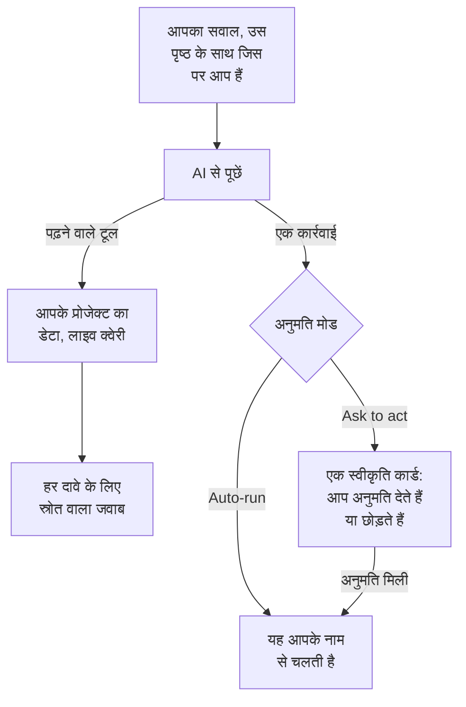

# AI से पूछें

AI से पूछें आपके प्रोजेक्ट के डेटा पर OneUptime की चैट है। इससे लॉग, ट्रेस, मेट्रिक्स, अपवाद, घटनाएं, अलर्ट, मॉनिटर, ऑन-कॉल, स्थिति पृष्ठ, SLO, रनबुक या वर्कफ़्लो के बारे में पूछें: यह आपके प्रोजेक्ट से लाइव क्वेरी करती है, हर दावे के साथ स्रोत देती है, और जब आप अनुमति दें, तो आपकी ओर से कार्रवाई करती है।

:::cards
- [AI से पूछें खोलें](#ai-से-पूछें-खोलें): हेडर, कीबोर्ड, किसी चार्ट या उत्पाद मेनू से।
- [यह क्या देख सकती है](#यह-क्या-देख-सकती-है): वह डेटा जिसे यह आपको जवाब देने के लिए पढ़ती है।
- [कार्रवाइयां और अनुमति मोड](#कार्रवाइयां-और-अनुमति-मोड): तय करें कि यह कार्रवाई कर सकती है या नहीं, और कब पहले पूछती है।
- [कार्रवाइयां आपके नाम से होती हैं](#कार्रवाइयां-आपके-नाम-से-होती-हैं): आपकी अनुमतियां, हर बदलाव पर आपका नाम।
:::

## AI से पूछें कैसे जवाब देती है

AI से पूछें केवल वही बताती है जो इसके टूल लौटाते हैं: यह याद से जवाब देने के बजाय आपके प्रोजेक्ट पर क्वेरी चलाती है। जवाब के हर तथ्य के साथ एक स्रोत चिप होती है, जो उसके पीछे की क्वेरी दिखाती है और पढ़ा गया डेटा खोलती है। जब आप इससे कुछ बदलने को कहते हैं, तो बातचीत का अनुमति मोड तय करता है कि यह पहले आपसे पूछे या नहीं। आपके सवाल से पहले यह प्रोजेक्ट का [AI संदर्भ](/docs/ai/ai-context) पढ़ती है: वह जो आपकी टीम ने आपके अपने सिस्टम के बारे में OneUptime AI के लिए लिखा है।

**केवल पढ़ने के लिए** मोड में कार्रवाइयां मॉडल को कभी नहीं दी जातीं, इसलिए बातचीत केवल पढ़ती है।

## OneUptime के बारे में सवाल

AI से पूछें खुद OneUptime के बारे में सवालों के जवाब भी देता है: "मेरी साइट डाउन होने पर मुझे SMS कैसे मिले?", "एपिसोड क्या है?", "दूसरा फ़ोन नंबर कहाँ जोड़ूँ?"। ये जवाब इसी दस्तावेज़ से आते हैं, यानी उस प्रति से जिसे आपका OneUptime खुद परोसता है, इसलिए यह इंटरनेट के बिना भी काम करता है और कुछ भी किसी नई जगह नहीं भेजता। जो पेज अनूदित है उसे यह आपकी भाषा में पढ़ता है, हर चरण के लिए पेज और सेक्शन बताता है, और अंदाज़ा लगाने के बजाय साफ़ कहता है कि दस्तावेज़ में यह बात नहीं है।

"कैसे करूँ" वाले जवाब के अंत में एक बटन होता है जो आपके प्रोजेक्ट का वह पेज खोलता है जहाँ यह काम होता है, जैसे **मॉनिटर बनाएं** या **सूचना विधियां**। यह केवल वही पेज खोलता है जो OneUptime में हैं: वे जिन्हें खोज (`Ctrl` + `K`) ढूँढती है।

## AI से पूछें खोलें

| कहां | कैसे |
| --- | --- |
| कोई भी पृष्ठ | हेडर में **AI से पूछें** पर क्लिक करें, या `Ctrl` + `I` दबाएं (Mac पर `Cmd` + `I`)। जब आप किसी टेक्स्ट बॉक्स या एडिटर में टाइप कर रहे हों, तो ये कुंजियां एडिटर का इटैलिक शॉर्टकट ही रहती हैं। |
| कमांड पैलेट | `Ctrl` + `K` दबाएं (Mac पर `Cmd` + `K`) और **AI से पूछें** चुनें। |
| लॉग का कोई त्रुटि पैटर्न, या किसी चार्ट के निष्कर्ष | **AI से समझाएं** पर क्लिक करें: AI से पूछें सबूतों के साथ एक ऐसे सवाल के रूप में खुलती है जिसे आप भेजने से पहले बदल सकते हैं। |
| उत्पाद मेनू | **उत्पाद → AI → चैट** खोलें। AI से पूछें उस पृष्ठ के बगल में खुलती है जिस पर आप थे। हर बातचीत का अपना पता होता है, इसलिए आप उसे बुकमार्क करके बाद में उस पर लौट सकते हैं। |

AI से पूछें विंडो के किनारे खुलती है, और पृष्ठ इसके लिए जगह बना देता है: इसके पीछे कुछ नहीं छिपता, इसलिए आप पृष्ठ पर काम जारी रख सकते हैं, दूसरे पृष्ठों पर जा सकते हैं और फिर से पूछ सकते हैं। इसे चौड़ा या संकरा करने के लिए इसका किनारा खींचें। पृष्ठ को पूरी विंडो लौटाने के लिए इसके भीतर `Esc` दबाएं, या **AI से पूछें** पर फिर से क्लिक करें। इसके खुले रहते, `Ctrl` + `I` (Mac पर `Cmd` + `I`) पृष्ठ से उस बॉक्स में ले जाता है जिसमें आप लिखते हैं, और वहां से इसे बंद कर देता है। बातचीत वहीं रहती है जहां आपने उसे छोड़ा था: जारी रखने के लिए AI से पूछें फिर से खोलें। अगर आप इसे जवाब देते समय बंद कर दें, तो कोने में एक रिमाइंडर बताता है कि जवाब कब तैयार है, और उसे खोलता है। टैबलेट या फ़ोन पर, जहां दोनों के लिए जगह नहीं होती, यह पृष्ठ के ऊपर खुलती है, और फ़ोन पर पूरी स्क्रीन भर देती है।

किसी घटना या अलर्ट पर, **OneUptime AI** कार्ड की अपनी बातचीत होती है, **OneUptime AI से पूछें**, जिसे वह घटना या अलर्ट देख सकने वाले सभी लोग साझा करते हैं: [घटना के बारे में OneUptime AI से बात करें](/docs/ai/ai-sre#घटना-के-बारे-में-oneuptime-ai-से-बात-करें) देखें।

## यह क्या देख सकती है

AI से पूछें आपके प्रोजेक्ट को आपकी अपनी अनुमतियों से पढ़ती है, इसलिए यह वही देखती है जो आप देख सकते हैं, उससे अधिक नहीं।

| क्षेत्र | AI से पूछें क्या पढ़ती है |
| --- | --- |
| टेलीमेट्री | लॉग खोज और हिस्टोग्राम, ट्रेस एकत्रीकरण और स्पैन ट्री, मेट्रिक्स, अपवाद, सुरक्षा इवेंट, रियल यूज़र मॉनिटरिंग और Web Vitals, हाल के बदलाव, और सीखी गई आधार रेखाओं के मुकाबले असामान्यता जांच। |
| इन्फ्रास्ट्रक्चर | होस्ट, Docker, Podman, Kubernetes, Docker Swarm, Proxmox, VMware vCenter, Ceph, स्टोरेज ऐरे, सर्वरलेस फ़ंक्शन, क्लाउड परिवेश, IoT बेड़े और नेटवर्क डिवाइस: इन्वेंटरी में क्या है, उनकी रिपोर्ट की गई कनेक्शन स्थिति, मेट्रिक रुझान, गंभीरता के अनुसार लॉग की गिनती और ट्रेस ऑपरेशनों के सारांश। एक क्वेरी उस टेलीमेट्री को भी कवर करती है जो किसी सेवा का नाम लेती है और उसे भी जो किसी इन्फ्रास्ट्रक्चर संसाधन का नाम लेती है। |
| घटना प्रतिक्रिया | घटनाएं और अलर्ट, स्थिति फ़िल्टर के साथ ("अभी क्या सक्रिय है?"), उनकी गतिविधि समयरेखाएं (स्थिति बदलाव, आंतरिक और सार्वजनिक नोट, फ़ीड) और मालिक, और पिछली घटनाओं में खोज ताकि उनके समाधान का दोबारा उपयोग हो सके। |
| ऑन-कॉल | अभी ऑन-कॉल कौन है, नीतियां और एस्केलेशन श्रृंखलाएं, और क्या हाल के पेज पहुंचे और स्वीकार किए गए। |
| AI का अपना काम | AI SRE जांचों और AI Insights के नतीजे, ताकि "AI को क्या मिला?" का जवाब प्रकाशित विश्लेषण से दिया जाए, न कि उसे फिर से निकाला जाए। |
| प्लेटफ़ॉर्म | मॉनिटर (स्थिति फ़िल्टर के साथ), अनुसूचित रखरखाव, स्थिति पृष्ठ और उनकी घोषणाएं, SLO, रनबुक, वर्कफ़्लो रन, प्रोब का स्वास्थ्य, टीमें, और GitHub, GitLab, Forgejo, Gitea और Azure DevOps पर जुड़े रिपॉज़िटरी का कोड (देखें [Git रिपॉजिटरी में AI क्या पढ़ता है](/docs/ai/ai-agent#git-रिपॉजिटरी-में-ai-क्या-पढ़ता-है))। |

## पृष्ठ का संदर्भ

AI से पूछें जानती है कि आपने इसे किस पृष्ठ से खोला। किसी घटना के पृष्ठ पर "यह क्यों हुआ?" का मतलब वही घटना है: लिखने का क्षेत्र पृष्ठ के विषय वाली एक चिप दिखाता है, और यह जो सवाल सुझाती है वे उसी पृष्ठ के होते हैं। पूरे प्रोजेक्ट के बारे में पूछने के लिए चिप हटा दें, और इसी तरह उसे वापस जोड़ें। किसी दूसरे पृष्ठ पर AI से पूछें खोलें, तो संदर्भ आपके साथ चलता है। बातचीत अपना पहला विषय सर्वर पर भी याद रखती है, इसलिए कई दिन बाद का अगला सवाल भी "यह घटना" सही समझता है।

किसी घटना, अलर्ट, मॉनिटर या अनुसूचित रखरखाव पर सुझाए गए सवाल उस रिकॉर्ड की मौजूदा स्थिति के हिसाब से भी होते हैं, जिसे AI से पूछें हर बार खुलने पर पढ़ती है। सुलझाई गई घटना पूछती है कि प्रतिक्रिया कैसी रही और इसे दोबारा होने से क्या रोकेगा, सुलझाया गया अलर्ट पूछता है कि क्या वह असली समस्या था और ऐसे अलर्ट कितनी बार आते हैं, और जो मॉनिटर कार्यरत नहीं है वह पूछता है कि क्यों। जो रखरखाव अभी शुरू नहीं हुआ वह पूछता है कि क्या उसके मॉनिटर शुरू होने से पहले ठीक हैं, और जो खत्म हो चुका है वह पूछता है कि क्या वे फिर से सामान्य हैं।

इन्फ्रास्ट्रक्चर सूचियां और संसाधन पृष्ठ उस तरह के संसाधन के लिए सवाल सुझाते हैं जिसे आप देख रहे हैं। एक Kubernetes क्लस्टर खोलें और पूछें "पिछले 24 घंटों में कौन से मेट्रिक्स बदले?", या एक Docker होस्ट खोलें और पूछें "पिछले छह घंटों की लॉग गंभीरता और ट्रेस त्रुटियों का सारांश दो।" सबूत के लिंक संसाधन के पृष्ठ पर वापस ले जाते हैं। पढ़ना आपके प्रोजेक्ट, संसाधन और टेलीमेट्री की अनुमतियों का पालन करता है, स्वामित्व और लेबल की पाबंदियों समेत।

किसी चाइल्ड पृष्ठ पर, संदर्भ आपके चुने गए पॉड, कंटेनर, VM, प्रोसेस या अन्य चाइल्ड को भी दर्ज करता है। इन्फ्रास्ट्रक्चर टूल पैरेंट संसाधन की टेलीमेट्री पढ़ते हैं; वे किसी चाइल्ड को केवल उसके नाम से नहीं माप सकते। AI से पूछें यह बताती है, और ऐसा Kubernetes नेमस्पेस नहीं मान लेती जो पृष्ठ नहीं बताता। कनेक्शन की स्थिति किसी वर्कलोड का स्वास्थ्य नहीं है, और टेलीमेट्री का न होना यह नहीं बताता कि संसाधन ठीक है।

## आपके इन्फ्रास्ट्रक्चर पर कमांड

ऐसे संसाधन के पृष्ठ पर खोली गई AI से पूछें, जिसका AI एजेंट जुड़ा है (कोई होस्ट, Docker या Podman होस्ट, Docker Swarm क्लस्टर, Proxmox क्लस्टर, VMware vCenter, Ceph क्लस्टर, डेटाबेस सर्वर या Kubernetes क्लस्टर), आपके कहने पर उसी एजेंट के ज़रिए उस पर कमांड चलाती है: "इस होस्ट पर `uptime` चलाओ" या "`journalctl -u nginx` की आखिरी 100 पंक्तियां दिखाओ"। जवाब में वही होता है जो वापस आया, किसी भी दूसरे सबूत की तरह उद्धरण के साथ। किसी घटना या अलर्ट पर खोली गई, यह उससे जुड़े संसाधनों तक पहुंचती है।

- यह केवल वही केवल-पढ़ने वाली कमांड चलाती है जो कोई AI जांच उस तरह के संसाधन पर चला सकती है (देखें [बुनियादी ढांचे के AI एजेंट](/docs/ai/infrastructure-ai-agents)), जितने जवाब के लिए ज़रूरी हों, जिन्हें हर अनुमति मोड में OneUptime और फिर एजेंट दोबारा जांचता है। एजेंट के ज़रिए कोई बदलाव, जैसे किसी सेवा को रीस्टार्ट करना, AI से पूछें से कभी नहीं चलता: इसके बजाय यह आपको सटीक कमांड देती है, और एजेंट केवल तब बदलाव करता है जब OneUptime AI किसी घटना या अलर्ट का समाधान करता है, संसाधन की अपनी सुधार सेटिंग्स के अनुसार। AI से पूछें की अपनी कार्रवाइयां, जैसे कोई रनबुक चलाना, बातचीत के अनुमति मोड का पालन करती हैं, जैसा नीचे बताया गया है।
- यह केवल उन संसाधनों तक पहुंचती है जिन्हें आप देख सकते हैं, और केवल तब तक जब तक संसाधन के लिए AI जांच चालू है।
- जब यह वहां कोई कमांड नहीं चला पाती (कोई एजेंट जुड़ा नहीं है, एजेंट ऑफ़लाइन है, या संसाधन के लिए AI जांच बंद है), तो यह बताती है, साथ में यह भी कि क्या बदलना है, और इसके बजाय आपके प्रोजेक्ट के डेटा से जवाब देती है।

## कार्रवाइयां और अनुमति मोड

हर बातचीत का एक अनुमति मोड होता है, जिसे आप लिखने के क्षेत्र में, टाइप करने वाले बॉक्स के पास चुनते हैं:

| मोड | क्या होता है |
| --- | --- |
| **कार्रवाई से पहले पूछें** | डिफ़ॉल्ट। AI से पूछें हर कार्रवाई को एक स्वीकृति कार्ड पर प्रस्तावित करती है, और जब तक आप उसके लिए **अनुमति दें** या **छोड़ें**, या **सभी अस्वीकार करें** नहीं चुनते, कुछ नहीं चलता। |
| **स्वतः चलाएँ** | मॉडल के मांगते ही कार्रवाइयां चलती हैं, फिर भी उतनी ही जितनी आपकी भूमिका को अनुमति है। इसे सावधानी से इस्तेमाल करें। |
| **केवल पढ़ने के लिए** | कार्रवाइयां मॉडल को बिल्कुल नहीं दी जातीं: AI से पूछें केवल पढ़ सकती है। |

जब कोई मोड अनुमति दे, तब AI से पूछें क्या कर सकती है:

- एक घटना या अलर्ट बनाना, घटनाओं और अलर्ट को स्वीकार करना या हल करना, और किसी घटना की गंभीरता बदलना।
- किसी घटना या अलर्ट को उस इंफ्रास्ट्रक्चर और उन सेवाओं से जोड़ना जिनसे वह संबंधित है। किसी संसाधन के पेज पर, जैसे किसी होस्ट के पेज पर, बनाई गई घटना या बनाया गया अलर्ट उसी संसाधन से जुड़ता है, और अनुमोदन कार्ड बताता है कि हर कार्रवाई किससे जोड़ती है। OneUptime AI उसी की जांच करता है और उसी को ठीक करता है जिससे कोई घटना या अलर्ट जुड़ा है।
- ऐसी समस्या दर्ज करना जिसे कोई पहले से संभाल रहा है, या जो पहले ही ख़त्म हो चुकी है: इसके द्वारा बनाई गई घटना या बनाया गया अलर्ट स्वीकार या सुलझी हुई स्थिति में शुरू हो सकता है, और तब किसी को पेज नहीं करता। अनुमोदन कार्ड बताता है कि कौन-सी। देखें [पहले से स्वीकार या सुलझी हुई घोषित](/docs/incidents/declaring-incidents#पहले-से-स्वीकार-या-सुलझी-हुई-घोषित)।
- किसी घटना या अलर्ट पर आंतरिक नोट लिखना। आंतरिक नोट कभी स्थिति पृष्ठ पर नहीं दिखते।
- किसी घटना पर सार्वजनिक स्थिति अपडेट प्रकाशित करना। यह एक अलग कार्रवाई है, क्योंकि यह स्थिति पृष्ठ के सब्सक्राइबरों को सूचना देती है।
- किसी ऑन-कॉल नीति को पेज करना, कोई रनबुक चलाना, या किसी घटना या अलर्ट की AI जांच शुरू करना।
- एक वाक्य से चीज़ें सेट अप करना: वेबसाइट या API मॉनिटर, किसे पेज किया जाए, एक स्थिति पृष्ठ और उस पर दिखने वाले मॉनिटर, सब एक ही स्वीकृति कार्ड पर। [चीज़ें सेट अप करें](#चीज़ें-सेट-अप-करें) देखें।
- कोड बदलाव का प्रस्ताव: GitHub, GitLab, Forgejo या Gitea पर किसी रिपॉज़िटरी की नई ब्रांच में कमिट करना और एक pull request खोलना (GitLab पर मर्ज रिक्वेस्ट)। यह कभी डिफ़ॉल्ट ब्रांच या किसी सुरक्षित ब्रांच में नहीं लिखती, इसलिए बदलाव को मर्ज अब भी कोई व्यक्ति करता है। Ask AI हर फ़ाइल को पूरा लिखता है, फ़ाइल के उसी रूप से जैसा उसने उसे आख़िरी बार पढ़ा था, और रिपॉज़िटरी की मुख्य ब्रांच पढ़ता है, जब तक उससे कोई दूसरी ब्रांच न माँगी जाए। अगर Ask AI के पढ़ने के बाद ब्रांच पर कोई फ़ाइल बदली गई, तो कमिट या pull request को मंज़ूरी देने से पहले कार्ड उसका नाम बताता है, जैसे "AI के पढ़ने के बाद यह फ़ाइल fix/login पर बदली गई, और AI का संस्करण उस बदलाव को पूर्ववत कर देता है: src/billing/charge.ts।" कार्ड ऐसी फ़ाइल का नाम भी बताता है जिसे Ask AI ने सिर्फ़ किसी दूसरी ब्रांच पर पढ़ा और जो वहाँ अलग है, ऐसी फ़ाइल जिसे Ask AI ने कभी नहीं पढ़ा पर जिसकी जगह वह ले रहा है, और ऐसी फ़ाइल जिसे OneUptime जाँच नहीं सका। Ask AI लंबी फ़ाइल को हिस्सों में पढ़ता है, इसलिए कार्ड ऐसी फ़ाइल का नाम भी बताता है जिसका Ask AI ने केवल एक हिस्सा पढ़ा है, जैसे "AI ने इस फ़ाइल का केवल एक हिस्सा पढ़ा है, और AI का संस्करण पूरी फ़ाइल की जगह ले लेता है: src/billing/charge.ts।" जब Ask AI पूरी फ़ाइल पढ़ लेता है, एक बार में या कई बार में, तो कार्ड उसके बारे में कुछ नहीं कहता। बाद के जवाब के पास पिछले जवाबों के शब्द होते हैं, उनकी पढ़ी फ़ाइलें नहीं, इसलिए कार्ड ऐसी फ़ाइल का नाम भी बताता है जिसे Ask AI ने सिर्फ़ किसी पिछले जवाब में पढ़ा था, जैसे "AI ने यह फ़ाइल किसी पिछले जवाब में पढ़ी थी और अब उसके पास इसका टेक्स्ट नहीं है, और AI का संस्करण पूरी फ़ाइल की जगह ले लेता है: src/billing/charge.ts।" बहुत लंबा जवाब अपने सबसे पुराने नतीजे भी छोड़ देता है, ताकि वह उतने में रहे जितना मॉडल एक बार में ले सकता है, इसलिए कार्ड ऐसी फ़ाइल का नाम भी बताता है जिसे Ask AI ने इसी जवाब में पहले पढ़ा था और जिसे पढ़ने का नतीजा बाद में छोड़ दिया गया, जैसे "AI ने यह फ़ाइल इसी जवाब में पहले पढ़ी थी और अब उसके पास इसका टेक्स्ट नहीं है, और AI का संस्करण पूरी फ़ाइल की जगह ले लेता है: src/billing/charge.ts।" अगर Ask AI ने फ़ाइल कई हिस्सों में पढ़ी थी और अब उसके पास उनमें से कुछ हिस्से नहीं हैं, तो कार्ड यह भी बताता है, जैसे "AI ने यह फ़ाइल पढ़ी थी और अब उसके पास इसके टेक्स्ट का एक हिस्सा नहीं है, और AI का संस्करण पूरी फ़ाइल की जगह ले लेता है: src/billing/charge.ts।" जब Ask AI उस जवाब में फ़ाइल फिर से पढ़ लेता है जो उसे बदलता है, तो कार्ड उसके बारे में कुछ नहीं कहता। नई फ़ाइल कभी नहीं गिनी जाती। किसी और का किया बदलाव बनाए रखने के लिए कार्रवाई छोड़ें और Ask AI से फ़ाइलें फिर से पढ़ने को कहें। स्वतः चलाएँ में, जहाँ कोई कार्रवाइयों को मंज़ूरी नहीं देता, Ask AI ऐसा बदलाव नहीं करता: वह फ़ाइलें फिर से पढ़ता है और उनकी मौजूदा स्थिति पर अपना बदलाव करता है। अगर कार्ड आपका इंतज़ार कर रहा हो और इसी बीच कोई फ़ाइल बदल जाए, तो मंज़ूरी देने से कुछ नहीं बदलता, और Ask AI बदलाव फिर से प्रस्तावित करता है। जिस pull request को आप फिर भी मंज़ूरी देते हैं, वह अपने विवरण में उन फ़ाइलों के नाम लिखता है, ताकि उसकी समीक्षा करने वाला उन्हें देख सके। Ask AI को गोपनीय जानकारी या व्यक्तिगत डेटा जैसे दिखने वाले मान, जैसे IP पते, ईमेल पते और कुंजियाँ, कभी नहीं दिखाए जाते: वह उनकी जगह `[redacted-ip]` जैसा प्लेसहोल्डर पढ़ता है। इसलिए कार्ड ऐसी फ़ाइल का नाम भी बताता है जिसमें Ask AI का संस्करण ऐसे प्लेसहोल्डर लिखता है, जैसे "गोपनीय जानकारी या व्यक्तिगत डेटा जैसे दिखने वाले मान AI से छिपाए गए थे, और इस फ़ाइल का AI का संस्करण उनकी जगह प्लेसहोल्डर लिखता है: config/servers.ts।" ब्रांच पर फ़ाइल में पहले से मौजूद प्लेसहोल्डर नहीं गिना जाता। Ask AI वे मान वापस नहीं लिख सकता, इसलिए स्वतः चलाएँ में वह यह बदलाव नहीं करता और इसके बजाय आपको बताता है कि क्या बदलना है।

जब उपयोगकर्ता प्रभावित हों तो घटना मांगें, और जब किसी चीज़ पर पहले आपकी टीम का ध्यान चाहिए, जैसे किसी होस्ट की मेमोरी का लगातार बढ़ना, तो अलर्ट मांगें। दोनों एक बार बनते हैं और किसी चीज़ पर नज़र नहीं रखते: हर बार जब किसी होस्ट की मेमोरी 75% से ऊपर जाए तब अलर्ट पाने के लिए, उसकी मेमोरी टेम्पलेट से एक [होस्ट मॉनिटर](/docs/monitor/host-monitor#तैयार-अलर्ट-टेम्पलेट) बनाएं, जिसकी थ्रेशोल्ड 75% हो। AI से पूछें केवल वेबसाइट और API मॉनिटर सेट अप करती है ([चीज़ें सेट अप करें](#चीज़ें-सेट-अप-करें) देखें)। किसी और तरह का मॉनिटर कहने पर यह यही बताती है, अभी का मान जांचती है, और अगर मान पहले से ऊपर हो तो अलर्ट बनाने की पेशकश करती है।

## कार्रवाइयां आपके नाम से होती हैं

AI से पूछें की हर कार्रवाई आपके नाम से होती है: यह वही बदलाव करती है जो डैशबोर्ड उसी कार्रवाई के लिए करता है, प्रोजेक्ट में आपकी अपनी अनुमतियों के साथ, और बदलाव का श्रेय आपको मिलता है। चैट से किसी घटना को स्वीकार करने पर वही स्थिति बदलाव बनता है जो घटना के स्थिति पैनल से बनता है, इसलिए घटना की समयरेखा और फ़ीड दिखाते हैं कि उसकी स्थिति आपने बदली। चैट से भेजा गया पेज आपको उसे शुरू करने वाले के रूप में दिखाता है।

- **हर कार्रवाई को क्या चाहिए।** वही अनुमति जो डैशबोर्ड उसी बदलाव के लिए मांगता है। कोई घटना या अलर्ट बनाने के लिए उसे बनाने की अनुमति चाहिए: ऐसी भूमिका जिसे इसकी अनुमति हो, या किसी कस्टम भूमिका में **Create Incident** या **Create Alert**। किसी घटना को स्वीकार करने या हल करने के लिए उसकी स्थिति बदलने की अनुमति चाहिए: **प्रोजेक्ट स्वामी**, **प्रोजेक्ट एडमिन**, **प्रोजेक्ट सदस्य**, **घटना एडमिन** और **घटना सदस्य**, या किसी कस्टम भूमिका में **Create Incident State Timeline**; किसी अलर्ट को अलर्ट के लिए वही अनुमति चाहिए (**Create Alert State Timeline**)। स्वीकार या सुलझी हुई स्थिति में शुरू होने वाली घटना या अलर्ट बनाने के लिए दोनों चाहिए: उसे बनाने की अनुमति, और उसकी स्थिति बदलने की अनुमति। किसी ऑन-कॉल नीति को पेज करने के लिए उसे चलाने की अनुमति चाहिए (**Execute On-Call Policies**), और किसी रनबुक को चलाने के लिए रनबुक निष्पादन शुरू करने की अनुमति: ऐसी भूमिका जो रनबुक चलाती है, उन रनबुक के लिए जिन तक उसके लेबल पहुंचते हैं, या किसी कस्टम भूमिका में **Create Runbook Execution**, जो प्रोजेक्ट की हर रनबुक तक पहुंचती है। किसी घटना की गंभीरता बदलने, किसी घटना या अलर्ट की AI जांच शुरू करने और किसी जुड़े रिपॉज़िटरी में कोड लिखने के लिए उस घटना, अलर्ट या रिपॉज़िटरी को बदलने की अनुमति चाहिए। जिस कार्रवाई की आपको अनुमति नहीं, वह अस्वीकार होती है, और AI बताती है कि उसे कौन सी अनुमति चाहिए। जब अनुमति आपके पास है लेकिन आपकी किसी टीम ने उसे ब्लॉक किया है, तो AI यही बताती है: कुछ लेबल पर लगा ब्लॉक AI से पूछें में उस कार्रवाई को हर रिकॉर्ड के लिए अस्वीकार करता है, केवल उन लेबल वाले रिकॉर्ड के लिए नहीं।
- **कौन से रिकॉर्ड।** वही जिन्हें आप बदल सकते हैं, जैसा OneUptime में हर जगह है: कुछ लेबल तक या आपके अपने रिकॉर्ड तक सीमित भूमिका के साथ, किसी और रिकॉर्ड पर की गई कार्रवाई कुछ नहीं बदलती। कोई रनबुक तभी चलती है जब रनबुक निष्पादन शुरू करने की आपकी अनुमति उस तक पहुंचती है। OneUptime Cloud पर, जो कार्रवाई प्रोजेक्ट की योजना में शामिल नहीं, वह ज़रूरी योजना के नाम के साथ अस्वीकार होती है।
- **जब कोई कार्रवाई अस्वीकार होती है।** कुछ नहीं बदलता, और AI फिर से कोशिश करने के बजाय साफ़ बताती है कि कार्रवाई नहीं हुई, और क्यों। जवाब के चरणों में, कार्रवाई का अपना चरण बताता है कि वह नहीं हुई, और क्यों: आपकी भूमिका इसकी अनुमति नहीं देती, आपकी किसी टीम ने इसे ब्लॉक किया है, या प्रोजेक्ट की योजना में यह शामिल नहीं।
- **Slack, Microsoft Teams और AI जांचें।** Slack और Microsoft Teams में AI के जवाब, और स्वायत्त AI जांचें, केवल पढ़ती हैं: वे इनमें से कोई कार्रवाई नहीं करतीं। वहाँ कोई बदलाव माँगने पर AI बताती है कि उसे चैट से ही कैसे करें: `/oneuptime incident` घटना घोषित करता है, `/oneuptime incident 42` घटना 42 को उसके बटनों के साथ दिखाता है, `/oneuptime page` किसी को पेज करता है (Microsoft Teams में, यही शब्द OneUptime बॉट को लिखकर), और OneUptime के संदेशों के बटन भी आपके नाम से काम करते हैं ([Slack](/docs/workspace-connections/slack#slack-से-घटनाओं-अलर्ट-और-इवेंट-पर-कार्रवाई-करना) और [Microsoft Teams](/docs/workspace-connections/microsoft-teams#microsoft-teams-से-घटनाओं-अलर्ट-और-इवेंट-पर-कार्रवाई-करना) देखें)। किसी और बदलाव के लिए वह AI से पूछें का लिंक देती है, जो बदलाव प्रस्तावित करता है ताकि आप उसे मंज़ूरी दें। किसी घटना या अलर्ट के अपने चैनल में पूछने पर, वह उसी घटना या अलर्ट को आपका आशय मानती है।

## चीज़ें सेट अप करें

AI से पूछें एक वाक्य से वही सेट अप करती है जो गाइडेड सेटअप करते हैं: "example.com को हर मिनट जांचो और अगर वह डाउन हो तो मुझे SMS भेजो।"

- **एक योजना, एक स्वीकृति।** AI से पूछें हर हिस्से को एक ही स्वीकृति कार्ड पर, सरल शब्दों में, प्रस्तावित करती है: वेबसाइट या API मॉनिटर, प्रोजेक्ट की पहली ऑन-कॉल नीति, एक स्थिति पृष्ठ और उस पर दिखने वाले मॉनिटर। कार्ड "और कुछ नहीं बदलता।" पर खत्म होता है। जो हिस्सा आप नहीं चाहते उस पर **छोड़ें** चुनें, और बाकी चलाएँ। उससे पहले कुछ नहीं बनता।
- **हमेशा पूछती है।** सेटअप हर मोड में आपकी स्वीकृति का इंतज़ार करता है, **स्वतः चलाएँ** में भी, क्योंकि यह ऐसी चीज़ें बनाता है जो लोगों को पेज करती हैं और जिन्हें आपके ग्राहक देखते हैं। **केवल पढ़ने के लिए** इसे पेश नहीं करता।
- **गाइडेड सेटअप वाले रिकॉर्ड।** मॉनिटर वही है जो **जानना कि मेरी वेबसाइट या API कब डाउन है** उसी पते के लिए बनाता है: मॉनिटर बनाएं के डिफ़ॉल्ट मान, जो पता जवाब न दे या त्रुटि के साथ जवाब दे तो घटना खोलता है, और हर 5 मिनट में जांचा जाता है, जब तक आप मॉनिटर बनाएं का कोई और अंतराल न मांगें। यह आपका है, इसलिए इसकी स्थिति बदलने पर आपको ईमेल मिलता है। स्थिति पृष्ठ वही है जो **एक स्थिति पृष्ठ प्रकाशित करें** बनाता है: बनते ही सार्वजनिक, हर मॉनिटर की स्थिति, उपलब्धता और इतिहास दिखाता हुआ।
- **किसे पेज किया जाता है।** जो प्रोजेक्ट अभी किसी को पेज नहीं करता, उसमें AI से पूछें प्रोजेक्ट की पहली ऑन-कॉल नीति, "Default on-call policy", प्रस्तावित करती है, जो हर नई घटना और हर नए अलर्ट पर आपको, और आपके बताए सदस्यों और टीमों को, पेज करती है। जो प्रोजेक्ट पहले से लोगों को पेज करता है, वह अपनी ऑन-कॉल नीतियां और नियम रखता है, और AI से पूछें एक और बनाने के बजाय यही बताती है।
- **क्या कमी है।** AI से पूछें कभी फ़ोन नंबर या मोबाइल ऐप नहीं जोड़ती: आप उन्हें **उपयोगकर्ता सेटिंग्स → सूचना विधियां** में खुद जोड़ते और सत्यापित करते हैं। अगर आप बिना सत्यापित नंबर के SMS मांगते हैं, तो कार्ड यह बताता है और जवाब उस पृष्ठ का लिंक देता है। जो हिस्सा AI से पूछें नहीं बना सकती, वह प्रस्तावित नहीं होता, जैसे जब आपकी भूमिका इसकी अनुमति नहीं देती, पता सही नहीं है, या मॉनिटर मौजूद नहीं हैं: जवाब बताता है कि क्या चाहिए।
- **हर हिस्से को क्या चाहिए।** मॉनिटर के लिए मॉनिटर बनाने की अनुमति चाहिए। पेजिंग के लिए ऑन-कॉल नीतियां, उनके एस्केलेशन नियम, और घटना व अलर्ट ऑन-कॉल नियम बनाने की अनुमति चाहिए। स्थिति पृष्ठ के लिए स्थिति पृष्ठ बनाने और उनमें मॉनिटर जोड़ने की अनुमति चाहिए। गाइडेड सेटअप की तरह, प्रोजेक्ट के प्लान की सीमाएं लागू होती हैं।
- **फिर परीक्षण करें।** योजना चलने के बाद हर कार्ड वह खोलता है जो बनाया गया, और जवाब के नीचे **इस नीति का परीक्षण करें** (या केवल मॉनिटर के लिए **मुझे परीक्षण पेज भेजें**) एक परीक्षण पेज भेजता है जिसे आप संदेश से स्वीकार करते हैं। अगर कोई हिस्सा विफल होता है, तो जवाब बताता है कि क्या बना और क्या नहीं।
- **किसे बताया जाता है।** पूछें "example.com डाउन होने पर किसे बताया जाता है?" और AI से पूछें उसी कड़ी से जवाब देती है जो मॉनिटर का पृष्ठ दिखाता है, हर टूटन का नाम लेते हुए।

## बातचीत को संभालना

- **इसे रोकें।** जब AI से पूछें काम कर रही होती है, तो भेजें बटन रोकें बटन बन जाता है। किसी भी समय रन रोकें और तुरंत कुछ और पूछें।
- **इसका काम देखें।** जवाब देते समय एक पंक्ति बताती है कि यह अभी क्या कर रही है, जैसे लॉग खोजना। हर चरण देखने के लिए उसके बगल में चरणों की संख्या पर क्लिक करें।
- **मॉडल चुनें।** जब आपका प्रोजेक्ट एक से ज़्यादा LLM प्रदाता इस्तेमाल कर सकता है, तो लिखने के क्षेत्र का प्रदाता चयनकर्ता आपके प्रोजेक्ट के LLM प्रदाता और वैश्विक प्रदाता दिखाता है, डिफ़ॉल्ट पर निशान के साथ। नई बातचीत डिफ़ॉल्ट का उपयोग करती है।
- **जवाब को रेट करें।** **अच्छा जवाब** और **खराब जवाब** संदेश के साथ सहेजे जाते हैं, ताकि समय के साथ जवाबों की गुणवत्ता मापी जा सके।
- **लागत देखें।** हर जवाब के नीचे, उसके स्रोत उसकी चलाई गई क्वेरी में खुलते हैं, और सबसे नए जवाब के स्रोत यह भी बताते हैं कि उसने कितनी क्वेरी चलाईं, उसके टोकन और उसकी लागत। किसी जवाब की हर स्रोत चिप उसके पीछे का डेटा खोलती है।
- **एक प्रति रखें।** **बातचीत डाउनलोड करें** थ्रेड को **Markdown के रूप में डाउनलोड करें** से सहेजता है, पढ़ने या किसी टिकट में चिपकाने के लिए, या **PDF के रूप में डाउनलोड करें** से, किसी को देने के लिए।
- **जहां छोड़ा था, वहीं से जारी रखें।** AI से पूछें के हेडर में **सभी बातचीत** आपकी बातचीतों को, सबसे नई पहले, फिर से खोलने या हटाने के लिए दिखाता है। नई बातचीत की शुरुआत आखिरी तीन दिखाती है।

## ज़रूरतें

- **एक LLM प्रदाता।** AI से पूछें प्रोजेक्ट के डिफ़ॉल्ट LLM प्रदाता का उपयोग करती है ([LLM प्रदाता](/docs/ai/llm-provider) देखें)। OneUptime Cloud पर यह वैश्विक प्रदाता के साथ तुरंत काम करती है, जिसका भुगतान प्रोजेक्ट के AI क्रेडिट से होता है; सेल्फ़-होस्टेड इंस्टॉलेशन एक प्रदाता या वैश्विक प्रदाता के एनवायरनमेंट वेरिएबल कॉन्फ़िगर करता है। जवाब मॉडल जितने ही अच्छे होते हैं: भरोसेमंद टूल कॉल के बिना एक छोटा सेल्फ़-होस्टेड मॉडल कमज़ोर जवाब देता है।
- **OneUptime Cloud पर Growth योजना।** निचली योजना वाला प्रोजेक्ट देखता है कि AI उसकी योजना में शामिल नहीं है, साथ में **प्रोजेक्ट सेटिंग्स → बिलिंग और चालान → बिलिंग** का लिंक होता है।
- **प्रोजेक्ट के लिए चालू AI।** **प्रोजेक्ट सेटिंग्स → एआई → AI सुविधाएं** पर **AI सक्षम करें** प्रोजेक्ट की हर AI सुविधा बंद कर देता है, AI से पूछें भी। यह तब तक चालू रहता है जब तक कोई इसे बंद न करे।

जब प्रोजेक्ट अपनी दैनिक AI सीमाएं तय करता है, तो AI से पूछें उनमें गिनी जाती है (प्रोजेक्ट सेटिंग्स → एआई → AI Features → और सेटिंग्स): जब कोई सीमा पूरी हो जाती है, तो AI से पूछें एक वाक्य दिखाती है जो बताता है कि कौन सी सीमा पूरी हुई, कि OneUptime AI मध्यरात्रि UTC पर फिर शुरू होता है, और कौन सीमा बढ़ा या हटा सकता है। हर दिन पहली बार कोई सीमा पूरी होने पर प्रोजेक्ट के मालिकों को ईमेल जाता है। घटनाओं और अलर्ट की दैनिक सीमाएं AI से पूछें को कभी नहीं रोकतीं। [प्रोजेक्ट की अपनी दैनिक सीमाएं](/docs/ai/ai-sre#प्रोजेक्ट-की-अपनी-दैनिक-सीमाएं) देखें।

## समस्या निवारण

:::details AI से पूछें कहती है कि AI उपलब्ध नहीं है
AI से पूछें आपके टाइप करने से पहले कारण बताती है: प्रोजेक्ट की योजना में AI शामिल नहीं है, **AI सक्षम करें** बंद है, या प्रोजेक्ट के पास कोई LLM प्रदाता नहीं है। हर सूचना उस पृष्ठ से जुड़ी होती है जहां इसे बदला जाता है।
:::

:::details कोई कार्रवाई अस्वीकार हुई
AI से पूछें बताती है कि कार्रवाई को कौन सी अनुमति चाहिए, या कौन सी टीम उसे ब्लॉक करती है। किसी ऐसे व्यक्ति से कहें जो यह बदलाव कर सकता है, या किसी प्रोजेक्ट मालिक से अपनी भूमिका को वह अनुमति देने को कहें। कुछ नहीं बदला गया।
:::

:::details जवाब अस्पष्ट हैं या कभी डेटा का उपयोग नहीं करते
प्रदाता के पीछे का मॉडल जांचें। AI से पूछें को ऐसा मॉडल चाहिए जो टूल भरोसे से कॉल करे; छोटे स्थानीय मॉडल अक्सर एक भी क्वेरी चलाए बिना जवाब देते हैं। [LLM प्रदाता](/docs/ai/llm-provider) देखें।
:::

## अगले कदम

:::cards
- [AI SRE](/docs/ai/ai-sre): OneUptime AI को हर नई घटना और अलर्ट की जांच करने दें।
- [LLM प्रदाता](/docs/ai/llm-provider): वह मॉडल चुनें जिसे AI से पूछें और बाकी AI सुविधाएं इस्तेमाल करती हैं।
- [MCP सर्वर](/docs/ai/mcp-server): इसके बजाय Claude, Cursor या VS Code से OneUptime के बारे में पूछें।
:::
