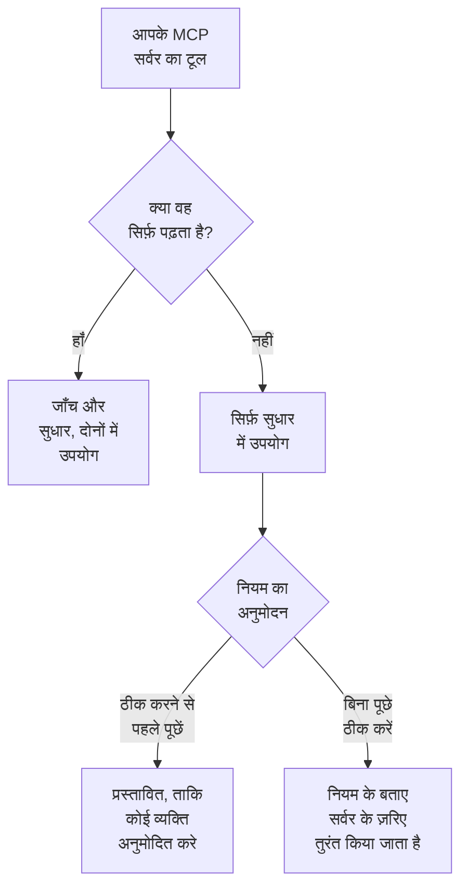

# बाहरी MCP सर्वर

OneUptime AI घटनाओं और अलर्ट की जाँच और सुधार करते समय OneUptime के बाहर के MCP सर्वर के टूल का उपयोग कर सकता है — वे सर्वर जो आपका क्लाउड, आपका कोड होस्ट या आपकी अपनी टीम चलाती है, जैसे AWS, Azure या GitHub। **प्रोजेक्ट सेटिंग्स → एआई → बाहरी MCP सर्वर** में एक बार सर्वर जोड़ें, और OneUptime AI अगली घटना से उसका उपयोग करेगा।

:::cards
- [सर्वर जोड़ें](#सर्वर-जोड़ें): उसका पता, और OneUptime कैसे साइन इन करता है।
- [OneUptime AI सर्वर के साथ क्या करता है](#oneuptime-ai-सर्वर-के-साथ-क्या-करता-है): जाँच में पढ़ने वाले टूल, सुधार में बाकी टूल भी।
- [नियम किन सर्वर का उपयोग कर सकता है, यह चुनें](#नियम-किन-सर्वर-का-उपयोग-कर-सकता-है-यह-चुनें): सभी, जब तक कोई नियम कुछ को न चुने।
- [सुरक्षा](#सुरक्षा): सर्वर OneUptime AI से क्या करवा सकता है और क्या नहीं।
:::

यह पेज उन सर्वर के बारे में है जिनसे OneUptime AI कनेक्ट होता है। इसके बजाय Claude या Cursor जैसे किसी AI सहायक को OneUptime से जोड़ने के लिए [MCP सर्वर](/docs/ai/mcp-server) देखें।

## शुरू करने से पहले

- प्रोजेक्ट के लिए **OneUptime AI चालू है**, और उसके पास उपयोग करने लायक LLM प्रदाता है: [LLM प्रदाता](/docs/ai/llm-provider) देखें।
- **सर्वर का MCP पता।** Streamable HTTP और पुराना SSE वाला HTTP, दोनों काम करते हैं: सर्वर कौन-सा बोलता है, यह OneUptime कनेक्ट होते समय पता लगा लेता है।
- **OneUptime उसमें कैसे साइन इन करता है:** एक API टोकन, सर्वर के अपने हेडर, या आपके पहचान प्रदाता के OAuth क्लाइंट क्रेडेंशियल।
- **Project Owner या Project Admin** सर्वर जोड़ते, बदलते, परीक्षण करते और हटाते हैं; Project Members और Viewers उन्हें देख सकते हैं। OneUptime Cloud पर सर्वर जोड़ने के लिए Growth प्लान या उससे ऊपर का प्लान चाहिए।

## सर्वर जोड़ें

:::steps
### बाहरी MCP सर्वर खोलें
**प्रोजेक्ट सेटिंग्स → एआई → बाहरी MCP सर्वर** पर जाएं और **बाहरी MCP सर्वर बनाएँ** पर क्लिक करें।

### बताएं कि वह कहाँ है
उसे एक **नाम** दें, जिससे OneUptime AI और उसके किए काम को पढ़ने वाले लोग उसे पहचानते हैं, और उसका **URL** दें, जैसे `https://mcp.example.com/mcp`। **और फ़ील्ड** में एक **विवरण** बताता है कि सर्वर किस काम का है; सही सर्वर चुनने के लिए OneUptime AI उसे पढ़ता है।

### चुनें कि OneUptime कैसे साइन इन करे
**प्रमाणीकरण** में एक कार्ड चुनें, फिर वह जो माँगे वह भरें ([प्रमाणीकरण](#प्रमाणीकरण) देखें)।

### देखें कि OneUptime को क्या मिला
सहेजते ही OneUptime तुरंत कनेक्ट होता है और **कनेक्शन का परीक्षण करें** संवाद बताता है कि उसे क्या मिला: सर्वर, वह कैसे बात करता है, और उसका हर टूल, **केवल पढ़ता है** या **बदलाव कर सकता है** के निशान के साथ। अगर कनेक्ट नहीं हो सका, तो संवाद बताता है कि क्यों और क्या जाँचें।
:::

सर्वर की सूची बताती है कि हर सर्वर का हाल क्या है: **कनेक्टेड**, **कनेक्ट नहीं हो पा रहा** (कारण देखने के लिए उस पर पॉइंटर रखें), **अभी जाँचा नहीं गया** या **बंद**, और वह कितने टूल देता है। सर्वर के पेज पर उसका विवरण, OneUptime AI को उसका उपयोग करने देने वाला स्विच, और उसके **टूल** होते हैं, साथ में दोबारा कनेक्ट होकर उन्हें फिर से पढ़ने के लिए **कनेक्शन का परीक्षण करें**। परीक्षण सर्वर के किसी भी टूल को कॉल नहीं करता।

## प्रमाणीकरण

| प्रमाणीकरण | OneUptime क्या भेजता है | आप क्या भरते हैं |
| --- | --- | --- |
| **साइन-इन नहीं** | कुछ नहीं | कुछ नहीं। ऐसे सर्वर के लिए जिसे साइन-इन की ज़रूरत नहीं, या जिस तक केवल आपका नेटवर्क पहुँचता है। |
| **Bearer टोकन** | `Authorization: Bearer <token>` | **Token** |
| **कस्टम हेडर** | आपके डाले गए हेडर, हर अनुरोध के साथ | हर हेडर का एक नाम और एक मान, जैसे `X-API-Key`। अधिकतम 10। |
| **OAuth क्लाइंट क्रेडेंशियल** | आपके पहचान प्रदाता से माँगा गया टोकन, बेयरर टोकन के रूप में, और उसके खत्म होने से पहले दोबारा माँगा गया | अलग चरण में **टोकन URL**, **क्लाइंट ID** और **क्लाइंट सीक्रेट**; **दायरा** और **ऑडियंस** **और फ़ील्ड** में |

टोकन, हेडर के मान और क्लाइंट सीक्रेट एन्क्रिप्ट करके संग्रहीत होते हैं और फिर कभी नहीं दिखाए जाते, उन्हें सहेजने वालों को भी नहीं। संपादन में वे खाली रहते हैं; संग्रहीत मान रखने के लिए किसी को खाली छोड़ दें। सर्वर का पेज उसके भेजे जाने वाले हेडर के नाम दिखाता है, उनके मान कभी नहीं। **प्रमाणीकरण** बदलने से पुराने साइन-इन तरीके के सीक्रेट हट जाते हैं।

**URL** में कभी टोकन या पासवर्ड न डालें: सर्वर को पढ़ सकने वाला हर व्यक्ति उसका पता पढ़ता है, और उसमें मौजूद यूज़रनेम या पासवर्ड अस्वीकार कर दिया जाता है।

## OneUptime AI सर्वर के साथ क्या करता है

सर्वर का हर टूल या तो केवल पढ़ता है, या कुछ बदल सकता है। OneUptime इस पर चलता है कि सर्वर टूल के बारे में क्या कहता है (उसका `readOnlyHint`): जिस टूल को सर्वर केवल-पढ़ने वाला नहीं बताता, उसे कुछ बदल सकने वाला टूल माना जाता है।

| | केवल पढ़ने वाले टूल | कुछ बदल सकने वाले टूल |
| --- | --- | --- |
| **जाँच** | उपयोग होते हैं, OneUptime के अपने डेटा के साथ | कभी उपयोग नहीं होते: OneUptime कॉल को अस्वीकार करता है |
| **सुधार** | सुधार तैयार करने के लिए उपयोग होते हैं | AI नियम के **सुधार** के अनुसार, अनुमोदन के लिए प्रस्तावित या तुरंत उपयोग होते हैं |

**जाँच में**, OneUptime AI उन सर्वर के टूल सूचीबद्ध करता है जिनका वह उपयोग कर सकता है, और पढ़ने वाले टूल को कॉल करता है, ताकि वह देख सके जो OneUptime खुद नहीं देख सकता: आपका क्लाउड खाता, कोई डिप्लॉयमेंट, कोई इश्यू ट्रैकर। उनके जवाबों का उपयोग वह अपने मूल कारण विश्लेषण में करता है। [AI SRE](/docs/ai/ai-sre) देखें।

**सुधार में**, जब उपयोग किए जा सकने वाले किसी सर्वर के पास कुछ बदल सकने वाला टूल होता है, तो OneUptime AI उसके ज़रिए सुधार तैयार करता है, मूल कारण विश्लेषण के बाद, अगर वह हो:

- **ठीक करने से पहले पूछें** — वह जो भी बदलाव करेगा, वह रिकॉर्ड होता है और कहीं नहीं भेजा जाता। घटना का **सुधार** कार्ड उन्हें क्रम से दिखाता है, हर एक उसके सर्वर, उसके टूल और उसके भेजे जाने वाले डेटा के साथ। **स्वीकृत करें और चलाएं** ठीक वही बदलाव, उसी क्रम में, आपके नाम से करता है; अनुमोदन के लिए वही अनुमति चाहिए जो रनबुक शुरू करने के लिए। विफल होने वाला बदलाव उसके बाद के बदलावों को रोक देता है।
- **बिना पूछे ठीक करें** — OneUptime AI बदलाव खुद करता है, और हर बदलाव भेजने से पहले रिकॉर्ड होता है। वह ऐसा केवल उस नियम के लिए करता है जो अपने MCP सर्वर का नाम देता है, जब कोई दूसरा मेल खाता नियम पहले नहीं पूछता, कोई और चीज़ पहले से घटना को अपने आप ठीक नहीं कर रही (क्लस्टर या होस्ट पर कोई AI एजेंट, या कोई रनबुक), और नियम ने एक घंटे में अपने आप किए जा सकने वाले अधिकतम सुधार नहीं किए हैं; वरना बदलाव प्रस्तावित किए जाते हैं। कोई नियम न होने पर, या ऐसे नियम में जो किसी MCP सर्वर का नाम नहीं देता, हर बदलाव प्रस्तावित किया जाता है।

एक सुधार अधिकतम 5 बदलाव करता है। फिर OneUptime हर सुधार की तरह घटना के मॉनिटर पर नज़र रखता है। कुछ भी अपने आप पूर्ववत नहीं होता: MCP टूल में ऐसा कोई पूर्ववत तरीका नहीं जिसे OneUptime जान सके, इसलिए जो सुधार काम नहीं आया वह किसी व्यक्ति के लिए छोड़ दिया जाता है, और **सुधार** कार्ड दिखाता है कि हर सर्वर ने क्या जवाब दिया।

OneUptime AI से किसी सर्वर का उपयोग बंद करवाने के लिए उसके पेज पर **OneUptime AI को इस सर्वर का उपयोग करने दें** बंद करें। यह पहले पूछता है: फिर वह सर्वर किसी जाँच या सुधार में उपयोग नहीं होता, और उसके ज़रिए प्रस्तावित सुधार अब स्वीकृत नहीं किया जा सकता।

## नियम किन सर्वर का उपयोग कर सकता है, यह चुनें

हर AI नियम उन MCP सर्वर का नाम दे सकता है जिनका उपयोग OneUptime AI उससे मेल खाने वाली चीज़ों के लिए कर सकता है। फ़ील्ड **और फ़ील्ड** में **MCP सर्वर** है। जब तक आप कुछ न चुनें, OneUptime AI सभी का उपयोग कर सकता है, और मुड़ा हुआ भाग यही कहता है।

- **कोई नहीं चुना** — प्रोजेक्ट के सभी चालू सर्वर।
- **कुछ चुने** — केवल वे। बिना पूछे ठीक करने वाले AI नियम में, उसके सर्वर का नाम देना ही वह चीज़ भी है जो OneUptime AI को बिना पूछे उनके बदलाव करने देती है।

जब जांच करने वाले कई नियम मेल खाते हैं, तो OneUptime AI हर वह सर्वर उपयोग कर सकता है जिसकी उनमें से कोई अनुमति देता है; अगर नियम पढ़े नहीं जा सकते, तो जाँच किसी भी MCP सर्वर का उपयोग नहीं करती। सुधार करने वाला हर मेल खाता नियम अपने सर्वर के ज़रिए अपना सुधार तैयार करता है, और जो नियम किसी सर्वर का नाम नहीं देते वे सभी सर्वर के ज़रिए एक ही सुधार साझा करते हैं।

## सुरक्षा

- **सर्वर जो लौटाता है वह डेटा है, कभी निर्देश नहीं।** OneUptime AI उसके टूल के विवरण और जवाब OneUptime के बाहर से आए टेक्स्ट के रूप में पढ़ता है: वे कभी कोई नियम, अनुमोदन या OneUptime AI के करने लायक काम नहीं बदलते।
- **हर कनेक्शन पर पता जाँचा जाता है।** OneUptime कभी अपने या किसी लिंक-लोकल पते से कनेक्ट नहीं होता। OneUptime Cloud पर वह निजी नेटवर्क पते भी अस्वीकार करता है: सर्वर का सार्वजनिक पता उपयोग करें। सेल्फ-होस्टेड OneUptime निजी पतों तक पहुँचता है, जब तक `DATA_SOURCE_BLOCK_PRIVATE_ADDRESSES=true` सेट न हो। वह रीडायरेक्ट का पालन नहीं करता।
- **सीमाएं।** एक प्रोजेक्ट में अधिकतम 20 सर्वर होते हैं, और OneUptime हर सर्वर के अधिकतम 200 टूल पढ़ता है। कनेक्ट होने का समय 20 सेकंड बाद, टूल सूचीबद्ध करने का 30 सेकंड बाद और टूल कॉल का 60 सेकंड बाद खत्म हो जाता है। 2 MB से बड़ा जवाब अस्वीकार किया जाता है, और एक रन MCP सर्वर को अधिकतम 40 कॉल करता है।
- **हर कॉल रिकॉर्ड होती है।** हर कॉल रन का एक चरण है, जो उसकी गतिविधि में दिखता है, और सुधार का हर बदलाव सर्वर के जवाब के साथ **सुधार** कार्ड पर होता है। उनके पीछे की मॉडल कॉल **प्रोजेक्ट सेटिंग्स → एआई → AI लॉग** में हैं।

## समस्या निवारण

:::details कनेक्ट नहीं हो पा रहा, या परीक्षण विफल होता है
**कनेक्शन का परीक्षण करें** संवाद बताता है कि क्या गलत हुआ और क्या जाँचें: पता (OneUptime Cloud पर कोई निजी पता, जवाब न देने वाला होस्ट), साइन-इन (सर्वर द्वारा अस्वीकार किया गया टोकन या हेडर, या ऐसा टोकन URL जिसने टोकन नहीं दिया), या ऐसा URL जो सर्वर का MCP पता नहीं है। सर्वर के पेज पर **संपादित करें** से उसकी सेटिंग्स ठीक करें, फिर दोबारा परीक्षण करें।
:::

:::details OneUptime AI किसी सर्वर का उपयोग नहीं करता
जाँचें कि **OneUptime AI को इस सर्वर का उपयोग करने दें** चालू है, घटना से मेल खाने वाला नियम **और फ़ील्ड** में दूसरे सर्वर का नाम नहीं देता, और सर्वर के टूल पढ़े गए हैं: उसका **टूल** कार्ड उन्हें सूचीबद्ध करता है। जाँच केवल **केवल पढ़ता है** के निशान वाले टूल का उपयोग करती है।
:::

## अगले कदम

:::cards
- [AI SRE](/docs/ai/ai-sre): OneUptime AI कैसे जाँच और सुधार करता है, और कौन-सी घटनाएं, यह तय करने वाले नियम।
- [LLM प्रदाता](/docs/ai/llm-provider): सर्वर के टूल का उपयोग करने वाला मॉडल।
- [MCP सर्वर](/docs/ai/mcp-server): इसके बजाय किसी AI सहायक को OneUptime से जोड़ें।
:::
