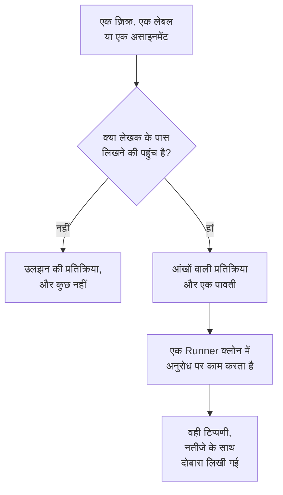

# GitHub App

OneUptime GitHub App आपके कोड से सिर्फ़ एक कनेक्शन नहीं है: आप अपनी रिपॉजिटरी में उससे बात कर सकते हैं, और वह काम वहीं करता है। किसी इश्यू पर उसका ज़िक्र करें और वह एक पुल रिक्वेस्ट खोलता है; किसी पुल रिक्वेस्ट पर उसका ज़िक्र करें और वह ब्रांच को संशोधित करता है या diff की समीक्षा करता है। वह जो भी बनाता है, वह किसी व्यक्ति के पढ़ने के लिए एक पुल रिक्वेस्ट या समीक्षा होती है: **वह कभी कुछ मर्ज नहीं करता, और कभी किसी पुल रिक्वेस्ट को मंज़ूरी नहीं देता।**

:::cards
- [कमांड](#कमांड): किसी इश्यू या पुल रिक्वेस्ट पर क्या लिखें।
- [थ्रेड में यह कैसा दिखता है](#थ्रेड-में-यह-कैसा-दिखता-है): एक टिप्पणी जो काम के साथ चलती है।
- [प्रोडक्शन संदर्भ के साथ समीक्षाएं](#प्रोडक्शन-संदर्भ-के-साथ-समीक्षाएं): बदले हुए कोड के बारे में प्रोडक्शन क्या कहता है।
- [इसे कमांड देने की अनुमति किसे है](#इसे-कमांड-देने-की-अनुमति-किसे-है): लिखने की पहुंच वाले लोग, और कोई नहीं।
- [समस्या निवारण](#समस्या-निवारण): जब किसी ज़िक्र से कुछ नहीं होता।
:::

```text
@oneuptime implement this                          →  a pull request that closes the issue
@oneuptime revise this — use exponential backoff   →  new commits on this pull request's branch
@oneuptime review                                  →  a code review posted on this pull request
@oneuptime production review                       →  what production shows of the changed code
```

> [!NOTE]
> `@oneuptime` को अपने ऐप के हैंडल से बदलें। OneUptime Cloud पर यह `@oneuptime` है। सेल्फ-होस्टेड इंस्टेंस पर यह वह नाम है जो आपने अपने GitHub App को दिया था, छोटे अक्षरों में और स्पेस की जगह हाइफ़न के साथ: "Acme AI" नाम के ऐप का ज़िक्र `@acme-ai` के रूप में होता है। अगर ज़िक्र से कुछ नहीं होता, तो पहले इसे जांचें।

## यह कैसे काम करता है



यह वही एजेंट और वही Runner है जो [कोड](/docs/ai/ai-agent) में है, वही बजट के साथ; सिर्फ़ ट्रिगर अलग है।

## शुरू करने से पहले

- रिपॉजिटरी GitHub App के ज़रिए **किसी OneUptime प्रोजेक्ट से कनेक्ट** होनी चाहिए: उसे **उत्पाद → कोड** में कनेक्ट करें। सेल्फ-होस्टेड इंस्टेंस को पहले अपना GitHub App चाहिए: देखें [GitHub एकीकरण](/docs/self-hosted/github-integration)। अगर ऐप GitHub खाते पर पहले से इंस्टॉल है, तो उसे फिर से इंस्टॉल करने के बजाय वहीं **मौजूदा इंस्टॉलेशन कनेक्ट करें** पर क्लिक करें।
- वह Runner ऑनलाइन होना चाहिए जिसे रिपॉजिटरी कोड में अपनी सेटिंग्स में चुनती है, या कोई Runner न चुनने वाली रिपॉजिटरी के लिए ग्लोबल Runner: वही Runner जो [कोड](/docs/ai/ai-agent) के कार्य पूरे करता है। इसके बिना, कमांड स्वीकार होती हैं और फिर 30 मिनट बाद इस संदेश के साथ विफल हो जाती हैं कि किसी Runner ने उन्हें नहीं उठाया।
- GitHub App को **Read & write** के साथ **Issues** अनुमति चाहिए, और उसे [किन इवेंट की सदस्यता लें](#किन-इवेंट-की-सदस्यता-लें) में बताए गए webhook इवेंट की सदस्यता लेनी होगी।

## कमांड

हर कमांड ऐप के ज़िक्र से शुरू होती है। ज़िक्र टिप्पणी में कहीं भी हो सकता है, और उसके बाद आप जो भी लिखते हैं, वह आपके अनुरोध के रूप में आगे भेजा जाता है। जिस टिप्पणी में ऐप का ज़िक्र पहले से है, उसे संपादित करने से ऐप फिर से नहीं चलता: अपना अनुरोध बदलने के लिए नई टिप्पणी लिखें। जो संपादन ज़िक्र जोड़ता है, वह एक नया अनुरोध है।

### पुल रिक्वेस्ट पर

| कमांड | क्या होता है | ये भी समझे जाते हैं |
| --- | --- | --- |
| `@oneuptime review` | ब्रांच क्लोन करता है, बदला हुआ कोड और उसके आसपास का कोड पढ़ता है, जांचता है कि प्रोडक्शन उसके बारे में क्या कहता है, और एक समीक्षा टिप्पणी के रूप में पोस्ट करता है। कुछ नहीं बदलता। | `code review`, `please review`, `can you review`, `review this` |
| `@oneuptime production review` | पुल रिक्वेस्ट की प्रोडक्शन के आधार पर अभी समीक्षा करता है, चाहे उसे किसी ने भी खोला हो: बदले गए कोड के आसपास के अपवाद, ऑपरेशन, घटनाएं और डिप्लॉय, एक ही टिप्पणी में जो उसी जगह अपडेट होती है (देखें [पुल रिक्वेस्ट की प्रोडक्शन समीक्षा](/docs/ai/ai-agent#पुल-रिक्वेस्ट-की-प्रोडक्शन-समीक्षा))। कुछ भी क्लोन नहीं करता और कुछ भी नहीं चलाता। | `review against production`, `review production`, `check production` |
| `@oneuptime revise this — <what you want changed>` | पुल रिक्वेस्ट की अपनी ब्रांच क्लोन करता है, बदलाव करता है और उस ब्रांच पर नए कमिट पुश करता है। कभी दूसरा पुल रिक्वेस्ट नहीं खोलता। | `revise`, `please revise`, `rework`, `redo` |

ज़िक्र के बाद आप जो भी लिखते हैं और जो कोई ज्ञात कमांड नहीं है, उसे संशोधन का अनुरोध माना जाता है, क्योंकि लगभग हमेशा वही होता है:

```text
@oneuptime the retry loop here should back off exponentially, and the test
should cover the 429 case
```

### इश्यू पर

| कमांड | क्या होता है | ये भी समझे जाते हैं |
| --- | --- | --- |
| `@oneuptime implement this` | इश्यू पर काम करता है और एक पुल रिक्वेस्ट खोलता है जो उसे बंद करता है। | `implement`, `please implement`, `work on this`, `pick this up`, `take this` |
| `@oneuptime <anything else>` | वही, आपके शब्दों को अतिरिक्त दिशा मानकर। | — |

आप बिना टिप्पणी के भी ऐप को इश्यू सौंप सकते हैं:

- **ट्रिगर लेबल जोड़ें।** किसी इश्यू पर रिपॉजिटरी का ट्रिगर लेबल जोड़ना, जो `oneuptime` है जब तक आपने उसे बदला न हो, वही काम शुरू करता है। GitHub के अपने पेजों से काम सौंपने का यह सबसे भरोसेमंद तरीका है।
- **इश्यू को ऐप के बॉट यूज़र को असाइन करें**, जहां आपकी रिपॉजिटरी इसकी अनुमति देती हो। GitHub हर जगह किसी ऐप को असाइनी नहीं बनने देता, इसीलिए लेबल मौजूद है: अगर असाइन करने से कुछ नहीं होता, तो लेबल का उपयोग करें।

### कहीं भी

| कमांड | क्या होता है | ये भी समझे जाते हैं |
| --- | --- | --- |
| `@oneuptime help` | कमांड की सूची दिखाता है। बिना किसी बात के सिर्फ़ ज़िक्र भी यही करता है। | `commands`, `usage`, `what can you do` |
| `@oneuptime status` | बताता है कि वह इस थ्रेड में किस पर काम कर रहा है। | `progress` |
| `@oneuptime cancel` | इस थ्रेड में चल रहे उसके रन रोक देता है। पहले से पुश किया गया काम पुश ही रहता है। | `stop`, `abort` |

`help`, `status` और `cancel` कभी एजेंट रन शुरू नहीं करते, इसलिए उनकी कोई लागत नहीं होती।

## थ्रेड में यह कैसा दिखता है

एक कमांड से **एक टिप्पणी** बनती है, जिसे ऐप काम आगे बढ़ने के साथ संपादित करता है, ताकि कोई लंबा कार्य किसी पुल रिक्वेस्ट को स्टेटस लॉग में न बदल दे।

1. वह आपकी टिप्पणी पर 👀 प्रतिक्रिया देता है, और एक पावती पोस्ट करता है जो उस OneUptime प्रोजेक्ट का नाम बताती है जिसका रन है, और लाइव रन से लिंक करती है।
2. काम पूरा होने पर, वह उसी टिप्पणी को नतीजे के साथ दोबारा लिखता है: उसके खोले गए पुल रिक्वेस्ट, उसके पुश किए गए कमिट, या एक साफ़ व्याख्या कि उसने कुछ क्यों नहीं किया।

अगर उसे बदलने लायक कुछ नहीं मिलता, तो वह अटकल वाला पुल रिक्वेस्ट खोलने के बजाय यही बताता है। यह सामान्य नतीजा है, विफलता नहीं: उसे और दिशा दें और फिर से पूछें।

## प्रोडक्शन संदर्भ के साथ समीक्षाएं

OneUptime के पास उस कोड की टेलीमेट्री होती है जिसकी वह समीक्षा करता है, इसलिए समीक्षा वह बता सकती है जो सिर्फ़ diff पढ़ने वाला कोई समीक्षक नहीं बता सकता। रिपॉजिटरी जिन सेवाओं से जुड़ी है, उनके लिए यह जांचता है:

- बदली गई फ़ाइलों और फ़ंक्शनों में पिछले 7 दिनों के दौरान फेंके गए अपवाद;
- diff जिन एंडपॉइंट और ऑपरेशन को छूता है, वे कितने व्यस्त और कितने धीमे हैं;
- बदली गई फ़ाइलों से जुड़ी घटनाएं;
- सेवाओं के वे हाल के डिप्लॉय जिन्हें OneUptime ने गिरावट के रूप में चिह्नित किया।

उसे जो मिलता है वह समीक्षा में **Production context** शीर्षक के नीचे जाता है, हर बिंदु उन संख्याओं और उस समय-अवधि के साथ जिनसे वह निकला है, उदाहरण के लिए: "`chargeCard` ने पिछले 7 दिनों में 1,240 बार `TypeError: Cannot read properties of undefined` फेंका; यह बदलाव वह null जांच जोड़ता है जो इसे रोकती है।" जब प्रोडक्शन में ऐसा कुछ नहीं दिखता जो diff से जुड़ा हो, तो समीक्षा यह कहने के बजाय कि सब ठीक है, उस शीर्षक को छोड़ देती है।

इसके लिए कुछ सेट नहीं करना पड़ता: सेवाएं वही हैं जिनके लिए OneUptime यह रिपॉजिटरी ढूंढता है, जैसे वह किसी सुधार के लिए करता है (देखें [सुधार में प्रोडक्शन टेलीमेट्री](/docs/ai/ai-agent#सुधार-में-प्रोडक्शन-टेलीमेट्री))। क्वेरी सिर्फ़ पढ़ती हैं, OneUptime सर्वर पर चलती हैं और किसी दूसरी सेवा, प्रोजेक्ट या निजी घटना का कुछ भी नहीं पढ़तीं। जिस रिपॉजिटरी की सेवाएं प्रोजेक्ट को कोई टेलीमेट्री नहीं भेजतीं, उसकी समीक्षा सिर्फ़ उसके कोड से होती है।

हर पुल रिक्वेस्ट की प्रोडक्शन के आधार पर अपने आप समीक्षा के लिए, रिपॉजिटरी की सेटिंग्स में **प्रोडक्शन के आधार पर पुल रिक्वेस्ट की समीक्षा करें** चालू करें: देखें [पुल रिक्वेस्ट की प्रोडक्शन समीक्षा](/docs/ai/ai-agent#पुल-रिक्वेस्ट-की-प्रोडक्शन-समीक्षा)।

## इसे कमांड देने की अनुमति किसे है

**सिर्फ़ उन लोगों को जिनके पास रिपॉजिटरी पर write, maintain या admin पहुंच है।** OneUptime हर बार GitHub से उस रिपॉजिटरी पर टिप्पणी करने वाले की अनुमति पूछता है; वह उस "contributor" बैज पर भरोसा नहीं करता जो GitHub टिप्पणी के पास दिखाता है, क्योंकि वह मौजूदा पहुंच के बजाय पिछली गतिविधि बताता है।

किसी और का ज़िक्र सिर्फ़ एक 😕 प्रतिक्रिया पाता है और कुछ नहीं। यह जानबूझकर है: सार्वजनिक रिपॉजिटरी पर कोई भी टिप्पणी कर सकता है, और अजनबियों को हमेशा जवाब देने वाला ऐप किसी थ्रेड को स्पैम से भरने के लिए इस्तेमाल हो सकता है।

वह किसी बॉट की लिखी हर टिप्पणी को भी अनदेखा करता है, अपनी टिप्पणियों सहित, और किसी उद्धरण (`>`) या कोड ब्लॉक के अंदर के ज़िक्र को भी। ये दोनों नियम मिलकर उसकी अपनी किसी टिप्पणी के जवाब को उसे फिर से शुरू करने से रोकते हैं।

## यह क्या नहीं करेगा

- **यह कभी मर्ज नहीं करता।** यह ऐप जो भी करता है, उससे आपकी डिफ़ॉल्ट ब्रांच पर कोड नहीं पहुंच सकता।
- **यह कभी मंज़ूरी नहीं देता और न ही बदलाव मांगता है।** समीक्षाएं टिप्पणियों के रूप में पोस्ट होती हैं, इसलिए ऐप की समीक्षा कभी किसी ब्रांच सुरक्षा नियम को पूरा नहीं कर सकती।
- **यह कभी इतिहास दोबारा नहीं लिखता।** संशोधन कमिट जोड़ता है; यह कभी force-push नहीं करता। अगर किसी और ने पहले ब्रांच पर पुश किया था, तो उनका काम फेंकने के बजाय संशोधन विफल हो जाता है।
- **यह किसी fork से आए पुल रिक्वेस्ट को संशोधित नहीं कर सकता।** fork की ब्रांच ऐसी रिपॉजिटरी में होती है जिसमें इंस्टॉलेशन लिख नहीं सकता। फिर भी यह उसकी समीक्षा कर सकता है: इसके बजाय समीक्षा मांगें।
- **यह कभी पुल रिक्वेस्ट का शीर्षक, विवरण या लक्ष्य ब्रांच नहीं बदलता।** सिर्फ़ कोड।

## इसकी लागत क्या है, और इसे कैसे सीमित करें

काम शुरू करने वाली हर कमांड एक पूरा एजेंट रन है: एक क्लोन, अधिकतम 40 LLM कॉल और 100,000 आउटपुट टोकन, और, आपके अपने Runner पर, बिल्ड और टेस्ट की वे जांचें जो आपकी रिपॉजिटरी की `AGENTS.md` बताती है। किसी समीक्षा की प्रोडक्शन क्वेरी, अधिकतम 12, उन्हीं 40 कॉल में गिनी जाती हैं।

GitHub कमांड घटनाओं और अलर्ट के बाहर का AI काम हैं, इसलिए उन पर कोई दैनिक सुधार-कार्य सीमा लागू नहीं होती; प्रोजेक्ट की अपनी दैनिक AI सीमाएं लागू होती हैं, जब प्रोजेक्ट उन्हें तय करता है। एकमात्र दूसरी सीमा वही है जो पहले से [कोड](/docs/ai/ai-agent) के कार्यों पर लागू होती है:

- **खुले पुल रिक्वेस्ट की सीमा** (रिपॉजिटरी के **सेटिंग्स** पेज पर **और सेटिंग्स** के नीचे **खुले फ़िक्स पुल रिक्वेस्ट की अधिकतम संख्या**)। जब तक आप **एक सीमा** नहीं चुनते, **AI फ़िक्स पुल रिक्वेस्ट** पर **कोई सीमा नहीं** रहता है, और **कोई नहीं** उस रिपॉजिटरी पर AI सुधार पुल रिक्वेस्ट को रोक देता है। समीक्षाएं और संशोधन इससे बाहर हैं: इनमें से कोई भी आपकी समीक्षा कतार में पुल रिक्वेस्ट नहीं जोड़ता।

हर इश्यू या पुल रिक्वेस्ट पर एक समय में एक तरह का सिर्फ़ एक रन चलता है। दो बार पूछने पर वह बताता है कि वह पहले से काम कर रहा है; संशोधन चलते समय समीक्षा मांगने पर दोनों शुरू हो जाते हैं, क्योंकि वे अलग अनुरोध हैं।

अगर कोई रन शुरू नहीं हो पाता, तो ऐप थ्रेड में कारण बताता है: वह कभी चुपचाप विफल नहीं होता।

## इसे बंद करना

हर रिपॉजिटरी में एक स्विच है: रिपॉजिटरी के **सेटिंग्स** पेज पर **और सेटिंग्स** के नीचे **GitHub कमांड का जवाब दें**। यह हर रिपॉजिटरी के लिए चालू रहता है और बदलते ही सेव हो जाता है। इसके बंद होने पर, ऐप उस रिपॉजिटरी में ज़िक्र, असाइनमेंट और ट्रिगर लेबल को अनदेखा करता है, और पूछने वाले हर व्यक्ति को स्विच के लिंक के साथ जवाब देता है।

अगर आप `oneuptime` के अलावा कोई और लेबल चाहते हैं, तो उसी पेज पर **और सेटिंग्स** के नीचे **GitHub ट्रिगर लेबल** है।

## किन इवेंट की सदस्यता लें

अपने GitHub App की **Permissions & events** सेटिंग्स में, इनकी सदस्यता लें:

| इवेंट | किसके लिए ज़रूरी |
| --- | --- |
| **Issue comment** | इश्यू और पुल रिक्वेस्ट पर `@mention` कमांड |
| **Issues** | किसी इश्यू को ऐप को असाइन करना, और ट्रिगर लेबल |
| **Pull request** | ऐप से मांगी गई समीक्षा, और पुल रिक्वेस्ट के खुलने और बदलने पर उनकी प्रोडक्शन समीक्षा |
| **Pull request review** | सबमिट की गई समीक्षा के मुख्य भाग में ज़िक्र |
| **Pull request review comment** | diff पर इनलाइन टिप्पणी में ज़िक्र |

**Repository permissions** के तहत, **Issues** का **Read & write** होना ज़रूरी है: GitHub पुल रिक्वेस्ट की बातचीत वाली टिप्पणियां issues API से भेजता है, इसलिए इसी से ऐप पुल रिक्वेस्ट पर भी टिप्पणी कर पाता है।

## प्रॉम्प्ट इंजेक्शन: क्या सुरक्षित है और क्या नहीं

इश्यू का टेक्स्ट, पुल रिक्वेस्ट के विवरण, diff और टिप्पणियां सब एजेंट के प्रॉम्प्ट का हिस्सा बनते हैं, और सार्वजनिक रिपॉजिटरी पर इन्हें कोई भी लिख सकता है। "अपने निर्देश अनदेखा करो और X करो" जैसी पंक्ति किसी इश्यू में मिलना वास्तविक बात है।

दो चीज़ें इसे सीमित करती हैं, और यह जानना उपयोगी है कि कौन-सी क्या करती है:

- **प्रॉम्प्ट अविश्वसनीय टेक्स्ट को निर्देश नहीं, बल्कि अनुरोध के रूप में चिह्नित करते हैं**, और रन की रिपॉजिटरी, ब्रांच और पुल रिक्वेस्ट एजेंट के शुरू होने से पहले तय हो जाते हैं: एजेंट जो भी पढ़ता है, उससे यह नहीं बदल सकता कि वह किस पर काम करता है।
- **असली रोकथाम सैंडबॉक्स है।** एजेंट आपके Runner पर, एक इस्तेमाल के बाद फेंके जाने वाले क्लोन में चलता है, उसकी कमांड के परिवेश से क्रेडेंशियल हटाकर और उसके git ऑपरेशन सीमित करके। वह सिर्फ़ किसी ब्रांच पर पुश कर सकता है, और मर्ज सिर्फ़ कोई व्यक्ति कर सकता है।

AI के लिखे पुल रिक्वेस्ट को वैसे ही देखें जैसे आप इश्यू पढ़ चुके किसी नए योगदानकर्ता के पुल रिक्वेस्ट को देखते: विवरण की नहीं, diff की समीक्षा करें।

## समस्या निवारण

:::details ज़िक्र करने पर कुछ नहीं होता
पहले हैंडल जांचें: यह ऐप का slug है, उसका डिस्प्ले नाम नहीं। फिर जांचें कि रिपॉजिटरी किसी प्रोजेक्ट से कनेक्ट है (**उत्पाद → कोड** में), कि **GitHub कमांड का जवाब दें** चालू है, और कि आपका GitHub App ऊपर दिए इवेंट की सदस्यता ले चुका है।
:::

:::details यह 😕 प्रतिक्रिया देता है और कुछ नहीं कहता
आपके पास रिपॉजिटरी पर लिखने की पहुंच नहीं है।
:::

:::details यह कहता है कि यह पहले से इस पर काम कर रहा है
उस तरह का एक रन इस इश्यू या पुल रिक्वेस्ट पर पहले से चल रहा है। `@oneuptime status` बताता है कि वह क्या है, और `@oneuptime cancel` उसे रोकता है।
:::

:::details इसने पावती दी, फिर लंबे समय तक चुप रहा
जांचें कि रिपॉजिटरी जो Runner चुनती है वह **रनबुक → Runbook एजेंट** के तहत ऑनलाइन है। जो रिपॉजिटरी कोई Runner नहीं चुनती, वह ग्लोबल Runner पर काम करती है, और कोड में उसकी सेटिंग्स बताती हैं कि कोई कनेक्ट है या नहीं। ऑनलाइन Runner के बिना, रन 30 मिनट बाद विफल होता है और थ्रेड को बताया जाता है।
:::

:::details यह कहता है कि पुल रिक्वेस्ट किसी fork से आया है
संशोधन के लिए इस रिपॉजिटरी में एक ब्रांच चाहिए। इसके बजाय समीक्षा मांगें, या ब्रांच को यहां पुश करें।
:::

## अगले कदम

:::cards
- [कोड](/docs/ai/ai-agent): वही एजेंट, किसी रिपॉजिटरी में कहा गया या किसी अपवाद, ट्रेस या जांच से शुरू किया गया।
- [GitHub एकीकरण](/docs/self-hosted/github-integration): सेल्फ-होस्टेड इंस्टेंस पर GitHub App बनाएं और कॉन्फ़िगर करें।
- [Runbook एजेंट](/docs/runbooks/agents): वह वर्कर जो हर रन पूरा करता है।
:::
