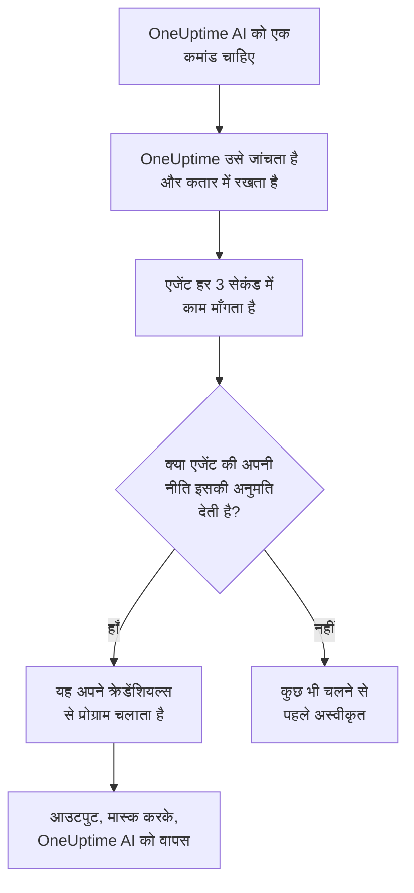

# बुनियादी ढांचे के AI एजेंट

किसी घटना या अलर्ट की जांच करते समय OneUptime AI आपकी टेलीमेट्री से आगे भी देख सकता है। आपके किसी संसाधन के बगल में इंस्टॉल किया गया एक छोटा एजेंट — कोई Docker या Podman होस्ट, Docker Swarm क्लस्टर, Proxmox क्लस्टर, VMware vCenter, Ceph क्लस्टर, डेटाबेस सर्वर या Linux होस्ट — वे केवल-पढ़ने वाली कमांड चलाता है जो OneUptime AI माँगता है, जैसे `docker logs --tail 200 web`, `pvesh get /cluster/status`, `ceph health detail`, `db long-queries --min-seconds 30` या `journalctl -u nginx -n 200 --no-pager`, और आउटपुट वापस भेजता है, ताकि मूल कारण विश्लेषण वही उद्धृत करे जो संसाधन खुद कहता है। अगर आप अनुमति दें, तो वही एजेंट सुधार भी लागू करता है — किसी कंटेनर को रीस्टार्ट करना, किसी VM को शुरू करना, किसी OSD को फिर से in चिह्नित करना — हर सुधार को एक कमांड नीति किसी स्तर में रखती है और, जब तक आप कुछ और न चुनें, पहले कोई व्यक्ति उसे अनुमोदित करता है।

ये एजेंट **संसाधन AI एजेंट** हैं। हर संसाधन के डैशबोर्ड पेज पर तीन पेजों वाला एक **एआई** सेक्शन होता है:

- **इनसाइट्स** — पिछले 30 दिनों में OneUptime AI ने संसाधन के बारे में क्या पता लगाया: बार-बार लौटने वाली समस्याएँ और उनकी वजह, साथ में AI को क्या मिला और वह कौन-सा कदम सुझाता है, संसाधन के वे हिस्से जो उनमें से ज़्यादातर के पीछे हैं, वे सुधार जिनसे मदद नहीं मिली या जो अनुमोदन का इंतज़ार कर रहे हैं, AI ने खुद क्या ठीक किया, और किसी को पेज किए जाने से पहले पकड़े गए जोखिम — साथ ही फ़ुटनोट में यह कि AI ने खुद वहाँ क्या किया। यह किसी क्लस्टर के पेज की तरह काम करता है — देखें [AI ने किसी क्लस्टर पर क्या सीखा](/docs/ai/ai-sre#ai-ने-किसी-क्लस्टर-पर-क्या-सीखा)।
- **लॉग** — OneUptime AI ने संसाधन पर जो कुछ भी किया, सबसे नया पहले: हर जांच अपनी घटना या अलर्ट और अपने सारांश के साथ, हर वह सुधार जो उसने प्रस्तावित किया या चलाया, और हर वह कमांड जो उसने एजेंट के ज़रिए भेजी। (यह पेज पहले इनसाइट्स कहलाता था।)
- **AI एजेंट** — एजेंट कनेक्ट है या नहीं, AI संसाधन पर क्या कर सकता है (जांच, और सुधार कैसे चलते हैं), जिस भी चीज़ पर ध्यान देना ज़रूरी है वह उसे ठीक करने वाले कदम के साथ, और एजेंट की स्थिति के बगल वाले **⋯** मेनू में **कनेक्शन का परीक्षण करें** और **एजेंट रीसेट करें**।

संसाधन का **अवलोकन** एक **AI एजेंट** कार्ड के साथ खत्म होता है जो AI एजेंट पेज का सार देता है: एजेंट कनेक्ट है या नहीं, जांच चालू है या नहीं, सुधार कैसे चलते हैं (**बंद**, **अनुमोदन माँगें**, **स्वचालित** या **अनुमोदन छोड़ें**) और किस चीज़ पर ध्यान देना ज़रूरी है, साथ में AI एजेंट पेज का लिंक, जहाँ इन्हें बदला जाता है।

:::cards
- [समर्थित संसाधन](#समर्थित-संसाधन): आठ तरह के संसाधन, एक इमेज।
- [AI एजेंट इंस्टॉल करना](#ai-एजेंट-इंस्टॉल-करना): पहले से चल रहे किसी कलेक्टर के बगल में, या किसी Linux होस्ट पर।
- [सुधार कैसे काम करते हैं](#सुधार-कैसे-काम-करते-हैं): क्या अपने आप चल सकता है, क्या किसी व्यक्ति का इंतज़ार करता है, और क्या कभी नहीं चलता।
- [सुरक्षा मॉडल](#सुरक्षा-मॉडल): हर कमांड पर तीन जांचें, और OneUptime से कोई क्रेडेंशियल नहीं।
:::

## यह कैसे काम करता है

एजेंट कभी भी OneUptime से कनेक्शन का इंतज़ार नहीं करता: वह खुद OneUptime को कॉल करता है, काम माँगता है, और अपने पास पहले से मौजूद क्रेडेंशियल्स के साथ केवल वही चलाता है जिसकी अनुमति कमांड नीति की उसकी अपनी कॉपी देती है।



## Kubernetes AI एजेंट से इसका संबंध

Kubernetes क्लस्टरों का अपना एजेंट होता है, Kubernetes AI एजेंट, जिसे Kubernetes एजेंट का Helm चार्ट इंस्टॉल करता है — देखें [क्लस्टर एक्सेस — OneUptime AI को kubectl चलाने दें](/docs/ai/ai-sre#क्लस्टर-एक्सेस-oneuptime-ai-को-kubectl-चलाने-दें)। इस पेज की कोई भी चीज़ उसे नहीं बदलती। संसाधन AI एजेंट उसी डिज़ाइन का पालन करते हैं:

- **वही स्तर और मोड।** हर कमांड **Read**, **SafeWrite**, **RiskyWrite** या **Denied** होती है, और सुधार **बंद**, **अनुमोदन माँगें**, **स्वचालित** या **अनुमोदन छोड़ें** होते हैं, जिनका अर्थ वही है जो किसी क्लस्टर पर।
- **वही तीन जांचें।** वही कमांड नीति OneUptime के AI टूल लागू करते हैं, फिर से तब जब OneUptime कमांड को कतार में रखता है, और फिर एक बार एजेंट कुछ भी चलाने से पहले।
- **क्रेडेंशियल्स का वही नियम।** एजेंट केवल वही इस्तेमाल करता है जो उसका अपना एनवायरनमेंट और उसके माउंट उसे देते हैं। OneUptime उसे कभी कोई क्रेडेंशियल नहीं भेजता।
- **वही डिफ़ॉल्ट।** AI जांचें डिफ़ॉल्ट रूप से चालू होती हैं: कोई संसाधन किसी क्लस्टर की तरह जांच चालू और सुधार बंद के साथ शुरू होता है, इसलिए OneUptime AI अपने एजेंट के कनेक्ट होते ही उसके साथ जांच करता है, और जब तक कोई सुधारों की अनुमति न दे, कुछ नहीं बदलता (देखें [OneUptime से कनेक्ट करना](#oneuptime-से-कनेक्ट-करना))।

क्या अलग है:

- **हर संसाधन के लिए एक इमेज।** `oneuptime/resource-ai-agent` आठों तरह के संसाधनों को सेवा देता है, और `ONEUPTIME_AI_AGENT_RESOURCE_TYPE` बताता है कि कोई एजेंट किसे सेवा देता है। यह Helm चार्ट से नहीं, बल्कि संसाधन के कलेक्टर के बगल में एक और कंटेनर के रूप में चलता है।
- **लिखने की पहुंच एक एनवायरनमेंट वेरिएबल है।** एजेंट पर `ONEUPTIME_AI_ALLOW_WRITES=true` ही उसे सुधार लागू करने देता है, और `ONEUPTIME_AI_WRITE_TARGETS` सीमित करता है कि वे किन कंटेनरों, सेवाओं, VM, OSD, सेशनों या यूनिटों को छू सकते हैं। किसी क्लस्टर पर यह काम चार्ट का RBAC और `aiAgent.remediation.namespaces` करते हैं।

Kubernetes AI एजेंट की तरह, संसाधन AI एजेंट भी कोई Runner नहीं है। यह कभी रनबुक → Runbook एजेंट में नहीं दिखता, और रनबुक के लिए कभी Bash या SSH होस्ट के रूप में इस्तेमाल नहीं होता।

## समर्थित संसाधन

| संसाधन | `ONEUPTIME_AI_AGENT_RESOURCE_TYPE` | एजेंट | इस रूप में रजिस्टर होता है (कलेक्टर का वेरिएबल) | चलाता है | संसाधन तक पहुँचता है |
| -------------------- | ---------------------------------- | --------------------- | ----------------------------------------------------------------------------------------------- | -------------------------------------------------------------------------------------------------------------------------------------------------- | -------------------------------------------------------------------------- |
| Docker होस्ट | `docker` | Docker AI एजेंट | `DOCKER_HOST_NAME` | `docker` | Docker सॉकेट, `/var/run/docker.sock` |
| Podman होस्ट | `podman` | Podman AI एजेंट | `PODMAN_HOST_NAME` | `docker`, Podman के Docker-संगत API के ज़रिए | Podman सॉकेट, `/run/podman/podman.sock` |
| Docker Swarm क्लस्टर | `docker-swarm` (या `swarm`) | Docker Swarm AI एजेंट | `DOCKER_SWARM_CLUSTER_NAME` | `docker` | किसी मैनेजर नोड का Docker सॉकेट |
| Proxmox क्लस्टर | `proxmox` | Proxmox AI एजेंट | `PROXMOX_CLUSTER_NAME` | `pvesh` कमांड, जो Proxmox VE API को भेजी जाती हैं (एजेंट में कोई `pvesh` बाइनरी नहीं है) | `https://PVE_HOST:8006/api2/json`, Proxmox API टोकन के साथ |
| VMware vCenter | `vmware` (या `vcenter`) | VMware AI एजेंट | `VMWARE_VCENTER_NAME` | `govc` | vCenter का API, vSphere उपयोगकर्ता के साथ |
| Ceph क्लस्टर | `ceph` | Ceph AI एजेंट | `CEPH_CLUSTER_NAME` | `ceph` | मॉनिटर, एक `ceph.conf` और एजेंट के अपने क्लाइंट की कीरिंग के साथ |
| डेटाबेस सर्वर | `database` (या `db`) | डेटाबेस AI एजेंट | `DATABASE_SERVER_ID`, या `DATABASE_SYSTEM` + `DATABASE_SERVER_ADDRESS` + `DATABASE_SERVER_PORT` | `db` — एक तय डायग्नोस्टिक कैटलॉग का एक ऑपरेशन, कभी SQL नहीं | डेटाबेस का अपना ड्राइवर, डेटाबेस लॉगिन के साथ |
| होस्ट | `host` | होस्ट AI एजेंट | `HOST_NAME` (खाली: होस्ट का अपना होस्टनेम) | `systemctl`, `journalctl`, `df`, `free`, `uptime`, `ps`, `ss`, `ip`, `dmesg`, `lsblk`, `cat`, `top`, `uname`, `hostnamectl`, `timedatectl`, `kill` | किसी विशेषाधिकार प्राप्त कंटेनर से होस्ट के नेमस्पेस में `nsenter` |

डेटाबेस सर्वर: डेटाबेस AI एजेंट के पास PostgreSQL, MySQL (और MariaDB व Percona Server), Redis (और Valkey, KeyDB व Dragonfly) और MongoDB के लिए डायग्नोस्टिक्स हैं। किसी भी दूसरे इंजन के लिए यह कुछ नहीं चलाता और डेटाबेस के AI एजेंट पेज पर यह बता देता है।

**कनेक्शन का परीक्षण करें**, जो AI एजेंट पेज पर एजेंट की स्थिति के बगल वाले **⋯** मेनू में है, एजेंट के ज़रिए ये केवल-पढ़ने वाली कमांड चलाता है और उनका आउटपुट एजेंट के कार्ड में दिखाता है:

| संसाधन | कनेक्शन का परीक्षण क्या चलाता है |
| -------------------- | ---------------------------------------------------- |
| Docker होस्ट | `docker version`, `docker info` |
| Podman होस्ट | `docker version`, `docker info` |
| Docker Swarm क्लस्टर | `docker version`, `docker node ls` |
| Proxmox क्लस्टर | `pvesh get /version`, `pvesh get /cluster/status` |
| VMware vCenter | `govc about` |
| Ceph क्लस्टर | `ceph health`, `ceph versions` |
| डेटाबेस सर्वर | `db ping`, `db version` |
| होस्ट | `uptime`, `systemctl list-units --failed --no-pager` |

Docker Swarm वर्कर पर `docker node ls` विफल होती है: Docker Swarm AI एजेंट को किसी मैनेजर नोड पर चलना चाहिए। वर्कर पर शुरू किया गया एजेंट क्लस्टर के लिए तब तक रजिस्टर नहीं होता जब तक उसका नोड मैनेजर न बन जाए, और Docker Swarm इंस्टॉलर उसे ऐसे नोड पर छोड़ देता है जो मैनेजर नहीं है।

## AI एजेंट इंस्टॉल करना

हर संसाधन AI एजेंट एक ही इमेज है, `oneuptime/resource-ai-agent:release`। इसे डैशबोर्ड में कुछ नहीं चाहिए: चलते ही यह OneUptime के साथ रजिस्टर होता है और एक मिनट के भीतर संसाधन के AI एजेंट पेज पर दिखाई देता है।

### किसी कलेक्टर के बगल में

Docker, Podman, Docker Swarm, Proxmox, VMware, Ceph और डेटाबेस सर्वरों के लिए एजेंट उस कलेक्टर के बगल में चलता है जिसे आप उस संसाधन के लिए पहले से इस्तेमाल करते हैं, और उसकी `.env` साझा करता है: उसके पास पहले से `ONEUPTIME_URL`, इंजेशन कुंजी और संसाधन का नाम होता है। हर कलेक्टर की `docker-compose.yml` एजेंट को एक और सेवा के रूप में साथ लाती है, और उसकी `install.sh` उसे शुरू करती है।

| संसाधन | कलेक्टर | AI एजेंट सेवा (और कंटेनर) | इसे कहाँ सेट किया जाता है |
| -------------------- | ----------------------------------------------------------- | --------------------------------- | ------------------------------------------------------------------------------------- |
| Docker होस्ट | [Docker एजेंट](/docs/telemetry/docker-host#ai-एजेंट) | `oneuptime-docker-ai-agent` | `agents/DockerAgent/docker-compose.yml`; `install.sh` इसे दूसरे कंटेनर के रूप में शुरू करती है |
| Podman होस्ट | [Podman एजेंट](/docs/telemetry/podman-host#ai-एजेंट) | `oneuptime-podman-ai-agent` | `agents/PodmanAgent/docker-compose.yml`; `install.sh` इसे दूसरे कंटेनर के रूप में शुरू करती है |
| Docker Swarm क्लस्टर | [Docker Swarm एजेंट](/docs/telemetry/docker-swarm#ai-एजेंट) | `oneuptime-docker-swarm-ai-agent` | `agents/DockerSwarmAgent/docker-compose.yml`, किसी मैनेजर नोड पर |
| Proxmox क्लस्टर | [Proxmox एजेंट](/docs/telemetry/proxmox#ai-एजेंट) | `oneuptime-proxmox-ai-agent` | `agents/ProxmoxAgent/docker-compose.yml` |
| VMware vCenter | [VMware एजेंट](/docs/telemetry/vmware#ai-एजेंट) | `oneuptime-vmware-ai-agent` | `agents/VMwareAgent/docker-compose.yml` |
| Ceph क्लस्टर | [Ceph एजेंट](/docs/telemetry/ceph#ai-एजेंट) | `oneuptime-ceph-ai-agent` | `agents/CephAgent/docker-compose.yml`, `./ceph` में एजेंट के अपने Ceph क्लाइंट के साथ |
| डेटाबेस सर्वर | [डेटाबेस एजेंट](/docs/telemetry/databases#ai-एजेंट) | `oneuptime-database-ai-agent` | `agents/DatabaseAgent/docker-compose.yml` |

AI एजेंट के आने से पहले इंस्टॉल किया गया कलेक्टर उसे अभी नहीं चलाता। उसकी `install.sh` फिर से चलाएँ: अब वह AI एजेंट को भी शुरू करती है (Proxmox, VMware, Ceph, डेटाबेस और Docker Swarm के इंस्टॉलर मौजूदा `docker-compose.yml` डाउनलोड करते हैं, जिसमें AI एजेंट सेवा है)। अगर आप फ़ाइलें खुद संभालते हैं, तो कलेक्टर की `docker-compose.yml` से सेवा अपनी फ़ाइल में जोड़ें और `docker compose up -d` चलाएँ। संसाधन का AI एजेंट पेज उस संसाधन के लिए ठीक-ठीक सेवा दिखाता है, जिसमें उसका नाम पहले से भरा होता है।

इंस्टॉलरों के बिना Docker AI एजेंट एक ही `docker run` है:

```bash
docker run -d \
  --name oneuptime-docker-ai-agent \
  --user 0:0 \
  --restart unless-stopped \
  --read-only --tmpfs /tmp \
  -v /var/run/docker.sock:/var/run/docker.sock:ro \
  -e ONEUPTIME_URL="https://oneuptime.com" \
  -e ONEUPTIME_SERVICE_TOKEN="YOUR_TELEMETRY_INGESTION_TOKEN" \
  -e ONEUPTIME_AI_AGENT_RESOURCE_TYPE=docker \
  -e DOCKER_HOST_NAME="my-docker-host" \
  oneuptime/resource-ai-agent:release
```

`DOCKER_HOST_NAME` वही नाम होना चाहिए जो Docker एजेंट रिपोर्ट करता है। AI एजेंट को छोड़ने के लिए Docker और Podman इंस्टॉलर `--no-ai-agent` (या `ONEUPTIME_INSTALL_AI_AGENT=false`) लेते हैं, और Docker Swarm इंस्टॉलर भी। बाद में किसी कलेक्टर को इसके बिना चलाने के लिए, उसकी AI एजेंट सेवा `docker-compose.yml` से हटाएँ, या `docker rm -f` से उसका कंटेनर हटाएँ।

### होस्ट AI एजेंट

जो Linux होस्ट [होस्ट OpenTelemetry कलेक्टर](/docs/telemetry/host-otel-collector) के ज़रिए रिपोर्ट करता है, उसके पास बगल में बैठने के लिए कोई OneUptime कंटेनर नहीं होता, इसलिए होस्ट AI एजेंट अपने खुद के इंस्टॉलर (`agents/HostAIAgent`) के साथ आता है:

```bash
curl -fsSL https://raw.githubusercontent.com/OneUptime/oneuptime/master/agents/HostAIAgent/install.sh -o install.sh
sudo bash install.sh
```

यह आपका OneUptime URL, प्रोजेक्ट की टेलीमेट्री इंजेशन कुंजी और होस्ट का नाम पूछता है, `/opt/oneuptime-host-ai-agent/.env` और `docker-compose.yml` लिखता है, और कंटेनर `oneuptime-host-ai-agent` शुरू करता है। इसके बजाय इसे `oneuptime-host-ai-agent` systemd यूनिट के तहत चलाने के लिए `--systemd` जोड़ें। इसे Compose प्लगइन के साथ Docker (सिस्टम इंजन, rootless Docker नहीं) चाहिए; rootful Podman वही कंटेनर चला सकता है।

होस्ट AI एजेंट **होस्ट के अपने** प्रोग्राम चलाता है: हर कमांड `nsenter --target 1 --mount --uts --ipc --net --pid -- PROGRAM ARGS` के रूप में चलती है, जो होस्ट के init के नेमस्पेस में प्रवेश करती है। इसके लिए `pid: host`, `privileged: true` और root चाहिए — देखें [Docker सॉकेट और होस्ट AI एजेंट होस्ट पर root हैं](#docker-सॉकेट-और-होस्ट-ai-एजेंट-होस्ट-पर-root-हैं)। होस्ट का होस्टनेम इस्तेमाल करने के लिए `HOST_NAME` खाली छोड़ें, जिसे कलेक्टर `host.name` के रूप में रिपोर्ट करता है, जब तक आपने उसे बदला न हो; नहीं तो इसे **होस्ट** के तहत दिखाए गए नाम पर सेट करें।

### OneUptime से कनेक्ट करना

एजेंट **उसी पहचान के साथ रजिस्टर होता है जो कलेक्टर रिपोर्ट करता है** — `DOCKER_HOST_NAME`, `PROXMOX_CLUSTER_NAME`, `CEPH_CLUSTER_NAME`, … (`ONEUPTIME_AI_AGENT_RESOURCE_NAME` इसे ओवरराइड करता है) — इसलिए यह ठीक उसी संसाधन को सेवा देता है जिसे कलेक्टर की टेलीमेट्री ने बनाया। जब OneUptime में उस नाम का कोई संसाधन अभी नहीं होता, तो रजिस्ट्रेशन उसे बना देता है, इसलिए कलेक्टर से अलग नाम देने पर आपको त्रुटि के बजाय एक दूसरा, खाली संसाधन मिलता है। कोई डेटाबेस `DATABASE_SERVER_ID` सेट होने पर उससे रजिस्टर होता है, नहीं तो अपने इंजन, पते और पोर्ट से; ऐसा `DATABASE_SERVER_ID` जो इस प्रोजेक्ट का डेटाबेस न हो, अस्वीकार कर दिया जाता है।

अगर कलेक्टर अब भी अपना डिफ़ॉल्ट नाम (`docker-host`, `podman-host`, `docker-swarm`, `proxmox-cluster`, `vmware-vcenter`, `ceph`) इस्तेमाल करता है, तो उस डिफ़ॉल्ट के साथ इंस्टॉल किया गया हर संसाधन OneUptime में एक ही संसाधन में रिपोर्ट करता है, और उसके लिए भेजी गई कमांड उनमें से किसी तक भी पहुँच सकती हैं। एजेंट अपने लॉग में इसकी चेतावनी देता है; हर संसाधन को कलेक्टर और एजेंट दोनों पर एक अनोखा नाम दें।

यह प्रोजेक्ट की टेलीमेट्री इंजेशन कुंजी से प्रमाणीकरण करता है — `ONEUPTIME_API_KEY`, `ONEUPTIME_TELEMETRY_INGESTION_KEY` और `ONEUPTIME_SERVICE_TOKEN` में से पहली सेट की हुई, जिन्हें कलेक्टर पहले से सेट करते हैं — और अपनी खुद की कुंजी पाता है। इसकी सभी कॉल `<ONEUPTIME_URL>/resource-ai-agent-ingest/…` को HTTPS `POST` होती हैं: यह शुरू होते समय एक बार रजिस्टर होता है, हर 30 सेकंड में हार्टबीट भेजता है (आखिरी हार्टबीट के बाद 5 मिनट तक इसे ऑनलाइन माना जाता है), हर 3 सेकंड में काम माँगता है, और रुकने पर साइन ऑफ़ करता है। उसी पहचान वाला दूसरा एजेंट तब तक अस्वीकार किया जाता है जब तक पहला ऑनलाइन है: साफ़ तरीके से रुकने वाला कंटेनर साइन ऑफ़ करता है, इसलिए उसका रिप्लेसमेंट तुरंत स्वीकार हो जाता है, और क्रैश या kill के बाद, पहली अस्वीकृति से पुराना 40 सेकंड तक कुछ न भेजे तो रिप्लेसमेंट उसकी जगह ले लेता है। अगर 10 मिनट बाद भी इसे अस्वीकार किया जाता है, तो कोई दूसरा सक्रिय एजेंट उसी पहचान का इस्तेमाल कर रहा है: एजेंट यह बताने वाली त्रुटि लॉग करता है और केवल हर 5 मिनट में पूछता है, जब तक आप हर संसाधन को उसका अपना नाम न दें या दूसरे एजेंट को न रोकें। किसी प्रोजेक्ट में अधिकतम 250 संसाधन AI एजेंट होते हैं, और हर घंटे अधिकतम 30 नए रजिस्टर होते हैं। 250 पूरे हो जाने पर, जिन एजेंटों से 7 दिनों में कोई खबर नहीं मिली, उन्हें नए एजेंट के लिए जगह बनाने के लिए हटा दिया जाता है (संसाधन अपनी AI सेटिंग्स रखता है, और ऐसा एजेंट लौटने पर बस फिर से रजिस्टर हो जाता है)।

**जांच** हर संसाधन के लिए शुरू से ही चालू होती है, इसलिए एजेंट के कनेक्ट होते ही OneUptime AI उसके साथ जांच करता है। इसके आगे, AI संसाधन पर क्या कर सकता है, यह एजेंट की अपनी सेटिंग है (देखें [AI क्या कर सकता है, एजेंट द्वारा सेट](#ai-क्या-कर-सकता-है-एजेंट-द्वारा-सेट))। जो एजेंट दोनों में से किसी सेटिंग का नाम नहीं लेता, वह अपने डिफ़ॉल्ट इस्तेमाल करता है: वह अपने संसाधन के लिए **जांच** चालू करता है और, अगर वह लिखने की अनुमति देता है (`ONEUPTIME_AI_ALLOW_WRITES=true`), तो **सुधार** को **अनुमोदन माँगें** पर सेट करता है, नहीं तो **बंद** पर। इसके डिफ़ॉल्ट केवल उस संसाधन पर लागू होते हैं जिसकी AI सेटिंग्स किसी ने AI एजेंट पेज पर नहीं चुनीं: किसी ने वहाँ जो सेटिंग्स सेव कीं, वे तब तक वैसी ही रहती हैं जब तक एजेंट का कॉन्फ़िगरेशन उनका नाम न ले, इसलिए जिस संसाधन का **जांच करें** स्विच किसी ने बंद किया, वह बंद ही रहता है। इन सेटिंग्स से पुराना एजेंट दोनों में से कुछ भी रिपोर्ट नहीं करता, और AI एजेंट पेज उन्हें पहले की तरह सेट करता है।

**एजेंट रीसेट करें**, जो AI एजेंट पेज पर उसी **⋯** मेनू में है, आपकी पुष्टि के बाद OneUptime से एजेंट की कुंजी भुलवा देता है; जिसके पास भी वह थी उसकी पहुंच बंद हो जाती है, और असली एजेंट कुछ मिनटों के भीतर फिर से रजिस्टर हो जाता है। एजेंट को अपनी इमेज के समान संस्करण या उससे नए OneUptime सर्वर की ज़रूरत होती है।

### AI क्या कर सकता है, एजेंट द्वारा सेट

जांच और सुधार वहीं सेट होते हैं जहाँ एजेंट चलता है — उस `.env` में जिसे वह कलेक्टर के साथ साझा करता है, या उसके कंटेनर के एनवायरनमेंट में — और OneUptime उनका पालन करता है:

| वेरिएबल | डिफ़ॉल्ट | यह क्या करता है |
| ---------------------------- | ------- | ----------------------------------------------------------------------------------------------------------------------------------------------------------------------------------------------------------------------------------------------------- |
| `ONEUPTIME_AI_INVESTIGATION` | खाली | `true` AI को जांच करते समय नीचे दी गई केवल-पढ़ने वाली कमांड चलाने देता है; `false` उसे उस डेटा तक सीमित रखता है जो OneUptime के पास पहले से है। खाली: चालू। |
| `ONEUPTIME_AI_FIXES` | खाली | AI कोई सुधार कैसे लागू कर सकता है: `off`, `ask-for-approval`, `automatic` या `bypass-approval` (देखें [सुधार मोड](#सुधार-मोड))। `off` के अलावा हर मोड को `ONEUPTIME_AI_ALLOW_WRITES=true` भी चाहिए, और `off` उसके होने पर भी एजेंट को केवल-पढ़ने वाला रखता है। खाली: एजेंट लिखने की अनुमति देता हो तो `ask-for-approval`, नहीं तो `off`। |

उदाहरण के लिए, AI को सुधार लागू करने देने के लिए, जिनमें से हर एक को कोई व्यक्ति अनुमोदित करे:

```bash
ONEUPTIME_AI_INVESTIGATION=true
ONEUPTIME_AI_FIXES=ask-for-approval
ONEUPTIME_AI_ALLOW_WRITES=true
```

फिर एजेंट को रीस्टार्ट करें (`docker compose up -d`, या Docker या Podman होस्ट के लिए इन्हें सेट करके कलेक्टर की `install.sh` फिर से चलाएँ)। एजेंट रजिस्टर होते समय और हर हार्टबीट के साथ दोनों को रिपोर्ट करता है, और OneUptime उन्हें तुरंत संसाधन पर लागू करता है। तब संसाधन का AI एजेंट पेज उन्हें केवल-पढ़ने के रूप में दिखाता है: **बदलें** कुछ भी सेव करने के बजाय आपके चुने विकल्प के लिए ये पंक्तियाँ दिखाता है, और जब तक एजेंट इन्हें सेट करता है, OneUptime कहीं और किए गए बदलाव को अस्वीकार करता है — API, Terraform, कोई मास्टर एडमिन। कमांड अनुमति-सूची पेज पर ही रहती है। जिस मान को एजेंट पढ़ नहीं पाता, वह उस सेटिंग को बंद रखता है, और एजेंट लॉग करता है कि कौन-सी।

## कोई जांच क्या चला सकती है

कोई जांच हमेशा केवल **Read** कमांड चलाती है: वे संसाधन को देखती हैं और कुछ नहीं बदलतीं। OneUptime AI घटना या अलर्ट से जुड़े (उनके मॉनिटर और टेलीमेट्री के ज़रिए, प्रति सिग्नल अधिकतम 10) वे संसाधन देखता है जिनका AI एजेंट कनेक्ट है और जिनका **जांच करें** स्विच चालू है, और जांच को जितनी कमांड चाहिए उतनी चलाता है (प्रति जांच 200 तक, बेकाबू लूप से बचाव के लिए), हर कमांड को किसी भी दूसरे सबूत की तरह उद्धृत किया जाता है। हर कमांड अपने आर्ग्युमेंट के साथ एक प्रोग्राम होती है — कभी शेल के ज़रिए नहीं, इसलिए पाइप, रीडायरेक्ट, `;`, `&&`, `$(…)` और `sudo` को यह बताने वाले संदेश के साथ अस्वीकार किया जाता है। किसी कमांड को डिफ़ॉल्ट रूप से 30 सेकंड और अधिकतम 2 मिनट मिलते हैं, और एजेंट पर उसका आउटपुट 1024 KB तक सीमित होता है। उस आउटपुट का कुछ भी OneUptime AI तक पहुँचने से पहले काटा नहीं जाता: लंबा आउटपुट एक बार में एक पेज दिखाया जाता है — पहले 40,000 अक्षर, फिर अनुरोध पर बाकी। अगर कोई एजेंट कोई कमांड नहीं उठाता, तो OneUptime AI जांच के बाकी हिस्से के लिए उस संसाधन को कमांड भेजना बंद कर देता है।

हर तरह का संसाधन क्या पढ़ सकता है, यह नीचे दिया गया है। यह वही सूची है जो खुद AI को दी जाती है; इसमें जो कुछ नहीं है, उसे अस्वीकार किया जाता है।

### Docker और Podman होस्ट

- कंटेनर: `docker ps -a` (साथ ही `-q`, `-n`, `-l`, `-s`, `--no-trunc`, `--filter`, `--format json`), `docker container inspect web`, `docker inspect --type container web`, `docker top web`, `docker port web`, `docker diff web`। inspect आउटपुट में एनवायरनमेंट मान मास्क होकर लौटते हैं।
- लॉग और गतिविधि: `docker logs --tail 200 web` या `docker logs --since 30m web` — अधिकतम 2000 का `--tail` या एक `--since` ज़रूरी है (`--tail` के बिना `--since` अधिकतम 24h की अवधि होनी चाहिए), और `-f` की कभी अनुमति नहीं है; `docker stats --no-stream`; `docker events --since 30m --until 0s` (दोनों सीमाएँ ज़रूरी हैं, `--until` अवधि के रूप में, ताकि विंडो हमेशा अतीत में बंद हो)।
- इंजन: `docker info`, `docker version`, `docker system df` (`-v` केवल तालिका के रूप में: `-v --format json` हर बिल्ड चरण की कमांड लाइन प्रिंट करता है), `docker images`, `docker image inspect nginx:1.27`, `docker network ls`, `docker network inspect bridge`, `docker volume ls`, `docker volume inspect data`।
- केवल `--format json` (या सूचियों के लिए `table`), कभी Go टेम्पलेट नहीं, और docker के ग्लोबल फ़्लैग में से कोई नहीं (`-H`, `--context`, `--config`, …): वे CLI को किसी दूसरे इंजन की ओर मोड़ देंगे।

Podman होस्ट Podman के Docker-संगत API के ज़रिए वही `docker` CLI और वही नीति चलाता है।

### Docker Swarm क्लस्टर

- नोड: `docker node ls`, `docker node ps node-1`, `docker node inspect node-1 --pretty`।
- सेवाएँ: `docker service ls`, `docker service ps web --no-trunc`, `docker service inspect web --pretty` (एनवायरनमेंट मान मास्क होकर लौटते हैं), `docker service logs --tail 200 web` (अधिकतम 2000 का `--tail` या एक `--since` ज़रूरी है — अकेले होने पर अधिकतम 24h की अवधि — कभी `-f` नहीं)।
- स्टैक: `docker stack ls`, `docker stack ps shop`, `docker stack services shop`।
- मैनेजर का अपना इंजन: `docker ps -a`, `docker container inspect web`, `docker logs --tail 200 web`, `docker stats --no-stream`, `docker info`, `docker version`, `docker network ls`, और Docker होस्ट की बाकी पढ़ने वाली कमांड।

### Proxmox क्लस्टर

एजेंट में कोई `pvesh` नहीं है। कमांड `pvesh` के व्याकरण में लिखी जाती है — `get` (या `ls`) और एक API पाथ, विकल्प `--name value` के रूप में — और एजेंट उसे अपने टोकन के साथ Proxmox VE API को ठीक एक `GET` में बदल देता है। `--output-format json|json-pretty|text` आउटपुट चुनता है; क्वेरी स्ट्रिंग स्वीकार नहीं की जातीं, और किसी लिखने वाली कमांड को अपना नोड बताना होता है (कभी `localhost` नहीं)।

- क्लस्टर: `pvesh get /version`, `pvesh get /cluster/status`, `pvesh get /cluster/resources --type vm`, `pvesh get /cluster/ha/status/current`, `pvesh get /cluster/log --max 50`, `pvesh get /cluster/tasks`, `pvesh get /nodes`, और रेप्लिकेशन, बैकअप, पूल और स्टोरेज की सूचियाँ।
- कोई नोड: `pvesh get /nodes/pve1/status`, `pvesh get /nodes/pve1/services`, `pvesh get /nodes/pve1/storage`, `pvesh get /nodes/pve1/disks/list`, `pvesh get /nodes/pve1/rrddata --timeframe hour`, साथ ही उसका नेटवर्क, रेप्लिकेशन, APT अपडेट और Ceph स्थिति।
- टास्क और लॉग: `pvesh get /nodes/pve1/tasks --errors 1 --limit 20`, किसी टास्क की स्थिति और लॉग, `pvesh get /nodes/pve1/syslog --limit 200`, `pvesh get /nodes/pve1/journal --lastentries 200`।
- गेस्ट (VM के लिए `qemu`, कंटेनरों के लिए `lxc`): `pvesh get /nodes/pve1/qemu`, `pvesh get /nodes/pve1/lxc`, `pvesh get /nodes/pve1/qemu/101/status/current`, `pvesh get /nodes/pve1/qemu/101/config` (cloud-init पासवर्ड जैसे सीक्रेट मास्क होकर लौटते हैं), लंबित बदलाव, स्नैपशॉट, `pvesh get /nodes/pve1/qemu/101/rrddata --timeframe hour`, और QEMU गेस्ट-एजेंट की जानकारी जैसे `pvesh get /nodes/pve1/qemu/101/agent/get-fsinfo`।
- कभी नहीं: `/access` के तहत कुछ भी (उपयोगकर्ता, API टोकन, ACL), कंसोल (`vncproxy`, `termproxy`, `spiceproxy`), QEMU मॉनिटर, गेस्ट-एजेंट की exec और फ़ाइल कॉल।

### VMware vCenter

पहले कमांड आती है, फिर उसके फ़्लैग, फिर नाम या इन्वेंटरी पाथ (govc किसी आर्ग्युमेंट के बाद लिखे फ़्लैग को अनदेखा करता है); `-dc DATACENTER` कोई डेटासेंटर चुनता है।

- `govc about`, `govc datacenter.info`, `govc ls /DC/vm`, `govc find . -type m -runtime.powerState poweredOff` — vCenter का संस्करण और इन्वेंटरी (`find` केवल नाम, प्रकार, स्वास्थ्य और रनटाइम गुणों पर फ़िल्टर करता है; `ls -json` अस्वीकार किया जाता है, क्योंकि वह सूचीबद्ध हर ऑब्जेक्ट के सभी गुण लोड करता है)।
- `govc vm.info web-01`, `govc host.info esx-01`, `govc datastore.info datastore1`, `govc pool.info /DC/host/cluster1/Resources` — पावर स्थिति, होस्ट, गेस्ट OS, IP पता, VMware Tools, क्षमता। `vm.info` केवल टेक्स्ट है: `-json` और `-e` अस्वीकार किए जाते हैं क्योंकि वे VM का `extraConfig` प्रिंट करते हैं, जहाँ cloud-init डेटा और पासवर्ड रहते हैं।
- `govc events -n 50 /DC/vm/web-01`, `govc tasks -n 50` — हाल की घटनाएँ और टास्क (अधिकतम 500, कभी `-f` नहीं)।
- `govc metric.sample -n 12 /DC/vm/web-01 cpu.usage.average`, `govc metric.ls /DC/vm/web-01`, `govc object.collect -s /DC/vm/web-01 runtime.powerState` (केवल रनटाइम और स्वास्थ्य गुण), `govc host.service.ls -host esx-01`, `govc host.date.info -host esx-01`, `govc tags.ls`।
- कभी नहीं: कनेक्शन, क्रेडेंशियल, TLS और डीबग फ़्लैग (`-u`, `-k`, `-cert`, `-debug`, `-dump`, …), गेस्ट ऑपरेशन (`guest.*`), डेटास्टोर फ़ाइल एक्सेस, `esxcli`, `env` और सूची में न दी गई हर कमांड।

### Ceph क्लस्टर

- क्लस्टर: `ceph status` (या `ceph -s`), `ceph health detail`, `ceph df detail`, `ceph versions`, `ceph progress`, `ceph quorum_status`, `ceph log last 100`।
- OSD: `ceph osd tree`, `ceph osd df`, `ceph osd perf`, `ceph osd stat`, `ceph osd dump`, `ceph osd blocked-by`, `ceph osd find 3`, `ceph osd metadata 3`, `ceph osd ok-to-stop 3`, `ceph osd safe-to-destroy 3`।
- पूल और प्लेसमेंट ग्रुप: `ceph osd pool ls detail`, `ceph osd pool stats`, `ceph osd pool get rbd size`, `ceph pg stat`, `ceph pg dump_stuck`, `ceph pg 1.2f query`, `ceph pg ls-by-osd 3`।
- डेमन, क्रैश और cephadm: `ceph mon stat`, `ceph mgr services`, `ceph mgr module ls`, `ceph fs status`, `ceph mds stat`, `ceph balancer status`, `ceph crash ls`, `ceph crash stat`, `ceph orch ps`, `ceph orch ls`, `ceph orch host ls`, `ceph orch device ls`।
- संरचित आउटपुट के लिए `--format json` (या `-f json`, `json-pretty`, `plain`) जोड़ें। कोई दूसरा विकल्प स्वीकार नहीं किया जाता — कभी `-c`, `--keyring`, `--id`, `--admin-daemon`, `-i`, `-o` या `-w` नहीं — और `auth`, `config-key`, `config`, `tell` और `daemon` कभी नहीं चलते।

### डेटाबेस सर्वर

`db` कोई प्रोग्राम नहीं है: यह एक तय डायग्नोस्टिक कैटलॉग के एक ऑपरेशन का नाम है, जिसे एजेंट डेटाबेस के अपने ड्राइवर के ज़रिए केवल-पढ़ने वाले सेशन में चलाता है, हर स्टेटमेंट पर समय-सीमा के साथ। OneUptime AI कभी SQL, Redis कमांड या MongoDB शेल कोड नहीं लिखता। फ़्लैग केवल लंबे रूप में होते हैं (`--limit 20` या `--limit=20`)।

- `db ping`, `db version` — सर्वर जवाब देता है या नहीं, उसका संस्करण और अपटाइम।
- `db sessions --limit 20` (साथ ही `--state active`, `--user`, `--database`; `db current-ops` भी यही है) — सेशन और हर सेशन क्या चला रहा है।
- `db long-queries --min-seconds 30`, `db blocking`, `db locks` — धीमे स्टेटमेंट, और कौन किसी लॉक का इंतज़ार कर रहा है और कौन उसे पकड़े हुए है।
- `db replication`, `db connections`, `db database-sizes`, `db table-sizes --limit 20`, `db top-statements --limit 10` — रेप्लिकेशन लैग, सीमा की तुलना में कनेक्शन, जगह और समय कहाँ जा रहे हैं।
- `db settings work_mem` (या हर सेटिंग) — कभी `requirepass` जैसी क्रेडेंशियल सेटिंग नहीं।
- इंजन रिपोर्ट: `db slowlog`, `db info memory`, `db innodb-status`, `db memory`, `db keyspace`।

आउटपुट में क्वेरी टेक्स्ट नॉर्मलाइज़ किया जाता है — हर स्ट्रिंग और संख्या लिटरल `?` बन जाता है — ताकि किसी स्टेटमेंट में मौजूद आपके ग्राहकों का डेटा कभी OneUptime तक न पहुँचे।

### होस्ट

- सेवाएँ: `systemctl status nginx --no-pager -n 50`, `systemctl is-active nginx`, `systemctl list-units --failed --no-pager`, `systemctl list-timers --all`, `systemctl show nginx -p ActiveState,SubState,Result,NRestarts` (`-p` ज़रूरी है, और केवल यूनिट-स्थिति गुणों की अनुमति है — कभी `Environment` नहीं, और कभी कोई यूनिट फ़ाइल नहीं)।
- लॉग: `journalctl -u nginx -n 200 --no-pager` — हर पढ़ने के लिए `-n` (अधिकतम 2000) या `--since` चाहिए, कभी `-f` नहीं; साथ ही `-p err`, `-k`, `-b`, `--until`, `-g`, `-t`, `-o short-iso|json`; `journalctl --list-boots`, `journalctl --disk-usage`।
- संसाधन: `uptime`, `free -m`, `df -h`, `df -i`, `lsblk -f`, `uname -a`, `hostnamectl`, `timedatectl`, `dmesg -T --level=err,warn`।
- प्रोसेस: `ps aux --sort=-%cpu`, `top -b -n 1 -o %MEM`। कमांड लाइनों पर पासवर्ड मास्क होकर लौटते हैं।
- नेटवर्क: `ss -tulpn`, `ss -s`, `ip -br addr`, `ip route`, `ip route get 1.1.1.1`।
- कर्नेल काउंटर: `cat /proc/loadavg`, `cat /proc/meminfo`, `cat /proc/pressure/memory`, `cat /etc/os-release` — `cat` केवल `/proc` फ़ाइलों की एक छोटी सूची और `/etc/os-release` पढ़ता है, और कुछ नहीं।
- हर कमांड में एक प्रोग्राम, बिना पाथ के नाम से: कभी शेल, `sudo` या कोई दूसरा प्रोग्राम नहीं।

## सुधार कैसे काम करते हैं

जब तक आप सुधार चालू नहीं करते, वे बंद रहते हैं, और इसके लिए एजेंट पर दो सेटिंग्स चाहिए: `ONEUPTIME_AI_FIXES` को `off` के अलावा किसी मोड पर सेट करना (देखें [AI क्या कर सकता है, एजेंट द्वारा सेट](#ai-क्या-कर-सकता-है-एजेंट-द्वारा-सेट)), और `ONEUPTIME_AI_ALLOW_WRITES=true` (देखें [एजेंट पर लिखने की पहुंच](#एजेंट-पर-लिखने-की-पहुंच))। इनमें से कोई एक अकेले कुछ नहीं बदलती। `ONEUPTIME_AI_FIXES` से पुराना एजेंट इसके बजाय संसाधन के AI एजेंट पेज से **सुधार** लेता है। सुधारों के लिए प्रोजेक्ट में AI का सक्षम होना भी ज़रूरी है (प्रोजेक्ट सेटिंग्स → एआई → AI Features के तहत **AI सक्षम करें**), जो तब तक सक्षम रहता है जब तक किसी ने उसे बंद न किया हो।

### सुधार मोड

सुधारों के वही चार मोड हैं जो किसी Kubernetes क्लस्टर पर — `ONEUPTIME_AI_FIXES` उन्हें `off`, `ask-for-approval`, `automatic` और `bypass-approval` लिखता है:

- **बंद** — AI केवल जांच करता है।
- **अनुमोदन माँगें** — मूल कारण विश्लेषण के बाद OneUptime AI पढ़ने वाली कमांड से निदान करता है और वह सबसे छोटी योजना बनाता है जो कारण को संभाले, जैसे `docker restart web`। योजना घटना या अलर्ट पर अपने तर्क, अपेक्षित असर और रोलबैक के साथ दिखाई देती है; कोई व्यक्ति एक क्लिक से उसे अनुमोदित करता है, और OneUptime ठीक वही कमांड चलाता है।
- **स्वचालित** — सुरक्षित बदलाव (**SafeWrite**) अपने आप चलते हैं; ज़्यादा जोखिम वाला बदलाव (**RiskyWrite**) अनुमोदन के लिए प्रस्तावित किया जाता है, जब तक संसाधन की कमांड अनुमति-सूची उसके सटीक रूप का नाम न ले।
- **अनुमोदन छोड़ें** — नीति जिस भी बदलाव की अनुमति देती है, ज़्यादा जोखिम वाले बदलावों सहित, वह अपने आप चलता है। जिसके लिए हमेशा किसी व्यक्ति की ज़रूरत होती है, वह अब भी उसका इंतज़ार करता है।

कोई सुधार चलने के बाद OneUptime घटना या अलर्ट के मॉनिटरों पर नज़र रखता है। अगर वे ठीक नहीं होते, तो योजना का रोलबैक चलता है और OneUptime AI विफल प्रयास को सामने रखकर एक और योजना बनाता है — प्रति घटना या अलर्ट अधिकतम दो दौर। **स्वचालित** मोड में वह दूसरा दौर अनुमोदन माँगता है; **अनुमोदन छोड़ें** में वह भी अपने आप चलता है। बिना निगरानी वाले सुधारों पर सर्किट ब्रेकर है, प्रति संसाधन प्रति घंटे तीन: इससे आगे, या जब तक OneUptime AI का कोई दूसरा बिना निगरानी वाला दौर उसी संसाधन को अब भी बदल या सत्यापित कर रहा हो, कोई दौर अपनी योजना को चलाने के बजाय अनुमोदन के लिए प्रस्तावित करता है।

किसी घटना या अलर्ट को एक ही AI सुधार लेन मिलती है। जब वह ऐसे Kubernetes क्लस्टर से जुड़ा हो जिसके सुधार चालू हैं, तो क्लस्टर का दौर चलता है और कोई संसाधन दौर नहीं चलता। नहीं तो सुधार चालू और तैयार एजेंट वाला पहला जुड़ा संसाधन दौर पाता है, इस क्रम में: Docker होस्ट, Podman होस्ट, Docker Swarm क्लस्टर, Proxmox क्लस्टर, VMware vCenter, Ceph क्लस्टर, डेटाबेस सर्वर, होस्ट। दौर केवल उसी संसाधन को बदलता है।

### सुरक्षित, ज़्यादा जोखिम वाले और कभी नहीं

| स्तर | इसका क्या अर्थ है | कब चलता है |
| -------------- | ------------------------------------------------------------------------------------------------------------------------------------- | ------------------------------------------------------------------------------------------------------------ |
| **Read** | संसाधन को देखता है और कुछ नहीं बदलता | जांचों और सुधार दौरों में, हमेशा |
| **SafeWrite** | ठीक एक नामित ऑब्जेक्ट पर पलटने योग्य बदलाव: एक कंटेनर रीस्टार्ट करना, एक VM शुरू करना, एक OSD को in चिह्नित करना, एक यूनिट रीस्टार्ट करना | **स्वचालित** और **अनुमोदन छोड़ें** में अपने आप; **अनुमोदन माँगें** में अनुमोदन के बाद |
| **RiskyWrite** | ऐसा बदलाव जो कुछ ठप कर सकता है या बदल सकता है कि क्या चलता है: रोकना, kill करना, बंद करना, शून्य तक स्केल करना, नई इमेज, एक साथ कई ऑब्जेक्ट | **अनुमोदन छोड़ें** में अपने आप, या **स्वचालित** में तब जब अनुमति-सूची उसका नाम ले; नहीं तो अनुमोदन के बाद |
| **Denied** | बाकी सब कुछ — सबसे बढ़कर हर वह चीज़ जो कोड चलाती है, डेटा मिटाती है, क्रेडेंशियल पढ़ती है या जिसे नीति नहीं जानती | कभी नहीं, तब भी नहीं जब कोई व्यक्ति उसे अनुमोदित करे |

कुछ ज़्यादा जोखिम वाले बदलावों को अनुमोदन छोड़ें सहित हर मोड में **हमेशा किसी व्यक्ति की ज़रूरत होती है**, और अनुमति-सूची की कोई प्रविष्टि इसे नहीं बदलती — नीचे की तालिकाओं में उन्हें इसी तरह चिह्नित किया गया है।

### Docker और Podman होस्ट पर सुधार

| | कमांड |
| ------------------- | ----------------------------------------------------------------------------------------------------------------------------------------------------------------------------------------------------------------------------------------------------------------------------------------------------- |
| **सुरक्षित** | `docker restart web` (`-t 30` ठीक है), `docker start web`, `docker unpause web` — एक कंटेनर |
| **ज़्यादा जोखिम वाले** | `docker stop web`, `docker kill -s TERM web` (TERM, INT, HUP, QUIT, USR1, USR2 या KILL), `docker pause web`, `docker update --memory 1g web` (साथ ही `--memory-swap`, `--memory-reservation`, `--cpus`, `--cpu-shares`, `--restart`, `--pids-limit`), और `docker restart web api` (कई कंटेनर) |
| **हमेशा कोई व्यक्ति** | — |
| **कभी नहीं** | `docker exec web sh`, `docker run nginx`, `docker rm web`, `docker system prune`, `docker cp web:/etc/passwd .`, `docker compose up -d`, create, build, pull, push, login, commit, save, load, नेटवर्क और वॉल्यूम में बदलाव, swarm कमांड और कोई भी दूसरा `update` फ़्लैग |

### Docker Swarm क्लस्टर पर सुधार

| | कमांड |
| ------------------- | --------------------------------------------------------------------------------------------------------------------------------------------------------------------------------------------------------------------------------------------------------------------------------------------------------------------------------------- |
| **सुरक्षित** | `docker service update --force web` (एक रोलिंग रीस्टार्ट), `docker service rollback web`, `docker service scale web=3` (1 या उससे ज़्यादा तक) — एक सेवा |
| **ज़्यादा जोखिम वाले** | `docker service scale web=0`, `docker service update --image nginx:1.27 web`, `docker service update --replicas 5 web`, `docker service update --limit-memory 1g web` (साथ ही CPU सीमाएँ, रिज़र्वेशन और अपडेट नीति), `docker node update --availability active node-1` |
| **हमेशा कोई व्यक्ति** | `docker node update --availability drain node-1`, `docker node update --availability pause node-1` |
| **कभी नहीं** | `docker service rm web`, `docker stack deploy -c stack.yml shop`, `docker secret ls`, `docker node rm node-1`, `docker service update --env-add A=b web` (एनवायरनमेंट, माउंट, सीक्रेट, नेटवर्क, पोर्ट, उपयोगकर्ता), कॉन्फ़िग, नोड प्रमोशन और लेबल, और `docker restart web` — मैनेजर पर एक कंटेनर बदलना Swarm सुधार नहीं है |

किसी बदलाव के चलने से ठीक पहले Docker, Podman और Docker Swarm AI एजेंट इंजन में उसका लक्ष्य देखते हैं, और ऐसे बदलाव को अस्वीकार करते हैं जिसका लक्ष्य उसे उसके स्तर से ज़्यादा बना देता है: `--rm` के साथ शुरू किए गए कंटेनर को रोकना या kill करना (docker उसे और उसके अनाम वॉल्यूम को मिटा देगा), `docker compose run` से बने किसी रुके हुए एक-बार वाले कंटेनर को शुरू करना (उसका जॉब फिर से चलेगा), और किसी Swarm जॉब सेवा (`replicated-job` या `global-job`: हर बार जॉब फिर से चलता है) का कोई भी अपडेट, स्केल या रोलबैक। ऐसा बदलाव किसी व्यक्ति पर छोड़ दिया जाता है, चाहे उसे किसी ने भी अनुमोदित किया हो।

### Proxmox क्लस्टर पर सुधार

कोई सुधार `create` और एक API पाथ होता है — Proxmox VE API को एक `POST`। `{type}` किसी VM के लिए `qemu` और कंटेनर के लिए `lxc` है। एजेंट सुधार द्वारा शुरू किए गए टास्क को उसके रुकने तक देखता रहता है, इसलिए जो गेस्ट शुरू नहीं हो पाता, उसे टास्क के लॉग के साथ विफल सुधार के रूप में रिपोर्ट किया जाता है।

| | कमांड |
| ------------------- | -------------------------------------------------------------------------------------------------------------------------------------------------------------------------------------------------------------------------------------------------------------------------------------------------------------------------------------------------------------------------------------------------------------------------------------------------------------------------------------------------------------------------- |
| **सुरक्षित** | `pvesh create /nodes/pve1/qemu/101/status/start`, `pvesh create /nodes/pve1/lxc/102/status/start`, `pvesh create /nodes/pve1/qemu/101/status/resume`, `pvesh create /nodes/pve1/qemu/101/status/reboot` — एक गेस्ट |
| **ज़्यादा जोखिम वाले** | `pvesh create /nodes/pve1/qemu/101/status/shutdown`, `pvesh create /nodes/pve1/qemu/101/status/stop`, `pvesh create /nodes/pve1/qemu/101/status/suspend`, `pvesh create /nodes/pve1/qemu/101/status/reset`, और `pvesh create /nodes/pve1/services/pveproxy/restart` (pveproxy, pvedaemon, pvestatd, pve-ha-lrm, pve-ha-crm, spiceproxy, pvescheduler, pve-firewall, chrony, cron या postfix को शुरू, रीस्टार्ट या रीलोड करना) |
| **हमेशा कोई व्यक्ति** | `pvesh create /nodes/pve1/qemu/101/migrate --target pve2`, `pvesh create /nodes/pve1/services/corosync/restart` (और `pve-cluster` को शुरू, रीस्टार्ट या रीलोड करना) |
| **कभी नहीं** | `pvesh set /nodes/pve1/qemu/101/config --memory 4096` (कॉन्फ़िगरेशन का कोई भी बदलाव), `pvesh delete /nodes/pve1/qemu/101`, `pvesh create /nodes/pve1/services/pveproxy/stop` (किसी नोड सेवा को रोकना), `pvesh create /nodes/pve1/status --command reboot` (नोड रीबूट या शटडाउन), `pvesh create /nodes/pve1/stopall`, `pvesh create /nodes/pve1/qemu/101/snapshot --snapname before`, `pvesh get /access/users`, `pvesh create /nodes/pve1/qemu/101/vncproxy`, `pvesh create /nodes/pve1/qemu/101/agent/exec --command ls` |

### VMware vCenter पर सुधार

हर VM का नाम ठीक-ठीक दिया जाता है — सबसे अच्छा उसके पूरे इन्वेंटरी पाथ से, क्योंकि govc किसी अकेले नाम को किसी भी फ़ोल्डर में उस नाम वाले हर VM पर लागू करता है — और हर ESXi होस्ट का केवल उसके नाम से, क्योंकि कोई पाथ पूरे क्लस्टर को नामित कर सकता है। कोई वाइल्डकार्ड नहीं और कोई मैनेज्ड ऑब्जेक्ट रेफ़रेंस (`vm-42`) नहीं, और फ़्लैग नामों से पहले।

| | कमांड |
| ------------------- | -------------------------------------------------------------------------------------------------------------------------------------------------------------------------------------------------------------------------------------------------------------------------------------------------------------------------------------------------------------- |
| **सुरक्षित** | `govc vm.power -on /DC/vm/web-01`, `govc vm.power -r /DC/vm/web-01` (VMware Tools के ज़रिए गेस्ट का सुचारु रीबूट) — एक VM, उसके इन्वेंटरी पाथ से नामित |
| **ज़्यादा जोखिम वाले** | `govc vm.power -s web-01` (गेस्ट शटडाउन), `govc vm.power -off web-01`, `govc vm.power -reset web-01`, `govc vm.power -suspend web-01` (`-force` केवल `-off` या `-reset` के साथ), `govc vm.power -on web-01 web-02` (कई VM), `govc vm.power -on web-01` (अकेला नाम: web-01 नाम वाला हर VM), `govc host.maintenance.exit esx-01` |
| **हमेशा कोई व्यक्ति** | `govc vm.migrate -host esx-02 web-01`, `govc host.maintenance.enter esx-01` |
| **कभी नहीं** | `govc vm.destroy web-01` (और create, clone, change, register), `govc snapshot.create -vm web-01 before`, `govc guest.run -vm web-01 ls`, `govc vm.info -e web-01`, `govc env`, `govc host.esxcli -host esx-01 system version get`, डिवाइस और डिस्क, डेटास्टोर फ़ाइल एक्सेस, होस्ट जोड़ना, हटाना, रीबूट और शटडाउन करना, अनुमतियाँ, भूमिकाएँ, सेशन और लाइसेंस |

### Ceph क्लस्टर पर सुधार

हर सुधार एक OSD (`3` या `osd.3`), PG (`1.2f`), डेमन (जैसे `ceph orch ps` उसे सूचीबद्ध करता है), सेवा या क्रैश रिपोर्ट का नाम लेता है।

| | कमांड |
| ------------------- | -------------------------------------------------------------------------------------------------------------------------------------------------------------------------------------------------------------------------------------------------------------------------------------------------------------------------------------------- |
| **सुरक्षित** | `ceph osd in 3`, `ceph osd unset noout` (साथ ही norebalance, nobackfill, norecover, noscrub, nodeep-scrub, pause), `ceph orch daemon restart osd.3`, `ceph pg scrub 1.2f`, `ceph pg deep-scrub 1.2f`, और एक क्रैश रिपोर्ट को आर्काइव करना |
| **ज़्यादा जोखिम वाले** | `ceph osd out 3`, `ceph osd down 3`, `ceph osd set noout`, `ceph osd reweight 3 0.8`, `ceph pg repair 1.2f`, `ceph mgr fail`, `ceph orch daemon stop osd.3`, `ceph orch restart rgw.default`, `ceph crash archive-all`, `ceph balancer on` |
| **हमेशा कोई व्यक्ति** | `ceph osd set pause` (यह सारा क्लाइंट I/O रोक देता है), `ceph osd pool set rbd size 3` (और `min_size`) |
| **कभी नहीं** | `ceph osd purge 3` (और destroy, rm, lost, crush बदलाव), `ceph osd pool delete rbd` (और पूल बनाना, नाम बदलना या पूल की कोई दूसरी सेटिंग), `ceph auth ls`, `ceph config-key ls`, `ceph tell osd.3 injectargs --debug-osd 20`, `ceph --id admin status`, `config`, `daemon`, fs और mon बदलाव, `mgr module enable`, `orch apply`, `crash rm` |

### डेटाबेस सर्वर पर सुधार

नीचे दिया `12345` एक सेशन id है, जैसे `db sessions` उसे प्रिंट करता है: PostgreSQL pid, MySQL processlist id, Redis क्लाइंट id या MongoDB opid। एजेंट पहले सेशन को खोजता है, और कभी अपने खुद के कनेक्शन, किसी सर्वर या रेप्लिकेशन थ्रेड, या ऐसे सेशन को नहीं छूता जो मौजूद ही नहीं है।

| | कमांड |
| ------------------- | ----------------------------------------------------------------------------------------------------------------------------------------------------------------------------------------------------- |
| **सुरक्षित** | `db cancel-query 12345` — किसी एक सेशन के चल रहे स्टेटमेंट को रद्द करता है; सेशन कनेक्ट रहता है (PostgreSQL, MySQL/MariaDB, MongoDB) |
| **ज़्यादा जोखिम वाले** | `db terminate-session 12345` — एक सेशन को डिस्कनेक्ट करता है और उसके खुले ट्रांज़ैक्शन को रोलबैक करता है (PostgreSQL, MySQL/MariaDB, Redis) |
| **हमेशा कोई व्यक्ति** | — |
| **कभी नहीं** | `db query "SELECT 1"`, `db sql DROP TABLE users` — कोई SQL नहीं, सेटिंग में कोई बदलाव नहीं (`ALTER SYSTEM`, `SET GLOBAL`, `CONFIG SET`), कोई `FLUSHALL` नहीं, कोई `SHUTDOWN` नहीं, स्कीमा, डेटा, उपयोगकर्ता या रेप्लिकेशन में कोई बदलाव नहीं |

### होस्ट पर सुधार

यूनिटों के नाम उनके पूरे नाम से दिए जाते हैं: `systemctl restart nginx` `nginx.service` को रीस्टार्ट करता है।

| | कमांड |
| ------------------- | -------------------------------------------------------------------------------------------------------------------------------------------------------------------------------------------------------------------------------------------------------------------------------------------------------------------------------------------------------------------- |
| **सुरक्षित** | `systemctl restart nginx`, `systemctl start nginx`, `systemctl reload nginx`, `systemctl reset-failed nginx` (साथ ही `try-restart` और `reload-or-restart`) — एक service, socket, timer या path यूनिट |
| **ज़्यादा जोखिम वाले** | `systemctl stop nginx`, `systemctl restart nginx php-fpm` (कई यूनिट), `journalctl --vacuum-size=500M` (साथ ही `--vacuum-time`, `--vacuum-files`), और बिना यूनिट के `systemctl reset-failed` |
| **हमेशा कोई व्यक्ति** | `systemctl restart sshd` और किसी सुरक्षित यूनिट में कोई भी दूसरा बदलाव (ssh, `systemd-*`, udev, dbus, polkit, NetworkManager, networking, getty और autovt, docker, containerd, podman, kubelet, फ़ायरवॉल, `user@`, और पैकेज-अपग्रेड यूनिट जैसे `apt-daily-upgrade` और `unattended-upgrades`), `systemctl restart docker`, `systemctl restart local-fs.target` (कोई भी `.target`, `.mount`, `.automount` या `.swap` यूनिट), `kill -TERM 4242` (किसी प्रोसेस को सिग्नल भेजना) |
| **कभी नहीं** | `systemctl enable nginx` (और disable, mask, edit), `systemctl daemon-reload`, `systemctl reboot` (और poweroff, halt, suspend, rescue, और उनकी यूनिट जैसे `reboot.target` और `runlevel6.target`), `systemctl start debug-shell` (बिना पासवर्ड का root शेल), `systemctl cat nginx`, `systemctl show nginx -p Environment`, `journalctl -f -u nginx`, `ip link set eth0 down`, `kill -9 1`, `cat /etc/shadow`, `bash -c uptime`, `sudo systemctl restart nginx`, `dmesg --clear`, `ss -K` |

### कमांड अनुमति-सूची

**स्वचालित** मोड में, AI एजेंट पेज पर संसाधन की **कमांड अनुमति-सूची** आपके द्वारा नामित ज़्यादा जोखिम वाली कमांड को बिना अनुमोदन के चलने देती है। इसका मिलान कमांड से शब्द-दर-शब्द होता है, टेक्स्ट के रूप में नहीं:

- `*` ठीक **एक पूरे शब्द** की जगह लेता है — कोई नाम, id या मान — कभी किसी शब्द के हिस्से की नहीं, और कभी अतिरिक्त शब्दों या फ़्लैग की नहीं। `docker update --memory * web` `web` के लिए कोई भी मेमोरी सीमा अनुमत करता है; `docker stop web-*` किसी से मेल नहीं खाता, क्योंकि `*` कभी किसी शब्द के हिस्से की जगह नहीं लेता।
- कमांड का हर शब्द प्रविष्टि में होना चाहिए, फ़्लैग सहित, और प्रविष्टि में प्रोग्राम के बाद कम से कम दो शब्द होने चाहिए। `*` क्रिया की जगह नहीं ले सकता: `docker *` और `docker * web` सेव करते समय अस्वीकार कर दिए जाते हैं।
- जो प्रविष्टि कभी किसी बदलाव को पहले से अनुमोदित नहीं कर सकती, उसे अस्वीकार किया जाता है: कोई केवल-पढ़ने वाली कमांड (पढ़ने के लिए कभी अनुमोदन नहीं चाहिए), नीति द्वारा मना की गई कमांड, या किसी दूसरे तरह के संसाधन की कमांड। एक सूची में अधिकतम 500 अक्षरों की अधिकतम 50 प्रविष्टियाँ होती हैं।
- लक्ष्य की जगह `*` वाली प्रविष्टि — `docker stop *` **हर** कंटेनर को रोकना पहले से अनुमोदित करती है — सेव होने से पहले आपसे पुष्टि माँगती है।
- Proxmox पाथ एक शब्द होता है, इसलिए उसमें `*` नहीं हो सकता: हर गेस्ट के लिए एक प्रविष्टि लिखें, जैसे `pvesh create /nodes/pve1/qemu/100/status/shutdown`।
- अनुमति-सूची की कोई भी चीज़ ऐसे बदलाव को ओवरराइड नहीं करती जिसके लिए हमेशा किसी व्यक्ति की ज़रूरत होती है, या ऐसी कमांड को जिसे नीति मना करती है।

हर संसाधन के लिए एक मान्य प्रविष्टि: `docker stop web` (Docker और Podman), `docker service update --image nginx:1.27 web` (Docker Swarm), `pvesh create /nodes/pve1/qemu/100/status/shutdown` (Proxmox), `govc vm.power -off web-01` (VMware), `ceph osd out 3` (Ceph), `db terminate-session 12345` (डेटाबेस), `systemctl stop nginx` (होस्ट)।

### इसे कौन बदल सकता है

जब तक एजेंट जांच और सुधार सेट करता है, वे वहीं बदलते हैं जहाँ वह चलता है, चाहे आप कोई भी हों, और आगे जो कहा गया है वह केवल कमांड अनुमति-सूची पर लागू होता है। इन सेटिंग्स से पुराने एजेंट के लिए, जो इन्हें AI एजेंट पेज पर छोड़ देता है: सुधार चालू करना — **बंद** से कोई भी बदलाव, **अनुमोदन माँगें** पर जाना भी — और उन्हें ढीला करना — **स्वचालित** या **अनुमोदन छोड़ें** पर जाना, या अनुमति-सूची में कोई प्रविष्टि जोड़ना — के लिए Project Owner, Project Admin या **Edit AI Rule** अनुमति चाहिए, यानी वही लोग जो बिना पूछे ठीक करने वाला AI नियम बना सकते हैं। **एजेंट रीसेट करें** के लिए भी वही लोग चाहिए। कसना — **बंद**, कम स्वायत्त मोड, अनुमति-सूची से प्रविष्टियाँ हटाना — और **जांच करें** स्विच हर उस व्यक्ति के लिए खुले हैं जो संसाधन को संपादित कर सकता है, और **कनेक्शन का परीक्षण करें** तथा OneUptime AI द्वारा उस संसाधन के लिए प्रस्तावित सुधार को स्वीकार करना भी। इन सबके लिए ठीक उसी संसाधन को संपादित करने की अनुमति चाहिए: कुछ लेबलों तक, या आपके या आपकी टीमों के स्वामित्व वाले संसाधनों तक सीमित अनुमति केवल उन्हीं संसाधनों तक पहुंचती है, और लेबल वाली अवरोध प्रविष्टि उन संसाधनों को हटा देती है जिन पर वे लेबल लगे हैं।

## एजेंट पर लिखने की पहुंच

AI एजेंट पेज कुछ भी कहे, एजेंट खुद हर बदलाव को अस्वीकार करता है जब तक उसे लिखने की पहुंच के साथ शुरू न किया गया हो। इसका फ़ैसला उसका एनवायरनमेंट करता है:

| वेरिएबल | डिफ़ॉल्ट | यह क्या करता है |
| -------------------------------- | ------- | -------------------------------------------------------------------------------------------------------------------------------------------------------------------------------------------------------------------------------------------------- |
| `ONEUPTIME_AI_ALLOW_WRITES` | `false` | `true` ही एजेंट को बदलाव चलाने देता है। इसके अलावा कुछ भी — सेट न होना, `false`, कोई टाइपो, `yes` — उसे केवल-पढ़ने वाला रखता है, और ऐसे मान के लिए एजेंट चेतावनी लॉग करता है जो न `true` है न `false`। |
| `ONEUPTIME_AI_WRITE_TARGETS` | खाली | उन लक्ष्यों के कॉमा से अलग किए गए ग्लॉब जिन्हें कोई बदलाव छू सकता है; `*` अक्षरों के किसी भी क्रम से मेल खाता है, और मिलान केस-संवेदी होता है। खाली का अर्थ है सुरक्षित लक्ष्यों को छोड़कर कोई भी लक्ष्य। इसके सेट होने पर, जो बदलाव अपने लक्ष्यों का नाम नहीं लेता उसे अस्वीकार किया जाता है। |
| `ONEUPTIME_AI_PROTECTED_TARGETS` | खाली | उन लक्ष्यों के कॉमा से अलग किए गए ग्लॉब जिन्हें OneUptime AI को कभी नहीं बदलना चाहिए, उनके अलावा जिन्हें एजेंट खुद सुरक्षित रखता है। तुलना केस-असंवेदी होती है। |

इन्हें उस `.env` में सेट करें जिसे एजेंट कलेक्टर के साथ साझा करता है (या उसके कंटेनर के एनवायरनमेंट में), और उसे `docker compose up -d` से रीस्टार्ट करें। 64 से ज़्यादा प्रविष्टियों वाली सूची, या 256 से ज़्यादा अक्षरों की प्रविष्टि वाली सूची, एजेंट को तब तक केवल-पढ़ने वाला रखती है जब तक उसे ठीक न किया जाए।

एजेंट हर हार्टबीट के साथ ये सेटिंग्स OneUptime को रिपोर्ट करता है, इसलिए OneUptime इनके बाहर के सुधार को तभी अस्वीकार कर देता है जब OneUptime AI उसे प्रस्तावित करता है, और फिर से तब जब कोई उसे अनुमोदित करता है — वह कभी विफल सुधार के रूप में एजेंट तक नहीं पहुँचता। एजेंट भी कुछ भी चलाने से पहले उसे अस्वीकार करता है।

### हर संसाधन के लिए लिखने के लक्ष्य

| संसाधन | किसी बदलाव के लक्ष्य, जैसे `ONEUPTIME_AI_WRITE_TARGETS` उन्हें देखता है | उदाहरण |
| ----------------------- | ---------------------------------------------------------------------------------------------------------------------------------------------------------------------------------------------------- | ----------------------- |
| Docker और Podman होस्ट | कंटेनर नाम या id, जैसे कमांड उन्हें लिखती है | `web-*,api-*` |
| Docker Swarm क्लस्टर | सेवा नाम (`web`, `web=3` नहीं) और नोड नाम | `web_*,api_*` |
| Proxmox क्लस्टर | किसी गेस्ट का VMID (`101`); `<node>/<service>` के रूप में कोई नोड सेवा (`pve1/pveproxy`) | `100,101,pve1/pveproxy` |
| VMware vCenter | VM और होस्ट नाम या इन्वेंटरी पाथ, ठीक वैसे ही जैसे कमांड उन्हें लिखती है — अगर आप पाथ इस्तेमाल करते हैं तो दोनों रूप सूची में दें | `web-*,/DC/vm/web/*` |
| Ceph क्लस्टर | `osd.3` (चाहे कमांड ने `3` लिखा हो या `osd.3`), कोई पूल नाम, कोई PG id, कोई डेमन नाम, कोई सेवा नाम, `mgr.NAME`, `crash/ID`, और पूरे क्लस्टर के बदलावों के लिए `cluster` जैसे `ceph osd set noout` | `osd.*,cluster` |
| डेटाबेस सर्वर | `session:<id>` | `session:*` |
| होस्ट | पूरे यूनिट नाम (`nginx.service`), किसी प्रोसेस के लिए `pid:<pid>`, जर्नल की सफ़ाई के लिए `journal` | `nginx.service,app-*` |

### एजेंट खुद क्या सुरक्षित रखता है

`ONEUPTIME_AI_WRITE_TARGETS` कुछ भी कहे, OneUptime AI कभी एजेंट को या उस चीज़ को नहीं बदलता जिसमें वह चलता है:

- **Docker, Podman और Docker Swarm:** एजेंट का अपना कंटेनर (नाम और id से) और उसकी Swarm सेवा, और OneUptime के Docker, Podman और Docker Swarm एजेंटों के कंटेनर — कलेक्टर, Swarm इन्वेंटरी पोलर और उनके AI एजेंट। जब तक एजेंट को अपना कंटेनर नहीं मिल जाता, वह हर बदलाव को अस्वीकार करता है।
- **VMware vCenter:** `VCENTER_ENDPOINT` में दिए होस्ट के नाम वाला VM (और उसका छोटा नाम) — आम तौर पर खुद vCenter अप्लायंस — चाहे कोई कमांड उसे किसी भी इन्वेंटरी पाथ से नामित करे। एजेंट अप्लायंस को केवल उसी नाम से जानता है: जब `VCENTER_ENDPOINT` कोई IP पता हो (तब एजेंट शुरू होते समय चेतावनी देता है), या अप्लायंस के VM का कोई दूसरा नाम हो, तो उस VM को `ONEUPTIME_AI_PROTECTED_TARGETS` में डालें।
- **डेटाबेस सर्वर:** एजेंट का अपना सेशन।
- **होस्ट:** हर OneUptime यूनिट (`oneuptime-*`, होस्ट AI एजेंट की अपनी यूनिट सहित), OpenTelemetry कलेक्टर (`otelcol-contrib.service`, `otelcol.service`), वह Docker इंजन जिसमें यह चलता है (`docker.service`, `docker.socket`, `containerd.service`), और एजेंट की अपनी प्रोसेस और उसके ऊपर की प्रोसेस।
- **Proxmox:** एजेंट यह नहीं बता सकता कि वह किस गेस्ट में चलता है। अगर यह उसी क्लस्टर के किसी VM या कंटेनर में चलता है, तो उस VMID को `ONEUPTIME_AI_PROTECTED_TARGETS` में डालें; VMware पर एजेंट के VM के साथ भी यही करें।

## क्रेडेंशियल और न्यूनतम विशेषाधिकार

एजेंट केवल अपने एनवायरनमेंट और माउंट के क्रेडेंशियल इस्तेमाल करता है — ज़्यादातर कलेक्टर के, उसी `.env` से। जो जॉब कोई क्रेडेंशियल साथ लाता है उसे अस्वीकार किया जाता है: OneUptime कभी कोई क्रेडेंशियल नहीं भेजता। कमांड नीति चाहे जो अनुमति दे, संसाधन खुद एजेंट को केवल वही करने देता है जिसकी अनुमति उस क्रेडेंशियल को है, इसलिए क्रेडेंशियल ही पक्की सीमा है। जांचों को केवल-पढ़ने वाली पहचान दें, और सुधारों को एक अलग पहचान जिसमें ठीक उतने ही अधिकार हों जितने उन्हें चाहिए।

| संसाधन | एजेंट क्या इस्तेमाल करता है | जांचों के लिए | सुधारों के लिए |
| ---------------------------- | --------------------------------------------------------------------------------------------------------------------------------------------------------------------------------------------------------------------------------------- | --------------------------------------------------------------------- | ---------------------------------------------------------------------------------------------------------------------------------------------------------------------------------------------------------------------------- |
| Docker, Podman, Docker Swarm | इंजन सॉकेट, कंटेनर में माउंट किया हुआ (`DOCKER_HOST` उसकी जगह ओवरराइड करता है) | कोई केवल-पढ़ने वाला सॉकेट नहीं है: `ONEUPTIME_AI_ALLOW_WRITES` सेट न करें | `ONEUPTIME_AI_WRITE_TARGETS` उन कंटेनरों या सेवाओं पर जिन्हें AI बदल सकता है |
| Proxmox क्लस्टर | `PVE_API_TOKEN_ID` / `PVE_API_TOKEN_SECRET` (कलेक्टर का टोकन), या सेट होने पर `ONEUPTIME_AI_PVE_API_TOKEN_ID` / `ONEUPTIME_AI_PVE_API_TOKEN_SECRET`; `PVE_HOST`, `PVE_PORT`, `PVE_VERIFY_SSL`, `PVE_CA_FILE` | कलेक्टर का `PVEAuditor` टोकन | `/vms` पर, या बेहतर किसी पूल या अलग-अलग VMID पर, `VM.PowerMgmt` (उदाहरण के लिए `PVEVMUser` भूमिका) वाला एजेंट का अपना टोकन; किसी नोड पर `Sys.Modify` केवल तब, जब AI नोड सेवाएँ रीस्टार्ट कर सकता हो |
| VMware vCenter | `VCENTER_USERNAME` / `VCENTER_PASSWORD` (कलेक्टर का उपयोगकर्ता), या सेट होने पर `ONEUPTIME_AI_VCENTER_USERNAME` / `ONEUPTIME_AI_VCENTER_PASSWORD`; `VCENTER_ENDPOINT`, `VCENTER_INSECURE_SKIP_VERIFY`, `VCENTER_CA_FILE`, `GOVC_DATACENTER` | कलेक्टर का **Read-Only** उपयोगकर्ता | `VirtualMachine.Interact.PowerOn`, `PowerOff`, `Reset` और `Suspend` वाला एजेंट का अपना उपयोगकर्ता, जिसे ये केवल उन फ़ोल्डरों पर दिए गए हों जिन्हें AI ठीक कर सकता है; `Host.Config.Maintenance` और माइग्रेशन विशेषाधिकार केवल तब, जब आप वे सुधार चाहते हों |
| Ceph क्लस्टर | उसके अपने क्लाइंट `client.oneuptime-ai` की कीरिंग और एक न्यूनतम `ceph.conf`, `/etc/ceph` पर माउंट किए हुए (`CEPH_CLIENT_ID`, `CEPH_CONF`, `CEPH_KEYRING`) | `mon 'allow r' mgr 'allow r' osd 'allow r'` — कभी एडमिन कीरिंग नहीं | पढ़ने की caps के साथ ठीक उन्हीं सुधारों के लिए `allow command` प्रविष्टियाँ (Ceph एजेंट का README उन्हें सूचीबद्ध करता है) |
| डेटाबेस सर्वर | `DATABASE_USERNAME` / `DATABASE_PASSWORD` (कलेक्टर का लॉगिन), या सेट होने पर `ONEUPTIME_AI_DATABASE_USERNAME` / `ONEUPTIME_AI_DATABASE_PASSWORD`; `DATABASE_ENDPOINT` और TLS सेटिंग्स | कलेक्टर का मॉनिटरिंग लॉगिन (PostgreSQL पर `pg_monitor`) | एजेंट का अपना लॉगिन जो दूसरे सेशनों को सिग्नल भेज सके: `pg_signal_backend` (PostgreSQL), `CONNECTION_ADMIN` (MySQL 8), `+client\|kill` (Redis ACL), `killop` कार्रवाई (MongoDB) |
| होस्ट | कुछ नहीं: यह होस्ट के नेमस्पेस में root के रूप में विशेषाधिकार के साथ चलता है | `ONEUPTIME_AI_ALLOW_WRITES` सेट न करें | `ONEUPTIME_AI_WRITE_TARGETS` उन यूनिटों पर जिन्हें AI बदल सकता है |

कलेक्टरों के README में सटीक कमांड हैं: Proxmox सुधार टोकन के लिए `pveum` कमांड ([ProxmoxAgent](https://github.com/OneUptime/oneuptime/tree/master/agents/ProxmoxAgent)), vSphere सुधार भूमिका ([VMwareAgent](https://github.com/OneUptime/oneuptime/tree/master/agents/VMwareAgent)), Ceph के पढ़ने और सुधार वाले caps ([CephAgent](https://github.com/OneUptime/oneuptime/tree/master/agents/CephAgent)) और हर इंजन के लिए डेटाबेस अनुमतियाँ ([DatabaseAgent](https://github.com/OneUptime/oneuptime/tree/master/agents/DatabaseAgent))।

## सुरक्षा मॉडल

### लागू करने के तीन बिंदु

हर कमांड आर्ग्युमेंट की एक सूची होती है, कभी शेल लाइन नहीं, और वही कमांड नीति — OneUptime में एक कॉपी, एजेंट में बाइट-दर-बाइट समान कॉपी — तीन बिंदुओं पर उसका स्तर तय करती है:

1. **OneUptime AI के टूल।** जांच टूल Read के अलावा हर चीज़ को अस्वीकार करता है; सुधार टूल Denied कमांड को अस्वीकार करते हैं, मोड, अनुमति-सूची और एजेंट की रिपोर्ट की गई लिखने की पहुंच लागू करते हैं, और जिस बदलाव के लिए किसी व्यक्ति की ज़रूरत हो उसे अनुमोदन के लिए भेजते हैं।
2. **जब OneUptime उसे कतार में रखता है।** हर कमांड फिर से जांची जाती है: Denied कमांड अस्वीकार की जाती है, कोई जांच केवल Read कमांड कतार में रख सकती है, संसाधन इसी प्रोजेक्ट का होना चाहिए और उसका एजेंट ऑनलाइन, जांच या सुधार स्विच चालू होना चाहिए, जॉब कोई क्रेडेंशियल नहीं ला सकता, और बदलाव एजेंट की रिपोर्ट की गई लिखने की पहुंच में फ़िट होना चाहिए। कोई प्रोजेक्ट प्रति घंटे अधिकतम 240 जांच कमांड और 30 सुधार कमांड कतार में रख सकता है।
3. **एजेंट पर, कुछ भी चलने से पहले।** एजेंट ऐसे जॉब को अस्वीकार करता है जो उसके अपने संसाधन के लिए AI कमांड नहीं है (वह पहचान जिससे वह रजिस्टर हुआ, और उसका OneUptime id), ऐसा प्रोग्राम जो उसका संसाधन नहीं चलाता, ऐसी कमांड जिसे उसकी अपनी नीति मना करती है या OneUptime के भेजे स्तर से ऊँचा रखती है, किसी जांच में Read के अलावा कुछ भी, और कोई भी बदलाव जब तक `ONEUPTIME_AI_ALLOW_WRITES` `true` न हो या जो उसके लिखने के लक्ष्यों से बाहर हो।

### कोई कमांड कैसे चलती है

- एक प्रोग्राम, आर्ग्युमेंट सूची के रूप में, कभी शेल के ज़रिए नहीं: पाइप, रीडायरेक्ट, `;`, `&&` और `$(…)` कुछ भी चलने से पहले अस्वीकार किए जाते हैं, और `sudo` भी।
- उसी एक कमांड के लिए बनाया गया एनवायरनमेंट: एजेंट का अपना कुछ भी — न उसकी इंजेशन कुंजी, न उसकी प्रॉक्सी सेटिंग्स — प्रोग्राम तक नहीं पहुँचता, और `docker`, `govc` और `ceph` को उसी एक कमांड के लिए `/tmp` के तहत एक निजी, खाली होम डायरेक्टरी मिलती है। `docker` CLI को एक खाली निजी `DOCKER_CONFIG` मिलता है, ताकि कोई भी कॉन्टेक्स्ट या क्रेडेंशियल हेल्पर यह न बदल सके कि वह किस ओर इशारा करता है; `govc` को उसके क्रेडेंशियल उसके एनवायरनमेंट में मिलते हैं, कभी उसकी कमांड लाइन पर नहीं; `ceph` को एजेंट के अपने `--conf`, `--keyring` और `--id` मिलते हैं, और कोई कमांड दूसरे नहीं चुन सकती।
- एक समय-सीमा (अधिकतम 2 मिनट), जिसके बाद प्रोग्राम को kill कर दिया जाता है; आउटपुट 50 KB तक सीमित।
- आउटपुट में मौजूद सीक्रेट — `docker inspect` में एनवायरनमेंट मान, Proxmox cloud-init पासवर्ड, लॉग और कमांड लाइनों में कुंजियाँ, टोकन और पासवर्ड — आउटपुट के एजेंट से निकलने से पहले एजेंट पर मास्क किए जाते हैं, और फिर से OneUptime द्वारा, उसे स्टोर करने या मॉडल को दिखाने से पहले।
- कंटेनर केवल-पढ़ने वाले रूट फ़ाइलसिस्टम के साथ चलते हैं। Proxmox, VMware, Ceph और डेटाबेस AI एजेंट बिना किसी capability के UID 1000 के रूप में चलते हैं।

### Docker सॉकेट और होस्ट AI एजेंट होस्ट पर root हैं

यह साफ़ समझ लें कि इनमें से दो एजेंटों के हाथ में क्या है:

- **Docker और Podman सॉकेट होस्ट पर root है।** जो भी उससे बात कर सकता है, वह होस्ट के फ़ाइलसिस्टम को माउंट करने वाला विशेषाधिकार प्राप्त कंटेनर शुरू कर सकता है। उसे केवल-पढ़ने के लिए (`:ro`) माउंट करने से यह नहीं बदलता: कोई प्रोसेस अब भी केवल-पढ़ने वाले माउंट पर मौजूद सॉकेट से कनेक्ट हो सकती है, और हर API कॉल पूरी होती है। Docker Swarm मैनेजर पर सॉकेट पूरे स्वॉर्म को नियंत्रित करता है। Docker, Podman और Docker Swarm AI एजेंट root के रूप में चलते हैं क्योंकि सॉकेट का मालिक root है।
- **होस्ट AI एजेंट होस्ट पर root है।** यह होस्ट के pid नेमस्पेस में, root के रूप में, विशेषाधिकार के साथ चलता है, और हर कमांड के लिए होस्ट के नेमस्पेस में प्रवेश करता है।

इनमें से किसी के लिए भी इससे बारीक क्रेडेंशियल नहीं है, इसलिए इन चार एजेंटों के लिए सीमा कमांड नीति, `ONEUPTIME_AI_ALLOW_WRITES` और `ONEUPTIME_AI_WRITE_TARGETS` हैं — खाता नहीं। नीति कभी `exec`, `run`, `rm`, `prune`, कोई शेल या अपनी सूची से बाहर का कोई प्रोग्राम नहीं चलाती, और एजेंट कभी खुद को या अपने कलेक्टर को नहीं बदलता। अगर यह उससे ज़्यादा भरोसा है जितना आप इस पर करना चाहते हैं, तो `ONEUPTIME_AI_ALLOW_WRITES` सेट न करें (जांचें तब भी काम करती हैं), या उस होस्ट पर एजेंट न चलाएँ।

### OneUptime कभी क्या नहीं भेजता

OneUptime किसी एजेंट को एक कमांड भेजता है — प्रोग्राम, उसके आर्ग्युमेंट और उसका स्तर — और कुछ नहीं। यह कभी कोई पासवर्ड, टोकन, कुंजी या कनेक्शन सेटिंग नहीं भेजता; ऐसी कोई चीज़ साथ लाने वाला जॉब कतार में रखते समय, एजेंट के उसे उठाते समय, और खुद एजेंट द्वारा अस्वीकार किया जाता है। एजेंट की अपनी कुंजी रजिस्ट्रेशन के समय बनाई जाती है और केवल उसका हैश स्टोर किया जाता है। OneUptime का API किसी एजेंट को केवल उन लोगों को दिखाता है जो उसका संसाधन पढ़ सकते हैं।

## समस्या निवारण

### लॉग और स्थिति

एजेंट के लॉग से शुरू करें, फिर उसकी स्थिति देखें। हर एजेंट पोर्ट `3877` पर जवाब देता है (Kubernetes AI एजेंट 3876 इस्तेमाल करता है, इसलिए दोनों एक ही मशीन पर चल सकते हैं), केवल अपने नेटवर्क के `127.0.0.1` पर (`ONEUPTIME_AI_AGENT_HEALTH_HOST=0.0.0.0` पोर्ट को प्रकाशित करने के लिए इसे हर इंटरफ़ेस पर उपलब्ध कराता है), `/status/live`, `/status/ready` (इनमें से कोई OneUptime का इंतज़ार नहीं करता) और `/status` के साथ — वह रजिस्टर हुआ या नहीं, वह किस संसाधन को सेवा देता है, उसकी आखिरी हार्टबीट और त्रुटि, वह संसाधन तक पहुँच सकता है या नहीं और क्यों नहीं, और आपका OneUptime उसके लिए बहुत पुराना है या नहीं:

```bash
docker logs --tail 100 oneuptime-docker-ai-agent
docker exec oneuptime-docker-ai-agent wget -qO- http://127.0.0.1:3877/status
```

अपने संसाधन के कंटेनर नाम का इस्तेमाल करें: `oneuptime-docker-ai-agent`, `oneuptime-podman-ai-agent` (`docker` के बजाय `podman` के साथ), `oneuptime-docker-swarm-ai-agent`, `oneuptime-proxmox-ai-agent`, `oneuptime-vmware-ai-agent`, `oneuptime-ceph-ai-agent`, `oneuptime-host-ai-agent`। डेटाबेस एजेंट की सेवा का कोई तय कंटेनर नाम नहीं है, इसलिए `/opt/oneuptime-database-agent` में `docker compose logs --tail=100 oneuptime-database-ai-agent` और `docker compose exec oneuptime-database-ai-agent wget -qO- http://127.0.0.1:3877/status` इस्तेमाल करें। होस्ट AI एजेंट होस्ट का नेटवर्क इस्तेमाल करता है, इसलिए `curl -s http://127.0.0.1:3877/status` खुद होस्ट पर काम करता है।

कोई सेटिंग न होने से एजेंट क्रैश नहीं होता: वह चालू और स्वस्थ रहता है, अपने लॉग और `/status` में बताता है कि क्या कमी है, और कुछ और नहीं करता, इसलिए कंटेनर कभी लूप में रीस्टार्ट नहीं होता।

### आम त्रुटियाँ

| आपको क्या दिखता है | क्या करें |
| ------------------------------------------------------------------------------------- | --------------------------------------------------------------------------------------------------------------------------------------------------------------------------- |
| `ONEUPTIME_AI_AGENT_RESOURCE_TYPE is not set` (या कोई दूसरी ज़रूरी सेटिंग) | इसे उस `.env` में सेट करें जिसे एजेंट कलेक्टर के साथ साझा करता है, फिर `docker compose up -d` चलाएँ। |
| `This OneUptime server does not have the resource AI agent API` | OneUptime अपग्रेड करें, या एजेंट इमेज का वह संस्करण चलाएँ जो आपके सर्वर से मेल खाता हो। एजेंट हर 5 मिनट में फिर से जांचता है। |
| `OneUptime refused the agent's API key` | प्रोजेक्ट की ऐसी टेलीमेट्री इंजेशन कुंजी इस्तेमाल करें जो पिन न की गई हो। |
| `OneUptime refused the registration: …` | लाइन का बाकी हिस्सा पढ़ें: अनजान संसाधन प्रकार, खाली या बहुत लंबी पहचान, किसी दूसरे प्रोजेक्ट का `DATABASE_SERVER_ID`, या प्रोजेक्ट की एजेंट सीमा। |
| `Waiting for this …'s previous AI agent to go offline` | पुराना कंटेनर साइन ऑफ़ नहीं हुआ (क्रैश या kill), इसलिए जब पुराना 40 सेकंड तक कुछ नहीं भेजता, तो नया उसकी जगह ले लेता है। इससे ज़्यादा समय: कोई दूसरा एजेंट यह पहचान इस्तेमाल कर रहा है। |
| यह चेतावनी कि नाम कलेक्टर का डिफ़ॉल्ट है | कलेक्टर और एजेंट पर संसाधन को एक अनोखा नाम दें। |
| `The agent cannot reach this … right now` | संदेश जिस सॉकेट माउंट, पते, क्रेडेंशियल या कीरिंग का नाम लेता है, उसे जांचें। AI एजेंट पेज वही कारण दिखाता है। |
| `Refused by the …: … this agent is read-only` | `ONEUPTIME_AI_ALLOW_WRITES=true` सेट करें और `ONEUPTIME_AI_FIXES` को `off` के अलावा किसी मोड पर सेट करें, और एजेंट रीस्टार्ट करें। |
| `ONEUPTIME_AI_FIXES="…" is not one of …, so AI fixes stay off` | `off`, `ask-for-approval`, `automatic` या `bypass-approval` इस्तेमाल करें (और `ONEUPTIME_AI_INVESTIGATION` के लिए `true` या `false`); तब तक वह सेटिंग बंद रहती है। |
| `ONEUPTIME_AI_FIXES=…, but … is not "true": the agent stays read-only` | `ONEUPTIME_AI_ALLOW_WRITES=true` भी सेट करें, या `ONEUPTIME_AI_FIXES=off`। |
| सेव अस्वीकार हुआ क्योंकि OneUptime AI क्या कर सकता है, यह एजेंट सेट करता है | जांच और सुधार एजेंट सेट करता है: उन्हें वहीं बदलें जहाँ वह चलता है। AI एजेंट पेज पर **बदलें** हर विकल्प के लिए पंक्तियाँ दिखाता है। |
| कोई सुधार `outside the targets` के रूप में या इसलिए अस्वीकार हुआ कि एजेंट किसी लक्ष्य को सुरक्षित रखता है (`protects`) | `ONEUPTIME_AI_WRITE_TARGETS` या `ONEUPTIME_AI_PROTECTED_TARGETS` समायोजित करें, या वह बदलाव किसी व्यक्ति पर छोड़ दें। |
| `OneUptime sent … as …, but this agent's policy reads it as …` | एजेंट और OneUptime अलग-अलग संस्करण चला रहे हैं: एजेंट इमेज का वह संस्करण चलाएँ जो आपके सर्वर से मेल खाता हो। |
| `pipes and redirects are not supported; run one command` | अपेक्षित: कमांड कभी शेल के ज़रिए नहीं चलतीं। अस्वीकृति OneUptime AI को एक बार में एक कमांड चलाने को कहती है। |
| `Killed (timeout …)` | संसाधन ने समय पर जवाब नहीं दिया; बिल्कुल भी आउटपुट न होने पर एजेंट उस तक पहुँच नहीं पा रहा — दोनों के बीच का नेटवर्क जांचें। |
| Proxmox, vCenter, Ceph या डेटाबेस की ऐसी त्रुटि जो कहती है कि कोई विशेषाधिकार, भूमिका या cap नहीं है | क्रेडेंशियल ही पक्की सीमा है: संदेश जिसका नाम लेता है वह दें (देखें [क्रेडेंशियल और न्यूनतम विशेषाधिकार](#क्रेडेंशियल-और-न्यूनतम-विशेषाधिकार)), या वह बदलाव किसी व्यक्ति पर छोड़ दें। |

[Proxmox](https://github.com/OneUptime/oneuptime/tree/master/agents/ProxmoxAgent), [VMware](https://github.com/OneUptime/oneuptime/tree/master/agents/VMwareAgent), [Ceph](https://github.com/OneUptime/oneuptime/tree/master/agents/CephAgent) और [डेटाबेस](https://github.com/OneUptime/oneuptime/tree/master/agents/DatabaseAgent) एजेंटों के README में, और [होस्ट AI एजेंट](https://github.com/OneUptime/oneuptime/tree/master/agents/HostAIAgent) के README में, उनकी अपनी कनेक्शन त्रुटियों के लिए समस्या निवारण तालिका है।

## क्या शामिल नहीं है

Kubernetes क्लस्टर Kubernetes AI एजेंट इस्तेमाल करते हैं। सर्वरलेस फ़ंक्शन और दूसरे क्लाउड संसाधन, IoT फ़्लीट और नेटवर्क डिवाइस का कोई AI एजेंट नहीं है: उन पर कार्रवाई करने के लिए क्लाउड या डिवाइस क्रेडेंशियल चाहिए, जिन्हें OneUptime AI केवल आपके चलाए Runner के ज़रिए इस्तेमाल करता है।

## अगले कदम

:::cards
- [AI SRE](/docs/ai/ai-sre): OneUptime AI किसी घटना के साथ क्या करता है, और सुधार कैसे तय होते हैं।
- [Docker एजेंट](/docs/telemetry/docker-host): वह कलेक्टर इंस्टॉल करें जिसके बगल में Docker AI एजेंट चलता है।
- [होस्ट OpenTelemetry कलेक्टर](/docs/telemetry/host-otel-collector): किसी Linux होस्ट से रिपोर्ट कराएँ, फिर होस्ट AI एजेंट जोड़ें।
:::
