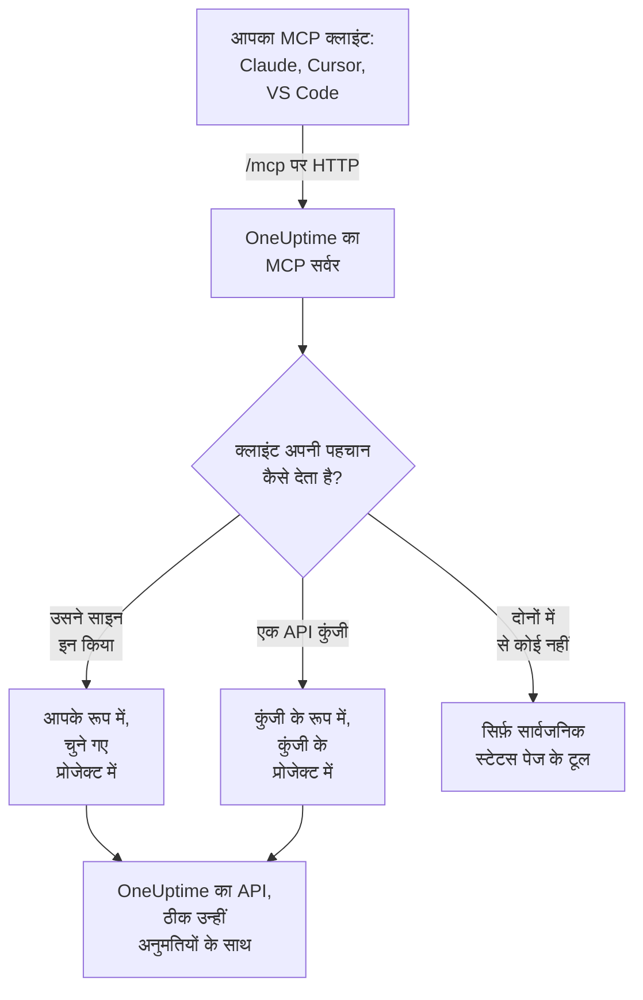

# MCP सर्वर

OneUptime का MCP सर्वर किसी AI सहायक को आपके OneUptime प्रोजेक्ट के साथ सीधे काम करने देता है। Claude, Cursor, GitHub Copilot वाला VS Code या Model Context Protocol (MCP) का कोई भी दूसरा क्लाइंट कनेक्ट करें, और उससे किसी घटना की पड़ताल करने, लॉग और ट्रेस क्वेरी करने, किसी अलर्ट को स्वीकार करने या कोई मॉनिटर सेट करने को कहें: वह आपकी अनुमतियों से, या किसी API कुंजी की अनुमतियों से, OneUptime के टूल कॉल करता है।

:::cards
- [क्लाइंट कनेक्ट करें](#क्लाइंट-कनेक्ट-करें): अपने क्लाइंट को सर्वर का पता दें और साइन इन करें।
- [OneUptime से साइन इन करना](#oneuptime-से-साइन-इन-करना): कनेक्टेड क्लाइंट क्या कर सकता है, और उसे डिस्कनेक्ट कैसे करें।
- [अपनी API कुंजी पाना](#अपनी-api-कुंजी-पाना): ऐसे एजेंट के लिए जो बिना निगरानी चलता है।
- [समस्या निवारण](#समस्या-निवारण): साइन-इन, अनुमति और कनेक्शन की समस्याएं।
:::

## यह कैसे काम करता है

MCP सर्वर हर OneUptime इंस्टेंस का हिस्सा है, डैशबोर्ड वाले पते पर ही `/mcp` पर, और streamable HTTP ट्रांसपोर्ट इस्तेमाल करता है। कुछ इंस्टॉल नहीं करना है।

- **OneUptime Cloud**: `https://oneuptime.com/mcp`
- **सेल्फ-होस्टेड**: `https://your-oneuptime-domain.com/mcp`



सर्वर स्टेटलेस है: वह कोई सेशन id जारी नहीं करता, और हर अनुरोध अपने आप में पूरा होता है, इसलिए वह लोड बैलेंसर के पीछे और कई रेप्लिका के साथ काम करता है।

## टूल क्या-क्या करते हैं

- **मॉनिटर**: मॉनिटर बनाएं और कॉन्फ़िगर करें, उनकी स्थिति जांचें और उनका इतिहास देखें।
- **घटना प्रतिक्रिया**: घटनाएं बनाएं, स्वीकार करें और सुलझाएं, आंतरिक या सार्वजनिक नोट जोड़ें, और समाधान तक उनका पीछा करें।
- **अलर्ट**: अलर्ट स्वीकार करें और सुलझाएं, नोट जोड़ें, और अलर्ट की स्थितियां और गंभीरताएं प्रबंधित करें।
- **टीमें और ऑन-कॉल**: टीमें और ऑन-कॉल नीतियां प्रबंधित करें।
- **स्टेटस पेज**: स्टेटस पेज प्रबंधित करें और घोषणाएं पोस्ट करें।
- **निर्धारित रखरखाव**: रखरखाव इवेंट बनाएं और प्रबंधित करें।
- **टेलीमेट्री**: लॉग, मेट्रिक्स, ट्रेस, अपवाद, मॉनिटर लॉग, सुरक्षा इवेंट और भी बहुत कुछ क्वेरी करें, सिर्फ़ पढ़ने के लिए।

30 तरह के रिकॉर्ड के लिए बनाने, पाने, सूचीबद्ध करने, अपडेट करने, हटाने और गिनने के टूल हैं, 9 तरह की टेलीमेट्री के लिए सूचीबद्ध करने और गिनने के टूल हैं, और घटना प्रतिक्रिया के लिए बने टूल हैं। सिर्फ़ पढ़ने वाले टूल पर `readOnlyHint` होता है, कुछ भी बदलने वाले हर टूल पर `destructiveHint` होता है, और सिर्फ़ सार्वजनिक स्टेटस पेज के टूल पर `openWorldHint` होता है, ताकि क्लाइंट सिर्फ़ पढ़ने वाली कॉल खुद चला सके और कोई भी बदलाव करने से पहले आपसे पूछे। विफल टूल कॉल MCP प्रोटोकॉल त्रुटि के रूप में नहीं, बल्कि टूल नतीजे (`isError: true`) के रूप में `statusCode`, विवरण और एक सुझाव के साथ लौटती है, ताकि एजेंट विफलता पढ़कर खुद को सुधार सके।

## शुरू करने से पहले

- एक OneUptime इंस्टेंस: OneUptime Cloud या सेल्फ-होस्टेड।
- एक MCP क्लाइंट, जैसे Claude Code, Claude, GitHub Copilot वाला VS Code या Cursor।
- साइन इन करने के लिए एक OneUptime खाता, या बिना निगरानी चलने वाले एजेंट के लिए एक OneUptime API कुंजी। सार्वजनिक स्टेटस पेज के टूल को इनमें से कुछ नहीं चाहिए।
- OneUptime Cloud पर Growth प्लान या उससे ऊपर: MCP क्लाइंट कनेक्ट करना उन्हीं प्लान पर उपलब्ध है जिन पर API कुंजियां हैं।

## क्लाइंट कनेक्ट करें

क्लाइंट को सर्वर का पता दें और कुछ नहीं। जब उसे पहली बार आपके डेटा की ज़रूरत होती है, तो वह साइन इन के लिए आपके ब्राउज़र में OneUptime खोलता है (देखें [OneUptime से साइन इन करना](#oneuptime-से-साइन-इन-करना))। सेल्फ-होस्टेड इंस्टेंस पर `https://oneuptime.com/mcp` की जगह `https://your-oneuptime-domain.com/mcp` इस्तेमाल करें।

:::tabs
@tab Claude Code
```bash
claude mcp add --transport http oneuptime https://oneuptime.com/mcp
```
फिर Claude Code के अंदर `/mcp` चलाएं और साइन इन के लिए **oneuptime** चुनें।
@tab Claude
Claude में **Customize → Connectors** खोलें, **Add custom connector** चुनें, और `https://oneuptime.com/mcp` डालें। जब Claude को पहली बार आपके डेटा की ज़रूरत होती है, तो वह आपसे OneUptime में साइन इन करने को कहता है।
@tab VS Code
इसे अपने MCP कॉन्फ़िगरेशन में जोड़ें (यह कहां रहता है, यह [GitHub Copilot के साथ VS Code](#github-copilot-के-साथ-vs-code) में देखें)। सर्वर शुरू करने पर VS Code साइन इन के लिए OneUptime खोलता है:
```json
{
  "servers": {
    "oneuptime": {
      "type": "http",
      "url": "https://oneuptime.com/mcp"
    }
  }
}
```
@tab Cursor
```json
{
  "mcpServers": {
    "oneuptime": {
      "url": "https://oneuptime.com/mcp"
    }
  }
}
```
:::

MCP ऑथराइज़ेशन का समर्थन करने वाला कोई भी दूसरा क्लाइंट इसी तरह काम करता है: उसे पता दें और बाकी सब वह खुद खोज लेता है। प्रोटोकॉल के लिए [साइन इन करना (OAuth 2.1)](#साइन-इन-करना-oauth-21) देखें।

डैशबोर्ड में भी ये चरण हैं, आपके इंस्टेंस का पता पहले से भरा हुआ: **प्रोजेक्ट सेटिंग्स → एआई → MCP सर्वर**। और किसी भी संसाधन (मॉनिटर, घटना, स्टेटस पेज वगैरह) से, उसके साइड मेन्यू में **डेवलपर** खोलें और **AI सहायक** चुनें: वह पेज ऐसे प्रॉम्प्ट भी सुझाता है जिनमें संसाधन और उसकी ID का नाम होता है, ताकि सहायक उसे तुरंत ढूंढ ले। जिस संसाधन के लिए MCP सर्वर में अभी कोई टूल नहीं है, जैसे वर्कफ़्लो, उसके लिए पेज दिखाता है कि कमांड चला सकने वाला सहायक इसके बजाय REST API के ज़रिए उसके साथ कैसे काम कर सकता है।

## OneUptime से साइन इन करना

कनेक्ट करने का सबसे आसान तरीका है अपने MCP क्लाइंट को सर्वर का पता देना और कुछ नहीं। जब क्लाइंट को पहली बार आपके डेटा की ज़रूरत होती है, तो वह आपके ब्राउज़र में एक OneUptime पेज खोलता है:

:::steps
1. अगर आप पहले से साइन इन नहीं हैं, तो OneUptime में साइन इन करें।
2. वह प्रोजेक्ट चुनें जिसमें क्लाइंट को काम करना है।
3. **पढ़ना और लिखना** या **केवल पढ़ना** चुनें।
4. **अधिकृत करें** पर क्लिक करें।
:::

इसके बाद क्लाइंट उस प्रोजेक्ट में आपके रूप में काम करता है। कोई API कुंजी बनाने, कॉपी करने या बदलने की ज़रूरत नहीं है, और कोई भी गुप्त चीज़ कॉन्फ़िगरेशन फ़ाइल में नहीं रखी जाती।

कनेक्टेड क्लाइंट क्या कर सकता है:

- **उसके पास आपकी अनुमतियां हैं, इससे ज़्यादा कभी नहीं।** प्रोजेक्ट में आपकी टीमें आपको जो करने देती हैं, वही क्लाइंट कर सकता है। अगर आपकी भूमिका बदलती है या आप प्रोजेक्ट छोड़ते हैं, तो यह क्लाइंट के अगले ही अनुरोध से लागू होता है। प्रोजेक्ट छोड़ने पर क्लाइंट भी डिस्कनेक्ट हो जाता है: उसका ऑथराइज़ेशन हटा दिया जाता है, और प्रोजेक्ट में लौटने पर आप उसे फिर से कनेक्ट करते हैं।
- **केवल पढ़ने का मतलब है केवल पढ़ना।** केवल पढ़ने के लिए अधिकृत क्लाइंट `get_`, `list_` और `count_` टूल इस्तेमाल कर सकता है। बनाने, अपडेट करने, हटाने, स्वीकार करने या सुलझाने वाले टूल अस्वीकार किए जाते हैं, MCP सर्वर द्वारा भी और उसके पीछे के OneUptime API द्वारा भी। आप किसी क्लाइंट को उसके मांगे से ज़्यादा एक्सेस कभी नहीं दे सकते।
- **यह एक प्रोजेक्ट के लिए है।** दूसरे प्रोजेक्ट को इस्तेमाल करने के लिए, क्लाइंट को फिर से कनेक्ट करें और वह प्रोजेक्ट चुनें।
- **यह सिर्फ़ MCP सर्वर के ज़रिए काम करता है।** क्लाइंट का एक्सेस टोकन MCP एंडपॉइंट स्वीकार करता है और कहीं और नहीं। इसका इस्तेमाल OneUptime REST API को सीधे कॉल करने के लिए नहीं किया जा सकता।
- **इंस्टेंस एडमिनिस्ट्रेटर को कोई खास बर्ताव नहीं मिलता।** मास्टर एडमिन द्वारा कनेक्ट किए गए क्लाइंट के पास वही होता है जो उस व्यक्ति की टीमें प्रोजेक्ट में देती हैं, पूरे इंस्टेंस का एक्सेस नहीं।

### कनेक्टेड क्लाइंट प्रबंधित करना

साइन इन करके कनेक्ट किया गया हर क्लाइंट **प्रोजेक्ट सेटिंग्स → एआई → MCP सर्वर** पर, **कनेक्ट किए गए MCP क्लाइंट** के तहत सूचीबद्ध होता है, इस जानकारी के साथ कि उसे किसने कनेक्ट किया, वह क्या कर सकता है और आखिरी बार कब इस्तेमाल हुआ। आप वे क्लाइंट देखते हैं जिन्हें आपने कनेक्ट किया; प्रोजेक्ट के ओनर और एडमिन सबके क्लाइंट देखते हैं।

किसी क्लाइंट को साइन आउट करने के लिए **Disconnect** पर क्लिक करें। वह तुरंत काम करना बंद कर देता है।

क्लाइंट तब तक कनेक्टेड रहता है जब तक उसका इस्तेमाल होता रहे। जिसका 30 दिनों से इस्तेमाल नहीं हुआ, उसे फिर से साइन इन करना होगा।

### कौन क्लाइंट कनेक्ट कर सकता है, यह तय करना

डिफ़ॉल्ट रूप से प्रोजेक्ट का हर सदस्य MCP क्लाइंट कनेक्ट कर सकता है। किसी टीम के सदस्यों को ऐसा करने से रोकने के लिए, टीम का **अनुमतियाँ** पेज खोलें, सबसे नीचे **और सेटिंग्स** खोलें, और **अनुमतियां अवरुद्ध करें** के तहत **Authorize MCP Client** अनुमति जोड़ें। उन सदस्यों के पहले से कनेक्ट किए क्लाइंट तुरंत काम करना बंद कर देते हैं।

अगर प्रोजेक्ट को सिंगल साइन-ऑन चाहिए, तो किसी क्लाइंट को अधिकृत करने से पहले अपने ब्राउज़र में SSO से प्रोजेक्ट में साइन इन करें। क्लाइंट का कनेक्शन उतनी ही देर चलता है जितना वह SSO साइन-इन; जब वह खत्म हो जाए, या जिस SSO प्रदाता से आपने साइन इन किया था वह बंद या हटा दिया जाए, तो क्लाइंट को फिर से कनेक्ट करें।

OneUptime Cloud पर MCP क्लाइंट कनेक्ट करना उन्हीं प्लान पर उपलब्ध है जिन पर API कुंजियां हैं (Growth और उससे ऊपर)।

Enterprise Edition में, कनेक्टेड क्लाइंट का किया हर बदलाव ऑडिट लॉग में उसे कनेक्ट करने वाले व्यक्ति के नाम से, क्लाइंट के नाम के साथ दर्ज होता है। API कुंजी से किए गए बदलाव कुंजी का नाम दिखाते हैं।

## अपनी API कुंजी पाना

बिना निगरानी चलने वाले एजेंट के लिए API कुंजी इस्तेमाल करें, जैसे कोई निर्धारित जॉब या CI पाइपलाइन, जहां साइन इन करने के लिए कोई मौजूद नहीं होता।

:::steps
### कुंजी बनाएं

**प्रोजेक्ट सेटिंग्स → उन्नत → API कुंजियाँ** पर जाएं और **API कुंजी बनाएँ** पर क्लिक करें। उसे एक नाम दें, जैसे "MCP Server"।

### चुनें कि वह क्या कर सकती है

**एक्सेस** के तहत, सिर्फ़ पढ़ने वाले एजेंट के लिए **Viewer** चुनें, या बनाने, अपडेट करने और हटाने वाले एजेंट के लिए **Project Admin** (देखें [API कुंजी की अनुमतियां](#api-कुंजी-की-अनुमतियां))।

### कुंजी कॉपी करें

**API कुंजी बनाएँ** पर क्लिक करें: कुंजी का पेज खुलता है। वहां से कुंजी कॉपी करें।
:::

API कुंजियां एक प्रोजेक्ट की होती हैं: MCP सर्वर प्रोजेक्ट को कुंजी से लेता है, इसलिए बनाने वाले टूल को कभी `projectId` आर्ग्युमेंट की ज़रूरत नहीं पड़ती।

> [!WARNING]
> किसी AI एजेंट को कभी मास्टर कुंजी न दें। OneUptime की मास्टर API कुंजी भी इस हेडर पर स्वीकार की जाती है और पूरे इंस्टेंस का एडमिन एक्सेस देती है। हमेशा प्रोजेक्ट API कुंजी इस्तेमाल करें, उतनी ही अनुमति के साथ जितनी एजेंट को चाहिए: हर `get_`, `list_` और `count_` टूल के लिए सिर्फ़ पढ़ने वाली कुंजी काफ़ी है।

## API कुंजी से कनेक्ट करना

कुंजी `x-api-key` हेडर में भेजें। API कुंजी वाले अनुरोध से कभी साइन इन करने को नहीं कहा जाता। सेल्फ-होस्टेड इंस्टेंस पर `oneuptime.com` की जगह अपना डोमेन इस्तेमाल करें।

:::tabs
@tab Claude Code
```bash
claude mcp add --transport http oneuptime https://oneuptime.com/mcp --header "x-api-key: your-api-key-here"
```
@tab Claude Desktop
इसे `claude_desktop_config.json` में जोड़ें, जो macOS पर `~/Library/Application Support/Claude/` में, Windows पर `%APPDATA%\Claude\` में या Linux पर `~/.config/Claude/` में है:
```json
{
  "mcpServers": {
    "oneuptime": {
      "transport": "streamable-http",
      "url": "https://oneuptime.com/mcp",
      "headers": {
        "x-api-key": "your-api-key-here"
      }
    }
  }
}
```
@tab VS Code
`"password": true` वाला इनपुट वेरिएबल कुंजी को सादे टेक्स्ट में रखने के बजाय सर्वर शुरू होने पर उसे मांगता है:
```json
{
  "servers": {
    "oneuptime": {
      "type": "http",
      "url": "https://oneuptime.com/mcp",
      "headers": {
        "x-api-key": "${input:oneuptime-api-key}"
      }
    }
  },
  "inputs": [
    {
      "type": "promptString",
      "id": "oneuptime-api-key",
      "description": "OneUptime API Key",
      "password": true
    }
  ]
}
```
@tab Cursor
```json
{
  "mcpServers": {
    "oneuptime": {
      "url": "https://oneuptime.com/mcp",
      "headers": {
        "x-api-key": "your-api-key-here"
      }
    }
  }
}
```
:::

## GitHub Copilot के साथ VS Code

VS Code 1.99 और उसके बाद के संस्करण GitHub Copilot Chat में MCP सर्वर को सीधे सपोर्ट करते हैं।

:::steps
### जांचें कि आपको क्या चाहिए

VS Code 1.99 या उसके बाद का संस्करण, GitHub Copilot एक्सटेंशन इंस्टॉल और साइन इन के साथ, और GitHub Copilot Chat चालू।

### MCP कॉन्फ़िगरेशन खोलें

`Ctrl+Shift+P` (macOS पर `Cmd+Shift+P`) दबाएं, "MCP: Open User Configuration" टाइप करें और Enter दबाएं। इससे `mcp.json` फ़ाइल खुलती है, या बनती है। सिर्फ़ एक वर्कस्पेस के लिए, उसके अंदर इसके बजाय `.vscode/mcp.json` बनाएं।

### OneUptime जोड़ें

ऊपर वाला VS Code कॉन्फ़िगरेशन पेस्ट करें: साइन इन के लिए बिना कुंजी वाला, या API कुंजी वाला।

### सर्वर शुरू करें

`Ctrl+Shift+P` (macOS पर `Cmd+Shift+P`) दबाएं, "MCP: List Servers" टाइप करें, और उसे शुरू करने के लिए **oneuptime** चुनें। VS Code पहली बार सर्वर पर भरोसा करने को कहता है, फिर साइन इन करने या अपनी API कुंजी डालने को।

### Copilot से पूछें

GitHub Copilot Chat को एजेंट मोड में खोलें और पूछें, उदाहरण के लिए "OneUptime में मेरे कौन-से मॉनिटर हैं?", "हाल की घटनाएं दिखाओ" या "https://example.com के लिए एक नया मॉनिटर बनाओ"।
:::

## ऑथेंटिकेशन

MCP सर्वर तीन तरीकों से काम करता है।

### सार्वजनिक टूल (ऑथेंटिकेशन की ज़रूरत नहीं)

API कुंजी या साइन-इन के बिना, क्लाइंट सार्वजनिक टूल इस्तेमाल कर सकता है:

- **`oneuptime_help`**: OneUptime के MCP टूल के बारे में मदद और मार्गदर्शन
- **`oneuptime_list_resources`**: संसाधन, और हर एक के साथ आप क्या कर सकते हैं
- **`get_public_status_page_overview`**: किसी सार्वजनिक स्टेटस पेज का अवलोकन
- **`get_public_status_page_incidents`**: किसी सार्वजनिक स्टेटस पेज की घटनाएं
- **`get_public_status_page_scheduled_maintenance`**: उसके निर्धारित रखरखाव इवेंट
- **`get_public_status_page_announcements`**: उसकी घोषणाएं

सार्वजनिक स्टेटस पेज के टूल किसी स्टेटस पेज की ID (एक UUID) या उसका डोमेन नाम लेते हैं। सिर्फ़ इन्हें इस्तेमाल करने के लिए, पते के साथ और बिना क्रेडेंशियल के कनेक्ट करें:

```json
{
  "mcpServers": {
    "oneuptime": {
      "transport": "streamable-http",
      "url": "https://oneuptime.com/mcp"
    }
  }
}
```

किसी स्टेटस पेज के ओनर उस पेज के लिए MCP एक्सेस बंद कर सकते हैं: स्टेटस पेज पर, उसके साइड मेन्यू के **एआई** सेक्शन में **MCP** खोलें और **MCP सर्वर सक्षम करें** बंद करें। स्विच बदलते ही सहेज लिया जाता है। MCP एक्सेस डिफ़ॉल्ट रूप से चालू है। जब तक यह बंद है, चारों `get_public_status_page_*` टूल उस स्टेटस पेज के लिए त्रुटि लौटाते हैं; स्टेटस पेज की वेबसाइट, उसकी RSS फ़ीड और उसका सार्वजनिक JSON API प्रभावित नहीं होते, और साइन-इन मांगने वाले स्टेटस पेज टूल (`get_status_page`, `list_status_pages` वगैरह) पेज के अपने प्रोजेक्ट के लिए काम करते रहते हैं।

### साइन इन करना (OAuth 2.1)

हर दूसरे टूल को यह जानना होता है कि कौन कॉल कर रहा है। जो क्लाइंट कोई क्रेडेंशियल नहीं भेजता और इनमें से किसी को कॉल करता है, उसे `401 Unauthorized` मिलता है, एक `WWW-Authenticate` हेडर के साथ जो सर्वर के सुरक्षित संसाधन मेटाडेटा की ओर इशारा करता है। यही वह संकेत है जिस पर MCP क्लाइंट आपको साइन इन कराता है; `initialize`, `tools/list` और सार्वजनिक टूल इसे कभी नहीं मांगते।

सर्वर [MCP ऑथराइज़ेशन विनिर्देश](https://modelcontextprotocol.io/specification/latest/basic/authorization) लागू करता है:

- **फ़्लो**: PKCE (सिर्फ़ `S256`) के साथ OAuth 2.1 authorization code। एक्सेस टोकन `Authorization: Bearer` के रूप में भेजे जाते हैं।
- **खोज**: सुरक्षित संसाधन मेटाडेटा (RFC 9728) और ऑथराइज़ेशन सर्वर मेटाडेटा (RFC 8414)। जारीकर्ता और संसाधन दोनों `https://<host>/mcp` हैं।
- **क्लाइंट पहचान**: एक Client ID Metadata Document (क्लाइंट ID एक `https` URL है जिसे सर्वर फ़ेच करता है), या डायनैमिक क्लाइंट रजिस्ट्रेशन (RFC 7591)। किसी क्लाइंट को एडमिनिस्ट्रेटर द्वारा रजिस्टर करने की ज़रूरत नहीं है।
- **दायरे**: `get_`, `list_` और `count_` टूल के लिए `mcp:read`; `mcp:write` कुछ भी बदलने वाले हर टूल को जोड़ता है, और उसमें `mcp:read` शामिल है। लिखने वाला टूल कॉल करने वाले सिर्फ़ पढ़ने वाले टोकन को `error="insufficient_scope"` के साथ `403` मिलता है।
- **टोकन की अवधि**: एक्सेस टोकन एक घंटा चलता है। रिफ़्रेश टोकन 30 दिन चलता है और हर इस्तेमाल पर बदल दिया जाता है; पहले से बदला हुआ रिफ़्रेश टोकन इस्तेमाल करने पर कनेक्शन खत्म हो जाता है।
- **संसाधन संकेतक** (RFC 8707): टोकन `https://<host>/mcp` के लिए जारी होता है और कहीं और स्वीकार नहीं किया जाता।
- **रद्दीकरण** (RFC 7009): दोनों में से किसी भी टोकन को रद्द करने पर कनेक्शन खत्म हो जाता है।

### API कुंजी

बिना निगरानी चलने वाला एजेंट इनमें से किसी एक हेडर में OneUptime API कुंजी भेजता है:

- `x-api-key`: आपकी OneUptime API कुंजी
- `Authorization`: आपकी API कुंजी वाला bearer टोकन (जैसे `Bearer your-api-key-here`)

`Bearer` स्कीम केस-संवेदनशील नहीं है। API कुंजी वाले अनुरोध से कभी साइन इन करने को नहीं कहा जाता।

OneUptime Cloud पर API कुंजियां तभी तक काम करती हैं जब तक प्रोजेक्ट **Growth** या उससे ऊपर हो। उससे नीचे, कुंजी की ज़रूरत वाला हर टूल प्लान का नाम बताने वाले संदेश के साथ `402` लौटाता है, और एजेंट से दोबारा कोशिश न करने को कहा जाता है। कुछ भी हटाया नहीं जाता: प्रोजेक्ट के वापस Growth पर आते ही कुंजी जैसी है वैसी फिर से काम करने लगती है, कुछ भी दोबारा कनेक्ट किए बिना। साइन इन करके कनेक्ट किया गया क्लाइंट एक व्यक्ति के रूप में काम करता है और चलता रहता है ([अपने प्लान से नीचे API कुंजियां और SCIM](/docs/api-reference/api-reference#अपने-प्लान-से-नीचे-api-कुंजियाँ-और-scim))।

## उपलब्ध एंडपॉइंट

| एंडपॉइंट | मेथड | विवरण |
| --- | --- | --- |
| `/mcp` | POST | टूल कॉल और दूसरे ऑपरेशन के लिए JSON-RPC अनुरोध |
| `/mcp` | GET | SSE `Accept` हेडर के बिना: सर्वर का एक छोटा JSON विवरण। उसके साथ: `405`, क्योंकि स्टेटलेस सर्वर कोई अलग SSE स्ट्रीम नहीं देता (विनिर्देश मानने वाले क्लाइंट उसके बिना आगे बढ़ते हैं) |
| `/mcp` | DELETE | कुछ नहीं करता: सर्वर स्टेटलेस है, इसलिए खत्म करने को कोई सेशन नहीं है |
| `/mcp/health` | GET | हेल्थ चेक |
| `/mcp/tools` | GET | टूल की सूची, सादे REST के रूप में |

साइन इन करने वाले MCP क्लाइंट नीचे के OAuth एंडपॉइंट भी इस्तेमाल करते हैं। क्लाइंट उन्हें खुद ढूंढ लेता है; वे क्लाइंट लिखने वालों या प्रॉक्सी सेट करने वालों के लिए सूचीबद्ध हैं।

| एंडपॉइंट | मेथड | विवरण |
| --- | --- | --- |
| `/mcp/.well-known/oauth-protected-resource` | GET | सुरक्षित संसाधन मेटाडेटा (RFC 9728)। `/.well-known/oauth-protected-resource/mcp` पर भी |
| `/.well-known/oauth-authorization-server/mcp` | GET | ऑथराइज़ेशन सर्वर मेटाडेटा (RFC 8414)। `/mcp/.well-known/oauth-authorization-server` पर भी |
| `/mcp/oauth/authorize` | GET | ऑथराइज़ेशन एंडपॉइंट: जहां क्लाइंट साइन इन के लिए आपके ब्राउज़र को भेजता है |
| `/mcp/oauth/token` | POST | टोकन एंडपॉइंट: ऑथराइज़ेशन कोड या रिफ़्रेश टोकन बदलता है |
| `/mcp/oauth/register` | POST | डायनैमिक क्लाइंट रजिस्ट्रेशन (RFC 7591) |
| `/mcp/oauth/revoke` | POST | टोकन रद्दीकरण (RFC 7009) |

यह जांचने के लिए कि सर्वर चल रहा है, और उसके टूल सूचीबद्ध करने के लिए:

```bash
curl https://oneuptime.com/mcp/health
curl https://oneuptime.com/mcp/tools
```

## घटना प्रतिक्रिया के टूल

हर तरह के रिकॉर्ड के टूल के अलावा, सर्वर में घटनाओं और अलर्ट पर प्रतिक्रिया के लिए बने टूल हैं:

- **`acknowledge_incident`** / **`resolve_incident`**: किसी घटना को प्रोजेक्ट की Acknowledged या Resolved स्थिति में ले जाएं, जैसा डैशबोर्ड का बटन करता है
- **`acknowledge_alert`** / **`resolve_alert`**: अलर्ट के लिए वही
- **`add_incident_note`**: किसी घटना में `visibility: "internal"` (सिर्फ़ टीम, डिफ़ॉल्ट) या `visibility: "public"` (स्टेटस पेज पर पोस्ट) के साथ नोट जोड़ें। Markdown समर्थित है
- **`add_alert_note`**: किसी अलर्ट में आंतरिक नोट जोड़ें

एक सामान्य क्रम: `list_incidents` → `acknowledge_incident` → `list_logs` से जांच → `add_incident_note` (सार्वजनिक) → `resolve_incident`।

**`oneuptime_whoami`** टूल वह प्रोजेक्ट लौटाता है जिसके आपके क्रेडेंशियल हैं (उसकी ID और नाम)। साइन इन किए क्लाइंट के लिए यह यह भी बताता है कि वह किसके रूप में साइन इन है और क्या वह बदलाव कर सकता है। एजेंट के लिए दिशा पाने का यह एक अच्छा पहला कॉल है, और चूंकि बनाने वाले टूल `projectId` क्रेडेंशियल से लेते हैं, एजेंट को कभी प्रोजेक्ट ID नहीं देनी पड़ती।

## टेलीमेट्री क्वेरी करना

लॉग, मेट्रिक्स, ट्रेस (span), अपवाद, मॉनिटर लॉग और दूसरी तरह की टेलीमेट्री सिर्फ़ पढ़ने वाले `list_` और `count_` टूल के रूप में आती है (`list_logs`, `list_metrics`, `list_spans`, `list_exception_instances`, `list_monitor_logs` और उनके `count_` जोड़ीदार)। टेलीमेट्री OpenTelemetry से आती है, इसलिए बनाने वाले टूल नहीं हैं।

टेलीमेट्री को हमेशा समय सीमा के साथ क्वेरी करें। क्वेरी फ़ील्ड कोई मान या ऑपरेटर ऑब्जेक्ट लेता है:

```json
{
  "query": {
    "time": { "_type": "GreaterThan", "value": "2026-07-04T00:00:00.000Z" }
  },
  "sort": { "time": "DESC" },
  "limit": 50
}
```

ऑपरेटर हैं `EqualTo`, `NotEqual`, `IsNull`, `NotNull`, `EqualToOrNull`, `GreaterThan`, `LessThan`, `GreaterThanOrEqual`, `LessThanOrEqual`, `InBetween`, `Search` और `Includes`। सॉर्ट मान `"ASC"` या `"DESC"` हैं।

## फ़ील्ड चयन और पेजिनेशन

`get_` और `list_` टूल फ़ील्ड नामों की एक वैकल्पिक `select` ऐरे लेते हैं। डिफ़ॉल्ट रूप से हर पढ़ने योग्य फ़ील्ड लौटता है, सिवाय भारी फ़ील्ड के (JSON, बहुत लंबे टेक्स्ट और HTML कॉलम), जिन्हें `select` में मांगना होता है।

सूची टूल `limit` (डिफ़ॉल्ट 10, अधिकतम 100) और `skip` से पेज करते हैं, और हर सूची जवाब ठीक-ठीक बताता है कि उसने क्या लौटाया:

```json
{
  "returnedCount": 10,
  "totalCount": 42,
  "skip": 0,
  "limit": 10,
  "hasMore": true,
  "data": ["..."]
}
```

## उपयोग के उदाहरण

### रोज़ के सवाल

```text
"What's the current status of all my monitors?"
"Show me incidents from the last 24 hours"
"List the teams in this project"
"Show me our on-call policies"
```

### मॉनिटर और घटनाएं

```text
"Create a new website monitor for https://example.com that checks every 5 minutes"
"Set up an API monitor for https://api.example.com/health with a 30-second timeout"
"Disable the monitor for staging.example.com while we're doing maintenance"
"Create a high-priority incident for the database outage affecting user authentication"
"Add a note to incident #123 saying 'Database connection restored, monitoring for stability'"
"Mark incident #456 as resolved"
```

### स्टेटस पेज

```text
"Update our status page to show 'Investigating Payment Issues' for the payment service"
"Create a status page announcement about scheduled maintenance this weekend"
```

### सार्वजनिक स्टेटस पेज क्वेरी (API कुंजी की ज़रूरत नहीं)

ये क्रेडेंशियल के बिना, सिर्फ़ सार्वजनिक स्टेटस पेज के टूल से काम करते हैं:

```text
"What's the current status of status.example.com?"
"Show me recent incidents from the OneUptime status page"
"Are there any scheduled maintenance events on status.acme.com?"
"Get the latest announcements from my public status page with ID abc123-..."
```

### एक साथ कई चरण

```text
"Create a scheduled maintenance window for Saturday 2-4 AM, disable all monitors for api.example.com during that time, and update the status page"
"Show me all monitors that have been down in the last hour, create incidents for any that don't already have one"
```

## API कुंजी की अनुमतियां

| एजेंट क्या करता है | **एक्सेस** के तहत चुनें |
| --- | --- |
| सिर्फ़ पढ़ता है | **Viewer**, या कुंजी के पेज पर पढ़ने की अनुमतियां जोड़ें |
| बनाता, अपडेट करता और हटाता भी है | **Project Admin**, या कुंजी के पेज पर Project Admin भूमिका जोड़ें |

हर कुंजी को उतना ही दें जितना उसे चाहिए, कुंजियां नियमित रूप से बदलें, हर परिवेश के लिए अलग कुंजी रखें, और OneUptime में देखते रहें कि हर कुंजी क्या करती है।

## सेल्फ-होस्टेड कॉन्फ़िगरेशन

सेल्फ-होस्टेड इंस्टेंस पर साइन-इन बिना किसी सेटअप के काम करता है। दो सेटिंग्स इसे बदलती हैं:

| एनवायरनमेंट वेरिएबल | Helm वैल्यू | यह क्या करता है |
| --- | --- | --- |
| `DISABLE_MCP_OAUTH` | `mcpOAuth.disabled` | साइन-इन बंद करने के लिए `true` पर सेट करें। OAuth एंडपॉइंट परोसे जाना बंद हो जाते हैं और MCP सर्वर सिर्फ़ API कुंजियां स्वीकार करता है। कुछ भी हटाया नहीं जाता; इसे फिर से चालू करने पर कनेक्टेड क्लाइंट फिर काम करने लगते हैं। |
| `DISABLE_MCP_OAUTH_CLIENT_ID_METADATA_DOCUMENTS` | `mcpOAuth.disableClientIdMetadataDocuments` | ऐसे इंस्टेंस पर `true` पर सेट करें जो इंटरनेट तक नहीं पहुंच सकता। क्लाइंट अपनी पहचान ऐसे URL से दे सकता है जिसे OneUptime फ़ेच करता है; इस सेटिंग के साथ क्लाइंट इसके बजाय सीधे आपके इंस्टेंस में रजिस्टर होते हैं, जिसके लिए किसी बाहरी अनुरोध की ज़रूरत नहीं होती। |

अगर आप OneUptime के आगे अपना रिवर्स प्रॉक्सी चलाते हैं, तो `/mcp` के साथ `/.well-known/oauth-protected-resource` और `/.well-known/oauth-authorization-server` (और उनके नीचे का सब कुछ) OneUptime तक फ़ॉरवर्ड करें। साथ आने वाला ingress यह पहले से करता है।

सर्वर हर OAuth URL को `HOST` और `HTTP_PROTOCOL` सेटिंग्स से बनाता है, इसलिए उन्हें उस पते से मेल खाना चाहिए जिससे लोग आपके इंस्टेंस तक पहुंचते हैं।

## समस्या निवारण

### साइन-इन की समस्याएं

- **क्लाइंट मुझसे कभी साइन इन करने को नहीं कहता**: हो सकता है क्लाइंट MCP ऑथराइज़ेशन का समर्थन न करता हो, या वह API कुंजी हेडर के साथ कॉन्फ़िगर हो, जिसकी प्राथमिकता होती है। इसके बजाय साइन इन करने के लिए हेडर हटाएं।
- **ऑथराइज़ेशन पेज पर मेरा प्रोजेक्ट धूसर है**: पेज प्रोजेक्ट के नाम के पास कारण बताता है: प्रोजेक्ट के प्लान में MCP क्लाइंट कनेक्ट करना शामिल नहीं है, प्रोजेक्ट को SSO चाहिए और इस ब्राउज़र ने उसमें SSO से साइन इन नहीं किया, या आपकी टीम को क्लाइंट कनेक्ट करने से रोका गया है।
- **कोई टूल "read-only" कहकर अस्वीकार होता है**: क्लाइंट को केवल पढ़ने के लिए अधिकृत किया गया था। उसे फिर से कनेक्ट करें और **पढ़ना और लिखना** चुनें।
- **क्लाइंट ने काम करना बंद कर दिया**: वह डिस्कनेक्ट कर दिया गया, 30 दिनों तक इस्तेमाल नहीं हुआ, आपको प्रोजेक्ट से हटा दिया गया, या प्रोजेक्ट का SSO साइन-इन खत्म हो गया या उसका प्रदाता बंद कर दिया गया। उसे फिर से कनेक्ट करें।
- **सेल्फ-होस्टेड - क्लाइंट कहता है कि उसे ऑथराइज़ेशन सर्वर नहीं मिल रहा**: जांचें कि `HOST` और `HTTP_PROTOCOL` आपके सार्वजनिक पते से मेल खाते हैं, और आपका प्रॉक्सी `/.well-known/oauth-*` पाथ फ़ॉरवर्ड करता है।

### अनुमति त्रुटियां

API कुंजी को, या साइन इन किए क्लाइंट के मामले में आपके अपने खाते को, सही अनुमतियां चाहिए: रिकॉर्ड सूचीबद्ध करने के लिए पढ़ने का एक्सेस, उन्हें बनाने और अपडेट करने के लिए लिखने का एक्सेस, और उन्हें हटाने के लिए हटाने का एक्सेस।

### कनेक्शन की समस्याएं

जांचें कि OneUptime का पता सही है और पहुंच योग्य है, API कुंजी मान्य है, और हेल्थ एंडपॉइंट जवाब देता है (देखें [उपलब्ध एंडपॉइंट](#उपलब्ध-एंडपॉइंट))।

### अमान्य API कुंजी

- अपनी OneUptime सेटिंग्स में API कुंजी जांचें, बिना अतिरिक्त स्पेस या अक्षरों के
- जांचें कि कुंजी की अवधि खत्म नहीं हुई है
- OneUptime Cloud पर, ऐसा `402` जो कहता है कि API कुंजियों को Growth प्लान चाहिए, बताता है कि प्रोजेक्ट उससे नीचे है: **प्रोजेक्ट सेटिंग्स → बिलिंग और चालान → बिलिंग** में प्रोजेक्ट को अपग्रेड करें, और वही कुंजी फिर से काम करने लगती है

### सेशन त्रुटियां

MCP सर्वर स्टेटलेस है: वह न सेशन id जारी करता है न उन्हें ट्रैक करता है, इसलिए हर अनुरोध किसी भी रेप्लिका पर काम करता है। जो क्लाइंट पुराने सर्वर संस्करण से `mcp-session-id` हेडर भेजता है, वह उसे छोड़ सकता है; उसे अनदेखा किया जाता है। ऐसे पुराने क्लाइंट कॉन्फ़िगरेशन को अपडेट करें जो सर्वर से सेशन id लौटाने की उम्मीद करता है।

## उपलब्ध संसाधन

| क्षेत्र | बनाने, पाने, सूचीबद्ध करने, अपडेट करने, हटाने और गिनने के टूल वाले रिकॉर्ड |
| --- | --- |
| मॉनिटरिंग | Monitor, Monitor Status, Monitor Status Event |
| घटनाएं | Incident, Incident State, Incident Severity, Incident State Timeline, Incident Public Note, Incident Internal Note, Incident Alert, Postmortem Status |
| अलर्ट | Alert, Alert State, Alert Severity, Alert State Timeline, Alert Internal Note |
| स्टेटस पेज | Status Page, Status Page Announcement |
| निर्धारित रखरखाव | Scheduled Maintenance Event, Scheduled Maintenance State, Scheduled Maintenance State Timeline |
| टीमें और ऑन-कॉल | Team, On-Call Policy |
| लेबल | Label |
| सुरक्षा | Security Case, Security Case Note, Security Case Priority, Security Case Status, Security Detection, Security Playbook |

| क्षेत्र | सिर्फ़ सूचीबद्ध करने और गिनने के टूल वाली टेलीमेट्री |
| --- | --- |
| अवलोकनीयता | Log, Metric, Span, Exception Instance, Monitor Log |
| सुरक्षा | Security Event, Threat Intel Indicator |
| बदलाव और लागत | Change Event, Kubernetes Cost Allocation |

टूल के नाम snake case में हैं: `create_incident`, `get_incident`, `list_incidents`, `update_incident`, `delete_incident` और `count_incidents`, या टेलीमेट्री के लिए `list_logs` और `count_spans`।

## अगले कदम

:::cards
- [AI से पूछें](/docs/ai/ask-ai): इसके बजाय OneUptime के अंदर ही अपने प्रोजेक्ट के बारे में पूछें।
- [OneUptime API संदर्भ](/docs/api-reference/api-reference): हर टूल के पीछे का REST API।
- [अनुमतियां](/docs/permissions/index): कोई भूमिका, टीम या API कुंजी क्या कर सकती है।
:::
