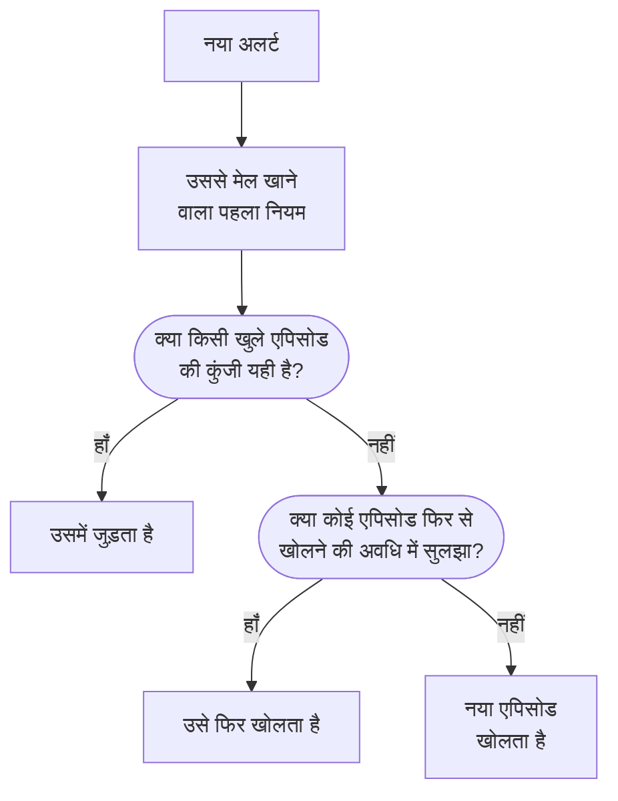

# अलर्ट एपिसोड और समूहीकरण नियम

जब कोई डेटाबेस बंद होता है, तो बीस मॉनिटर कुछ ही मिनटों में बीस अलर्ट बना सकते हैं। एपिसोड उन्हें एक रिकॉर्ड में रखता है जिसे आपकी टीम एक साथ स्वीकार करती है और सुलझाती है, और समूहीकरण नियम तय करता है कि कौन-से अलर्ट उसमें जाएँ। यह पेज दिखाता है कि समूहीकरण कैसे काम करता है, नियम कैसे सेट करें, और खुलने के बाद एपिसोड कैसा व्यवहार करता है।

:::cards
- [समूहीकरण कैसे काम करता है](#समूहीकरण-कैसे-काम-करता-है): नियम, समूहीकरण कुंजियाँ और समय विंडो।
- [समूहीकरण नियम बनाना](#समूहीकरण-नियम-बनाना): एक क्लिक में टेम्पलेट से, या अपना खुद का।
- [एपिसोड कैसा व्यवहार करता है](#एपिसोड-कैसा-व्यवहार-करता-है): उसकी गंभीरता, उसकी स्थितियाँ और वह कब सुलझता है।
- [एपिसोड किसे पेज करता है](#एपिसोड-किसे-पेज-करता-है): नियम की ऑन-कॉल नीतियाँ और अलर्ट की अपनी नीतियाँ।
:::

## समूहीकरण कैसे काम करता है

समूहीकरण हर नए अलर्ट के लिए एक बार चलता है, उसकी ऑन-कॉल नीतियाँ चलने के ठीक बाद। अलर्ट को आपके सक्षम समूहीकरण नियमों से, सूची में ऊपर से नीचे, जाँचा जाता है, और उससे मेल खाने वाला पहला नियम उसका एपिसोड तय करता है। जिस अलर्ट से कोई नियम मेल नहीं खाता, वह अकेला रहता है।



- **नियम की शर्तें** तय करती हैं कि वह किन अलर्ट पर लागू होता है। बिना शर्तों वाला नियम हर नए अलर्ट पर लागू होता है।
- **समूहीकरण कुंजी** तय करती है कि कौन-से अलर्ट एक एपिसोड साझा करते हैं: एक ही मॉनिटर, एक ही गंभीरता, एक ही शीर्षक वाले, या जिस भी मेल के अनुसार नियम समूहित करता है। जो नियम किसी भी चीज़ के अनुसार समूहित नहीं करता, वह अपने से मेल खाने वाले हर अलर्ट को एक ही एपिसोड में रखता है।
- **समय विंडो** तय करती है कि एपिसोड कब तक अलर्ट लेता रहता है। चालू होने पर, अलर्ट तभी जुड़ता है जब वह एपिसोड के आख़िरी अलर्ट के बाद विंडो के भीतर आए। बंद होने पर, मेल खाने वाले अलर्ट एपिसोड सुलझने तक जुड़ते रहते हैं।

समूहीकरण अलर्ट बनते समय होता है। आज जोड़ा गया नियम उसके बाद बने अलर्ट को समूहित करता है; वह पहले से मौजूद अलर्ट को दोबारा समूहित नहीं करता।

> [!NOTE]
> पहले से स्वीकार किया हुआ बनाया गया अलर्ट किसी खुले एपिसोड से जुड़ सकता है, पर कभी एपिसोड नहीं खोलता, और सुलझा हुआ बनाया गया अलर्ट बिल्कुल समूहित नहीं होता। देखें [पहले से स्वीकार या सुलझा हुआ बनाया गया](/docs/alerts/index#पहले-से-स्वीकार-या-सुलझा-हुआ-बनाया-गया)।

## समूहीकरण नियम बनाना

**अलर्ट → नियम → समूहीकरण नियम** पर जाएँ। साइड मेनू का **नियम** अनुभाग शुरू में मुड़ा रहता है, इसलिए पहले उसे खोलें।

### टेम्पलेट से शुरू करें

जिस प्रोजेक्ट में कोई समूहीकरण नियम नहीं है, उसे खाली सूची के बजाय चार तैयार नियम दिखते हैं; नियम होने के बाद, कार्ड पर **टेम्पलेट से बनाएँ** उन्हें खोलता है। **नियम जोड़ें** एक क्लिक में एक नियम सहेजता है, सक्षम, सूची के अंत में, और हर नए अलर्ट पर लागू। बाद में उसे किसी भी दूसरे नियम की तरह संपादित करें।

| टेम्पलेट                                        | समूहित करता है                                                            | समय विंडो   |
| ----------------------------------------------- | ------------------------------------------------------------------------- | ----------- |
| **एक ही मॉनिटर के अलर्ट को समूहित करें**        | हर मॉनिटर के लिए एक एपिसोड                                                | 30 मिनट     |
| **एक साथ होने वाले अलर्ट को समूहित करें**       | एक साझा एपिसोड, मॉनिटर चाहे जो हो                                         | 10 मिनट     |
| **अलर्ट को गंभीरता के अनुसार समूहित करें**      | हर गंभीरता के लिए एक एपिसोड                                               | 30 मिनट     |
| **एक ही अलर्ट के दोहराव को समूहित करें**        | हर अलर्ट शीर्षक के लिए एक एपिसोड, संख्याओं और अक्षरों के छोटे-बड़े रूप को अनदेखा करके | 1 घंटा |

### अपना खुद का बनाएँ

:::steps
#### बताएँ कि कैसे समूहित करना है

टेम्पलेट के नीचे **कस्टम नियम बनाएँ** पर क्लिक करें, या नियम होने के बाद कार्ड पर **अलर्ट समूहन नियम बनाएँ** पर। **समूहीकरण** चरण पर, **अलर्ट को इसके अनुसार समूहित करें** एक सवाल पूछता है: **मॉनिटर**, **सब एक साथ**, **गंभीरता**, **शीर्षक** या **कस्टम**। **नाम** आपके जवाब के साथ बदलता है, जब तक आप अपना नाम न लिखें।

#### समय विंडो सेट करें

**केवल पास-पास आने वाले अलर्ट को समूहित करें** चालू है, 30 मिनट की विंडो के साथ। मिनट बदलें, या एपिसोड को सुलझने तक खुला रखने के लिए इसे बंद करें।

#### फ़ील्ड मिलाएँ, कस्टम के लिए

**कस्टम** पाँच स्विच वाला एक **इसके अनुसार समूहित करें** चरण जोड़ता है: **मॉनिटर के अनुसार समूहित करें**, **अलर्ट गंभीरता के अनुसार समूहित करें**, **अलर्ट शीर्षक के अनुसार समूहित करें**, **अलर्ट लेबल के अनुसार समूहित करें** और **मॉनिटर लेबल के अनुसार समूहित करें**। लेबल अपने सटीक सेट के अनुसार समूहित होते हैं।

#### दायरा सीमित करें

**कौन-से अलर्ट** पर **सभी अलर्ट**, जिससे नया नियम शुरू होता है, हर नए अलर्ट को समूहित करता है। इसे सीमित करने के लिए **केवल शर्तों से मेल खाने वाले अलर्ट** चुनें और मॉनिटर, गंभीरता, लेबल, शीर्षक और विवरण पर शर्तें जोड़ें। फिर **अलर्ट समूहन नियम बनाएँ** पर क्लिक करें।
:::

नियम जो कुछ और कर सकता है, वह सब **समूहीकरण** चरण के अंत में **और फ़ील्ड** के नीचे, तीन समूहों में, मुड़ा हुआ है। मुड़ी हुई अवस्था में उसका हेडर बताता है कि उसमें क्या है, और नियम जो भी सेटिंग इस्तेमाल करता है उसका मान बताता है, ताकि नियम संपादित करते समय यह कभी न छिपे कि वह क्या करता है।

| समूह                       | सेटिंग्स                                                                                                   |
| -------------------------- | ---------------------------------------------------------------------------------------------------------- |
| **ऑन-कॉल और स्वामित्व**    | **ऑन-कॉल नीतियां** जो नियम के एपिसोड खोलने पर चलती हैं, और **एपिसोड के मालिक**।                           |
| **एपिसोड जीवनचक्र**        | **हाल ही में हल हुए एपिसोड फिर से खोलें**, **एपिसोड हल करने से पहले प्रतीक्षा करें** और **शांत पड़े एपिसोड हल करें**, हर एक अपने मिनटों वाला स्विच। |
| **विवरण**                  | नियम का **विवरण**, **एपिसोड शीर्षक टेम्पलेट**, **एपिसोड विवरण टेम्पलेट** और **एपिसोड लेबल**।               |

नियम सूची में ऊपर से नीचे जाँचे जाते हैं, और पहला मेल जीतता है: किसी नियम की जगह बदलने के लिए उसे खींचें। ख़ास नियमों को सामान्य नियमों से ऊपर रखें। सूची का **समूहीकरण** कॉलम एक वाक्य में बताता है कि हर नियम क्या करता है, जैसे "हर मॉनिटर के लिए एक एपिसोड"।

## एपिसोड के शीर्षक

टेम्पलेट के बिना, एपिसोड का नाम उसके पहले अलर्ट के मॉनिटर पर रखा जाता है, या मॉनिटर न होने पर अलर्ट के शीर्षक के पहले 50 अक्षरों पर। **एपिसोड शीर्षक टेम्पलेट** या **एपिसोड विवरण टेम्पलेट** के साथ, ये वैरिएबल भरे जाते हैं। किसी एक को चुनने के लिए किसी भी फ़ील्ड में `{{` टाइप करें।

| वैरिएबल                | किससे भरा जाता है                                                                              |
| ---------------------- | ---------------------------------------------------------------------------------------------- |
| `{{alertTitle}}`       | पहले अलर्ट का शीर्षक।                                                                          |
| `{{alertDescription}}` | पहले अलर्ट का विवरण।                                                                           |
| `{{alertSeverity}}`    | पहले अलर्ट की गंभीरता।                                                                         |
| `{{monitorName}}`      | पहले अलर्ट के मॉनिटर का नाम।                                                                   |
| `{{alertCount}}`       | एपिसोड में कितने अलर्ट हैं, अलर्ट जुड़ने या हटने पर फिर से लिखा जाता है।                       |

जिस वैरिएबल का पहले अलर्ट में कोई मान नहीं है, या जो इस सूची में नहीं है, उसे छोड़ दिया जाता है। जब पहला अलर्ट निजी होता है, तो `{{alertTitle}}` और `{{alertDescription}}` में "Private alert" आता है, क्योंकि एपिसोड निजी नहीं होता।

## एपिसोड कैसा व्यवहार करता है

एपिसोड आपकी अलर्ट स्थितियों से गुज़रता है, वही सूची जो अलर्ट इस्तेमाल करते हैं, और उसके अपने मालिक, नोट, मूल कारण और सुधार नोट होते हैं।

- **उसकी गंभीरता उसके अलर्ट के साथ बढ़ती है।** वह अपने पहले अलर्ट की गंभीरता से शुरू होता है, और उससे जुड़ने वाले किसी भी ज़्यादा गंभीर अलर्ट की गंभीरता ले लेता है, जहाँ "ज़्यादा गंभीर" का मतलब है **अलर्ट → सेटिंग्स → अलर्ट गंभीरता** में ऊपर।
- **उसकी स्थिति उसके अलर्ट को आगे बढ़ाती है।** किसी एपिसोड को स्वीकार करें या सुलझाएँ, या उसे अपनी किसी स्थिति में ले जाएँ, और उसका हर अलर्ट भी साथ जाता है, सिवाय उस अलर्ट के जो पहले से उस स्थिति में या उसके बाद है।
- **वह अपने आप सुलझ जाता है** जब उसका हर अलर्ट सुलझ जाता है। **एपिसोड हल करने से पहले प्रतीक्षा करें** उसे पहले उतने मिनट खुला रखता है, अगर कोई अलर्ट लौट आए।
- **वह फिर से खुल सकता है।** **हाल ही में हल हुए एपिसोड फिर से खोलें** चालू होने पर, एपिसोड सुलझने के बाद के मिनटों में आने वाला मेल खाता अलर्ट दूसरा एपिसोड खोलने के बजाय उसे फिर से खोलता है। स्थितियों की सूची में ऊपर लौटने का यही एकमात्र कदम है, और यह एपिसोड के अलर्ट को फिर से नहीं खोलता।

> [!WARNING]
> **शांत पड़े एपिसोड हल करें** एपिसोड को तब सुलझाता है जब आपके सेट किए मिनटों तक कोई नया अलर्ट उससे नहीं जुड़ा, और उसमें अब भी खुला हर अलर्ट भी सुलझा देता है। इसे ऐसे शोर के लिए इस्तेमाल करें जिसके बारे में आपको यक़ीन हो कि उसे किसी जवाब की ज़रूरत नहीं।

## एपिसोड किसे पेज करता है

अलर्ट की अपनी ऑन-कॉल नीतियाँ उसके बनते ही, समूहीकरण से पहले, चलती हैं, चाहे वह किसी एपिसोड से जुड़े या नहीं। एपिसोड अपनी नीतियाँ जोड़ता है:

```mermaid title="एपिसोड खोलने वाला अलर्ट दो बार पेज करता है; जुड़ने वाला एक बार"
flowchart TB
    alert["नया अलर्ट"] --> own["अलर्ट की अपनी<br/>नीतियाँ चलती हैं"]
    own --> grouped{"समूहीकरण"}
    grouped -->|"एपिसोड खोलता है"| ep["एपिसोड की नीतियाँ<br/>भी चलती हैं"]
    grouped -->|"एपिसोड में जुड़ता है"| none["और कुछ नहीं चलता"]
```

- **नया एपिसोड** नियम की **ऑन-कॉल नीतियां** चलाता है, साथ ही **अलर्ट → नियम → ऑन-कॉल नियम** के **Episode Rules** टैब पर मेल खाने वाले किसी भी नियम की नीतियाँ।
- **किसी खुले एपिसोड से जुड़ने वाला अलर्ट** केवल अपनी नीतियाँ चलाता है। एपिसोड की नीतियाँ फिर से नहीं चलतीं।
- **किसी एपिसोड के पेज का जवाब देना** एपिसोड को स्वीकार करता है, और उसके साथ उसके हर अलर्ट को।

> [!TIP]
> हर अलर्ट पर एक बार के बजाय हर समस्या पर एक बार पेज करने के लिए, ऑन-कॉल नीतियाँ अपने समूहीकरण नियमों पर रखें और अलर्ट से हटा दें: मॉनिटर के मानदंड, बनाने वाले फ़ॉर्म और आपके अलर्ट ऑन-कॉल नियमों से।

एपिसोड के मालिकों को भी पता चलता है: **अलर्ट एपिसोड बनाया गया**, **अलर्ट एपिसोड की स्थिति बदली** और **अलर्ट एपिसोड में अलर्ट जोड़ा गया** डिफ़ॉल्ट रूप से ईमेल से चालू हैं, **उपयोगकर्ता सेटिंग्स → सूचना सेटिंग्स** में, **अलर्ट** टैब पर। नियम के **एपिसोड के मालिक** उसके खोले हर एपिसोड के मालिक बनते हैं, और किसी भी दूसरे मालिक की तरह सूचित किए जाते हैं।

## हाथ से एपिसोड बनाना

:::steps
### फ़ॉर्म खोलें

**अलर्ट → सभी एपिसोड** पर जाएँ और **एपिसोड बनाएँ** पर क्लिक करें। **नया अलर्ट एपिसोड बनाएँ** फ़ॉर्म खुलता है।

### एपिसोड का वर्णन करें

**एपिसोड विवरण** पर **शीर्षक** भरें और, चाहें तो, एक **अलर्ट गंभीरता** और एक **विवरण**। **प्रारंभिक स्थिति** और **लेबल** आपको **और फ़ील्ड** के नीचे मिलते हैं।

### चुनें कि किसे पेज किया जाए और मालिक कौन हो

**ऑन-कॉल और मालिक** पर एपिसोड बनने पर चलने वाली एक **ऑन-कॉल नीति** और उसके **मालिक** चुनें। फिर **एपिसोड बनाएँ** पर क्लिक करें।

आप जिस भी टीम के सदस्य हैं वह **मालिक** के नीचे एक क्लिक दूर है, और सारांश उन स्वामी नियमों को सूचीबद्ध करता है जो और लोगों को जोड़ेंगे।

### अलर्ट जोड़ें

एपिसोड का **सदस्य अलर्ट** पेज खोलें, **अलर्ट जोड़ें** पर क्लिक करें और उससे जुड़े अलर्ट चुनें, एक साथ जितने चाहिए उतने। अलर्ट से शुरू करना हो, तो उन्हें **अलर्ट** सूची में चुनें और **बल्क कार्रवाइयाँ** में **नए एपिसोड में जोड़ें** चुनें ([एपिसोड](/docs/incidents/episodes) देखें)।
:::

आपका बनाया एपिसोड किसी समूहीकरण नियम से नहीं आता, इसलिए सूची में **समूहन नियम** के रूप में **मैन्युअल** दिखता है, और उस पर कोई जीवनचक्र सेटिंग लागू नहीं होती। फिर भी, जब उसका हर अलर्ट सुलझ जाता है, तो वह अपने आप सुलझ जाता है।

## एपिसोड का हर पेज क्या दिखाता है

| साइड मेनू अनुभाग  | पेज                                                                         |
| ----------------- | --------------------------------------------------------------------------- |
| **अवलोकन** | **अवलोकन**, **स्थिति टाइमलाइन** |
| **जांच** | **विवरण**, **मूल कारण**, **सुधार नोट** |
| **टीम** | **मालिक** |
| **अलर्ट** | **सदस्य अलर्ट** |
| **नोट** | **निजी नोट** |
| **डेवलपर** | **Terraform**, **API**, **AI सहायक** |
| **उन्नत** | **ऑडिट लॉग**, **एपिसोड हटाएं** |

**डेवलपर** और **उन्नत** शुरू में मुड़े रहते हैं। **अवलोकन** पर हेडर एपिसोड के **मालिक** बताता है, पहले टीमें, और पहली टाइल, **बनाया गया**, बताती है कि एपिसोड कब बना — **स्वचालित रूप से**, जब किसी समूहीकरण नियम ने उसे खोला हो। पेज की शुरुआत **क्या हुआ** कार्ड से होती है — एपिसोड का विवरण और उसका **मूल कारण** — फिर **Alerts in this episode** और **एपिसोड फ़ीड**, **एपिसोड विवरण** कार्ड के बगल में: उसकी संख्या, स्थिति, गंभीरता, अलर्ट की गिनती, समूहीकरण नियम और ऑन-कॉल नीतियाँ। उसके हेडर में **स्वीकार करें** और **सुलझाएं** हैं, और **⋯** मेनू में **एपिसोड को इसमें ले जाएँ**।

**अलर्ट → सक्रिय एपिसोड** उन एपिसोड की सूची है जो अभी सुलझे नहीं हैं, और उसके बगल का बैज उन्हें गिनता है।

## समस्या निवारण

:::details नया अलर्ट उस एपिसोड से नहीं जुड़ा जिसकी मुझे उम्मीद थी
इसी क्रम में जाँचें: नियम सक्षम है; उससे ऊपर के किसी नियम ने अलर्ट से पहले मेल नहीं खाया; अलर्ट नियम की शर्तों से मेल खाता है; उसकी समूहीकरण कुंजी एपिसोड के अलर्ट जैसी ही है, जैसे वही मॉनिटर; और समय विंडो चालू होने पर, वह एपिसोड के आख़िरी अलर्ट के बाद विंडो के भीतर आया। पहले से स्वीकार किया हुआ बनाया गया अलर्ट कभी एपिसोड नहीं खोलता, और सुलझा हुआ बनाया गया अलर्ट कभी समूहित नहीं होता।
:::

:::details एक ही समस्या के लिए हमें दो बार पेज किया गया
अलर्ट की अपनी ऑन-कॉल नीति चली, और नए एपिसोड की नीति भी चली। नीतियाँ समूहीकरण नियम पर रखें, और अलर्ट के मानदंड, फ़ॉर्म या ऑन-कॉल नियमों से हटा दें।
:::

:::details एक एपिसोड अपने आप सुलझ गया
उसका हर अलर्ट सुलझ चुका था, इसलिए प्रतीक्षा पूरी होते ही एपिसोड सुलझ गया। **शांत पड़े एपिसोड हल करें** चालू होने पर, वह उस एपिसोड को भी सुलझा देता है जिसमें इतनी देर तक कोई नया अलर्ट नहीं आया।
:::

## आगे के कदम

:::cards
- [अलर्ट नियम और सेटिंग्स](/docs/alerts/settings): नए अलर्ट और एपिसोड पर काम करने वाले बाकी नियम।
- [अलर्ट स्थितियाँ और गंभीरता](/docs/alerts/states-and-severities): वे स्थितियाँ जिनसे एपिसोड गुज़रता है।
- [एस्केलेशन नियम](/docs/on-call/escalation-rules): एपिसोड की चलाई नीतियाँ लोगों को कैसे पेज करती हैं।
- [घटना सेटिंग्स और स्वचालन](/docs/incidents/settings): घटनाओं के लिए समूहीकरण नियम।
:::
