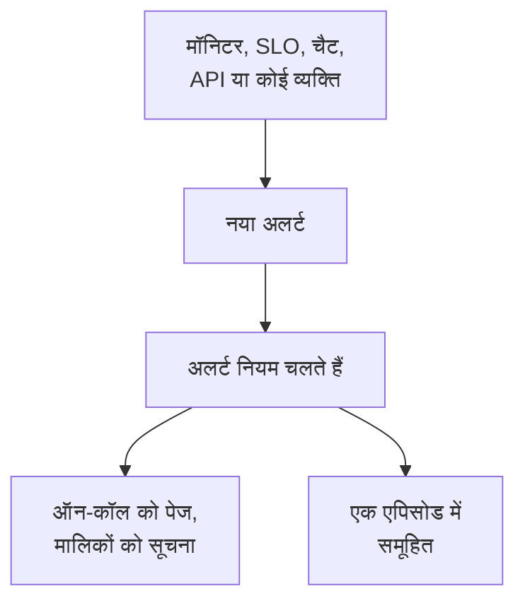

# अलर्ट का अवलोकन

अलर्ट आपकी टीम को किसी ऐसी समस्या के बारे में बताता है जिसे आपके उपयोगकर्ताओं के ध्यान में आने से पहले देख लेना चाहिए: भरती जा रही डिस्क, जल्द ही समाप्त होने वाला सर्टिफ़िकेट, धीरे-धीरे बढ़ती त्रुटि दर। यह ऑन-कॉल व्यक्ति को पेज कर सकता है और अपने मालिकों को सूचित कर सकता है, लेकिन यह कभी स्थिति पृष्ठ पर नहीं दिखता और आपके सब्सक्राइबर को कभी नहीं बताता। यह पेज बताता है कि अलर्ट कहाँ से आते हैं, डैशबोर्ड में कहाँ रहते हैं और आपकी टीम उन पर कैसे काम करती है।

:::cards
- [अलर्ट और घटनाएँ](#अलर्ट-और-घटनाएँ): कोई समस्या किसके रूप में दर्ज होनी चाहिए, और दोनों कैसे जुड़ते हैं।
- [अलर्ट कहाँ से आते हैं](#अलर्ट-कहाँ-से-आते-हैं): मॉनिटर, SLO, चैट, API, या हाथ से।
- [हाथ से अलर्ट बनाना](#हाथ-से-अलर्ट-बनाना): डैशबोर्ड में दो चरण।
- [अलर्ट पर प्रतिक्रिया देना](#अलर्ट-पर-प्रतिक्रिया-देना): उसे स्वीकार करें, सुलझाएँ, या घटना घोषित करें।
:::

## यह कैसे काम करता है

ज़्यादातर अलर्ट ऐसा मॉनिटर बनाता है जिसके मानदंड मेल खाते हैं। कुछ किसी SLO से आते हैं जो अपना एरर बजट खर्च कर रहा हो, किसी सुरक्षा नियम से, Slack या Microsoft Teams से भेजे गए पेज से, या किसी व्यक्ति से। वह किसी भी रास्ते से आए, अलर्ट हमेशा वही रिकॉर्ड होता है, और उस पर वही नियम चलते हैं।

- **नियम उसे आकार देते हैं।** अलर्ट बनते ही गोपनीयता, स्वामी, लेबल और ऑन-कॉल नियम चलते हैं, और Runbook नियम मेल खाने वाली प्रक्रियाएँ शुरू करते हैं। देखें [अलर्ट नियम और सेटिंग्स](/docs/alerts/settings)।
- **ऑन-कॉल नीतियाँ लोगों को पेज करती हैं।** अलर्ट जिन नीतियों का नाम लेता है, और उसके ऑन-कॉल नियम जो नीतियाँ जोड़ते हैं, वे तब तक अपने लोगों को पेज करती हैं जब तक कोई अलर्ट को स्वीकार नहीं कर लेता।
- **एपिसोड शोर को समूहित करते हैं।** एक समूहीकरण नियम संबंधित अलर्ट को एक एपिसोड में रखता है, ताकि एक आउटेज के बीस अलर्ट एक ही काम बन जाएँ। देखें [अलर्ट एपिसोड और समूहीकरण नियम](/docs/alerts/episodes)।

## अलर्ट और घटनाएँ

दोनों एक समस्या दर्ज करते हैं, और दोनों ऑन-कॉल व्यक्ति को पेज कर सकते हैं। फ़र्क़ इसमें है कि समस्या किसे प्रभावित करती है।

|                              | अलर्ट                                                  | घटना                                              |
| ---------------------------- | ------------------------------------------------------ | ------------------------------------------------- |
| **यह क्या है**               | ऐसी समस्या जिसे उपयोगकर्ताओं के प्रभावित होने से पहले आपकी टीम को देखना चाहिए | ऐसी समस्या जो आपके उपयोगकर्ताओं को प्रभावित करती है, जैसे आउटेज |
| **स्थिति पृष्ठों पर**         | कभी नहीं                                               | दिख सकती है, और सब्सक्राइबर को बताती है           |
| **नोट**                      | निजी नोट, केवल आपकी टीम के लिए                         | ग्राहकों के लिए सार्वजनिक नोट, और निजी नोट        |
| **शुरुआती स्थितियाँ**         | **पहचाना गया**, **स्वीकार किया गया**, **सुलझाया गया**  | **पहचाना गया**, **स्वीकार किया गया**, **सुलझाया गया** |
| **शुरुआती गंभीरताएँ**         | **उच्च**, **निम्न**                                      | Critical Incident, Major Incident, Minor Incident |
| **नए प्रोजेक्ट में संख्याएँ**   | `ALT-42`, और एपिसोड के लिए `AE-42`                     | `INC-42`, और एपिसोड के लिए `IE-42`                |

जब आपकी टीम को बाहर किसी के ध्यान देने से पहले देखना चाहिए, तो अलर्ट बनाएँ, और जब उपयोगकर्ता प्रभावित हों, तो घटना घोषित करें। अगर कोई अलर्ट किसी आउटेज का हिस्सा निकले, तो उससे घटना घोषित करें, या उसे उस घटना से लिंक करें जो उसकी वजह बताती है: देखें [लिंक किए गए अलर्ट](/docs/incidents/linked-alerts)।

## अलर्ट कहाँ से आते हैं

- **किसी मॉनिटर के मानदंड।** किसी मानदंड की **क्रियाएँ** में **जब फ़िल्टर मेल खाते हैं, तो एक अलर्ट बनाएँ।** चालू करें और वह अलर्ट भरें जो वह बनाता है: **अलर्ट शीर्षक** और **गंभीरता**, फिर, हर एक मुड़ा हुआ, **विवरण**, **स्वामित्व और लेबल**, **ऑन-कॉल** और **और फ़ील्ड**, जिसमें **अलर्ट स्वतः सुलझाएं**, **निजी अलर्ट** और **सुधार नोट** हैं। एक मानदंड एक समय में एक ही खुला अलर्ट रखता है, किसी फ़ील्ड के आधार पर समूह बनाने वाले मॉनिटर पर हर सीरीज़ के लिए एक, और **अलर्ट स्वतः सुलझाएं** उसे तब सुलझा देता है जब मानदंड मेल खाना बंद कर दे। देखें [मॉनिटर बनाना](/docs/monitor/create-monitor) और [घटना और अलर्ट टेम्पलेट](/docs/monitor/incident-alert-templating)।
- **हाथ से।** अलर्ट सूची पर, या किसी मॉनिटर, होस्ट, नेटवर्क डिवाइस या अन्य संसाधन के **अलर्ट** टैब पर, **अलर्ट बनाएं** पर क्लिक करें, जो उस संसाधन को आपके लिए चुन लेता है। देखें [हाथ से अलर्ट बनाना](#हाथ-से-अलर्ट-बनाना)।
- **किसी SLO की बर्न रेट।** बर्न रेट नियम तब अलर्ट बना सकता है जब कोई SLO अपना एरर बजट बहुत तेज़ी से खर्च करता है। देखें [बर्न रेट अलर्ट और घटनाएँ](/docs/slo/burn-rate-alerts)।
- **नेटवर्क साइटें और सुरक्षा इवेंट।** अस्वस्थ होने पर अलर्ट करने के लिए सेट की गई नेटवर्क साइट तब अलर्ट खोलती है जब उसका सारांश परिचालन में नहीं रहता, और आपके सुरक्षा इवेंट पहचान नियम भी अलर्ट खोलते हैं। देखें [नेटवर्क साइटें (स्थिति सारांश और अपटाइम)](/docs/monitor/network-sites) और [सुरक्षा इवेंट (SIEM)](/docs/telemetry/security-events)।
- **एक पेज।** Slack या Microsoft Teams में `/oneuptime page` एक अलर्ट खोलता है जिसका शीर्षक आपका संदेश होता है, और आपके बताए लोगों को पेज करता है। किसी वर्कफ़्लो के पेजिंग ब्लॉक यही काम उस शीर्षक और संदेश के साथ करते हैं जो आप उन्हें देते हैं। देखें [Slack से किसी को पेज करना](/docs/workspace-connections/slack#slack-से-किसी-को-पेज-करना) और [Paging](/docs/workflows/components#paging)।
- **API, Terraform और वर्कफ़्लो।** अलर्ट एक सामान्य संसाधन हैं: `/api/alert`, Terraform संसाधन `oneuptime_alert` और किसी वर्कफ़्लो का **Create One Alert** चरण।

## डैशबोर्ड में अलर्ट कहाँ रहते हैं

ऊपरी बार के **उत्पाद** मेनू से **अलर्ट** खोलें। अलर्ट सूची `/dashboard/{projectId}/alerts` पर है, और उसके साइड मेनू में अलर्ट से जुड़ी हर चीज़ है:

| अनुभाग        | आप वहाँ क्या करते हैं                                                                                                     |
| ------------- | ------------------------------------------------------------------------------------------------------------------------- |
| **अलर्ट**     | **सभी अलर्ट** और **सक्रिय अलर्ट**, जिसका लाल बैज उन अलर्ट को गिनता है जो अभी सुलझे नहीं हैं।                              |
| **एपिसोड** | **सभी एपिसोड** और **सक्रिय एपिसोड**: संबंधित अलर्ट, जिन पर काम करने के लिए एक समस्या में समूहित किया गया है। |
| **एआई**       | **इनसाइट्स**, **लॉग** और **सेटिंग्स**: OneUptime AI ने आपके अलर्ट से क्या सीखा, उसने क्या-क्या किया, और उसे क्या करने की अनुमति है। |
| **वर्कस्पेस**  | **Slack** और **Microsoft Teams**, जो भी प्रोजेक्ट ने कनेक्ट किया हो, या कोई न होने पर **Slack या Teams कनेक्ट करें**।     |
| **नियम**      | **समूहीकरण नियम**, **ऑन-कॉल नियम**, **स्वामी नियम**, **Runbook नियम**, **गोपनीयता नियम**, **लेबल नियम**, **Reminder Rules**। |
| **सेटिंग्स**   | **अलर्ट स्थिति**, **अलर्ट गंभीरता**, **नोट टेम्पलेट**, **कस्टम फ़ील्ड**, **माप**, **एपिसोड सदस्यता**, **क्रमांकन**।                       |

**अलर्ट** और **एपिसोड** खुले रहते हैं; **एआई**, **वर्कस्पेस**, **नियम**, **सेटिंग्स** और **डेवलपर** शुरू में मुड़े रहते हैं, और जब आप किसी अनुभाग के किसी पेज पर होते हैं तो वह अपने आप खुल जाता है। अलर्ट का कॉन्फ़िगरेशन यहीं है, **प्रोजेक्ट सेटिंग्स** में नहीं।

सूची **अलर्ट संख्या**, **शीर्षक**, **स्थिति**, **गंभीरता**, **प्रभावित संसाधन** (सबसे पहले अलर्ट का मॉनिटर), **बनाया गया**, **अवधि**, **लेबल** और **मालिक** दिखाती है। एक साथ कई अलर्ट पर काम करने के लिए उन्हें चुनें: **स्वीकार करें**, **सुलझाएं**, **स्थिति बदलें**, **गंभीरता बदलें**, **मुझे असाइन करें**, **स्वामी जोड़ें**, **स्वामी हटाएँ**, **लेबल जोड़ें**, **लेबल हटाएँ**, **घटना से लिंक करें**, **घटना घोषित करें** या उन्हें हटाएँ।

हर अलर्ट की पंक्ति के अंत में **⋯** मेनू यही काम सिर्फ़ उसी अलर्ट के लिए करता है: **स्वीकार करें** और **सुलझाएं** जब तक अलर्ट वह कदम उठा सकता है, **स्थिति बदलें**, **गंभीरता बदलें**, **मुझे असाइन करें** जब तक आप उसके मालिक नहीं हैं, और उसे किसी और को सौंपने के लिए **स्वामी जोड़ें**।

## हाथ से अलर्ट बनाना

:::steps
### फ़ॉर्म खोलें

**अलर्ट → सभी अलर्ट** पर जाएँ और **अलर्ट बनाएं** पर क्लिक करें। **नया अलर्ट बनाएँ** फ़ॉर्म अपने पहले चरण, **अलर्ट विवरण**, पर खुलता है।

### अलर्ट का वर्णन करें

**शीर्षक** भरें और एक **अलर्ट गंभीरता** चुनें; दोनों ज़रूरी हैं। मदद मिले तो **विवरण** जोड़ें। मुड़े हुए **और फ़ील्ड** में आप एक **प्रारंभिक स्थिति** चुन सकते हैं, **लेबल** जोड़ सकते हैं, या **निजी अलर्ट** चालू कर सकते हैं। **मालिक** भी वहीं है: आप जो अलर्ट बनाते हैं उसके आप वैसे भी मालिक बनते हैं, और आप जिस भी टीम के सदस्य हैं वह पिकर के नीचे एक क्लिक दूर है। मास्टर एडमिन, जो पूरा इंस्टॉलेशन चलाता है, इकलौता अपवाद है: वह अपनी बनाई चीज़ का मालिक नहीं बनता।

### चुनें कि यह किसे प्रभावित करता है और किसे पेज किया जाए

**संसाधन और ऑन-कॉल** तक पहुँचने के लिए **अगला** पर क्लिक करें। जिस **मॉनिटर** के बारे में यह है उसे चुनें, और **अन्य प्रभावित संसाधन** में होस्ट, नेटवर्क डिवाइस, Kubernetes क्लस्टर या सेवाएँ जैसी कोई भी चीज़। **ऑन-कॉल नीति** में वे नीतियाँ चुनें जो अलर्ट बनने पर चलें।

### इसे बनाएँ

सारांश जाँचने के लिए **अगला** पर क्लिक करें, फिर **अलर्ट बनाएं** पर। अलर्ट का अपना पेज खुलता है, और नियम चलने लगते हैं। सारांश में, **मालिक** पंक्ति हर उस स्वामी नियम को सूचीबद्ध करती है जो किसी को जोड़ेगा, और किसे: देखें [इसका मालिक कौन होगा](/docs/incidents/declaring-incidents#इसका-मालिक-कौन-होगा)।
:::

**प्रारंभिक स्थिति** खाली छोड़ें, तो अलर्ट वहीं से शुरू होता है जहाँ से हर नया अलर्ट: आपकी निर्माण स्थिति से, जो नए प्रोजेक्ट में **पहचाना गया** है। बाद की कोई स्थिति चुनने से ऐसा अलर्ट दर्ज होता है जिसे कोई पहले से सँभाल रहा है, या जो पहले ही ख़त्म हो चुका है; देखें [पहले से स्वीकार या सुलझा हुआ बनाया गया](#पहले-से-स्वीकार-या-सुलझा-हुआ-बनाया-गया)।

## अलर्ट बनने पर क्या होता है

जैसे ही कोई अलर्ट बनता है, OneUptime इन चरणों से इसी क्रम में गुज़रता है:

1. **उसे एक संख्या और एक स्थिति मिलती है।** अलर्ट संख्या प्रति-प्रोजेक्ट काउंटर से आती है और आपके उपसर्ग के साथ दिखती है (`ALT-42`)। अलर्ट आपकी निर्माण स्थिति में शुरू होता है, जब तक कि फ़ॉर्म, API या किसी वर्कफ़्लो ने कोई दूसरी स्थिति न चुनी हो।
2. **गोपनीयता नियम सबसे पहले चलते हैं**, ताकि उनके बाद की हर चीज़ जाने कि अलर्ट निजी है या नहीं।
3. **फ़ीड और आपके चैट टूल को पता चलता है।** **अलर्ट फ़ीड** में एक **अलर्ट बनाया गया** प्रविष्टि लिखी जाती है, और आपके Slack और Microsoft Teams नियम जिन चैनलों का नाम लेते हैं उन्हें बताया जाता है; कोई नियम अलर्ट के लिए चैनल बना सकता है।
4. **मालिक और लेबल जोड़े जाते हैं**: जिनका नाम मॉनिटर के मानदंड या अनुरोध लेते हैं, फिर मेल खाने वाले स्वामी और लेबल नियमों वाले।
5. **ऑन-कॉल नियम अपनी नीतियाँ जोड़ते हैं**, फिर Runbook नियम मेल खाने वाली रनबुक शुरू करते हैं।
6. **ऑन-कॉल नीतियाँ चलती हैं।** अलर्ट की हर नीति अपने लोगों को एक साथ पेज करती है; किसी एक के विफल होने से बाकी नहीं रुकतीं।
7. **समूहीकरण नियम उसे एक एपिसोड में रखते हैं**, जब कोई नियम मेल खाता है। देखें [अलर्ट एपिसोड और समूहीकरण नियम](/docs/alerts/episodes)।
8. **रिमाइंडर शेड्यूल होते हैं**, जब कोई रिमाइंडर नियम मेल खाता है, और **OneUptime AI** अलर्ट की जाँच करता है जब **अलर्ट → एआई → सेटिंग्स** में **नए अलर्ट की जांच करें** चालू हो, और उसे ठीक करता है जब **नए अलर्ट को अपने आप ठीक करें** चालू हो। देखें [AI SRE](/docs/ai/ai-sre)।

एक बैकग्राउंड जॉब एक मिनट के भीतर अलर्ट के मालिकों को बताता है, और **On Create Alert** वर्कफ़्लो ट्रिगर उस पर बना हर वर्कफ़्लो शुरू करता है।

### पहले से स्वीकार या सुलझा हुआ बनाया गया

बाद की स्थिति में शुरू होने वाला अलर्ट ऐसी समस्या का रिकॉर्ड है जिस पर कोई पहले से काम कर रहा है, इसलिए उसे नई आपात स्थिति नहीं माना जाता:

- **आपकी स्वीकृत स्थिति में या उसके बाद**, कोई ऑन-कॉल नीति नहीं चलती। अलर्ट अपनी नीतियाँ रखता है, और उसकी फ़ीड एक पंक्ति में बताती है कि किसी को पेज क्यों नहीं किया गया। वह किसी खुले एपिसोड से जुड़ सकता है, लेकिन कभी एपिसोड नहीं खोलता, क्योंकि वह एपिसोड की नीतियों के ज़रिए पेज करता।
- **आपकी सुलझी हुई स्थिति में या उसके बाद**, अलर्ट ख़त्म हो चुका है: उसे किसी एपिसोड में समूहित नहीं किया जाता, कोई रनबुक या स्वचालित सुधार उस पर काम नहीं करता, OneUptime AI उसकी जाँच नहीं करता, और उसके लिए कोई Slack या Microsoft Teams चैनल नहीं बनता।

उसके नियम, उसके मालिक, उसकी फ़ीड और उसकी पहली स्थिति दोनों स्थितियों में फिर भी होते हैं। घटनाएँ भी यही नियम मानती हैं: देखें [पहले से स्वीकार या सुलझी हुई घोषित](/docs/incidents/declaring-incidents#पहले-से-स्वीकार-या-सुलझी-हुई-घोषित)।

## अलर्ट पर प्रतिक्रिया देना

अलर्ट खोलें। उसका हेडर उसकी स्थिति, उसकी गंभीरता, वह कितनी देर से चल रहा है, उसके मालिक और वह किस मॉनिटर और एपिसोड का हिस्सा है, यह दिखाता है, साथ में वे बटन जिनकी आपके अगले कदम को ज़रूरत है:

- **स्वीकार करें** बताता है कि कोई इस पर काम कर रहा है। यह अलर्ट की ऑन-कॉल नीतियों को अगले स्तर को पेज करने से रोकता है।
- **सुलझाएं** उसे बंद करता है। अलर्ट **सक्रिय अलर्ट** से हट जाता है, और उसके रिमाइंडर रुक जाते हैं।
- **स्थिति इसमें बदलें**, उनके पास वाले **⋯** मेनू में, उसे आपकी अपनी किसी स्थिति में ले जाता है, जैसे "जाँच जारी"।
- **घटना घोषित करें** अलर्ट से पहले से भरी हुई एक नई घटना खोलता है, जब पता चले कि समस्या उपयोगकर्ताओं को प्रभावित कर रही है। देखें [लिंक किए गए अलर्ट](/docs/incidents/linked-alerts)।

दूसरी स्थिति में जाने पर पुष्टि माँगी जाती है, साथ में **निजी नोट जोड़ें** के नीचे मुड़ा हुआ एक वैकल्पिक निजी नोट। हर स्थिति क्या करती है, यह [अलर्ट स्थितियाँ और गंभीरता](/docs/alerts/states-and-severities) पर है।

काम करते हुए जो सीखें उसे **निजी नोट** के रूप में लिखें, उसके **मूल कारण** और **सुधार** पेज भरें, और **मालिक** जोड़ें। **अलर्ट फ़ीड** का **क्रियाएँ** मेनू **Execute Runbook** से रनबुक भी चलाता है, या **ऑन-कॉल नीति निष्पादित करें** से और लोगों को पेज करता है।

## अलर्ट का हर पेज क्या दिखाता है

| साइड मेनू अनुभाग  | पेज                                                                                                            |
| ----------------- | -------------------------------------------------------------------------------------------------------------- |
| **अवलोकन** | **अवलोकन** और **स्थिति टाइमलाइन** |
| **जांच** | **विवरण**, **मूल कारण**, **सुधार**, **रनबुक**, **लिंक की गई घटनाएं** |
| **टीम** | **ऑन-कॉल निष्पादन** और **मालिक**: अलर्ट के लिए किसे बुलाया गया, और उसका मालिक कौन है |
| **सूचनाएं**           | **सूचना लॉग** और **AI लॉग**: अलर्ट के बारे में भेजा गया हर संदेश, और AI ने उसके लिए जो कुछ किया               |
| **नोट**   | **निजी नोट**                                                                                                   |
| **डेवलपर**        | **Terraform**, **API** और **AI सहायक**: कोड से प्रबंधित अलर्ट                                                  |
| **उन्नत** | **कस्टम फ़ील्ड**, **सेटिंग्स**, **ऑडिट लॉग**, **अलर्ट हटाएं** |

**अवलोकन**, **जांच**, **टीम** और **नोट** खुले रहते हैं; बाकी अनुभाग तब तक मुड़े रहते हैं जब तक आप उन पर क्लिक न करें।

- **अवलोकन** — हेडर अलर्ट के मॉनिटर और एपिसोड के बगल में अलर्ट के **मालिक** बताता है, पहले टीमें। **बनाया गया** टाइल बताती है कि अलर्ट कब और किससे बना, और दो टाइल बताती हैं कि उसे स्वीकार और सुलझाए जाने में कितना समय लगा; कितनी देर चला, यह हेडर में सबसे पहले है। पेज की शुरुआत **क्या हुआ** कार्ड से होती है — अलर्ट का विवरण और उसका **मूल कारण** — फिर **OneUptime AI** कार्ड, उसके नीचे **Ask OneUptime AI** के साथ, और **अलर्ट फ़ीड** अलर्ट के साथ हुई हर बात दर्ज करती है। उनके बगल में **प्रभावित संसाधन** कार्ड, **अलर्ट विवरण** कार्ड और अलर्ट के माप हैं।
- **स्थिति टाइमलाइन** — अलर्ट जिन-जिन स्थितियों में रहा, कब और कितनी देर। देखें [स्थिति टाइमलाइन](/docs/alerts/states-and-severities#स्थिति-टाइमलाइन)।
- **लिंक की गई घटनाएं** — वे घटनाएँ जिनका यह अलर्ट हिस्सा है, **घटना लिंक करें** और **घटना घोषित करें** के साथ।
- **सेटिंग्स** — **इस अलर्ट को कौन देख सकता है**, **निजी अलर्ट** स्विच के साथ, और **रिमाइंडर**, **रिमाइंडर भेजें** के साथ। हर स्विच पलटते ही सहेज लिया जाता है।

## निजी अलर्ट

निजी अलर्ट को केवल उसके मालिक, यानी मालिक उपयोगकर्ता और उसकी मालिक टीमों के सदस्य, और आपके प्रोजेक्ट के एडमिन और मालिक देख सकते हैं। प्रोजेक्ट में कोई और उसे नहीं खोल सकता।

किसी अलर्ट को निजी बनाएँ: बनाने वाले फ़ॉर्म या किसी मॉनिटर के मानदंड में **और फ़ील्ड** के नीचे **निजी अलर्ट** से, **अलर्ट → नियम → गोपनीयता नियम** से, या बाद में उसके **सेटिंग्स** पेज पर, जो अलर्ट छिपाने से पहले **इस अलर्ट को निजी बनाएं?** पूछता है। अगर आप इनमें से कोई नहीं हैं, तो आपकी पहुँच भी चली जाती है।

जिस एपिसोड को कोई निजी अलर्ट खोलता है, वह निजी नहीं होता, इसलिए वह कभी अलर्ट का शीर्षक या विवरण नहीं दिखाता: जहाँ उसके शीर्षक या विवरण में वे आते, वहाँ "Private alert" लिखा होता है।

## अलर्ट के बारे में किसे पता चलता है

- **ऑन-कॉल।** अलर्ट की ऑन-कॉल नीतियाँ अपने लोगों को पेज करती हैं, हर व्यक्ति को उसी तरह जैसे उसने **उपयोगकर्ता सेटिंग्स → ऑन-कॉल नियम** में, **अलर्ट** टैब पर, सेट किया है। पेज का जवाब देने से अलर्ट स्वीकार हो जाता है, और पेजिंग रुक जाती है।
- **उसके मालिक।** ईमेल से, जब तक उन्होंने **उपयोगकर्ता सेटिंग्स → सूचना सेटिंग्स** में, **अलर्ट** टैब पर, दूसरे चैनल न चुने हों: **अलर्ट बनाया गया**, **अलर्ट की स्थिति बदली** और **Alert reminder** डिफ़ॉल्ट रूप से चालू हैं, और **अलर्ट नोट पोस्ट किया गया** और **अलर्ट स्वामी के रूप में जोड़ा गया** तब तक बंद रहते हैं जब तक कोई उन्हें चालू न करे। बिना मालिक वाला अलर्ट इसके बजाय प्रोजेक्ट के मालिकों को सूचित करता है।
- **आपके चैट टूल।** **अलर्ट → वर्कस्पेस** में Slack और Microsoft Teams के वे नियम हैं जो अलर्ट और एपिसोड को चैनलों में पोस्ट करते हैं। देखें [Slack](/docs/workspace-connections/slack) और [Microsoft Teams](/docs/workspace-connections/microsoft-teams)।

## समस्या निवारण

:::details नए अलर्ट के लिए किसी को पेज नहीं किया गया
अलर्ट का **ऑन-कॉल निष्पादन** पेज खोलें। अगर वह खाली है, तो अलर्ट की कोई ऑन-कॉल नीति नहीं थी: न फ़ॉर्म में और न मॉनिटर के मानदंड में कोई चुनी गई, और कोई ऑन-कॉल नियम उससे मेल नहीं खाया। अगर अलर्ट पहले से स्वीकार या सुलझा हुआ बनाया गया था, तो उसकी फ़ीड बताती है कि किसी को पेज नहीं किया गया, और क्यों।
:::

:::details मॉनिटर बार-बार विफल हो रहा है, पर कोई नया अलर्ट नहीं आता
एक मानदंड एक समय में एक ही खुला अलर्ट रखता है। जब तक वह अलर्ट सुलझ नहीं जाता, मॉनिटर उसी मानदंड के लिए कुछ नया नहीं जोड़ता। उसे सुलझाएँ, या **अलर्ट स्वतः सुलझाएं** चालू करें ताकि मानदंड मेल खाना बंद होने पर मॉनिटर उसे सुलझा दे।
:::

:::details एक साथी ऐसा अलर्ट खोल सकता है जो मुझे नहीं मिलता
अलर्ट शायद निजी है। किसी प्रोजेक्ट एडमिन से कहें कि वह आपको मालिक के रूप में जोड़े, या अलर्ट के **सेटिंग्स** पेज पर **निजी अलर्ट** बंद करे।
:::

## आगे के कदम

:::cards
- [अलर्ट स्थितियाँ और गंभीरता](/docs/alerts/states-and-severities): स्वीकार करने और सुलझाने से क्या होता है, और अपनी स्थितियाँ कैसे जोड़ें।
- [अलर्ट एपिसोड और समूहीकरण नियम](/docs/alerts/episodes): अलर्ट की बाढ़ को एक काम में बदलें।
- [अलर्ट नियम और सेटिंग्स](/docs/alerts/settings): अपने आप पेज करें, मालिक तय करें, लेबल लगाएँ और याद दिलाएँ।
- [लिंक किए गए अलर्ट](/docs/incidents/linked-alerts): अलर्ट को उस घटना से जोड़ें जो उनकी वजह बताती है।
:::
