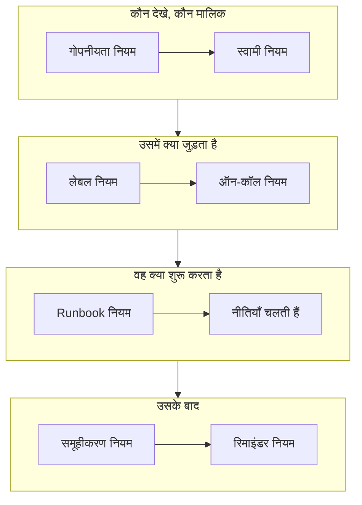

# अलर्ट नियम और सेटिंग्स

अलर्ट का कॉन्फ़िगरेशन **अलर्ट** के भीतर है, **प्रोजेक्ट सेटिंग्स** में नहीं: वे नियम जो हर नए अलर्ट पर काम करते हैं, और वे सेटिंग्स जो प्रोजेक्ट के हर अलर्ट को आकार देती हैं। यह पेज इनमें से हर एक का संदर्भ है, और उसका भी जो अलर्ट बनने पर अपने आप चलता है।

:::cards
- [नया अलर्ट जिन नियमों से गुज़रता है](#नया-अलर्ट-जिन-नियमों-से-गुज़रता-है): क्रम से, और हर एक क्या करता है।
- [ऑन-कॉल नियम](#ऑन-कॉल-नियम): हर बार नीति चुने बिना सही लोगों को पेज करें।
- [रिमाइंडर नियम](#रिमाइंडर-नियम): अलर्ट खुला रहने तक मालिकों को याद दिलाएँ।
- [सेटिंग्स](#सेटिंग्स): नोट टेम्पलेट, कस्टम फ़ील्ड, माप, एपिसोड सदस्यता और क्रमांकन।
:::

## अलर्ट सेटिंग्स कहाँ हैं

ऊपरी बार के **उत्पाद** मेनू से **अलर्ट** खोलें। उसके साइड मेनू के **नियम** और **सेटिंग्स** अनुभाग शुरू में मुड़े रहते हैं, इसलिए पहले उन्हें खोलें। यहाँ का हर पेज पूरे प्रोजेक्ट पर लागू होता है, `/dashboard/{projectId}/alerts/settings/` से शुरू होने वाले पतों पर।

| नियम पेज            | यह क्या करता है                                                                                |
| ------------------- | ---------------------------------------------------------------------------------------------- |
| **समूहीकरण नियम**   | संबंधित अलर्ट को एपिसोड में रखता है। देखें [अलर्ट एपिसोड और समूहीकरण नियम](/docs/alerts/episodes)। |
| **ऑन-कॉल नियम**     | मेल खाने वाले अलर्ट और एपिसोड के लिए ऑन-कॉल नीतियाँ चलाता है।                                  |
| **स्वामी नियम**      | मेल खाने वाले अलर्ट और एपिसोड में मालिक जोड़ता है।                                              |
| **Runbook नियम**    | मेल खाने वाले अलर्ट के लिए रनबुक शुरू करता है।                                                 |
| **गोपनीयता नियम**   | मेल खाने वाले अलर्ट और एपिसोड को निजी बनाता है।                                                |
| **लेबल नियम**       | मेल खाने वाले अलर्ट और एपिसोड में लेबल जोड़ता है।                                              |
| **Reminder Rules**  | अलर्ट खुला रहने तक तय अंतराल पर मालिकों को याद दिलाता है।                                     |

**सेटिंग्स** अनुभाग में **अलर्ट स्थिति** और **अलर्ट गंभीरता** हैं, जिनका वर्णन [अलर्ट स्थितियाँ और गंभीरता](/docs/alerts/states-and-severities) पर है, फिर **नोट टेम्पलेट**, **कस्टम फ़ील्ड**, **माप**, **एपिसोड सदस्यता** और **क्रमांकन**, जिनका वर्णन नीचे है।

दो और अनुभाग अलर्ट पर काम करते हैं। **अलर्ट → एआई → सेटिंग्स** तय करता है कि OneUptime AI अपने आप क्या करे: **नए अलर्ट की जांच करें**, जो नए प्रोजेक्ट में चालू होता है, और **नए अलर्ट को अपने आप ठीक करें**, जो आपके चालू करने तक बंद रहता है। देखें [AI SRE](/docs/ai/ai-sre)। **अलर्ट → वर्कस्पेस** में Slack और Microsoft Teams के वे नियम हैं जो अलर्ट और एपिसोड को चैनलों में पोस्ट करते हैं, और उसका **सारांश** टैब। देखें [Slack](/docs/workspace-connections/slack)।

## नया अलर्ट जिन नियमों से गुज़रता है

कई मेल होने पर नियम अलग-अलग तरह से तय होते हैं:

- **समूहीकरण नियम** और **Reminder Rules** अपनी सूची में ऊपर से नीचे जाँचे जाते हैं, और पहला मेल जीतता है। किसी नियम की जगह बदलने के लिए उसे खींचें; नया नियम अंत में जाता है।
- **ऑन-कॉल नियम**, **स्वामी नियम**, **लेबल नियम**, **गोपनीयता नियम** और **Runbook नियम** सभी मेल खाने पर काम करते हैं। कई नियमों द्वारा जोड़ी गई ऑन-कॉल नीतियाँ, मालिक और लेबल एक ही बार जोड़े जाते हैं।

**ऑन-कॉल नियम**, **स्वामी नियम**, **लेबल नियम** और **गोपनीयता नियम** में दो टैब हैं: अलर्ट के लिए **Alert Rules**, और **Episode Rules**, जो हर नए अलर्ट एपिसोड पर इसी तरह काम करते हैं। नया नियम सक्षम शुरू होता है; उसे रोकने के लिए उसके संपादन फ़ॉर्म में **सक्षम** बंद करें, और सूची हर नियम के लिए हरा **सक्षम** या लाल **अक्षम** दिखाती है।

ज़्यादातर नियम उन अलर्ट और एपिसोड पर काम करते हैं जो उन्हें सहेजने के बाद बनते हैं। किसी स्वामी, लेबल या गोपनीयता नियम को पहले से मौजूद अलर्ट पर लागू करने के लिए **अभी चलाएँ** का इस्तेमाल करें: देखें [मौजूदा संसाधनों पर नियम चलाना](/docs/configuration/run-rules-now)। रिमाइंडर नियम अपवाद हैं: एक को सहेजने से हर खुले अलर्ट का फिर से मिलान होता है।

### शर्तें

किसी नियम की शर्तें तय करती हैं कि वह किन अलर्ट पर काम करता है, और वाक्यों की तरह पढ़ी जाती हैं: "यदि **अलर्ट शीर्षक** में `database` शामिल है", "और **मॉनिटर लेबल** में *Production* में से कोई है"। बिना शर्तों वाला नियम हर अलर्ट से मेल खाता है।

| शर्त                                                          | किससे तुलना                                                                                                    |
| ------------------------------------------------------------- | -------------------------------------------------------------------------------------------------------------- |
| **मॉनिटर**, **अलर्ट गंभीरता**, **अलर्ट लेबल**, **मॉनिटर लेबल** | आपके चुने मानों के साथ **इनमें से कोई भी है**, **ये सभी हैं** या **इनमें से कोई नहीं है**।                       |
| **अलर्ट शीर्षक**, **अलर्ट विवरण**, **मॉनिटर नाम**, **मॉनिटर विवरण** | **शामिल है**, **शामिल नहीं है**, **बराबर**, **बराबर नहीं**, **से शुरू होता है**, **पर समाप्त होता है**, अक्षरों के छोटे-बड़े रूप को अनदेखा करके, या रेगुलर एक्सप्रेशन या `*` वाइल्डकार्ड के लिए **पैटर्न से मेल खाता है** और **पैटर्न से मेल नहीं खाता**। |

दो या ज़्यादा शर्तों के साथ, **सभी से मिलान** चुनें, जहाँ हर शर्त पूरी होनी चाहिए, या **किसी से भी मिलान**, जहाँ एक ही काफ़ी है। एपिसोड नियम इसके बजाय एपिसोड की गंभीरता, लेबल, शीर्षक और विवरण से मिलान करते हैं।

## ऑन-कॉल नियम

**अलर्ट → नियम → ऑन-कॉल नियम** पेजिंग को स्वचालित बनाता है। हर मेल खाने वाला नियम नए अलर्ट में अपनी नीतियाँ जोड़ता है, और अलर्ट उन्हें अपनी पहले से मौजूद नीतियों के साथ चलाता है, हर एक को एक बार।

:::steps
### अलर्ट चुनें

**Alert On-Call Rule बनाएँ** पर क्लिक करें। **मिलान** पर **सभी अलर्ट**, जिससे नया नियम शुरू होता है, हर नए अलर्ट से मेल खाता है। इसे सीमित करने के लिए **केवल शर्तों से मेल खाने वाले अलर्ट** चुनें और वे शर्तें जोड़ें जो किसी अलर्ट को पूरी करनी हों।

### नीतियाँ चुनें

**ऑन-कॉल नीतियां** पर वे **ऑन-कॉल नीतियां** चुनें जिन्हें नियम बुलाता है। जब तक आप अपना नाम नहीं लिखते, इसका **नाम** उनके साथ बदलता है, जैसे "Platform on-call को बुलाएँ", और **विवरण** के लिए **और फ़ील्ड** खोलें। फिर नियम बनाएँ।
:::

कोई गंभीरता अपने आप किसी को पेज नहीं करती: **अलर्ट गंभीरता** से मिलान करने वाला ऑन-कॉल नियम ही "हर High अलर्ट पर डेटाबेस टीम को पेज करें" सेट करने का तरीका है। किसी एक अलर्ट के लिए क्या चला, यह देखने के लिए उसका **ऑन-कॉल निष्पादन** पेज खोलें। फिर हर व्यक्ति तक उसी तरह पहुँचा जाता है जैसे उसने **उपयोगकर्ता सेटिंग्स → ऑन-कॉल नियम** में, **अलर्ट** टैब पर, सेट किया है; देखें [एस्केलेशन नियम](/docs/on-call/escalation-rules)।

कोई नियम अलर्ट के मेल खाते ही बुलाता है। इसके बजाय कार्य समय की प्रतीक्षा कराने के लिए, **और फ़ील्ड** में **यह नियम कब बुलाए?** का उत्तर **केवल कार्य समय में** दें। **कार्य समय** शुरुआत में आपके अपने टाइमज़ोन में सोमवार से शुक्रवार, 09:00 से 17:00 होता है: दूसरे दिन, दूसरा **प्रारंभ समय** या **समाप्ति समय**, या दूसरा **टाइमज़ोन** चुनें, और विकल्प के नीचे एक वाक्य बताता है कि क्या होगा। सूची में नियम अपने नाम के नीचे अपना कार्य समय दिखाता है। इन घंटों के बाहर मेल खाने वाले अलर्ट को एक ऐसा रन मिलता है जो प्रतीक्षा करता है और किसी को नहीं बुलाता; कार्य समय शुरू होते ही नीति अपने पहले एस्केलेशन नियम से बुलाती है और हमेशा की तरह एस्केलेट होती है। अगर अलर्ट पहले ही स्वीकार या सुलझा लिया जाए, तो किसी को नहीं बुलाया जाता। अगर प्रतीक्षा के दौरान अलर्ट बदल जाए और अब किसी ऐसे नियम से मेल खाए जो तुरंत बुलाता है, जैसे उसकी गंभीरता बढ़ा दी जाए, तो रन उसी समय बुलाना शुरू कर देता है, और अलर्ट की फ़ीड बताती है कि क्यों। एक ही नीति को बुलाने वाले दो नियम उसे तब बुलाते हैं जब उनमें से कोई भी अनुमति दे: सबसे ऊँची गंभीरताओं को तुरंत बुलाने वाला नियम, और बाकी के लिए कार्य समय की प्रतीक्षा करने वाला नियम, साथ मिलकर रातों को शांत रखते हैं।

## स्वामी और लेबल नियम

**स्वामी नियम** मेल खाने वाले नए अलर्ट में मालिक उपयोगकर्ता और टीमें जोड़ते हैं, और **लेबल नियम** लेबल जोड़ते हैं। एक बनाने में दो चरण लगते हैं: **मिलान**, यानी शर्तें, फिर **मालिक** या **लेबल**, यानी नियम क्या जोड़ता है। नियम का **नाम** आपके चुनाव के साथ बदलता है, जब तक आप अपना नाम न लिखें।

- **नियम इनहेरिट कर सकता है।** **स्वामी इनहेरिट करें** या **लेबल इनहेरिट करें** के नीचे मुड़े छह स्विच अलर्ट के मॉनिटर, होस्ट, Kubernetes क्लस्टर, Docker होस्ट, Podman होस्ट और सेवाओं के मालिक या लेबल आगे बढ़ाते हैं। एपिसोड नियमों में ऐसे स्विच नहीं होते। स्वामी नियम के **स्वामी इनहेरिट करें** के अंत में **निर्माता की टीम** है: वहाँ दी गई टीमों में से, जिस भी टीम में अलर्ट बनाने वाला व्यक्ति है, वह भी मालिक बन जाती है।
- **नए नियम को कुछ जोड़ना होगा**: कम से कम एक मालिक या लेबल चुनें, या कोई स्विच चालू करें। घटना या अलर्ट स्वामी नियम में, **निर्माता की टीम** के नीचे एक टीम भी काफ़ी है।
- **स्वामियों को सूचित करें**, स्वामी नियम के **और फ़ील्ड** के नीचे, तय करता है कि जोड़े गए लोगों को बताया जाए या नहीं।

[लेबल और स्वामी नियम](/docs/configuration/label-and-owner-rules) हर तरह के संसाधन के लिए फ़ॉर्म को चरण-दर-चरण समझाता है।

## गोपनीयता और Runbook नियम

**गोपनीयता नियम** मेल खाने वाले नए अलर्ट को कुछ और चलने से पहले निजी बनाते हैं: केवल उनके मालिक और प्रोजेक्ट के एडमिन और मालिक उन्हें देख सकते हैं। नियम के दो चरण होते हैं: **मिलान**, वे अलर्ट जिन्हें वह निजी बनाता है, फिर **नाम**, जो पहले से "अलर्ट निजी बनाएँ" भरा होता है। देखें [निजी अलर्ट](/docs/alerts/index#निजी-अलर्ट)।

**Runbook नियम** नया अलर्ट मेल खाने पर रनबुक शुरू करते हैं, जब तक अलर्ट सुलझा हुआ न बनाया गया हो। देखें [Runbook नियम](/docs/runbooks/rules)।

## रिमाइंडर नियम

**अलर्ट → नियम → Reminder Rules** अलर्ट खुला रहने तक उसके मालिकों को याद दिलाता है। हर नए अलर्ट को उससे मेल खाने वाला पहला नियम मिलता है, सूची में ऊपर से नीचे।

:::steps
### चुनें कि किन अलर्ट के लिए याद दिलाना है

**Alert Reminder Rule बनाएँ** पर क्लिक करें। हर अलर्ट के लिए याद दिलाने के लिए **मिलान** पर **सभी अलर्ट** चुना रहने दें, या **केवल शर्तों से मेल खाने वाले अलर्ट** चुनें और फिर वे **अलर्ट गंभीरता** और **लेबल** चुनें जिन पर यह लागू होता है।

### अंतराल सेट करें

**रिमाइंडर** पर **रिमाइंडर अंतराल (मिनट)** सेट करें, यानी मालिकों को कितनी बार याद दिलाया जाए, और **रिमाइंडर कब बंद करें**: **सुलझाया गया**, जो डिफ़ॉल्ट है, या **स्वीकार किया गया**। जब तक आप अपना नाम नहीं लिखते, इसका **नाम** दोनों के साथ बदलता है, जैसे "सुलझने तक हर 30 मिनट में याद दिलाएँ"। फिर नियम बनाएँ।
:::

मालिकों को हर रिमाइंडर **Alert reminder** के रूप में मिलता है, जो डिफ़ॉल्ट रूप से ईमेल से चालू है। किसी अलर्ट की गंभीरता या लेबल बदलने पर उसके नियम का फिर से मिलान होता है। किसी एक अलर्ट के रिमाइंडर रोकने के लिए, उसके **सेटिंग्स** पेज पर **रिमाइंडर भेजें** बंद करें; पलटते ही यह सहेज लिया जाता है।

## सेटिंग्स

### नोट टेम्पलेट

**अलर्ट → सेटिंग्स → नोट टेम्पलेट** निजी नोट के लिए तैयार टेक्स्ट रखता है। **अलर्ट के लिए निजी नोट टेम्पलेट** कार्ड उन्हें दिखाता है; **अलर्ट नोट टेम्पलेट बनाएँ** एक **टेम्पलेट नाम**, एक **टेम्पलेट विवरण** और **नोट** माँगता है। टेम्पलेट तब पेश किया जाता है जब कोई किसी अलर्ट या एपिसोड पर निजी नोट लिखता है, और जब कोई उसे स्वीकार करता है या सुलझाता है, और पोस्ट करने से पहले उसका टेक्स्ट संपादित किया जा सकता है। अलर्ट नोट टेम्पलेट सादा टेक्स्ट हैं: घटना नोट टेम्पलेट के विपरीत, वे कोई वैरिएबल नहीं भरते।

### कस्टम फ़ील्ड

**अलर्ट → सेटिंग्स → कस्टम फ़ील्ड** हर अलर्ट में आपके अपने फ़ील्ड जोड़ता है, जैसे ग्राहक स्तर या टिकट संदर्भ। उन्हें अलर्ट के **कस्टम फ़ील्ड** पेज पर भरें, या API से `customFields` के रूप में। कोई फ़ील्ड टाइप किए जाने के बजाय मॉनिटर के किसी कस्टम फ़ील्ड से अपना मान कॉपी कर सकता है: देखें [मॉनिटर से कॉपी होने वाले फ़ील्ड](/docs/incidents/settings#मॉनिटर-से-कॉपी-होने-वाले-फ़ील्ड), जो अलर्ट के लिए भी इसी तरह काम करता है।

### माप

**अलर्ट → सेटिंग्स → माप** हर अलर्ट पर मापता है कि चीज़ों में कितना समय लगता है। **स्वीकार करने में लगा समय** या **सुलझाने में लगा समय** चुनें, या अपने दो पल, जैसे जब **अलर्ट बनाया जाता है** और जब वह आपकी चुनी स्थिति में जाता है। हर माप अलर्ट के पेज पर दिखता है और `oneuptime.alert.measurement.<key>` के रूप में चार्ट किया जाता है। देखें [माप](/docs/incidents/settings#माप), जो अलर्ट के लिए भी इसी तरह काम करता है।

**बुलावे के बाद स्वीकार करने में लगा समय** अलर्ट बनने के समय से नहीं, बल्कि उस पल से गिना जाता है जब **किसी को पहली बार बुलाया जाता है**, यानी जब किसी ऑन-कॉल नीति या सीधे बुलावे ने पहली बार किसी को अलर्ट के बारे में सूचित किया: रात में आए जिस अलर्ट के लिए सुबह पेज किया गया, उसके खाते में पूरी रात का समय नहीं जुड़ता। जिस अलर्ट के लिए किसी को पेज नहीं किया गया, उसका कोई मान नहीं होता। देखें [बुलावे के बाद स्वीकार करने में लगा समय](/docs/incidents/settings#बुलावे-के-बाद-स्वीकार-करने-में-लगा-समय)।

### एपिसोड सदस्यता

**अलर्ट → सेटिंग्स → एपिसोड सदस्यता** तय करता है कि एक अलर्ट एक से ज़्यादा एपिसोड में हो सकता है या नहीं। **एक अलर्ट केवल एक एपिसोड में हो सकता है** चालू करें, तो किसी एपिसोड में मौजूद अलर्ट उस एपिसोड से हटाए जाने तक किसी दूसरे एपिसोड में नहीं जोड़ा जाता, न डैशबोर्ड से, न API, किसी वर्कफ़्लो या किसी समूहीकरण नियम से। स्विच तब तक बंद रहता है जब तक आप इसे चालू न करें, और केवल Project Owners और Project Admins इसे बदल सकते हैं। इसे चालू करने से कोई अलर्ट किसी एपिसोड से बाहर नहीं निकलता। देखें [हर घटना एक ही एपिसोड में](/docs/incidents/episodes#हर-घटना-एक-ही-एपिसोड-में), जो अलर्ट के लिए भी इसी तरह काम करता है।

### क्रमांकन

**अलर्ट → सेटिंग्स → क्रमांकन** अलर्ट और एपिसोड संख्याओं के आगे का टेक्स्ट तय करता है: नए प्रोजेक्ट में `ALT-` और `AE-`, या कोई न हो तो `#`। **अपडेट करें** से **अलर्ट संख्या उपसर्ग** और **अलर्ट एपिसोड संख्या उपसर्ग** खुलते हैं, टाइप करते समय पूर्वावलोकन के साथ। केवल बाद में बने अलर्ट और एपिसोड को नया उपसर्ग मिलता है। उपसर्ग के नियम [संख्या उपसर्ग](/docs/incidents/settings#संख्या-उपसर्ग) पर हैं।

उसके नीचे का **अगली संख्या** कार्ड वह संख्या तय करता है जो अगले अलर्ट और अगले एपिसोड को मिलती है, ताकि किसी दूसरे टूल की संख्याएँ आगे जारी रहें: **अपडेट करें** से **अगली अलर्ट संख्या** और **अगली अलर्ट एपिसोड संख्या** खुलते हैं, हर एक अब तक की सबसे बड़ी संख्या से बड़ा। [अगली संख्याएँ](/docs/incidents/settings#अगली-संख्याएँ) देखें।

> [!NOTE]
> OneUptime Cloud पर नोट टेम्पलेट और कस्टम फ़ील्ड के लिए **Growth** प्लान या उससे ऊपर चाहिए।

## वर्कफ़्लो

हर अलर्ट मॉडल के अपने नाम पर वर्कफ़्लो ट्रिगर और क्रियाएँ हैं: **On Create Alert**, **On Update Alert**, **On Create or Update Alert** और **On Delete Alert**, यही **अलर्ट एपिसोड**, **अलर्ट स्थिति टाइमलाइन** और बाकी के लिए, और **Create One Alert** और **Update One Alert** जैसी क्रियाएँ। अलर्ट कस्टम फ़ील्ड की परिभाषाएँ एकमात्र अपवाद हैं: उनके कोई वर्कफ़्लो ट्रिगर नहीं हैं। देखें [वर्कफ़्लो अवलोकन](/docs/workflows/index)।

## इन्हें कौन बदल सकता है

नियमों, कस्टम फ़ील्ड और माप के लिए Project Owner या Project Admin चाहिए, या उस नियम की अपनी अनुमति वाली कोई कस्टम भूमिका। **अलर्ट सदस्य** अलर्ट और एपिसोड, उनके नोट, मालिकों और स्थिति टाइमलाइन, और नोट टेम्पलेट के साथ काम करता है, और **अलर्ट एडमिन** इसके अलावा अलर्ट स्थितियाँ और गंभीरताएँ भी प्रबंधित करता है। देखें [उपयोगकर्ता, टीमें और अनुमतियाँ](/docs/permissions/index)।

## आगे के कदम

:::cards
- [अलर्ट एपिसोड और समूहीकरण नियम](/docs/alerts/episodes): समूहीकरण नियम, विस्तार से।
- [एस्केलेशन नियम](/docs/on-call/escalation-rules): ऑन-कॉल नियम के नीति चलाने के बाद क्या होता है।
- [लेबल और स्वामी नियम](/docs/configuration/label-and-owner-rules): नियम फ़ॉर्म, चरण-दर-चरण।
- [AI SRE](/docs/ai/ai-sre): नए अलर्ट की अपने आप जाँच करें और उन्हें ठीक करें।
:::
