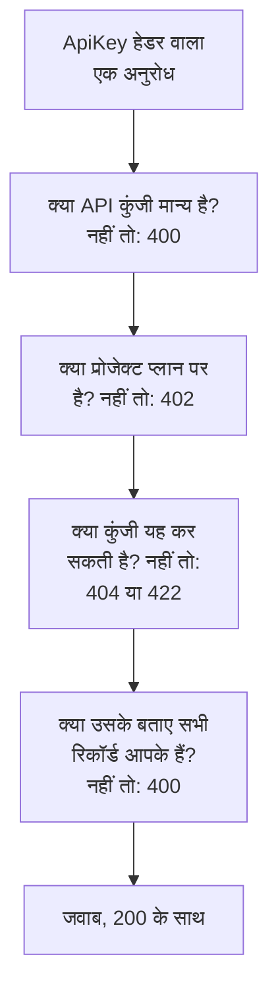

# OneUptime API संदर्भ

OneUptime डैशबोर्ड पर आप जो कुछ भी कर सकते हैं, वह उसके REST API से भी कर सकते हैं: दोहराए जाने वाले काम को स्वचालित करें, OneUptime को अपने दूसरे टूल से जोड़ें, या अपने खुद के इंटीग्रेशन बनाएँ। यह पेज दिखाता है कि अपना पहला अनुरोध कैसे करें, और वे नियम जिनका हर अनुरोध पालन करता है। हर एंडपॉइंट और फ़ील्ड [पूरे API संदर्भ](/reference) में सूचीबद्ध है।

:::cards
- [अपना पहला अनुरोध करें](#अपना-पहला-अनुरोध-करें): एक API कुंजी, एक हेडर और एक curl कमांड।
- [अनुरोध और जवाब](#अनुरोध-और-जवाब): वे छह अनुरोध जो हर संसाधन के पास हैं, और हर स्टेटस कोड का अर्थ।
- [प्लान और API](#प्लान-और-api): प्लान क्या बेचता है, और उससे नीचे क्या अब भी काम करता है।
- [रिकॉर्ड का नाम लेना और लिखना](#रिकॉर्ड-का-नाम-लेना-और-लिखना): ID, संदर्भ, स्विच और वे फ़ील्ड जिन्हें OneUptime सेट करता है।
- [स्थितियाँ और एपिसोड](#स्थितियाँ-और-एपिसोड): वह स्थिति जिसमें रिकॉर्ड शुरू होता है और जिनसे होकर गुज़रता है।
- [अनुरोध किस तक पहुँच सकता है](#अनुरोध-किस-तक-पहुँच-सकता-है): पढ़ना, बदलना और हटाना, एक बार में एक प्रोजेक्ट।
:::

## अनुरोध का जवाब कैसे दिया जाता है

API REST के इर्द-गिर्द बना है: मानक HTTP मेथड और स्टेटस कोड, JSON अंदर और JSON बाहर। हर अनुरोध एक API कुंजी लेकर आता है और कुछ जाँचों से गुज़रता है। जिस पहली जाँच में वह विफल होता है, वह एक स्टेटस कोड और `{ "message": "..." }` के साथ जवाब देती है, इसलिए संदेश बताता है कि उसे किसने रोका।



## अपना पहला अनुरोध करें

सभी API अनुरोध API कुंजी से प्रमाणित होते हैं। एक कुंजी एक प्रोजेक्ट की होती है, और वही करती है जिसकी उसकी अनुमतियाँ इजाज़त देती हैं।

:::steps
### एक API कुंजी बनाएँ

**प्रोजेक्ट सेटिंग्स → उन्नत → API कुंजियाँ** खोलें और **API कुंजी बनाएँ** पर क्लिक करें। उसे एक **नाम** दें, और **एक्सेस** के नीचे चुनें कि वह क्या कर सकती है: **प्रोजेक्ट एडमिन**, **प्रोजेक्ट सदस्य**, **दर्शक**, या कुंजी के पेज पर अलग-अलग अनुमतियाँ जोड़ने के लिए **अनुमतियाँ बाद में चुनें**। कुंजी आज से एक साल बाद समाप्त होती है, जब तक आप **उन्नत** के नीचे कोई दूसरी तारीख न चुनें।

### कुंजी कॉपी करें

कुंजी का पेज खुलता है। **API कुंजी विवरण** कार्ड से **API कुंजी** कॉपी करें, और उसे अपने कोड से बाहर रखें:

```bash
export ONEUPTIME_API_KEY="your-api-key"
```

### एक अनुरोध भेजें

पहले दस मॉनिटर सूचीबद्ध करें। कुंजी अपना ही प्रोजेक्ट पढ़ती है, इसलिए अनुरोध में किसी प्रोजेक्ट का नाम नहीं होता:

```bash
curl -X POST 'https://oneuptime.com/api/monitor/get-list?skip=0&limit=10' \
  -H "ApiKey: $ONEUPTIME_API_KEY" \
  -H 'Content-Type: application/json' \
  -d '{ "select": { "name": true } }'
```

जवाब `{ "data": [...], "count": ... }` होता है: मॉनिटर, और कुल कितने हैं। सेल्फ़-होस्टेड इंस्टॉल पर, `https://oneuptime.com` की जगह अपना OneUptime पता इस्तेमाल करें।
:::

### हर संसाधन के लिए उदाहरण

OneUptime डैशबोर्ड के हर संसाधन के साइड मेन्यू में एक **डेवलपर** सेक्शन होता है, जो खोलने तक मुड़ा रहता है। उसका **API** पेज उस संसाधन के लिए तुरंत चलने वाले `curl` कमांड देता है, जो आपके OneUptime की ओर इशारा करते हैं और आपके अपने प्रोजेक्ट से भरे होते हैं: संसाधन के अपने पेज से उसे पढ़ें, बदलें और हटाएँ, या किसी सूची पेज (उदाहरण के लिए **मॉनिटर**) से सूचीबद्ध करें, गिनें और बनाएँ। कमांड आपकी API कुंजी `ONEUPTIME_API_KEY` एनवायरनमेंट वेरिएबल से पढ़ते हैं।

उदाहरण संसाधन के लिए लिखे जाते हैं। उदाहरण के लिए, **घटनाएं** सूची पर, सूची अनुरोध आपकी पहली घटना के साथ अपना जवाब दिखाता है, फ़िल्टर वे घटनाएँ ढूँढते हैं जो हल नहीं हुईं, किसी एक गंभीरता की, किसी एक मॉनिटर से जुड़ी या पिछले सात दिनों की, आपकी अपनी स्थितियों, गंभीरताओं और मॉनिटर का इस्तेमाल करके, और बनाने वाला अनुरोध आपकी किसी एक गंभीरता के साथ एक घटना घोषित करता है, हर फ़ील्ड किस लिए है इस पर एक पंक्ति के साथ। किसी घटना का अपना पेज उसे उसके असली जवाब के साथ पढ़ता है, उसे आपकी किसी दूसरी गंभीरता पर ले जाता है, और उसके आम काम देता है: उसे स्वीकार करना और हल करना (आपके प्रोजेक्ट की अपनी स्थितियों के साथ), और आंतरिक या सार्वजनिक नोट जोड़ना। हर API पेज संसाधन के एंडपॉइंट के साथ ख़त्म होता है।

## अनुरोध और जवाब

हर संसाधन के एक जैसे अनुरोध होते हैं, `https://oneuptime.com/api` और संसाधन के पाथ के नीचे, जैसे `/monitor` या `/incident`:

| अनुरोध | मेथड और पाथ | बॉडी में क्या होता है |
| --- | --- | --- |
| सूची | `POST /api/<resource>/get-list` | `query`, `select` और `sort` |
| गिनती | `POST /api/<resource>/count` | `query` |
| एक पढ़ें | `POST /api/<resource>/<id>/get-item` | `select` |
| बनाएँ | `POST /api/<resource>` | `{ "data": { ... } }` |
| एक बदलें | `PUT /api/<resource>/<id>` | `{ "data": { ... } }`, बदलने वाले फ़ील्ड |
| एक हटाएँ | `DELETE /api/<resource>/<id>` | कुछ नहीं |

`POST /api/<resource>/<id>/update-item` और `POST /api/<resource>/<id>/delete-item` भी एक रिकॉर्ड बदलते और हटाते हैं, उन क्लाइंट के लिए जो केवल `POST` भेजते हैं।

### फ़िल्टर, सॉर्ट और पेज

सूची या गिनती एक `query` लेती है। मान वाला फ़ील्ड उसी मान से मेल खाता है; `_type` वाला ऑब्जेक्ट तुलना करता है:

| `_type` | किससे मेल खाता है |
| --- | --- |
| `Search` | वह टेक्स्ट जिसमें `value` शामिल हो |
| `NotEqual` | `value` के अलावा कुछ भी |
| `GreaterThan`, `LessThan` | बाद की तारीखें या बड़ी संख्याएँ, या पहले की और छोटी |
| `InBetween` | `startValue` और `endValue` के बीच की तारीखें या संख्याएँ |
| `Includes` | `value` के मानों में से कोई भी |
| `IsNull`, `NotNull` | कोई मान नहीं, या कोई भी मान |

संसाधन जिस रिकॉर्ड का नाम लेता है, उसके किसी फ़ील्ड को उसके संबंध के नीचे फ़िल्टर किया जाता है: `"user": { "name": { "_type": "Search", "value": "ada" } }` उन टीम सदस्यों को ढूँढता है जिनके उपयोगकर्ता के नाम में "ada" है। किसी फ़ील्ड से फ़िल्टर करने के लिए उसे पढ़ने की अनुमति चाहिए, संबंध के ज़रिए भी और संसाधन पर भी: जिस फ़ील्ड को आप पढ़ नहीं सकते, उस पर फ़िल्टर एक `422` के साथ अस्वीकार होता है, जो उस फ़ील्ड का नाम बताता है।

`select` लौटाए जाने वाले फ़ील्ड बताता है, और `_id` हमेशा लौटता है। `sort` उन्हें क्रम में लगाता है, `ASC` या `DESC`; उसके बिना, सबसे नए पहले आते हैं। जब तक आप `limit` सेट न करें, सूची 10 रिकॉर्ड लौटाती है, अधिकतम 10,000 तक, और `skip` पहले उतने छोड़ देता है: `skip` को `limit` जितना बढ़ाते रहें जब तक आपके पास उनमें से `count` न हो जाएँ। JSON के बजाय CSV के लिए सूची अनुरोध में `?output-type=csv` जोड़ें।

उदाहरण के लिए, वे मॉनिटर जिनके नाम में "checkout" है, जो 2026 की शुरुआत से बनाए गए हैं, सबसे नए पहले:

```bash
curl -X POST 'https://oneuptime.com/api/monitor/get-list' \
  -H "ApiKey: $ONEUPTIME_API_KEY" \
  -H 'Content-Type: application/json' \
  -d '{
    "query": {
      "name": { "_type": "Search", "value": "checkout" },
      "createdAt": { "_type": "GreaterThan", "value": "2026-01-01T00:00:00.000Z" }
    },
    "select": { "name": true, "createdAt": true },
    "sort": { "createdAt": "DESC" },
    "limit": 100
  }'
```

तारीखें और `_id` के अलावा ID लिपटी हुई आती हैं, जैसे `{ "_type": "DateTime", "value": "..." }` और `{ "_type": "ObjectID", "value": "..." }`: उन्हें `value` से पढ़ें।

हर ID जिससे कोई अनुरोध फ़िल्टर करता है या जिसे वह लिखता है - `_id`, `monitorId` जैसा कोई फ़ील्ड, और हर रिकॉर्ड जिसे कोई संबंध सूचीबद्ध करता है, जैसे `"labels": [{ "_id": "..." }]` - एक UUID होता है, जिसे टेक्स्ट के रूप में या उसी तरह लिपटा हुआ भेजा जाता है जैसे वह लौटता है। इसके अलावा कुछ भी, जैसे ऐसा टेक्स्ट जो UUID नहीं है या ID की जगह कोई ऑब्जेक्ट, एक `400` के साथ अस्वीकार कर दिया जाता है जो फ़ील्ड का नाम बताता है और बताता है कि वह `query` में था या `data` में, और कुछ भी पढ़ा या लिखा नहीं जाता:

```text
Invalid ID for "currentIncidentStateId" in the query: "resolved". An ID is a UUID, such as "550e8400-e29b-41d4-a716-446655440000".
```

### स्टेटस कोड

| कोड | इसका अर्थ | और पढ़ें |
| --- | --- | --- |
| `200` | अनुरोध पूरा हुआ। सूची या गिनती उन रिकॉर्ड के साथ जवाब देती है जिन्हें आप पढ़ सकते हैं, कोई न हो तो खाली। | [किसी रिकॉर्ड को उसकी ID से पढ़ना](#किसी-रिकॉर्ड-को-उसकी-id-से-पढ़ना) |
| `400` | अनुरोध ग़लत है: API कुंजी अमान्य है, कोई मान अनुमत नहीं है, कोई फ़ील्ड लिखा नहीं जा सकता, उसका बताया कोई रिकॉर्ड आपका नहीं है, या वह एक साथ कई प्रोजेक्ट बदलता है। संदेश बताता है कि क्या ग़लत है। | [अनुरोध जिन रिकॉर्ड का नाम लेता है](#अनुरोध-जिन-रिकॉर्ड-का-नाम-लेता-है) |
| `402` | प्रोजेक्ट के प्लान में वह शामिल नहीं है जिसका अनुरोध इस्तेमाल करता है। संदेश प्लान का नाम बताता है। | [वे सुविधाएँ जो आपके प्लान में शामिल नहीं हैं](#वे-सुविधाएँ-जो-आपके-प्लान-में-शामिल-नहीं-हैं) |
| `404` | रिकॉर्ड मौजूद नहीं है, किसी दूसरे प्रोजेक्ट में है, या ऐसा है जिसे आप नहीं पढ़ सकते: हर स्थिति के लिए एक ही जवाब। | [ऐसा रिकॉर्ड बदलना या हटाना जिसे आप नहीं पढ़ सकते](#ऐसा-रिकॉर्ड-बदलना-या-हटाना-जिसे-आप-नहीं-पढ़-सकते) |
| `422` | आप यह नहीं कर सकते: API कुंजी के पास इस तरह के रिकॉर्ड की कोई अनुमति नहीं है, आप रिकॉर्ड पढ़ सकते हैं पर बदल नहीं सकते, या किसी अनुमति के लेबल उसे बाहर रखते हैं। संदेश बताता है क्यों। | [ऐसा रिकॉर्ड बदलना या हटाना जिसे आप नहीं पढ़ सकते](#ऐसा-रिकॉर्ड-बदलना-या-हटाना-जिसे-आप-नहीं-पढ़-सकते) |
| `500` | सर्वर पर कुछ विफल हुआ। जब किसी नए रिकॉर्ड का मालिक नहीं लिखा जा सकता, तो रिकॉर्ड फिर से हटा दिया जाता है, ताकि बनाने का प्रयास दोबारा किया जा सके। | [अनुरोध जिन रिकॉर्ड का नाम लेता है](#अनुरोध-जिन-रिकॉर्ड-का-नाम-लेता-है) |

## प्लान और API

### वे सुविधाएँ जो आपके प्लान में शामिल नहीं हैं

OneUptime Cloud पर, कुछ संसाधन किसी प्लान के साथ बेचे जाते हैं: सिंगल साइन-ऑन प्रदाता और SCIM कनेक्शन **Scale** पर; API कुंजियाँ, ऑन-कॉल शेड्यूल, और Slack और Microsoft Teams के सूचना नियम और सारांश **Growth** पर, और भी कई। इनमें से कोई बनाने, बदलने या चालू करने के लिए वह प्लान चाहिए। उससे नीचे, अनुरोध `402 Payment Required` के साथ अस्वीकार होता है, और संदेश प्लान का नाम बताता है।

किसी संसाधन की कुछ सेटिंग्स भी इसी तरह किसी प्लान के साथ बेची जाती हैं। उदाहरण के लिए: ऐसा स्टेटस पेज जो निजी है, जो अपनी कोई सूची छिपाता है, या जिसमें कस्टम HTML, CSS या JavaScript, ईमेल रिपोर्ट, SMS, Slack, Microsoft Teams या वेबहुक सब्सक्राइबर, या IP अनुमति सूची है; ऐसा डैशबोर्ड जो सार्वजनिक रूप से साझा है, या उसकी IP अनुमति सूची; किसी फ़ॉर्म की IP अनुमति सूची; किसी प्रोजेक्ट के ऑडिट लॉग। हर एक की गाइड, और सेटिंग के पास डैशबोर्ड, उसके लिए ज़रूरी प्लान बताता है। ऐसी सेटिंग को जब भी लिखा जाए, उसका प्लान चाहिए - संसाधन उसके साथ बनाया जाए या बाद में बदला जाए - इसलिए प्लान से नीचे उसे चालू करने वाला बनाने का अनुरोध भी `402` के साथ अस्वीकार होता है। अपने डिफ़ॉल्ट पर छोड़ी गई, या उस पर लौटाई गई सेटिंग हर प्लान पर काम करती है: इन सेटिंग्स को न छूने वाला बनाने का अनुरोध पूरा होता है, और उन्हें सेट न करने वाला Terraform कॉन्फ़िगरेशन भी।

प्रोजेक्ट के पास जो पहले से है, उसका प्रबंधन उसके प्लान से फ़र्क़ नहीं पड़ते हुए हो सकता है, उदाहरण के लिए ट्रायल ख़त्म होने या प्लान घटने के बाद:

- आप उन रिकॉर्ड को हटा सकते हैं;
- `isEnabled` फ़ील्ड वाले संसाधन पर, आप केवल `"isEnabled": false` भेजकर उसे बंद कर सकते हैं;
- प्लान घटने के बाद प्रोजेक्ट को जिन्हें ढूँढना है, आप उन्हें सूचीबद्ध कर सकते हैं और पढ़ सकते हैं - उन्हें बंद करने के लिए, या यह देखने के लिए कि क्या रुका: सिंगल साइन-ऑन प्रदाता, SCIM कनेक्शन, API कुंजियाँ और उनकी अनुमतियाँ, ऑन-कॉल शेड्यूल, और Slack और Microsoft Teams के सूचना नियम और सारांश।

कौन क्या कर सकता है, यह अब भी सामान्य अनुमतियाँ ही तय करती हैं, ठीक वैसे ही जैसे प्लान पर। प्लान के बेचे गए दूसरे संसाधनों को पढ़ने के लिए, जैसे टेम्पलेट, कस्टम फ़ील्ड, मॉनिटर समूह, ऑन-कॉल लॉग और फ़ॉर्म सबमिशन, अब भी प्लान चाहिए: उन्हें पढ़ना ही सुविधा का इस्तेमाल है। **Growth** से नीचे किसी API कुंजी की अनुमतियाँ एक-एक करके नहीं हटाई जातीं, क्योंकि ब्लॉक अनुमति हटाने से कुंजी को ज़्यादा पहुँच मिल जाएगी; इसके बजाय कुंजी हटाएँ।

### अपने प्लान से नीचे API कुंजियाँ और SCIM

OneUptime Cloud पर, किसी प्रोजेक्ट की API कुंजियाँ तभी तक काम करती हैं जब तक प्रोजेक्ट **Growth** या उससे ऊपर है, और उसके SCIM कनेक्शन - प्रोजेक्ट के अपने और उसके स्टेटस पेज के - पूरी तरह तभी तक काम करते हैं जब तक वह **Scale** या उससे ऊपर है। जब प्रोजेक्ट उस प्लान से नीचे जाता है:

- प्रोजेक्ट की किसी API कुंजी से किया गया हर अनुरोध `402 Payment Required` के साथ अस्वीकार होता है, वह जो भी माँगे: REST API, और वह सब कुछ जो उसे API कुंजी से कॉल करता है - Terraform, `oneuptime` CLI, API कुंजी से जुड़े MCP क्लाइंट, अनुरोध हेडर में कुंजी भेजने वाले वर्कफ़्लो, और आपकी अपनी स्क्रिप्ट। संदेश प्लान का नाम बताता है: `API keys need the Growth plan. This project's plan does not include them, so its API keys stopped working. The keys are kept: upgrade the project to Growth in Project Settings > Billing and Invoices > Billing and they work again.`
- उसके SCIM कनेक्शन केवल लोगों को हटाते हैं। लोगों को निष्क्रिय करना और हटाना, और उन्हें समूहों से निकालना अब भी काम करता है, इसलिए जाने वाला हर व्यक्ति अब भी अपनी पहुँच खोता है; लोगों या समूहों को जोड़ने या बदलने वाला हर SCIM अनुरोध `402` के साथ, SCIM त्रुटि प्रारूप में, अस्वीकार होता है, ताकि आपका आइडेंटिटी प्रोवाइडर कारण दिखाए ([Scale प्लान से नीचे SCIM](/docs/identity/scim#scale-प्लान-से-नीचे))।

कुछ भी हटाया या बंद नहीं किया जाता। कुंजियाँ और कनेक्शन बने रहते हैं, और प्रोजेक्ट के प्लान पर लौटते ही वे जैसे हैं वैसे पूरी तरह फिर से काम करने लगते हैं: कोई नई कुंजी बनाने की ज़रूरत नहीं, आइडेंटिटी प्रोवाइडर में कुछ भी दोबारा सेट करने की ज़रूरत नहीं। प्लान का बदलाव एक मिनट के भीतर लागू होता है।

**Growth** से नीचे, **प्रोजेक्ट सेटिंग्स** > **उन्नत** > **API कुंजियाँ** प्रोजेक्ट की बची हुई कुंजियाँ सूचीबद्ध करता है और बताता है कि वे रुक गई हैं, इसलिए उनमें से कोई भी हर प्लान पर हटाई (रद्द की) जा सकती है। कुंजियाँ बनाने या बदलने के लिए **Growth** चाहिए। **प्रोजेक्ट सेटिंग्स** > **बिलिंग और चालान** > **बिलिंग** बताता है कि हर चुनने योग्य प्लान पर निचला प्लान कितनी API कुंजियाँ रोकता है और कितने SCIM कनेक्शन सीमित करता है, और प्रोजेक्ट के प्लान ने क्या रोका है; जब प्लान का बदलाव उन्हें रोकता है तो प्रोजेक्ट के मालिकों को ईमेल मिलता है। जिन प्रोजेक्ट के मालिक यह शुरू होने के समय पहले से इन प्लान से नीचे थे, उन्हें एक ईमेल मिलता है जिसमें बताया जाता है कि क्या रुका और उसे फिर से कैसे चालू करें।

केवल प्रोजेक्ट की API कुंजियाँ और SCIM कनेक्शन प्रभावित होते हैं। लोग प्रभावित नहीं होते: डैशबोर्ड में साइन इन करना, और साइन इन करके जुड़े MCP क्लाइंट, पहले की तरह काम करते हैं। टेलीमेट्री इन्जेस्शन कुंजियाँ, प्रोब कुंजियाँ और एजेंट कुंजियाँ API कुंजियाँ नहीं हैं, और काम करती रहती हैं। सेल्फ़-होस्टेड इंस्टॉल के कोई प्लान नहीं होते, इसलिए उनके लिए कुछ नहीं बदलता।

## रिकॉर्ड का नाम लेना और लिखना

### किसी संसाधन की ID ढूँढना

जो अनुरोध एक संसाधन को पढ़ते, बदलते या हटाते हैं, वे उसका नाम उसकी ID से लेते हैं, जो एक UUID है। संसाधन के अपने पेज पर, उसका विवरण कार्ड एक छोटी **ID** पंक्ति के साथ ख़त्म होता है जो ID की शुरुआत दिखाती है: पूरी ID कॉपी करने के लिए ID पर, या उसके पास के कॉपी बटन पर क्लिक करें। जो सूचियाँ यह सुविधा देती हैं, उनकी किसी पंक्ति के **⋯** मेन्यू में **ID दिखाएँ** होता है, और ID पेज के पते का आख़िरी हिस्सा भी होती है। आपके प्रोजेक्ट की ID **प्रोजेक्ट सेटिंग्स → प्रोजेक्ट** के **प्रोजेक्ट विवरण** कार्ड पर सबसे पहली चीज़ है।

### अनुरोध जिन रिकॉर्ड का नाम लेता है

कई संसाधन दूसरे रिकॉर्ड का नाम लेते हैं: कोई मॉनिटर अपने लेबल और प्रोब का, कोई स्टेटस पेज सब्सक्राइबर अपने स्टेटस पेज का, कोई नेटवर्क डिवाइस अपनी साइट का, किसी घटना का सदस्य घटना और भूमिका का। नीचे का हर नियम API, Terraform और वर्कफ़्लो, सब पर एक जैसा लागू होता है:

| जब कोई अनुरोध | उसे यह करना होगा | नहीं तो |
| --- | --- | --- |
| किसी रिकॉर्ड का नाम उसकी ID से लेता है | आपके प्रोजेक्ट के किसी रिकॉर्ड का नाम ले | `400` |
| ऐसा रिकॉर्ड बनाता है जो किसी दूसरे के ज़रिए पढ़ा जाता है, जैसे कोई नोट | उसे ऐसे रिकॉर्ड के नीचे बनाए जिसे आप पढ़ सकते हैं | `400`, या उस तरह के रिकॉर्ड को पढ़ने की अनुमति न होने पर `422` |
| किसी रिकॉर्ड को दूसरे के नीचे ले जाता है | उसे ऐसे रिकॉर्ड के नीचे ले जाए जिसे आप पढ़ सकते हैं | `400` |
| रिकॉर्ड सूचीबद्ध करता है, या अपने किसी फ़ील्ड में किसी एक का नाम लेता है | उन रिकॉर्ड का नाम ले जिन तक आपकी पढ़ने की अनुमति पहुँचती है | `400` |
| क्रेडेंशियल रखने वाली किसी सेटिंग का नाम लेता है | ऐसे व्यक्ति से आए जो उस तरह की सेटिंग पढ़ सकता है | `400` |
| लेबल तक सीमित अनुमति के अंतर्गत कोई रिकॉर्ड बनाता है या उसके लेबल बदलता है | रिकॉर्ड को उन लेबल में से एक दे | `422` |
| एक रिकॉर्ड का नाम दो तरह से लेता है | दोनों बार एक ही रिकॉर्ड का नाम ले | `400` |

#### हर ID आपके प्रोजेक्ट की होनी चाहिए

किसी संसाधन के बताए रिकॉर्ड के लिए आप जो भी ID भेजते हैं, वह आपके प्रोजेक्ट का रिकॉर्ड होनी चाहिए — डैशबोर्ड के पिकर इसके अलावा कुछ नहीं देते — और Terraform और वर्कफ़्लो के अनुरोधों पर भी यही लागू है। किसी दूसरे प्रोजेक्ट के रिकॉर्ड की ID और ऐसी ID जो मौजूद नहीं है, दोनों एक ही तरह अस्वीकार होती हैं, एक `400` के साथ जो फ़ील्ड और ID का नाम बताता है:

```text
This network device references records that are not in this project: Network Site "…". Please pick values from this project and try again.
```

लोगों की जाँच सदस्यता से होती है: जो व्यक्ति प्रोजेक्ट का सदस्य नहीं है, वह उसी तरह अस्वीकार होता है। ग्लोबल प्रोब, जिसे हर प्रोजेक्ट इस्तेमाल कर सकता है, आपके प्रोजेक्ट का माना जाता है। किसी संसाधन को बदलने पर केवल वे ID जाँची जाती हैं जिन्हें बदलाव जोड़ता है, इसलिए जो संसाधन किसी ऐसी चीज़ का नाम लेता है जो बाद में चली गई, उसे फिर भी सेव किया जा सकता है।

#### किसी दूसरे के ज़रिए पढ़े जाने वाले रिकॉर्ड

किसी दूसरे के ज़रिए पढ़ा जाने वाला रिकॉर्ड - किसी घटना या अलर्ट के नोट और स्टेट टाइमलाइन, किसी स्टेटस पेज की घोषणाएँ, डोमेन और समूह - भी ऐसे रिकॉर्ड का नाम ले जिसे आप पढ़ सकते हैं, उसी नियम से जिसका उसका पढ़ना पालन करता है: कोई घटना जो उन लेबल या मालिकों से बाहर है जिन तक घटनाएँ पढ़ने की आपकी अनुमति पहुँचती है, जिस पर ऐसा लेबल है जिसे घटनाएँ पढ़ने पर लगा ब्लॉक हटा देता है, या जो निजी चिह्नित है और जिसके मालिकों में आप सीधे या किसी टीम के ज़रिए नहीं हैं (प्रोजेक्ट मालिक और एडमिन हर निजी घटना, अलर्ट और एपिसोड देखते हैं), उसी `400` के साथ अस्वीकार होती है, और कुछ भी नहीं लिखा जाता। कोई घोषणा जिन स्टेटस पेज का नाम लेती है, उनमें से हर एक ऐसा होना चाहिए जिसे आप पढ़ सकते हैं, और जिस कुंजी की स्टेटस पेज पढ़ने की अनुमति उनमें से केवल कुछ तक पहुँचती है, उसे कम से कम एक का नाम लेना होगा। ऐसा रिकॉर्ड बनाने की अनुमति को उस रिकॉर्ड को पढ़ने की अनुमति चाहिए जिसके नीचे वह बनाया जाता है; उसके बिना, बनाने का अनुरोध एक `422` के साथ अस्वीकार होता है जो उन अनुमतियों का नाम बताता है जो उसे आगे जाने देतीं:

```text
You do not have permissions to create Incident Internal Note. It is read through its Incident, and you need one of these permissions to read Incidents: …
```

ऐसे रिकॉर्ड को किसी दूसरे के नीचे ले जाने वाला बदलाव भी उसी नियम का पालन करता है: वह जिस भी रिकॉर्ड को पैरेंट के रूप में जोड़ता है - किसी घोषणा के लिए दूसरा स्टेटस पेज, अपनी सेवा के ज़रिए पढ़े जाने वाले रिकॉर्ड के लिए दूसरी सेवा - वह ऐसा होना चाहिए जिसे आप पढ़ सकते हैं, नहीं तो बदलाव उसी `400` के साथ अस्वीकार होता है और कुछ भी नहीं लिखा जाता। किसी रिकॉर्ड के पहले से मौजूद पैरेंट दोबारा नहीं जाँचे जाते, और जो बदलाव उसे किसी के भी नीचे नहीं छोड़ता, उसे उस तरह के रिकॉर्ड को पढ़ने की ऐसी अनुमति चाहिए जो उन सब तक पहुँचे, जैसे किसी का नाम न लेने वाले बनाने के अनुरोध को चाहिए।

#### मालिक

किसी संसाधन के मालिक - किसी मॉनिटर, ऑन-कॉल नीति, डैशबोर्ड और मालिकों वाले हर दूसरे संसाधन के उपयोगकर्ता और टीम मालिक रिकॉर्ड - उसी तरह उस संसाधन के ज़रिए पढ़े जाते हैं जिसके वे मालिक हैं: उन्हें सूचीबद्ध करने, पढ़ने, जोड़ने और हटाने के लिए उस संसाधन को उसके लेबल और मालिकों के अंतर्गत पढ़ने की अनुमति चाहिए, और जिस संसाधन को आप नहीं पढ़ सकते उसके मालिक रिकॉर्ड का जवाब ऐसे दिया जाता है जैसे वह मौजूद ही न हो। उन्हें जोड़ना और हटाना भी उस अनुमति के दायरे में रहता है जो इसकी अनुमति देती है: `Owned` दायरे वाली अनुमति केवल उन संसाधनों के मालिकों तक पहुँचती है जिनके मालिक आप या आपकी कोई टीम हैं, और किसी भी दूसरे संसाधन में मालिक जोड़ने को `422` के साथ अस्वीकार किया जाता है, जो यही बताता है।

#### रिकॉर्ड जिन्हें कोई लेखन सूचीबद्ध करता है या जिनका नाम लेता है

जिन रिकॉर्ड को बनाने या बदलने का अनुरोध सूचीबद्ध करता है - किसी घटना के मॉनिटर और ऑन-कॉल नीतियाँ, किसी अलर्ट की सेवाएँ, किसी शेड्यूल्ड मेंटेनेंस इवेंट के स्टेटस पेज, किसी नियम की रनबुक - वे उस तरह के रिकॉर्ड को पढ़ने की आपकी अनुमति के भीतर रहते हैं जब आपके पास वह हो, और हर हाल में उसे पढ़ने पर लगे लेबल वाले ब्लॉक के भीतर: उनके बाहर का रिकॉर्ड उसी `400` के साथ अस्वीकार होता है। बदलाव केवल उन रिकॉर्ड को जाँचता है जिन्हें वह किसी सूची में जोड़ता है, इसलिए सूची में पहले से मौजूद रिकॉर्ड बने रहते हैं।

बनाने या बदलने का अनुरोध अपने किसी फ़ील्ड में जिस एक रिकॉर्ड का नाम लेता है - किसी अलर्ट का मॉनिटर, किसी स्टेटस पेज संसाधन का दिखाया मॉनिटर, किसी कॉस्ट बजट की सेवा, वह घटना जिससे कोई रनबुक रन जुड़ा है - वह भी उसी नियम के भीतर रहता है, अपने दोनों में से किसी भी नाम के तहत: उस तरह के रिकॉर्ड को पढ़ने की आपकी अनुमति से बाहर का, या ऐसा लेबल रखने वाला जिसे उसे पढ़ने पर लगा ब्लॉक हटा देता है, उसी `400` के साथ अस्वीकार होता है। बदलाव उसे केवल तब जाँचता है जब वह फ़ील्ड में पहले से मौजूद रिकॉर्ड के बजाय किसी दूसरे रिकॉर्ड का नाम लेता है। OneUptime के ग्लोबल प्रोब और AI एजेंट, जिन्हें हर प्रोजेक्ट इस्तेमाल कर सकता है, हर प्रोजेक्ट के लिए खुले रहते हैं। कोई टेम्पलेट आपके लिए जो रिकॉर्ड भरता है, वे भरे जाने के बाद, कुछ भी सेव होने से पहले, उसी तरह जाँचे जाते हैं: कोई घटना टेम्पलेट उससे घोषित घटना में जो मॉनिटर, स्टेटस पेज और ऑन-कॉल नीतियाँ जोड़ता है, वे ऐसी होनी चाहिए जिन्हें आप पढ़ सकते हैं, मानो आपने उन्हें खुद चुना हो।

#### क्रेडेंशियल रखने वाली सेटिंग्स

क्रेडेंशियल रखने वाली सेटिंग - कोई SMTP सर्वर, कॉल और SMS प्रदाता, SNMP क्रेडेंशियल, वीडियो कॉल कनेक्शन, कोई API कुंजी, कोई बाहरी MCP सर्वर - का नाम केवल वही कॉलर ले सकता है जो उस तरह की सेटिंग पढ़ सकता है: किसी स्टेटस पेज का `smtpConfig` और `callSmsConfig`, किसी इनकमिंग कॉल नीति का `projectCallSMSConfig`, किसी नेटवर्क डिवाइस या साइट का `snmpCredentialProfile`, किसी घटना या अलर्ट का वीडियो कॉल `videoCallConnection`, किसी API कुंजी अनुमति का `apiKey`, और किसी AI नियम का `externalMcpServers`। उस तरह की सेटिंग पढ़ने की अनुमति के बिना - या ऐसी अनुमति के साथ जिसे बिना लेबल वाला ब्लॉक हटा देता है - किसी एक का नाम लेना उसी `400` के साथ अस्वीकार होता है, उसके दोनों में से किसी भी नाम के तहत; जो बदलाव किसी रिकॉर्ड की पहले से बताई सेटिंग को बनाए रखता है, उससे यह नहीं पूछा जाता। किसी इनकमिंग कॉल नीति की नंबर खोज और उसके अपने नंबरों की सूची भी उसी Call/SMS कॉन्फ़िगरेशन को पढ़ने की अनुमति लेती हैं जिसका वे नाम लेती हैं।

#### बनाते समय लेबल और मालिक

लेबल तक सीमित बनाने की अनुमति केवल अपने किसी लेबल वाले रिकॉर्ड बनाती है - जिस रिकॉर्ड के अपने कोई लेबल नहीं, उसके लिए ऐसे रिकॉर्ड के नीचे के रिकॉर्ड जिस पर कोई लेबल हो - जब तक उस तरह का रिकॉर्ड बनाने की कोई दूसरी अनुमति पूरे प्रोजेक्ट तक न पहुँचती हो, और बनाने की अनुमति पर लगा लेबल वाला ब्लॉक अपने किसी लेबल वाले रिकॉर्ड को अस्वीकार करता है। उनसे बाहर का बनाने का अनुरोध एक `422` के साथ अस्वीकार होता है जो लेबल का नाम बताता है:

```text
Your access lets you create Status Pages only with one of these labels: Production. Add one of them and try again.
```

**Owned** तक सीमित बनाने की अनुमति कोई मॉनिटर, स्टेटस पेज या अपने खुद के मालिकों वाला दूसरा रिकॉर्ड केवल किसी व्यक्ति के लिए बनाती है, जो उसके मालिकों में से एक बन जाता है, और कोई नोट या अपने मालिक उस रिकॉर्ड से लेने वाला दूसरा रिकॉर्ड जिससे वह जुड़ा है, केवल ऐसे रिकॉर्ड के नीचे बनाती है जिसके मालिक आप या आपकी कोई टीम है।

रिकॉर्ड सेव होते ही, उसके साथ कुछ और होने से पहले, बनाने वाले को मालिक बना दिया जाता है। अगर मालिक की पंक्ति नहीं लिखी जा सकती, तो रिकॉर्ड फिर से हटा दिया जाता है और बनाने का अनुरोध `500` के साथ अस्वीकार होता है, ताकि कोई ऐसा रिकॉर्ड न बचे जिस तक उसका बनाने वाला न पहुँच सके।

#### लेबल का बदलाव

किसी रिकॉर्ड के लेबल का बदलाव - उसके अपने लेबल, या जिस रिकॉर्ड के अपने लेबल नहीं, उसके बताए रिकॉर्ड - उसी तरह उस तरह के रिकॉर्ड को बदलने की आपकी अनुमति के भीतर रहता है: लेबल तक सीमित अनुमति के साथ, रिकॉर्ड उनमें से कम से कम एक लेबल रखता है, जब तक उसे बदलने की कोई दूसरी अनुमति पूरे प्रोजेक्ट तक न पहुँचती हो, और बदलने की अनुमति पर लगा लेबल वाला ब्लॉक उसे अपना कोई लेबल देने से मना करता है। ऐसा बदलाव एक `422` के साथ अस्वीकार होता है जो लेबल का नाम बताता है:

```text
Your access lets you change Monitors only with one of these labels: Production. Keep one of them and try again.
```

#### एक रिकॉर्ड का नाम दो तरह से लेना

किसी रिकॉर्ड का नाम दो तरह से लिया जा सकता है: उसके ID फ़ील्ड (`monitorId`) से, या संबंध (`"monitor": { "_id": "…" }`) से, जो डैशबोर्ड के फ़ॉर्म भेजते हैं। इनमें से एक भेजें। अगर कोई अनुरोध दोनों भेजता है, तो दोनों को एक ही रिकॉर्ड का नाम लेना होगा: जिस अनुरोध के दोनों नाम मेल नहीं खाते — दो अलग ID, या एक ID और एक खाली मान — वह एक `400` के साथ अस्वीकार होता है जो दोनों फ़ील्ड का नाम बताता है:

```text
Conflicting Monitor references were provided. monitorId and monitor are names for the same field and must hold the same value: send only one of them, or the same id in each.
```

दोनों नाम एक ही तरह जाँचे जाते हैं। आप जिस रिकॉर्ड का नाम लेते हैं, उसके बारे में नियम लागू होते हैं, आप उसे किसी भी नाम से भेजें: किसी स्टेटस पेज समूह का पैरेंट समूह उसी स्टेटस पेज पर होना चाहिए, किसी स्टेटस पेज में अधिकतम तीन हेडर लिंक हो सकते हैं, और किसी समूह का नाम उसके स्टेटस पेज पर अनोखा होना चाहिए।

### स्विच

चालू या बंद होने वाला फ़ील्ड - `isEnabled`, `isVisibleOnStatusPage`, `isArchived` और हर दूसरा `true` या `false` फ़ील्ड - `true` या `false` लेता है। जिस टेक्स्ट और संख्या को डेटाबेस इनमें से किसी एक के रूप में पढ़ता है, उसे वही मान माना जाता है, API, Terraform और वर्कफ़्लो के लिए एक जैसा: `"true"`, `"yes"`, `"on"`, `"1"` और `1` का अर्थ `true` है, और `"false"`, `"no"`, `"off"`, `"0"` और `0` का अर्थ `false`, अक्षर बड़े हों या छोटे। OneUptime रिकॉर्ड के साथ जो कुछ भी करता है, उसमें भी उसे वही मान माना जाता है: `"isVisibleOnStatusPage": "true"` के साथ भेजा गया शेड्यूल्ड मेंटेनेंस इवेंट स्टेटस पेज पर अपनी तस्वीरें दिखाता है, और `"isEnabled": "false"` किसी संसाधन को उसके प्लान से नीचे वैसे ही बंद करता है जैसे `false` करता है। कोई भी दूसरा मान, जैसे `"maybe"`, `""` या `2`, एक `400` के साथ अस्वीकार होता है जो फ़ील्ड का नाम बताता है:

```text
isVisibleOnStatusPage must be true or false.
```

जो अपडेट किसी रिकॉर्ड के मानों को वैसे ही लिखता है जैसे वे पहले से हैं, वह कुछ नहीं बदलता: वह रिकॉर्ड के **On Update** वर्कफ़्लो शुरू नहीं करता, लाइव अपडेट नहीं भेजता और ऑडिट लॉग में कोई प्रविष्टि नहीं जोड़ता। `false` के ऊपर लिखा `false` वही मान गिना जाता है, और इसी तरह `false` के ऊपर लिखा `"false"`, अपने टेक्स्ट के रूप में लिखी संख्या, किसी दूसरे प्रारूप में लिखा वही क्षण, और किसी भी क्रम में लिखे वही लेबल भी। जब कोई अपडेट कुछ मान बदलता है और दूसरों को वैसे ही वापस लिखता है, तो उसकी ऑडिट लॉग प्रविष्टि केवल बदले मानों को सूचीबद्ध करती है, और किसी वर्कफ़्लो का **Fields to watch** केवल उन्हीं को सुनता है।

### प्रोजेक्ट कहाँ से ख़रीदा गया

किसी प्रोजेक्ट का रीसेलर, रीसेलर प्लान और रीसेलर लाइसेंस (`resellerId`, `resellerPlanId`, `resellerLicenseId`, और संबंध `reseller` और `resellerPlan`) केवल OneUptime सेट करता है: जब कोई प्रोजेक्ट किसी रीसेलर के प्रोमो कोड के साथ बनाया जाता है, और जब रीसेलर प्लान बदलता है। प्रोजेक्ट को बनाने या बदलने का जो अनुरोध इनमें से कोई एक भेजता है, वह एक `400` के साथ अस्वीकार होता है जो फ़ील्ड का नाम बताता है, भेजने वाला चाहे कोई भी हो:

```text
User is not allowed to create on resellerId column of Project. No permission allows it: the column is set by the server, not by a request.
```

### रिकॉर्ड किसने बनाया

OneUptime दर्ज करता है कि रिकॉर्ड किसने बनाया — और किसने उसे संग्रहित किया, हल किया, स्वीकार किया या ट्रिगर किया — खुद अनुरोध से: साइन इन किया हुआ व्यक्ति, या कोई नहीं जब अनुरोध किसी API कुंजी के साथ या किसी वर्कफ़्लो से आता है। ये फ़ील्ड (`createdByUserId` और `ByUserId` पर ख़त्म होने वाले दूसरे फ़ील्ड, अपने संबंधों जैसे `createdByUser` के साथ) केवल पढ़ने के लिए हैं, और यह भी कि रिकॉर्ड कब संग्रहित या हल किया गया (`archivedAt`, `markedAsResolvedAt`, `markedAsArchivedAt`): `isArchived` या `isResolved` को चालू करने से दर्ज होता है कि किसने और कब किया, और बंद करने से दोनों साफ़ हो जाते हैं। किसी स्विच को उसकी मौजूदा स्थिति में भेजने से यह बना रहता है कि उसे किसने और कब बदला।

API संदर्भ इन फ़ील्ड को केवल पढ़ने वाले के रूप में चिह्नित करता है। दूसरे बदलावों के साथ इनमें से किसी के लिए भेजा गया मान अनदेखा किया जाता है, ताकि बाकी बदलाव पूरा हो; जो अपडेट और कुछ नहीं भेजता, वह फ़ील्ड के नाम बताने वाले संदेश के साथ अस्वीकार होता है। जो रिकॉर्ड OneUptime खुद किसी की ओर से बनाता है — Slack या Microsoft Teams से पोस्ट किया गया नोट, किसी आमंत्रण से बना खाता — वे उसी व्यक्ति का नाम लेते हैं।

## स्थितियाँ और एपिसोड

### वह स्थिति जिसमें नया रिकॉर्ड शुरू होता है

कोई घटना, अलर्ट, घटना एपिसोड और अलर्ट एपिसोड आपके प्रोजेक्ट की किसी भी स्थिति में बनाए जा सकते हैं, जैसा उनके बनाने वाले फ़ॉर्म का **प्रारंभिक स्थिति** फ़ील्ड करता है: `currentIncidentStateId` (घटनाएँ और घटना एपिसोड) या `currentAlertStateId` (अलर्ट और अलर्ट एपिसोड), या संबंध भेजें। रिकॉर्ड उसी स्थिति में शुरू होता है और उसकी स्टेट टाइमलाइन उसी से शुरू होती है। इसे छोड़ दें तो वह आपके प्रोजेक्ट की बनाई गई स्थिति में शुरू होता है, जो `isCreatedState` से चिह्नित है — या, ऐसे टेम्पलेट से घोषित घटना के लिए जिसकी कोई प्रारंभिक स्थिति है, टेम्पलेट की स्थिति में। किसी दूसरे प्रोजेक्ट की स्थिति किसी भी दूसरे रिकॉर्ड की तरह अस्वीकार होती है। Terraform के `current_incident_state_id` और `current_alert_state_id` भी इसी तरह काम करते हैं। आपकी स्वीकृत स्थिति पर या उसके बाद बनाया गया रिकॉर्ड किसी को पेज नहीं करता, और हल की हुई स्थिति में बनाया गया रिकॉर्ड न तो समूह में जोड़ा जाता है, न ठीक किया जाता है, न AI से जाँचा जाता है, और उसे कोई Slack या Microsoft Teams चैनल नहीं मिलता — देखें [पहले से स्वीकार या सुलझी हुई घोषित](/docs/incidents/declaring-incidents#पहले-से-स्वीकार-या-सुलझी-हुई-घोषित)।

### किसी रिकॉर्ड की स्थिति बदलना

किसी रिकॉर्ड की स्थिति उसकी स्टेट टाइमलाइन की एक पंक्ति से बदलती है - `POST /api/incident-state-timeline`, `/api/alert-state-timeline`, `/api/incident-episode-state-timeline`, `/api/alert-episode-state-timeline` या `/api/scheduled-maintenance-state-timeline` - या ऐसे अपडेट से जो उसकी मौजूदा स्थिति लिखता है (`currentIncidentStateId`, `currentAlertStateId`, `currentScheduledMaintenanceStateId`, या संबंध), जो वही पंक्ति दर्ज करता है। दोनों में से किसी भी तरह, एक ही नियम इस बदलाव पर लागू होता है, एपिसोड के लिए भी और घटना, अलर्ट या शेड्यूल्ड मेंटेनेंस इवेंट के लिए भी: आपके प्रोजेक्ट के क्रम में रिकॉर्ड की मौजूदा स्थिति से पहले की स्थिति कुछ भी सेव होने से पहले अस्वीकार होती है, और वह स्थिति भी जिसमें वह पहले से है:

```text
Episode cannot transition to Acknowledged state from Resolved state because Acknowledged is before Resolved in the order of incident states.
```

ग़लती से सेट की गई स्थिति को रिकॉर्ड की स्टेट टाइमलाइन से उसकी पंक्ति हटाकर ठीक किया जाता है। देखें [क्रम एक असली बाधा है, दिखावे की पसंद नहीं](/docs/incidents/states-and-severities#क्रम-एक-असली-बाधा-है-दिखावे-की-पसंद-नहीं)।

### वह एपिसोड जिसमें कोई घटना या अलर्ट है

किसी घटना का `incidentEpisodeId` और किसी अलर्ट का `alertEpisodeId` — और उनके संबंध `incidentEpisode` और `alertEpisode` — उस सबसे हाल के एपिसोड का नाम लेते हैं जिसमें उसे जोड़ा गया और जिसका वह अब भी सदस्य है, या किसी का नहीं। ये केवल पढ़ने के लिए हैं: OneUptime इन्हें एपिसोड के सदस्यों से सेट करता है। किसी घटना को एपिसोड में डालने के लिए, एक Incident Episode Member बनाएँ (`POST /api/incident-episode-member`, `incidentEpisodeId` और `incidentId` के साथ); उसे बाहर निकालने के लिए, वह सदस्य हटाएँ, और तब घटना उस सबसे हाल के एपिसोड का नाम लेती है जिसमें वह अब भी है, या किसी का नहीं। अलर्ट भी Alert Episode Members के ज़रिए इसी तरह काम करते हैं (`/api/alert-episode-member`, `alertEpisodeId` और `alertId` के साथ)। ग्रुपिंग नियम भी घटनाओं और अलर्ट को इसी तरह एपिसोड में जोड़ते हैं। किसी घटना या अलर्ट को बनाने या अपडेट करने का जो अनुरोध उसका एपिसोड भेजता है, वह अस्वीकार होता है, भेजने वाला चाहे कोई भी हो — API, Terraform, MCP टूल या कोई वर्कफ़्लो। Terraform में, `incident_episode_id` और `alert_episode_id` पढ़े जा सकते हैं पर सेट नहीं किए जा सकते; `oneuptime_incident_episode_member` और `oneuptime_alert_episode_member` संसाधन सदस्यता संभालते हैं।

## अनुरोध किस तक पहुँच सकता है

### ऐसा रिकॉर्ड बदलना या हटाना जिसे आप नहीं पढ़ सकते

बदलाव या हटाना केवल उन रिकॉर्ड तक पहुँचता है जिन्हें API कुंजी - या साइन इन किया हुआ व्यक्ति - पढ़ सकता है। जो रिकॉर्ड उसके लेबल या मालिकों से बाहर है, पढ़ने पर लगे ब्लॉक के पीछे है, या किसी ऐसे दूसरे रिकॉर्ड के ज़रिए पढ़ा जाता है जिसे वह नहीं पढ़ सकता (किसी घटना का नोट, किसी स्टेटस पेज की घोषणा), उसे भी न बदला जा सकता है, न हटाया जा सकता है। किसी तरह के रिकॉर्ड को बदलने या हटाने की अनुमति उसे पढ़ने की अनुमति के साथ मिलकर काम करती है, और किसी घटना के नोट बदलने की अनुमति घटनाएँ पढ़ने की अनुमति के साथ।

जो अनुरोध किसी एक रिकॉर्ड को उसकी ID से बदलता या हटाता है - `PUT /api/<resource>/<id>` या `POST /api/<resource>/<id>/update-item`, `DELETE /api/<resource>/<id>` या `POST /api/<resource>/<id>/delete-item` - और किसी तक नहीं पहुँचता, वह यह जवाब देता है:

- `404` जब रिकॉर्ड मौजूद नहीं है, किसी दूसरे प्रोजेक्ट में है, या ऐसा है जिसे आप नहीं पढ़ सकते - हर स्थिति के लिए एक ही जवाब:

```text
Incident not found.
```

- `422` जब आप रिकॉर्ड पढ़ सकते हैं पर उसे बदल या हटा नहीं सकते, कारण के साथ:

```text
You do not have permission to update this incident.
```

जो हटाना किसी तक नहीं पहुँचता था, वह पहले `200` लौटाता था। क्वेरी से होने वाले अपडेट और हटाना, जैसे किसी वर्कफ़्लो के अपडेट और हटाने वाले चरण, यह बताते हैं कि उन्होंने कितने रिकॉर्ड बदले, किसी तक न पहुँचने पर `0`। Terraform `terraform destroy` पर मिले `404` को ऐसा संसाधन मानता है जो पहले ही जा चुका है।

टेलीमेट्री भी इसी नियम का पालन करती है। लॉग, ट्रेस, मेट्रिक्स, अपवाद, प्रोफ़ाइल या सेशन रीप्ले का हटाना उन संसाधनों - सेवाएँ, होस्ट, क्लस्टर और ऐसे ही - की पंक्तियों तक पहुँचता है जिनकी टेलीमेट्री आप पढ़ भी सकते हैं और हटा भी सकते हैं, और एक बार में एक प्रोजेक्ट में होता है: आपके सभी प्रोजेक्ट में फैला अनुरोध अस्वीकार होता है। किसी एक पंक्ति को उसकी ID से हटाने का अनुरोध जो किसी तक नहीं पहुँचता, ऊपर की तरह `404` या `422` लौटाता है।

### बदलाव एक बार में एक प्रोजेक्ट में होते हैं

किसी प्रोजेक्ट के रिकॉर्ड का अपडेट या हटाना उस प्रोजेक्ट में होता है जिसका नाम अनुरोध लेता है: `tenantid` हेडर, या API कुंजी के लिए, कुंजी का अपना प्रोजेक्ट। साइन इन किए उपयोगकर्ता का जो अपडेट या हटाना किसी प्रोजेक्ट का नाम नहीं लेता, या `is-multi-tenant-query` हेडर के साथ उसके सभी प्रोजेक्ट में पूछता है, वह `400` के साथ अस्वीकार होता है:

```text
Changes to incidents are made in one project at a time. Please pass the project ID in the 'tenantid' header.
```

ऐसा अनुरोध पहले `500` के साथ विफल होता था। पढ़ने के अनुरोध अब भी आपके सभी प्रोजेक्ट में पूछ सकते हैं।

### किसी रिकॉर्ड को उसकी ID से पढ़ना

किसी एक रिकॉर्ड को उसकी ID से पढ़ना - `POST /api/<resource>/<id>/get-item` - `404` लौटाता है जब रिकॉर्ड मौजूद नहीं है, किसी दूसरे प्रोजेक्ट में है, या ऐसा है जिसे आप नहीं पढ़ सकते, हर स्थिति के लिए एक ही जवाब:

```text
Incident not found.
```

यह पहले खाली बॉडी के साथ `200` लौटाता था। सूची (`get-list`) और गिनती अब भी `200` लौटाती हैं, उन रिकॉर्ड के साथ जिन्हें आप पढ़ सकते हैं, कोई न हो तो खाली। Terraform प्रोवाइडर रिफ़्रेश पर मिले `404` को जा चुका संसाधन मानता है और उसे स्टेट से हटा देता है, इसलिए अगला प्लान उसे फिर से बनाता है: जिस API कुंजी का वह इस्तेमाल करता है, उसे अपने संभाले हर संसाधन को पढ़ने की अनुमतियाँ और लेबल दें। MCP टूल `404` का जवाब ऐसी त्रुटि से देते हैं जो मिलते-जुलते सूची टूल की ओर इशारा करती है, और CLI कोड `3` के साथ बाहर निकलता है।

## पूरा एंडपॉइंट संदर्भ

हर संसाधन, एंडपॉइंट और फ़ील्ड [OneUptime API संदर्भ](/reference) में सूचीबद्ध है। यह कई भाषाओं में उपलब्ध है: आपकी भाषा आपके ब्राउज़र से चुनी जाती है, और आप पेज के ऊपर के चयनकर्ता से किसी भी समय बदल सकते हैं।

## समस्या निवारण

:::details हर अनुरोध 400 Invalid API Key लौटाता है
`ApiKey` हेडर खाली है, कोई कुंजी नहीं है, या ऐसी कुंजी बताता है जो समाप्त हो चुकी है या रीसेट की गई है। कुंजी को **प्रोजेक्ट सेटिंग्स → उन्नत → API कुंजियाँ** के नीचे उसके पेज से फिर से कॉपी करें, जहाँ उसकी **समाप्त होता है** तारीख भी है।
:::

:::details हर अनुरोध 402 Payment Required लौटाता है
OneUptime Cloud पर, API कुंजियाँ तभी तक काम करती हैं जब तक प्रोजेक्ट **Growth** या उससे ऊपर के प्लान पर है। कुंजियाँ बनी रहती हैं, और प्रोजेक्ट के प्लान पर लौटते ही जैसी हैं वैसी फिर से काम करती हैं: देखें [अपने प्लान से नीचे API कुंजियाँ और SCIM](#अपने-प्लान-से-नीचे-api-कुंजियाँ-और-scim)।
:::

:::details हर अनुरोध 422 You do not have permissions लौटाता है
API कुंजी के पास उस तरह के रिकॉर्ड की कोई अनुमति नहीं है। **अनुमतियाँ बाद में चुनें** के साथ बनी कुंजी तब तक कुछ नहीं कर सकती जब तक उसे कोई अनुमति न मिले: उसे **प्रोजेक्ट सेटिंग्स → उन्नत → API कुंजियाँ** के नीचे खोलें, फिर **भूमिका जोड़ें** या **अनुमति जोड़ें** पर क्लिक करें। संदेश उन अनुमतियों का नाम बताता है जो अनुरोध को आगे जाने देतीं।
:::

:::details डैशबोर्ड में दिखने वाला रिकॉर्ड 404 लौटाता है
API कुंजी केवल वही पढ़ती है जिस तक उसकी अनुमतियाँ और उनके लेबल पहुँचते हैं, और कोई कुंजी आपके अपने खाते से कम तक पहुँच सकती है। कुंजी को ऐसी अनुमति दें जो रिकॉर्ड तक पहुँचे: देखें [किसी रिकॉर्ड को उसकी ID से पढ़ना](#किसी-रिकॉर्ड-को-उसकी-id-से-पढ़ना)।
:::

:::details कोई अपडेट 400 Invalid request body लौटाता है
अपडेट बदलने वाले फ़ील्ड `data` के अंदर भेजता है, जैसे `{ "data": { "name": "New name" } }`। इसके बिना वाली बॉडी `200` लौटाकर कुछ न बदलने के बजाय अस्वीकार होती है:

```text
Invalid request body. The update payload should be an object of the form { "data": { ...fields to update... } }.
```
:::

:::details कोई लेखन 400 लौटाता है और एक फ़ील्ड और एक ID बताता है
ID किसी दूसरे प्रोजेक्ट के रिकॉर्ड, ऐसे रिकॉर्ड जो मौजूद नहीं है, या ऐसे रिकॉर्ड का नाम लेती है जिस तक आपकी अनुमतियाँ नहीं पहुँचतीं। देखें [अनुरोध जिन रिकॉर्ड का नाम लेता है](#अनुरोध-जिन-रिकॉर्ड-का-नाम-लेता-है)।
:::

## अगले कदम

:::cards
- [उपयोगकर्ता, टीमें और अनुमतियाँ](/docs/permissions/index): किसी API कुंजी की अनुमतियाँ और लेबल किस तक पहुँचते हैं।
- [Terraform प्रोवाइडर](/docs/terraform/index): OneUptime संसाधनों को कोड के रूप में संभालें, उसी API के ज़रिए।
- [OneUptime CLI](/docs/cli/index): अपने टर्मिनल और अपनी स्क्रिप्ट से API को कॉल करें।
- [MCP सर्वर](/docs/ai/mcp-server): AI सहायकों को अपने प्रोजेक्ट के साथ काम करने दें।
:::
