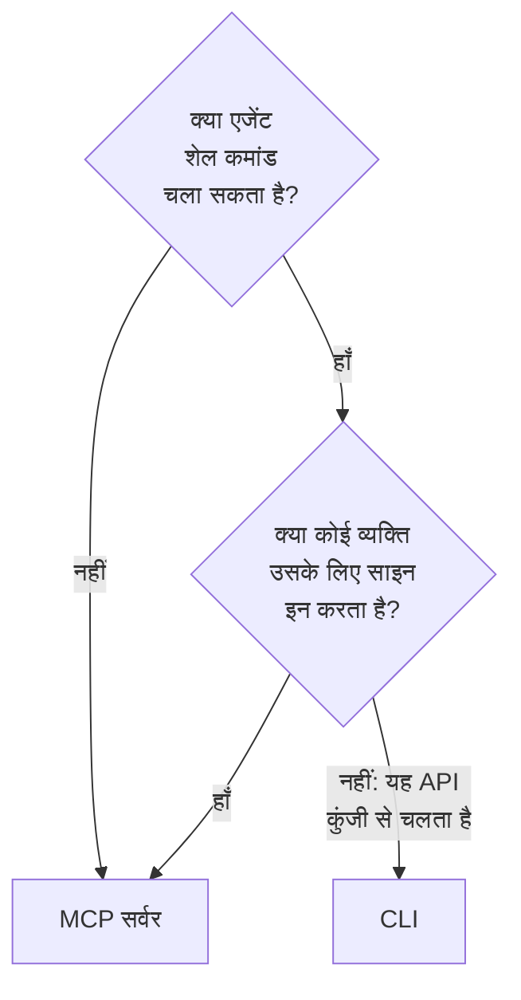

# AI एजेंट के लिए CLI

जो AI एजेंट शेल कमांड चला सकता है, जैसे आपके एडिटर में कोडिंग एजेंट या आपकी पाइपलाइन में कोई जॉब, वह [MCP सर्वर](/docs/ai/mcp-server) के बजाय CLI के ज़रिए OneUptime के साथ काम कर सकता है। यह पेज बताता है कि कौन कब ठीक है, और कोई एजेंट CLI कैसे इंस्टॉल करता है, रास्ता कैसे खोजता है और उसके जवाब कैसे पढ़ता है।

:::cards
- [CLI या MCP सर्वर](#cli-या-mcp-सर्वर): एजेंट को कौन सा उपयोग करना चाहिए।
- [इसे एजेंट के लिए सेट करें](#इसे-एजेंट-के-लिए-सेट-करें): इसे इंस्टॉल करें, और एनवायरनमेंट में इसे एक कुंजी दें।
- [एजेंट रास्ता कैसे खोजता है](#एजेंट-रास्ता-कैसे-खोजता-है): संसाधन, उनके फ़ील्ड और सहायता।
- [जवाब पढ़ें](#जवाब-पढ़ें): हर कमांड से JSON, त्रुटियाँ भी।
:::

## CLI या MCP सर्वर

दोनों OneUptime API तक पहुँचते हैं, और वही करते हैं जिसकी उनके क्रेडेंशियल अनुमति देते हैं। फ़र्क इसमें है कि एजेंट को उन तक पहुँचने के लिए क्या चाहिए:



| | CLI | MCP सर्वर |
| --- | --- | --- |
| एजेंट को चाहिए | एक शेल, और Node.js 22 या बाद का | एक MCP क्लाइंट, जैसे Claude या Cursor |
| साइन इन किससे होता है | प्रोजेक्ट की API कुंजी से, `ONEUPTIME_API_KEY` में | आपके OneUptime खाते से, या API कुंजी से |
| यह कहाँ तक पहुँचता है | API का हर संसाधन, 450 से भी ज़्यादा | वे रिकॉर्ड और टेलीमेट्री जिनके लिए इसके पास टूल हैं, और घटना प्रतिक्रिया के टूल |
| यह किसके लिए ठीक है | ऐसी स्क्रिप्ट जिन्हें एजेंट लोगों के रखने के लिए लिखता है, पाइपलाइन में जाँचें, और कई रिकॉर्ड के साथ काम | बातचीत: किसी घटना की जाँच, कोई मॉनिटर सेट करना |

CLI तब उपयोग करें जब एजेंट पहले से कमांड चलाता है, जैसे कोडिंग एजेंट करता है, या जब उसका बनाया हुआ उसके बिना चलता रहना चाहिए: किसी रिपॉज़िटरी में स्क्रिप्ट, किसी पाइपलाइन का एक चरण। MCP सर्वर तब उपयोग करें जब कोई व्यक्ति किसी चैट क्लाइंट में एजेंट से बात करता है, ताकि एजेंट उनकी अनुमतियों से काम करे और क्लाइंट किसी बदलाव से पहले पूछे।

## इसे एजेंट के लिए सेट करें

हर OneUptime अपनी रिलीज़ के लिए CLI की इंस्टॉल स्क्रिप्ट देता है: नीचे की कमांड इसे `https://oneuptime.com` से डाउनलोड करती हैं, इसलिए सेल्फ़-होस्टेड OneUptime पर इसकी जगह अपना URL डालें। स्क्रिप्ट पहले `install.sh` के रूप में सहेजी जाती है, ताकि आप उसे चलाने से पहले पढ़ सकें:

```bash
curl -fsSL https://oneuptime.com/install/cli -o install.sh
ONEUPTIME_URL=https://oneuptime.com bash install.sh
```

एजेंट को प्रोजेक्ट की ऐसी API कुंजी दें जिसके पास केवल उतना एक्सेस हो जितना उसके काम के लिए ज़रूरी है, कमांड लाइन पर नहीं बल्कि एनवायरनमेंट में, और उससे पहले कुंजी जँचवाएँ:

```bash
export ONEUPTIME_API_KEY="your-api-key"
export ONEUPTIME_URL=https://oneuptime.com
oneuptime whoami --check -o json
```

कुंजी **प्रोजेक्ट सेटिंग्स → उन्नत → API कुंजियाँ** में बनाएँ: [API कुंजी बनाएँ](/docs/api-reference/api-reference#एक-api-कुंजी-बनाएँ) देखें। जो कुंजी केवल पढ़ सकती है, वह एजेंट को केवल देखने देती है, और कुछ नहीं।

## एजेंट रास्ता कैसे खोजता है

CLI बताता है कि वह क्या कर सकता है, बिना API कुंजी और बिना अनुरोध के:

| कमांड | यह क्या जवाब देती है |
| --- | --- |
| `oneuptime resources -o json` | हर संसाधन: उसकी कमांड, उसके नाम, उसका API पथ, उसके संचालन और उसकी कार्रवाइयाँ |
| `oneuptime incident fields -o json` | किसी संसाधन के फ़ील्ड: हर एक किस काम का है, उसका प्रकार, क्या बनाने के लिए वह ज़रूरी है, और उसका फ़्लैग |
| `oneuptime incident create --help` | किसी कमांड के आर्ग्युमेंट और फ़्लैग |

ID रखने वाला फ़ील्ड बताता है कि वह किस संसाधन की ID लेता है, इसलिए एजेंट पहले उस संसाधन को सूचीबद्ध करता है: `incidentSeverityId` एक ID `oneuptime incident-severity list` से लेता है। किसी व्यक्ति को बताने वाला फ़ील्ड उसका ईमेल पता भी लेता है, जैसे `--user-email` से।

## जवाब पढ़ें

एजेंट से हर कमांड में `-o json`, या `--json`, जुड़वाएँ। तब हर कमांड JSON में जवाब देती है, वे भी जिनका जवाब एक वाक्य है, और त्रुटि मानक त्रुटि पर एक JSON ऑब्जेक्ट होती है:

```bash
oneuptime incident acknowledge 6f1c2a40-3b1e-4c55-9a0b-3e2f8d7c1a11 -o json
```

```json
{
  "_id": "6f1c2a40-3b1e-4c55-9a0b-3e2f8d7c1a11",
  "action": "acknowledge",
  "changed": true,
  "state": {
    "_id": "0b7d5e2c-8f4a-4d1b-9c3e-5a6f7b8c9d0e",
    "name": "Acknowledged"
  }
}
```

एग्ज़िट कोड बताता है कि क्या हुआ: काम होने पर `0`, विफल होने पर `1`, API कुंजी न होने या अस्वीकार होने पर `2`, और रिकॉर्ड न होने पर `3`। त्रुटि के JSON में वही कोड `exitCode` में होता है, और आगे क्या करें यह `hint` में। [आउटपुट प्रारूप](/docs/cli/output-formats#json) और [एग्ज़िट कोड](/docs/cli/scripting#एग्ज़िट-कोड) देखें।

## अगले कदम

:::cards
- [संसाधन संचालन](/docs/cli/resource-operations): हर संचालन, उसके फ़्लैग और फ़िल्टर के साथ।
- [कमांड संदर्भ](/docs/cli/command-reference): हर कमांड, विकल्प और डिफ़ॉल्ट।
- [MCP सर्वर](/docs/ai/mcp-server): इसके बजाय किसी चैट क्लाइंट को OneUptime से जोड़ें।
:::
