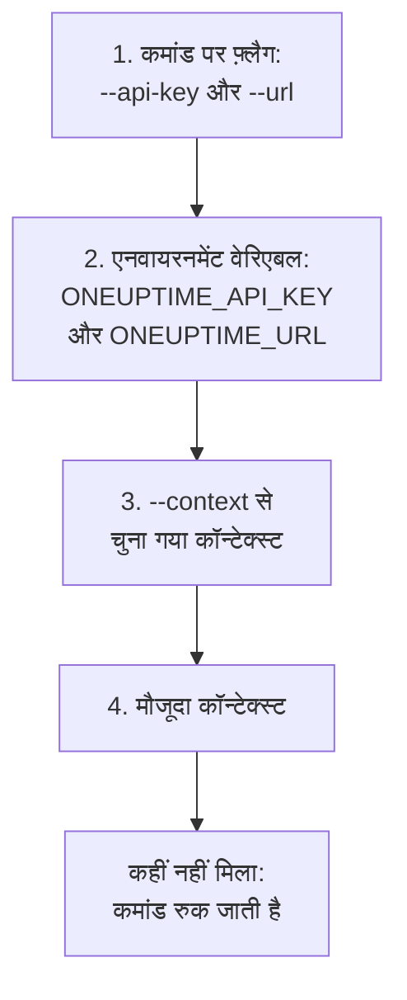

# प्रमाणीकरण

CLI का भेजा हर अनुरोध आपके प्रोजेक्ट की एक API कुंजी साथ ले जाता है। कुंजियाँ `oneuptime login` से एक बार सहेजें, हर एनवायरनमेंट के लिए एक कॉन्टेक्स्ट, या उन्हें फ़्लैग या एनवायरनमेंट वेरिएबल में किसी कमांड को दें, जैसा स्क्रिप्ट करती हैं। यह पेज हर तरीका दिखाता है, और यह भी कि कई तरीके होने पर कोई कमांड कौन-सा उपयोग करती है।

:::cards
- [लॉग इन करें](#लॉग-इन-करें): एक API कुंजी और अपने OneUptime का पता सहेजें।
- [कॉन्टेक्स्ट](#कॉन्टेक्स्ट): हर प्रोजेक्ट या एनवायरनमेंट के लिए सहेजा गया लॉगिन, और उनके बीच बदलना।
- [कोई कमांड कौन-से क्रेडेंशियल उपयोग करती है](#कोई-कमांड-कौन-से-क्रेडेंशियल-उपयोग-करती-है): पहले फ़्लैग, फिर एनवायरनमेंट वेरिएबल, फिर कॉन्टेक्स्ट।
- [समस्या निवारण](#समस्या-निवारण): क्रेडेंशियल नहीं मिले, अमान्य कुंजियाँ और अस्वीकृतियाँ।
:::

## शुरू करने से पहले

आपको अपने प्रोजेक्ट की एक API कुंजी चाहिए। इसे **प्रोजेक्ट सेटिंग्स → उन्नत → API कुंजियाँ** में **API कुंजी बनाएँ** से बनाएँ, और इसे वह एक्सेस दें जिसकी आपकी कमांड को ज़रूरत है: [एक API कुंजी बनाएँ](/docs/api-reference/api-reference#एक-api-कुंजी-बनाएँ) देखें। कुंजी वही करती है जिसकी उसकी अनुमतियाँ इजाज़त देती हैं, इसलिए जो कुंजी केवल रिकॉर्ड पढ़ सकती है, वह उन्हें सूचीबद्ध कर सकती है और पढ़ सकती है, पर बदल नहीं सकती।

OneUptime Cloud पर, API कुंजियाँ तभी तक काम करती हैं जब तक प्रोजेक्ट **Growth** प्लान या उससे ऊपर है। उससे नीचे, हर कमांड प्लान का नाम बताने वाले संदेश के साथ `API error (402)` जवाब देती है, जब तक प्रोजेक्ट अपग्रेड न हो; उसके बाद वही कुंजी फिर काम करती है। [अपने प्लान से नीचे API कुंजियाँ और SCIM](/docs/api-reference/api-reference#अपने-प्लान-से-नीचे-api-कुंजियाँ-और-scim) देखें।

## लॉग इन करें

`oneuptime login` एक API कुंजी और आपके OneUptime का पता कॉन्टेक्स्ट के रूप में सहेजता है, और उसे मौजूदा कॉन्टेक्स्ट बनाता है:

```bash
oneuptime login <api-key> <instance-url> [--context-name <name>]
```

| आर्ग्युमेंट या विकल्प | यह क्या है |
| --- | --- |
| `<api-key>` | आपके प्रोजेक्ट की एक API कुंजी |
| `<instance-url>` | आपके OneUptime का पता: `https://oneuptime.com`, या आपके अपने सर्वर का, जैसे `https://oneuptime.example.com` |
| `--context-name <name>` | वह नाम जिससे कॉन्टेक्स्ट सहेजा जाता है। डिफ़ॉल्ट: `default` |

उदाहरण के लिए, `production` नाम का एक कॉन्टेक्स्ट:

```bash
oneuptime login <api-key> https://oneuptime.com --context-name production
```

यह `Logged in successfully. Context "production" is now active.` जवाब देता है। पते के अंत का स्लैश हटा दिया जाता है, और उसी नाम से फिर लॉग इन करने पर वह कॉन्टेक्स्ट बदल जाता है।

> [!NOTE]
> `login` कुंजी को OneUptime से पूछे बिना सहेजता है। कुंजी काम करती है यह देखने के लिए कोई कमांड चलाएँ, जैसे `oneuptime incident count`।

## कॉन्टेक्स्ट

कॉन्टेक्स्ट एक सहेजा गया लॉगिन है: एक नाम, एक पता और एक API कुंजी। हर प्रोजेक्ट या एनवायरनमेंट के लिए एक सहेजें, फिर आगे की सभी कमांड के लिए, या किसी एक कमांड के लिए, एक चुनें।

:::steps
### हर एनवायरनमेंट के लिए एक कॉन्टेक्स्ट सहेजें

```bash
oneuptime login <production-api-key> https://oneuptime.com --context-name production
oneuptime login <staging-api-key> https://oneuptime.example.com --context-name staging
```

हर लॉगिन अपने कॉन्टेक्स्ट को मौजूदा कॉन्टेक्स्ट बनाता है, इसलिए अब `staging` मौजूदा है।

### उन्हें सूचीबद्ध करें

```bash
oneuptime context list
```

```text
┌───┬────────────┬───────────────────────────────┐
│   │ Name       │ URL                           │
├───┼────────────┼───────────────────────────────┤
│   │ production │ https://oneuptime.com         │
├───┼────────────┼───────────────────────────────┤
│ * │ staging    │ https://oneuptime.example.com │
└───┴────────────┴───────────────────────────────┘
```

`*` मौजूदा कॉन्टेक्स्ट को चिह्नित करता है। API कुंजियाँ कभी सूचीबद्ध नहीं होतीं।

### दूसरे कॉन्टेक्स्ट पर जाएँ

```bash
oneuptime context use production
```

यह `Switched to context "production".` जवाब देता है और आगे की कमांड उसी का उपयोग करती हैं।

### एक कमांड के लिए कॉन्टेक्स्ट उपयोग करें

```bash
oneuptime incident list --context staging
```

मौजूदा कॉन्टेक्स्ट जैसा था वैसा ही रहता है।
:::

| कमांड | यह क्या करती है |
| --- | --- |
| `oneuptime context list` | सहेजे कॉन्टेक्स्ट सूचीबद्ध करती है; `*` मौजूदा को चिह्नित करता है। `-o json` के साथ, हर कॉन्टेक्स्ट का `name`, `apiUrl` और `isCurrent`, उसकी कुंजी कभी नहीं |
| `oneuptime context use <name>` | किसी सहेजे कॉन्टेक्स्ट को मौजूदा बनाती है |
| `oneuptime context current` | मौजूदा कॉन्टेक्स्ट का नाम, URL और API कुंजी दिखाती है, कुंजी के पहले चार और आखिरी चार अक्षरों को छोड़कर सब छिपा होता है |
| `oneuptime context delete <name>` | सहेजा कॉन्टेक्स्ट हटाती है। अगर वह मौजूदा था, तो बचा हुआ पहला कॉन्टेक्स्ट मौजूदा बन जाता है |

## कोई कमांड कौन-से क्रेडेंशियल उपयोग करती है

कमांड को एक API कुंजी और एक URL चाहिए। वह दोनों में से हर एक को इन जगहों में से पहली ऐसी जगह से लेती है जहाँ वह मौजूद हो:



इसलिए आप इन्हें मिला सकते हैं: उदाहरण के लिए, एनवायरनमेंट वेरिएबल से API कुंजी और मौजूदा कॉन्टेक्स्ट का URL। एनवायरनमेंट वेरिएबल उन स्क्रिप्ट और CI जॉब के लिए ठीक हैं जिनके पास कोई सहेजा कॉन्टेक्स्ट नहीं होता:

:::tabs
@tab Linux
```bash
export ONEUPTIME_API_KEY=<api-key>
export ONEUPTIME_URL=https://oneuptime.com
oneuptime incident list
```
@tab macOS
```bash
export ONEUPTIME_API_KEY=<api-key>
export ONEUPTIME_URL=https://oneuptime.com
oneuptime incident list
```
@tab Windows
```powershell
$env:ONEUPTIME_API_KEY = "<api-key>"
$env:ONEUPTIME_URL = "https://oneuptime.com"
oneuptime incident list
```
:::

एक कमांड के लिए, फ़्लैग बाकी सब से पहले आते हैं:

```bash
oneuptime --api-key <api-key> --url https://oneuptime.com incident list
```

> [!WARNING]
> फ़्लैग के रूप में दी गई कुंजी आपकी shell हिस्ट्री में पहुँच जाती है, और मशीन के दूसरे उपयोगकर्ता उसे प्रोसेस सूची में देख सकते हैं। साझा मशीन पर, इसकी जगह कॉन्टेक्स्ट या एनवायरनमेंट वेरिएबल उपयोग करें।

## देखें कि CLI क्या उपयोग करेगा

`oneuptime whoami` वह URL और API कुंजी दिखाता है जिनका अगली कमांड उपयोग करेगी, और वह कॉन्टेक्स्ट जिससे वे आती हैं:

```bash
oneuptime whoami
```

```text
URL:     https://oneuptime.com
API Key: 4f1c****0a13
Context: production
```

कुंजी के केवल पहले चार और आखिरी चार अक्षर दिखाए जाते हैं। `Context` पंक्ति तभी दिखती है जब URL और कुंजी उसी कॉन्टेक्स्ट के अपने हों, न कि ऐसे मान जिन्हें किसी फ़्लैग या एनवायरनमेंट वेरिएबल ने बदल दिया हो। `whoami` OneUptime को कॉल किए बिना आपकी सेटिंग्स पढ़ता है: यह दिखाता है कि कमांड क्या भेजेगी, यह नहीं कि OneUptime उसे स्वीकार करता है या नहीं। कुछ भी सहेजा या सेट न होने पर, यह जवाब देता है:

```text
Not authenticated. Run `oneuptime login` to authenticate.
```

## कॉन्फ़िगरेशन फ़ाइल

`oneuptime login` कॉन्टेक्स्ट को आपके होम फ़ोल्डर में `~/.oneuptime/config.json` में सहेजता है (Windows पर `%USERPROFILE%\.oneuptime\config.json`)। CLI इसे ऐसे बनाता है कि केवल आपका उपयोगकर्ता इसे पढ़ और लिख सके (मोड `0600`):

```json title="~/.oneuptime/config.json"
{
  "currentContext": "production",
  "contexts": {
    "production": {
      "name": "production",
      "apiUrl": "https://oneuptime.com",
      "apiKey": "<api-key>"
    },
    "staging": {
      "name": "staging",
      "apiUrl": "https://oneuptime.example.com",
      "apiKey": "<api-key>"
    }
  }
}
```

फ़ाइल API कुंजियों को ज्यों का त्यों रखती है: इसे साझा फ़ोल्डरों, बैकअप और रिपॉज़िटरी से दूर रखें। किसी एक कॉन्टेक्स्ट से लॉग आउट करने के लिए, उसे `oneuptime context delete <name>` से हटाएँ; सभी से लॉग आउट करने के लिए, फ़ाइल हटाएँ। जो कुंजी लीक हो गई हो सकती है, वह तब तक मान्य रहती है जब तक आप उसे OneUptime में, **प्रोजेक्ट सेटिंग्स → उन्नत → API कुंजियाँ** में, हटा नहीं देते।

आउटपुट प्रारूप और सूची का आकार यहाँ सहेजे नहीं जाते: हर कमांड को `-o` और `--limit` दें।

## समस्या निवारण

:::details "No credentials found" संदेश
`Authentication error: No credentials found.` का मतलब है कि किसी फ़्लैग, एनवायरनमेंट वेरिएबल या सहेजे कॉन्टेक्स्ट ने कमांड को उसकी API कुंजी और URL नहीं दिए। `oneuptime login` चलाएँ, या `ONEUPTIME_API_KEY` और `ONEUPTIME_URL` दोनों सेट करें। कमांड कोड `2` के साथ बाहर निकलती है।
:::

:::details "API error (400): Invalid API Key" संदेश
कुंजी OneUptime की API कुंजी नहीं है, उसकी अवधि समाप्त हो गई है, या उसे रीसेट किया गया था। उसे **प्रोजेक्ट सेटिंग्स → उन्नत → API कुंजियाँ** में उसके पेज से फिर कॉपी करें, जहाँ उसकी **समाप्त होता है** वाली तारीख भी है, और उसी कॉन्टेक्स्ट नाम से फिर लॉग इन करें। कमांड कोड `2` के साथ बाहर निकलती है।
:::

:::details "API error (402): API keys need the Growth plan" संदेश
OneUptime Cloud पर, प्रोजेक्ट **Growth** प्लान से नीचे है, इसलिए उसकी API कुंजियों ने काम करना बंद कर दिया। प्रोजेक्ट अपग्रेड करें, और वही कुंजी फिर काम करती है: CLI में कुछ बदलने की ज़रूरत नहीं।
:::

:::details "API error (422): You do not have permissions" संदेश
कुंजी की अनुमतियाँ वहाँ तक नहीं पहुँचतीं जो कमांड माँगती है। **प्रोजेक्ट सेटिंग्स → उन्नत → API कुंजियाँ** में कुंजी के पेज पर उसे कोई भूमिका या अनुमति दें: संदेश उन अनुमतियों के नाम बताता है जिनसे अनुरोध आगे जा सकेगा।
:::

:::details "Context "staging" does not exist" संदेश
उस नाम का कोई कॉन्टेक्स्ट सहेजा नहीं गया है। `oneuptime context list` मौजूद नाम दिखाता है।
:::

:::details whoami कॉन्टेक्स्ट से अलग URL या कुंजी दिखाता है
कोई एनवायरनमेंट वेरिएबल या फ़्लैग कॉन्टेक्स्ट के मान को बदल देता है। `env | grep ONEUPTIME` सेट किए गए वेरिएबल दिखाता है, और `unset ONEUPTIME_API_KEY ONEUPTIME_URL` आपको आपके कॉन्टेक्स्ट पर वापस ले जाता है।
:::

:::details पते पर अनुरोध विफल हुआ
`Error: Request failed to https://...` का मतलब है कि CLI उस पते पर OneUptime तक नहीं पहुँच सका। `oneuptime whoami` से URL जाँचें: यह वही पता है जिस पर आप OneUptime खोलते हैं, `https://` के साथ, जैसे `https://oneuptime.com`।
:::

## अगले कदम

:::cards
- [संसाधन संचालन](/docs/cli/resource-operations): रिकॉर्ड सूचीबद्ध करें, पढ़ें, बनाएँ, बदलें, हटाएँ और गिनें।
- [स्क्रिप्टिंग और CI/CD](/docs/cli/scripting): पाइपलाइन को उसकी कुंजी एनवायरनमेंट वेरिएबल में दें।
- [OneUptime API संदर्भ](/docs/api-reference/api-reference): API कुंजी क्या कर सकती है, और हर जवाब का क्या मतलब है।
:::
