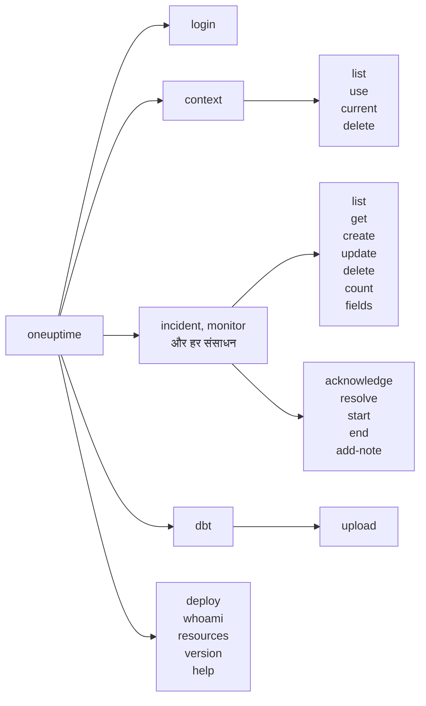

# कमांड संदर्भ

`oneuptime` CLI की हर कमांड, उसके आर्ग्युमेंट, विकल्पों और डिफ़ॉल्ट के साथ। अपने टर्मिनल में यही देखने के लिए किसी भी कमांड में `--help` जोड़ें।

:::cards
- [ग्लोबल विकल्प](#ग्लोबल-विकल्प): वे विकल्प जो हर कमांड लेती है।
- [लॉगिन और कॉन्टेक्स्ट](#लॉगिन-और-कॉन्टेक्स्ट): login और context कमांड।
- [संसाधन कमांड](#संसाधन-कमांड): हर संसाधन के संचालन, फ़ील्ड और कार्रवाइयाँ।
- [अन्य कमांड](#अन्य-कमांड): deploy, dbt upload, data-checks apply, whoami, resources, version और help।
:::

## कमांड



## ग्लोबल विकल्प

| विकल्प | यह क्या करता है | डिफ़ॉल्ट |
| --- | --- | --- |
| `--api-key <key>` | इस कमांड के लिए API कुंजी | `ONEUPTIME_API_KEY`, फिर कॉन्टेक्स्ट की कुंजी |
| `--url <url>` | इस कमांड के लिए आपके OneUptime का पता | `ONEUPTIME_URL`, फिर कॉन्टेक्स्ट का URL |
| `--context <name>` | इस कमांड के लिए उपयोग होने वाला सहेजा कॉन्टेक्स्ट | मौजूदा कॉन्टेक्स्ट |
| `-o, --output <format>` | `json`, `table` या `wide` | टर्मिनल में `table`, पाइप में `json` |
| `--json` | `-o json` के समान | |
| `--no-color` | बिना रंगों के प्रिंट करता है | रंगों के साथ, जब तक `NO_COLOR` सेट न हो |
| `-V, --version` | CLI का संस्करण प्रिंट करता है | |
| `-h, --help` | किसी कमांड की सहायता दिखाता है | |

विकल्प कमांड से पहले या बाद में आते हैं: `oneuptime --context staging incident list` और `oneuptime incident list --context staging` एक ही काम करते हैं।

हर कमांड `-o` और `--json` लेती है, इसलिए नीचे की टेबल उन्हें छोड़ देती हैं। जिस कमांड का जवाब एक वाक्य है, जैसे `delete`, वह वाक्य प्रिंट करती है, जब तक `-o json` या `--json` JSON न माँगे: [आउटपुट प्रारूप](/docs/cli/output-formats#json) देखें।

## लॉगिन और कॉन्टेक्स्ट

### `oneuptime login`

एक API कुंजी और एक पते को कॉन्टेक्स्ट के रूप में सहेजती है, और उसे मौजूदा कॉन्टेक्स्ट बनाती है। [लॉग इन करें](/docs/cli/authentication#लॉग-इन-करें) देखें।

```bash
oneuptime login <api-key> <instance-url> [--context-name <name>]
```

| आर्ग्युमेंट या विकल्प | ज़रूरी | यह क्या है | डिफ़ॉल्ट |
| --- | --- | --- | --- |
| `<api-key>` | हाँ | आपके प्रोजेक्ट की एक API कुंजी | |
| `<instance-url>` | हाँ | आपके OneUptime का पता, जैसे `https://oneuptime.com` | |
| `--context-name <name>` | नहीं | वह नाम जिससे कॉन्टेक्स्ट सहेजा जाता है | `default` |

### `oneuptime context list`

सहेजे गए कॉन्टेक्स्ट सूचीबद्ध करती है; `*` मौजूदा कॉन्टेक्स्ट को चिह्नित करता है। API कुंजियाँ कभी सूचीबद्ध नहीं होतीं: JSON हर कॉन्टेक्स्ट का `name`, `apiUrl` और `isCurrent` देता है।

```bash
oneuptime context list
```

### `oneuptime context use`

किसी सहेजे कॉन्टेक्स्ट को मौजूदा बनाती है।

```bash
oneuptime context use <name>
```

| आर्ग्युमेंट | ज़रूरी | यह क्या है |
| --- | --- | --- |
| `<name>` | हाँ | किसी सहेजे कॉन्टेक्स्ट का नाम |

### `oneuptime context current`

मौजूदा कॉन्टेक्स्ट का नाम और URL दिखाती है, और उसकी API कुंजी, जिसमें पहले चार और आखिरी चार अक्षरों को छोड़कर सब छिपा होता है।

```bash
oneuptime context current
```

### `oneuptime context delete`

सहेजा कॉन्टेक्स्ट हटाती है। अगर वह मौजूदा था, तो बचा हुआ पहला कॉन्टेक्स्ट मौजूदा बन जाता है।

```bash
oneuptime context delete <name>
```

| आर्ग्युमेंट | ज़रूरी | यह क्या है |
| --- | --- | --- |
| `<name>` | हाँ | किसी सहेजे कॉन्टेक्स्ट का नाम |

## संसाधन कमांड

`<resource>` किसी तरह के रिकॉर्ड की कमांड है, [संसाधन](#संसाधन) टेबल से, जैसे `incident` या `monitor`। किसी संसाधन के पास वे संचालन होते हैं जो API उसके लिए लेता है, ज़्यादातर के पास सभी छह, और `oneuptime <resource> --help` उसके अपने संचालन सूचीबद्ध करती है। उदाहरणों के लिए [संसाधन संचालन](/docs/cli/resource-operations) देखें।

### `oneuptime <resource> list`

रिकॉर्ड सूचीबद्ध करती है, सबसे नए पहले। लेबल इसके बजाय नाम के क्रम में सूचीबद्ध होते हैं, संख्या वाले लेबल पहले (`2. Team` पहले, `10. Owner` बाद में)।

```bash
oneuptime <resource> list [--query <json>] [--limit <n>] [--skip <n>] [--sort <json>] [--fields <names>] [--all]
```

| विकल्प | यह क्या करता है | डिफ़ॉल्ट |
| --- | --- | --- |
| `--query <json>` | एक फ़िल्टर, JSON के रूप में | हर वह रिकॉर्ड जिसे कुंजी पढ़ सकती है |
| `--limit <n>` | लौटाए जाने वाले अधिकतम रिकॉर्ड, 10,000 तक | `10` |
| `--skip <n>` | पहले कितने रिकॉर्ड छोड़ने हैं | `0` |
| `--sort <json>` | क्रम, JSON के रूप में: `{"<field>":"ASC"}` या `{"<field>":"DESC"}` | सबसे नए पहले |
| `--fields <names>` | लौटाए जाने वाले फ़ील्ड, कॉमा से अलग किए हुए; किसी जुड़े हुए रिकॉर्ड का फ़ील्ड बिंदु के बाद, जैसे `currentIncidentState.name` में | हर वह फ़ील्ड जिसे कुंजी पढ़ सकती है |
| `--all` | हर मेल खाने वाला रिकॉर्ड, एक बार में 100, 100,000 तक, `--limit` और `--skip` की जगह। केवल रिकॉर्ड के लिए: टेलीमेट्री में `--all` नहीं है | |

### `oneuptime <resource> get`

एक रिकॉर्ड पढ़ती है।

```bash
oneuptime <resource> get <id> [--fields <names>]
```

| आर्ग्युमेंट या विकल्प | ज़रूरी | यह क्या है |
| --- | --- | --- |
| `<id>` | हाँ | रिकॉर्ड की ID, एक UUID |
| `--fields <names>` | नहीं | लौटाए जाने वाले फ़ील्ड, कॉमा से अलग किए हुए। डिफ़ॉल्ट: हर वह फ़ील्ड जिसे कुंजी पढ़ सकती है |

### `oneuptime <resource> create`

एक रिकॉर्ड बनाती है और उसे प्रिंट करती है।

```bash
oneuptime <resource> create [--<field> <value>]... [--data <json>] [--file <path>]
```

| विकल्प | ज़रूरी | यह क्या है |
| --- | --- | --- |
| `--<field> <value>` | वे फ़ील्ड जिन्हें बनाते समय देना ज़रूरी है | किसी फ़ील्ड का मान: `--title <text>`, `--incident-severity-id <id>`, `--labels <ids>`। `oneuptime <resource> create --help` इन्हें सूचीबद्ध करती है। केवल रिकॉर्ड के लिए |
| `--data <json>` | नहीं | रिकॉर्ड, JSON के रूप में |
| `--file <path>` | नहीं | रिकॉर्ड वाली JSON फ़ाइल। `--data` के साथ दी जाए, तो फ़ाइल उपयोग होती है |

फ़्लैग `--data` या `--file` के ऊपर लागू होते हैं। जो फ़ील्ड किसी व्यक्ति को यूज़र ID से बताता है, उसका एक फ़्लैग ऐसा भी है जो उसे ईमेल पते से बताता है: `--user-email`, `--user-id` के बगल में।

### `oneuptime <resource> update`

आपके दिए फ़ील्ड बदलती है।

```bash
oneuptime <resource> update <id> [--<field> <value>]... [--data <json>] [--file <path>]
```

| आर्ग्युमेंट या विकल्प | ज़रूरी | यह क्या है |
| --- | --- | --- |
| `<id>` | हाँ | रिकॉर्ड की ID |
| `--<field> <value>` | नहीं | बदलने वाला फ़ील्ड: `oneuptime <resource> update --help` इन्हें सूचीबद्ध करती है। केवल रिकॉर्ड के लिए |
| `--data <json>` | नहीं | बदलने वाले फ़ील्ड, JSON के रूप में |
| `--file <path>` | नहीं | बदलने वाले फ़ील्ड वाली JSON फ़ाइल। `--data` के साथ दी जाए, तो फ़ाइल उपयोग होती है |

### `oneuptime <resource> delete`

रिकॉर्ड को तुरंत हटाती है, बिना पूछे।

```bash
oneuptime <resource> delete <id> [--force]
```

| आर्ग्युमेंट या विकल्प | ज़रूरी | यह क्या है |
| --- | --- | --- |
| `<id>` | हाँ | रिकॉर्ड की ID |
| `--force` | नहीं | स्वीकार होता है और कुछ नहीं बदलता: `delete` कभी पुष्टि नहीं माँगता |

### `oneuptime <resource> count`

रिकॉर्ड गिनती है, और संख्या प्रिंट करती है।

```bash
oneuptime <resource> count [--query <json>]
```

| विकल्प | ज़रूरी | यह क्या है |
| --- | --- | --- |
| `--query <json>` | नहीं | एक फ़िल्टर, JSON के रूप में। इसके बिना, हर वह रिकॉर्ड जिसे कुंजी पढ़ सकती है |

### `oneuptime <resource> fields`

संसाधन के फ़ील्ड सूचीबद्ध करती है: हर एक किस काम का है, उसका प्रकार, क्या बनाते समय उसे देना ज़रूरी है, और वह फ़्लैग जो उसे सेट करता है। यह उन्हें खुद CLI से पढ़ती है, बिना API कुंजी और बिना अनुरोध के।

```bash
oneuptime <resource> fields
```

### `oneuptime <resource> acknowledge`

किसी घटना, अलर्ट या उनमें से किसी के एपिसोड को आपके प्रोजेक्ट की स्वीकार की गई स्थिति में ले जाती है, जैसे डैशबोर्ड का बटन करता है। जो रिकॉर्ड पहले से स्वीकार किया जा चुका है, या उससे आगे है, उसे वैसा ही छोड़ दिया जाता है।

```bash
oneuptime <resource> acknowledge <id>
```

| आर्ग्युमेंट | ज़रूरी | यह क्या है |
| --- | --- | --- |
| `<id>` | हाँ | रिकॉर्ड की ID |

### `oneuptime <resource> resolve`

किसी घटना, अलर्ट या उनमें से किसी के एपिसोड को आपके प्रोजेक्ट की हल हो चुकी स्थिति में ले जाती है।

```bash
oneuptime <resource> resolve <id>
```

| आर्ग्युमेंट | ज़रूरी | यह क्या है |
| --- | --- | --- |
| `<id>` | हाँ | रिकॉर्ड की ID |

### `oneuptime <resource> start`

किसी रखरखाव इवेंट को आपके प्रोजेक्ट की जारी स्थिति में ले जाती है।

```bash
oneuptime <resource> start <id>
```

| आर्ग्युमेंट | ज़रूरी | यह क्या है |
| --- | --- | --- |
| `<id>` | हाँ | इवेंट की ID |

### `oneuptime <resource> end`

किसी रखरखाव इवेंट को आपके प्रोजेक्ट की समाप्त स्थिति में ले जाती है।

```bash
oneuptime <resource> end <id>
```

| आर्ग्युमेंट | ज़रूरी | यह क्या है |
| --- | --- | --- |
| `<id>` | हाँ | इवेंट की ID |

### `oneuptime <resource> add-note`

किसी घटना, अलर्ट, उनमें से किसी के एपिसोड या किसी रखरखाव इवेंट में नोट जोड़ती है।

```bash
oneuptime <resource> add-note <id> --note <markdown> [--public]
```

| आर्ग्युमेंट या विकल्प | ज़रूरी | यह क्या है |
| --- | --- | --- |
| `<id>` | हाँ | रिकॉर्ड की ID |
| `--note <markdown>` | हाँ | नोट, Markdown में |
| `--public` | नहीं | इसे रिकॉर्ड के स्थिति पृष्ठों पर पोस्ट करता है, जहाँ उसके सब्सक्राइबर को बताया जाता है। केवल घटनाएँ, उनके एपिसोड और अनुसूचित रखरखाव |

### संसाधन

OneUptime API का हर संसाधन एक कमांड है, उन संचालनों के साथ जो API उसके लिए लेता है, `fields` के साथ, और जिन रिकॉर्ड के पास कार्रवाइयाँ हैं, उनकी कार्रवाइयों के साथ:

{{CLI_RESOURCE_COMMANDS}}

CLI, OneUptime के साथ रिलीज़ होता है, इसलिए `oneuptime resources` आपके इंस्टॉल किए संस्करण की कमांड सूचीबद्ध करता है।

### API अनुरोध

हर संचालन API को एक अनुरोध है, जिसमें कुंजी `APIKey` हेडर में होती है। `<path>` संसाधन का API पाथ है, जो `oneuptime resources` से मिलता है: `incident` के लिए `/incident`, `on-call-policy` के लिए `/on-call-duty-policy`।

| संचालन | अनुरोध | बॉडी |
| --- | --- | --- |
| `list` | `POST /api/<path>/get-list` | `query`, `select`, `skip`, `limit` और `sort` |
| `get` | `POST /api/<path>/<id>/get-item` | `select` |
| `create` | `POST /api/<path>` | `{"data": ...}` |
| `update` | `PUT /api/<path>/<id>/` | `{"data": ...}` |
| `delete` | `DELETE /api/<path>/<id>/` | कोई नहीं |
| `count` | `POST /api/<path>/count` | `query` |

कोई कार्रवाई आपके प्रोजेक्ट की स्थितियाँ और रिकॉर्ड पढ़ती है, फिर रिकॉर्ड की स्थिति टाइमलाइन में एक पंक्ति बनाती है, जैसे डैशबोर्ड का बटन करता है: किसी घटना पर `acknowledge` एक `incident-state-timeline` बनाता है। `add-note` एक `incident-internal-note` बनाता है, या `--public` के साथ एक `incident-public-note`। ईमेल फ़्लैग पहले उस पते वाले प्रोजेक्ट के टीम सदस्यों को सूचीबद्ध करता है। जब OneUptime कोई ऐसा फ़ील्ड अस्वीकार करता है जिसे कुंजी पढ़ नहीं सकती, तो list या get उसके बिना फिर से माँगता है।

## अन्य कमांड

### `oneuptime deploy`

किसी पाइपलाइन से एक डिप्लॉय, या कोई दूसरा बदलाव, रिकॉर्ड करती है: यह सेवा के चार्ट पर दिखाया जाता है और OneUptime AI किसी घटना की जांच करते समय इसे पढ़ता है। यह API कुंजी से नहीं, बल्कि टेलीमेट्री इंजेशन कुंजी से लिखती है। [डिप्लॉय और बदलाव](/docs/telemetry/change-events) देखें।

```bash
oneuptime deploy [--service <name>] [--service-version <version>] [--previous-version <version>] [--commit <sha>] [--repository <url>] [--branch <name>] [--pull-request <number>] [--environment <name>] [--title <title>] [--description <text>] [--type <type>] [--time <time>] [--attribute <key=value...>] [--ingestion-key <key>]
```

| विकल्प | ज़रूरी | यह क्या है | डिफ़ॉल्ट |
| --- | --- | --- | --- |
| `--service <name>` | नहीं | वह सेवा जिसे डिप्लॉय किया गया | पूरे प्रोजेक्ट का बदलाव |
| `--service-version <version>` | नहीं | डिप्लॉय किया गया संस्करण | |
| `--previous-version <version>` | नहीं | वह संस्करण जिसकी जगह इसने ली | |
| `--commit <sha>` | नहीं | डिप्लॉय किया गया कमिट | |
| `--repository <url>` | नहीं | वह रिपॉजिटरी जिसमें कमिट है | |
| `--branch <name>` | नहीं | डिप्लॉय की गई ब्रांच | |
| `--pull-request <number>` | नहीं | डिप्लॉय किया गया पुल रिक्वेस्ट | |
| `--environment <name>` | नहीं | वह एनवायरनमेंट जिसमें डिप्लॉय किया गया | |
| `--title <title>` | नहीं | बदलाव का शीर्षक; डिप्लॉय के अलावा किसी दूसरे प्रकार के बदलाव के लिए यह ज़रूरी है | `Deploy <version>` |
| `--description <text>` | नहीं | बदलाव का विवरण | |
| `--type <type>` | नहीं | बदलाव का प्रकार, जैसे `config-change` या `rollback` | `deployment` |
| `--time <time>` | नहीं | यह कब हुआ, जैसे `2026-10-19T10:00:00Z` | अभी |
| `--attribute <key=value...>` | नहीं | और एट्रिब्यूट, `key=value` के रूप में, एक या ज़्यादा | |
| `--ingestion-key <key>` | नहीं | प्रोजेक्ट की एक टेलीमेट्री इंजेशन कुंजी | `ONEUPTIME_TELEMETRY_INGESTION_KEY` |

### `oneuptime dbt upload`

किसी बिल्ड के बाद, CI या किसी dbt Cloud जॉब से, किसी dbt प्रोजेक्ट के आर्टिफ़ैक्ट डेटा अवलोकनीयता को भेजती है। उसके मॉडल उन टेबल पर अपनी वंशावली के साथ दिखते हैं जिन्हें वे बनाते हैं, उसके टेस्ट OneUptime की जाँचों के बगल में दिखते हैं और अलर्ट बना सकते हैं, और हर बिल्ड प्रोजेक्ट की पाइपलाइन का एक रन होता है। यह dbt के टार्गेट फ़ोल्डर से `manifest.json` और `run_results.json` पढ़ती है, उनमें से सिर्फ़ वही भेजती है जो डेटा अवलोकनीयता पढ़ती है, और API कुंजी से नहीं, बल्कि टेलीमेट्री इंजेशन कुंजी से लिखती है। आपके डैशबोर्ड में डेटा अवलोकनीयता का दस्तावेज़ीकरण पेज इसे एक CI जॉब में दिखाता है।

```bash
oneuptime dbt upload [--target-path <dir>] [--manifest <file>] [--run-results <file>] [--project <name>] [--ingestion-key <key>]
```

| विकल्प | ज़रूरी | यह क्या है | डिफ़ॉल्ट |
| --- | --- | --- | --- |
| `--target-path <dir>` | नहीं | वह फ़ोल्डर जिसमें dbt ने अपने आर्टिफ़ैक्ट लिखे | `target` |
| `--manifest <file>` | नहीं | भेजा जाने वाला मैनिफ़ेस्ट | टार्गेट फ़ोल्डर में `manifest.json` |
| `--run-results <file>` | नहीं | भेजे जाने वाले रन के नतीजे | टार्गेट फ़ोल्डर में `run_results.json` |
| `--project <name>` | नहीं | dbt प्रोजेक्ट का नाम, जिसकी ज़रूरत तभी है जब कोई मैनिफ़ेस्ट न भेजा जाए | मैनिफ़ेस्ट का प्रोजेक्ट |
| `--ingestion-key <key>` | नहीं | प्रोजेक्ट की एक टेलीमेट्री इंजेशन कुंजी | `ONEUPTIME_TELEMETRY_INGESTION_KEY` |

### `oneuptime data-checks apply`

प्रोजेक्ट की डेटा जाँचों को एक YAML फ़ाइल से मिला देती है, ताकि वे किसी रिपॉज़िटरी में रखी जाएं और कोड की तरह समीक्षा की जाएं। फ़ाइल में कहीं भी गलती हो तो कुछ भी लागू नहीं होता और त्रुटि के साथ बाहर निकलती है। फ़ाइल का फ़ॉर्मैट [जांचें और मिलान](/docs/data-observability/checks) में है।

```bash
oneuptime data-checks apply <file> [--dry-run] [--prune]
```

| विकल्प | ज़रूरी | यह क्या है | डिफ़ॉल्ट |
| --- | --- | --- | --- |
| `--dry-run` | नहीं | बताता है कि क्या बदलेगा, और कुछ नहीं बदलता | बंद |
| `--prune` | नहीं | उन जाँचों को हटाता है जो पिछले apply ने बनाई थीं और जिनका नाम अब फ़ाइल में नहीं है | बंद |

### `oneuptime whoami`

वह URL और API कुंजी दिखाती है जिनका अगली कमांड उपयोग करेगी, कुंजी छिपी हुई, और वह कॉन्टेक्स्ट जिससे वे आते हैं। `--check` के बिना यह OneUptime को कॉल नहीं करती। [देखें कि CLI क्या उपयोग करेगा](/docs/cli/authentication#देखें-कि-cli-क्या-उपयोग-करेगा) देखें।

```bash
oneuptime whoami [--check]
```

| विकल्प | ज़रूरी | यह क्या है |
| --- | --- | --- |
| `--check` | नहीं | OneUptime से पूछता है कि वह कुंजी स्वीकार करता है या नहीं, और कुंजी का प्रोजेक्ट, आपके OneUptime का संस्करण और CLI का संस्करण दिखाता है |

### `oneuptime resources`

हर उस तरह के रिकॉर्ड को सूचीबद्ध करती है जिसके लिए CLI के पास कमांड है: उसकी कमांड, एकवचन और बहुवचन नाम, प्रकार और API पथ, और कुल संख्या। JSON हर एक का `name`, `singularName`, `pluralName`, `modelType`, `apiPath`, `operations` और `actions` देता है।

```bash
oneuptime resources [--type <type>]
```

| विकल्प | ज़रूरी | यह क्या है | डिफ़ॉल्ट |
| --- | --- | --- | --- |
| `--type <type>` | नहीं | रिकॉर्ड के लिए `database`, टेलीमेट्री के लिए `analytics` | दोनों |

### `oneuptime version`

CLI का संस्करण प्रिंट करती है, जैसे `oneuptime --version` करता है।

```bash
oneuptime version
```

### `oneuptime help`

CLI की, या किसी कमांड की, सहायता दिखाती है।

```bash
oneuptime help [command]
```

## एनवायरनमेंट वेरिएबल

| वेरिएबल | यह क्या करता है |
| --- | --- |
| `ONEUPTIME_API_KEY` | API कुंजी, जब कोई `--api-key` फ़्लैग कुंजी न दे |
| `ONEUPTIME_URL` | आपके OneUptime का पता, जब कोई `--url` फ़्लैग पता न दे |
| `ONEUPTIME_TELEMETRY_INGESTION_KEY` | वह टेलीमेट्री इंजेशन कुंजी जिससे `oneuptime deploy` लिखती है, जब कोई `--ingestion-key` फ़्लैग कुंजी न दे |
| `NO_COLOR` | कोई भी मान देने पर रंग बंद करता है |

## फ़ाइलें

| फ़ाइल | इसमें क्या होता है |
| --- | --- |
| `~/.oneuptime/config.json` | सहेजे कॉन्टेक्स्ट, उनकी API कुंजियाँ, और मौजूदा कॉन्टेक्स्ट |

## एग्ज़िट कोड

| कोड | मतलब |
| --- | --- |
| `0` | काम हुआ |
| `1` | विफल हुआ: OneUptime ने अनुरोध अस्वीकार किया, या कमांड गलत थी |
| `2` | कोई उपयोग योग्य API कुंजी नहीं: नहीं मिली, अमान्य, या अपने प्लान से नीचे |
| `3` | नहीं मिला: OneUptime ने `404` जवाब दिया |

उदाहरणों के लिए [एग्ज़िट कोड](/docs/cli/scripting#एग्ज़िट-कोड) देखें।

## अगले कदम

:::cards
- [CLI अवलोकन](/docs/cli/index): CLI इंस्टॉल करें और अपनी पहली कमांड चलाएँ।
- [संसाधन संचालन](/docs/cli/resource-operations): हर संचालन के उदाहरण।
- [स्क्रिप्टिंग और CI/CD](/docs/cli/scripting): स्क्रिप्ट और पाइपलाइन में CLI।
:::
