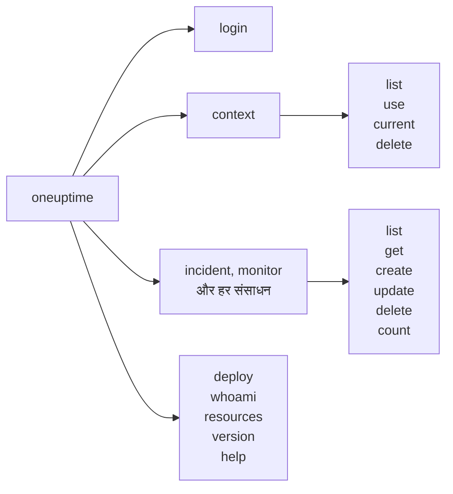

# कमांड संदर्भ

`oneuptime` CLI की हर कमांड, उसके आर्ग्युमेंट, विकल्पों और डिफ़ॉल्ट के साथ। अपने टर्मिनल में यही देखने के लिए किसी भी कमांड में `--help` जोड़ें।

:::cards
- [ग्लोबल विकल्प](#ग्लोबल-विकल्प): वे विकल्प जो हर कमांड लेती है।
- [लॉगिन और कॉन्टेक्स्ट](#लॉगिन-और-कॉन्टेक्स्ट): login और context कमांड।
- [संसाधन कमांड](#संसाधन-कमांड): list, get, create, update, delete और count।
- [अन्य कमांड](#अन्य-कमांड): deploy, whoami, resources, version और help।
:::

## कमांड



## ग्लोबल विकल्प

| विकल्प | यह क्या करता है | डिफ़ॉल्ट |
| --- | --- | --- |
| `--api-key <key>` | इस कमांड के लिए API कुंजी | `ONEUPTIME_API_KEY`, फिर कॉन्टेक्स्ट की कुंजी |
| `--url <url>` | इस कमांड के लिए आपके OneUptime का पता | `ONEUPTIME_URL`, फिर कॉन्टेक्स्ट का URL |
| `--context <name>` | इस कमांड के लिए उपयोग होने वाला सहेजा कॉन्टेक्स्ट | मौजूदा कॉन्टेक्स्ट |
| `-o, --output <format>` | `json`, `table` या `wide` | टर्मिनल में `table`, पाइप में `json` |
| `--no-color` | बिना रंगों के प्रिंट करता है | रंगों के साथ, जब तक `NO_COLOR` सेट न हो |
| `-V, --version` | CLI का संस्करण प्रिंट करता है | |
| `-h, --help` | किसी कमांड की सहायता दिखाता है | |

विकल्प कमांड से पहले या बाद में आते हैं: `oneuptime --context staging incident list` और `oneuptime incident list --context staging` एक ही काम करते हैं।

## लॉगिन और कॉन्टेक्स्ट

### `oneuptime login`

एक API कुंजी और एक पते को कॉन्टेक्स्ट के रूप में सहेजती है, और उसे मौजूदा कॉन्टेक्स्ट बनाती है। [लॉग इन करें](/docs/cli/authentication#लॉग-इन-करें) देखें।

```bash
oneuptime login <api-key> <instance-url> [--context-name <name>]
```

| आर्ग्युमेंट या विकल्प | ज़रूरी | यह क्या है | डिफ़ॉल्ट |
| --- | --- | --- | --- |
| `<api-key>` | हाँ | आपके प्रोजेक्ट की एक API कुंजी | |
| `<instance-url>` | हाँ | आपके OneUptime का पता, जैसे `https://oneuptime.com` | |
| `--context-name <name>` | नहीं | वह नाम जिससे कॉन्टेक्स्ट सहेजा जाता है | `default` |

### `oneuptime context list`

सहेजे कॉन्टेक्स्ट सूचीबद्ध करती है; `*` मौजूदा को चिह्नित करता है। API कुंजियाँ कभी सूचीबद्ध नहीं होतीं।

```bash
oneuptime context list [-o <format>]
```

| विकल्प | ज़रूरी | यह क्या है |
| --- | --- | --- |
| `-o, --output <format>` | नहीं | `json`, `table` या `wide`। JSON हर कॉन्टेक्स्ट का `name`, `apiUrl` और `isCurrent` देता है |

### `oneuptime context use`

किसी सहेजे कॉन्टेक्स्ट को मौजूदा बनाती है।

```bash
oneuptime context use <name>
```

| आर्ग्युमेंट | ज़रूरी | यह क्या है |
| --- | --- | --- |
| `<name>` | हाँ | किसी सहेजे कॉन्टेक्स्ट का नाम |

### `oneuptime context current`

मौजूदा कॉन्टेक्स्ट का नाम और URL दिखाती है, और उसकी API कुंजी, जिसमें पहले चार और आखिरी चार अक्षरों को छोड़कर सब छिपा होता है।

```bash
oneuptime context current
```

### `oneuptime context delete`

सहेजा कॉन्टेक्स्ट हटाती है। अगर वह मौजूदा था, तो बचा हुआ पहला कॉन्टेक्स्ट मौजूदा बन जाता है।

```bash
oneuptime context delete <name>
```

| आर्ग्युमेंट | ज़रूरी | यह क्या है |
| --- | --- | --- |
| `<name>` | हाँ | किसी सहेजे कॉन्टेक्स्ट का नाम |

## संसाधन कमांड

`<resource>` किसी तरह के रिकॉर्ड की कमांड है, [संसाधन](#संसाधन) टेबलों से, जैसे `incident` या `monitor`। उदाहरणों के लिए [संसाधन संचालन](/docs/cli/resource-operations) देखें।

### `oneuptime <resource> list`

रिकॉर्ड सूचीबद्ध करती है, सबसे नए पहले। लेबल इसके बजाय नाम के क्रम में सूचीबद्ध होते हैं, संख्या वाले लेबल पहले (`2. Team` पहले, `10. Owner` बाद में)।

```bash
oneuptime <resource> list [--query <json>] [--limit <n>] [--skip <n>] [--sort <json>] [-o <format>]
```

| विकल्प | यह क्या करता है | डिफ़ॉल्ट |
| --- | --- | --- |
| `--query <json>` | एक फ़िल्टर, JSON के रूप में | हर वह रिकॉर्ड जिसे कुंजी पढ़ सकती है |
| `--limit <n>` | लौटाए जाने वाले अधिकतम रिकॉर्ड, 10,000 तक | `10` |
| `--skip <n>` | पहले कितने रिकॉर्ड छोड़ने हैं | `0` |
| `--sort <json>` | क्रम, JSON के रूप में: `{"<field>":"ASC"}` या `{"<field>":"DESC"}` | सबसे नए पहले |
| `-o, --output <format>` | `json`, `table` या `wide` | टर्मिनल में `table`, पाइप में `json` |

### `oneuptime <resource> get`

एक रिकॉर्ड पढ़ती है। केवल रिकॉर्ड के लिए: टेलीमेट्री में `get` नहीं है।

```bash
oneuptime <resource> get <id> [-o <format>]
```

| आर्ग्युमेंट या विकल्प | ज़रूरी | यह क्या है |
| --- | --- | --- |
| `<id>` | हाँ | रिकॉर्ड की ID, एक UUID |
| `-o, --output <format>` | नहीं | `json`, `table` या `wide` |

### `oneuptime <resource> create`

एक रिकॉर्ड बनाती है और उसे प्रिंट करती है।

```bash
oneuptime <resource> create (--data <json> | --file <path>) [-o <format>]
```

| विकल्प | ज़रूरी | यह क्या है |
| --- | --- | --- |
| `--data <json>` | दोनों में से एक | रिकॉर्ड, JSON के रूप में |
| `--file <path>` | दोनों में से एक | रिकॉर्ड वाली JSON फ़ाइल। `--data` के साथ दी जाए, तो फ़ाइल उपयोग होती है |
| `-o, --output <format>` | नहीं | `json`, `table` या `wide` |

### `oneuptime <resource> update`

आपके दिए फ़ील्ड बदलती है। केवल रिकॉर्ड के लिए: टेलीमेट्री में `update` नहीं है।

```bash
oneuptime <resource> update <id> --data <json> [-o <format>]
```

| आर्ग्युमेंट या विकल्प | ज़रूरी | यह क्या है |
| --- | --- | --- |
| `<id>` | हाँ | रिकॉर्ड की ID |
| `--data <json>` | हाँ | बदलने वाले फ़ील्ड, JSON के रूप में |
| `-o, --output <format>` | नहीं | `json`, `table` या `wide` |

### `oneuptime <resource> delete`

बिना पूछे, तुरंत एक रिकॉर्ड हटाती है। केवल रिकॉर्ड के लिए: टेलीमेट्री में `delete` नहीं है।

```bash
oneuptime <resource> delete <id> [--force]
```

| आर्ग्युमेंट या विकल्प | ज़रूरी | यह क्या है |
| --- | --- | --- |
| `<id>` | हाँ | रिकॉर्ड की ID |
| `--force` | नहीं | स्वीकार होता है और कुछ नहीं बदलता: `delete` कभी पुष्टि नहीं माँगता |

### `oneuptime <resource> count`

रिकॉर्ड गिनती है, और संख्या प्रिंट करती है।

```bash
oneuptime <resource> count [--query <json>] [-o <format>]
```

| विकल्प | ज़रूरी | यह क्या है |
| --- | --- | --- |
| `--query <json>` | नहीं | एक फ़िल्टर, JSON के रूप में। इसके बिना, हर वह रिकॉर्ड जिसे कुंजी पढ़ सकती है |
| `-o, --output <format>` | नहीं | `json`, `table` या `wide` |

### संसाधन

रिकॉर्ड `list`, `get`, `create`, `update`, `delete` और `count` लेते हैं:

| क्षेत्र | कमांड |
| --- | --- |
| मॉनिटरिंग | `monitor`, `monitor-status`, `monitor-status-event` |
| घटनाएँ | `incident`, `incident-state`, `incident-severity`, `incident-state-timeline`, `incident-public-note`, `incident-internal-note`, `incident-alert`, `postmortem-status` |
| अलर्ट | `alert`, `alert-state`, `alert-severity`, `alert-state-timeline`, `alert-internal-note` |
| स्थिति पृष्ठ | `status-page`, `status-page-announcement` |
| अनुसूचित रखरखाव | `scheduled-maintenance-event`, `scheduled-maintenance-state`, `scheduled-maintenance-state-timeline` |
| टीमें और ऑन-कॉल | `team`, `on-call-policy` |
| सुरक्षा | `security-case`, `security-case-evidence`, `security-case-note`, `security-case-priority`, `security-case-status`, `security-case-task`, `security-detection`, `security-playbook` |
| डेटा सुरक्षा | `data-store`, `data-store-finding`, `data-store-access-entry`, `data-flow`, `data-security-issue`, `data-security-scan`, `custom-data-type`, `check-setting`, `residency-rule`, `data-security-setting` |
| लेबल | `label` |

टेलीमेट्री `list`, `create` और `count` लेती है:

| क्षेत्र | कमांड |
| --- | --- |
| ऑब्ज़र्वेबिलिटी | `log`, `metric`, `span`, `exception-instance`, `monitor-log` |
| सुरक्षा | `security-event`, `threat-intel-indicator` |
| बदलाव और लागत | `change-event`, `kubernetes-cost-allocation` |

CLI, OneUptime के साथ रिलीज़ होता है, इसलिए `oneuptime resources` आपके इंस्टॉल किए संस्करण की कमांड सूचीबद्ध करता है।

### API अनुरोध

हर संचालन API को एक अनुरोध है, जिसमें कुंजी `APIKey` हेडर में होती है। `<path>` संसाधन का API पाथ है, जो `oneuptime resources` से मिलता है: `incident` के लिए `/incident`, `on-call-policy` के लिए `/on-call-duty-policy`।

| संचालन | अनुरोध | बॉडी |
| --- | --- | --- |
| `list` | `POST /api/<path>/get-list` | `query`, `select`, `skip`, `limit` और `sort` |
| `get` | `POST /api/<path>/<id>/get-item` | `select` |
| `create` | `POST /api/<path>` | `{"data": ...}` |
| `update` | `PUT /api/<path>/<id>/` | `{"data": ...}` |
| `delete` | `DELETE /api/<path>/<id>/` | कोई नहीं |
| `count` | `POST /api/<path>/count` | `query` |

## अन्य कमांड

### `oneuptime deploy`

किसी पाइपलाइन से एक डिप्लॉय, या कोई दूसरा बदलाव, रिकॉर्ड करती है: यह सेवा के चार्ट पर दिखाया जाता है और OneUptime AI किसी घटना की जांच करते समय इसे पढ़ता है। यह API कुंजी से नहीं, बल्कि टेलीमेट्री इंजेशन कुंजी से लिखती है। [डिप्लॉय और बदलाव](/docs/telemetry/change-events) देखें।

```bash
oneuptime deploy [--service <name>] [--service-version <version>] [--previous-version <version>] [--commit <sha>] [--repository <url>] [--branch <name>] [--pull-request <number>] [--environment <name>] [--title <title>] [--description <text>] [--type <type>] [--time <time>] [--attribute <key=value...>] [--ingestion-key <key>]
```

| विकल्प | ज़रूरी | यह क्या है | डिफ़ॉल्ट |
| --- | --- | --- | --- |
| `--service <name>` | नहीं | वह सेवा जिसे डिप्लॉय किया गया | पूरे प्रोजेक्ट का बदलाव |
| `--service-version <version>` | नहीं | डिप्लॉय किया गया संस्करण | |
| `--previous-version <version>` | नहीं | वह संस्करण जिसकी जगह इसने ली | |
| `--commit <sha>` | नहीं | डिप्लॉय किया गया कमिट | |
| `--repository <url>` | नहीं | वह रिपॉजिटरी जिसमें कमिट है | |
| `--branch <name>` | नहीं | डिप्लॉय की गई ब्रांच | |
| `--pull-request <number>` | नहीं | डिप्लॉय किया गया पुल रिक्वेस्ट | |
| `--environment <name>` | नहीं | वह एनवायरनमेंट जिसमें डिप्लॉय किया गया | |
| `--title <title>` | नहीं | बदलाव का शीर्षक; डिप्लॉय के अलावा किसी दूसरे प्रकार के बदलाव के लिए यह ज़रूरी है | `Deploy <version>` |
| `--description <text>` | नहीं | बदलाव का विवरण | |
| `--type <type>` | नहीं | बदलाव का प्रकार, जैसे `config-change` या `rollback` | `deployment` |
| `--time <time>` | नहीं | यह कब हुआ, जैसे `2026-10-19T10:00:00Z` | अभी |
| `--attribute <key=value...>` | नहीं | और एट्रिब्यूट, `key=value` के रूप में, एक या ज़्यादा | |
| `--ingestion-key <key>` | नहीं | प्रोजेक्ट की एक टेलीमेट्री इंजेशन कुंजी | `ONEUPTIME_TELEMETRY_INGESTION_KEY` |

### `oneuptime whoami`

वह URL और API कुंजी दिखाती है जिनका अगली कमांड उपयोग करेगी, कुंजी छिपाकर, और वह कॉन्टेक्स्ट जिससे वे आती हैं। यह OneUptime को कॉल नहीं करती। [देखें कि CLI क्या उपयोग करेगा](/docs/cli/authentication#देखें-कि-cli-क्या-उपयोग-करेगा) देखें।

```bash
oneuptime whoami
```

### `oneuptime resources`

हर तरह का वह रिकॉर्ड सूचीबद्ध करती है जिसकी CLI में कमांड है: उसकी कमांड, एकवचन और बहुवचन नाम, प्रकार और API पाथ, और कुल संख्या।

```bash
oneuptime resources [--type <type>] [-o <format>]
```

| विकल्प | ज़रूरी | यह क्या है | डिफ़ॉल्ट |
| --- | --- | --- | --- |
| `--type <type>` | नहीं | रिकॉर्ड के लिए `database`, टेलीमेट्री के लिए `analytics` | दोनों |
| `-o, --output <format>` | नहीं | `json`, `table` या `wide`। JSON हर एक का `name`, `singularName`, `pluralName`, `modelType` और `apiPath` देता है | टर्मिनल में `table`, पाइप में `json` |

### `oneuptime version`

CLI का संस्करण प्रिंट करती है, जैसे `oneuptime --version` करता है।

```bash
oneuptime version
```

### `oneuptime help`

CLI की, या किसी कमांड की, सहायता दिखाती है।

```bash
oneuptime help [command]
```

## एनवायरनमेंट वेरिएबल

| वेरिएबल | यह क्या करता है |
| --- | --- |
| `ONEUPTIME_API_KEY` | API कुंजी, जब कोई `--api-key` फ़्लैग कुंजी न दे |
| `ONEUPTIME_URL` | आपके OneUptime का पता, जब कोई `--url` फ़्लैग पता न दे |
| `ONEUPTIME_TELEMETRY_INGESTION_KEY` | वह टेलीमेट्री इंजेशन कुंजी जिससे `oneuptime deploy` लिखती है, जब कोई `--ingestion-key` फ़्लैग कुंजी न दे |
| `NO_COLOR` | कोई भी मान देने पर रंग बंद करता है |

## फ़ाइलें

| फ़ाइल | इसमें क्या होता है |
| --- | --- |
| `~/.oneuptime/config.json` | सहेजे कॉन्टेक्स्ट, उनकी API कुंजियाँ, और मौजूदा कॉन्टेक्स्ट |

## एग्ज़िट कोड

| कोड | मतलब |
| --- | --- |
| `0` | काम हुआ |
| `1` | विफल हुआ: OneUptime ने अनुरोध अस्वीकार किया, या कमांड गलत थी |
| `2` | कोई उपयोग योग्य API कुंजी नहीं: नहीं मिली, अमान्य, या अपने प्लान से नीचे |
| `3` | नहीं मिला: OneUptime ने `404` जवाब दिया |

उदाहरणों के लिए [एग्ज़िट कोड](/docs/cli/scripting#एग्ज़िट-कोड) देखें।

## अगले कदम

:::cards
- [CLI अवलोकन](/docs/cli/index): CLI इंस्टॉल करें और अपनी पहली कमांड चलाएँ।
- [संसाधन संचालन](/docs/cli/resource-operations): हर संचालन के उदाहरण।
- [स्क्रिप्टिंग और CI/CD](/docs/cli/scripting): स्क्रिप्ट और पाइपलाइन में CLI।
:::
