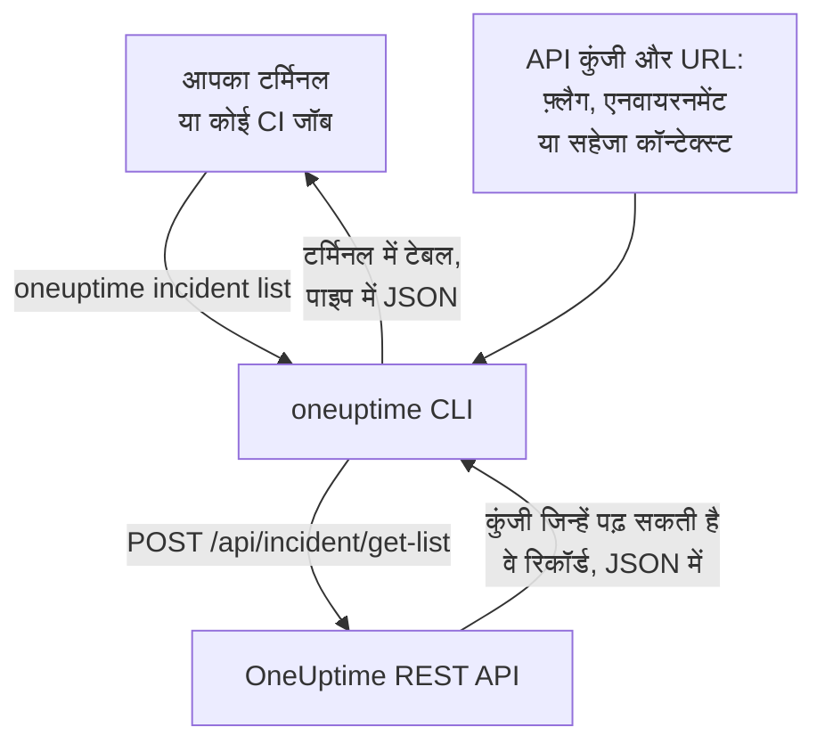

# CLI अवलोकन

OneUptime CLI, यानी `oneuptime`, टर्मिनल या स्क्रिप्ट से आपके OneUptime प्रोजेक्ट का प्रबंधन करता है। अपने प्रोजेक्ट की API कुंजी से मॉनिटर, घटनाएँ, अलर्ट, स्थिति पृष्ठ और OneUptime API के दिए बाकी रिकॉर्ड सूचीबद्ध करें, पढ़ें, बनाएँ, बदलें, हटाएँ और गिनें।

:::cards
- [CLI कैसे काम करता है](#cli-कैसे-काम-करता-है): एक कमांड, एक API अनुरोध, एक जवाब।
- [CLI इंस्टॉल करें](#cli-इंस्टॉल-करें): एक npm कमांड, और कौन-सा संस्करण चुनें।
- [अपनी पहली कमांड चलाएँ](#अपनी-पहली-कमांड-चलाएँ): अपनी API कुंजी सहेजें, फिर अपनी घटनाएँ सूचीबद्ध करें।
- [सभी कमांड एक नज़र में](#सभी-कमांड-एक-नज़र-में): हर कमांड, और वह पेज जो उसे समझाता है।
:::

## CLI कैसे काम करता है

हर कमांड OneUptime REST API को एक अनुरोध भेजती है और जवाब प्रिंट करती है। CLI API कुंजी और आपके OneUptime का पता फ़्लैग, एनवायरनमेंट वेरिएबल या `oneuptime login` के सहेजे कॉन्टेक्स्ट से लेता है। कोई कमांड क्या पढ़ और बदल सकती है, यह कुंजी तय करती है, ठीक वैसे ही जैसे API के लिए।



रिकॉर्ड की कमांड CLI के साथ आती हैं: OneUptime API जिस भी तरह का रिकॉर्ड टूल के लिए खोलता है, उसकी एक कमांड है, यानी वही रिकॉर्ड जिनके लिए [MCP सर्वर](/docs/ai/mcp-server) में टूल हैं। उन्हें सूचीबद्ध करने के लिए `oneuptime resources` चलाएँ।

## शुरू करने से पहले

- **Node.js और npm**, कोई मौजूदा LTS रिलीज़, CLI इंस्टॉल करने के लिए।
- **आपके प्रोजेक्ट की एक API कुंजी।** इसे **प्रोजेक्ट सेटिंग्स → उन्नत → API कुंजियाँ** में **API कुंजी बनाएँ** से बनाएँ: [एक API कुंजी बनाएँ](/docs/api-reference/api-reference#एक-api-कुंजी-बनाएँ) देखें।
- **OneUptime Cloud पर, Growth प्लान या उससे ऊपर।** प्रोजेक्ट की API कुंजियाँ केवल उसी पर काम करती हैं: [अपने प्लान से नीचे API कुंजियाँ और SCIM](/docs/api-reference/api-reference#अपने-प्लान-से-नीचे-api-कुंजियाँ-और-scim) देखें।

## CLI इंस्टॉल करें

npm से `@oneuptime/cli` पैकेज इंस्टॉल करें। यह `oneuptime` कमांड जोड़ता है, और `--version` आपका इंस्टॉल किया संस्करण प्रिंट करता है:

```bash
npm install -g @oneuptime/cli
oneuptime --version
```

CLI, OneUptime के साथ रिलीज़ होता है और उसका संस्करण नंबर भी वही होता है। सेल्फ़-होस्टेड OneUptime पर, अपने OneUptime के संस्करण वाला CLI इंस्टॉल करें, ताकि उसकी कमांड आपके सर्वर के रिकॉर्ड से मेल खाएँ:

```bash
npm install -g @oneuptime/cli@<your-oneuptime-version>
```

> [!WARNING]
> 14.0.64 से पहले के CLI संस्करण शुरू होते ही `Cannot find module 'Common/Models/DatabaseModels/Index'` जैसी त्रुटि के साथ रुक जाते हैं। `npm install -g @oneuptime/cli@latest` से 14.0.64 या उसके बाद का संस्करण इंस्टॉल करें। 14.0.64 से पुराने सेल्फ़-होस्टेड OneUptime पर पहले [OneUptime को अपग्रेड करें](/docs/installation/upgrading#अपग्रेड-कैसे-करें), फिर उसी संस्करण का CLI इंस्टॉल करें जिस पर आपने अपग्रेड किया है।

## अपनी पहली कमांड चलाएँ

:::steps
### अपनी API कुंजी सहेजें

कुंजी और अपने OneUptime के पते से लॉग इन करें। CLI उन्हें `default` नाम के कॉन्टेक्स्ट के रूप में सहेजता है और अब से उसी का उपयोग करता है:

```bash
oneuptime login <your-api-key> https://oneuptime.com
```

यह `Logged in successfully. Context "default" is now active.` जवाब देता है। सेल्फ़-होस्टेड OneUptime पर, `https://oneuptime.com` की जगह उसका पता लिखें।

### अपनी घटनाएँ सूचीबद्ध करें

```bash
oneuptime incident list
```

दस सबसे नई घटनाएँ टेबल के रूप में दिखती हैं। `login` कुंजी को जाँचे बिना सहेजता है, इसलिए यह पहली कमांड है जो दिखाती है कि कुंजी काम करती है: अगर इसे अस्वीकार किया जाए, तो [समस्या निवारण](/docs/cli/authentication#समस्या-निवारण) देखें।

### देखें कि आप और क्या प्रबंधित कर सकते हैं

```bash
oneuptime resources
```

सूची हर तरह का वह रिकॉर्ड दिखाती है जिसके साथ आप काम कर सकते हैं, और उसकी कमांड, जैसे `monitor`, `status-page` या `on-call-policy`।
:::

## सभी कमांड एक नज़र में

| कमांड | यह क्या करती है | और पढ़ें |
| --- | --- | --- |
| `oneuptime login <api-key> <instance-url>` | API कुंजी और पते को कॉन्टेक्स्ट के रूप में सहेजती है | [प्रमाणीकरण](/docs/cli/authentication#लॉग-इन-करें) |
| `oneuptime context list`, `use`, `current`, `delete` | सहेजे कॉन्टेक्स्ट सूचीबद्ध करती है, बदलती है, दिखाती है और हटाती है | [प्रमाणीकरण](/docs/cli/authentication#कॉन्टेक्स्ट) |
| `oneuptime whoami` | वह URL और API कुंजी दिखाती है जिनका अगली कमांड उपयोग करेगी | [प्रमाणीकरण](/docs/cli/authentication#देखें-कि-cli-क्या-उपयोग-करेगा) |
| `oneuptime deploy` | चार्ट और OneUptime AI के लिए एक डिप्लॉय, या कोई दूसरा बदलाव, रिकॉर्ड करती है | [डिप्लॉय और बदलाव](/docs/telemetry/change-events) |
| `oneuptime <resource> list`, `get`, `create`, `update`, `delete`, `count` | एक तरह के रिकॉर्ड के साथ काम करती है | [संसाधन संचालन](/docs/cli/resource-operations) |
| `oneuptime resources` | रिकॉर्ड के प्रकार उनकी कमांड के साथ सूचीबद्ध करती है | [कमांड संदर्भ](/docs/cli/command-reference#oneuptime-resources) |
| `oneuptime version` | CLI का संस्करण प्रिंट करती है | [कमांड संदर्भ](/docs/cli/command-reference#oneuptime-version) |
| `oneuptime help [command]` | किसी कमांड की सहायता दिखाती है | [सहायता पाएँ](#सहायता-पाएँ) |

## ग्लोबल विकल्प

ये विकल्प हर कमांड के साथ काम करते हैं, उसके पहले या बाद में:

| विकल्प | यह क्या करता है |
| --- | --- |
| `--api-key <key>` | इस कमांड के लिए API कुंजी, सहेजी गई कुंजी की जगह |
| `--url <url>` | इस कमांड के लिए आपके OneUptime का पता |
| `--context <name>` | इस कमांड के लिए कोई सहेजा कॉन्टेक्स्ट, मौजूदा कॉन्टेक्स्ट की जगह |
| `-o, --output <format>` | `table`, `json` या `wide`: [आउटपुट प्रारूप](/docs/cli/output-formats) देखें |
| `--no-color` | बिना रंगों के प्रिंट करता है |
| `-V, --version` | CLI का संस्करण प्रिंट करता है |
| `-h, --help` | कमांड की सहायता दिखाता है |

## सहायता पाएँ

हर कमांड की अपनी सहायता है, जिसमें उसके आर्ग्युमेंट, विकल्प और डिफ़ॉल्ट होते हैं:

```bash
oneuptime --help
oneuptime help incident
oneuptime incident list --help
```

## अगले कदम

:::cards
- [प्रमाणीकरण](/docs/cli/authentication): हर एनवायरनमेंट के लिए कॉन्टेक्स्ट, और कोई कमांड कौन-सी कुंजी उपयोग करती है।
- [संसाधन संचालन](/docs/cli/resource-operations): रिकॉर्ड सूचीबद्ध करें, पढ़ें, बनाएँ, बदलें, हटाएँ और गिनें।
- [आउटपुट प्रारूप](/docs/cli/output-formats): लोगों के लिए टेबल, स्क्रिप्ट के लिए JSON।
- [स्क्रिप्टिंग और CI/CD](/docs/cli/scripting): एग्ज़िट कोड, jq और पाइपलाइन।
- [कमांड संदर्भ](/docs/cli/command-reference): हर कमांड, विकल्प और डिफ़ॉल्ट।
:::
