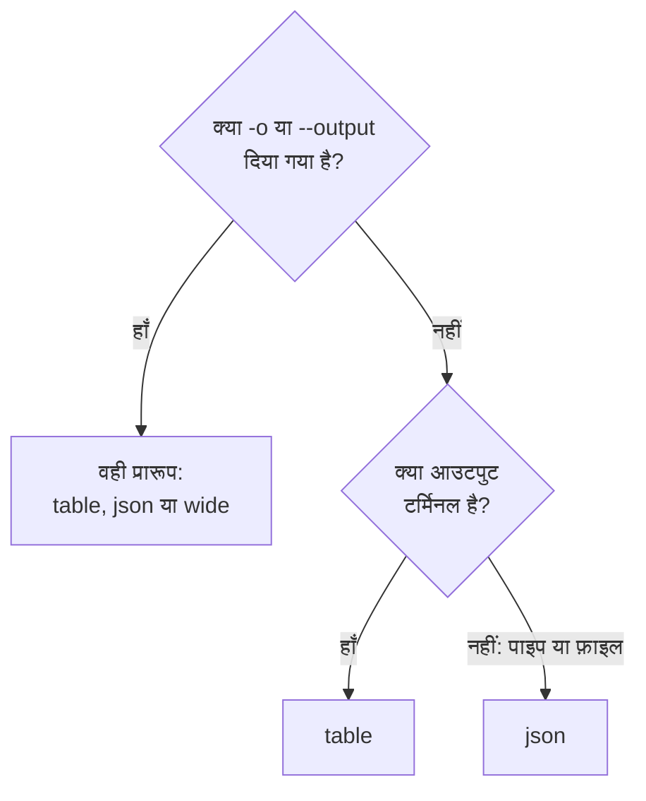

# आउटपुट प्रारूप

जब आप टर्मिनल में जवाब पढ़ते हैं तो CLI टेबल प्रिंट करता है, और जब कोई स्क्रिप्ट या दूसरा प्रोग्राम उसे पढ़ता है तो JSON। किसी भी कमांड का प्रारूप `-o` या `--output` से चुनें।

:::cards
- [प्रारूप कैसे चुना जाता है](#प्रारूप-कैसे-चुना-जाता-है): टर्मिनल को टेबल मिलती है, पाइप को JSON।
- [टेबल](#टेबल): छह कॉलम, हर मान 60 अक्षरों पर कटा हुआ।
- [JSON](#json): हर फ़ील्ड, पूरा, स्क्रिप्ट और jq के लिए।
- [वाइड](#वाइड): हर कॉलम वाली टेबल।
:::

## प्रारूप कैसे चुना जाता है



| प्रारूप | यह क्या प्रिंट करता है | किसके लिए सबसे अच्छा |
| --- | --- | --- |
| `table` | अधिकतम छह कॉलम की टेबल; एक रिकॉर्ड हर फ़ील्ड के लिए एक पंक्ति के रूप में | टर्मिनल में पढ़ना |
| `json` | जवाब जैसा OneUptime ने भेजा, दो स्पेस के इंडेंट के साथ | स्क्रिप्ट, `jq` और फ़ाइलें |
| `wide` | हर फ़ील्ड के लिए एक कॉलम वाली टेबल | एक नज़र में कई फ़ील्ड की तुलना |

`-o` हर उस कमांड पर काम करता है जो रिकॉर्ड प्रिंट करती है: किसी संसाधन के `list`, `get`, `create`, `update` और `count`, `oneuptime resources` और `oneuptime context list`। यह कमांड लाइन पर कहीं भी आ सकता है। कोई भी दूसरा मान अनुरोध भेजे जाने से पहले ही अस्वीकार हो जाता है:

```text
error: option '-o, --output <format>' argument 'yaml' is invalid. Allowed choices are json, table, wide.
```

## टेबल

टर्मिनल में टेबल डिफ़ॉल्ट है। उदाहरण के लिए, `oneuptime resources --type analytics` यह टेबल प्रिंट करता है:

```text
┌────────────────────────────┬────────────────────────────┬─────────────────────────────┬───────────┬─────────────────────────────┐
│ Command                    │ Singular                   │ Plural                      │ Type      │ API Path                    │
├────────────────────────────┼────────────────────────────┼─────────────────────────────┼───────────┼─────────────────────────────┤
│ log                        │ Log                        │ Logs                        │ analytics │ /logs                       │
├────────────────────────────┼────────────────────────────┼─────────────────────────────┼───────────┼─────────────────────────────┤
│ span                       │ Span                       │ Spans                       │ analytics │ /span                       │
├────────────────────────────┼────────────────────────────┼─────────────────────────────┼───────────┼─────────────────────────────┤
│ metric                     │ Metric                     │ Metrics                     │ analytics │ /metrics                    │
├────────────────────────────┼────────────────────────────┼─────────────────────────────┼───────────┼─────────────────────────────┤
│ exception-instance         │ Exception Instance         │ Exception Instances         │ analytics │ /exceptions                 │
├────────────────────────────┼────────────────────────────┼─────────────────────────────┼───────────┼─────────────────────────────┤
│ monitor-log                │ Monitor Log                │ Monitor Logs                │ analytics │ /monitor-log                │
├────────────────────────────┼────────────────────────────┼─────────────────────────────┼───────────┼─────────────────────────────┤
│ kubernetes-cost-allocation │ Kubernetes Cost Allocation │ Kubernetes Cost Allocations │ analytics │ /kubernetes-cost-allocation │
├────────────────────────────┼────────────────────────────┼─────────────────────────────┼───────────┼─────────────────────────────┤
│ security-event             │ Security Event             │ Security Events             │ analytics │ /security-events            │
├────────────────────────────┼────────────────────────────┼─────────────────────────────┼───────────┼─────────────────────────────┤
│ change-event               │ Change Event               │ Change Events               │ analytics │ /change-events              │
├────────────────────────────┼────────────────────────────┼─────────────────────────────┼───────────┼─────────────────────────────┤
│ threat-intel-indicator     │ Threat Intel Indicator     │ Threat Intel Indicators     │ analytics │ /threat-intel-indicators    │
└────────────────────────────┴────────────────────────────┴─────────────────────────────┴───────────┴─────────────────────────────┘

Total: 9 resources
```

रिकॉर्ड की सूची के लिए, टेबल अधिकतम छह कॉलम दिखाती है: पहले `_id`, `name`, `title`, `status`, `createdAt` और `updatedAt` में से वे जो रिकॉर्ड में हैं, फिर क्रम से रिकॉर्ड के अगले फ़ील्ड। कॉलम पहले रिकॉर्ड से लिए जाते हैं। 60 अक्षरों से लंबा मान उसके पहले 57 अक्षरों तक काटा जाता है, और उसके बाद `...` आता है।

एक रिकॉर्ड, जैसा `get` और `create` उसे प्रिंट करते हैं, दो कॉलम की टेबल होता है: फ़ील्ड का नाम और उसका मान, हर फ़ील्ड के लिए एक पंक्ति।

OneUptime तारीखें और दूसरे रिकॉर्ड की ID ऑब्जेक्ट के रूप में भेजता है, जैसे `{"_type":"DateTime","value":"2026-10-14T09:12:44.000Z"}`, और टेबल उन्हें उसी टेक्स्ट के रूप में दिखाती है। उनका मान `value` में होता है: [JSON](#json) देखें।

## JSON

JSON वह जवाब है जैसा OneUptime ने भेजा, दो स्पेस के इंडेंट के साथ: सूची रिकॉर्ड का ऐरे है, और एक रिकॉर्ड एक ऑब्जेक्ट।

```bash
oneuptime incident list --limit 1 -o json
```

```json
[
  {
    "_id": "6f1c2a40-3b1e-4c55-9a0b-3e2f8d7c1a11",
    "createdAt": {
      "_type": "DateTime",
      "value": "2026-10-14T09:12:44.000Z"
    },
    "title": "Checkout API is down",
    "currentIncidentStateId": {
      "_type": "ObjectID",
      "value": "0b7d5e2c-8f4a-4d1b-9c3e-5a6f7b8c9d0e"
    }
  }
]
```

रिकॉर्ड में हर वह फ़ील्ड होता है जिसे कुंजी पढ़ सकती है; यह रिकॉर्ड चार फ़ील्ड तक छोटा किया गया है। रिकॉर्ड की अपनी `_id` टेक्स्ट है, और बाकी ID और तारीखें ऐसे ऑब्जेक्ट हैं जिनका `value` उन्हें रखता है:

```bash
oneuptime incident list -o json | jq -r '.[] | "\(.createdAt.value)  \(.title)"'
```

जब आउटपुट टर्मिनल नहीं होता, जैसे `oneuptime incident list | jq '.[].title'` में, तो CLI `-o json` के बिना भी JSON प्रिंट करता है। फिर भी स्क्रिप्ट में `-o json` लिखें, ताकि वे इस पर निर्भर न रहें।

## वाइड

`-o wide` ऐसी टेबल है जिसमें रिकॉर्ड के हर फ़ील्ड के लिए एक कॉलम होता है। हर मान अब भी 60 अक्षरों पर कटता है, और रिकॉर्ड में कई फ़ील्ड होते हैं, इसलिए वाइड टेबल बहुत चौड़ी होती है: उसे `less -S` से पेज करके देखें।

```bash
oneuptime incident list -o wide | less -S
```

## रंग

टेबल के हेडर सियान होते हैं; संदेश कुछ सफल होने पर हरे, जानकारी के लिए नीले और त्रुटियों के लिए लाल होते हैं। रंग `--no-color` से, या `NO_COLOR` को कोई भी मान देकर, बंद करें:

```bash
oneuptime incident list --no-color
NO_COLOR=1 oneuptime incident list
```

## हर कमांड क्या प्रिंट करती है

रिकॉर्ड और गिनती मानक आउटपुट में जाते हैं, और त्रुटियाँ मानक त्रुटि में, इसलिए पाइप केवल जवाब पढ़ता है।

| कमांड | टेबल में | JSON में |
| --- | --- | --- |
| कुछ न पाने वाला `list` | `No results found.` | `[]` |
| `get` या `create` | हर फ़ील्ड के लिए एक पंक्ति | रिकॉर्ड |
| `count` | संख्या | संख्या |
| `update` | एक खाली पंक्ति | `{}` |
| `delete` | `Monitor <id> deleted successfully.` | वही पंक्ति |

## अगले कदम

:::cards
- [स्क्रिप्टिंग और CI/CD](/docs/cli/scripting): स्क्रिप्ट और पाइपलाइन में jq से JSON पढ़ें।
- [संसाधन संचालन](/docs/cli/resource-operations): वे संचालन जिनके ये जवाब हैं।
- [कमांड संदर्भ](/docs/cli/command-reference): हर कमांड और विकल्प।
:::
