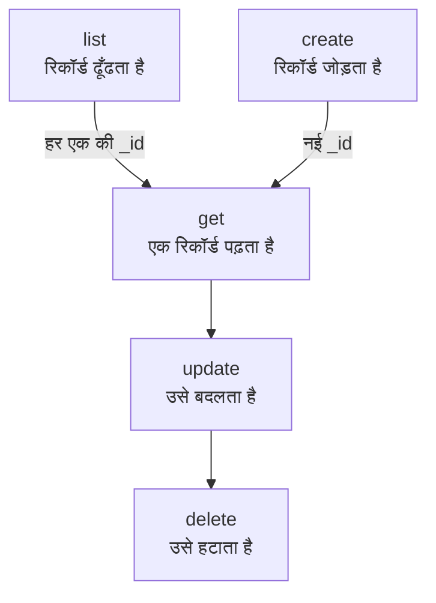

# संसाधन संचालन

हर तरह का रिकॉर्ड अपनी अलग कमांड है, जैसे `incident`, `monitor` या `status-page`, और हर कमांड वही संचालन लेती है: `list`, `get`, `create`, `update`, `delete` और `count`। यह पेज हर संचालन दिखाता है, फ़िल्टर, पेजिंग और उस JSON के साथ जिसमें रिकॉर्ड लिखा जाता है।

:::cards
- [किसी रिकॉर्ड की कमांड ढूँढें](#किसी-रिकॉर्ड-की-कमांड-ढूँढें): oneuptime resources उन सभी को सूचीबद्ध करता है।
- [रिकॉर्ड सूचीबद्ध करें](#रिकॉर्ड-सूचीबद्ध-करें): फ़िल्टर, सॉर्ट और पेज।
- [रिकॉर्ड बनाएँ](#रिकॉर्ड-बनाएँ): कमांड लाइन पर या किसी फ़ाइल में JSON से।
- [रिकॉर्ड हटाएँ](#रिकॉर्ड-हटाएँ): तुरंत, बिना पूर्ववत किए।
:::

## संचालन आपस में कैसे जुड़ते हैं

किसी रिकॉर्ड को पढ़ने, बदलने और हटाने के लिए उसकी ID चाहिए। सूचीबद्ध करने, गिनने और बनाने के लिए किसी ID की ज़रूरत नहीं, और list या create से आपको वे ID मिलती हैं जो बाकी संचालन लेते हैं:



ID एक UUID होती है, जैसे `6f1c2a40-3b1e-4c55-9a0b-3e2f8d7c1a11`। आप इसे OneUptime में रिकॉर्ड के पेज से भी कॉपी कर सकते हैं: [किसी संसाधन की ID ढूँढना](/docs/api-reference/api-reference#किसी-संसाधन-की-id-ढूँढना) देखें।

## किसी रिकॉर्ड की कमांड ढूँढें

```bash
oneuptime resources
```

सूची हर तरह के रिकॉर्ड को उसकी कमांड, उसके नामों, उसके प्रकार और उसके API पाथ के साथ दिखाती है। प्रकार दो हैं:

| प्रकार | इसमें क्या होता है | संचालन |
| --- | --- | --- |
| `database` | वे रिकॉर्ड जिन्हें आप प्रबंधित करते हैं: मॉनिटर, घटनाएँ, अलर्ट, स्थिति पृष्ठ, टीमें और अन्य | `list`, `get`, `create`, `update`, `delete`, `count` |
| `analytics` | टेलीमेट्री: लॉग, स्पैन, मेट्रिक्स, अपवाद और अन्य इवेंट | `list`, `create`, `count` |

एक प्रकार दिखाने के लिए `oneuptime resources --type database` या `--type analytics` उपयोग करें। [कमांड संदर्भ](/docs/cli/command-reference#संसाधन) हर कमांड सूचीबद्ध करता है।

## रिकॉर्ड सूचीबद्ध करें

```bash
oneuptime <resource> list [--query <json>] [--limit <n>] [--skip <n>] [--sort <json>] [-o <format>]
```

| विकल्प | यह क्या करता है | डिफ़ॉल्ट |
| --- | --- | --- |
| `--query <json>` | केवल मेल खाने वाले रिकॉर्ड लौटाता है: [सूची फ़िल्टर करें](#सूची-फ़िल्टर-करें) देखें | हर वह रिकॉर्ड जिसे कुंजी पढ़ सकती है |
| `--limit <n>` | लौटाए जाने वाले अधिकतम रिकॉर्ड, 10,000 तक | `10` |
| `--skip <n>` | पहले कितने मेल खाने वाले रिकॉर्ड छोड़ने हैं | `0` |
| `--sort <json>` | क्रम, जैसे `{"createdAt":"ASC"}`, या सबसे नए पहले के लिए `"DESC"` | सबसे नए पहले |
| `-o, --output <format>` | `table`, `json` या `wide` | टर्मिनल में `table`, पाइप में `json` |

```bash
# The ten newest incidents
oneuptime incident list

# The oldest monitors first, 50 at a time: the second page
oneuptime monitor list --sort '{"createdAt":"ASC"}' --limit 50 --skip 50

# Every field of each incident, as JSON
oneuptime incident list -o json
```

सूची OneUptime से हर रिकॉर्ड का वह हर फ़ील्ड माँगती है जिसे कुंजी पढ़ सकती है। टेबल उनमें से छह दिखाती है; JSON सभी दिखाता है ([आउटपुट प्रारूप](/docs/cli/output-formats) देखें)। हर रिकॉर्ड से होकर पेज करने के लिए, `--skip` को `--limit` जितना बढ़ाते जाएँ, जब तक कोई पेज खाली न लौटे; `count` बताता है कि कुल कितने हैं।

लेबल सबसे नए पहले के बजाय नाम के क्रम में सूचीबद्ध होते हैं: जिन लेबलों के नाम किसी संख्या से शुरू होते हैं, वे पहले आते हैं, उस संख्या के क्रम में (`2. Team` पहले, `10. Owner` बाद में), फिर बाकी लेबल वर्णानुक्रम में। उन्हें किसी और क्रम में सूचीबद्ध करने के लिए `--sort` दें।

### सूची फ़िल्टर करें

`--query` वही फ़िल्टर लेता है जो API लेता है: मान वाला फ़ील्ड उसी मान से मेल खाता है, और `_type` वाला ऑब्जेक्ट तुलना करता है।

| फ़िल्टर | किससे मेल खाता है |
| --- | --- |
| `{"title":"Checkout API is down"}` | ठीक उसी मान वाले रिकॉर्ड |
| `{"title":{"_type":"Search","value":"checkout"}}` | वह टेक्स्ट जिसमें मान शामिल है |
| `{"createdAt":{"_type":"GreaterThan","value":"2026-10-01T00:00:00.000Z"}}` | बाद की तारीखें, या बड़ी संख्याएँ |
| `{"currentIncidentState":{"isResolvedState":false}}` | संसाधन जिस रिकॉर्ड का नाम देता है उसका फ़ील्ड: यहाँ, वे घटनाएँ जो हल नहीं हुई हैं |

```bash
oneuptime incident list --query '{"title":{"_type":"Search","value":"checkout"}}'
```

API संदर्भ में [फ़िल्टर, सॉर्ट और पेज](/docs/api-reference/api-reference#फ़िल्टर-सॉर्ट-और-पेज) हर `_type` सूचीबद्ध करता है।

## रिकॉर्ड पढ़ें

```bash
oneuptime <resource> get <id> [-o <format>]
```

```bash
oneuptime incident get 6f1c2a40-3b1e-4c55-9a0b-3e2f8d7c1a11
```

टेबल रिकॉर्ड के हर फ़ील्ड के लिए एक पंक्ति दिखाती है, हर मान 60 अक्षरों पर कटा हुआ; `-o json` मान पूरे दिखाता है। जो ID आपकी कुंजी के पढ़ने लायक किसी रिकॉर्ड की नहीं है, उसका जवाब `Not found` होता है, और कमांड कोड `3` के साथ बाहर निकलती है।

## रिकॉर्ड बनाएँ

```bash
oneuptime <resource> create --data <json> [-o <format>]
oneuptime <resource> create --file <path> [-o <format>]
```

`--data` रिकॉर्ड को JSON के रूप में लेता है, और `--file` उसे किसी JSON फ़ाइल से पढ़ता है। दोनों में से एक दें; दोनों देने पर फ़ाइल उपयोग होती है। फ़ील्ड API के ही हैं, और [API संदर्भ](/reference) हर संसाधन के फ़ील्ड सूचीबद्ध करता है। प्रोजेक्ट API कुंजी से आता है, इसलिए रिकॉर्ड में उसका नाम कभी नहीं होता।

```bash
# A manual monitor
oneuptime monitor create --data '{"name":"Checkout API","monitorType":"Manual"}'

# An incident with one of your severities
oneuptime incident create --data '{"title":"Checkout API is down","incidentSeverityId":"<severity-id>"}'

# The same incident, from a file
oneuptime incident create --file incident.json
```

CLI नया रिकॉर्ड, उसकी `_id` के साथ, प्रिंट करता है। घटना आपके प्रोजेक्ट की बनाई गई स्थिति में शुरू होती है, जब तक `currentIncidentStateId` कोई दूसरी स्थिति न बताए: [वह स्थिति जिसमें नया रिकॉर्ड शुरू होता है](/docs/api-reference/api-reference#वह-स्थिति-जिसमें-नया-रिकॉर्ड-शुरू-होता-है) देखें। अपनी गंभीरताओं की ID ढूँढने के लिए:

```bash
oneuptime incident-severity list -o json | jq -r '.[] | "\(._id)  \(.name)"'
```

> [!TIP]
> Windows पर, JSON को किसी फ़ाइल में रखें और `--file` उपयोग करें: PowerShell और Command Prompt कमांड लाइन पर JSON को Bash से अलग तरीके से कोट करते हैं।

## रिकॉर्ड अपडेट करें

```bash
oneuptime <resource> update <id> --data <json> [-o <format>]
```

`--data` ज़रूरी है और इसमें केवल बदलने वाले फ़ील्ड होते हैं:

```bash
# Rename a monitor
oneuptime monitor update <monitor-id> --data '{"name":"Checkout API (EU)"}'

# Move an incident to your resolved state
oneuptime incident update <incident-id> --data '{"currentIncidentStateId":"<resolved-state-id>"}'
```

OneUptime अपडेट का जवाब एक खाली ऑब्जेक्ट से देता है: CLI एक खाली पंक्ति प्रिंट करता है, या `-o json` के साथ `{}`। रिकॉर्ड अभी कैसा है यह देखने के लिए `get` चलाएँ। इस तरह किसी घटना को दूसरी स्थिति में ले जाने पर बदलाव उसकी टाइमलाइन पर दर्ज होता है, जैसा डैशबोर्ड करता है, और उसकी मौजूदा स्थिति से पहले की स्थिति अस्वीकार कर दी जाती है। हल हुई स्थिति की ID ढूँढने के लिए, जो आपके प्रोजेक्ट के क्रम में पहली है:

```bash
oneuptime incident-state list --query '{"isResolvedState":true}' --sort '{"order":"ASC"}' --limit 1 -o json | jq -r '.[0]._id'
```

## रिकॉर्ड हटाएँ

```bash
oneuptime <resource> delete <id>
```

```bash
oneuptime monitor delete 6f1c2a40-3b1e-4c55-9a0b-3e2f8d7c1a11
```

यह `Monitor 6f1c2a40-3b1e-4c55-9a0b-3e2f8d7c1a11 deleted successfully.` जवाब देता है।

> [!CAUTION]
> `delete` रिकॉर्ड को तुरंत हटा देता है। CLI आपसे पुष्टि नहीं माँगता, और इसे पूर्ववत नहीं किया जा सकता। यह उन स्क्रिप्ट के लिए `--force` स्वीकार करता है जो इसके साथ लिखी गई हैं, और `--force` कुछ नहीं बदलता।

## रिकॉर्ड गिनें

```bash
oneuptime <resource> count [--query <json>]
```

```bash
# Every incident
oneuptime incident count

# Incidents that are not resolved
oneuptime incident count --query '{"currentIncidentState":{"isResolvedState":false}}'
```

CLI एक संख्या प्रिंट करता है, टेबल और JSON में एक जैसी, ताकि स्क्रिप्ट उसे जैसी है वैसी ही पढ़ सके।

## हर प्रकार क्या कर सकता है

| संचालन | `database` | `analytics` |
| --- | --- | --- |
| `list` | हाँ | हाँ |
| `get` | हाँ | नहीं |
| `create` | हाँ | हाँ |
| `update` | हाँ | नहीं |
| `delete` | हाँ | नहीं |
| `count` | हाँ | हाँ |

## समस्या निवारण

:::details "Not found: API error (404)" संदेश
रिकॉर्ड मौजूद नहीं है, किसी दूसरे प्रोजेक्ट में है, या कुंजी उसे पढ़ नहीं सकती: OneUptime हर मामले में एक ही जवाब देता है। `list` से ID जाँचें, और कुंजी की अनुमतियाँ भी। कमांड कोड `3` के साथ बाहर निकलती है।
:::

:::details "API error (422): You do not have permissions to select on" संदेश
list या get रिकॉर्ड का हर फ़ील्ड माँगता है, और कुंजी उनमें से किसी एक को पढ़ नहीं सकती: संदेश उस फ़ील्ड और उसे पढ़ सकने वाली अनुमतियों के नाम बताता है। कुंजी को उनमें से एक अनुमति दें।
:::

:::details "Error: Invalid JSON" संदेश
`--query`, `--sort` या `--data` का मान JSON नहीं है। Bash और zsh में, उसे सिंगल कोट में लपेटें; Windows पर, रिकॉर्ड को किसी फ़ाइल में रखें और `--file` उपयोग करें।
:::

:::details create या update पर API error (400)
OneUptime ने कोई फ़ील्ड अस्वीकार किया: संदेश उसका नाम बताता है। `No fields to update` का मतलब है कि `--data` में बदलने के लिए कोई फ़ील्ड नहीं था।
:::

## अगले कदम

:::cards
- [आउटपुट प्रारूप](/docs/cli/output-formats): जवाबों को टेबल या JSON के रूप में पढ़ें।
- [स्क्रिप्टिंग और CI/CD](/docs/cli/scripting): इन संचालनों को स्क्रिप्ट और पाइपलाइन में उपयोग करें।
- [कमांड संदर्भ](/docs/cli/command-reference): हर कमांड, विकल्प और डिफ़ॉल्ट।
:::
