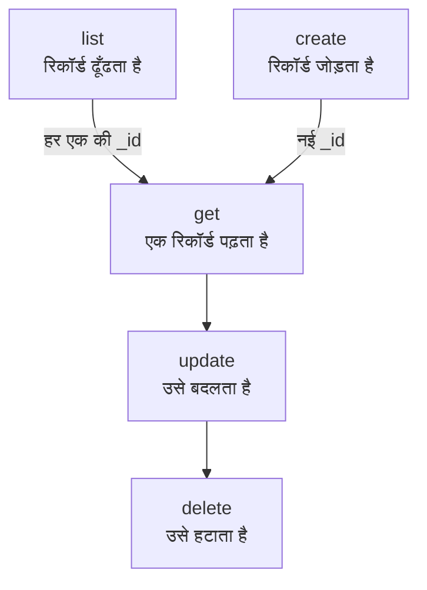

# संसाधन संचालन

हर तरह का रिकॉर्ड अपनी अलग कमांड है, जैसे `incident`, `monitor` या `status-page`, उन संचालनों के साथ जो API उसके लिए लेता है: ज़्यादातर के लिए `list`, `get`, `create`, `update`, `delete` और `count`। यह पेज हर संचालन दिखाता है, फ़िल्टर, पेजिंग और उन फ़्लैग के साथ जिनसे रिकॉर्ड लिखा जाता है, और वे कमांड भी जो वही करती हैं जो डैशबोर्ड के बटन करते हैं।

:::cards
- [किसी रिकॉर्ड की कमांड ढूँढें](#किसी-रिकॉर्ड-की-कमांड-ढूँढें): oneuptime resources उन सभी को सूचीबद्ध करता है।
- [रिकॉर्ड सूचीबद्ध करें](#रिकॉर्ड-सूचीबद्ध-करें): फ़िल्टर, सॉर्ट और पेज।
- [रिकॉर्ड बनाएँ](#रिकॉर्ड-बनाएँ): हर फ़ील्ड के लिए एक फ़्लैग, या पूरा रिकॉर्ड JSON के रूप में।
- [स्वीकार करें, सुलझाएँ और नोट जोड़ें](#स्वीकार-करें-सुलझाएँ-और-नोट-जोड़ें): डैशबोर्ड के बटन, कमांड के रूप में।
- [रिकॉर्ड हटाएँ](#रिकॉर्ड-हटाएँ): तुरंत, बिना पूर्ववत किए।
:::

## संचालन आपस में कैसे जुड़ते हैं

किसी रिकॉर्ड को पढ़ने, बदलने और हटाने के लिए उसकी ID चाहिए। सूचीबद्ध करने, गिनने और बनाने के लिए किसी ID की ज़रूरत नहीं, और list या create से आपको वे ID मिलती हैं जो बाकी संचालन लेते हैं:



ID एक UUID होती है, जैसे `6f1c2a40-3b1e-4c55-9a0b-3e2f8d7c1a11`। आप इसे OneUptime में रिकॉर्ड के पेज से भी कॉपी कर सकते हैं: [किसी संसाधन की ID ढूँढना](/docs/api-reference/api-reference#किसी-संसाधन-की-id-ढूँढना) देखें।

## किसी रिकॉर्ड की कमांड ढूँढें

```bash
oneuptime resources
```

सूची हर तरह के रिकॉर्ड को उसकी कमांड, उसके नामों, उसके प्रकार और उसके API पाथ के साथ दिखाती है। प्रकार दो हैं:

| प्रकार | इसमें क्या है |
| --- | --- |
| `database` | वे रिकॉर्ड जिन्हें आप प्रबंधित करते हैं: मॉनिटर, घटनाएँ, अलर्ट, स्थिति पृष्ठ, टीमें और अन्य |
| `analytics` | टेलीमेट्री: लॉग, स्पैन, मेट्रिक्स, अपवाद और अन्य इवेंट |

एक प्रकार दिखाने के लिए `oneuptime resources --type database` या `--type analytics` उपयोग करें। [कमांड संदर्भ](/docs/cli/command-reference#संसाधन) हर कमांड सूचीबद्ध करता है।

कोई संसाधन वे संचालन लेता है जो API उसके लिए लेता है। ज़्यादातर सभी छह लेते हैं; जिसे OneUptime खुद लिखता है, जैसे ईमेल लॉग, वह केवल पढ़ा जा सकता है। `oneuptime <resource> --help` किसी संसाधन की सबकमांड सूचीबद्ध करती है।

## किसी संसाधन के फ़ील्ड देखें

`fields` किसी संसाधन के फ़ील्ड खुद CLI से सूचीबद्ध करती है, बिना API कुंजी और बिना अनुरोध के:

```bash
oneuptime incident fields
```

हर फ़ील्ड का अपना प्रकार है, वह किस काम का है, क्या बनाते समय उसे देना ज़रूरी है, और वह फ़्लैग जो उसे सेट करता है। ID रखने वाला फ़ील्ड बताता है कि वह ID किस संसाधन की है: `incidentSeverityId` एक ID `oneuptime incident-severity list` से लेता है। `-o json` के साथ, कोई स्क्रिप्ट या AI एजेंट यही पढ़ता है, हर फ़ील्ड के लिए एक जैसी कुंजियों के साथ: `name`, `title`, `type`, `description`, `required`, `create`, `update`, `read`, `flag`, `emailFlag` और `relatedResource`।

## रिकॉर्ड सूचीबद्ध करें

```bash
oneuptime <resource> list [--query <json>] [--limit <n>] [--skip <n>] [--sort <json>] [--fields <names>] [--all] [-o <format>]
```

| विकल्प | यह क्या करता है | डिफ़ॉल्ट |
| --- | --- | --- |
| `--query <json>` | केवल मेल खाने वाले रिकॉर्ड लौटाता है: [सूची फ़िल्टर करें](#सूची-फ़िल्टर-करें) देखें | हर वह रिकॉर्ड जिसे कुंजी पढ़ सकती है |
| `--limit <n>` | लौटाए जाने वाले अधिकतम रिकॉर्ड, 10,000 तक | `10` |
| `--skip <n>` | पहले कितने मेल खाने वाले रिकॉर्ड छोड़ने हैं | `0` |
| `--sort <json>` | क्रम, जैसे `{"createdAt":"ASC"}`, या सबसे नए पहले के लिए `"DESC"` | सबसे नए पहले |
| `--fields <names>` | लौटाए जाने वाले फ़ील्ड, कॉमा से अलग किए हुए, जैसे `title,createdAt` | हर वह फ़ील्ड जिसे कुंजी पढ़ सकती है |
| `--all` | हर मेल खाने वाला रिकॉर्ड, एक के बाद एक पेज, `--limit` और `--skip` की जगह। केवल रिकॉर्ड के लिए | |
| `-o, --output <format>` | `table`, `json` या `wide` | टर्मिनल में `table`, पाइप में `json` |

```bash
# The ten newest incidents
oneuptime incident list

# The oldest monitors first, 50 at a time: the second page
oneuptime monitor list --sort '{"createdAt":"ASC"}' --limit 50 --skip 50

# Every field of each incident, as JSON
oneuptime incident list -o json

# The title, the state and the creation date of every incident
oneuptime incident list --all --fields title,currentIncidentState.name,createdAt -o json
```

सूची OneUptime से हर रिकॉर्ड का वह हर फ़ील्ड माँगती है जिसे कुंजी पढ़ सकती है। `--fields` इसके बजाय केवल अपने बताए फ़ील्ड माँगता है, और बिंदु के बाद किसी जुड़े हुए रिकॉर्ड का फ़ील्ड, जैसे `currentIncidentState.name` में। टेबल छह फ़ील्ड दिखाती है; JSON सभी दिखाता है ([आउटपुट प्रारूप](/docs/cli/output-formats) देखें)। `--all` हर पेज पढ़ता है, एक बार में 100 रिकॉर्ड, 100,000 तक; `count` बताता है कि कितने हैं।

लेबल सबसे नए पहले के बजाय नाम के क्रम में सूचीबद्ध होते हैं: जिन लेबलों के नाम किसी संख्या से शुरू होते हैं, वे पहले आते हैं, उस संख्या के क्रम में (`2. Team` पहले, `10. Owner` बाद में), फिर बाकी लेबल वर्णानुक्रम में। उन्हें किसी और क्रम में सूचीबद्ध करने के लिए `--sort` दें।

### सूची फ़िल्टर करें

`--query` वही फ़िल्टर लेता है जो API लेता है: मान वाला फ़ील्ड उसी मान से मेल खाता है, और `_type` वाला ऑब्जेक्ट तुलना करता है।

| फ़िल्टर | किससे मेल खाता है |
| --- | --- |
| `{"title":"Checkout API is down"}` | ठीक उसी मान वाले रिकॉर्ड |
| `{"title":{"_type":"Search","value":"checkout"}}` | वह टेक्स्ट जिसमें मान शामिल है |
| `{"createdAt":{"_type":"GreaterThan","value":"2026-10-01T00:00:00.000Z"}}` | बाद की तारीखें, या बड़ी संख्याएँ |
| `{"currentIncidentState":{"isResolvedState":false}}` | संसाधन जिस रिकॉर्ड का नाम देता है उसका फ़ील्ड: यहाँ, वे घटनाएँ जो हल नहीं हुई हैं |

```bash
oneuptime incident list --query '{"title":{"_type":"Search","value":"checkout"}}'
```

API संदर्भ में [फ़िल्टर, सॉर्ट और पेज](/docs/api-reference/api-reference#फ़िल्टर-सॉर्ट-और-पेज) हर `_type` सूचीबद्ध करता है।

## रिकॉर्ड पढ़ें

```bash
oneuptime <resource> get <id> [--fields <names>] [-o <format>]
```

```bash
oneuptime incident get 6f1c2a40-3b1e-4c55-9a0b-3e2f8d7c1a11
```

टेबल रिकॉर्ड के हर फ़ील्ड के लिए एक पंक्ति दिखाती है, हर मान 60 अक्षरों पर कटा हुआ; `-o json` मान पूरे दिखाता है। जो ID आपकी कुंजी के पढ़ने लायक किसी रिकॉर्ड की नहीं है, उसका जवाब `Not found` होता है, और कमांड कोड `3` के साथ बाहर निकलती है।

## रिकॉर्ड बनाएँ

```bash
oneuptime <resource> create [--<field> <value>]... [--data <json>] [--file <path>] [-o <format>]
```

बनाते समय लिए जाने वाले हर फ़ील्ड का एक फ़्लैग है: `--title <text>`, `--incident-severity-id <id>`, कॉमा से अलग ID के लिए `--labels <ids>`, हाँ-या-ना वाले फ़ील्ड के लिए `--is-visible-on-status-page [true|false]`, जो अकेले देने पर true होता है, और JSON रखने वाले फ़ील्ड के लिए `--monitor-steps <json>`। `oneuptime <resource> create --help` इन्हें सूचीबद्ध करती है, और [`fields`](#किसी-संसाधन-के-फ़ील्ड-देखें) बताती है कि हर एक किस काम का है। प्रोजेक्ट API कुंजी से आता है, इसलिए कोई रिकॉर्ड उसका नाम कभी नहीं लेता।

```bash
# A manual monitor
oneuptime monitor create --name "Checkout API" --monitor-type Manual

# An incident with one of your severities
oneuptime incident create --title "Checkout API is down" --incident-severity-id <severity-id>

# The same incident, from a file
oneuptime incident create --file incident.json
```

`--data` रिकॉर्ड को JSON के रूप में लेता है, और `--file` उसे किसी JSON फ़ाइल से पढ़ता है, API के फ़ील्ड के साथ: [API संदर्भ](/reference) हर संसाधन के फ़ील्ड सूचीबद्ध करता है। दोनों देने पर फ़ाइल उपयोग होती है, और फ़्लैग दोनों में से किसी के भी ऊपर लागू होते हैं।

जो फ़ील्ड किसी व्यक्ति को यूज़र ID से बताता है, उसका एक दूसरा फ़्लैग है जो उसे ईमेल पते से बताता है: `--user-email`, `--user-id` के बगल में, और `--owner-user-emails`, `--owner-users` के बगल में। CLI उस व्यक्ति को API कुंजी के प्रोजेक्ट के सदस्यों और उसमें आमंत्रित लोगों में खोजता है। जिस टीम सदस्य को ऐसे पते से बताया जाए जो प्रोजेक्ट में किसी के पास नहीं है, उसे प्रोजेक्ट में आमंत्रित किया जाता है, जैसे डैशबोर्ड से आमंत्रित करने पर होता है:

```bash
oneuptime team-member create --team-id <team-id> --user-email alice@example.com
```

CLI नया रिकॉर्ड, उसकी `_id` के साथ, प्रिंट करता है। घटना आपके प्रोजेक्ट की बनाई गई स्थिति में शुरू होती है, जब तक `currentIncidentStateId` कोई दूसरी स्थिति न बताए: [वह स्थिति जिसमें नया रिकॉर्ड शुरू होता है](/docs/api-reference/api-reference#वह-स्थिति-जिसमें-नया-रिकॉर्ड-शुरू-होता-है) देखें। अपनी गंभीरताओं की ID ढूँढने के लिए:

```bash
oneuptime incident-severity list -o json | jq -r '.[] | "\(._id)  \(.name)"'
```

> [!TIP]
> Windows पर, फ़ील्ड उनके फ़्लैग के साथ दें, या JSON को किसी फ़ाइल में रखें और `--file` उपयोग करें: PowerShell और Command Prompt कमांड लाइन पर JSON को Bash से अलग तरीके से कोट करते हैं।

## रिकॉर्ड अपडेट करें

```bash
oneuptime <resource> update <id> [--<field> <value>]... [--data <json>] [--file <path>] [-o <format>]
```

केवल बदलने वाले फ़ील्ड दें, उनके फ़्लैग के साथ या JSON के रूप में:

```bash
# Rename a monitor
oneuptime monitor update <monitor-id> --name "Checkout API (EU)"

# Record an incident's root cause
oneuptime incident update <incident-id> --root-cause "A full disk on the primary database"
```

OneUptime अपडेट का जवाब एक खाली ऑब्जेक्ट से देता है: CLI एक खाली पंक्ति प्रिंट करता है, या `-o json` के साथ `{}`। रिकॉर्ड अभी कैसा है यह देखने के लिए `get` चलाएँ। किसी घटना को दूसरी स्थिति में ले जाने के लिए `--current-incident-state-id` दें: बदलाव उसकी टाइमलाइन पर दर्ज होता है, जैसे डैशबोर्ड करता है, और उसकी मौजूदा स्थिति से पहले की स्थिति अस्वीकार कर दी जाती है। [`acknowledge` और `resolve`](#स्वीकार-करें-सुलझाएँ-और-नोट-जोड़ें) आपके लिए स्थिति ढूँढ लेते हैं। हल हो चुकी स्थिति की ID ढूँढने के लिए, जो आपके प्रोजेक्ट के क्रम में पहली है:

```bash
oneuptime incident-state list --query '{"isResolvedState":true}' --sort '{"order":"ASC"}' --limit 1 -o json | jq -r '.[0]._id'
```

## स्वीकार करें, सुलझाएँ और नोट जोड़ें

घटनाओं, अलर्ट, उनके एपिसोड और रखरखाव इवेंट के लिए उन कामों की कमांड हैं जो डैशबोर्ड के बटन उन पर करते हैं:

| कमांड | यह क्या करती है | संसाधन |
| --- | --- | --- |
| `acknowledge <id>` | रिकॉर्ड को आपके प्रोजेक्ट की स्वीकार की गई स्थिति में ले जाती है | `incident`, `alert`, `incident-episode`, `alert-episode` |
| `resolve <id>` | इसे आपके प्रोजेक्ट की हल हो चुकी स्थिति में ले जाती है | यही चार |
| `start <id>` | इवेंट को आपके प्रोजेक्ट की जारी स्थिति में ले जाती है | `scheduled-maintenance-event` |
| `end <id>` | इसे आपके प्रोजेक्ट की समाप्त स्थिति में ले जाती है | `scheduled-maintenance-event` |
| `add-note <id> --note <markdown>` | ऐसा नोट जोड़ती है जिसे केवल वे लोग पढ़ सकते हैं जो रिकॉर्ड देख सकते हैं, या `--public` के साथ रिकॉर्ड के स्थिति पृष्ठों पर एक नोट | सभी पाँच |

```bash
oneuptime incident acknowledge 6f1c2a40-3b1e-4c55-9a0b-3e2f8d7c1a11
oneuptime incident add-note 6f1c2a40-3b1e-4c55-9a0b-3e2f8d7c1a11 --note "Rolled back the 14:05 deploy."
oneuptime incident resolve 6f1c2a40-3b1e-4c55-9a0b-3e2f8d7c1a11
```

`acknowledge` यह जवाब देती है: `Incident 6f1c2a40-3b1e-4c55-9a0b-3e2f8d7c1a11 acknowledged: it is in Acknowledged now.` जो रिकॉर्ड पहले से उस स्थिति में है, या उससे आगे है, उसे वैसा ही छोड़ दिया जाता है: कमांड यह बताती है, और `0` के साथ बाहर निकलती है। `-o json` के साथ, यह रिकॉर्ड की `_id`, `action`, कुछ बदला या नहीं यह बताने वाले `changed`, और रिकॉर्ड जिस `state` में है, उनके साथ जवाब देती है। अलर्ट और अलर्ट एपिसोड केवल आंतरिक नोट लेते हैं।

## रिकॉर्ड हटाएँ

```bash
oneuptime <resource> delete <id>
```

```bash
oneuptime monitor delete 6f1c2a40-3b1e-4c55-9a0b-3e2f8d7c1a11
```

यह `Monitor 6f1c2a40-3b1e-4c55-9a0b-3e2f8d7c1a11 deleted successfully.` जवाब देता है। `-o json` के साथ, यह रिकॉर्ड की `_id` और `"deleted": true` के साथ जवाब देता है।

> [!CAUTION]
> `delete` रिकॉर्ड को तुरंत हटा देता है। CLI आपसे पुष्टि नहीं माँगता, और इसे पूर्ववत नहीं किया जा सकता। यह उन स्क्रिप्ट के लिए `--force` स्वीकार करता है जो इसके साथ लिखी गई हैं, और `--force` कुछ नहीं बदलता।

## रिकॉर्ड गिनें

```bash
oneuptime <resource> count [--query <json>]
```

```bash
# Every incident
oneuptime incident count

# Incidents that are not resolved
oneuptime incident count --query '{"currentIncidentState":{"isResolvedState":false}}'
```

CLI एक संख्या प्रिंट करता है, टेबल और JSON में एक जैसी, ताकि स्क्रिप्ट उसे जैसी है वैसी ही पढ़ सके।

## समस्या निवारण

:::details "Not found: API error (404)" संदेश
रिकॉर्ड मौजूद नहीं है, किसी दूसरे प्रोजेक्ट में है, या कुंजी उसे पढ़ नहीं सकती: OneUptime हर मामले में एक ही जवाब देता है। `list` से ID जाँचें, और कुंजी की अनुमतियाँ भी। कमांड कोड `3` के साथ बाहर निकलती है।
:::

:::details "Left out fields this API key may not read" संदेश
list या get रिकॉर्ड का हर फ़ील्ड माँगता है, और OneUptime वह फ़ील्ड अस्वीकार करता है जिसे कुंजी पढ़ नहीं सकती: CLI उसके बिना फिर से माँगता है, और छोड़े गए फ़ील्ड मानक त्रुटि में बताता है। कुंजी को ऐसी अनुमति दें जो उन्हें पढ़ सके, या अपनी ज़रूरत के फ़ील्ड `--fields` से बताएँ: बताया गया कोई फ़ील्ड जिसे कुंजी पढ़ नहीं सकती, कमांड को `API error (422)` के साथ रोक देता है।
:::

:::details "Error: Invalid JSON" संदेश
`--query`, `--sort` या `--data` का मान JSON नहीं है। Bash और zsh में, उसे सिंगल कोट में लपेटें; Windows पर, फ़ील्ड उनके फ़्लैग के साथ दें, या रिकॉर्ड को किसी फ़ाइल में रखें और `--file` उपयोग करें।
:::

:::details create या update पर API error (400)
OneUptime ने कोई फ़ील्ड अस्वीकार किया: संदेश उसका नाम बताता है, और `oneuptime <resource> fields` फ़ील्ड को उन्हें सेट करने वाले फ़्लैग के साथ सूचीबद्ध करती है। जो कमांड कोई फ़ील्ड नहीं देती, उसे भेजने से पहले ही अस्वीकार कर दिया जाता है, देने लायक फ़्लैग के साथ।
:::

:::details "No one in this project, or invited to it, has the email address" संदेश
ईमेल फ़्लैग किसी ऐसे व्यक्ति को बताता है जो न तो API कुंजी के प्रोजेक्ट का सदस्य है और न उसमें आमंत्रित है। उसे `oneuptime team-member create --team-id <team-id> --user-email <email>` से आमंत्रित करें, या उसे यूज़र ID से बताएँ।
:::

## अगले कदम

:::cards
- [आउटपुट प्रारूप](/docs/cli/output-formats): जवाबों को टेबल या JSON के रूप में पढ़ें।
- [स्क्रिप्टिंग और CI/CD](/docs/cli/scripting): इन संचालनों को स्क्रिप्ट और पाइपलाइन में उपयोग करें।
- [कमांड संदर्भ](/docs/cli/command-reference): हर कमांड, विकल्प और डिफ़ॉल्ट।
:::
