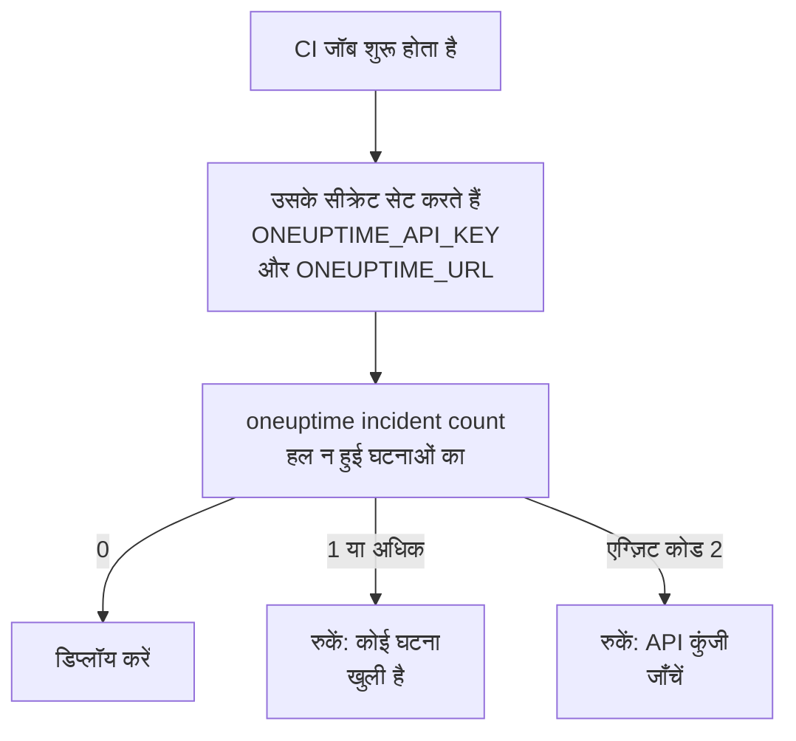

# स्क्रिप्टिंग और CI/CD

CLI स्क्रिप्ट में भी वैसे ही काम करता है जैसे टर्मिनल में। इसे एनवायरनमेंट वेरिएबल में API कुंजी दें, इसके जवाब JSON के रूप में पढ़ें, और इसके एग्ज़िट कोड को स्क्रिप्ट को बताने दें कि क्या हुआ। यह पेज इनमें से हर एक दिखाता है, और GitHub Actions, GitLab CI और Docker के लिए पूरी पाइपलाइन।

:::cards
- [स्क्रिप्ट को उसकी API कुंजी दें](#स्क्रिप्ट-को-उसकी-api-कुंजी-दें): दो एनवायरनमेंट वेरिएबल, कोई सहेजा कॉन्टेक्स्ट नहीं।
- [एग्ज़िट कोड](#एग्ज़िट-कोड): काम होने पर 0, और न होने पर उसका कारण।
- [jq से जवाब पढ़ें](#jq-से-जवाब-पढ़ें): JSON से ID, शीर्षक और तारीखें निकालें।
- [पाइपलाइन के उदाहरण](#पाइपलाइन-के-उदाहरण): GitHub Actions, GitLab CI और Docker।
:::

## स्क्रिप्ट CLI का उपयोग कैसे करती है

कोई डिप्लॉयमेंट पहले OneUptime से पूछ सकता है कि कोई घटना खुली है या नहीं, और अगर है तो रुक सकता है:



## स्क्रिप्ट को उसकी API कुंजी दें

`ONEUPTIME_API_KEY` और `ONEUPTIME_URL` को अपने CI सिस्टम के सीक्रेट से सेट करें। तब CLI को न `login` चाहिए और न कोई कॉन्फ़िगरेशन फ़ाइल। किसी एक कमांड के लिए फ़्लैग अब भी इनसे पहले आता है, और ये सहेजे कॉन्टेक्स्ट से पहले आते हैं।

```bash
export ONEUPTIME_API_KEY="$CI_ONEUPTIME_API_KEY"
export ONEUPTIME_URL="https://oneuptime.com"
oneuptime incident count
```

> [!TIP]
> हर पाइपलाइन को उसकी अपनी API कुंजी दें, केवल उतने एक्सेस के साथ जितना उसे चाहिए: जो जाँच केवल पढ़ती है, उसे केवल पढ़ने वाली कुंजी चाहिए। पाइपलाइन बंद होने पर कुंजी को OneUptime में हटा दें।

अगर एक मशीन कई प्रोजेक्ट के जॉब चलाती है, तो हर प्रोजेक्ट के लिए एक कॉन्टेक्स्ट सहेजें और हर कमांड में उसका नाम दें, ताकि कोई जॉब कभी किसी दूसरे का मौजूदा कॉन्टेक्स्ट उपयोग न करे:

```bash
oneuptime --context production incident count
oneuptime --context staging monitor count
```

## एग्ज़िट कोड

| कोड | मतलब | उदाहरण |
| --- | --- | --- |
| `0` | काम हुआ | कोई list, भले ही उसे कुछ न मिले |
| `1` | विफल हुआ | OneUptime ने अनुरोध अस्वीकार किया, जैसे `API error (422)`; अमान्य JSON; छूटा हुआ या अज्ञात विकल्प; ऐसा कॉन्टेक्स्ट जो सहेजा नहीं गया |
| `2` | कोई उपयोग योग्य API कुंजी नहीं | क्रेडेंशियल नहीं मिले; अमान्य API कुंजी; अपने प्लान से नीचे की कुंजी (`402`); `401` |
| `3` | नहीं मिला | OneUptime ने `404` जवाब दिया: रिकॉर्ड मौजूद नहीं है, किसी दूसरे प्रोजेक्ट में है, या कुंजी उसे पढ़ नहीं सकती |

कुछ भी सहेजा न होने पर भी `whoami` और `context current` `0` के साथ बाहर निकलते हैं: वे बताते हैं कि क्या सेट है, उसे जाँचते नहीं। स्क्रिप्ट कोड से मामलों को अलग पहचानती है:

```bash
oneuptime incident get "$INCIDENT_ID" -o json > incident.json
case $? in
  0) echo "Saved the incident to incident.json" ;;
  2) echo "Check ONEUPTIME_API_KEY and ONEUPTIME_URL" >&2; exit 1 ;;
  3) echo "There is no incident $INCIDENT_ID" >&2; exit 1 ;;
  *) echo "OneUptime refused the request" >&2; exit 1 ;;
esac
```

त्रुटि संदेश मानक त्रुटि में जाते हैं, इसलिए `incident.json` में केवल जवाब होता है।

## jq से जवाब पढ़ें

स्क्रिप्ट में `-o json` लिखें। पाइप में CLI वैसे भी JSON प्रिंट करता है, पर फ़्लैग से स्क्रिप्ट जहाँ भी चले, काम करती रहती है:

```bash
# The title of each incident
oneuptime incident list -o json | jq -r '.[].title'

# The ID of a new monitor
MONITOR_ID=$(oneuptime monitor create --data '{"name":"Checkout API","monitorType":"Manual"}' -o json | jq -r '._id')

# When each incident was created: dates come as objects
oneuptime incident list -o json | jq -r '.[] | "\(.createdAt.value)  \(.title)"'

# The newest 100 incidents as CSV
oneuptime incident list --limit 100 -o json | jq -r '.[] | [._id, .title, .createdAt.value] | @csv'
```

गिनती एक संख्या प्रिंट करती है, तुलना के लिए तैयार:

```bash
OPEN=$(oneuptime incident count --query '{"currentIncidentState":{"isResolvedState":false}}')
echo "$OPEN incidents are open"
```

## फ़ाइलों से रिकॉर्ड बनाएँ

रिकॉर्ड को अपने कोड के पास JSON फ़ाइलों के रूप में रखें, और उन्हें वहीं से बनाएँ:

```json title="monitors/checkout-api.json"
{
  "name": "Checkout API",
  "monitorType": "Manual"
}
```

```bash
oneuptime monitor create --file monitors/checkout-api.json
```

एक JSON ऐरे से कई रिकॉर्ड, हर एक के लिए एक create:

```bash
jq -c '.[]' monitors.json | while IFS= read -r monitor; do
  oneuptime monitor create --data "$monitor" -o json | jq -r '._id'
done
```

> [!NOTE]
> हर रन नए रिकॉर्ड बनाता है। मॉनिटर और स्थिति पृष्ठों को फ़ाइलों के साथ मेल में रखने, केवल बदला हुआ बदलने और हटाया हुआ हटाने के लिए, [Terraform प्रोवाइडर](/docs/terraform/index) उपयोग करें।

## पाइपलाइन के उदाहरण

:::tabs
@tab GitHub Actions
```yaml title=".github/workflows/deploy.yml"
name: Deploy
on:
  push:
    branches: [main]

jobs:
  deploy:
    runs-on: ubuntu-latest
    steps:
      - uses: actions/checkout@v4
      - uses: actions/setup-node@v4
        with:
          node-version: lts/*
      - name: Install the OneUptime CLI
        run: npm install -g @oneuptime/cli
      - name: Stop while an incident is open
        env:
          ONEUPTIME_API_KEY: ${{ secrets.ONEUPTIME_API_KEY }}
          ONEUPTIME_URL: https://oneuptime.com
        run: |
          OPEN=$(oneuptime incident count --query '{"currentIncidentState":{"isResolvedState":false}}')
          if [ "$OPEN" -gt 0 ]; then
            echo "$OPEN incidents are open: not deploying."
            exit 1
          fi
      - name: Deploy
        run: ./deploy.sh
```
@tab GitLab CI
```yaml title=".gitlab-ci.yml"
check-incidents:
  stage: test
  image: node:lts
  variables:
    ONEUPTIME_URL: https://oneuptime.com
  script:
    - npm install -g @oneuptime/cli
    - OPEN=$(oneuptime incident count --query '{"currentIncidentState":{"isResolvedState":false}}')
    - echo "$OPEN incidents are open"
    - test "$OPEN" -eq 0
```
@tab Docker
```dockerfile title="Dockerfile"
FROM node:lts-slim
RUN npm install -g @oneuptime/cli
ENTRYPOINT ["oneuptime"]
```
:::

GitHub Actions में, रिपॉज़िटरी के **Settings → Secrets and variables → Actions** में `ONEUPTIME_API_KEY` जोड़ें; GitLab में, इसे मास्क किए गए CI/CD वेरिएबल के रूप में जोड़ें। Docker इमेज के साथ, हर रन में वेरिएबल पास करें:

```bash
docker build -t oneuptime-cli .
docker run --rm -e ONEUPTIME_API_KEY -e ONEUPTIME_URL oneuptime-cli incident count
```

## अगले कदम

:::cards
- [प्रमाणीकरण](/docs/cli/authentication): कई कुंजियाँ सेट होने पर कोई कमांड कौन-सी उपयोग करती है।
- [आउटपुट प्रारूप](/docs/cli/output-formats): वह JSON जो आपकी स्क्रिप्ट पढ़ती हैं।
- [संसाधन संचालन](/docs/cli/resource-operations): फ़िल्टर, पेजिंग और रिकॉर्ड के फ़ील्ड।
- [Terraform प्रोवाइडर](/docs/terraform/index): OneUptime का कॉन्फ़िगरेशन फ़ाइलों में रखें।
:::
