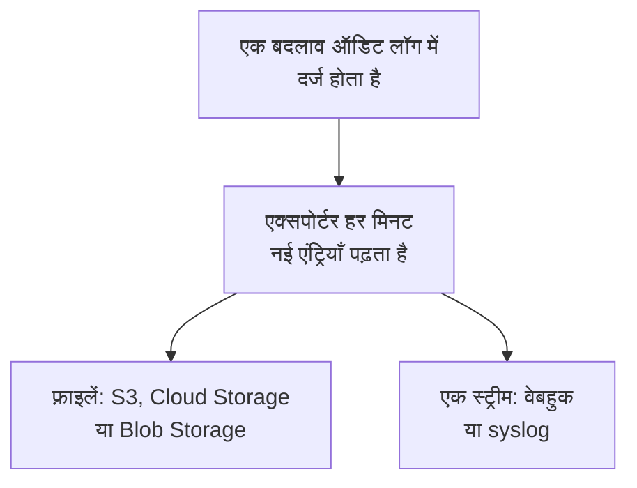

# ऑडिट लॉग एक्सपोर्ट

ऑडिट लॉग को, जैसे-जैसे वह दर्ज होता है, अपनी पसंद के स्टोरेज या सेवा में भेजें: Amazon S3 या S3-संगत स्टोरेज, Google Cloud Storage, Azure Blob Storage, कोई वेबहुक या syslog। एंट्रियों को वहाँ तब तक रखें जब तक आपकी अनुपालन समीक्षाओं को ज़रूरत हो, और उन्हें अपने SIEM में खोजें। किसी प्रोजेक्ट के ओनर और एडमिन प्रोजेक्ट सेटिंग्स से उसका ऑडिट लॉग एक्सपोर्ट करते हैं, और मास्टर एडमिन Admin Dashboard से हर प्रोजेक्ट का ऑडिट लॉग एक्सपोर्ट करते हैं। यह OneUptime Cloud पर Enterprise प्लान का, और सेल्फ-होस्ट करने पर Enterprise Edition का हिस्सा है।

:::cards
- [एक्सपोर्ट सेट अप करें](#एक्सपोर्ट-सेट-अप-करें): गंतव्य चुनें, उसे टेस्ट करें, सहेजें।
- [क्या भेजा जाता है](#क्या-भेजा-जाता-है): हर एंट्री के लिए एक JSON ऑब्जेक्ट, स्थिर स्कीमा में।
- [एंट्रियाँ कब भेजी जाती हैं](#एंट्रियाँ-कब-भेजी-जाती-हैं): हर मिनट, हर एंट्री एक बार, क्रम से।
- [जब कोई गंतव्य विफल हो](#जब-कोई-गंतव्य-विफल-हो): दोबारा कोशिशें, त्रुटि, और कुछ भी छूटता नहीं।
:::

## एंट्री आपके गंतव्य तक कैसे पहुँचती है



- **एक एक्सपोर्ट, एक गंतव्य।** किसी प्रोजेक्ट के कई एक्सपोर्ट हो सकते हैं, और हर एक्सपोर्ट हर एंट्री को अपने गंतव्य पर भेजता है।
- **किसी प्रोजेक्ट का, या इंस्टेंस का।** किसी प्रोजेक्ट का एक्सपोर्ट उसी प्रोजेक्ट की एंट्रियाँ भेजता है। Admin Dashboard में सेट किया गया एक्सपोर्ट उन सभी प्रोजेक्ट की एंट्रियाँ भेजता है जो ऑडिट लॉग दर्ज करते हैं।
- **सहेजे जाने के समय से।** एक्सपोर्ट वह भेजता है जो उसके सहेजे जाने के बाद दर्ज होता है, जब तक आप **कब से एक्सपोर्ट करें** को किसी पहले की तारीख पर सेट न करें।

## शुरू करने से पहले

- **OneUptime Cloud पर, Enterprise प्लान।** दूसरे प्लानों पर यह पेज दिखाता है कि सुविधा क्या करती है और इसे कैसे पाएं।
- **सेल्फ-होस्ट करने पर, Enterprise Edition**, ऐसे लाइसेंस के साथ जिसमें ऑडिट लॉग शामिल हों। देखें [एंटरप्राइज़ संस्करण](/docs/self-hosted/enterprise)।
- **ऑडिट लॉगिंग चालू हो** उस हर प्रोजेक्ट में जिसे आप एक्सपोर्ट करते हैं। देखें [ऑडिट लॉग](/docs/configuration/audit-logs)।
- **कोई Project Owner या Project Admin** किसी प्रोजेक्ट का ऑडिट लॉग एक्सपोर्ट करने के लिए, या कोई मास्टर एडमिन इंस्टेंस का ऑडिट लॉग एक्सपोर्ट करने के लिए।

## एक्सपोर्ट सेट अप करें

:::steps
### एक्सपोर्ट पेज खोलें

किसी प्रोजेक्ट के लिए **प्रोजेक्ट सेटिंग्स → ऑडिट लॉग → एक्सपोर्ट** पर जाएँ। पूरे इंस्टेंस के लिए Admin Dashboard में **सेटिंग्स → ऑडिट लॉग एक्सपोर्ट** पर जाएँ।

### गंतव्य चुनें

**एक्सपोर्ट जोड़ें** पर क्लिक करें और नीचे दिए छह गंतव्यों में से एक चुनें। किसी एक्सपोर्ट का गंतव्य बाद में बदला नहीं जा सकता।

### बताएँ कि वहाँ कैसे पहुँचें

गंतव्य जो माँगता है, वह भरें। जिन सेटिंग्स को ज़्यादातर लोग वैसे ही छोड़ देते हैं, वे **और फ़ील्ड** में रहती हैं, और **सेटअप गाइड** इस पेज पर उस गंतव्य का सेक्शन खोलता है।

### टेस्ट भेजें

**टेस्ट फ़ाइल लिखें** या **टेस्ट एंट्री भेजें** पर क्लिक करें। स्टोरेज को उसके फ़ोल्डर में `oneuptime-audit-log-export-test.ndjson.gz` फ़ाइल मिलती है, और वेबहुक या syslog को एक एंट्री मिलती है जिसकी कार्रवाई `Test` है। विफल टेस्ट बताता है कि क्या ठीक करना है।

### एक्सपोर्ट शुरू करें

**अगला** पर क्लिक करें, एक्सपोर्ट को नाम दें, और **एक्सपोर्ट शुरू करें** पर क्लिक करें। पहली एंट्रियाँ कुछ ही मिनटों में पहुँचती हैं।
:::

एक्सपोर्ट की पंक्ति दिखाती है कि वह कैसा चल रहा है: **एक्सपोर्ट हो रहा है**, **विफल**, **रोका गया**, **एंट्रियों की प्रतीक्षा में** या **शुरू हो रहा है**। **टेस्ट भेजें** सहेजी गई सेटिंग्स से एक टेस्ट भेजता है, और **संपादित करें** उन्हें बदलता है: जो क्रेडेंशियल आप खाली छोड़ते हैं, उसकी जगह सहेजा गया क्रेडेंशियल ही रहता है।

## गंतव्य

| गंतव्य | क्या पहुँचता है | किससे साइन इन होता है |
| --- | --- | --- |
| [Amazon S3](#amazon-s3) | कंप्रेस की गई NDJSON फ़ाइलें | एक एक्सेस कुंजी |
| [S3-संगत स्टोरेज](#s3-संगत-स्टोरेज) | कंप्रेस की गई NDJSON फ़ाइलें | एक एक्सेस कुंजी |
| [Google Cloud Storage](#google-cloud-storage) | कंप्रेस की गई NDJSON फ़ाइलें | एक सर्विस अकाउंट कुंजी |
| [Azure Blob Storage](#azure-blob-storage) | कंप्रेस की गई NDJSON फ़ाइलें | एक SAS टोकन या एक एक्सेस कुंजी |
| [वेबहुक](#वेबहुक) | HTTPS अनुरोध | एक वैकल्पिक हेडर और साइनिंग सीक्रेट |
| [Syslog](#syslog) | RFC 5424 संदेश | कुछ नहीं |

### Amazon S3

| फ़ील्ड | क्या भरें |
| --- | --- |
| **बकेट** | वह बकेट जिसमें फ़ाइलें लिखी जाती हैं। |
| **क्षेत्र** | बकेट का क्षेत्र। शुरुआत में यह `us-east-1` होता है। |
| **एक्सेस कुंजी ID** | ऐसी एक्सेस कुंजी जो बकेट में ऑब्जेक्ट लिख सके। |
| **सीक्रेट एक्सेस कुंजी** | उस कुंजी का सीक्रेट। |
| **फ़ोल्डर** | **और फ़ील्ड** में। खाली छोड़ने पर फ़ाइलें `oneuptime/audit-logs/` में जाती हैं। |

कुंजी को फ़ोल्डर पर केवल `s3:PutObject` चाहिए:

```json
{
  "Version": "2012-10-17",
  "Statement": [
    {
      "Effect": "Allow",
      "Action": "s3:PutObject",
      "Resource": "arn:aws:s3:::my-audit-logs/oneuptime/audit-logs/*"
    }
  ]
}
```

### S3-संगत स्टोरेज

Amazon S3 वाले ही फ़ील्ड, एक **एंडपॉइंट** के बाद: स्टोरेज का S3 पता, जैसे `https://minio.example.com:9000` या `https://<account>.r2.cloudflarestorage.com`। **क्षेत्र** को वह रखें जो स्टोरेज चाहता है: MinIO और Wasabi के डिफ़ॉल्ट के लिए `us-east-1`, Cloudflare R2 के लिए `auto`।

### Google Cloud Storage

**बकेट** भरें और एक **सर्विस अकाउंट कुंजी** (JSON) पेस्ट करें, जिसके सर्विस अकाउंट के पास बकेट पर Storage Object Creator भूमिका हो। **फ़ोल्डर** **और फ़ील्ड** में रहता है।

### Azure Blob Storage

**स्टोरेज अकाउंट** और **कंटेनर** भरें, और **इससे साइन इन करें** में चुनें कि साइन इन कैसे हो: कंटेनर पर Create और Write अनुमति वाला **SAS टोकन**, या स्टोरेज अकाउंट की कोई **एक्सेस कुंजी**। SAS टोकन को सिर्फ़ इस कंटेनर तक सीमित किया जा सकता है, इसलिए वह ज़्यादा सुरक्षित विकल्प है। **क्लाउड** और **फ़ोल्डर** **और फ़ील्ड** में रहते हैं।

### वेबहुक

OneUptime हर बैच को **URL** पर POST करता है, JSON ऐरे (`application/json`) के रूप में या हर पंक्ति में एक एंट्री (`application/x-ndjson`) के रूप में, जैसा **बॉडी फ़ॉर्मैट** बताता है, इन हेडर के साथ:

| हेडर | मान |
| --- | --- |
| `X-OneUptime-Event` | `audit-log-export` |
| `X-OneUptime-Batch-Id` | बैच की पहली एंट्री की id: वही बैच दोबारा भेजे जाने पर वही id रखता है। |
| `X-OneUptime-Entry-Count` | बॉडी में कितनी एंट्रियाँ हैं। |
| `X-OneUptime-Signature` | `sha256=` और बॉडी का HMAC-SHA256, **साइनिंग सीक्रेट** से, जब वह सेट हो। |

**क्रेडेंशियल**, जैसे `Bearer <token>`, उस हेडर में भेजा जाता है जिसे आप **हेडर का नाम** में चुनते हैं; न बदलने पर यह `Authorization` होता है। **बॉडी फ़ॉर्मैट**, **हेडर का नाम** और **साइनिंग सीक्रेट** **और फ़ील्ड** में रहते हैं। कोई भी 2xx जवाब डिलीवरी माना जाता है। `413` बैच को दो हिस्सों में बाँट देता है, और कोई भी दूसरा इनकार बाद में पूरा बैच दोबारा भेजता है।

### Syslog

हर एंट्री **होस्ट** और **पोर्ट** पर भेजा गया एक RFC 5424 संदेश है, पोर्ट `6514` पर TLS से, जब तक **प्रोटोकॉल** TCP न कहे, facility 13 (log audit) और severity 6 (informational) के साथ:

```text
<110>1 2026-10-24T09:15:03.000Z oneuptime.example.com oneuptime - audit-log - {"schemaVersion":1,"id":"..."}
```

संदेशों को ऑक्टेट गिनती (RFC 5425) से अलग किया जाता है, जब तक **फ़्रेमिंग** हर पंक्ति में एक संदेश न कहे। जिस रिसीवर का प्रमाणपत्र किसी निजी CA ने साइन किया हो, उसे **CA प्रमाणपत्र** में उस CA का प्रमाणपत्र चाहिए। दोनों **और फ़ील्ड** में रहते हैं।

## क्या भेजा जाता है

हर एंट्री एक JSON ऑब्जेक्ट है, जिसकी कुंजियाँ हमेशा इसी क्रम में होती हैं:

| कुंजी | इसमें क्या है |
| --- | --- |
| `schemaVersion` | `1`। स्कीमा में बदलाव नए संस्करण के साथ आता है। |
| `id` | एंट्री की id। वही एंट्री दो बार भेजी जाए तो उसकी id वही रहती है। |
| `createdAt` | बदलाव कब दर्ज हुआ, UTC में। |
| `projectId` | वह प्रोजेक्ट जिसमें बदलाव किया गया। |
| `action` | `Create`, `Update`, `Delete` या `Download`। |
| `resourceType`, `resourceId`, `resourceName` | क्या बदला गया। |
| `rootResourceType`, `rootResourceId` | वह संसाधन जिसका यह हिस्सा है, जैसे किसी नियम के लिए उसका SLO। |
| `userId`, `userName`, `userEmail`, `userType` | बदलाव किसने किया। |
| `apiKeyId`, `apiKeyName` | वह API कुंजी जिससे बदलाव किया गया, अगर कोई हो। |
| `mcpOAuthGrantId`, `mcpClientName` | वह MCP क्लाइंट जिसके ज़रिए बदलाव किया गया, अगर कोई हो। |
| `workflowId`, `workflowName` | वह वर्कफ़्लो जिसने बदलाव किया, अगर कोई हो। |
| `changes` | हर बदला गया फ़ील्ड: `field`, `oldValue` और `newValue` के साथ। |

एक फ़ाइल में हर पंक्ति में एक एंट्री होती है, gzip से कंप्रेस की हुई, और उसे उसकी पहली एंट्री के घंटे के हिसाब से रखा जाता है: `oneuptime/audit-logs/2026/10/24/09/20261024T091503Z_<first entry id>.ndjson.gz`।

कुंजियाँ, टोकन और पासवर्ड कभी बाहर नहीं जाते: वे `[REDACTED]` के रूप में दर्ज होते हैं, और जिन फ़ील्ड को कोई नहीं पढ़ सकता, वे किसी भी एंट्री में नहीं होते।

## एंट्रियाँ कब भेजी जाती हैं

- **हर मिनट।** एक मिनट से ज़्यादा पहले दर्ज हुई एंट्रियाँ सबसे पुरानी से शुरू करके पढ़ी जाती हैं और बैच में भेजी जाती हैं: हर फ़ाइल में अधिकतम 5,000 एंट्रियाँ या 16 MB, और हर वेबहुक अनुरोध या syslog कनेक्शन में 500 एंट्रियाँ।
- **हर एंट्री के लिए फ़ाइल नहीं लिखी जाती।** फ़ाइल तब लिखी जाती है जब कोई बैच भर जाए या उसकी पहली एंट्री पाँच मिनट पुरानी हो जाए।
- **हर एंट्री एक बार, क्रम से।** हर डिलीवरी के बाद एक्सपोर्ट आख़िरी भेजी गई एंट्री याद रखता है, इसलिए रीस्टार्ट या कोई दूसरा वर्कर वहीं से आगे बढ़ता है।
- **दोहराव पहचाना जा सकता है।** क्रैश के बाद दोबारा भेजा गया बैच वही फ़ाइल नाम लिखता है या वही `X-OneUptime-Batch-Id` रखता है, और हर एंट्री अपनी `id` रखती है।

## जब कोई गंतव्य विफल हो

एक बैच को कुछ सेकंड के अंतर पर तीन बार आज़माया जाता है, फिर एक्सपोर्ट दोबारा कोशिश करने से पहले इंतज़ार करता है: एक मिनट, फिर दो, चार और इसी तरह, एक घंटे तक। उसकी पंक्ति **विफल** दिखाती है, और **त्रुटि देखें** दिखाता है कि गंतव्य ने क्या जवाब दिया और अगली कोशिश कब होगी।

कुछ भी छूटता नहीं: एंट्रियाँ ऑडिट लॉग में इंतज़ार करती हैं, और अगली सफल डिलीवरी सबसे पुरानी एंट्री से पीछे का काम पूरा करती है। जो एंट्री अपने प्रोजेक्ट के ऑडिट लॉग की रिटेंशन से पुरानी हो जाती है, वह भेजे जाने से पहले ही हट जाती है, इसलिए विफल एक्सपोर्ट को उसी समय के भीतर ठीक करें।

किसी एक्सपोर्ट को रोकने के लिए **संपादित करें** में **एक्सपोर्ट** बंद करें: वह अपनी जगह याद रखता है, और दोबारा चालू करने पर बीच में दर्ज हुई चीज़ें भेजता है। OneUptime Cloud पर, Enterprise प्लान छोड़ने वाला प्रोजेक्ट एक्सपोर्ट करना बंद कर देता है, और उसके एक्सपोर्ट अपग्रेड कार्ड के नीचे इंतज़ार करते हैं, जहाँ उन्हें बंद किया या हटाया जा सकता है। सेल्फ-होस्ट करने पर, जब तक लाइसेंस में ऑडिट लॉग शामिल नहीं होते, एक्सपोर्ट रुका रहता है, और ऐसा लाइसेंस आते ही वहीं से आगे बढ़ता है जहाँ रुका था।

## समस्या निवारण

:::details टेस्ट कहता है कि एक्सेस अस्वीकार हुआ
कुंजी, टोकन या सर्विस अकाउंट को वहाँ लिखने की अनुमति नहीं है जहाँ एक्सपोर्ट लिखता है। ऊपर हर गंतव्य के सेक्शन में बताए अनुसार उसे फ़ोल्डर में ऑब्जेक्ट बनाने की अनुमति दें, फिर टेस्ट दोबारा भेजें।
:::

:::details टेस्ट पते तक नहीं पहुँच पाता
OneUptime Cloud पर किसी प्रोजेक्ट का एक्सपोर्ट निजी नेटवर्क पते तक नहीं पहुँच सकता। सेल्फ-होस्ट करने पर पहुँच सकता है, जब तक `DATA_SOURCE_BLOCK_PRIVATE_ADDRESSES` `true` न हो, और Admin Dashboard में सेट किया गया एक्सपोर्ट हमेशा पहुँच सकता है। लूपबैक और लिंक-लोकल पतों तक कभी नहीं पहुँचा जाता।
:::

:::details कुछ भी नहीं पहुँचता
जाँचें कि प्रोजेक्ट में ऑडिट लॉगिंग चालू है, और एक्सपोर्ट सहेजे जाने के बाद किसी ने कुछ बदला है। स्टोरेज को फ़ाइल तभी मिलती है जब कोई बैच भर जाए या पाँच मिनट पुराना हो जाए।
:::

## अगले कदम

:::cards
- [ऑडिट लॉग](/docs/configuration/audit-logs): क्या दर्ज होता है, और कितने समय तक रखा जाता है।
- [उपयोगकर्ता, टीमें और अनुमतियाँ](/docs/permissions/index): तय करें कि एक्सपोर्ट कौन सेट अप कर सकता है।
- [एंटरप्राइज़ संस्करण](/docs/self-hosted/enterprise): सेल्फ-होस्टेड इंस्टॉलेशन पर ऑडिट लॉग।
:::
