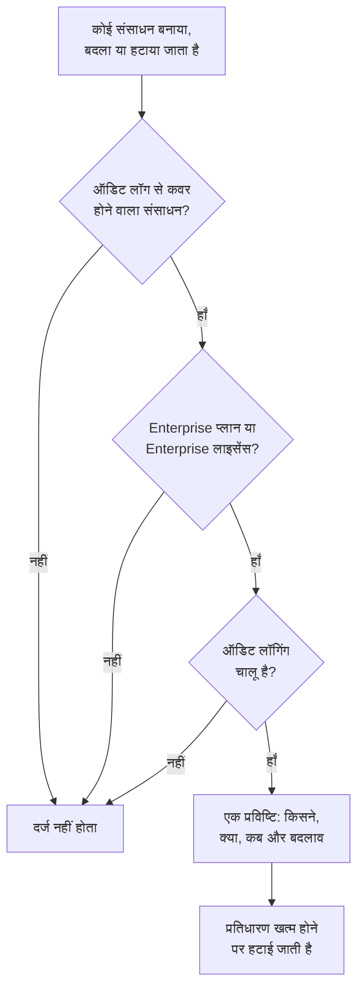

# ऑडिट लॉग

ऑडिट लॉग दर्ज करता है कि आपके प्रोजेक्ट में किसने क्या बदला: जिन संसाधनों को यह कवर करता है, उनका हर निर्माण, बदलाव और हटाना, पहले और बाद के मानों के साथ, और हर बार जब कोई साइन इन या साइन आउट करता है। इसका उपयोग यह पता लगाने के लिए करें कि किसने कोई मॉनिटर बंद किया या कोई API कुंजी बदली, किसने कहाँ से साइन इन किया, और अनुपालन समीक्षाओं के लिए रिकॉर्ड रखने के लिए। यह OneUptime Cloud पर Enterprise प्लान का, और सेल्फ-होस्ट करने पर Enterprise Edition का हिस्सा है।

:::cards
- [ऑडिट लॉगिंग चालू करें](#ऑडिट-लॉगिंग-चालू-करें): यह हर प्रोजेक्ट में शुरुआत में बंद रहती है।
- [ऑडिट लॉग पढ़ें](#ऑडिट-लॉग-पढ़ें): किसने क्या और कब बदला।
- [क्या दर्ज होता है](#क्या-दर्ज-होता-है): वे संसाधन और कार्रवाइयाँ जिन्हें यह कवर करता है।
- [साइन इन और सत्र](#साइन-इन-और-सत्र): किसने साइन इन किया, और हर सत्र कैसे खत्म हुआ।
- [प्रविष्टियाँ कितने समय तक रहती हैं](#प्रविष्टियाँ-कितने-समय-तक-रहती-हैं): 7 से 180 दिन तक।
:::

## कोई बदलाव प्रविष्टि कैसे बनता है

- **यह शुरुआत में बंद रहती है।** जब तक कोई ऑडिट लॉगिंग चालू नहीं करता, प्रोजेक्ट कुछ भी दर्ज नहीं करता, और उस पल से पहले का कुछ भी नहीं।
- **यह दर्ज करती है कि लोग क्या करते हैं।** किसी व्यक्ति, API कुंजी, MCP क्लाइंट या वर्कफ़्लो द्वारा किया गया बदलाव दर्ज होता है। OneUptime द्वारा खुद किया गया बदलाव, जैसे किसी बैकग्राउंड जॉब से, तब तक छोड़ दिया जाता है जब तक आप **सिस्टम इवेंट संग्रहित करें** चालू नहीं करते।
- **प्रविष्टियाँ बदली नहीं जा सकतीं।** कोई भी किसी प्रविष्टि को संपादित या हटा नहीं सकता, न डैशबोर्ड में और न API से। कोई प्रविष्टि केवल तब जाती है जब उसका प्रतिधारण खत्म होता है।

## शुरू करने से पहले

- **OneUptime Cloud पर, Enterprise प्लान।** दूसरे प्लानों पर ऑडिट लॉग पेज दिखाते हैं कि सुविधा क्या करती है और इसे कैसे पाएं।
- **सेल्फ-होस्ट करने पर, Enterprise Edition**, ऐसे लाइसेंस के साथ जिसमें ऑडिट लॉग शामिल हों। देखें [एंटरप्राइज़ संस्करण](/docs/self-hosted/enterprise)।
- **ऑडिट लॉग पढ़ सकने वाली भूमिका।** Project Owner, Project Admin, Settings Admin, या **Read Audit Log** अनुमति। ऑडिट लॉगिंग चालू करने और उसकी सेटिंग्स बदलने के लिए Project Owner, Project Admin, या प्रोजेक्ट संपादित करने की अनुमति चाहिए।

## ऑडिट लॉगिंग चालू करें

:::steps
### ऑडिट लॉग सेटिंग्स खोलें

**प्रोजेक्ट सेटिंग्स → ऑडिट लॉग → सेटिंग्स** पर जाएं। **ऑडिट लॉग** साइड मेनू में शुरुआत में बंद रहता है: उसे खोलने के लिए उस पर क्लिक करें।

### सेटिंग्स संपादित करें

**Edit Audit Log Settings** पर क्लिक करें।

### इसे चालू करें

**ऑडिट लॉग्स सक्षम करें** चालू करें, **धारण (दिन)** सेट करें, और चुनें कि **सिस्टम इवेंट संग्रहित करें** या नहीं। **परिवर्तन सहेजें** पर क्लिक करें।
:::

| सेटिंग | शुरुआती मान | यह क्या करती है |
| --- | --- | --- |
| **ऑडिट लॉग्स सक्षम करें** | बंद | अब से प्रोजेक्ट के संसाधनों में बदलाव दर्ज करती है। |
| **धारण (दिन)** | 7 | हर प्रविष्टि कितने दिन रखी जाती है: 7 से 180 तक। |
| **सिस्टम इवेंट संग्रहित करें** | बंद | वे बदलाव भी दर्ज करती है जो OneUptime खुद करता है, जिन्हें किसी व्यक्ति या कुंजी ने शुरू नहीं किया। |

इन सेटिंग्स में बदलाव एक मिनट के भीतर लागू हो जाता है।

## ऑडिट लॉग पढ़ें

**प्रोजेक्ट सेटिंग्स → ऑडिट लॉग → ऑडिट लॉग** प्रोजेक्ट की हर प्रविष्टि दिखाता है, सबसे नई पहले:

| कॉलम | यह क्या दिखाता है |
| --- | --- |
| **कब** | कितनी देर पहले, तारीख और समय के साथ। |
| **कार्रवाई** | `Create`, `Update` या `Delete`, किसी पैकेट कैप्चर फ़ाइल के लिए `Download` जिसे किसी ने डाउनलोड किया, या किसी सत्र के लिए `Sign In`, `Sign Out`, `Session Timeout` या `Session Revoked`। |
| **संसाधन** | संसाधन का नाम, जो उसके मौजूद रहने तक उसे खोलता है, और उसका प्रकार। |
| **एक्टर** | बदलाव किसने किया: कोई व्यक्ति, API कुंजी, वर्कफ़्लो, या OneUptime द्वारा खुद किए गए बदलाव के लिए `System`। MCP क्लाइंट के ज़रिए किसी व्यक्ति के बदलाव में बताया जाता है कि कौन-सा क्लाइंट। |
| **परिवर्तन** | कितने फ़ील्ड बदले गए, या निर्माण या हटाने पर कितने दर्ज हुए। किसी सत्र के लिए, उसने कैसे साइन इन किया या वह क्यों खत्म हुआ। हर फ़ील्ड देखने के लिए क्लिक करें। |

**संसाधन प्रकार**, **संसाधन नाम**, **कार्रवाई**, **उपयोगकर्ता ईमेल** या **समय** से फ़िल्टर करें। किसी बदलाव में केवल वे फ़ील्ड दिखते हैं जो बदले, पहले और बाद में, और ऐसा सहेजना जो कुछ नहीं बदलता, कोई प्रविष्टि नहीं जोड़ता।

जिस संसाधन का अपना कोई नाम नहीं होता, उसे उसी से नाम दिया जाता है जो OneUptime में उसे नाम देता है: एक अपवाद को उसके प्रकार और उसके संदेश की शुरुआत से, जिसमें आईडी, पते और जो कुछ भी किसी रहस्य जैसा दिखे, छिपा दिया जाता है, Runbook के रन को उसकी Runbook से, किसी आने वाली कॉल नीति के फ़ोन नंबर को उस नंबर से, और किसी टेम्पलेट या डोमेन को उसके अपने नाम से।

मॉनिटर, घटनाएं, अलर्ट, स्थिति पृष्ठ, SLO और कई दूसरे संसाधनों का भी अपना **ऑडिट लॉग** पेज होता है, उनके साइड मेनू के किसी बंद सेक्शन में, जैसे **उन्नत**। यह केवल उसी संसाधन की प्रविष्टियाँ दिखाता है, उसके अंतर्गत आने वाली चीज़ों की प्रविष्टियों के साथ: किसी SLO का पेज उसके नियम और मालिक भी दिखाता है।

## क्या दर्ज होता है

किसी प्रोजेक्ट में लोग जो कुछ भी बनाते, बदलते या हटाते हैं, वह सब दर्ज होता है: मॉनिटर, घटनाएँ, अलर्ट, स्टेटस पेज, वर्कफ़्लो और उनके चरण, कतारें, डैशबोर्ड, ऑन-कॉल नीतियाँ, टीमें और उनमें कौन है, API कुंजियाँ और हर सेटिंग। **संसाधन प्रकार** बताता है कि कोई प्रविष्टि किस बारे में है, जैसे `Monitor`, `Workflow` या `Queue`।

| दर्ज नहीं होता | क्यों |
| --- | --- |
| संदेशों के लॉग | हर एक पहले से ही किसी ईमेल, SMS, कॉल, पुश सूचना या चैट संदेश का रिकॉर्ड है जिसे OneUptime ने भेजा या पाया। |
| रन के रिकॉर्ड | हर एक पहले से ही किसी वर्कफ़्लो रन, ऑन-कॉल एस्केलेशन, स्कैन, आयात या AI रन का रिकॉर्ड है। |
| एजेंट और टेलीमेट्री जो रिपोर्ट करते हैं | खोजे गए संसाधन, रीडिंग और उपयोग हर रिपोर्ट के साथ बदलते हैं, इसलिए नहीं कि किसी ने उन्हें बदला। |
| गतिविधि फ़ीड | फ़ीड वे बदलाव दिखाती है जिन्हें ऑडिट लॉग पहले से दर्ज करता है। |
| OneUptime की कामकाजी स्थिति | स्टेटस पेज के पाठकों के सत्र, कतार में लगे जॉब और दूसरी स्थिति जिसे OneUptime काम करते हुए रखता है। |
| किसी व्यक्ति का अपना सूचना सेटअप | हर व्यक्ति के पते, नंबर और मुझसे कैसे संपर्क करें सिर्फ़ उसी के हैं। |
| किसी व्यक्ति की अपनी पसंद | हर व्यक्ति अपने ऊपरी बार में जो उत्पाद पिन करता है, वे सिर्फ़ उसी के हैं, और सिर्फ़ वही उन्हें देखता है। |

यह भी दर्ज होता है जब कोई एडमिन किसी और के खाते पर सूचना विधि या मुझसे कैसे संपर्क करें जोड़ता या हटाता है, बिना खुद पते या नंबर के।

जिन फ़ील्ड को सिर्फ़ OneUptime लिखता है, जैसे कि कोई होस्ट आख़िरी बार कब दिखा, उन्हें हर प्रविष्टि से बाहर रखा जाता है, और उन फ़ील्ड को भी जिन्हें कोई नहीं पढ़ सकता। जब OneUptime इनमें से कोई फ़ील्ड किसी के कहने पर लिखता है, जैसे किसी अपवाद को दूसरे में मिलाना या वेबहुक URL रीसेट करना, तो प्रविष्टि उसे उसी व्यक्ति के बदलाव के रूप में दर्ज करती है। कुंजियाँ, टोकन और पासवर्ड `[REDACTED]` के रूप में दर्ज होते हैं: प्रविष्टि बताती है कि वे बदले, उनका मान कभी नहीं। वर्कफ़्लो के चरण इस रूप में दर्ज होते हैं कि क्या बदला, किसी चरण की सेटिंग के नाम के साथ, पर उनमें लिखी गई चीज़ कभी नहीं, और कैनवास पर किसी चरण को खिसकाना दर्ज नहीं होता।

OneUptime जो कुछ इसलिए करता है कि किसी ने उससे कहा, वह भी उसी व्यक्ति के बदलाव के रूप में दर्ज होता है, चाहे प्रोजेक्ट सिस्टम इवेंट सहेजता हो या नहीं:

- Runbook का रन शुरू करना, अनुमोदित करना, पूरा करना, छोड़ना और रद्द करना। उसके चरण उसी रूप में दर्ज होते हैं जो हर एक के साथ किया गया, जैसे `Approved "Restart the API" (step 3)`, कभी उसके साथ नहीं जो किसी चरण ने छापा।
- जब कोई किसी नियम को चलाता है, तब वह नियम जो बदलता है: वे लेबल और स्वामी जो वह जोड़ता है, वे रिकॉर्ड जिन्हें कोई गोपनीयता नियम निजी बनाता है, वे डिवाइस जिन्हें कोई साइट असाइनमेंट नियम किसी साइट में ले जाता है, वे डिवाइस और मॉनिटर जिन्हें कोई ऑटो आयात नियम बनाता है, और वह जो किसी स्थिति पृष्ठ या SLO का मॉनिटर नियम अपने पृष्ठ या SLO पर बदलता है।
- किसी आने वाली कॉल नीति का फ़ोन नंबर खरीदना, जोड़ना और छोड़ना।
- किसी डेटा अलर्ट को हल करना जिसे कोई अपेक्षित या कोई समस्या नहीं के रूप में चिह्नित करता है।
- किसी कैलेंडर फ़ीड का लिंक रीसेट करना।
- वे टीमें जिनमें कोई SSO से साइन इन करते समय शामिल होता है।

कोई नियम अपने आप जो करता है, वह OneUptime का अपना बदलाव है, और **सिस्टम इवेंट संग्रहित करें** चालू होने पर दर्ज होता है: रिकॉर्ड बनते समय कोई नियम जो लेबल और स्वामी जोड़ता है, और जिस रिकॉर्ड को वह तब निजी बनाता है; वे डिवाइस और मॉनिटर जिन्हें कोई ऑटो आयात नियम नए स्कैन परिणामों से बनाता है; और वह जो किसी स्थिति पृष्ठ या SLO का मॉनिटर नियम तब बदलता है जब कोई नियम, मॉनिटर या लेबल सहेजा जाता है।

किसी होस्ट, क्लस्टर या क्लाउड खाते के AI एजेंट को रीसेट करना उस संसाधन के अपने **ऑडिट लॉग** पेज पर दर्ज होता है, उसे रीसेट करने वाले व्यक्ति के `aiAgentResetAt` के बदलाव के रूप में: किसने, और कब। किसी क्लाउड खाते के AI एजेंट के लिए कुंजी बनाना भी ऐसे ही दर्ज होता है: कुंजियाँ बदली हुई दिखती हैं, कभी किसी कुंजी या हैश के साथ नहीं। कोई एजेंट जुड़ते और अपनी स्थिति भेजते समय जो बताता है, वह पहले की तरह बाहर रहता है।

## साइन इन और सत्र

जब भी प्रोजेक्ट का कोई सदस्य OneUptime में साइन इन करता है, ऑडिट लॉग उसे दर्ज करता है, और फिर तब भी जब वह सत्र खत्म होता है। साइन इन OneUptime में होता है, किसी एक प्रोजेक्ट में नहीं, इसलिए वह व्यक्ति जिन-जिन प्रोजेक्ट का सदस्य है, उनमें से हर प्रोजेक्ट इसे दर्ज करता है।

| कार्रवाई | यह कब दर्ज होता है |
| --- | --- |
| `Sign In` | कोई साइन इन करता है: पासवर्ड या साइन-इन लिंक, पासकी, Google, Microsoft, Vercel या सिंगल साइन-ऑन से। |
| `Sign Out` | वह साइन आउट करता है। |
| `Session Timeout` | OneUptime समय पूरा होने पर सत्र खत्म करता है: किसी सर्वर एडमिन द्वारा सेट की गई निष्क्रियता की अवधि या सत्र की अवधि, या 30 दिन तक कोई उपयोग न होना। |
| `Session Revoked` | OneUptime सत्र इसलिए खत्म करता है कि पासवर्ड बदला गया, खाता ब्लॉक किया गया, या किसी सर्वर एडमिन ने टू-फ़ैक्टर ऑथेंटिकेशन रीसेट या अनिवार्य किया। |

किसी प्रविष्टि का **संसाधन** वह सत्र होता है, जिसे उस डिवाइस का नाम दिया जाता है जिससे साइन इन हुआ, जैसे `Chrome 130 on macOS`। उसका **एक्टर** वह व्यक्ति है जिसका वह सत्र है, इसलिए **उपयोगकर्ता ईमेल** से फ़िल्टर करने पर उसके सभी साइन इन और सत्र मिल जाते हैं। उसके विवरण बताते हैं कि उसने कैसे और किस दूसरे फ़ैक्टर से साइन इन किया, IP पता और जगह, और खत्म हो चुके सत्र के लिए, उसने कब साइन इन किया, आखिरी बार कब उपयोग हुआ और कब उसका समय खत्म हुआ। किसी प्रोजेक्ट के अपने SSO प्रदाता का नाम केवल उसी प्रोजेक्ट के ऑडिट लॉग में आता है।

साइन इन और सत्र दर्ज होते हैं, चाहे प्रोजेक्ट सिस्टम इवेंट सहेजता हो या नहीं। सत्र की अवधि या 30 दिन तक कोई उपयोग न होना, समय पूरा होने के कुछ ही मिनटों में दर्ज हो जाता है। निष्क्रियता की अवधि तब दर्ज होती है जब उस व्यक्ति का खुला टैब या मोबाइल ऐप अगली बार OneUptime तक पहुँचता है।

## प्रविष्टियाँ कितने समय तक रहती हैं

हर प्रविष्टि उतने समय रखी जाती है जितना दर्ज होते समय प्रोजेक्ट का **धारण (दिन)** था, फिर हटा दी जाती है। नया प्रतिधारण नई प्रविष्टियों पर लागू होता है: पहले से दर्ज प्रविष्टियाँ अपनी तारीखें रखती हैं। API से भी, प्रतिधारण 7 से 180 तक पूरे दिनों की संख्या होता है: कोई भी दूसरा मान अस्वीकार किया जाता है।

180 दिन से ज़्यादा समय तक प्रविष्टियाँ रखने के लिए, उन्हें दर्ज होते ही अपने स्टोरेज या SIEM में भेजें: देखें [ऑडिट लॉग एक्सपोर्ट](/docs/configuration/audit-log-export)। आप उन्हें **Read Audit Log** वाली API कुंजी के साथ API से पढ़कर, जहाँ ज़रूरत हो वहाँ संग्रहित भी कर सकते हैं। देखें [OneUptime API संदर्भ](/docs/api-reference/api-reference)।

## जब प्लान या लाइसेंस में अब ऑडिट लॉग शामिल नहीं होते

- **OneUptime Cloud पर**, Enterprise प्लान छोड़ने वाला प्रोजेक्ट दर्ज करना बंद कर देता है, और उसके ऑडिट लॉग पेज तब तक अपग्रेड कार्ड दिखाते हैं जब तक वह फिर से उस प्लान पर नहीं आता।
- **सेल्फ-होस्ट करने पर**, ऑडिट लॉगिंग तब दर्ज करना बंद कर देती है जब Enterprise ट्रायल या ग्रेस अवधि बिना लाइसेंस के खत्म हो जाती है, या जब लाइसेंस में ऑडिट लॉग शामिल नहीं होते। ऑडिट लॉग इसे लाल रंग में दिखाता है। पहले से दर्ज प्रविष्टियाँ रखी जाती हैं, और लाइसेंस सक्रिय होते ही उन्हीं सेटिंग्स के साथ दर्ज करना फिर शुरू हो जाता है। देखें [जब लाइसेंस समाप्त हो जाए या न हो](/docs/self-hosted/enterprise#जब-लाइसेंस-समाप्त-हो-जाए-या-न-हो)।

## समस्या निवारण

:::details ऑडिट लॉग खाली है
ऑडिट लॉगिंग शुरुआत में बंद रहती है, और चालू होने से पहले का कुछ भी दर्ज नहीं करती। अगर सूची कहती है कि ऑडिट लॉगिंग बंद है, तो उसके लिंक से सेटिंग्स पर जाएं और इसे चालू करें। नहीं तो, कोई मॉनिटर या घटना बदलें और सूची रीफ़्रेश करें।
:::

:::details ऑडिट लॉग में कोई बदलाव नहीं है
जांचें कि संसाधन [क्या दर्ज होता है](#क्या-दर्ज-होता-है) में है, और बदलाव ऑडिट लॉगिंग चालू होने के बाद किया गया था। OneUptime द्वारा खुद किया गया बदलाव केवल तब दर्ज होता है जब **सिस्टम इवेंट संग्रहित करें** चालू हो।
:::

## अगले कदम

:::cards
- [ऑडिट लॉग एक्सपोर्ट](/docs/configuration/audit-log-export): ऑडिट लॉग को अपने स्टोरेज या SIEM में भेजें।
- [उपयोगकर्ता, टीमें और अनुमतियाँ](/docs/permissions/index): तय करें कि ऑडिट लॉग कौन पढ़ सकता है।
- [प्रोजेक्ट सेटिंग्स](/docs/configuration/project-settings): प्रोजेक्ट की बाकी सेटिंग्स।
- [बिलिंग और उपयोग](/docs/configuration/billing): प्रोजेक्ट का प्लान बदलें।
- [एंटरप्राइज़ संस्करण](/docs/self-hosted/enterprise): सेल्फ-होस्टेड इंस्टॉलेशन पर ऑडिट लॉग।
:::
